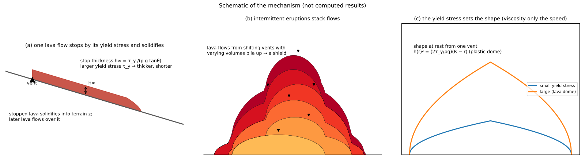
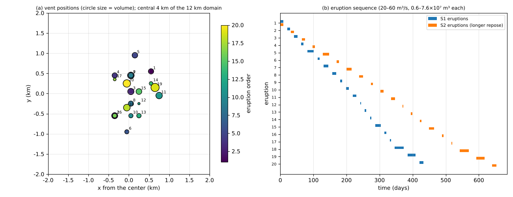
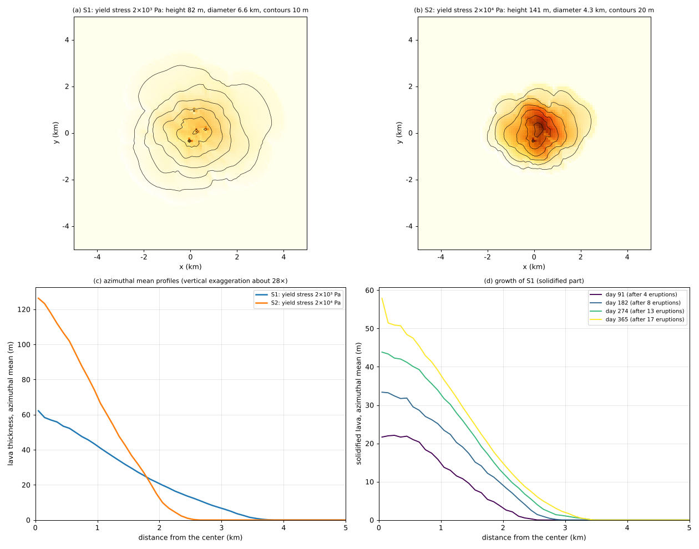
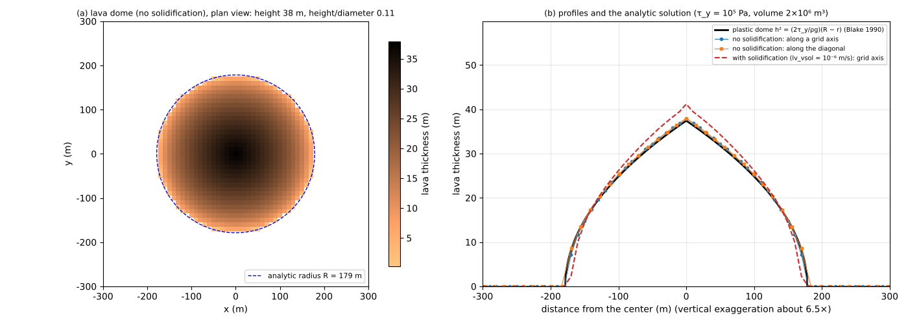

# shield_volcano — A shield volcano growing by intermittent eruptions, and a lava dome of viscous lava

> English mirror of examples/shield_volcano/README.md. The Japanese file is the master copy.

[日本語](../README.md)

Near the center of a flat ground surface, lava is erupted 20 times while the vent position and
the erupted volume change, and the solidified lava flows pile up into a growing shield volcano
([lava flow chapter of the users guide](../../../docs/en/users_guide/lavaflow.md)). Comparing
with a run whose lava has a ten times larger yield stress, the example shows that the shape is
set by the yield stress, not by the viscosity, and that to approach the shape of real shield
volcanoes the yield stress has to be given as an "effective" value that includes the effect of
lava stopping as it cools. As a supplement, viscous lava erupted from one vent makes a lava dome
whose shape is compared with the analytic solution. The values are schematic, chosen to make
the phenomena easy to see; this is not a reproduction of a particular volcano.

## What happens at real shield volcanoes and lava domes

- **Shield volcanoes**: fluid basaltic lava flows out many times from summit and fissure
  vents and piles up in thin layers into a gentle rise (Hawaii, Iceland). The medians of
  Icelandic shield volcanoes (24 olivine tholeiite shields) are a slope of 2.7°, a height of
  60 m, a diameter of 3.6 km, a height/diameter ratio of 0.019 and a volume of 0.2 km³
  (Rossi 1996). Height/basal width of shield volcanoes worldwide is mostly 0.01–0.1, and an
  average slope of 12° and a height/basal width of 0.1 are roughly the boundary with
  stratovolcanoes (Grosse & Kervyn 2018).
- **Why lava flows stop**: basaltic lava flows cool and crust over as they flow, and stop. The
  length of a flow is set mainly by the effusion rate (Walker 1973).
- **Lava domes**: viscous (SiO₂-rich) lava does not spread out but piles up over the vent. Its
  shape has been explained by the model of a shape held up by the yield stress of the lava
  (plastic dome; Blake 1990). The steep sides of real domes are often slopes of broken blocks
  fallen from the cracked surface (talus), and domes grow from inside and collapse into
  pyroclastic flows (e.g. Unzen, 1991–1995).
- Shield volcanoes and lava domes roughly correspond to the Aspite and Tholoide of an old
  classification of volcano forms (Schneider 1911), but these terms are now rarely used.

## Mechanisms needed for reproduction



Schematic (not computed results). (a) A lava flow stops by its yield stress, and the stopped lava
solidifies into terrain. (b) Flows from shifting vents with varying volumes pile up into a
shield. (c) The shape at rest from one vent is set by the yield stress; for the same volume, a
larger yield stress gives a higher, narrower lava dome.

| Real phenomenon | Representation in ENCflow | Settings |
|---|---|---|
| Lava wells up from a vent | an effusion-rate time series at the vent cells (no momentum) | `lv_cell`, `lv_val` |
| Lava flows, and stops when it becomes too thin | isothermal Bingham viscous gravity current (lubrication approximation); for the magnitude S of the lava-surface gradient, lava flows only where it is thicker than τ_y/(ρgS) | `lv_visc`, `lv_tauy` |
| Stopped lava solidifies into terrain | lava in cells whose speed is below a threshold is moved to the bed elevation z at a fixed rate (a numerical closure; cooling is not computed) | `lv_vsol`, `lv_wsol` |
| The vent and the volume change with each eruption | 20 vents used once each at different times | `lv_cell(1:2,1,k)`, `lv_val(1:2,m,k)` (k = 1–20) |
| Repose between eruptions | shortened to just the time the lava needs to stop and solidify (there is no water or erosion, so nothing happens during repose) | the times of the effusion-rate series |
| (Supplement) a lava dome of viscous lava | lava with a large yield stress erupted from one vent | `lv_tauy = 1.0e5` |

## Geometry and settings



(a) Vent positions (circle size = volume, color = eruption order). (b) Eruption sequence; S2 has
longer repose because its lava is slower.

A flat surface (z = 0) 12 km square with Δx = 100 m (120 × 120 cells). The vents are scattered
around the center with a normal distribution of standard deviation 400 m; the volumes follow a
log-normal distribution with a median of 3×10⁷ m³ (0.6–7.6×10⁷ m³ each, 0.68 km³ in total for 20
eruptions), and the effusion rate is 20–60 m³/s (1.9–27 days each). `make_param.py` builds the
eruption sequence from a random seed (`--seed 1`), and S1 and S2 use the same sequence. The lava
does not reach the domain edges.

| Item | S1 (main case) | S2 (comparison) | dome / dome_sol (supplement) |
|---|---|---|---|
| Yield stress τ_y | 2×10³ Pa (within measured values for basaltic aa lava) | 2×10⁴ Pa (effective value including stopping by cooling) | 10⁵ Pa (typical of lava domes) |
| Viscosity η | 10⁶ Pa s | 10⁸ Pa s | 10¹⁰ Pa s |
| Stop-detection threshold lv_vsol | 5×10⁻⁵ m/s | 5×10⁻⁶ m/s | dome: no solidification / dome_sol: 10⁻⁶ m/s |
| Eruptions | 20, 10⁶ s (about 12 days) between eruptions | the same 20, 2×10⁶ s between eruptions | 2 m³/s from the central cell for 10⁶ s (2×10⁶ m³) |
| Grid and time step | Δx = 100 m, dt = 300 s | Δx = 100 m, dt = 1800 s | 101 × 101, Δx = 10 m, dt = 300 s |
| Run length | 456 days (23 days after the last eruption) | 711 days (57 days after) | 6×10⁶ s |

The viscosity is larger than that of real basaltic lava (10²–10⁴ Pa s) to shorten the time,
because the shape at rest does not depend on the viscosity (see "Notes" below). The "days" in the
table are time inside the computation, not the duration of real eruptions. The stop-detection
thresholds are small compared with the speed of each flow, and the upward bias of the stopped
thickness is about 11% for S1 and about 6% for S2 ("Notes").

## How to run

```bash
make              # links to the executables in ../../bin/
make run          # S1 (about 6 minutes) and S2 (about 1.5 minutes), with 4 threads
make run-dome     # dome and dome_sol (about 40 seconds each)
python3 plot_results.py      # figures and shape numbers (argument en draws the English figures in en/figs/)
```

The settings files are in the repository. To change the number of eruptions, the vent scatter,
the random seed and so on, change the arguments of `make_param.py` and regenerate them with
`make params` ("Starting points for sensitivity experiments").

## Results



(a)(b) Final topography (shading and contours). (c) Azimuthal mean profiles (vertical
exaggeration about 28×). (d) Time evolution of the profile of solidified lava in S1.

| Shape numbers | S1 (τ_y = 2×10³ Pa) | S2 (τ_y = 2×10⁴ Pa) | Median of Icelandic shields (Rossi 1996) |
|---|---:|---:|---:|
| Volume | 0.68 km³ | 0.68 km³ | 0.2 km³ |
| Height (highest point; mean within 200 m of the center) | 82 m (60 m) | 141 m (124 m) | 60 m |
| Diameter (equivalent diameter of the area thicker than 0.5 m) | 6.6 km | 4.3 km | 3.6 km |
| Height/diameter | 0.012 | 0.033 | 0.019 |
| Slope (median over covered cells) | 1.0° | 3.5° | 2.7° |
| Lava still flowing at the end of the run | 0.2% of the erupted volume | 3.4% | — |

- **Lava flows pile up into a shield**: both cases make a nearly circular gentle rise (the ratio
  of the area-equivalent radii of the sectors along the grid axes and the diagonals is 0.97 for
  S1 and 1.02 for S2). New lava spreads while filling the low parts of the solidified lava, so
  the whole edifice stays round even though the vents are scattered. As in (d), the center rises
  with each eruption (22 m after 4 eruptions → 58 m after 17) and the base widens. Because the
  vents are scattered by ±400 m, the summit is flat.
- **The yield stress sets the shape**: with the same eruptions, S2 with a ten times larger
  yield stress has 2/3 of the diameter, 1.7 times the height and 3.5 times the slope. Lava
  spreads until it thins to the stop thickness h∞ = τ_y/(ρ g tanθ) and then stops, so a larger
  yield stress piles up thicker, shorter flows into a steeper rise.
- **Comparison with real shields**: with a yield stress within the measured range for basaltic
  lava (S1) the edifice is flatter and wider than real shields (slope 1.0°); with a ten times
  larger value (S2) it has a slope of 3.5° and a height/diameter of 0.03, of the same order as
  the medians of Icelandic shields (2.7°, 0.019). Both are within the range of shields worldwide
  (height/basal width 0.01–0.1) and gentler than the boundary with stratovolcanoes (12°, 0.1).
  The reason for the difference is that the model does not compute temperature. Real lava flows
  stop as they cool and crust over (Walker 1973), before spreading out thin, whereas the lava in
  this model spreads until its yield stress stops it. The yield stress therefore has to be set
  not as a measured flow property but as an effective value that includes stopping by cooling,
  fitted to the thickness of real lava flows or the slope of volcanoes. The volumes differ
  (this example is 3.4 times the Rossi median), so the comparison is a rough guide.
- **Effect of the stop-detection threshold**: the shape also depends on the threshold
  `lv_vsol` below which lava is considered stopped, not only on the yield stress. With a ten
  times smaller threshold for S2 (5×10⁻⁷ m/s), lava is slow to be judged stopped and does not
  finish stopping within the same run time (30% of the erupted volume is still flowing at the
  end). The slope at that time is 2.5°, gentler than the 3.5° with a threshold of 5×10⁻⁶ m/s.
  The shape after the lava has fully stopped has not been checked. The effect is smaller than
  that of the tenfold yield stress (slopes 1.0° and 3.5°), but the numbers are a rough guide
  that includes the choice of the threshold.

## Supplement: lava dome (dome, dome_sol)



(a) Plan view of the lava dome without solidification (dashed: analytic radius). (b) Profiles
and the analytic plastic dome; the red dashed line is the case with solidification.

- Erupting 2×10⁶ m³ of viscous lava (τ_y = 10⁵ Pa) from one vent piles the lava up around the
  vent into a dome 38 m high and 354 m in diameter (height/diameter 0.11). The shape at rest
  agrees with the analytic plastic dome held by the yield stress, h(r)² = (2τ_y/ρg)(R − r)
  (Blake 1990), to +1.4% in height and −0.6% in radius, and the profiles along the grid axes and
  the diagonals overlap.
- The height/diameter of a plastic dome is proportional to the yield stress to the power 0.6
  and inversely proportional to the volume to the power 0.2. With the yield stress of S1
  (2×10³ Pa) and the same volume, the height/diameter would be about 0.01, and lava spreads out
  flat even from one vent.
- **The solidification criterion changes the shape (dome_sol)**: with solidification
  (lv_vsol = 10⁻⁶ m/s), the slowing margins solidify while the eruption continues and hold the
  lava back, so the center becomes 41 m (10% higher than the analytic solution). This is the
  effect of a numerical closure, the stop-detection threshold, not a computation of cooling and
  solidification. A smaller threshold approaches the shape without solidification, but takes
  longer to finish stopping (with lv_vsol = 10⁻⁷ m/s, 27% of the erupted volume has still not
  solidified at 6×10⁶ s).

## What this model cannot represent (differences from the real phenomena)

- **Cooling of lava**: temperature is not computed, so the dependence of the flow length on the
  effusion rate and cooling (Walker 1973) does not appear. The yield stress has to be calibrated
  as an effective value ("Results").
- **Lava tubes, lava lakes, caldera collapse, intrusion along rift zones, inflation or collapse
  of the edifice**: not represented. An edifice elongated along rift zones, like Hawaiian
  shields, should be approachable by lining up the vents ("Starting points for sensitivity
  experiments"; not checked in this example).
- **Erosion and weathering**: none. The terrain is that of a young, still-active volcano, not an
  old shield cut by valleys.
- **Explosive eruptions and ashfall**: not represented. A stratovolcano, with a steep cone of
  fallen pyroclastics and a foot of material washed down by rain, cannot be made with lava alone.
- **Talus, growth from inside, collapse and pyroclastic flows of lava domes**: what can be
  computed is an estimate of the shape at rest held by the yield stress (a collapse can be given
  separately with the instantaneous mobilization of the debris flow model, which takes a
  collapse-depth distribution `fn_dbinit`).
- **Time**: the viscosity is larger than real and the repose is shortened, so the days inside
  the computation are not the duration of real eruptions.
- **Grid**: on the 100 m grid one lava lobe is a few cells wide. The flow is computed with
  the 8-neighbour 9-point stencil (`lv_diagratio = 1/3`, the default; yield and stopping are judged
  on the gradient magnitude, so the shape at rest does not depend on the grid orientation).
- **Number of eruptions**: one run can use at most 20 vents. To pile up more eruptions, save the
  state (`f_state_save`) and restart (`f_state_restore`) with settings in which the vents are
  rewritten.
- **Water**: this example has no rain. When used together with the groundwater computation,
  the soil layer under solidified lava is buried and rain does not infiltrate on the lava (real
  young lava is often permeable; constraints section of the users guide).

## Notes

- **Viscosity and time**: the shape at rest does not depend on the viscosity; the viscosity
  only sets the speed of the flow (the time scale). To multiply the viscosity by k with the
  same yield stress, multiply the eruption and repose times by k (with the same volumes) and
  divide the threshold `lv_vsol` and the solidification rate `lv_wsol` by k, and the same shape
  results. Real values (10²–10⁴ Pa s) make the run tens to
  hundreds of times longer because of the stability condition of the diffusion.
- **Guide to the stop-detection threshold**: the upward bias of the stopped thickness from the
  stop detection is roughly the fraction √(2 lv_vsol η ρ g S)/τ_y (S is the slope; the formula of
  lava_plan.md Sec. 5 divided by the stop thickness). With the values of this example it is about
  11% for S1 (slope 1°) and about 6% for S2 (slope 3.5°). A smaller threshold reduces the bias
  but takes longer to judge the lava stopped (the S2 example in "Results").
- Lava still flowing at the end of the run (from the last eruption) remains in molten of the
  final ledger and in the field Hl9998. The thicknesses in the figures and tables include it.

## Starting points for sensitivity experiments

Only the four cases S1, S2, dome and dome_sol have been checked. The expectations below have not
been checked in this example.

- **Yield stress** (`lv_tauy`): sets the steepness of the rise. Values between S1 and S2 can be
  searched for one matching the slope of real shields.
- **Volume and number of eruptions** (`VMED` and `--neru` of `make_param.py`; at most 20
  eruptions): for a dome from one vent, the height/diameter decreases with the volume
  ("Supplement"), so the same tendency is expected for the shield.
- **Vent scatter** (`--sigma`): a smaller value is expected to give a pointed summit, a larger
  value a flat, wide rise.
- **Rift zones**: lining up the vents of `lv_cell` is expected to give an edifice elongated
  along the line.
- **Initial topography** (`--cone 0.02` etc.): starting from a gentle cone, lava is expected to
  run down the slope and spread at its foot.
- **Random seed** (`--seed`): shows the spread of shapes for different eruption sequences.

## References

- Blake, S. (1990): Viscoplastic models of lava domes. In: Fink, J. H. (ed.), *Lava Flows and Domes:
  Emplacement Mechanisms and Hazard Implications*, IAVCEI Proceedings in Volcanology 2, Springer, Berlin.
- Grosse, P. and Kervyn, M. (2018): Morphometry of terrestrial shield volcanoes. *Geomorphology*, 304, 1–14.
- Rossi, M. J. (1996): Morphology and mechanism of eruption of postglacial shield volcanoes in Iceland.
  *Bulletin of Volcanology*, 57, 530–540.
- Walker, G. P. L. (1973): Lengths of lava flows. *Philosophical Transactions of the Royal Society of
  London A*, 274, 107–118.
