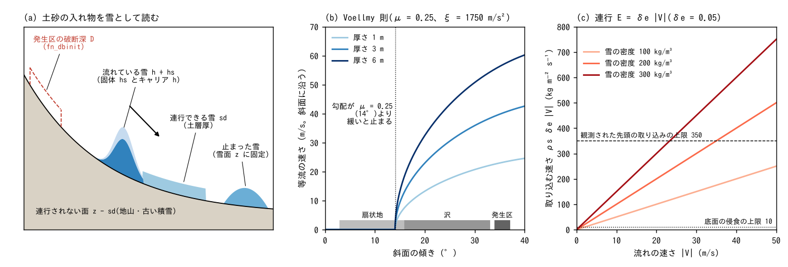
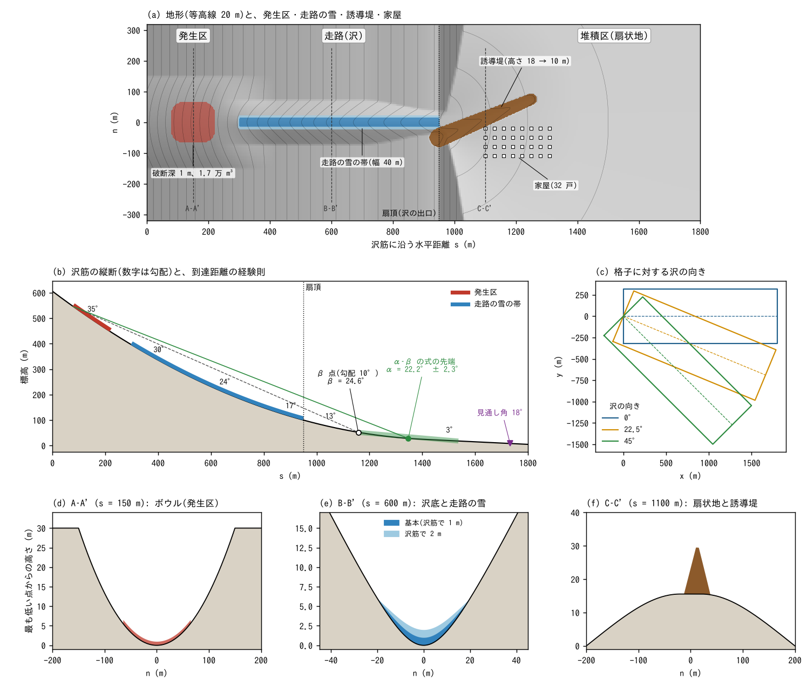
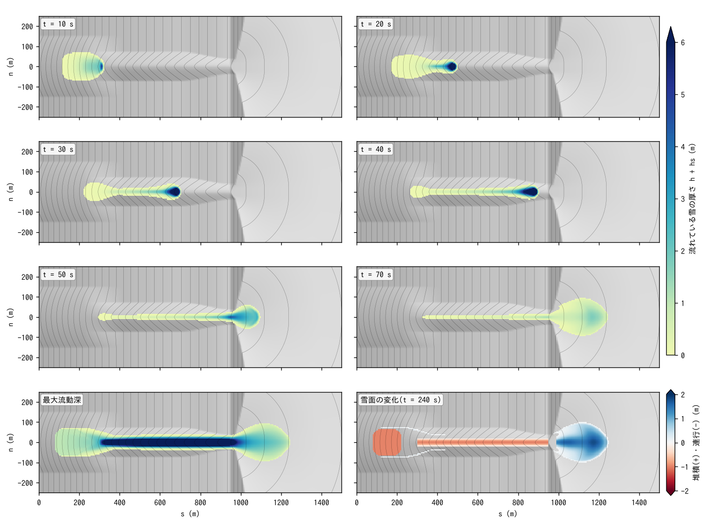
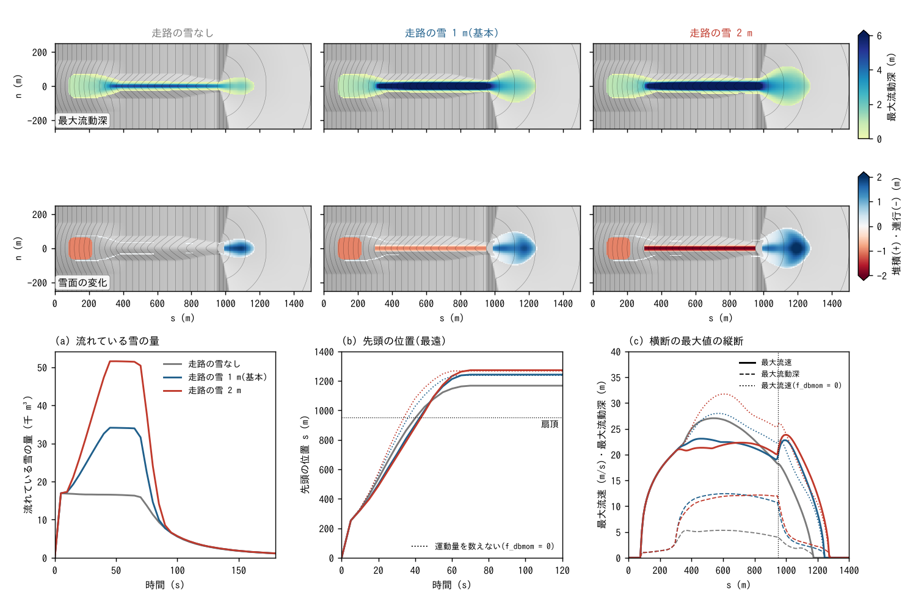
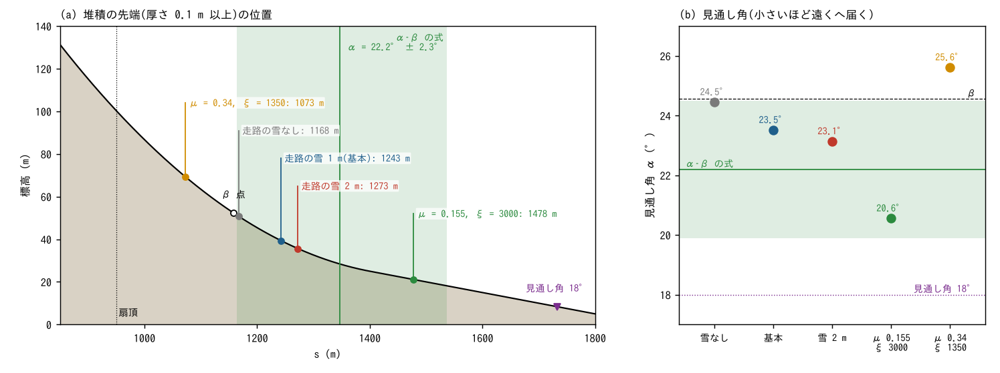
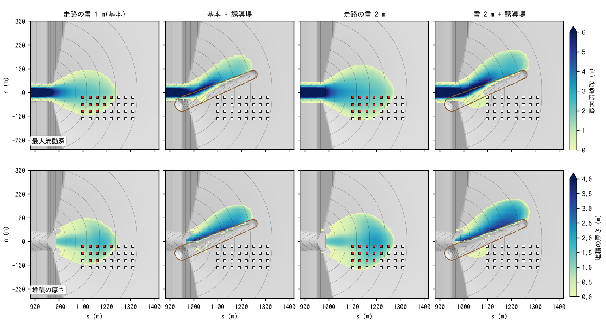
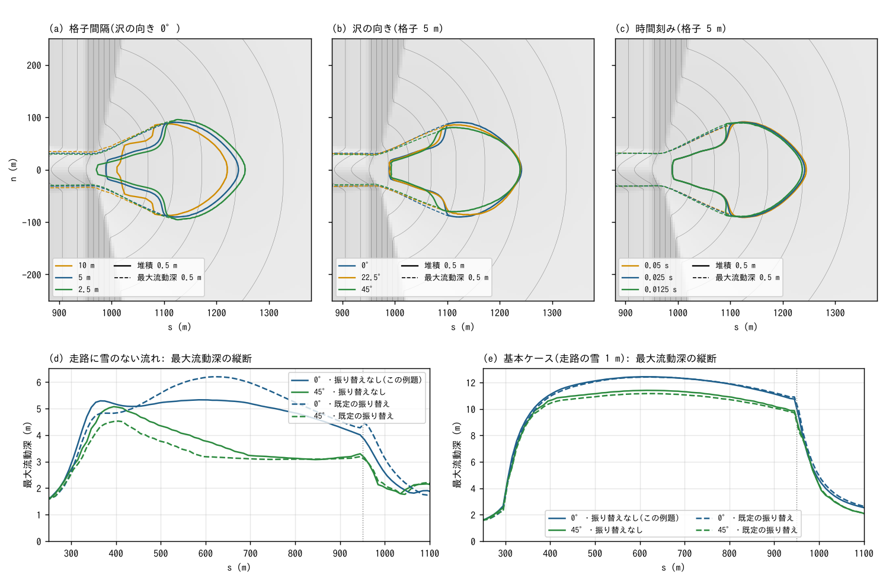
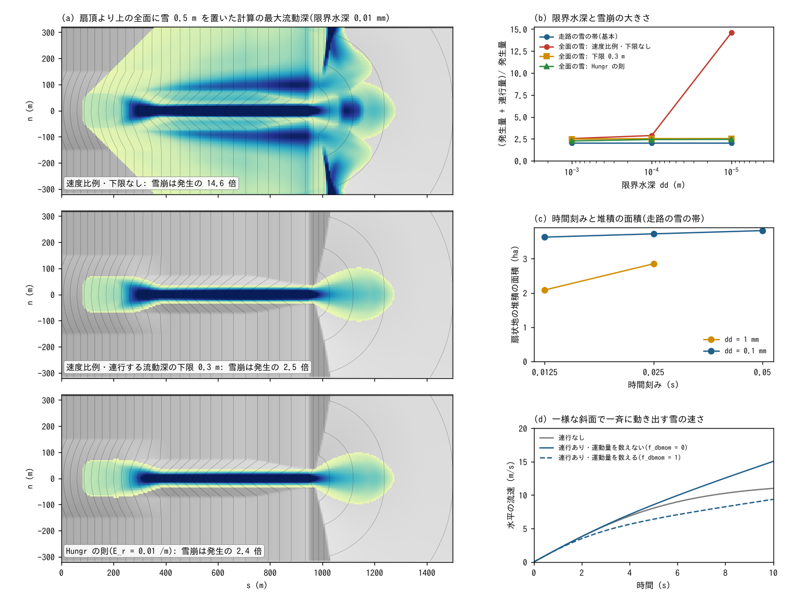

# snow_avalanche — 沢を下る流れ型雪崩: 走路の雪の連行と、扇状地の誘導堤

[English](en/README.md)

急な斜面で面発生した雪崩が、沢(走路)を下りながら沢底の雪を取り込んで大きくなり、沢の出口の
扇状地(堆積区)に広がって止まるまでを、模式的な地形で計算します。雪崩の専用モデルではなく、
土砂流動モデル(Voellmy の抵抗則と、速さに比例する連行)の入れ物を雪に読み替えて使います
([土砂・地形変化の適用例の雪崩](../../docs/users_guide/geomorph_applications.md#5-雪崩流れ型))。
ねらいは 2 つです。(1) 同じ量の雪が発生しても、走路の雪の量(沢底の帯の厚さ 0・1・2 m)によって、
雪崩がどれだけ大きくなり、どこまで届くか。(2) 扇状地に誘導堤(地形として与える土堤)を置くと、
流れの向きと堆積の場所がどう変わり、雪崩が大きいと何が起きるか。あわせて、摩擦係数の選び方、
格子間隔・格子に対する沢の向き・時間刻みへの依存と、この組み方の限界(連行できる雪の与え方、
限界水深、連行と運動量)を確かめます。地形・雪の量・摩擦係数は現象を見やすくするための模式値で、
特定の雪崩の再現ではありません。

**この例題で分かること**

- **走路の雪を取り込んだ雪崩は、厚く、遠くまで届く**: 発生した 1.7 万 m³ に沢底の雪 1.7 万 m³(沢筋で厚さ
  1 m)が加わると、流れる雪は 2.0 倍になり、沢の出口の流動深は 4 → 10 m、速さは 18 → 20 m/s、堆積の先端は
  75 m 先(s = 1,168 → 1,243 m)、扇状地の堆積の面積は 2.3 倍になります。沢底の雪が 2 m なら 3.0 倍・105 m
  先です。取り込んだ雪は静止から加速するので、雪を取り込む雪崩は、取り込まない雪崩より 2〜3 秒遅く沢の
  出口に着きます。
- **到達距離は経験則の幅に入る**: 発生区の上端から堆積の先端を見上げる見通し角は 23.1〜24.5° で、
  ノルウェーの 206 の雪崩走路の統計(α–β の式。この地形で 22.2° ± 2.3°)の幅に入ります。摩擦係数を
  RAMMS の表のほかの行の値に替えると 20.6°(大規模・開けた斜面の値)〜25.6°(中規模・沢の値)です。
- **誘導堤はそらすが、大きい雪崩は越える**: 高さ 18 → 10 m の誘導堤は、基本ケースの雪崩を左へそらし、
  堤が守る家屋 32 戸に雪は届きません(堤がなければ 12 戸に厚さ 0.5 m 以上の雪が届く)。沢底の雪が 2 m の
  雪崩は、堤の起点から 200 m の区間で天端を越え(天端の上の流動深は最大 2.0 m)、460 m³ が堤の裏へ落ちて、
  家屋の位置に厚さ 0.3 m の雪が届きます。そらされた流れは堤に沿って集まり、堤がないときより 24 m 遠くまで
  届きます。
- **取り込んだ雪の運動量を数える**: 基本ケースは、取り込んだ雪を静止から流れの速さまで加速する分を数えます
  (`f_dbmom = 1`)。数えないと(`f_dbmom = 0`)、雪を取り込む雪崩は沢の出口に 6〜9 秒早く着き、出口の速さが
  3〜5 m/s 大きく出ます。
- **連行できる雪を広く置くときは、薄い流れの連行を止める**: 速度比例の連行則には閾値がなく、流れが触れた雪は
  すべて取り込まれます。沢底の帯に置いた雪は、置いた量がそのまま取り込まれます。斜面の全面に雪を置くと、
  流れの縁の薄い雪が雪を取り込みながら横へ広がることがあり、雪崩の大きさが数値の閾値(限界水深)で決まって
  しまいます(発生量の 2.5〜15 倍)。連行する流動深の下限(`db_hent`)か Hungr の連行則(`f_dbed = 5`)を使うと、
  2.3〜2.5 倍で、限界水深によらなくなります。
- **キャリアを雪と一緒に出し入れし、限界水深を下げる**: 流れている雪の厚さを地表水 h と土砂柱状量 hs の
  和で運ぶこのモデルでは、h を雪と同じ割合で授受し(`f_dbwet = 1`、`db_satbed = db_relsat`)、限界水深
  `dd` を 0.1 mm に下げると、堆積が滑らかになり、結果が時間刻みにほとんどよらなくなります(面積で 3 % ほど)。
- **格子で解像された V 字の沢では、開口の動的振り替えを使わない**: 浅水流計算の既定は、格子幅の河道のために、
  斜め先を地盤に塞がれた辺の通過幅を開いた辺へ振り替えます(`f_opening_dynamic = 3`)。格子で解像された V 字の
  沢では、これが谷底の列の通過幅だけを増やし、流れの頭の厚さが、格子に対する沢の向きで変わります(雪を
  取り込まない流れの沢の中の最大流動深が、沢が格子の軸に沿うと 6.2 m、対角に沿うと 3.7 m)。この例題は
  振り替えを使わず(`f_opening_dynamic = 0`)、同じ比較で 5.3 m と 4.3 m です。格子間隔 10・5・2.5 m で、
  沢の出口への到達は 47・43・40 秒、堆積の先端は s = 1,225・1,243・1,256 m と、細かいほど速く遠くなる向きに、
  差を縮めながら動きます。

## 実際の雪崩で起きていること

- **発生区・走路・堆積区**: 雪崩の跡は、積雪が壊れて動き始める発生区、雪が流れ下る走路、雪が止まって
  積もる堆積区に分けられます(国土交通省 河川砂防技術基準)。雪崩が発生しやすいのは勾配 30° 以上の
  斜面で、35〜45° がもっとも危険とされます(国土交通省 2006)。走路の勾配は 15〜30°、堆積区は 15° より
  緩いのが普通です(Schweizer ら 2021)。
- **流れ型と煙型**: 雪崩の運動は、雪煙をほとんど上げずに流れる「流れ型」、雪煙を高く巻き上げる「煙型」、
  両者の「混合型」に分けられます(日本雪氷学会の分類)。流れ型(密な流れ)は、厚さ 1〜3 m(沢に集まると
  もっと深くなる)、密度 300 kg/m³ ほどで(Jóhannesson ら 2009)、速さは大きな乾雪雪崩で 14〜56 m/s
  (時速 50〜200 km)、湿雪雪崩で 6〜28 m/s(時速 20〜100 km)です(Schweizer ら 2021)。
- **走路の雪の取り込み(連行)**: 雪崩は、走路の雪を取り込んで大きくなります。スイスとイタリアの試験地の
  18 の雪崩の計測では、堆積した雪の質量は発生した質量の平均 4.6 倍(1〜12 倍)でした。取り込みは主に
  先頭で起こり(すき取り。最大 350 kg m⁻² s⁻¹)、走路に沿って取り込む深さは平均して破断深の 0.6 倍、
  取り込む量を決めるのは取り込める雪の量と積雪の構造で、地形や雪崩の大きさは二次的でした。先頭の速さは
  雪がどこから来たかによらず、速さが同じなら質量が大きいほど遠くまで届きます(Sovilla ら 2006)。
- **到達距離の経験則**: ノルウェーの 206 の雪崩走路の、知られている最大の到達位置から、見通し角 α
  (発生区の上端から堆積の先端を見る平均勾配)は α = 0.96 β − 1.4°(標準偏差 2.3°)で表せます。β は
  発生区の上端から、走路の勾配が 10° になる点を見る平均勾配です(Bakkehøi ら 1983)。最大の到達位置が
  知られているのは 100 年以上の言い伝えや記録のある走路で、まれな大きい雪崩の到達距離の目安です。日本では、
  表層雪崩は見通し角 18° まで、全層雪崩は 24° までを到達範囲の目安にします(高橋の 18 度法則。
  国土交通省 2006)。
- **雪崩の計算と摩擦係数**: 流れ型雪崩の計算には、底面の摩擦を、垂直応力に比例する項(係数 μ)と速さの
  2 乗に比例する項(係数 ξ)の和で表す Voellmy (1955) の則が広く使われます。スイスの実務のモデル RAMMS は、
  μ・ξ を雪崩の規模・再現期間・標高・地形の区分(開けた斜面・流路・沢・平坦)ごとの表で与え、規模が
  大きいほど μ が小さく ξ が大きく、沢では μ が大きく ξ が小さくなります(μ = 0.14〜0.47、
  ξ = 900〜4,000 m/s²。Bartelt & Christen 2026)。この表のもとになったスイスの指針の値は、走路の雪の
  取り込みを考えない計算で決められています(Christen ら 2002)。
- **誘導堤**: 走路や堆積区に置く防護工には、雪崩を止める阻止工、勢いを弱める減勢工、向きを変える誘導工が
  あります(国土交通省 河川砂防技術基準)。誘導堤の高さは、雪崩が速い流れ(射流)のまま堤を越えないことと、
  堤の前にできる衝撃波の下流の厚さより堤が高いことから決めます(Jóhannesson ら 2009)。アイスランドの
  フラーテイリでは、1995 年の雪崩災害(死者 20 名)の後、高さ 15〜20 m・長さ約 600 m の誘導堤 2 本が
  築かれました。1999 年と 2000 年の雪崩(どちらも 10 万 m³ 以上)は堤に 12〜13 m 駆け上がってそらされ、
  堤に沿う幅 20〜80 m の流れに集まって、到達距離が 100 m 以上伸びたと見積もられています
  (Jóhannesson 2001)。2020 年 1 月の 2 つの雪崩(24 万 m³ と 31.5 万 m³)では、密な本体はそらされましたが、
  先頭の流動化した部分(質量の約 1 割)が堤を越えました(Jóhannesson ら 2024、Hákonardóttir ら 2024)。

## 再現に必要な機構



(a) 土砂流動モデルの入れ物の読み替え。標高 z は雪面で、土層厚 sd が連行できる雪、z − sd が連行されない面
(地山と古い積雪)です。流れている雪の厚さは、地表水 h(キャリア)と土砂柱状量 hs(固体)の和で運びます。
(b) Voellmy 則の等流の速さ(斜面に沿う速さ V² = ξ h cos θ (sin θ − μ cos θ))。勾配が μ(14°)より緩い所では
止まり、速さは厚さの平方根に比例します。下の帯は、この例題の発生区・沢・扇状地の勾配の範囲です。
(c) 連行の速さを質量で表したもの。破線は、観測された先頭の取り込みの上限(Sovilla ら 2006)です。
模式図と式の図で、計算結果ではありません。

| 実際の現象 | ENCflow での表し方 | 設定 |
|---|---|---|
| 積雪が面で壊れて動き出す | 発生区と破断深の分布を与え、計算開始と同時に、破断深の雪を流れる雪に移す(発生は予測しない) | `fn_dbinit`、`db_reltime = 0` |
| 密な雪の流れの抵抗 | Voellmy 則。見かけの摩擦 μ(止まる勾配を決める)と、速さの 2 乗に比例する抵抗 g V²/(ξ h)(速さの上限を決める) | `f_dbres = 4`、`db_mu`、`db_xi` |
| 走路の雪を取り込んで大きくなる | 連行できる雪の厚さを土層厚で与え、流れの速さに比例する速さ δe \|V\| で雪面を削って流れに加える。削り切ると止まる | `fn_sd`、`f_dbed = 4`、`db_delte` |
| 取り込んだ雪を流れの速さまで加速する | 静止していた雪を加速する分だけ、流れの速さを下げる(質量が m から m + Δm に増えると、速さは m/(m + Δm) 倍) | `f_dbmom = 1` |
| 緩い所で止まって積もる | 止まった雪(速さ 0.05 m/s 未満)を雪面に固定する。堆積は雪面を上げ、連行できる雪になる | `f_dbstop = 1`、`db_vstop`、`db_wstop` |
| 流れている雪の厚さ | 地表水 h と土砂柱状量 hs の和。h は雪の厚さの 1 割を担うキャリアで、発生・連行・停止のたびに雪と同じ割合で出し入れする | `fluv_porosity = 0.1`、`f_dbwet = 1`、`db_satbed = db_relsat = 1` |
| 薄い雪も流れる | 限界水深を 0.1 mm に下げる(キャリアが限界水深を切ったセルの雪は、その場で固定される) | `dd = 0.0001` |
| 急な斜面の重力と摩擦 | 斜面の傾きによる重力の補正。Voellmy 則を斜面に沿う速さと地盤に直角な厚さで評価する | `f_gravity_correction = 2`(既定) |
| 誘導堤 | 堤体を地形に足し、堤体の土層厚を 0(連行されない)にする | `fn_z`・`fn_sd`(`make_init.py` が作る) |
| 沢の向きと格子 | 地形・雪・発生区を沢に沿う座標の式で与え、各格子のセル中心で値を取る(補間しない)。ENC 格子の 8 近傍 | `make_init.py` |
| 格子で解像された V 字の沢の通過幅 | 塞がれた開口の動的振り替え(格子幅の河道が斜め先を地盤に塞がれるときの、通過幅の閉じ方)を使わない。使うと、谷底の列の通過幅だけが増え、流れの頭の形が沢の向きに左右される | `f_opening_dynamic = 0` |

**流れている雪の厚さの勘定(キャリア)。** このモデルは、流れを地表水 h と土砂柱状量 hs(固体の体積の
厚さ)の混合体として運び、地表水 h が限界水深 `dd` を切ったセルは乾いたセルとして扱います(流量を計算せず、
残った hs をその場で地形に固定する)。雪崩では、h + hs を流れている雪の厚さと読み、h を「雪の厚さのうち
割合 λ(`fluv_porosity`)を担うキャリア」とします。`f_dbwet = 1` と `db_satbed = db_relsat = 1` を組むと、
発生では破断深 D が hs = (1 − λ)D と h = λD に、連行では削った厚さが同じ割合で流れに入り、止まった雪は
同じ割合の h を引き取るので、流れのどこでも h : hs = λ : (1 − λ) が保たれ、h + hs は雪面が下がった(上がった)
厚さとちょうど同じだけ増え(減り)ます。雪の厚さで見た「乾いたセル」の閾値は dd/λ で、`dd = 0.1 mm`・
λ = 0.1 なら 1 mm です。密度は式に現れないので(駆動も抵抗も加速度の形)、厚さは「雪の量を一定の密度で
数えた厚さ」です。この組み合わせにしない場合に起きることは、下の「キャリアと限界水深」にあります。

## 幾何と設定



(a) 模式地形(沢に沿う座標 s・n)。赤 = 発生区、青 = 走路の雪の帯、茶 = 誘導堤、白い四角 = 家屋。
(b) 沢筋の縦断と、到達距離の経験則(β 点、α–β の式の先端と標準偏差の幅、見通し角 18° の位置)。
(c) 格子に対する沢の向き 0°・22.5°・45° の領域(同じ地形を格子に対して回して置く)。(d)〜(f) 横断
(縦を強調)。(e) の水色は沢筋で 2 m のケースの雪です。

- **領域**: 沢に沿って 1,800 m、横断 640 m の長方形。この長方形の外は領域外です。沢を格子に対して回すと、
  長方形の縁は格子の上で階段状になります。
- **縦断**: 沢筋の勾配は、上端の 0.78(38°)から 1,400 m 先の 0.05(3°)へ直線的に緩み(放物線)、その先は
  勾配 0.05 の谷底です。上端から下流端まで 601 m 下がります。
- **横断**: 上部(s < 220 m)は浅いボウル(半幅 150 m、縁の比高 30 m の放物面)、中部は丸い底の V 字の沢
  (谷壁の勾配 0.6、縁の比高 35 m)で、s = 220〜420 m でボウルから沢へ移ります。沢の出口(扇頂、
  s = 950 m、勾配 16°)から先は、出口の幅 40 m の線分を頂点とする円錐状の扇状地です。山体は出口の線から
  35° の崖で終わります。
- **発生区**: ボウルの上部(s = 80〜220 m、勾配 34〜37°)の、角の丸い長方形(140 m × 130 m)。破断深は
  一様で、体積が 1.7 万 m³ になるように格子ごとに規格化します(5 m 格子で 1.00 m)。
- **走路の雪**: 沢筋に沿う幅 40 m の帯(s = 300〜950 m)に、連行できる雪を置きます。厚さは沢筋で最大、
  横断は放物線で縁が 0 です(沢底にたまった新雪や吹きだまりの想定)。基本ケースは沢筋で 1 m(1.75 万 m³、
  帯の平均で 0.67 m)、ほかに 0 m と 2 m(3.49 万 m³)。帯の外と扇状地には、連行できる雪を置きません。
- **摩擦係数**: μ = 0.25、ξ = 1,750 m/s²。RAMMS の表の、中規模(2.5〜6 万 m³)・流路(channelled)・
  標高 1,500 m 以上・再現期間 300 年の値です。領域の全体に同じ値を使います。
- **連行係数**: δe = 0.05。雪面を削る速さは δe |V| で、厚さ 1 m の雪は、流れが 1/δe = 20 m 進む間に
  取り込まれます(速さによらない)。密度 200 kg/m³ の雪・速さ 35 m/s で 350 kg m⁻² s⁻¹ になり、観測された
  先頭の取り込みの上限の桁です。取り込んだ雪は静止から流れの速さまで加速するので(`f_dbmom = 1`)、取り込んで
  いるあいだ、流れには δe |V|²/(流動深) の減速が掛かります(Voellmy 則の ξ に直すと g/δe ≈ 200 m/s² に当たる強さ)。
- **誘導堤**: 沢の出口の右岸の山麓(s = 950 m、n = −50 m)から、沢筋に対して 23° の向きに 325 m 伸びる
  土堤(終点は s = 1,250 m、n = 75 m)。堤高は起点で 18 m、終点で 10 m(直線的に下げる)、天端の幅 5 m、
  のり勾配 1 : 1.5 です。堤体は地形に足し、連行されません。
- **家屋**: 堤の右岸側(s = 1,100〜1,310 m、n = −110〜−20 m)に 30 m おきに並ぶ 32 戸の位置
  (`houses.txt`)。計算には使わず(家屋は流れを妨げない)、図化で最大流動深と最大流速を読みます。
- **時間刻みと出力**: dt = 0.005Δx(5 m で 0.025 s。クーラン数の最大は 0.2 ほど)。計算は 4 分、分布の
  出力は 5 秒おき(bil)。

| ケース | 走路の雪(沢筋の厚さ) | 誘導堤 | ほかの違い |
|---|---|---|---|
| `nosnow` | なし | なし | |
| `base`(`param.txt`) | 1 m | なし | |
| `deep` | 2 m | なし | |
| `dam` | 1 m | あり | |
| `deep_dam` | 2 m | あり | |
| `mu155`・`mu340` | 1 m | なし | 摩擦係数 μ = 0.155・ξ = 3,000 m/s²、μ = 0.34・ξ = 1,350 m/s² |
| `dx10`・`dx2p5` | 1 m | なし | 格子間隔 10 m・2.5 m |
| `r22p5`・`r45` | 1 m | なし | 格子に対する沢の向き 22.5°・45° |
| `dt2`・`dthalf` | 1 m | なし | 時間刻み 0.05 s・0.0125 s |
| `nosnow_r45` | なし | なし | 格子に対する沢の向き 45° |
| `open3`・`open3_r45` | 1 m | なし | 塞がれた開口の動的振り替えを既定(`f_opening_dynamic = 3`)にする。沢の向き 0°・45° |
| `nosnow_open3`・`nosnow_open3_r45` | なし | なし | 同上 |
| `dd3`・`dd3_dthalf`・`dd5` | 1 m | なし | 限界水深 1 mm(時間刻み 0.025 s と 0.0125 s)・0.01 mm |
| `nomom`・`deep_nomom` | 1 m・2 m | なし | 取り込んだ雪の運動量を数えない(`f_dbmom = 0`) |
| `hungr` | 1 m | なし | Hungr の連行則(`f_dbed = 5`、成長率 `db_er` = 0.01 /m) |
| `allsnow`・`allsnow_dd3`・`allsnow_dd5` | 扇頂より上の全面に 0.5 m | なし | 限界水深 0.1 mm・1 mm・0.01 mm |
| `allsnow_t`・`allsnow_t_dd3`・`allsnow_t_dd5` | 同上 | なし | 連行する流動深の下限 `db_hent` = 0.3 m。限界水深は同上 |
| `allsnow_h`・`allsnow_h_dd3`・`allsnow_h_dd5` | 同上 | なし | Hungr の連行則(`db_er` = 0.01 /m)。限界水深は同上 |

`param.txt`(基本ケース)が注釈付きの雛形で、ほかのケースの `param_<ケース>.txt` は `make_init.py` が
格子・時間刻み・入出力と、表の違いの行だけを書き換えて作ります。格子は 5 m(有効セル 4.6 万)で、
10 m は 1.2 万、2.5 m は 18 万セルです。

## 実行方法

```bash
cd examples/snow_avalanche
make                     # リンクと、全 33 ケースの入力と設定(make_init.py)
make run                 # 本文の 5 ケース(nosnow・base・deep・dam・deep_dam)を計算(4 スレッドで 4 分ほど)
make extra               # 補足の 28 ケースを計算(4 スレッドで 25 分ほど。格子 2.5 m の 1 ケースが 2 割)
python3 plot_results.py  # figs/*.png と数表(引数 en で英語版を en/figs/ に。計算前でも説明図 setup・mechanism は描ける)
```

1 ケースだけなら `./encflow param.txt`(基本ケース。1 分ほど)。出力は全ケースで 2 GB ほどになります
(`make clean` で消せます)。図化スクリプトは、計算の済んだケースの図だけを描きます。

## 結果

### 雪崩の流れ方(基本ケース)



基本ケースの、流れている雪の厚さ(発生から 10〜70 秒)、最大流動深、4 分後の雪面の変化(赤 = 発生と連行で
下がった所、青 = 堆積)。

- **発生区から沢へ(0〜20 秒)**: 厚さ 1 m の雪はボウルの中央へ寄りながら加速し、沢の入口(s = 420 m)で
  幅 50〜60 m の流れにまとまります。走路の雪の帯に入ると(s = 300 m から)、取り込んだ雪を加速する分だけ
  遅くなり、速さの最大は沢の入口の 23 m/s です(雪のない走路では、沢に入った所で 27 m/s)。流動深は 12 m に
  達します。
- **沢の流下と連行(20〜45 秒)**: 先頭は 20 m/s で沢を下り、沢底の雪を、通った所から取り込みます
  (帯の雪 1.75 万 m³ の全量)。流れている雪は 45 秒に 3.4 万 m³(発生の 2.0 倍)になります。沢の中の
  最大流動深は 11.2〜12.4 m、最大流速は 20〜23 m/s です。
- **扇状地での停止(45〜80 秒)**: 先頭は 42.5 秒で沢の出口に達し(流動深 10.4 m、20 m/s)、扇状地に出ると
  左右に広がりながら減速して、65〜70 秒に堆積の先端(s = 1,243 m。扇頂から 293 m)に届いて止まります。
  流れている雪の量は 78 秒で半分に、155 秒で最大の 5 % を切ります。4 分後に流れている 560 m³(1.6 %)は、
  勾配が μ より急な扇状地の上部と沢に残る薄い雪です。
- **堆積**: 扇状地の堆積は、扇頂の 40 m 下から先端まで長さ 255 m・幅 185 m の舌状で、面積 3.7 万 m²
  (厚さ 0.1 m 以上)、最大の厚さ 1.79 m(扇頂から 225 m)、体積 3.35 万 m³ です。沢とボウルに残るのは
  380 m³(流れの縁の薄い堆積)です。

### 走路の雪で変わること



上段: 最大流動深と雪面の変化(左から走路の雪なし・1 m・2 m)。下段: (a) 流れている雪の量、(b) 先頭の
位置(流動深 0.1 m 以上の最も下流の位置)、(c) 横断の最大流速(実線)と最大流動深(破線)の縦断。点線は、
取り込んだ雪の運動量を数えない計算(`f_dbmom = 0`。`nomom`・`deep_nomom`)です。

| | 走路の雪なし | 1 m(基本) | 2 m |
|---|---:|---:|---:|
| 走路の連行できる雪 (万 m³) | 0 | 1.75 | 3.49 |
| 流れた雪の最大量 (万 m³) | 1.69 | 3.41 | 5.16 |
| 発生量(1.7 万 m³)に対する倍率 | 1.0 | 2.0 | 3.0 |
| 沢の中の最大流速 (m/s) | 27 | 23 | 22 |
| 沢の出口への到達 (s) | 40.2 | 42.5 | 43.1 |
| 沢の出口の最大流動深 (m) | 3.9 | 10.4 | 11.7 |
| 沢の出口の最大流速 (m/s) | 18 | 20 | 21 |
| 堆積の先端 s (m) | 1,168 | 1,243 | 1,273 |
| 見通し角 α (°) | 24.5 | 23.5 | 23.1 |
| 扇状地の堆積の面積 (万 m²) | 1.62 | 3.73 | 5.01 |
| 扇状地の堆積の最大の厚さ (m) | 1.93 | 1.79 | 2.22 |
| 扇状地の堆積の幅 (m) | 105 | 185 | 235 |

(最大流速は、最大流動深が 0.5 m 以上のセルの最大流速 V9999 から読んだ値。堆積の面積・先端・幅は厚さ
0.1 m 以上の範囲)

- **取り込む量は、置いた雪の量で決まる**: どのケースも、流れは帯の雪をすべて取り込みます。連行の速さ
  δe |V| では、厚さ 1 m の雪は流れが 20 m 進む間になくなるので、雪崩の本体(長さ 200〜300 m)が通る間に
  帯の雪は尽きます。観測でも、取り込む量を決めるのは取り込める雪の量です(Sovilla ら 2006)。
- **雪を取り込むと、厚く、遅く着くが、出口では速い**: 取り込んだ雪は静止から加速するので、雪の帯に入った
  流れは 27 → 23 m/s に遅くなり、沢の出口には、雪のない走路の雪崩より 2.3〜2.9 秒遅く着きます。一方、雪を
  取り込まない流れは、沢を下る間に薄くなって(流動深 5 → 4 m)18 m/s まで遅くなるのに対し、雪を取り込む
  流れは厚さを保ち(10〜12 m)、20〜21 m/s で沢を出ます(Voellmy 則の速さは厚さの平方根に比例する)。
- **大きい雪崩ほど遠くへ、広く**: 堆積の先端は、走路の雪 1 m で 75 m、2 m で 105 m 先へ伸び、堆積の面積は
  2.3 倍・3.1 倍になります。最大の厚さはあまり変わらず(1.8〜2.2 m)、増えた雪は横と先への広がりになります。
- **取り込んだ雪の運動量を数えないと**(点線。`f_dbmom = 0`): 取り込んだ雪が流れの速さを持って加わるので、
  流れは遅くならず、沢の出口には 36.1 秒・33.9 秒(雪 1 m・2 m)で着いて、雪のない走路の雪崩より 4〜6 秒
  早くなります。出口の最大流速は 23・26 m/s、最大流動深は 8.8・10.4 m、堆積の先端は 1,238・1,268 m(5 m
  手前)です。雪崩の大きさと堆積の面積(3.7 万・5.0 万 m²)はほとんど変わりません。

### 到達距離: 経験則と摩擦係数



(a) 堆積の先端の位置。緑の線と帯は α–β の式の先端と標準偏差の幅、白丸は β 点、紫の三角は見通し角 18° の
位置。(b) 見通し角 α。

この地形の β 点(勾配 10°)は s = 1,158 m で β = 24.6°、α–β の式の見通し角は 22.2° ± 2.3°(先端の位置で
s = 1,347 m、幅は 1,164〜1,537 m)、見通し角 18° の位置は s = 1,732 m です。

| | μ | ξ (m/s²) | RAMMS の表の区分 | 沢の出口の最大流速 (m/s) | 堆積の先端 s (m) | 見通し角 α (°) |
|---|---:|---:|---|---:|---:|---:|
| `mu155` | 0.155 | 3,000 | 大規模・開けた斜面・300 年 | 30 | 1,478 | 20.6 |
| `base` | 0.25 | 1,750 | 中規模・流路・300 年 | 20 | 1,243 | 23.5 |
| `mu340` | 0.34 | 1,350 | 中規模・沢・30 年 | 12 | 1,073 | 25.6 |

(どれも標高 1,500 m 以上の値。走路の雪は 1 m)

- **走路の雪の量による違いは 1.3°、摩擦係数による違いは 5.1°**: 走路の雪 0〜2 m で見通し角は 24.5 → 23.1°、
  摩擦係数を表の端から端へ替えると 20.6〜25.6° です。到達距離を決めるのは、まず摩擦係数です。
- **経験則との関係**: 基本の摩擦係数の 3 ケースと `mu155` は α–β の式の標準偏差の幅(19.9〜24.5°)に入り、
  沢の値(`mu340`)はその外(手前)で止まります(雪の 3 割は沢の中に止まる)。α–β の式は、知られている最大の
  到達位置の統計なので、まれな大きい雪崩の目安です。見通し角 18° の位置には、どのケースも届きません。
  経験則は、計算結果が桁違いでないことの確かめで、摩擦係数の校正の代わりにはなりません。
- **表の値と連行**: 表のもとになった指針の値は、雪を取り込まない計算で決められたものです。連行を入れた
  計算に同じ値を使うと、同じ発生量でも雪崩は大きく、遠くまで届く側になります(`nosnow` と `base` の差)。

### 誘導堤



上段: 最大流動深、下段: 堆積の厚さ。左から、基本(堤なし)、基本 + 誘導堤、走路の雪 2 m(堤なし)、
雪 2 m + 誘導堤。茶色の線 = 堤体の縁、四角 = 家屋(赤 = 上段は最大流動深 0.5 m 以上、下段は堆積 0.5 m 以上)。

| | 基本 | 基本 + 堤 | 雪 2 m | 雪 2 m + 堤 |
|---|---:|---:|---:|---:|
| 最大流動深 0.5 m 以上の雪が届く家屋(32 戸のうち) | 12 | 0 | 16 | 0 |
| 0.5 m 以上埋まる家屋 | 11 | 0 | 16 | 0 |
| 家屋の位置の最大流動深の最大 (m) | 2.2 | 0 | 2.7 | 0.3 |
| 家屋の位置の最大流速の最大 (m/s) | 16 | 0 | 18 | –(流動深 0.5 m 未満) |
| 堤の線より右岸側に入った雪 (m³) | 16,100 | 20 | 28,300 | 460 |
| 堆積の先端の、扇頂からの距離 (m) | 293 | 317 | 323 | 351 |
| 堆積の最大の厚さ (m) | 1.8 | 4.3 | 2.2 | 4.8 |

- **基本の雪崩はそらされる**: 沢を出た流れ(流動深 10.4 m、20 m/s)は堤の上流側ののり面に駆け上がり、
  堤に沿う流れになって左へそれます。のり面を上った雪は、起点から 150 m までの区間で天端(高さ 17〜15 m)に
  届きますが(天端の上の最大流動深 1.0 m)、右岸側へ落ちるのは 20 m³ で、家屋には届きません。
- **雪 2 m の雪崩は越える**: 沢を出る流れが厚い(11.7 m、21 m/s)ので、起点から 200 m の区間で天端を
  越え(天端の上の最大流動深 2.0 m)、460 m³(流れた雪の 0.9 %)が右岸側へ落ちます。越えた雪は薄く広がり、
  堤の裏の家屋の位置で厚さ 0.3 m です(0.5 m には届かない)。
- **そらされた流れは集まり、遠くへ届く**: 堤に沿う流れは堤の前に最大 4.3 m の厚さで積もり、堤の終点を
  過ぎて扇頂から 317 m まで届きます(堤がないときより 24 m 遠い)。フラーテイリの雪崩でも、堤に沿う流れは
  幅の狭い流れに集まり、到達距離が伸びました(Jóhannesson 2001)。誘導堤は、雪崩の行き先を変える施設です。
- **設計式との関係**: 堤に当たる流れは、堤のない計算の沢の出口で、速さ 20 m/s、流動深が沢筋で 10.4 m・
  幅 60 m の平均で 5.9 m です(雪 2 m では 21 m/s、11.7 m・幅 70 m の平均で 6.5 m)。Jóhannesson ら (2009) の
  式に平均の流動深を入れると、偏向角 23° の堤の前にできる衝撃波の下流の厚さは 13 m(雪 2 m で 14 m)です。
  射流のまま越えない高さの式は、堤に直角な向きのフルード数が 1.0 と小さいので、条件になりません。計算で
  雪がのり面を上る高さ(起点から 50 m ごとに、基本で 14・17・14・7 m、雪 2 m で 17・17・16・10 m)は
  衝撃波の厚さと同じ程度で、堤高(同じ区間で 17・16・15・14 m)を、基本では起点から 50〜100 m の区間で
  わずかに、雪 2 m では起点から 50〜150 m の区間で超えます。沢筋の流動深を入れた衝撃波の厚さは 19 m(22 m)で、
  幅の狭い深い流れにどの厚さを使うかで見積もりは変わります。実際の雪崩では、密な本体より先に、流動化した
  先頭が堤を越えることがあり(フラーテイリの 2020 年)、水深積分のモデルはそれを表せません。この計算の
  堤の高さは、設計の根拠にはなりません。

### 格子間隔・沢の向き・時間刻み



上段: 扇状地の堆積 0.5 m(実線)と最大流動深 0.5 m(破線)の線を重ねた図(沢に沿う座標)。(a) 格子間隔、
(b) 格子に対する沢の向き、(c) 時間刻み。下段: 横断の最大流動深の縦断を、沢の向き(0°・45°)と、塞がれた開口の
動的振り替えの有無で比べた図。(d) 走路に雪のない流れ、(e) 基本ケース。点線は沢の出口です。

| | 格子 10 m | 5 m(基本) | 2.5 m | 沢の向き 22.5° | 45° | 時間刻み 0.05 s | 0.0125 s |
|---|---:|---:|---:|---:|---:|---:|---:|
| 流れた雪の最大量 (万 m³) | 3.45 | 3.41 | 3.40 | 3.40 | 3.42 | 3.43 | 3.39 |
| 先頭の速さ(20〜30 秒の平均。m/s) | 18.0 | 20.5 | 22.2 | 20.6 | 21.2 | 21.0 | 20.5 |
| 沢の出口への到達 (s) | 47.2 | 42.5 | 40.1 | 42.3 | 41.4 | 42.8 | 42.5 |
| 沢の中の最大流速 (m/s) | 21.6 | 23.0 | 24.3 | 22.5 | 23.8 | 23.1 | 23.0 |
| 沢の中の最大流動深 (m) | 11.4 | 12.4 | 11.3 | 12.1 | 11.4 | 12.9 | 12.2 |
| 堆積の先端 s (m) | 1,225 | 1,243 | 1,256 | 1,243 | 1,243 | 1,248 | 1,238 |
| 扇状地の堆積の面積 (万 m²) | 3.44 | 3.73 | 3.90 | 3.62 | 3.41 | 3.82 | 3.63 |
| 堆積の最大の厚さ (m) | 1.99 | 1.79 | 1.80 | 1.76 | 1.94 | 1.75 | 1.85 |
| 堆積の幅 (m) | 190 | 185 | 198 | 182 | 170 | 195 | 185 |

(格子間隔と向きを変えたケースの時間刻みは 0.005Δx。沢の中は s = 500〜900 m)

- **時間刻み**: 時間刻みを 0.5〜2 倍にしても、堆積の先端は 5 m 以内、面積の差は 3 % ほどで、沢の出口への
  到達は 0.3 秒以内、沢の中の最大流速は 1 % 以内です。
- **格子間隔**: 格子を細かくすると、流れは速く、堆積は遠く広くなります。沢の出口への到達は 47.2・42.5・
  40.1 秒、沢の中の最大流速は 21.6・23.0・24.3 m/s、堆積の先端は s = 1,225・1,243・1,256 m、面積は 3.44・
  3.73・3.90 万 m² で、格子を半分にするごとの変化は小さくなります(到達で 4.7 秒と 2.4 秒、先端で 18 m と
  14 m、面積で 8 % と 5 %)。8 近傍の格子は、流れの幅が数セルの沢の流れをやや遅く見積もり、その誤差は
  格子間隔にほぼ比例します(流れの幅が 8 セルの一様な V 字水路で、流量が厳密解より 7〜11 % 小さい。
  [test/vchannel](../../test/vchannel/README.md))。この例題の沢の流れの幅は 60 m で、格子 10・5・2.5 m では
  6・12・24 セルです。
- **沢の向き**: 22.5° では、沢の出口への到達が 0.2 秒早く、沢の中の最大流速が 2 % 小さく、堆積の面積が
  3 % 小さくなります。45° では、到達が 1.1 秒早く、沢の中の最大流速が 3 % 大きく、最大流動深が 8 % 小さく、
  扇状地の堆積は幅が 8 % 狭く、最大の厚さが 8 % 大きく、面積が 9 % 小さくなります。堆積の先端は、3 つの
  向きで 1 m 以内にそろいます。

**塞がれた開口の動的振り替えと沢の向き**(図 (d)・(e))。浅水流計算の既定(`f_opening_dynamic = 3`)は、流れより
高い隣の地盤に塞がれた斜めの通過幅を、開いた辺へ振り替えます。格子幅の河道の流れを正しく通すための仕組みです
([通過幅の調整](../../docs/users_guide/passage_width.md))。この例題は、これを使いません(`f_opening_dynamic = 0`)。
V 字の沢を、流れの幅 12 セルで解像した計算のための選択です。平らな谷底と急な谷壁を持つ谷や、流れの幅が数セル
以下の谷では、振り替えなしにすると、谷壁に接する列の通過幅が戻らず、流れが遅く、少なく出るので、既定のままに
します(土石流の例題 [debris_fan](../debris_fan/README.md) では、振り替えなしで、扇状地に届く土砂が 5 m 格子で
7〜9 % 減ります)。

| ケース | 走路の雪 | 沢の向き | 開口の振り替え | 沢の出口への到達 (s) | 沢の中の最大流速 (m/s) | 沢の中の最大流動深 (m) | 堆積の先端 s (m) | 堆積の面積 (万 m²) |
|---|---|---|---|---:|---:|---:|---:|---:|
| `nosnow` | なし | 0° | なし | 40.2 | 27.0 | 5.3 | 1,168 | 1.62 |
| `nosnow_r45` | なし | 45° | なし | 39.6 | 30.1 | 4.3 | 1,169 | 1.50 |
| `nosnow_open3` | なし | 0° | 既定 | 39.9 | 27.5 | 6.2 | 1,178 | 1.87 |
| `nosnow_open3_r45` | なし | 45° | 既定 | 39.6 | 29.8 | 3.7 | 1,172 | 1.57 |
| `base` | 1 m | 0° | なし | 42.5 | 23.0 | 12.4 | 1,243 | 3.73 |
| `r45` | 1 m | 45° | なし | 41.4 | 23.8 | 11.4 | 1,243 | 3.41 |
| `open3` | 1 m | 0° | 既定 | 41.6 | 23.9 | 12.4 | 1,248 | 3.86 |
| `open3_r45` | 1 m | 45° | 既定 | 41.1 | 24.1 | 11.2 | 1,243 | 3.48 |

- **既定の振り替えは、沢が格子の軸に沿うときにだけ、谷底の通過幅を増やす**: 格子で解像された V 字の沢では、
  流れが薄い所で、谷底の列の両脇のセルの地盤が流れの表面より高くなり、既定の振り替えが、谷底の列の、軸に沿う
  向きの通過幅を増やします。沢が対角に沿うときには、同じことが起きません。雪を取り込まない流れの沢の中の
  最大流動深は、0° で 6.2 m、45° で 3.7 m と、向きで 1.7 倍違います(図 (d) の破線。0° では沢の中ほどで頭が
  厚くなる)。振り替えを使わないと 5.3 m と 4.3 m(1.2 倍)で、縦断の形も近づきます(実線)。
- **雪を取り込む流れでは、違いは小さい**: 基本ケースでは、振り替えの有無による違いは小さく(図 (e))、
  向きによる最大流動深の違い(8〜10 %)は、どちらでも同じ程度です。
- **向きによる違いは、流れの頭に出る**: 0° では頭が厚く、45° では薄く速くなり(雪のない流れの沢の中の最大流速が
  27.0 と 30.1 m/s)、頭より上流の流れと堆積の先端はほとんど変わりません。格子に沿う直交格子(4 近傍)の計算では、
  頭は薄く速くなります。8 近傍の 0° の頭はそれより厚く遅く、格子を細かくすると、先頭の位置の差は縮みますが、
  頭の厚さの差は残ります(developer.md §130.4)。
- **結果の読み方**: 堆積の先端は、沢の向きと時間刻みで ±5 m、格子間隔で −18〜+14 m(見通し角で ±0.2°)に
  収まり、走路の雪の量による違い(30〜75 m)や摩擦係数による違い(170〜235 m)より小さくなります。沢の出口への
  到達時刻と沢の中の速さは、格子間隔で 1 割ほど変わり(細かいほど速い)、堆積の面積・幅と沢の中の流動深は、
  向きで 1 割ほどの幅を持つ値として読みます。雪を取り込まない流れの頭の厚さは、向きで 2 割ほど変わります。

## 連行の与え方と、キャリア・限界水深(この組み方の限界)



(a) 扇頂より上の全面に厚さ 0.5 m の連行できる雪を置いた計算の最大流動深(限界水深 0.01 mm。上から、速度比例
連行で下限なし、連行する流動深の下限 0.3 m、Hungr の連行則)。(b) 限界水深と雪崩の大きさ((発生量 +
連行量)/発生量)。(c) 時間刻みと扇状地の堆積の面積(基本ケース。限界水深 1 mm と 0.1 mm)。(d) 一様な
斜面で一斉に動き出す雪の速さ(常微分方程式の解。連行なし、連行ありで運動量を数えない場合と数える場合)。

### 連行できる雪を広く置くときは、薄い流れの連行を止める

連行則 E = δe |V| には、流れの厚さや雪の強さの閾値がありません。流れが触れた雪は、流れが薄くても、20 m
進む間に厚さ 1 m 分が取り込まれます。本文の計算は、連行できる雪を、流れが覆う沢底の帯に置いているので、
取り込む量は置いた量で決まります。扇頂より上の全面に厚さ 0.5 m の雪を置くと(`allsnow`。置いた雪は
29.6 万 m³)、流れの縁から隣のセルへ出た薄い雪が、そのセルの雪を取り込んで厚い流れになることがあり、これが
繰り返されると、雪を取り込む範囲が発生区から山の全幅へ広がります(図 (a) の上)。

| 連行の設定(全面に雪 0.5 m) | 限界水深 1 mm | 0.1 mm | 0.01 mm |
|---|---:|---:|---:|
| 速度比例、下限なし(`allsnow`) | 2.5 | 2.9 | 14.6 |
| 速度比例、連行する流動深の下限 0.3 m(`allsnow_t`) | 2.5 | 2.5 | 2.5 |
| Hungr の連行則、成長率 0.01 /m(`allsnow_h`) | 2.3 | 2.4 | 2.4 |

(雪崩の大きさ =(発生量 + 連行量)/発生量)

- **下限なしでは、広がりを止めているのは数値の閾値**: 限界水深 1 mm と 0.1 mm では、縁の薄い雪が乾いたセルの
  規則(次の節)で固定されて広がりが止まり、流れが通った幅 60〜70 m の雪だけが取り込まれます(雪崩は発生量の
  2.5 倍・2.9 倍)。0.01 mm では、雪を取り込む範囲が山の全幅(640 m)に広がり、雪崩は発生量の 15 倍になって、
  4 分後も 4.9 万 m³ が流れています。どの値が正しいとも言えません。広がるかどうかを決めているのが、雪の性質では
  なく数値の閾値だからです。
- **連行する流動深の下限**(`db_hent = 0.3`): 流動深が 0.3 m に満たない流れは雪を取り込まない、とすると、
  取り込まれる幅は流れの本体が通る 60 m になり、雪崩の大きさは 2.5 倍で、限界水深によらなくなります(図 (a) の
  中、図 (b))。0.3 m は、雪の降伏応力の閾値 300 Pa(RAMMS::Extended の連行の既定値)を
  流動深に直した値(密度 300 kg/m³・μ = 0.25 で約 0.4 m)に近い値です。応力そのものではなく流動深で切る、
  このモデルの簡略化です。
- **Hungr の連行則**(`f_dbed = 5`、`db_er = 0.01`): 雪面を削る速さが流動深にも比例する E = E_r h |V| では、
  薄い流れはほとんど取り込みません(流動深 5 m で δe = 0.05 と同じ速さ、0.1 m ではその 1/50)。雪崩の大きさは
  2.3〜2.4 倍で、限界水深にほとんどよりません(図 (a) の下)。沢底の帯の計算をこの則に替えると(`hungr`)、
  帯の雪は同じく全量が取り込まれ、沢の出口への到達は 40.6 秒、出口の最大流速は 21 m/s、堆積の先端は
  s = 1,253 m です(基本ケースは 42.5 秒・20 m/s・1,243 m)。
- **範囲を決めて与える**: 帯に置いた雪の計算は、下限なしでも、限界水深 1 mm から 0.01 mm まで、取り込む量が
  変わりません(図 (b))。実際の雪崩で取り込む範囲を限るのは、積雪の強さ(弱い層だけが取り込まれる)や流れの厚さです。
  速さに比例する連行則を使う RAMMS の開発者も、雪崩が横へ広がりすぎると取り込む質量が増えすぎる、と書いて
  います(Christen ら 2008)。連行できる雪は、取り込まれてよい範囲と厚さを決めて入力にし、広く置くときは
  流動深の下限か Hungr の則を使って、その置き方と設定を結果と一緒に示します。

### キャリアと限界水深

利用者ガイドの雪崩の設定の型は、放出のときにだけ少量のキャリアの水を入れます(`db_relsat = 0.1〜0.15`、
`f_dbwet` なし)。走路 30 m の検定([test/avalanche](../../test/avalanche/README.md) の構成 1)はこの型です。
走路が長く、連行で大きく育つ計算では、次の 2 つを足します。

- **キャリアを雪と一緒に授受する**(`f_dbwet = 1`、`db_satbed = db_relsat`): 放出のときだけキャリアを入れる
  型では、連行で雪が増えるほどキャリアが薄まり、キャリアが限界水深を切って雪が固定されるセルが増えます。
  長さ 1.4 km の斜面の試算(連行で 4.4 倍に育つ)では、固定される雪の厚さの閾値が 6 cm から 26 cm に上がり、
  勾配 27° の走路の縁に厚さ 1〜3 m の雪が残って、堆積が 1 セルごとにでこぼこになりました
  (developer.md §126.2)。
- **限界水深を下げる**(`dd = 0.0001`): 乾いたセルに入った雪は、1 ステップの流入でキャリアが限界水深を
  超えない限り、その場で固定されます。既定の 1 mm(雪の厚さで 1 cm)では、流れの先頭が新しいセルへ進めるか
  どうかが時間刻みで変わり、結果が時間刻みによります(図 (c))。

| 限界水深 | 時間刻み (s) | 流れた雪の最大量(発生量に対する倍率) | 堆積の先端 s (m) | 扇状地の堆積の面積 (万 m²) | 沢とボウルに残る雪 (m³) |
|---|---:|---:|---:|---:|---:|
| 1 mm | 0.025 | 1.83 | 1,213 | 2.85 | 3,350 |
| 1 mm | 0.0125 | 1.64 | 1,188 | 2.09 | 6,150 |
| 0.1 mm | 0.05 | 2.02 | 1,248 | 3.82 | 200 |
| 0.1 mm(基本) | 0.025 | 2.01 | 1,243 | 3.73 | 380 |
| 0.1 mm | 0.0125 | 2.00 | 1,238 | 3.63 | 580 |
| 0.01 mm | 0.025 | 2.03 | 1,248 | 3.83 | 30 |

限界水深 1 mm では、流れた雪の 1〜2 割が沢とボウルに残り、時間刻みを半分にすると扇状地の堆積の面積が 27 %
減ります。0.1 mm では、時間刻みを 0.5〜2 倍にしても面積の差は 3 % ほど、堆積の先端の差は 5 m で、0.01 mm との
差は 3 % です。キャリアの割合 `fluv_porosity` を大きくしても同じ効果があります(閾値は dd/`fluv_porosity`)。

### 取り込んだ雪の運動量

基本ケースは、取り込んだ雪を静止から流れの速さまで加速する分を数えます(`f_dbmom = 1`)。運動方程式は流速を
変数に解き、連行は流れている雪の厚さを増やすだけなので、この選択子を入れない既定(`f_dbmom = 0`)では、
取り込まれた雪はその場の流れの速さを持って加わり、流れは遅くなりません。数える扱いでは、取り込みは流れの
減速(速さ u、厚さ h、厚さの増える速さ E に対して u E/h)になります。図 (d) は、勾配 0.5 の一様な斜面で
厚さ 0.5 m の雪が一斉に動き出すときの速さです(常微分方程式の解。摩擦係数は基本ケースの値)。連行が
なければ 10 秒後に 11.0 m/s、下の雪を δe = 0.02 で取り込み続けると、運動量を数えない扱いでは厚くなった分だけ
速くなって 15.0 m/s、数える扱いでは 9.4 m/s です。同じ形の計算(μ = 0.2、ξ = 1,500 m/s²)を ENCflow で
行うと、どちらの扱いも、それぞれの解に 0.5 % 以内で一致します([test/avalanche](../../test/avalanche/README.md) の
構成 2・3)。

本文の計算での違いは、「走路の雪で変わること」の図の点線と最後の項のとおりです(数えないと、沢の出口に
6〜9 秒早く着き、出口の最大流速が 3〜5 m/s 大きい)。取り込んだ雪を加速する扱いは、SamosAT(Sailer ら 2008、
Fischer ら 2015)・AvaFrame com1DFA・DAN3D が採っています。RAMMS の 2008 年の定式化は、取り込みによる運動量の
損失を入れていません(Christen ら 2008)。このモデルが数えるのは静止から加速する分だけで、積雪を壊して
圧縮するのに要るエネルギー(SamosAT の e_s・e_d)は入っていません。

## このモデルで表せないこと(実際の現象との違い)

- **発生**: 発生区の位置・範囲・破断深・時刻は与えます。積雪の中の弱層の破壊や、気象からの発生の予測は
  対象外です(積雪モジュールの積雪水量からの連成もありません。使うなら前処理で雪の厚さに直して与えます)。
- **煙型雪崩と流動化した先頭**: 空気中に舞う雪(煙型、流動化した層)は、水深積分の浅水流の外です。
  誘導堤や家屋に対しては、密な流れより先に、これらが堤を越えて届くことがあります。
- **雪の密度の変化**: 流れている雪も堆積も、雪面の雪と同じ密度として厚さを数えます。実際の乾雪雪崩の
  堆積は、もとの積雪の 2〜3 倍の密度に締まります(Sovilla ら 2001)。堆積の厚さと面積は、その分の違いを
  含みます。
- **雪の粘着と堆積の形**: Voellmy 則は粘着のない流体なので、扇状地で薄く広く広がり、堆積は先端に集まります。
  粘着を入れた計算では、到達距離が短く、横への広がりが小さくなります(Bartelt ら 2015)。湿った雪の
  雪崩に見られる、縁の立った厚い堆積や堤状の縁(レビー)は表しません。
- **摩擦係数の分布**: μ・ξ は領域の全体で 1 組です。RAMMS のように、地形の区分・標高・森林で値を変える
  ことはできません。雪温や含水による流れ方の違いも、μ・ξ の値で与えるだけです。
- **連行の閾値と雪の強さ**: 基本ケースの連行則は、流れが触れた雪を、雪の強さや流れの厚さによらず取り込みます
  (流動深の下限と Hungr の則は選べます。上の節)。積雪の層ごとの強さの違いは表しません。取り込んだ雪は、
  静止から加速する分だけを数え、積雪を壊して圧縮するのに要るエネルギーは数えません。
- **地形の曲率**: 遠心力による摩擦の増減(`f_dbcurv`)は入れていません。
- **誘導堤**: 堤は地形で、のり面を 5 m の格子で表します。堤に当たる流れの跳ね上がり・飛び越しは表しません。
  堤や家屋に働く力(衝撃圧)は出力していません。目安には、最大流速 V から ρV²(流れている雪の密度 ρ を
  300 kg/m³ とすると、家屋の位置の最大で 76 kPa = 基本、101 kPa = 雪 2 m)と読めますが、厚い流れの
  深さ平均の値で、構造物の設計に使う値ではありません。
- **家屋・森林**: 家屋は流れを妨げず、壊れません。森林による発生の抑制や減速は入れていません。

## 注意

- **保存**: 流れている雪と雪面の変化の和(Σ(h + hs) + Σ(z − z0))は、全ケースで ±0.1 m³ 以内で閉じます
  (単精度の出力の丸めの範囲)。雪は領域の端に届きません。
- **最大流速の読み方**: 流速の出力は、雪が通り過ぎて乾いたセルにも値が残ります。最大流速は、最大流動深
  D9999 が 0.5 m 以上のセルの V9999 から読んでいます。
- **止まるまでの時間**: Voellmy 則の流体は、表面の勾配が μ を超える所でゆっくり動き続けます。4 分後に
  流れている雪は、流れた雪の 1〜4 %(格子 10 m で 6 %)、誘導堤のあるケースで 4〜5 %(堤の前の厚い堆積の縁)
  です。堆積の指標には、流れている雪を含めていません。
- **連行された雪の量**: 5 秒おきの出力の雪面の、最も下がったときの低下量から数えています。
- **前縁の位置の時刻**: 先頭は 5 秒おきの出力から読み、出力の間は線形に補間しています。
- **停止の係数**: 止まったとみなす速さ `db_vstop` と固定の速さ `db_wstop` は数値の閉じで、文献の値では
  ありません。

## 感度実験の入口

- `db_mu`・`db_xi`(`param.txt`): 摩擦係数。到達距離は μ で、走路の速さは ξ で大きく変わります。
- `SNOW_TRACK`・`W_E`・`S_E0`(`make_init.py`): 走路の雪の厚さ・帯の半幅・始まり。
- `V_REL`・`S_C`・`A_S`・`A_N`(`make_init.py`): 発生する雪の体積と発生区の位置・大きさ。
- `DAM_A`・`DAM_B`・`DAM_H`(`make_init.py`): 誘導堤の位置・向き・高さ。堤を高くする、向きを変える、
  起点を下流へずらす、と、越える量とそらされた流れの行き先が変わります。
- `db_delte`(`param.txt`): 連行係数。帯の雪を取り込み切る範囲では、取り込む量は変わりません。
- `f_dbmom`(`param.txt`): 0 にすると、取り込んだ雪の運動量を数えません(`nomom`)。
- `f_dbed = 5` と `db_er`、`db_hent`(`param.txt`): Hungr の連行則と、連行する流動深の下限。連行できる雪を
  広く置く計算で、雪崩の大きさがどう決まるかが変わります。
- `f_dbcurv = 1`(`param.txt`): 地形の曲率による摩擦の増減を入れます。
- `f_opening_dynamic`(`param.txt`): 3(浅水流計算の既定)に戻すと、塞がれた開口の動的振り替えが働きます
  (`open3`・`nosnow_open3`)。
- `S_TOP`・`S_END`・`L_P`・`S_A`(`make_init.py`): 縦断の勾配と沢の出口の位置。

## 関連文書

- [土砂・地形変化の適用例の雪崩](../../docs/users_guide/geomorph_applications.md#5-雪崩流れ型) — 読み替えの表と設定の型
- [土石流・斜面崩壊・動く底層の解説](../../docs/users_guide/massflow.md) — Voellmy 則(§2)と、連行・連行する流動深の下限・
  取り込んだ質量の運動量(§3)の式
- [急勾配の重力補正の解説](../../docs/users_guide/steep_slope.md) — 斜面に沿う抵抗の評価
- [通過幅の調整](../../docs/users_guide/passage_width.md) — 塞がれた開口の動的振り替えと、格子で解像された谷での限界
- [test/avalanche](../../test/avalanche/README.md) — 連行と停止の保存則、一様な斜面の連行と運動量の検定、
  [test/volcano](../../test/volcano/README.md) — Voellmy 則の等流の解析解、
  [test/vchannel](../../test/vchannel/README.md) — 一様な V 字水路の流れの横断分布(流れの向き 0°・22.5°・45°)
- [debris_fan](../debris_fan/README.md) — 同じ形の地形での土石流(格子の大きさ・向きへの依存)

## 参考文献

- Voellmy, A. (1955): Über die Zerstörungskraft von Lawinen. *Schweizerische Bauzeitung*, 73, 159–165,
  212–217, 246–249, 280–285.(抵抗則)
- Bartelt, P. and Christen, M. (2026): *Snow Avalanche Dynamics with RAMMS::Avalanche*(RAMMS::Avalanche
  利用者マニュアル). RAMMS AG. <https://ramms.ch/manuals/RAMMS_AVAL_Manual.pdf> (摩擦則の形、付録の
  摩擦係数の表 = "RAMMS::Avalanche Friction Parameters", SLF, 2011)
- Christen, M., Bartelt, P. and Gruber, U. (2002): *AVAL-1D User Manual*. SLF, Davos.
  <https://www.slf.ch/fileadmin/user_upload/SLF/Services_Produkte/Software_Apps/AVAL1D/AVAL-1D_1.2_User_manual.pdf>
  (指針の摩擦係数は、走路の雪の取り込みを考えない計算で決められている)
- Christen, M., Bartelt, P., Kowalski, J. and Stoffel, L. (2008): Calculation of dense snow avalanches in
  three-dimensional terrain with the numerical simulation program RAMMS. *Proc. International Snow Science
  Workshop, Whistler*, 709–716.(速さに比例する連行、横へ広がりすぎたときの取り込みすぎ、運動量の損失を
  入れない扱い)
- Bartelt, P. and Christen, M. (2026): *RAMMS::Extended User Manual*. RAMMS AG.
  <https://ramms.ch/manuals/RAMMS_EXT_Manual.pdf> (連行の降伏応力の閾値 Yield Stress。既定 300 Pa)
- Sailer, R. et al. (2008): *Ann. Glaciol.*, 48, 183–192. doi:10.3189/172756408784700707 (SamosAT の連行。
  取り込んだ雪を雪崩の速さまで加速する項)
- Fischer, J.-T. et al. (2015): *J. Glaciol.*, 61(229), 875–888. doi:10.3189/2015JoG14J168 (同じ項を持つ
  運動方程式と、底面のせん断応力に比例する連行)
- AvaFrame com1DFA の理論の文書(Entrainment の節). <https://docs.avaframe.org/en/latest/theoryCom1DFA.html>
  (取り込んだ雪を静止から加速する扱い。版 2.2.1)
- Hungr, O. (1995): A model for the runout analysis of rapid flow slides, debris flows, and avalanches.
  *Can. Geotech. J.*, 32, 610–623. doi:10.1139/t95-063 (流動深と速さに比例する連行則のもと)
- Qiao, Z., Li, T., Simoni, A., Gregoretti, C., Bernard, M., Wu, S., Shen, W. and Berti, M. (2023): Numerical
  modelling of an alpine debris flow by considering bed entrainment. *Front. Earth Sci.*, 10, 1059525.
  doi:10.3389/feart.2022.1059525 (DAN3D の連行則 E = E_r h v と成長率の見積もり)
- Sovilla, B., Burlando, P. and Bartelt, P. (2006): Field experiments and numerical modeling of mass
  entrainment in snow avalanches. *J. Geophys. Res.*, 111, F03007. doi:10.1029/2005JF000391
- Sovilla, B., Sommavilla, F. and Tomaselli, A. (2001): Measurements of mass balance in dense snow avalanche
  events. *Ann. Glaciol.*, 32, 230–236.(堆積の密度はもとの積雪の 2〜3 倍)
- Bakkehøi, S., Domaas, U. and Lied, K. (1983): Calculation of snow avalanche runout distance. *Ann. Glaciol.*,
  4, 24–29.(α = 0.96β − 1.4°、標準偏差 2.3°、206 走路。印刷では符号が落ちていて、次の文献が符号つきで引く)
- Lied, K. and Toppe, R. (1989): Calculation of maximum snow-avalanche run-out distance by use of digital
  terrain models. *Ann. Glaciol.*, 13, 164–169.
- Lied, K. and Bakkehøi, S. (1980): Empirical calculations of snow-avalanche run-out distance based on
  topographic parameters. *J. Glaciol.*, 26(94), 165–177.(α と β の定義、対象の走路)
- Jóhannesson, T., Gauer, P., Issler, P. and Lied, K. (eds.) (2009): *The design of avalanche protection
  dams. Recent practical and theoretical developments*. European Commission, EUR 23339.
  doi:10.2777/12871 (誘導堤の高さの決め方 = 式 (5.9)〜(5.11)、密な流れの厚さ・密度、水深積分の
  定式化で表せない過程)
- Jóhannesson, T. (2001): Run-up of two avalanches on the deflecting dams at Flateyri, northwestern Iceland.
  *Ann. Glaciol.*, 32, 350–354.
- Jóhannesson, T., Grímsdóttir, H., Hákonardóttir, K. M., Brynjólfsson, S., Hilmarsson, Ó. and Jarosch, A. H.
  (2024): Lessons from several avalanches impacting avalanche protective structures in Iceland in January
  2020 and March 2023. *Proc. International Snow Science Workshop, Tromsø*, 820–827.
- Hákonardóttir, K. M., Lárusson, R., Kristjánsson, Á. and Pétursson, G. (2024): Loading on structures from
  fluidized avalanche fronts overflowing deflecting dams at Flateyri, Iceland, January 2020. *Proc. International
  Snow Science Workshop, Tromsø*, 932–939.
- Bartelt, P., Vera Valero, C., Feistl, T., Christen, M., Bühler, Y. and Buser, O. (2015): Modelling cohesion
  in snow avalanche flow. *J. Glaciol.*, 61(229), 837–850.
- Schweizer, J., Bartelt, P. and van Herwijnen, A. (2021): Snow avalanches. In: Haeberli, W. and Whiteman, C.
  (eds.), *Snow and Ice-Related Hazards, Risks, and Disasters*, 2nd ed., Elsevier, Chapter 12.(速さ、走路と
  堆積区の勾配)
- 国土交通省 砂防部保全課 (2006): 雪崩についての解説. <https://www.mlit.go.jp/common/001018269.pdf>
  (発生しやすい勾配、見通し角 18°・24°)
- 国土交通省: 河川砂防技術基準 計画編 基本計画編 第 3 章(発生区・走路・堆積区)
  <https://www.mlit.go.jp/river/shishin_guideline/gijutsu/gijutsukijunn/keikaku/pdf/3_g.pdf>、施設配置等計画編
  第 3 章 第 9 節(予防工と防護工、阻止工・減勢工・誘導工)
  <https://www.mlit.go.jp/river/shishin_guideline/gijutsu/gijutsukijunn/keikaku/pdf/3-3-2_g.pdf>
- 日本雪氷学会 (1998): 日本雪氷学会積雪・雪崩分類. 雪氷, 60, 419–436.(流れ型・煙型・混合型)

日本雪氷学会 (1998) は、この分類を引く博士論文(中村 2023、北海道大学)で内容を確かめたもので、原典とは
照合していません。Schweizer ら (2021) は著者の公開版、Sovilla ら (2006) は機関リポジトリの版を読みました。
Hungr (1995) は原論文を読めておらず、連行則の形は Qiao ら (2023) と香港の土木工程拓展署の報告(GEO Report
No. 367)の記述で確かめました。Sailer ら (2008)・Fischer ら (2015) は該当の式のページを読みました。
見通し角 18°・24° のもとの文献(高橋 1960、雪氷 22(1))は読んでいません。
