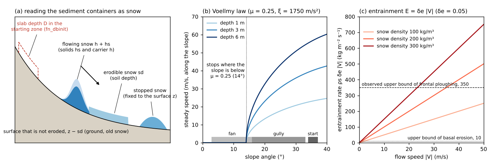
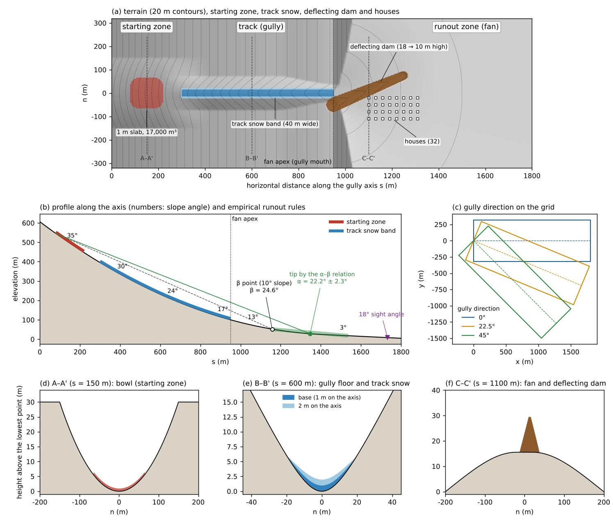
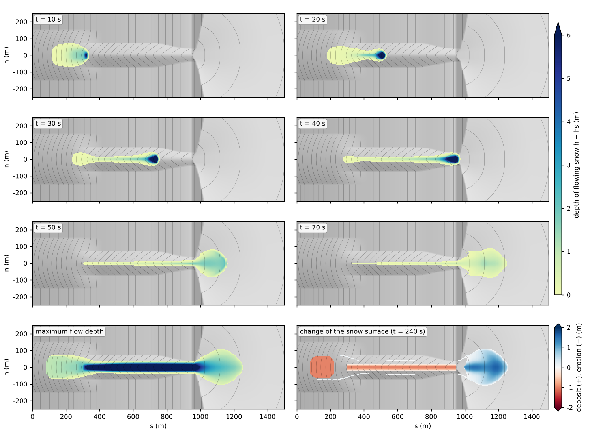
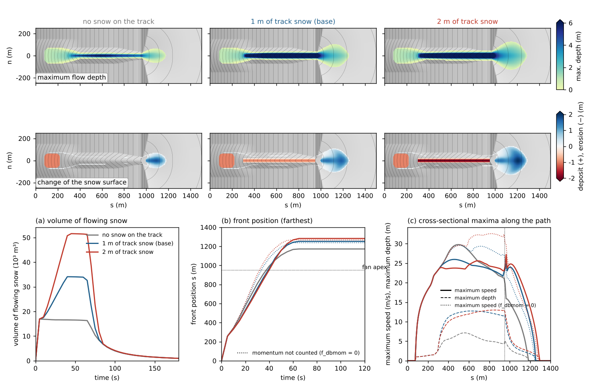
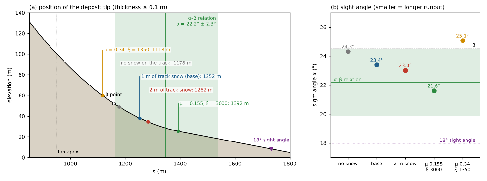
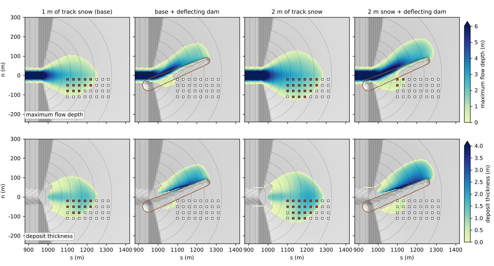
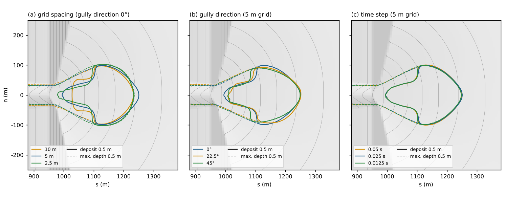
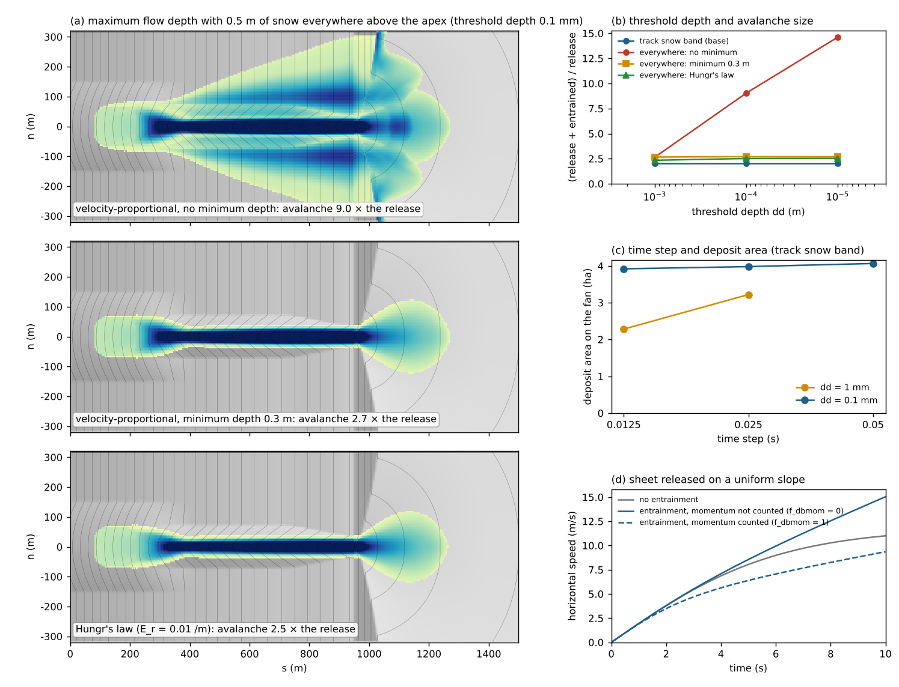

# snow_avalanche — a dense snow avalanche down a gully: entrainment of the track snow and a deflecting dam on the fan

> English mirror of examples/snow_avalanche/README.md. The Japanese file is the master copy.

[日本語](../README.md)

This example computes, on a schematic terrain, a slab avalanche released on a steep slope that runs
down a gully (the track), grows by taking up the snow on the gully floor, spreads over the fan at the
gully mouth (the runout zone) and stops. It does not use a dedicated avalanche model: the containers of
the sediment-flow model (the Voellmy resistance law and entrainment proportional to the speed) are read
as snow ([snow avalanches on the applications page of sediment and landform change](../../../docs/en/users_guide/geomorph_applications.md#5-snow-avalanches-dense-flow)).
There are two aims. (1) For the same released volume, how much larger the avalanche becomes and how far
it reaches, depending on the amount of snow on the track (a band on the gully floor, 0, 1 or 2 m thick).
(2) How a deflecting dam on the fan (an earth dam given as terrain) changes the direction of the flow
and the place of the deposit, and what happens when the avalanche is large. The example also checks the
choice of the friction coefficients, the dependence on the grid spacing, on the direction of the gully
on the grid and on the time step, and the limits of this setup (how the entrainable snow is given, the
threshold depth, and entrainment and momentum). The terrain, the amounts of snow and the friction
coefficients are schematic values chosen to make the phenomena visible, and do not reproduce a
particular avalanche.

**What this example shows**

- **An avalanche that takes up the track snow becomes thicker and runs farther**: when 17,000 m³ of
  snow on the gully floor (1 m thick on the axis) is added to the released 17,000 m³, the flowing snow
  becomes 2.0 times as large, the flow depth at the gully mouth goes from 5 to 12 m and the speed from 20
  to 24 m/s, the tip of the deposit moves 75 m farther (s = 1,178 → 1,253 m), and the deposit area on the
  fan becomes 2.1 times as large. With 2 m of snow on the gully floor the figures are 3.0 times and 105 m
  farther. The entrained snow is accelerated from rest, so an avalanche that takes up snow reaches the
  gully mouth about 2 s later than one that takes up none.
- **The runout falls within the scatter of an empirical relation**: the sight angle from the top of the
  starting zone to the tip of the deposit is 23.0 to 24.3°, within the scatter of the statistics of 206
  avalanche paths in Norway (the α–β relation; 22.2° ± 2.3° for this terrain). With the friction
  coefficients of other rows of the RAMMS table it is 21.6° (the values for a large avalanche on an open
  slope) to 25.1° (the values for a medium avalanche in a gully).
- **The deflecting dam deflects, but a large avalanche overtops it**: a deflecting dam 18 → 10 m high
  deflects the avalanche of the base case to the left, and no snow reaches the 32 houses the dam protects
  (without the dam, snow at least 0.5 m deep reaches 13 houses). The avalanche with 2 m of snow on the
  gully floor overtops the crest over the first 200 m of the dam and reaches 3 houses. The deflected
  flow gathers along the dam and runs 30 m farther than without the dam.
- **Count the momentum of the entrained snow**: the base case counts what it takes to accelerate the
  entrained snow from rest to the flow speed (`f_dbmom = 1`). Without it (`f_dbmom = 0`), an avalanche
  that takes up snow reaches the gully mouth 6 to 8 s earlier and its speed at the mouth comes out 4 to
  8 m/s higher.
- **When the entrainable snow is placed widely, stop the entrainment by thin flow**: the
  velocity-proportional entrainment law has no threshold, so all snow the flow touches is taken. Snow
  placed in the band on the gully floor is taken up in exactly the amount that was placed. If snow is
  placed over the whole slope, the thin snow at the margins of the flow spreads sideways while taking up
  snow, and the size of the avalanche ends up being set by a numerical threshold (the threshold depth):
  2.7 to 15 times the released volume. With a minimum flow depth for entrainment (`db_hent`) or Hungr's
  entrainment law (`f_dbed = 5`) it is 2.3 to 2.7 times and no longer depends on the threshold depth.
- **Exchange the carrier together with the snow, and lower the threshold depth**: in this model, which
  carries the depth of flowing snow as the sum of the surface water h and the sediment column hs,
  exchanging h in the same proportion as the snow (`f_dbwet = 1`, `db_satbed = db_relsat`) and lowering
  the threshold depth `dd` to 0.1 mm makes the deposit smooth and the results almost independent of the
  time step (about 2 % in the area).

## What happens in real avalanches

- **Starting zone, track and runout zone**: an avalanche path is divided into the starting zone, where
  the snowpack fails and starts to move, the track, down which the snow flows, and the runout zone,
  where the snow stops and is deposited (MLIT, Technical Criteria for River Works). Avalanches are
  likely on slopes of 30° or more, and slopes of 35 to 45° are regarded as the most dangerous
  (MLIT 2006). The track is usually 15 to 30° steep and the runout zone gentler than 15°
  (Schweizer et al. 2021).
- **Flowing and powder avalanches**: by their motion, avalanches are classified into the "flowing
  type", which runs with almost no snow cloud, the "powder type", which raises a high snow cloud, and
  the "mixed type" of both (classification of the Japanese Society of Snow and Ice). The flowing type
  (dense flow) is 1 to 3 m deep (much deeper where it is channelled) with a density of about 300 kg/m³
  (Jóhannesson et al. 2009); the speed is 14 to 56 m/s (50 to 200 km/h) for large dry-snow avalanches
  and 6 to 28 m/s (20 to 100 km/h) for wet-snow avalanches (Schweizer et al. 2021).
- **Uptake of the track snow (entrainment)**: avalanches grow by taking up the snow on the track. In
  measurements of 18 avalanches at test sites in Switzerland and Italy, the deposited mass was on
  average 4.6 times the released mass (1 to 12 times). The uptake took place mainly at the front
  (ploughing; up to 350 kg m⁻² s⁻¹), the depth taken up along the path was on average 0.6 times the
  fracture depth, and the amount taken up was governed by the available snow and the structure of the
  snow cover, with the topography and the size of the avalanche secondary. The front speed did not
  depend on where the snow came from, and for the same speed a larger mass runs farther
  (Sovilla et al. 2006).
- **Empirical rules for the runout**: from the longest known runouts of 206 avalanche paths in Norway,
  the sight angle α (the mean slope from the top of the starting zone to the tip of the deposit) is
  given by α = 0.96 β − 1.4° (standard deviation 2.3°), where β is the mean slope from the top of the
  starting zone to the point where the path slope is 10° (Bakkehøi et al. 1983). The longest runouts
  are known for paths with more than a hundred years of local tradition or records, so the relation is
  a guide to the runout of rare, large avalanches. In Japan, a sight angle of 18° for surface-layer
  avalanches and 24° for full-depth avalanches is used as a guide to the area they can reach
  (Takahashi's 18-degree rule; MLIT 2006).
- **Avalanche computations and friction coefficients**: computations of flowing avalanches widely use
  the law of Voellmy (1955), which expresses the basal friction as the sum of a term proportional to
  the normal stress (coefficient μ) and a term proportional to the square of the speed (coefficient ξ).
  RAMMS, the model of Swiss practice, gives μ and ξ in a table by avalanche size, return period,
  altitude and terrain class (open slope, channelled, gully, flat): the larger the avalanche, the
  smaller μ and the larger ξ, and in gullies μ is larger and ξ smaller (μ = 0.14 to 0.47,
  ξ = 900 to 4,000 m/s²; Bartelt & Christen 2026). The values of the Swiss guidelines on which this
  table is based were determined with computations that do not consider the uptake of track snow
  (Christen et al. 2002).
- **Deflecting dams**: the protective works placed in the track and the runout zone are stopping works
  that halt the avalanche, braking works that weaken it and deflecting works that change its direction
  (MLIT, Technical Criteria for River Works). The height of a deflecting dam is determined from two
  requirements: the avalanche must not pass over the dam while still a fast (supercritical) flow, and
  the dam must be higher than the flow depth downstream of the shock that forms in front of it
  (Jóhannesson et al. 2009). At Flateyri, Iceland, two deflecting dams 15 to 20 m high and about 600 m
  long were built after the avalanche disaster of 1995 (20 fatalities). The avalanches of 1999 and 2000
  (each more than 100,000 m³) ran up 12 to 13 m on the dams and were deflected; they gathered into a
  stream 20 to 80 m wide along the dam, and their runout is estimated to have increased by more than
  100 m (Jóhannesson 2001). In the two avalanches of January 2020 (240,000 and 315,000 m³) the dense
  core was deflected, but the fluidized front (about a tenth of the mass) overflowed the dams
  (Jóhannesson et al. 2024; Hákonardóttir et al. 2024).

## Mechanisms needed for the reproduction



(a) How the containers of the sediment-flow model are read. The elevation z is the snow surface, the
soil depth sd is the entrainable snow, and z − sd is the surface that is not eroded (the ground and old
snow). The depth of flowing snow is carried as the sum of the surface water h (the carrier) and the
sediment column hs (the solids). (b) The steady speed of the Voellmy law (speed along the slope,
V² = ξ h cos θ (sin θ − μ cos θ)). The flow stops where the slope is gentler than μ (14°), and the speed
is proportional to the square root of the depth. The bars at the bottom are the slope ranges of the
starting zone, the gully and the fan of this example. (c) The entrainment rate expressed as mass. The
dashed line is the observed upper bound of frontal ploughing (Sovilla et al. 2006). These are a sketch
and plots of formulas, not computed results.

| Real phenomenon | Representation in ENCflow | Settings |
|---|---|---|
| The snowpack fails over an area and starts to move | The starting zone and the fracture depth are given as a distribution, and the snow of the fracture depth is moved to flowing snow at the start of the run (release is not predicted) | `fn_dbinit`, `db_reltime = 0` |
| Resistance of the dense snow flow | The Voellmy law: an apparent friction μ (which sets the slope at which the flow stops) and a resistance proportional to the square of the speed, g V²/(ξ h) (which limits the speed) | `f_dbres = 4`, `db_mu`, `db_xi` |
| Growth by taking up the track snow | The thickness of the entrainable snow is given as the soil depth; the snow surface is lowered at a rate δe \|V\| proportional to the flow speed and the snow is added to the flow. It stops when the layer is used up | `fn_sd`, `f_dbed = 4`, `db_delte` |
| Acceleration of the entrained snow to the flow speed | The flow is slowed by what it takes to accelerate the resting snow (when the mass grows from m to m + Δm, the speed is multiplied by m/(m + Δm)) | `f_dbmom = 1` |
| Stopping and deposition on gentle ground | Stopped snow (speed below 0.05 m/s) is fixed to the snow surface. The deposit raises the snow surface and becomes entrainable snow | `f_dbstop = 1`, `db_vstop`, `db_wstop` |
| Depth of flowing snow | The sum of the surface water h and the sediment column hs. h is a carrier that takes a tenth of the snow depth and is put in and taken out in the same proportion as the snow at release, entrainment and stopping | `fluv_porosity = 0.1`, `f_dbwet = 1`, `db_satbed = db_relsat = 1` |
| Thin snow also flows | The threshold depth is lowered to 0.1 mm (the snow in a cell whose carrier falls below the threshold depth is fixed on the spot) | `dd = 0.0001` |
| Gravity and friction on steep slopes | The correction of gravity for the slope. The Voellmy law is evaluated with the speed along the slope and the depth normal to the ground | `f_gravity_correction = 2` (default) |
| Deflecting dam | The dam body is added to the terrain and its soil depth is set to 0 (not eroded) | `fn_z`, `fn_sd` (made by `make_init.py`) |
| Gully direction and the grid | The terrain, the snow and the starting zone are given by formulas in coordinates along the gully and sampled at the cell centres of each grid (no interpolation). The eight neighbours of the ENC grid | `make_init.py` |

**Accounting for the depth of flowing snow (the carrier).** This model carries the flow as a mixture of
the surface water h and the sediment column hs (the solid volume as a thickness), and treats a cell
whose surface water h falls below the threshold depth `dd` as dry (no discharge is computed and the
remaining hs is fixed to the terrain on the spot). For avalanches, h + hs is read as the depth of
flowing snow and h as "the carrier that takes the share λ (`fluv_porosity`) of the snow depth". With
`f_dbwet = 1` and `db_satbed = db_relsat = 1`, the fracture depth D becomes hs = (1 − λ)D and h = λD at
release, the thickness eroded enters the flow in the same proportion at entrainment, and stopped snow
takes the same share of h with it, so h : hs = λ : (1 − λ) holds everywhere in the flow and h + hs
increases (decreases) by exactly the thickness by which the snow surface is lowered (raised). The
threshold for a "dry cell" in terms of snow depth is dd/λ, that is 1 mm for `dd = 0.1 mm` and λ = 0.1.
The density does not appear in the equations (the driving force and the resistance are both in
acceleration form), so the depth is "the depth of the snow counted at one constant density". What
happens without this combination is described under "The carrier and the threshold depth" below.

## Geometry and settings



(a) The schematic terrain (coordinates s and n along the gully). Red = starting zone, blue = track snow
band, brown = deflecting dam, white squares = houses. (b) The profile along the gully axis and the
empirical runout rules (the β point, the tip by the α–β relation with the range of its standard
deviation, and the position of the 18° sight angle). (c) The domains for gully directions of 0°, 22.5°
and 45° on the grid (the same terrain is placed rotated relative to the grid). (d) to (f) Cross-sections
(vertically exaggerated). The light blue in (e) is the snow of the case with 2 m on the axis.

- **Domain**: a rectangle 1,800 m along the gully and 640 m across. Outside this rectangle is outside
  the domain. When the gully is rotated relative to the grid, the edge of the rectangle becomes a
  staircase on the grid.
- **Profile**: the slope of the gully axis decreases linearly from 0.78 (38°) at the upper end to 0.05
  (3°) 1,400 m farther on (a parabola), followed by a valley floor with a slope of 0.05. The drop from
  the upper end to the downstream end is 601 m.
- **Cross-section**: the upper part (s < 220 m) is a shallow bowl (a paraboloid with a half-width of
  150 m and a rim 30 m high), the middle part a V-shaped gully with a rounded floor (wall slope 0.6,
  rim 35 m high), and the bowl changes into the gully over s = 220 to 420 m. Beyond the gully mouth (the
  fan apex, s = 950 m, slope 16°) lies a conical fan whose apex is a line segment of the width of the
  mouth, 40 m. The mountain ends at the line of the mouth with a 35° scarp.
- **Starting zone**: a rounded rectangle (140 m × 130 m) in the upper bowl (s = 80 to 220 m, slope 34
  to 37°). The fracture depth is uniform and is normalized on each grid so that the volume is 17,000 m³
  (1.00 m on the 5 m grid).
- **Track snow**: entrainable snow is placed in a band 40 m wide along the gully axis (s = 300 to
  950 m). It is thickest on the axis, with a parabolic cross-section that falls to 0 at the edges
  (representing new snow and drift snow collected on the gully floor). The base case has 1 m on the axis
  (17,500 m³; 0.67 m on average over the band); the other cases have 0 m and 2 m (34,900 m³). No
  entrainable snow is placed outside the band or on the fan.
- **Friction coefficients**: μ = 0.25, ξ = 1,750 m/s²: the values of the RAMMS table for a medium
  avalanche (25,000 to 60,000 m³), channelled terrain, altitudes above 1,500 m and a return period of
  300 years. The same values are used over the whole domain.
- **Entrainment coefficient**: δe = 0.05. The snow surface is lowered at the rate δe |V|, so 1 m of snow
  is taken up while the flow travels 1/δe = 20 m (at any speed). For snow of 200 kg/m³ and a speed of
  35 m/s this gives 350 kg m⁻² s⁻¹, the order of the observed upper bound of frontal ploughing. The entrained
  snow is accelerated from rest to the flow speed (`f_dbmom = 1`), so while the flow entrains it is
  decelerated by δe |V|²/(flow depth) (as strong as g/δe ≈ 200 m/s² in terms of the ξ of the Voellmy law).
- **Deflecting dam**: an earth dam that runs 325 m from the foot of the mountain on the right bank of
  the gully mouth (s = 950 m, n = −50 m) at 23° to the gully axis (ending at s = 1,250 m, n = 75 m).
  The dam is 18 m high at its upstream end and 10 m at its downstream end (lowered linearly), with a
  crest 5 m wide and side slopes of 1 : 1.5. The dam body is added to the terrain and is not eroded.
- **Houses**: the positions of 32 houses 30 m apart on the right-bank side of the dam (s = 1,100 to
  1,310 m, n = −110 to −20 m; `houses.txt`). They are not used in the computation (the houses do not
  obstruct the flow); the maximum flow depth and the maximum speed are read at them when plotting.
- **Time step and output**: dt = 0.005Δx (0.025 s for 5 m; the maximum Courant number is about 0.2).
  The run covers 4 minutes, with distributions written every 5 seconds (bil).

| Case | Track snow (thickness on the axis) | Deflecting dam | Other differences |
|---|---|---|---|
| `nosnow` | none | no | |
| `base` (`param.txt`) | 1 m | no | |
| `deep` | 2 m | no | |
| `dam` | 1 m | yes | |
| `deep_dam` | 2 m | yes | |
| `mu155`, `mu340` | 1 m | no | friction coefficients μ = 0.155, ξ = 3,000 m/s² and μ = 0.34, ξ = 1,350 m/s² |
| `dx10`, `dx2p5` | 1 m | no | grid spacing 10 m and 2.5 m |
| `r22p5`, `r45` | 1 m | no | gully direction on the grid 22.5° and 45° |
| `dt2`, `dthalf` | 1 m | no | time step 0.05 s and 0.0125 s |
| `dd3`, `dd3_dthalf`, `dd5` | 1 m | no | threshold depth 1 mm (time steps 0.025 s and 0.0125 s) and 0.01 mm |
| `nomom`, `deep_nomom` | 1 m, 2 m | no | momentum of the entrained snow not counted (`f_dbmom = 0`) |
| `hungr` | 1 m | no | Hungr's entrainment law (`f_dbed = 5`, growth rate `db_er` = 0.01 /m) |
| `allsnow`, `allsnow_dd3`, `allsnow_dd5` | 0.5 m everywhere above the apex | no | threshold depth 0.1 mm, 1 mm and 0.01 mm |
| `allsnow_t`, `allsnow_t_dd3`, `allsnow_t_dd5` | same | no | minimum flow depth for entrainment `db_hent` = 0.3 m; threshold depths as above |
| `allsnow_h`, `allsnow_h_dd3`, `allsnow_h_dd5` | same | no | Hungr's entrainment law (`db_er` = 0.01 /m); threshold depths as above |

`param.txt` (the base case) is the annotated template; `make_init.py` writes the `param_<case>.txt` of
the other cases by replacing only the lines for the grid, the time step, the input and output, and the
differences in the table. The grid is 5 m (46,000 active cells); the 10 m grid has 12,000 cells and
the 2.5 m grid 180,000.

## How to run

```bash
cd examples/snow_avalanche
make                     # links, and the inputs and settings of all 28 cases (make_init.py)
make run                 # the 5 cases of the main text (nosnow, base, deep, dam, deep_dam): about 6 minutes on 4 threads
make extra               # the 23 supplementary cases: about 40 minutes on 4 threads (the one 2.5 m case takes 30 %)
python3 plot_results.py  # figs/*.png and tables (with the argument en, the English version in en/figs/; the explanatory figures setup and mechanism need no results)
```

A single case is `./encflow param.txt` (the base case; about one minute). The output of all cases is
about 1.5 GB (`make clean` removes it). The plotting script draws only the figures whose cases have
been computed.

## Results

### How the avalanche flows (base case)



The base case: the depth of flowing snow (10 to 70 s after release), the maximum flow depth, and the
change of the snow surface after 4 minutes (red = lowered by the release and entrainment, blue =
deposit).

- **From the starting zone into the gully (0 to 20 s)**: the 1 m of snow accelerates while converging
  to the centre of the bowl and gathers into a flow about 45 m wide at the entrance of the gully
  (s = 420 m). Once it enters the band of track snow (from s = 300 m) it is slowed by what it takes to
  accelerate the entrained snow, and the maximum speed is 26 m/s at the entrance of the gully (30 m/s
  just inside the gully on a track without snow). The flow depth reaches 12 m.
- **Down the gully, with entrainment (20 to 40 s)**: the front runs down the gully at 22 m/s and takes
  up the snow of the gully floor as it passes (all of the 17,500 m³ of the band). The flowing snow
  reaches 34,000 m³ (2.0 times the release) at 40 s. In the gully the maximum flow depth is 11.5 to
  12.8 m and the maximum speed 22 to 25 m/s.
- **Stopping on the fan (40 to 75 s)**: the front reaches the gully mouth at 39 s (flow depth 11.6 m,
  24 m/s), decelerates while spreading to both sides on the fan, and stops on reaching the tip of the
  deposit (s = 1,253 m, 303 m from the apex) at 65 s. The volume of flowing snow falls to half at 75 s
  and below 5 % of its maximum at 140 s. The 470 m³ (1.4 %) still flowing after 4 minutes is thin snow
  left on the upper fan, where the slope is steeper than μ, and in the gully.
- **Deposit**: the deposit on the fan is a tongue 260 m long, from 40 m below the apex to the tip, and
  205 m wide, with an area of 40,000 m² (thickness of 0.1 m or more), a maximum thickness of 1.63 m
  (230 m from the apex) and a volume of 33,500 m³. What is left in the gully and the bowl is 400 m³
  (thin deposits at the margins of the flow).

### What the track snow changes



Top rows: the maximum flow depth and the change of the snow surface (from the left: no track snow, 1 m,
2 m). Bottom row: (a) the volume of flowing snow, (b) the position of the front (the most downstream
position with a flow depth of 0.1 m or more), (c) the cross-sectional maximum of the speed (solid) and
of the flow depth (dashed) along the path. The dotted lines are the computations that do not count the
momentum of the entrained snow (`f_dbmom = 0`; `nomom`, `deep_nomom`).

| | No track snow | 1 m (base) | 2 m |
|---|---:|---:|---:|
| Entrainable snow on the track (10³ m³) | 0 | 17.5 | 34.9 |
| Peak volume of flowing snow (10³ m³) | 16.9 | 34.1 | 51.6 |
| Ratio to the released volume (17,000 m³) | 1.0 | 2.0 | 3.0 |
| Maximum speed in the gully (m/s) | 30 | 26 | 26 |
| Arrival at the gully mouth (s) | 37.5 | 39.1 | 39.9 |
| Maximum flow depth at the gully mouth (m) | 5.1 | 11.6 | 12.4 |
| Maximum speed at the gully mouth (m/s) | 20 | 24 | 24 |
| Tip of the deposit, s (m) | 1,178 | 1,253 | 1,283 |
| Sight angle α (°) | 24.3 | 23.4 | 23.0 |
| Deposit area on the fan (10³ m²) | 19.4 | 39.8 | 54.2 |
| Maximum deposit thickness on the fan (m) | 1.72 | 1.63 | 1.98 |
| Width of the deposit on the fan (m) | 135 | 205 | 255 |

(The maximum speed is read from the maximum speed V9999 of the cells whose maximum flow depth is 0.5 m
or more. The area, the tip and the width of the deposit are for a thickness of 0.1 m or more.)

- **The amount taken up is set by the amount of snow placed**: in every case the flow takes up all the
  snow of the band. At the entrainment rate δe |V|, 1 m of snow is gone while the flow travels 20 m, so
  the snow of the band is used up while the body of the avalanche (200 to 300 m long) passes. In the
  observations too, it is the available snow that governs the amount taken up (Sovilla et al. 2006).
- **Taking up snow makes the flow thicker and later, but faster at the mouth**: the entrained snow is
  accelerated from rest, so the flow slows from 30 to 26 m/s when it enters the band of snow and reaches
  the gully mouth 1.6 to 2.4 s later than the avalanche on a track without snow. On the other hand, the
  flow that takes up no snow becomes thinner on its way down the gully (flow depth 7 → 5 m) and slows to
  20 m/s, whereas the flows that take up snow grow thicker (11 to 13 m) and leave the gully at 24 m/s
  (the speed of the Voellmy law is proportional to the square root of the depth).
- **A larger avalanche runs farther and wider**: the tip of the deposit moves 75 m farther with 1 m of
  track snow and 105 m with 2 m, and the deposit area becomes 2.1 and 2.8 times as large. The maximum
  thickness changes little (1.6 to 2.0 m); the additional snow goes into spreading sideways and
  forwards.
- **If the momentum of the entrained snow is not counted** (dotted lines; `f_dbmom = 0`): the entrained
  snow joins at the flow speed, so the flow does not slow down; it reaches the gully mouth at 33.4 s and
  31.8 s (1 m and 2 m of snow), 4 to 6 s earlier than the avalanche on a track without snow. The maximum
  speed at the mouth is 27 and 32 m/s, the maximum flow depth 9.9 and 13.1 m, and the tip of the deposit
  is at 1,238 and 1,268 m (15 m short). The size of the avalanche and the deposit area (39,000 and
  53,000 m²) hardly change.

### Runout: the empirical rules and the friction coefficients



(a) The position of the tip of the deposit. The green line and band are the tip by the α–β relation and
the range of its standard deviation, the white circle is the β point, and the purple triangle is the
position of the 18° sight angle. (b) The sight angle α.

The β point of this terrain (10° slope) is at s = 1,158 m with β = 24.6°; the sight angle of the α–β
relation is 22.2° ± 2.3° (a tip at s = 1,347 m, with a range of 1,164 to 1,537 m), and the position of
the 18° sight angle is s = 1,732 m.

| | μ | ξ (m/s²) | Class in the RAMMS table | Maximum speed at the gully mouth (m/s) | Tip of the deposit, s (m) | Sight angle α (°) |
|---|---:|---:|---|---:|---:|---:|
| `mu155` | 0.155 | 3,000 | large, open slope, 300 years | 26 | 1,393 | 21.6 |
| `base` | 0.25 | 1,750 | medium, channelled, 300 years | 24 | 1,253 | 23.4 |
| `mu340` | 0.34 | 1,350 | medium, gully, 30 years | 18 | 1,118 | 25.1 |

(All are the values for altitudes above 1,500 m. The track snow is 1 m.)

- **The amount of track snow changes the angle by 1.3°, the friction coefficients by 3.5°**: the sight
  angle goes from 24.3 to 23.0° for 0 to 2 m of track snow, and from 21.6 to 25.1° when the friction
  coefficients are changed from one end of the table to the other. The runout is set first of all by
  the friction coefficients.
- **Relation to the empirical rules**: the three cases with the base friction coefficients and `mu155`
  fall within the standard-deviation range of the α–β relation (19.9 to 24.5°), and the gully values
  (`mu340`) stop outside it (short of it). The α–β relation is a statistic of the longest known
  runouts, so it is a guide for rare, large avalanches. No case reaches the position of the 18° sight
  angle. The empirical rules are a check that the computed results are not off by a large factor; they
  do not replace the calibration of the friction coefficients.
- **The table values and entrainment**: the guideline values behind the table were determined with
  computations that take up no snow. Using the same values in a computation with entrainment makes the
  avalanche larger and longer-running for the same released volume (the difference between `nosnow` and
  `base`).

### Deflecting dam



Top: the maximum flow depth; bottom: the deposit thickness. From the left: base (no dam), base +
deflecting dam, 2 m of track snow (no dam), 2 m of snow + deflecting dam. Brown line = edge of the dam
body; squares = houses (red = maximum flow depth of 0.5 m or more in the top row, deposit of 0.5 m or
more in the bottom row).

| | Base | Base + dam | 2 m of snow | 2 m of snow + dam |
|---|---:|---:|---:|---:|
| Houses reached by snow with a maximum flow depth of 0.5 m or more (out of 32) | 13 | 0 | 20 | 3 |
| Houses buried by 0.5 m or more | 12 | 0 | 19 | 0 |
| Largest maximum flow depth at the houses (m) | 2.3 | 0 | 2.9 | 0.8 |
| Largest maximum speed at the houses (m/s) | 18 | 0 | 20 | 10 |
| Snow that entered the right-bank side of the dam line (m³) | 17,000 | 210 | 29,200 | 1,400 |
| Distance of the tip of the deposit from the apex (m) | 303 | 331 | 333 | 362 |
| Maximum deposit thickness (m) | 1.6 | 4.5 | 2.0 | 5.1 |

- **The base avalanche is deflected**: the flow leaving the gully (flow depth 11.6 m, 24 m/s) runs up
  the upstream face of the dam, becomes a flow along the dam and turns to the left. The snow on the face
  overtops the crest (16 to 15 m high) between 50 and 150 m from the upstream end (a maximum flow depth
  of 1.5 m on the crest), but only 210 m³ (0.6 % of the flowing snow) falls to the right-bank side, and
  it does not reach the houses.
- **The avalanche with 2 m of snow overtops**: the flow leaving the gully is deeper (12.4 m, 24 m/s), so
  it overtops the crest over the first 200 m (a maximum flow depth of 2.6 m on the crest), 1,400 m³
  (3 % of the flowing snow) falls to the right-bank side, and snow 0.5 to 0.8 m deep moving at 10 m/s
  reaches 3 houses behind the dam. The snow that overtops spreads thinly and does not form a deposit
  that buries a house by 0.5 m or more.
- **The deflected flow gathers and runs farther**: the flow along the dam deposits up to 4.5 m in front
  of the dam, passes the end of the dam and reaches 331 m from the apex (28 m farther than without the
  dam). In the avalanches at Flateyri too, the flow along the dam gathered into a narrow stream and its
  runout increased (Jóhannesson 2001). A deflecting dam is a structure that changes where the avalanche
  goes.
- **Relation to the design formulas**: the flow that hits the dam has, at the gully mouth in the
  computation without the dam, a speed of 24 m/s and a flow depth of 11.6 m on the axis and 6.9 m on
  average over a width of 60 m (24 m/s, 12.4 m and 7.5 m over 70 m with 2 m of snow). With the mean flow
  depth, the formulas of Jóhannesson et al. (2009) give a flow depth of 16 m downstream of the shock in
  front of a dam with a deflecting angle of 23° (17 m with 2 m of snow). The formula for the height that
  prevents supercritical overflow does not apply, because the Froude number normal to the dam is as
  small as 1.1. The height the snow climbs on the dam face in the computation (per 50 m from the
  upstream end: 16, 17, 16 and 10 m in the base case; 18, 18, 17 and 14 m with 2 m of snow) is about the
  same as the shock depth, and exceeds the dam height (17, 16, 15 and 14 m over the same reaches) over
  the first 150 m (200 m with 2 m of snow). With the flow depth on the axis, the shock depth is 23 m
  (24 m): the estimate depends on which depth is used for a narrow, deep flow. In real avalanches a
  fluidized front can overflow a dam ahead of the dense core (Flateyri in 2020), which a depth-averaged
  model cannot represent. The dam height of this computation is not a basis for design.

### Grid spacing, gully direction and time step



The contours of a 0.5 m deposit on the fan (solid) and of a maximum flow depth of 0.5 m (dashed),
overlaid (coordinates along the gully). (a) Grid spacing, (b) gully direction on the grid, (c) time
step.

| | Grid 10 m | 5 m (base) | 2.5 m | Gully direction 22.5° | 45° | Time step 0.05 s | 0.0125 s |
|---|---:|---:|---:|---:|---:|---:|---:|
| Peak volume of flowing snow (10³ m³) | 34.5 | 34.1 | 34.1 | 34.0 | 34.2 | 34.3 | 34.0 |
| Front speed (mean over 20 to 30 s; m/s) | 20.0 | 22.5 | 22.2 | 22.7 | 23.0 | 22.0 | 22.5 |
| Arrival at the gully mouth (s) | 41.8 | 39.1 | 40.3 | 38.9 | 38.5 | 39.9 | 38.9 |
| Maximum speed in the gully (m/s) | 25.4 | 25.8 | 26.4 | 27.0 | 27.1 | 25.5 | 25.9 |
| Maximum flow depth in the gully (m) | 11.8 | 12.8 | 12.2 | 12.2 | 11.1 | 13.2 | 12.5 |
| Tip of the deposit, s (m) | 1,235 | 1,253 | 1,239 | 1,256 | 1,254 | 1,253 | 1,248 |
| Deposit area on the fan (10³ m²) | 38.0 | 39.8 | 41.4 | 39.7 | 38.6 | 40.7 | 39.2 |
| Maximum deposit thickness (m) | 1.77 | 1.63 | 1.81 | 1.58 | 1.73 | 1.61 | 1.69 |
| Width of the deposit (m) | 210 | 205 | 218 | 200 | 191 | 215 | 205 |

(The time step of the cases with another grid spacing or direction is 0.005Δx. "In the gully" is
s = 500 to 900 m.)

- **Time step**: when the time step is multiplied by 0.5 to 2, the tip of the deposit stays within 5 m
  and the area changes by about 2 %; the front speed changes by ±2 % and the maximum speed in the gully
  by ±1 %.
- **Grid spacing**: the tip of the deposit is 18 m short on the 10 m grid and 14 m short on the 2.5 m
  grid; it does not move in one direction with the grid spacing. The deposit area grows by 5 % and 4 %
  each time the grid spacing is halved (a Voellmy fluid spreads thinly on the fan, and the position of
  the 0.1 m margin moves with the grid). The arrival at the gully mouth is at 41.8, 39.1 and 40.3 s, the
  maximum speed in the gully 25.4, 25.8 and 26.4 m/s, and the maximum flow depth 11.8 to 12.8 m.
- **Gully direction**: at 22.5° the maximum speed in the gully is 5 % higher, the tip of the deposit 4 m
  farther and the deposit 2 % narrower. At 45° the maximum speed in the gully is 5 % higher, the maximum
  flow depth 13 % smaller and the arrival at the gully mouth 0.6 s earlier; the deposit on the fan is 7 %
  narrower, its maximum thickness 6 % larger and its area 3 % smaller. The tip of the deposit differs by
  1 m.
- **The shape of the head of the flow changes with the grid orientation**: the difference between
  orientations appears in the head (the thick leading part of the flow). At 0° the head is thick and
  short, at 45° thin and long; the flow upstream of the head and the tip of the deposit hardly change.
  The cause is the transport of momentum across the flow. The numerical cross-stream mixing of the
  advection term of this scheme depends on the grid orientation (twice as large for axis-aligned flow as
  for flow at 45°; see [diagonal numerical diffusion](../../../docs/en/users_guide/diagonal_diffusion.md)),
  and the Voellmy law has no stress that couples neighbouring flow sideways, so the grid sets the width
  and speed of the fast core along the thalweg. In the computations that do not count the momentum of the
  entrained snow (`f_dbmom = 0`) the difference is large (at 45° the maximum speed in the gully is 15 %
  higher, the maximum flow depth 28 % smaller and the arrival at the gully mouth 2.8 s earlier; the ratio
  of the front positions at 30 s between 45° and 0° is 1.07 on the 5 m grid and 1.17 on the 2.5 m grid,
  so it does not shrink with refinement). When the acceleration of the entrained snow is counted, the
  front is slowed by taking up snow and this sets the shape of the head, so the ratio of the front
  positions stays at 1.01 on the 5 m grid and 1.02 on the 2.5 m grid. For a flow on a track without snow
  (a flow without entrainment) the difference in the head shape remains (on the terrain without the band
  of snow, 5 m grid, the maximum flow depth in the gully is 6.9 m at 0° and 3.5 m at 45°, and the ratio
  of the front positions at 30 s is 1.03).
- **How to read the results**: the tip of the deposit stays within ±20 m (±0.2° in the sight angle) for
  the grid spacings, gully directions and time steps, much less than the differences due to the amount
  of track snow and the friction coefficients (75 to 280 m). Read the area and width of the deposit and
  the speed and flow depth in the gully as values with a spread of about 10 %. The thickness of the head
  and the arrival time of a flow without entrainment have a larger spread.

## How the entrainable snow is given, and the carrier and threshold depth (limits of this setup)



(a) Maximum flow depth of the computations with 0.5 m of entrainable snow everywhere above the apex
(threshold depth 0.1 mm; from the top: velocity-proportional entrainment without a minimum depth, with a
minimum flow depth for entrainment of 0.3 m, and Hungr's entrainment law). (b) Threshold depth and the
size of the avalanche ((release + entrained) / release). (c) Time step and deposit area on the fan (base
case; threshold depths of 1 mm and 0.1 mm). (d) Speed of a sheet of snow released at once on a uniform
slope (solutions of the ordinary differential equation: no entrainment, and entrainment with the momentum
not counted and counted).

### When the entrainable snow is placed widely, stop the entrainment by thin flow

The entrainment law E = δe |V| has no threshold on the flow depth or the snow strength. Snow touched by
the flow is taken up, 1 m of it while the flow travels 20 m, however thin the flow. The computations of
the main text place the entrainable snow in a band on the gully floor that the flow covers, so the amount
taken up is set by the amount placed. If 0.5 m of snow is placed everywhere above the apex (`allsnow`;
296,000 m³ of snow placed), thin snow that leaves the margin of the flow for a neighbouring cell takes up
the snow of that cell and becomes thick flow; this repeats, and the area where snow is taken up spreads
from the starting zone in a wedge (top of panel (a)).

| Entrainment setting (0.5 m of snow everywhere) | Threshold depth 1 mm | 0.1 mm | 0.01 mm |
|---|---:|---:|---:|
| Velocity-proportional, no minimum depth (`allsnow`) | 2.7 | 9.0 | 14.6 |
| Velocity-proportional, minimum flow depth for entrainment 0.3 m (`allsnow_t`) | 2.7 | 2.7 | 2.7 |
| Hungr's entrainment law, growth rate 0.01 /m (`allsnow_h`) | 2.3 | 2.5 | 2.5 |

(Size of the avalanche = (release + entrained) / release.)

- **Without a minimum depth, it is a numerical threshold that stops the spreading**: with a threshold
  depth of 1 mm, the thin snow at the margins is fixed by the dry-cell rule (next section), the spreading
  stops, and only the snow over the 70 m width covered by the flow is taken up. With 0.1 mm the width
  where snow is taken up grows to 310 m at s = 500 m and 580 m at s = 900 m, and 15,000 m³ is still
  flowing after 4 minutes. With 0.01 mm it spreads over the full width of the mountain (640 m) and the
  avalanche becomes 15 times the release. None of these values can be called correct, because what sets
  the spreading is a numerical threshold and not a property of the snow.
- **A minimum flow depth for entrainment** (`db_hent = 0.3`): if flow thinner than 0.3 m takes up no snow,
  the width where snow is taken up is the 70 m covered by the body of the flow, and the avalanche is
  2.7 times the release whatever the threshold depth (middle of panel (a), panel (b)). 0.3 m is close to
  a yield-stress threshold of the snow of 300 Pa (the default for entrainment in RAMMS::Extended)
  converted to a flow depth (about 0.4 m for a density of 300 kg/m³ and μ = 0.25). It is a simplification
  of this model, which cuts by flow depth and not by the stress itself.
- **Hungr's entrainment law** (`f_dbed = 5`, `db_er = 0.01`): with E = E_r h |V|, where the rate of
  lowering of the snow surface is also proportional to the flow depth, thin flow takes up almost nothing
  (the same rate as δe = 0.05 at a flow depth of 5 m, and 1/50 of it at 0.1 m). The avalanche is 2.3 to
  2.5 times the release and hardly depends on the threshold depth (bottom of panel (a)). If the
  computation with the band on the gully floor is switched to this law (`hungr`), all the snow of the
  band is taken up as before, the arrival at the gully mouth is at 36.8 s, the maximum speed at the mouth
  is 25 m/s and the tip of the deposit is at s = 1,263 m (39.1 s, 24 m/s and 1,253 m in the base case).
- **Give the snow over a chosen area**: the computation with the snow in a band does not change between
  threshold depths of 0.1 mm and 0.01 mm even without a minimum depth (panel (b)). In real avalanches the
  area that is entrained is limited by the strength of the snow cover (only weak layers are taken up) and
  by the flow depth. The developers of RAMMS, which uses an entrainment law proportional to the speed,
  also write that too much mass is entrained if the avalanche spreads too widely (Christen et al. 2008).
  Decide the area and depth of the snow that may be taken up and give them as input; when the snow is
  placed widely, use the minimum flow depth or Hungr's law, and show the placement and the setting
  together with the results.

### The carrier and the threshold depth

The typical avalanche setup of the user guide puts in a small amount of carrier water at release only
(`db_relsat = 0.1 to 0.15`, no `f_dbwet`). The test with a 30 m track (configuration 1 of
[test/avalanche](../../../test/avalanche/en/README.md)) uses this setup. For a long track and an
avalanche that grows a lot by entrainment, add the following two.

- **Exchange the carrier together with the snow** (`f_dbwet = 1`, `db_satbed = db_relsat`): with the
  carrier put in at release only, the carrier thins as entrainment adds snow, and more cells have their
  carrier fall below the threshold depth and their snow fixed. In a trial on a slope 1.4 km long (growth
  by 4.4 times through entrainment), the threshold thickness of the snow that gets fixed rose from 6 cm
  to 26 cm, snow 1 to 3 m thick was left at the margins of a track of 27°, and the deposit became rough
  from cell to cell (developer.md §126.2).
- **Lower the threshold depth** (`dd = 0.0001`): snow that enters a dry cell is fixed on the spot unless
  the inflow of one step brings the carrier above the threshold depth. At the default of 1 mm (1 cm in
  terms of snow depth), whether the front can advance into a new cell changes with the time step, and
  the results depend on the time step (panel (c)).

| Threshold depth | Time step (s) | Peak volume of flowing snow (ratio to the release) | Tip of the deposit, s (m) | Deposit area on the fan (10³ m²) | Snow left in the gully and the bowl (m³) |
|---|---:|---:|---:|---:|---:|
| 1 mm | 0.025 | 1.83 | 1,223 | 32.2 | 3,120 |
| 1 mm | 0.0125 | 1.58 | 1,193 | 22.8 | 7,220 |
| 0.1 mm | 0.05 | 2.02 | 1,253 | 40.7 | 160 |
| 0.1 mm (base) | 0.025 | 2.01 | 1,253 | 39.8 | 400 |
| 0.1 mm | 0.0125 | 2.00 | 1,248 | 39.2 | 520 |
| 0.01 mm | 0.025 | 2.03 | 1,258 | 41.1 | 30 |

With a threshold depth of 1 mm, 10 to 20 % of the flowing snow is left in the gully and the bowl, and
halving the time step reduces the deposit area on the fan by 29 %. With 0.1 mm the area changes by about
2 % and the tip of the deposit by 5 m when the time step is multiplied by 0.5 to 2, and the
difference from 0.01 mm is 3 %. Increasing the carrier fraction `fluv_porosity` has the same effect (the
threshold is dd/`fluv_porosity`).

### Momentum of the entrained snow

The base case counts what it takes to accelerate the entrained snow from rest to the flow speed
(`f_dbmom = 1`). The momentum equation is solved for the velocity and entrainment only adds to the depth
of flowing snow, so with the default without this option (`f_dbmom = 0`) the entrained snow joins at the
local flow speed and the flow does not slow down. When it is counted, entrainment decelerates the flow
(by u E/h for a speed u, a depth h and a rate of depth increase E). Panel (d) shows the speed of a 0.5 m
sheet of snow released at once on a uniform slope of 0.5 (solutions of the ordinary differential
equation; friction coefficients of the base case). Without entrainment the speed after 10 s is 11.0 m/s;
with continuous entrainment of the snow below at δe = 0.02 it is 15.0 m/s when the momentum is not
counted, faster by the gain in depth, and 9.4 m/s when it is counted. When the same kind of computation
(μ = 0.2, ξ = 1,500 m/s²) is run with ENCflow, both treatments agree with their solutions within 0.5 %
(configurations 2 and 3 of [test/avalanche](../../../test/avalanche/en/README.md)).

The difference in the computations of the main text is shown by the dotted lines and the last item of
"What the track snow changes" (without counting it, the flow reaches the gully mouth 6 to 8 s earlier
and the maximum speed at the mouth is 4 to 8 m/s higher). Accelerating the entrained snow is the
treatment of SamosAT (Sailer et al. 2008, Fischer et al. 2015), AvaFrame com1DFA and DAN3D. The 2008
formulation of RAMMS does not include momentum losses from entrainment (Christen et al. 2008). This
model counts only the acceleration from rest; the energy needed to break and compact the snow cover (e_s
and e_d of SamosAT) is not included.

## What this model cannot represent (differences from real phenomena)

- **Release**: the position, extent, fracture depth and time of the release are given. The failure of a
  weak layer in the snowpack and the prediction of release from the weather are out of scope (there is
  no coupling from the snow water equivalent of the snow module either; to use it, convert it to a snow
  thickness in preprocessing).
- **Powder avalanches and the fluidized front**: snow suspended in the air (the powder component, the
  fluidized layer) is outside the depth-averaged shallow-water flow. At deflecting dams and houses,
  these can overflow the dam and arrive ahead of the dense flow.
- **Change of snow density**: the flowing snow and the deposit are counted as thicknesses at the same
  density as the snow of the snow surface. The deposit of a real dry-snow avalanche is compacted to 2
  to 3 times the density of the original snow cover (Sovilla et al. 2001). The thickness and the area
  of the deposit include that difference.
- **Cohesion of snow and the shape of the deposit**: the Voellmy law is a cohesionless fluid, so the
  flow spreads thin and wide on the fan and the deposit concentrates at the front. In computations with
  cohesion the runout is shorter and the lateral spreading smaller (Bartelt et al. 2015). The thick
  deposits with steep margins and the levees seen in wet-snow avalanches are not represented.
- **Distribution of the friction coefficients**: μ and ξ are one pair for the whole domain. They cannot
  be varied with terrain class, altitude and forest as in RAMMS. Differences in the flow due to snow
  temperature and water content can only be given through the values of μ and ξ.
- **Entrainment threshold and snow strength**: the entrainment law of the base case takes up the snow
  the flow touches regardless of the snow strength and the flow depth (the minimum flow depth and Hungr's
  law can be selected; see the section above). Differences in strength between the layers of the snow
  cover are not represented. For the entrained snow only the acceleration from rest is counted, not the
  energy needed to break and compact the snow cover.
- **Terrain curvature**: the increase and decrease of friction by the centrifugal force (`f_dbcurv`) is
  not included.
- **Deflecting dam**: the dam is terrain, and its faces are represented on the 5 m grid. The splashing
  and jumping of the flow that hits the dam are not represented. The forces on the dam and the houses
  (impact pressures) are not output. As a guide, ρV² can be read from the maximum speed V (with a
  flowing-snow density ρ of 300 kg/m³, at most 92 kPa at the houses in the base case and 118 kPa with
  2 m of snow), but this is a depth-averaged value of a thick flow and not a value for the design of
  structures.
- **Houses and forest**: the houses do not obstruct the flow and are not destroyed. The suppression of
  release and the deceleration by forest are not included.

## Notes

- **Conservation**: the sum of the flowing snow and the change of the snow surface
  (Σ(h + hs) + Σ(z − z0)) closes within ±0.1 m³ in all cases (the rounding of the single-precision
  output). The snow does not reach the edge of the domain.
- **How the maximum speed is read**: the velocity output keeps values in cells that the snow has left
  and that are dry. The maximum speed is read from V9999 in the cells whose maximum flow depth D9999 is
  0.5 m or more.
- **Time to stop**: a Voellmy fluid keeps moving slowly where the surface slope exceeds μ. The snow
  still flowing after 4 minutes is 1 to 3 % of the flowing snow (5 % on the 10 m grid), and 7 to 10 %
  in the cases with the deflecting dam (the margin of the thick deposit in front of the dam). The deposit
  indicators do not include the flowing snow.
- **Entrained snow volume**: it is counted from the lowering of the snow surface at its lowest in the
  outputs every 5 seconds.
- **Time of the front position**: the front is read from the outputs every 5 seconds and interpolated
  linearly between them.
- **Stopping coefficients**: the speed below which the snow is regarded as stopped, `db_vstop`, and the
  fixing rate, `db_wstop`, are numerical closures, not literature values.

## Starting points for sensitivity tests

- `db_mu`, `db_xi` (`param.txt`): the friction coefficients. The runout changes strongly with μ and the
  speed on the track with ξ.
- `SNOW_TRACK`, `W_E`, `S_E0` (`make_init.py`): the thickness of the track snow, and the half-width and
  the start of the band.
- `V_REL`, `S_C`, `A_S`, `A_N` (`make_init.py`): the released volume and the position and size of the
  starting zone.
- `DAM_A`, `DAM_B`, `DAM_H` (`make_init.py`): the position, direction and height of the deflecting dam.
  Raising the dam, changing its direction or moving its upstream end downstream changes the amount that
  overtops and where the deflected flow goes.
- `db_delte` (`param.txt`): the entrainment coefficient. As long as the snow of the band is used up, the
  amount taken up does not change.
- `f_dbmom` (`param.txt`): 0 does not count the momentum of the entrained snow (`nomom`).
- `f_dbed = 5` with `db_er`, and `db_hent` (`param.txt`): Hungr's entrainment law and the minimum flow
  depth for entrainment. They change how the size of the avalanche is set when the entrainable snow is
  placed widely.
- `f_dbcurv = 1` (`param.txt`): includes the increase and decrease of friction by the terrain
  curvature.
- `S_TOP`, `S_END`, `L_P`, `S_A` (`make_init.py`): the slopes of the profile and the position of the
  gully mouth.

## Related documents

- [Snow avalanches on the applications page of sediment and landform change](../../../docs/en/users_guide/geomorph_applications.md#5-snow-avalanches-dense-flow) — the table of how the containers are read, and the typical setup
- [Debris flow, slope failure and moving bed layer](../../../docs/en/users_guide/massflow.md) — the formulas of the Voellmy law (§2) and of entrainment, the minimum flow depth for entrainment and the momentum of the entrained mass (§3)
- [Steep-slope gravity correction](../../../docs/en/users_guide/steep_slope.md) — the evaluation of the resistance along the slope
- [test/avalanche](../../../test/avalanche/en/README.md) — the conservation test of entrainment and stopping and the tests of entrainment and momentum on a uniform slope; [test/volcano](../../../test/volcano/en/README.md) —
  the analytic solution of the steady flow of the Voellmy law
- [debris_fan](../../debris_fan/en/README.md) — a debris flow on a terrain of the same form (dependence on the grid spacing and orientation)

## References

- Voellmy, A. (1955): Über die Zerstörungskraft von Lawinen. *Schweizerische Bauzeitung*, 73, 159–165,
  212–217, 246–249, 280–285. (the resistance law)
- Bartelt, P. and Christen, M. (2026): *Snow Avalanche Dynamics with RAMMS::Avalanche* (RAMMS::Avalanche
  user manual). RAMMS AG. <https://ramms.ch/manuals/RAMMS_AVAL_Manual.pdf> (the form of the friction
  law; the table of friction coefficients in the appendix = "RAMMS::Avalanche Friction Parameters", SLF, 2011)
- Christen, M., Bartelt, P. and Gruber, U. (2002): *AVAL-1D User Manual*. SLF, Davos.
  <https://www.slf.ch/fileadmin/user_upload/SLF/Services_Produkte/Software_Apps/AVAL1D/AVAL-1D_1.2_User_manual.pdf>
  (the guideline friction coefficients were determined with computations that do not consider the uptake of track snow)
- Christen, M., Bartelt, P., Kowalski, J. and Stoffel, L. (2008): Calculation of dense snow avalanches in
  three-dimensional terrain with the numerical simulation program RAMMS. *Proc. International Snow Science
  Workshop, Whistler*, 709–716. (entrainment proportional to the speed, excessive uptake when the avalanche
  spreads too widely, and no momentum loss from the uptake)
- Bartelt, P. and Christen, M. (2026): *RAMMS::Extended User Manual*. RAMMS AG.
  <https://ramms.ch/manuals/RAMMS_EXT_Manual.pdf> (the yield-stress threshold for entrainment, Yield
  Stress; default 300 Pa)
- Sailer, R. et al. (2008): *Ann. Glaciol.*, 48, 183–192. doi:10.3189/172756408784700707 (entrainment in
  SamosAT; the term that accelerates the entrained snow to the avalanche speed)
- Fischer, J.-T. et al. (2015): *J. Glaciol.*, 61(229), 875–888. doi:10.3189/2015JoG14J168 (the momentum
  equation with the same term, and entrainment proportional to the basal shear stress)
- The theory document of AvaFrame com1DFA (section Entrainment).
  <https://docs.avaframe.org/en/latest/theoryCom1DFA.html> (acceleration of the entrained snow from rest;
  release 2.2.1)
- Hungr, O. (1995): A model for the runout analysis of rapid flow slides, debris flows, and avalanches.
  *Can. Geotech. J.*, 32, 610–623. doi:10.1139/t95-063 (the origin of the entrainment law proportional to
  flow depth and speed)
- Qiao, Z., Li, T., Simoni, A., Gregoretti, C., Bernard, M., Wu, S., Shen, W. and Berti, M. (2023): Numerical
  modelling of an alpine debris flow by considering bed entrainment. *Front. Earth Sci.*, 10, 1059525.
  doi:10.3389/feart.2022.1059525 (the entrainment law E = E_r h v of DAN3D and the estimate of the growth
  rate)
- Sovilla, B., Burlando, P. and Bartelt, P. (2006): Field experiments and numerical modeling of mass
  entrainment in snow avalanches. *J. Geophys. Res.*, 111, F03007. doi:10.1029/2005JF000391
- Sovilla, B., Sommavilla, F. and Tomaselli, A. (2001): Measurements of mass balance in dense snow avalanche
  events. *Ann. Glaciol.*, 32, 230–236. (the density of the deposit is 2 to 3 times that of the original snow cover)
- Bakkehøi, S., Domaas, U. and Lied, K. (1983): Calculation of snow avalanche runout distance. *Ann. Glaciol.*,
  4, 24–29. (α = 0.96β − 1.4°, standard deviation 2.3°, 206 paths; the sign is missing in print, and the next reference quotes it with the sign)
- Lied, K. and Toppe, R. (1989): Calculation of maximum snow-avalanche run-out distance by use of digital
  terrain models. *Ann. Glaciol.*, 13, 164–169.
- Lied, K. and Bakkehøi, S. (1980): Empirical calculations of snow-avalanche run-out distance based on
  topographic parameters. *J. Glaciol.*, 26(94), 165–177. (the definitions of α and β, and the paths covered)
- Jóhannesson, T., Gauer, P., Issler, P. and Lied, K. (eds.) (2009): *The design of avalanche protection
  dams. Recent practical and theoretical developments*. European Commission, EUR 23339.
  doi:10.2777/12871 (how the height of a deflecting dam is determined = Eqs. (5.9) to (5.11); the depth and
  density of dense flow; the processes a depth-averaged formulation cannot represent)
- Jóhannesson, T. (2001): Run-up of two avalanches on the deflecting dams at Flateyri, northwestern Iceland.
  *Ann. Glaciol.*, 32, 350–354.
- Jóhannesson, T., Grímsdóttir, H., Hákonardóttir, K. M., Brynjólfsson, S., Hilmarsson, Ó. and Jarosch, A. H.
  (2024): Lessons from several avalanches impacting avalanche protective structures in Iceland in January
  2020 and March 2023. *Proc. International Snow Science Workshop, Tromsø*, 820–827.
- Hákonardóttir, K. M., Lárusson, R., Kristjánsson, Á. and Pétursson, G. (2024): Loading on structures from
  fluidized avalanche fronts overflowing deflecting dams at Flateyri, Iceland, January 2020. *Proc. International
  Snow Science Workshop, Tromsø*, 932–939.
- Bartelt, P., Vera Valero, C., Feistl, T., Christen, M., Bühler, Y. and Buser, O. (2015): Modelling cohesion
  in snow avalanche flow. *J. Glaciol.*, 61(229), 837–850.
- Schweizer, J., Bartelt, P. and van Herwijnen, A. (2021): Snow avalanches. In: Haeberli, W. and Whiteman, C.
  (eds.), *Snow and Ice-Related Hazards, Risks, and Disasters*, 2nd ed., Elsevier, Chapter 12. (speeds, and the
  slopes of the track and the runout zone)
- MLIT (Ministry of Land, Infrastructure, Transport and Tourism), Sabo Department (2006): 雪崩についての解説
  (An explanation of avalanches; in Japanese). <https://www.mlit.go.jp/common/001018269.pdf>
  (slopes prone to release, the sight angles of 18° and 24°)
- MLIT: 河川砂防技術基準 計画編 (Technical Criteria for River Works, Planning; in Japanese), Basic Planning,
  Chapter 3 (starting zone, track and runout zone)
  <https://www.mlit.go.jp/river/shishin_guideline/gijutsu/gijutsukijunn/keikaku/pdf/3_g.pdf>, and Facility
  Layout Planning, Chapter 3, Section 9 (prevention works and protective works; stopping, braking and deflecting works)
  <https://www.mlit.go.jp/river/shishin_guideline/gijutsu/gijutsukijunn/keikaku/pdf/3-3-2_g.pdf>
- Japanese Society of Snow and Ice (1998): 日本雪氷学会積雪・雪崩分類 (The JSSI classification of snow cover
  and avalanches; in Japanese). *Seppyo*, 60, 419–436. (flowing, powder and mixed types)

The content of Japanese Society of Snow and Ice (1998) was checked in a doctoral thesis that quotes the
classification (Nakamura 2023, Hokkaido University), not against the original. Schweizer et al. (2021) was
read in the authors' public version and Sovilla et al. (2006) in the version of the institutional
repository. Hungr (1995) could not be read in the original; the form of the entrainment law was checked in
Qiao et al. (2023) and in a report of the Geotechnical Engineering Office of Hong Kong (GEO Report
No. 367). For Sailer et al. (2008) and Fischer et al. (2015) the pages with the equations were read. The
original reference for the sight angles of 18° and 24° (Takahashi 1960, *Seppyo* 22(1)) has not been
read.
