# source_area — 山地流域の流出寄与域の発達と縮小

[English](en/README.md)

山地の森林流域に降った雨の多くは、地表を流れずに土にしみ込みます。しみ込んだ水は土層の中を
斜面の下へ流れて谷に集まり、土層が満ちた所(飽和域)で地表に出て川になります。流出を出す
範囲は流域の一部で、雨の間に谷から斜面へ広がり、雨が止むと縮みます(流出寄与域の変動)。
この例題は、秩父の実地形から切り出した 35 km² の源流域に同じ雨を 2 回降らせて、次の 2 つを
見ます。

1. **過程計算**: 浸透 → 土層の側方流 → 飽和域 → 河道の流下 を 1 つの計算でつなぎ、飽和域の
   発達と縮小、流域の出口のハイドログラフ、乾いた土に降る雨と湿った土に降る雨の違いを見ます。
2. **地表の流れだけで代えられるか**: 同じ雨を「浸透なし(雨の全量が地表を流れる)」と
   「鉛直浸透のみ(土層の側方流なし)」で計算して過程計算と比べ、斜面の粗度を大きくすれば
   (等価粗度)、土を通ることによる流出の遅れを表せるかを調べます。合う粗度が、土層の水の
   通しやすさと雨の強さでどう変わるかも見ます([追補](#追補-等価粗度と土層の透水係数))。

地形は実在の流域ですが、土層・透水係数・雨は一様に与えた模式値で、この流域の流出の再現では
ありません(観測との比較はしていません)。

**この例題で分かること**

- **流出寄与域(飽和域)は谷筋を上流へ伸び、雨が止むと下流へ縮む**: 飽和域は雨の 2 時間目に
  谷に現れ、3 時間で流域の 11 %、最大で 15 % になります。飽和するのは上流の集水面積が大きい谷と
  凹地で、尾根と斜面(セルの 83 %)はほとんど飽和しません。雨が止むと 4 時間後に 9 %、36 時間後に
  3 % に縮みます。同じ貯留でも、発達のときと縮小のときで飽和域の広さは違います
  ([過程計算](#過程計算-飽和域の発達と縮小))。
- **流出は土層を通ってきた水が主で、飽和域が谷でつながってから急に立ち上がる**: 流出の 9 割近くは、
  いったんしみ込んで土層を流れ、飽和域で湧き出した水です。乾いた土では 3 時間あまり流出がなく、
  そのあと 2 時間足らずで雨の 9 割に達します。湿った土に降る 2 回目の雨は、1 時間早く立ち上がります。
- **地表流だけの計算でも、斜面の粗度を大きくすれば(等価粗度)ハイドログラフはほぼ重なる**: 雨の
  全量を地表に流す計算は、斜面の粗度を 2(過程計算の 0.3 の 7 倍)にすると、過程計算と適合度 0.99 で
  重なります。乾いた土と湿った土の違い、立ち上がりの急さ、飽和域の広がりは表せません。土層の
  側方流を切って鉛直浸透だけにすると、土層に入った水が出てこず、1 回目の雨の流出は 20 mm
  (過程計算は 115 mm)にとどまります
  ([浸透なし・鉛直浸透のみとの比較](#浸透なし鉛直浸透のみとの比較))。
- **等価粗度は、土層が水を通す速さで 1 桁変わる**: 側方の透水係数を 100000 mm/h から 3600 mm/h に
  下げると、最も近い粗度は 1 から、1 回目の雨で 10、2 回目の雨で 5 まで大きくなります(基本の
  36000 mm/h は 2)。粗度の 1 桁の違いは、斜面の水が河道に出るまでの遅れの 4 倍の違いに当たり、
  その遅れは斜面に貯まる水の量に比例します。実務の山地の等価粗度(0.4〜0.8 程度)に重なるのは
  100000 mm/h のときで、基本の 36000 mm/h に合う粗度 2 は実務の値の数倍です
  ([土層の通しやすさと等価粗度](#土層の通しやすさと等価粗度)、
  [追補](#追補-等価粗度と土層の透水係数))。
- **雨が強いほど飽和域は広がるが、等価粗度はあまり変わらない**: 雨を 3 倍の 30 mm/h にすると、
  飽和域の最大は 15 → 25 % に広がり、流出が雨の 9 割に達する時刻は 5.5 → 3.3 時間に早まります。
  斜面の遅れが同じになる粗度は 1.7 → 1.6 です
  ([雨の強さと飽和域・等価粗度](#雨の強さと飽和域等価粗度))。
- **速い出水は、水が速くなくても、応答が速く伝われば起きる**: 応答が斜面を伝わる速さは
  透水係数 × 勾配 ÷ 比湧水量 で決まります。水を通しにくい土層(3600 mm/h)の下に比湧水量の小さい
  第 2 層を置くと、第 2 層は 10 倍の透水係数の土層と同じ速さで谷を満たし、最も近い粗度は、
  1 回目の雨で 10、2 回目の雨で 5 から、どちらの雨でも 3 に下がります
  ([追補](#追補-等価粗度と土層の透水係数))。
- **鉛直の不飽和浸透だけでも、同じ桁の遅れになる**: 谷 (2023) の VZ 流出の土壌柱(斜面方向の移動を
  遅れなしとするモデル)に同じ雨を与えると、深さ 0.5 m の排水の、雨からの遅れは 4.4 時間で、
  過程計算が土層の側方流で作る斜面の遅れ(3.3 時間)と同じ桁です。柱の土壌は別の試験地の値で、
  目安の比較です([鉛直不飽和浸透(VZ)との関係](#鉛直不飽和浸透vzとの関係))。
- **流域を 1 つのタンクとみなす貯留関数法では、遅れは合うが、立ち上がりは合わない**: 過程計算と
  同じ貯留になるタンク(貯留 S と流出 q の関係 S = K·q^0.6)は、遅れが 5.3 時間(過程計算は
  5.1 時間)で、適合度は 0.92 と 0.96 です。流出が雨の始めから増えるので、貯まるまで出ない
  立ち上がりは表せません。遅れ時間を足すと立ち上がりの始まりは合いますが、雨の強さが変わると
  合わなくなります。指数は、雨が強くなったときの遅れの縮み方を決め、地表流は 0.6、
  VZ の土壌柱は 0.17 に当たります([貯留関数法との関係](#貯留関数法との関係))。
- **1 層の側方飽和透水係数は、土層厚・有効間隙率と組で決まる、モデルの等価な値**: 側方飽和透水
  係数と有効間隙率を 1/10、土層厚を 10 倍にした 1 層は、基本とほぼ同じ出水になります(適合度
  1.000)。出水に合わせて決まるのは透水係数そのものではなく、土の測定値と比べられる量でも
  ありません。ほかの分布型モデルでも、側方の透水係数は校正する値として扱われています
  ([追補 2](#追補-2-1-層の側方飽和透水係数は何と等価な値か))。

## 実際の山地流域で起きていること

- **雨は土にしみ込み、土の中を流れる**: 森林の土は浸透能が大きく、ふつうの強さの雨は地表を
  流れません。Hewlett & Hibbert (1967) は、アメリカ東部の森林の小流域の記録から、出水時の
  流出も地中を通る流れが主で、ハイドログラフを地表流・中間流・基底流に分ける見方は小流域には
  当てはまりにくいと論じました。斜面の土層には大きな孔隙やパイプがあり、斜面方向の実効的な
  透水係数は土の基質の値より 1〜2 桁大きくなります(Mosley 1979、Beven & Germann 1982)。
- **流出寄与域は広がり、縮む**: 流出を出すのは流域の一部で、その範囲は雨の間にも季節でも
  変わります(variable source area)。Dunne & Black (1970) は、バーモント州の小流域で、出水の
  おもな出どころが、流域の小さな割合を占める飽和域の地表流(飽和域に直接降った雨を含む)で
  あり、その範囲が季節や雨の間に伸び縮みすることを観測しました。
- **飽和しやすいのは水が集まる所**: 上流の集水面積が大きく勾配の緩い所ほど土層が満ちやすく、
  この関係を地形の指標で表して流出寄与域の広がりを計算するのが TOPMODEL(Beven & Kirkby 1979)
  です。土層の薄い所は少ない雨で満ちるので、土層厚の分布も飽和の順序を決めます(Tani 1997)。
- **つながるまで出てこない**: 斜面の地中の流出は、雨の総量がある量を超えてから急に増える
  ことが多く、Tromp-van Meerveld & McDonnell (2006) は、ジョージア州 Panola の斜面で、基岩面の
  凹みが満ちて飽和域が斜面の下端までつながる 55 mm を境に流出が桁違いに増えることを示しました
  (fill and spill)。
- **流出の応答が速いことと、水が速く動くことは別**: 雨に対する流出の応答は、水の粒子そのもの
  より速く伝わりえます(この計算の側方流の式での関係は
  [追補](#追補-等価粗度と土層の透水係数))。谷 (2023) の VZ 流出モデルは、土壌と基岩の境界付近の
  水みちによる効率的な排水が地下水位の変化を抑えると考え、斜面方向の地下の流れの遅れを省いて、
  鉛直の不飽和浸透だけから山地小流域の流出の応答を求めます(ENCflow の
  [VZ 流出](../../docs/users_guide/vz.md))。
- **実務の流出計算は、斜面の流れを地表流に見立てることが多い**: 雨水流法(kinematic wave 法。
  等価粗度法とも呼ぶ)は、斜面の雨水の流れをマニング則の地表流として解き、粗度に実際の地表より
  大きな値(等価粗度)を与えて、土を通ることによる遅れをまとめて表します。流出になる雨の量
  (有効雨量)は別に決めます。等価粗度の標準値は、河川砂防技術基準 調査編の表を引いた国土交通省の
  資料によると、林相のよい山地流域で 0.4〜0.8 m⁻¹ᐟ³ s で、山地に 0.6 を使った例もあります
  (どちらも検索の抜粋で確認。原典は未照合)。地表を実際に流れる薄い表面流のマニングの粗度は、
  草地で 0.15〜0.41、林地で 0.4〜0.8 と整理されています(USDA 1986 の表 3-1。Engman 1986 の
  整理による。値は検索の抜粋で確認、表は未照合)。
- **出水の速さの目安**: 中小河川の洪水到達時間(流域の最も遠い所の雨が出口に届くまでの時間)の
  経験式に、角屋・福島 (1976) の tp = C A^0.22 re^-0.35 があります(tp は分、A は流域面積 km²、re は
  有効降雨強度 mm/h。丘陵山林地で C = 290)。この例題の流域(35 km²)では、雨 10 mm/h で
  4.7 時間、30 mm/h で 3.2 時間です(式と係数は、これを引いた論文の検索の抜粋で確認。原典は
  未照合)。

## 再現に必要な機構

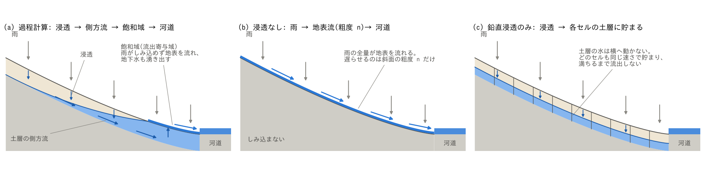

斜面の断面の模式図です(計算結果ではありません)。(a) 過程計算。雨は土層にしみ込み、土層の底
(基岩面)の上にできる飽和帯を斜面の下へ流れます。飽和帯が地表に達した所が飽和域で、そこに
降る雨はしみ込めずに地表を流れ、斜面の上から来た地下水も湧き出します。(b) 浸透なし。雨の
全量が地表を流れ、流出を遅らせるのは斜面の粗度だけです。(c) 鉛直浸透のみ。雨は各セルの土層に
貯まるだけで横へ動かず、土層が満ちるまで流出しません。

| 実際の現象 | ENCflow での表し方 | 設定 |
|---|---|---|
| 雨が土にしみ込む | Green-Ampt の浸透(一定浸透能 200 mm/h)。土層 0.5 m × 有効間隙率 0.2 = 100 mm まで貯まる | `f_gwvertical = 2`、`gw_ksv_mmh`、`sd0`・`sy0` |
| 土層の水が斜面の下へ流れ、谷に集まる | 土層の側方流(飽和帯の Darcy 流。非線形 Boussinesq、8 近傍) | `f_gwlateral = 1`、`gw_ksh_mmh` |
| 土層が満ちた所では雨がしみ込めず、地下水が湧き出す | 浸透は土層の残りの容量まで。側方流で容量を超えた分は、その時刻に地表水へ渡す(復帰流) | 上の 2 つを有効にすると働く |
| 地表の水が谷と河道を流れ下る | 浅水流(力学波)。斜面と河道セルで粗度を分ける | `rn0`・`rn0_rw`、河道マスク `fn_rw` |
| 地表を流れる水が、まだ満ちていない土にしみ込む | 浸透は地表に水のある全セルで毎ステップ働く(雨と、上流から流れてきた水を区別しない) | 同上 |
| 流域の出口から水が出ていく | 谷筋の下流端の 1 セルを水位規定で常に空にする(完全排水口) | `&list_bound_stage` |

比べる 3 つの計算は、地形・河道・雨・出口・時間刻みが同じで、土の扱いだけが違います。

| 計算 | 浸透 | 土層の側方流 | 設定ファイル | 過程計算から変える所 |
|---|---|---|---|---|
| 過程計算 | あり | あり | `param.txt` | — |
| 鉛直浸透のみ | あり | なし | `param_vertical.txt` | `f_gwlateral = 0` |
| 浸透なし | なし | — | `param_surface.txt` | `fn_gwflow` を書かない(地下水を有効にしない) |

各機構の式と設定は、ユーザーガイドの[地下水](../../docs/users_guide/gwflow.md)と
[地下水モデルの解説](../../docs/users_guide/gwflow_models.md)(Green-Ampt は §3、側方流は §4、
第 2 層は §5)、[浅水流計算](../../docs/users_guide/swflow.md)、
[境界条件](../../docs/users_guide/boundary.md)にあります。

## 幾何と設定

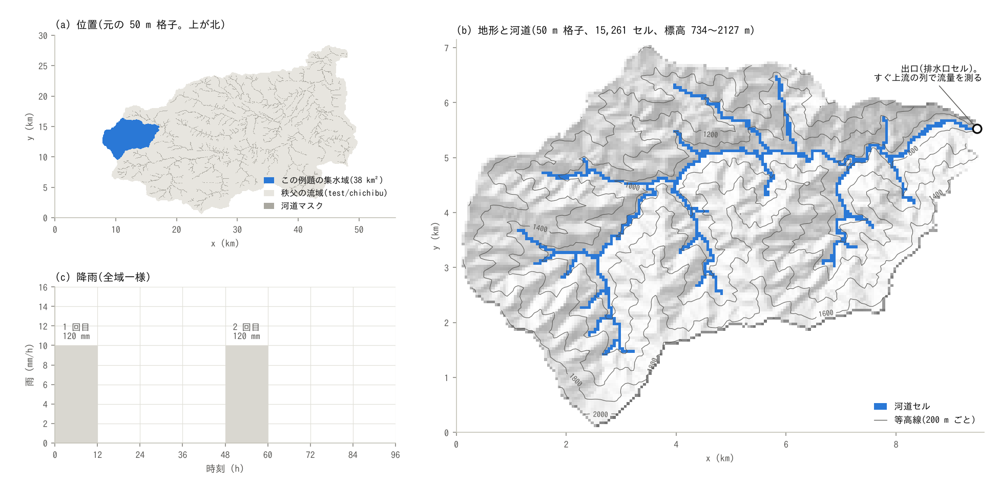

(a) 秩父の流域(test/chichibu の 50 m 格子)の中の位置。(b) 切り出した集水域の地形と河道セル。
(c) 降雨。

- **集水域**: 秩父の流域(荒川上流。[test/chichibu](../../test/chichibu/) の 50 m 格子、
  1120 × 600 セル)の西端の源流域です。2 本の支川の合流点から、南側(右岸側)の支川を 2.3 km
  さかのぼった谷の 1 セル(元の格子の (307, 308))を出口にして、その上流の 13,896 セル
  (34.74 km²)を切り出します(172 × 143 セルの窓)。出口は、右岸と左岸から小さな支川が入る
  すぐ上流です。そこから合流点までの下流は、窪地処理でできた長さ 1.5 km の平らな区間に水が
  たまるので、集水域に入れていません([感度実験の入口](#感度実験の入口))。標高 757〜2127 m、
  最急勾配の中央値は 0.76(37°。セルの 8 割が 0.40〜1.01)です。切り出しは `make`
  (`make_catchment.py`)が行い、標高の値は元のデータのままです。
- **落水線と河道セル**: 各セルの流下先は 8 近傍の最急勾配のセル(D8。O'Callaghan & Mark 1984)
  で決め、窪地処理で埋めた平坦面は Priority-Flood(Barnes ら 2014)の順で流下先を決めます。
  河道セルは、元の河道マスク(国土数値情報の河川から作られたもの)の 730 セルに、その各セル
  から落水線を出口までたどって通ったセル 16 個を加えた 746 セル(5.4 %)です(河道マスクの
  線は標高の谷線から 1 セルずれて途切れる所があります。[注意](#注意))。
- **出口と流量の測り方**: 出口セル (153, 39) は水位規定(河床より低い水位)で常に空にする
  排水口です。集水域は「出口セルの西隣の谷筋のセル (152, 39) の上流」と出口セルからなるので、
  流域を出る水はすべて列 i = 152 から出口セルへ入ります。この列を横切る測線の流量を、流域からの
  流出とします(10 分ごと)。
- **土層**: 厚さ 0.5 m、有効間隙率 0.2(貯められる水は 100 mm)、浸透能(鉛直飽和透水係数)
  200 mm/h、側方飽和透水係数 36000 mm/h(1e-2 m/s)。どれも全域一様で、最初は土層も河道も
  空です。土層厚は、ユーザーガイドの森林流域の目安(0.5〜1.5 m)の範囲の模式値です。側方の
  透水係数は、土の基質の値ではなく、パイプなどの速い経路をまとめた実効値で、ユーザーガイドの
  森林流域の目安(1000〜10000 mm/h)より大きく、出水の速さが洪水到達時間の経験式に近くなる
  大きさに選んでいます([追補](#追補-等価粗度と土層の透水係数))。
- **粗度**: 斜面 0.3、河道セル 0.05(どちらも模式値。斜面は、上に挙げた薄い表面流の文献値
  (草地 0.15〜0.41、林地 0.4〜0.8)の中ほどから選び、河道は礫・巨礫の渓流の程度)。
- **雨**: 10 mm/h × 12 時間 = 120 mm を、0〜12 時と 48〜60 時の 2 回(全域一様)。1 回目は
  乾いた土に、2 回目は 1 回目の水が残る土に降ります。
- **計算**: 地表は力学波、dt = 3 s、96 時間。限界水深 `dd` と摩擦項の水深の下限 `dv` は
  0.1 mm(斜面の薄い流れを止めないため。既定は 1 mm)。分布は 1 時間ごと。掃引では、地表の
  流れを拡散波(`f_govequation = 1`。移流項なし。局所項は残るので、厳密には局所慣性方程式。
  用語は[浅水方程式と力学波・拡散波・運動波](../../docs/users_guide/shallow_water.md#encflow))に
  した計算も行います。

| ケース | 設定ファイル | 内容 |
|---|---|---|
| 過程計算 | `param.txt` | 浸透 + 土層の側方流。斜面の粗度 0.3 |
| 鉛直浸透のみ | `param_vertical.txt` | 側方流なし。斜面の粗度 0.3 |
| 浸透なし | `param_surface.txt` | 地下水なし。斜面の粗度 0.3 |
| 掃引(23 ケース) | `param_sweep_<case>.txt`(`sweep.py` が上の 3 つから作る) | 浸透なしの斜面の粗度(0.6、1、2、3、5、10、30)、浸透なしを拡散波にした粗度(0.3、3、10)、鉛直浸透のみの粗度 3、過程計算の設定を 1 つ変えたもの(斜面の粗度 1、拡散波、側方 3600 mm/h、10000 mm/h、100000 mm/h、土層 1 m、第 2 層 = 土層の側方 3600 mm/h の下に、比湧水量の小さい層を置く、側方飽和透水係数と有効間隙率を 1/10 にして土層厚を 10 倍にした 1 層)、雨を 30 mm/h にした過程計算と浸透なし(粗度 0.3、1、3。降雨は `param_rain30.txt`、dt = 2 s) |
| VZ 流出の土壌柱(2 ケース) | `param_vz.txt`、`param_vz_r30.txt` | 流域の地形を使わず、VZ 流出の参照柱 1 本に同じ雨(10 mm/h と 30 mm/h)を与える。土壌は VZ 流出の試算用の既定(谷 (2023) の竜ノ口山の土壌)。[追補](#鉛直不飽和浸透vzとの関係)の比較用 |
| 貯留関数法のタンク(2 ケース) | `param_sfm.txt`、`param_sfm_r30.txt` | 流域の地形を使わず、貯留関数法のタンク 4 つに同じ雨(10 mm/h と 30 mm/h)を与える。K・P・遅れ時間は、過程計算と VZ 流出の土壌柱の「貯留と流出の関係」と遅れの内訳から決めた値。[追補](#貯留関数法との関係)の比較用 |

## 実行方法

```
cd examples/source_area
make                      # リンクと入力(make_catchment.py。数秒)
make run                  # 基本の 3 ケースを順に計算
make sweep                # 掃引の 23 ケースを順に計算
make vz                   # VZ 流出の土壌柱の 2 ケース(追補の比較用。数秒)
make sfm                  # 貯留関数法のタンクの 2 ケース(追補の比較用。数秒)
python3 plot_results.py   # figs/*.png と数表(引数 en で英語版を en/figs/ に)
```

所要時間の目安です(gfortran -Ofast、4 コアの計算機)。過程計算は 3 スレッドで 6 分です。
1 スレッドで 4 ケースを並べて回すと、過程計算 12〜18 分、鉛直浸透のみ 23〜30 分、浸透なし
25〜37 分、雨 30 mm/h のケースは過程計算 20 分、浸透なし 42〜54 分ほどかかります(浸透なしと、
土層が満ちたあとの鉛直浸透のみは、全セルに水が載るので重くなります。雨 30 mm/h のケースは
時間刻みが小さい分だけ延びます)。ケースを並べて回すには `make -j 4 run OMP_NUM_THREADS=1`、
`make -j 4 sweep OMP_NUM_THREADS=1` とします(26 ケースで 3 時間ほど)。結果はスレッド数に
よりません(過程計算を 1 スレッドと 3 スレッドで回すと、測線の流量・Log・全時刻の分布が
バイト単位で一致します)。`mechanism.png` と `setup.png` は計算結果を使わないので、`make` の
あと計算の前に描けます。掃引が済んでいなければ、済んだケースだけで図と表を作ります。VZ 流出の
土壌柱と貯留関数法のタンクの図と表は、`make vz`、`make sfm` のあとに出ます(流域の入力を使わない
ので、ほかの計算より先に回せます。粗度への換算には掃引の浸透なしの結果を、タンクとの比較には
過程計算と VZ 流出の土壌柱の結果を使います)。

## 結果

### 過程計算: 飽和域の発達と縮小

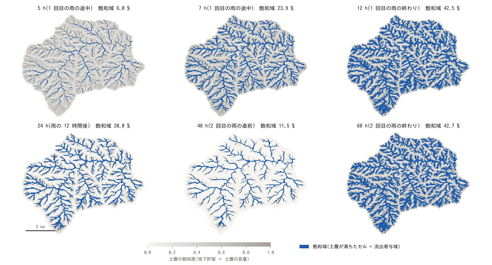

過程計算の土層の飽和度(灰色の濃さ)と飽和域(青)。上段は 1 回目の雨の途中と終わり、下段は
雨の 4 時間後、12 時間後、2 回目の雨の直前(雨の 36 時間後)です。

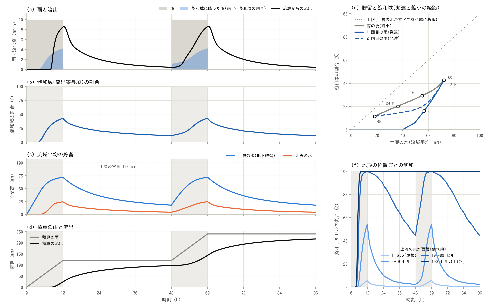

(a) 雨(灰色)と流域からの流出(黒)。青は飽和域に降った雨(雨 × 飽和域の割合)で、流出の
うち残りは土層を通ってきた水です。(b) 飽和域の割合。(c) 流域平均の貯留。(d) 積算の雨と流出。
(e) 土層の水と飽和域の割合の関係(丸は分布の図と同じ時刻。点線は、土層の水がすべて飽和域の
セルにある場合の上限で、図の対角線に当たる。軸の右上の端は、土層の容量 100 mm と全域 100 % の
4 割)。(f) 落水線の上流の集水面積で分けた、飽和したセルの割合。

| 雨 | 雨の前の土層の水 (mm) | 雨の前の飽和域 (%) | 流出高が 1 mm/h を超える時刻 (h) | ピーク (mm/h) | ピークの時刻 (h) | 飽和域の最大 (%) | 48 時間の流出高 (mm) | 雨に対する比 (%) |
|---|---:|---:|---:|---:|---:|---:|---:|---:|
| 1 | 0.0 | 0.0 | 3.8 | 9.99 | 12.0 | 15.3 | 114.9 | 96 |
| 2 | 4.1 | 2.8 | 2.8 | 9.99 | 12.0 | 15.3 | 119.9 | 100 |

時刻は雨の開始からです。ピークは雨と同じ 10 mm/h で、流出が雨と釣り合って頭打ちになった値です
(「ピークの時刻」は雨の終わり)。上流の集水面積(落水線。自セルを含む)の階級ごとの、飽和した
セルの割合は次のとおりです。

| 階級 | セルの割合 (%) | 2 h | 3 h | 12 h | 16 h | 24 h | 48 h |
|---|---:|---:|---:|---:|---:|---:|---:|
| 1 セル(尾根) | 39 | 0 | 0 | 0 | 0 | 0 | 0 |
| 2〜9 セル | 44 | 0 | 2 | 4 | 1 | 0 | 0 |
| 10〜99 セル | 11 | 8 | 48 | 70 | 27 | 4 | 0 |
| 100 セル以上(谷) | 5 | 36 | 96 | 99 | 99 | 86 | 49 |

- **最初の 2 時間は、ほとんど飽和しない**: 雨は全量が土にしみ込み、土層の水は流域平均で雨と
  ほぼ同じ速さで増えます(2 時で 19.6 mm)。地表の水は 0.4 mm で、流出は 0 です。
- **飽和域は谷から上流へ伸びる**: 上流から地下水が集まる谷のセルが先に満ちます(2 時に、集水面積
  100 セル以上の谷の 36 %。流域全体では 2.9 %)。3 時には谷のほぼ全部(96 %)と集水面積 10〜99
  セルの 48 % が満ちて 11.3 % になり、飽和域は谷筋を樹枝状に上流へ伸びます。5 時からはほとんど
  変わらず、雨の終わりの 12 時に 15.3 % です。飽和するのは集水面積 10 セル以上の谷と凹地で
  (10〜99 セルの 70 %、100 セル以上の 99 %)、尾根と斜面のセル(9 セル以下。全体の 83 %)は
  ほとんど飽和しません。
- **土層の水は容量の 3 割で頭打ちになる**: 土層の水は流域平均で 28 mm(容量 100 mm の 28 %)まで
  増えたあと、雨が続いても増えません。斜面のセルは、しみ込む雨と、斜面の下へ流れ出る水が
  釣り合うからです。8 時には流域全体でも入る水と出る水が釣り合い、出口の流出は雨と同じ
  10 mm/h になります(8 時に 9.94 mm/h)。
- **雨が止むと、上流の端から縮む**: 飽和域は雨の 4 時間後に 8.9 %、12 時間後に 5.3 %、
  36 時間後(2 回目の雨の直前)に 2.8 % まで縮みます。集水面積 10〜99 セルの凹地は 70 % →
  27 % → 4 % → 0 % と先に乾き、100 セル以上の谷は 99 % → 99 % → 86 % → 49 % と遅れて、
  下流の太い谷だけが残ります。
- **同じ貯留でも、飽和域の広さは発達と縮小で違う**: 土層の水が流域平均で 18〜20 mm のとき、
  飽和域は 1 回目の雨の途中(2 時)で 2.9 %、雨の後(14 時)で 11.6 % です((e) の経路が輪を描く)。
  雨の間は水が斜面全体に一様に入り、雨の後は水が谷へ寄っているからです((e) の点線に近いほど、
  土層の水が飽和域に集まっている。飽和域のセルにある水は、2 時に土層の水の 15 %、14 時に 66 %、
  2 回目の雨の直前に 70 %)。流域平均の貯留だけでは飽和域の広さは決まりません。
- **出口の流出は、飽和域が谷でつながってから立ち上がる**: 1 回目の雨では、流出は 3 時まで
  ほぼ 0(0.04 mm/h)で、4 時に 1.9 mm/h、5 時に 8.4 mm/h、6 時に 9.6 mm/h と急に増えます。
  飽和域ができはじめる 2 時から、流出高が 1 mm/h を超える 3.8 時までの 2 時間弱の間、飽和域から
  出た水は、まだ満ちていない下流のセルにしみ込み、谷と河道を満たしながら下ります(地表の水は
  3 時に流域平均で 4.9 mm、4 時に 12.3 mm、12 時に 17.0 mm。
  [表せないこと](#このモデルで表せないこと実際の現象との違い))。
- **流出の 9 割近くは土層を通ってきた水**: 飽和域に降った雨は 1 回目 14 mm、2 回目 15 mm で、
  48 時間の流出高の 12 % と 13 % です。残りは、いったんしみ込んで土層を流れ、飽和域で湧き出した
  水です。雨が止むと、流出は 2 時間で 5.7 mm/h、4 時間で 2.8 mm/h に減り、その後は土層からの
  排水でゆっくり減ります(雨の 12 時間後に 0.57 mm/h、36 時間後に 0.09 mm/h)。
- **湿った土に降る 2 回目の雨は、1 時間早く立ち上がる**: 2 回目の雨の前には、飽和域が 2.8 %、
  土層の水が 4 mm 残っています。流出高は 2.8 時間で 1 mm/h を超え(1 回目は 3.8 時間)、
  3 時間目には 1.6 mm/h です(1 回目は 0.04 mm/h)。そのあとは 1 回目と同じ経過をたどり、
  48 時間の流出高は雨と同じ 120 mm です(1 回目は 114.9 mm。差の 5 mm は、乾いた土と河道を
  最初に満たした分)。

流域に貯まっている水の内訳は次のとおりです(流域平均の水深 mm。50 時と 51 時は 2 回目の雨の
2 時間目と 3 時間目)。

| 時刻 (h) | 流出 (mm/h) | 土層の水 | うち飽和域のセル | 地表の水 | うち河道セル | 合計 |
|---:|---:|---:|---:|---:|---:|---:|
| 2 | 0.00 | 19.6 | 2.9 | 0.4 | 0.3 | 20.0 |
| 3 | 0.04 | 25.1 | 11.3 | 4.9 | 2.8 | 30.0 |
| 4 | 1.88 | 27.0 | 14.0 | 12.3 | 8.7 | 39.3 |
| 6 | 9.55 | 27.9 | 15.1 | 16.7 | 12.6 | 44.6 |
| 12 | 9.99 | 28.0 | 15.3 | 17.0 | 12.8 | 45.1 |
| 14 | 5.70 | 17.7 | 11.6 | 11.1 | 9.0 | 28.7 |
| 24 | 0.57 | 7.5 | 5.3 | 3.1 | 2.8 | 10.5 |
| 48 | 0.09 | 4.0 | 2.8 | 1.2 | 1.1 | 5.2 |
| 50 | 0.38 | 20.6 | 5.8 | 4.0 | 3.6 | 24.7 |
| 51 | 1.57 | 25.2 | 11.6 | 8.6 | 6.4 | 33.8 |
| 60 | 9.99 | 28.0 | 15.3 | 17.0 | 12.8 | 45.1 |

- **雨の間に流域に貯まる水は 45 mm**: 流出が雨と釣り合ったとき、流域には 45 mm の水があります
  (土層に 28 mm、地表に 17 mm。地表の水のうち 12.8 mm は河道セル)。雨が止むとこの水が出てきて、
  12 時間後には 10.5 mm に減ります。
- **河道に水が流れている状態で、流域には 5 mm の水がある**: 2 回目の雨の直前(雨の 36 時間後)、
  出口には 0.09 mm/h(0.9 m³/s)が流れていて、流域には 5.2 mm の水があります。土層に 4.0 mm
  (うち 2.8 mm は谷の飽和域のセル)、地表に 1.2 mm(うち 1.1 mm は河道セル)です。1 回目と
  2 回目の雨の流出高の差(5 mm)は、この水を最初に貯めた分に当たります。
- **土層に同じだけ水があっても、乾いた流域では出口に届かない**: 1 回目の雨の 3 時には、土層に
  25.1 mm の水がありますが、地表の水は 4.9 mm で、流出は 0.04 mm/h です。2 回目の雨の 3 時間目
  (51 時)は、土層の水が同じ 25.2 mm で、地表の水が 8.6 mm あり、流出は 1.6 mm/h です。
  1 回目は、乾いていた谷と河道にまだ水が行き渡っていないからです。

過程計算の設定を 1 つずつ変えると、次のようになります(`make sweep` の `process_*`。第 2 層を
置いた計算は[追補](#追補-等価粗度と土層の透水係数)で説明します)。

| 変えた設定 | 雨 | 1 mm/h を超える時刻 (h) | ピーク (mm/h) | ピークの時刻 (h) | 雨の 12 時間後の流出高 (mm/h) | 48 時間の流出高 (mm) | 飽和域の最大 (%) |
|---|---:|---:|---:|---:|---:|---:|---:|
| 基本 | 1 | 3.8 | 9.99 | 12.0 | 0.57 | 114.9 | 15.3 |
| 基本 | 2 | 2.8 | 9.99 | 12.0 | 0.57 | 119.9 | 15.3 |
| 斜面の粗度 0.3 → 1 | 1 | 4.2 | 9.99 | 12.0 | 0.66 | 114.7 | 15.3 |
| 斜面の粗度 0.3 → 1 | 2 | 2.8 | 9.99 | 12.0 | 0.66 | 119.9 | 15.3 |
| 地表の流れを拡散波に | 1 | 3.8 | 9.99 | 12.0 | 0.57 | 114.9 | 15.3 |
| 地表の流れを拡散波に | 2 | 2.8 | 9.99 | 12.0 | 0.57 | 119.9 | 15.3 |
| 側方飽和透水係数 36000 → 3600 mm/h | 1 | 7.5 | 8.72 | 12.2 | 1.94 | 99.0 | 42.5 |
| 側方飽和透水係数 36000 → 3600 mm/h | 2 | 2.5 | 8.79 | 12.2 | 1.94 | 119.9 | 42.7 |
| 側方飽和透水係数 36000 → 10000 mm/h | 1 | 5.5 | 9.77 | 12.0 | 1.20 | 109.5 | 26.8 |
| 側方飽和透水係数 36000 → 10000 mm/h | 2 | 3.0 | 9.78 | 12.0 | 1.20 | 119.9 | 26.8 |
| 側方飽和透水係数 36000 → 100000 mm/h | 1 | 2.8 | 9.99 | 10.7 | 0.35 | 116.8 | 10.0 |
| 側方飽和透水係数 36000 → 100000 mm/h | 2 | 2.5 | 9.99 | 10.7 | 0.35 | 119.7 | 10.0 |
| 土層厚 0.5 → 1 m | 1 | 5.0 | 9.98 | 12.0 | 0.87 | 110.7 | 11.3 |
| 土層厚 0.5 → 1 m | 2 | 2.8 | 9.98 | 12.0 | 0.87 | 119.8 | 11.3 |
| 側方飽和透水係数 36000 → 3600 mm/h + 第 2 層 | 1 | 5.2 | 9.91 | 12.0 | 0.98 | 109.7 | 13.7 |
| 側方飽和透水係数 36000 → 3600 mm/h + 第 2 層 | 2 | 2.7 | 9.91 | 12.0 | 0.98 | 119.8 | 13.7 |

- **地表の粗度と流れの式は、過程計算の流出をあまり変えない**: 斜面の粗度を 0.3 から 1 にすると、
  1 回目の雨で 1 mm/h を超える時刻が 0.4 時間遅れ(3.8 → 4.2 時間)、雨の 12 時間後の流出高が
  0.57 → 0.66 mm/h になる程度で、2 回目の雨の立ち上がりと飽和域の広さは変わりません(浸透なしの
  計算では、同じ粗度の変更で 1 mm/h を超える時刻が 1.8 → 2.7 時間に遅れる)。地表の流れを
  拡散波にした計算は、表の桁まで同じです。地表の粗度が効くのは、水が飽和域と谷を流れる間だけ
  だからです。
- **土層の通しやすさと厚さは、流出を大きく変える**: 側方の透水係数を 1/10 の 3600 mm/h にすると、
  斜面の水が抜けにくくなって、飽和域の最大は 15 → 43 % に広がり、1 回目の雨の立ち上がりは
  3.8 → 7.5 時間に遅れ、12 時間の雨の間に流出が雨と釣り合いません(ピーク 8.7 mm/h)。
  10000 mm/h では 27 % と 5.5 時間、100000 mm/h では 10 % と 2.8 時間です。土層を 1 m にすると、
  土層が運べる水が倍になって飽和域の最大は 11 % に減り、谷のセルを満たすのに要る水も倍に
  なるので、1 回目の雨の立ち上がりは 5.0 時間に遅れます(2 回目は基本と同じ 2.8 時間)。

### 浸透なし・鉛直浸透のみとの比較

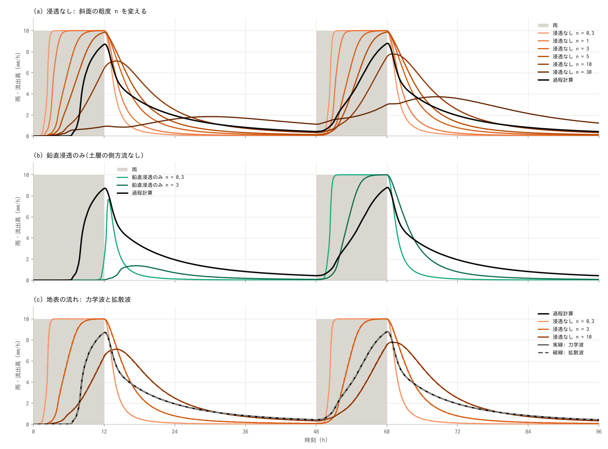

(a) 浸透なしで斜面の粗度 n を変えた計算(粗度 0.6 と 30 は表だけに載せる)。(b) 鉛直浸透のみ。
(c) 地表の流れを拡散波にした計算(破線)。黒は過程計算、灰色は雨です。

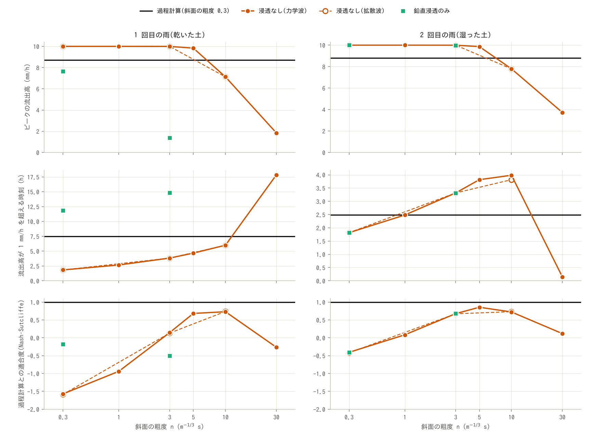

浸透なしの計算の斜面の粗度と、ピークの流出高(上)、流出高が 1 mm/h を超える時刻(中)、
過程計算に対する適合度(下。Nash & Sutcliffe 1970 の係数を雨 1 回分の 48 時間で求めたもの。
1 で完全に一致、0 は過程計算の平均値を当てるのと同じ)。黒の横線は過程計算、緑は鉛直浸透のみ
です。

| ケース | 斜面の粗度 | 雨 | 1 mm/h を超える時刻 (h) | ピーク (mm/h) | ピークの時刻 (h) | 雨の 12 時間後の流出高 (mm/h) | 48 時間の流出高 (mm) | 適合度 |
|---|---:|---:|---:|---:|---:|---:|---:|---:|
| 過程計算 | 0.3 | 1 | 3.8 | 9.99 | 12.0 | 0.57 | 114.9 | — |
| 過程計算 | 0.3 | 2 | 2.8 | 9.99 | 12.0 | 0.57 | 119.9 | — |
| 浸透なし | 0.3 | 1 | 1.8 | 10.00 | 5.7 | 0.12 | 119.7 | 0.71 |
| 浸透なし | 0.3 | 2 | 1.8 | 10.00 | 5.7 | 0.12 | 120.0 | 0.81 |
| 浸透なし | 0.6 | 1 | 2.3 | 10.00 | 7.8 | 0.19 | 119.5 | 0.82 |
| 浸透なし | 0.6 | 2 | 2.2 | 10.00 | 7.8 | 0.19 | 120.0 | 0.91 |
| 浸透なし | 1 | 1 | 2.7 | 10.00 | 10.3 | 0.29 | 119.2 | 0.92 |
| 浸透なし | 1 | 2 | 2.5 | 10.00 | 10.3 | 0.29 | 120.0 | 0.97 |
| 浸透なし | 2 | 1 | 3.3 | 10.00 | 12.0 | 0.54 | 118.2 | 0.99 |
| 浸透なし | 2 | 2 | 3.0 | 10.00 | 12.0 | 0.54 | 120.0 | 0.99 |
| 浸透なし | 3 | 1 | 3.8 | 10.00 | 12.0 | 0.80 | 117.1 | 0.93 |
| 浸透なし | 3 | 2 | 3.3 | 10.00 | 12.0 | 0.79 | 120.0 | 0.93 |
| 浸透なし | 5 | 1 | 4.7 | 9.84 | 12.0 | 1.31 | 114.4 | 0.72 |
| 浸透なし | 5 | 2 | 3.8 | 9.87 | 12.0 | 1.31 | 120.0 | 0.75 |
| 浸透なし | 10 | 1 | 6.0 | 7.12 | 14.2 | 2.49 | 105.7 | 0.20 |
| 浸透なし | 10 | 2 | 4.0 | 7.79 | 12.8 | 2.49 | 119.9 | 0.35 |
| 浸透なし | 30 | 1 | 17.8 | 1.85 | 30.0 | 1.62 | 56.4 | -0.29 |
| 浸透なし | 30 | 2 | 0.2 | 3.73 | 20.5 | 3.56 | 118.2 | -0.05 |
| 浸透なし(拡散波) | 0.3 | 1 | 1.8 | 10.00 | 5.5 | 0.12 | 119.7 | 0.71 |
| 浸透なし(拡散波) | 0.3 | 2 | 1.8 | 10.00 | 5.7 | 0.12 | 120.0 | 0.81 |
| 浸透なし(拡散波) | 3 | 1 | 3.8 | 10.00 | 12.0 | 0.79 | 117.1 | 0.93 |
| 浸透なし(拡散波) | 3 | 2 | 3.3 | 10.00 | 12.0 | 0.79 | 120.0 | 0.93 |
| 浸透なし(拡散波) | 10 | 1 | 6.0 | 7.12 | 14.0 | 2.48 | 105.7 | 0.21 |
| 浸透なし(拡散波) | 10 | 2 | 3.8 | 7.79 | 12.8 | 2.48 | 119.9 | 0.36 |
| 鉛直浸透のみ | 0.3 | 1 | 11.8 | 7.66 | 12.8 | 0.12 | 19.7 | -0.18 |
| 鉛直浸透のみ | 0.3 | 2 | 1.8 | 10.00 | 5.7 | 0.12 | 120.0 | 0.81 |
| 鉛直浸透のみ | 3 | 1 | 14.8 | 1.37 | 17.5 | 0.71 | 17.1 | -0.38 |
| 鉛直浸透のみ | 3 | 2 | 3.3 | 10.00 | 12.0 | 0.79 | 120.0 | 0.93 |

時刻は雨の開始からです。ピークが雨と同じ 10 mm/h のケースは、流出が雨と釣り合って頭打ちに
なっていて、「ピークの時刻」は頭打ちに達した時刻です(過程計算は雨の終わりまでわずかに増え続ける
ので 12.0 時)。粗度 30 の 2 回目の雨で 1 mm/h を超える時刻が 0.2 時間なのは、1 回目の雨の水が
まだ 1 mm/h あまり出ているためです。

地表に載っている水の量は次のとおりです(流域平均の貯留高の最大と、雨の終わりの河道セル以外の
セルの水深)。

| ケース | 斜面の粗度 | 地表の水の最大 (mm) | 12 h の水深の平均 (mm) | 12 h の水深の最大 (m) | 60 h の水深の平均 (mm) |
|---|---:|---:|---:|---:|---:|
| 過程計算 | 0.3 | 17.0 | 4.5 | 0.82 | 4.5 |
| 過程計算 | 1 | 21.5 | 9.2 | 1.21 | 9.2 |
| 過程計算(拡散波) | 0.3 | 16.9 | 4.5 | 0.82 | 4.5 |
| 過程計算(側方 3600 mm/h) | 0.3 | 18.4 | 6.7 | 0.79 | 6.7 |
| 過程計算(側方 10000 mm/h) | 0.3 | 18.2 | 5.8 | 0.82 | 5.8 |
| 過程計算(側方 100000 mm/h) | 0.3 | 16.1 | 3.5 | 0.82 | 3.5 |
| 過程計算(土層 1 m) | 0.3 | 16.4 | 3.8 | 0.82 | 3.8 |
| 過程計算(側方 3600 mm/h + 第 2 層) | 0.3 | 16.8 | 4.3 | 0.82 | 4.3 |
| 浸透なし | 0.3 | 23.0 | 10.6 | 0.82 | 10.6 |
| 浸透なし | 0.6 | 28.3 | 16.1 | 1.04 | 16.1 |
| 浸透なし | 1 | 34.0 | 22.1 | 1.21 | 22.1 |
| 浸透なし | 2 | 45.4 | 34.2 | 1.62 | 34.2 |
| 浸透なし | 3 | 55.0 | 44.2 | 1.92 | 44.2 |
| 浸透なし | 5 | 71.4 | 61.6 | 2.40 | 61.6 |
| 浸透なし | 10 | 101.6 | 93.2 | 2.92 | 95.2 |
| 浸透なし | 30 | 160.8 | 117.8 | 0.60 | 162.5 |
| 浸透なし(拡散波) | 0.3 | 22.8 | 10.6 | 0.82 | 10.6 |
| 浸透なし(拡散波) | 3 | 54.6 | 44.2 | 1.92 | 44.2 |
| 浸透なし(拡散波) | 10 | 101.3 | 93.2 | 2.92 | 95.2 |
| 鉛直浸透のみ | 0.3 | 23.0 | 10.5 | 0.81 | 10.6 |
| 鉛直浸透のみ | 3 | 55.0 | 19.2 | 0.10 | 44.2 |
| 過程計算(雨 30 mm/h) | 0.3 | 33.4 | 10.9 | 1.65 | 11.0 |
| 浸透なし(雨 30 mm/h) | 0.3 | 42.9 | 20.5 | 1.68 | 20.5 |
| 浸透なし(雨 30 mm/h) | 1 | 64.2 | 42.7 | 1.92 | 42.7 |
| 浸透なし(雨 30 mm/h) | 3 | 104.8 | 85.4 | 3.05 | 85.4 |

- **粗度 0.3 の浸透なしは、早く立ち上がり、早く引く**: 流出高は 1.8 時間で 1 mm/h を超え、
  2.8 時間で雨の 9 割に達します(過程計算は 3.8 時間と 5.5 時間)。雨が止むと数時間で引き、
  12 時間後は 0.12 mm/h です(過程計算は 0.57 mm/h)。1 回目と 2 回目の応答は同じです。土を
  通らないので、乾いた土を満たす時間も、土層からの排水による逓減もありません。
- **粗度を大きくすると過程計算に近づき、粗度 2 でほぼ重なる**: 斜面の粗度を上げるほど、
  立ち上がりが遅れ、逓減が緩やかになります。試した 8 つの中で過程計算に最も近いのは、どちらの
  雨でも粗度 2 で、適合度は 0.99 と 0.99 です(粗度 1 は 0.92 と 0.97、粗度 3 は 0.93 と 0.93)。
  粗度 5 以上では行き過ぎます(粗度 10 は、1 回目のピークが 7.1 mm/h に下がり、雨の終わりの
  2 時間後になる)。
- **合う粗度 2 は、実務の等価粗度の数倍**: 粗度 2 は、過程計算の斜面の粗度 0.3 の 7 倍で、
  実務の山地の等価粗度(0.4〜0.8 程度)の 2.5〜5 倍です。実務の値に当たる粗度 0.6 の適合度は
  0.82 と 0.91 で、流出が過程計算より 1.5〜2 時間早くなります(1 mm/h を超える時刻が 2.3 時間、
  雨の 9 割に達する時刻が 3.5 時間。過程計算は 3.8 時間と 5.5 時間)。粗度 2 のとき、斜面の
  セルには雨の終わりに平均 34 mm の水が載っています。過程計算が斜面に持つ水(土層と地表の合計
  29 mm)と同じくらいです。大きな粗度は、土層が貯めていた水を、地表の水の層として貯める
  ことで、流出を遅らせています。
- **要る粗度は、土層が貯める水の量で決まる**: 浸透なしの計算の雨の終わりの斜面の水深は、粗度の
  ほぼ 0.6 乗に比例して増えます(下の表。マニングの等流の水深 h = (n q / √I)^0.6 の関係。q は
  単位幅流量、I は勾配)。過程計算が雨の終わりに斜面(河道セル以外)に持っている水は、土層と
  地表を合わせて 29 mm で、これを地表だけで持つ粗度は 0.3 × (29.0 / 10.6)^(5/3) = 1.6 です。
  最も近い粗度 2 は、この値に近くなっています。水を 2 倍貯めるには粗度を 3.2 倍にする必要が
  あるので、土層が貯める水が多いほど、要る粗度は急に大きくなります
  ([土層の通しやすさと等価粗度](#土層の通しやすさと等価粗度))。

| 斜面の粗度 | 0.3 | 0.6 | 1 | 2 | 3 | 5 | 10 | 30 |
|---|---:|---:|---:|---:|---:|---:|---:|---:|
| 雨の 50 % に達する時刻 (h) | 2.5 | 2.8 | 3.3 | 4.5 | 5.5 | 7.2 | 10.8 | — |
| 雨の 90 % に達する時刻 (h) | 2.8 | 3.5 | 4.3 | 6.2 | 7.5 | 10.0 | — | — |
| 12 h の斜面の水深の平均 (mm) | 10.6 | 16.1 | 22.1 | 34.2 | 44.2 | 61.6 | 93.2 | 117.8 |
| 粗度 0.3 の水深 × (n / 0.3)^0.6 (mm) | 10.6 | 16.1 | 21.8 | 33.1 | 42.2 | 57.3 | 86.9 | 167.9 |

浸透なしの計算の 1 回目の雨の値です(— は雨の間に達しない)。水深は、粗度 3〜10 で 0.6 乗の
関係より 5〜7 % 多く、粗度 30 は、雨の終わりにまだ流出が雨と釣り合っていないので少なく
なっています。

- **立ち上がりは、過程計算の方が遅く始まり、急に上がる**: 粗度 2 の浸透なしは、流出高が
  1 mm/h を超えるのが 3.3 時間、雨の 9 割に達するのが 6.2 時間で、その間に 2.9 時間かかります。
  過程計算は 3.8 時間と 5.5 時間で、1.7 時間しかかかりません(4 時に 1.9、5 時に 8.4、6 時に
  9.6 mm/h)。過程計算の流出は、飽和域が谷でつながるまで出ず、つながると急に増えるからです。
  雨の 12 時間後の流出高は 0.54 mm/h と 0.57 mm/h で、逓減はほぼ同じです。
- **乾いた土と湿った土の違いは、粗度では表せない**: 浸透なしの計算に土の記憶はなく、2 回の雨への
  応答の違いは、地表に残った水の分だけです(粗度 2 では、1 mm/h を超える時刻が 3.3 → 3.0 時間)。
  過程計算の違い(3.8 → 2.8 時間)はそれより大きく、粗度 2 の立ち上がりは、1 回目の雨には
  0.5 時間早く、2 回目の雨には 0.2 時間遅くなります。土層が水を通しにくい設定では、この違いが
  合う粗度の違いとして表れます(側方 3600 mm/h で、1 回目の雨に 10、2 回目の雨に 5。
  [次の節](#土層の通しやすさと等価粗度))。
- **合う粗度は、土層の条件で変わる**: 合わせた粗度は地表の性質ではなく、土層の通しやすさ・
  厚さの代わりの値で、それらが変われば合わせ直す必要があります
  ([次の節](#土層の通しやすさと等価粗度))。
- **鉛直浸透のみは、満ちるまで出ず、満ちると全域から出て、入った水は戻らない**: 土層の側方流を
  切ると、どのセルの土層も同じ速さで貯まり、積算の雨が容量の 100 mm に達する 10 時に全セルが
  同時に飽和します(飽和域が 0 から 100 % に変わる)。そのあとの雨 20 mm だけが地表を流れ、
  出口の流出は 11.8 時に 1 mm/h を超えて、雨が止んだあとの 12.8 時に 7.7 mm/h のピークになります
  (48 時間の流出高は 20 mm。過程計算は 114.9 mm)。土層に入った 100 mm は斜面を下らないので、
  出てきません。2 回目の雨は、土層が満ちたままなので、粗度 0.3 の浸透なしと同じ応答です
  (1.8 時間で 1 mm/h を超え、10 mm/h で頭打ち)。96 時間の流出高は 140 mm で、過程計算の
  235 mm より 95 mm 少なくなります。斜面の粗度を 3 にすると、1 回目のピークが
  1.4 mm/h に下がって 5 時間近く遅れますが、出てくる水の量はほとんど変わりません(48 時間で
  17 mm)。谷へ水を集めて飽和域を作り、雨のあとも流出を続けさせているのは、土層の側方流です。
- **地表の流れの式(力学波と拡散波)の違いは小さい**: 浸透なしの粗度 0.3、3、10 を
  拡散波で計算すると、流出高が 1 mm/h を超える時刻・ピーク・48 時間の流出高は、力学波と表の桁で
  同じか、ほぼ同じです(粗度 10 のピークはどちらも 7.12 mm/h。2 回目の雨で 1 mm/h を超える
  時刻が 3.8 時間と 4.0 時間)。適合度の違いも 0.01 以下です。過程計算も同じです(上の表)。
  この例題の雨の強さと流量では、移流項を入れるかどうかより、土の扱いと粗度の方がはるかに
  効きます。

### 土層の通しやすさと等価粗度

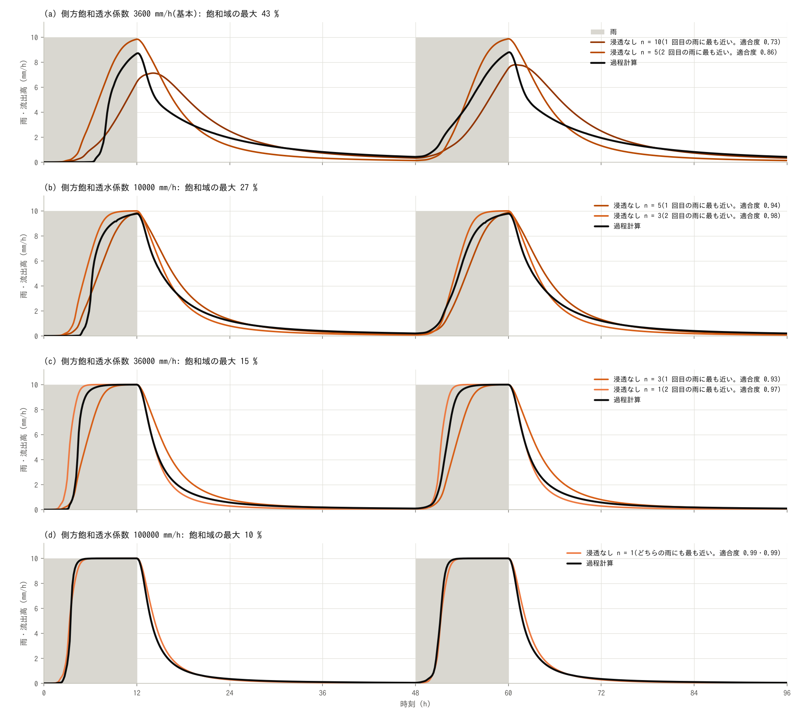

過程計算(黒)の側方飽和透水係数を (a) 3600 mm/h、(b) 10000、(c) 36000(基本)、(d) 100000 mm/h に
して、それぞれに最も近い浸透なしの計算(橙)を重ねたものです。灰色は雨です。

| 側方飽和透水係数 (mm/h) | 飽和域の最大 (%) | 雨の終わりに斜面にある水 (mm) | 同じ水を地表に貯める粗度 | 流出が雨の 90 % に達する時刻 (h) | 最も近い粗度(適合度): 1 回目の雨 | 2 回目の雨 |
|---:|---:|---:|---:|---:|---:|---:|
| 3600 | 42.7 | 77.2 | 8.2 | — / — | 10 (0.73) | 5 (0.86) |
| 10000 | 26.8 | 52.7 | 4.3 | 9.0 / 8.8 | 5 (0.94) | 3 (0.98) |
| 36000(基本) | 15.3 | 29.0 | 1.6 | 5.5 / 5.3 | 2 (0.99) | 2 (0.99) |
| 100000 | 10.0 | 18.0 | 0.7 | 4.0 / 4.0 | 1 (0.99) | 1 (0.99) |
| 3600 + 第 2 層 | 13.7 | 39.9 | 2.7 | 7.3 / 7.3 | 3 (0.96) | 3 (0.98) |

「雨の終わりに斜面にある水」は、12 時の河道セル以外の土層の水と地表の水の合計、「同じ水を地表に
貯める粗度」は、それを上の 0.6 乗の関係で粗度に直した値です。到達時刻は 1 回目 / 2 回目の雨で、
— は雨の間に達しないことを示します。最後の行は、土層の側方を 3600 mm/h にして、その下に第 2 層を
置いた計算です([追補](#追補-等価粗度と土層の透水係数))。過程計算の条件ごとの、各粗度の浸透なしの
適合度(1 回目 / 2 回目の雨)は次のとおりです。

| 過程計算の条件 | n = 0.3 | n = 0.6 | n = 1 | n = 2 | n = 3 | n = 5 | n = 10 | n = 30 |
|---|---:|---:|---:|---:|---:|---:|---:|---:|
| 基本(土層 0.5 m、側方 36000 mm/h、斜面の粗度 0.3) | 0.71 / 0.81 | 0.82 / 0.91 | 0.92 / 0.97 | 0.99 / 0.99 | 0.93 / 0.93 | 0.72 / 0.75 | 0.20 / 0.35 | -0.29 / -0.05 |
| 斜面の粗度 1 | 0.62 / 0.74 | 0.75 / 0.84 | 0.87 / 0.93 | 0.99 / 1.00 | 0.97 / 0.97 | 0.80 / 0.83 | 0.28 / 0.43 | -0.29 / -0.03 |
| 側方 3600 mm/h | -1.57 / -0.41 | -1.26 / -0.16 | -0.94 / 0.08 | -0.32 / 0.46 | 0.15 / 0.68 | 0.68 / 0.86 | 0.73 / 0.72 | -0.26 / 0.12 |
| 側方 10000 mm/h | 0.08 / 0.40 | 0.26 / 0.56 | 0.45 / 0.71 | 0.76 / 0.91 | 0.92 / 0.98 | 0.94 / 0.95 | 0.51 / 0.62 | -0.28 / 0.04 |
| 側方 100000 mm/h | 0.90 / 0.94 | 0.97 / 0.99 | 0.99 / 0.99 | 0.91 / 0.91 | 0.79 / 0.81 | 0.55 / 0.61 | 0.06 / 0.22 | -0.30 / -0.08 |
| 土層 1 m | 0.41 / 0.64 | 0.55 / 0.76 | 0.69 / 0.86 | 0.91 / 0.98 | 0.97 / 0.99 | 0.87 / 0.87 | 0.37 / 0.49 | -0.27 / -0.01 |
| 側方 3600 mm/h + 第 2 層 | 0.36 / 0.63 | 0.50 / 0.75 | 0.65 / 0.85 | 0.89 / 0.97 | 0.96 / 0.98 | 0.87 / 0.87 | 0.37 / 0.48 | -0.27 / -0.01 |

- **土層が水を通しにくいほど、合う粗度は大きくなり、形も合わなくなる**: 側方の透水係数を下げると、
  土層に貯まる水と飽和域が増え、出水が遅れます。最も近い粗度(1 回目の雨と 2 回目の雨)は、
  100000 mm/h で 1 と 1、36000 mm/h で 2 と 2、10000 mm/h で 5 と 3、3600 mm/h で 10 と 5 と
  大きくなり、適合度は 0.99 と 0.99(100000 mm/h と 36000 mm/h)から 0.73 と 0.86 に下がります。
  どの場合も、最も近い粗度は「同じ水を地表に貯める粗度」(0.7、1.6、4.3、8.2)の前後です。
  3600 mm/h の過程計算は、飽和域が流域の 43 % に広がり、12 時間の雨の間に流出が雨と
  釣り合いません(ピーク 8.7 mm/h)。雨の前の湿り具合による違いも大きくなります(1 mm/h を
  超える時刻は 1 回目 7.5 時間、2 回目 2.5 時間)。
- **実務の等価粗度に当たるのは、土層が水を速く通す場合**: 浸透なしの計算で流出が雨の 90 % に
  達する時刻は、粗度 0.3 で 2.8 時間、1 で 4.3 時間です。実務の山地の等価粗度(0.4〜0.8 程度)は
  この間にあり、洪水到達時間の経験式のこの流域での値(4.7 時間)は、粗度 1 の値に近くなって
  います。過程計算がこの速さになるのは、側方の透水係数が 36000〜100000 mm/h のとき
  (5.5 時間と 4.0 時間)で、10000 mm/h では 9.0 時間、3600 mm/h では 12 時間の雨の間に 90 % に
  達しません。最も近い粗度でみると、実務の値に重なるのは 100000 mm/h(粗度 0.6 の適合度が
  0.97 と 0.99、粗度 1 が 0.99 と 0.99)で、36000 mm/h は実務の値の数倍の粗度 2 に当たります。
  基本の 36000 mm/h は、洪水到達時間の式の値を挟む 36000〜100000 mm/h のうち、飽和域が広く、
  発達と縮小を見やすい側の値です。実務の等価粗度は斜面長の取り方と組になった値で、洪水到達
  時間の定義も「雨の 90 % に達する時刻」と同じではないので、この対応は目安です。
- **土層が厚いと、合う粗度は大きくなる**: 土層を 1 m にした過程計算に最も近い粗度は 3(適合度
  0.97 と 0.99)で、基本の 2 より大きくなります。乾いた土を満たすのに要る雨が増える分は、実務では
  有効雨量(損失)で扱う部分で、粗度が受け持つのは流出になった水の遅れです。

### 雨の強さと飽和域・等価粗度

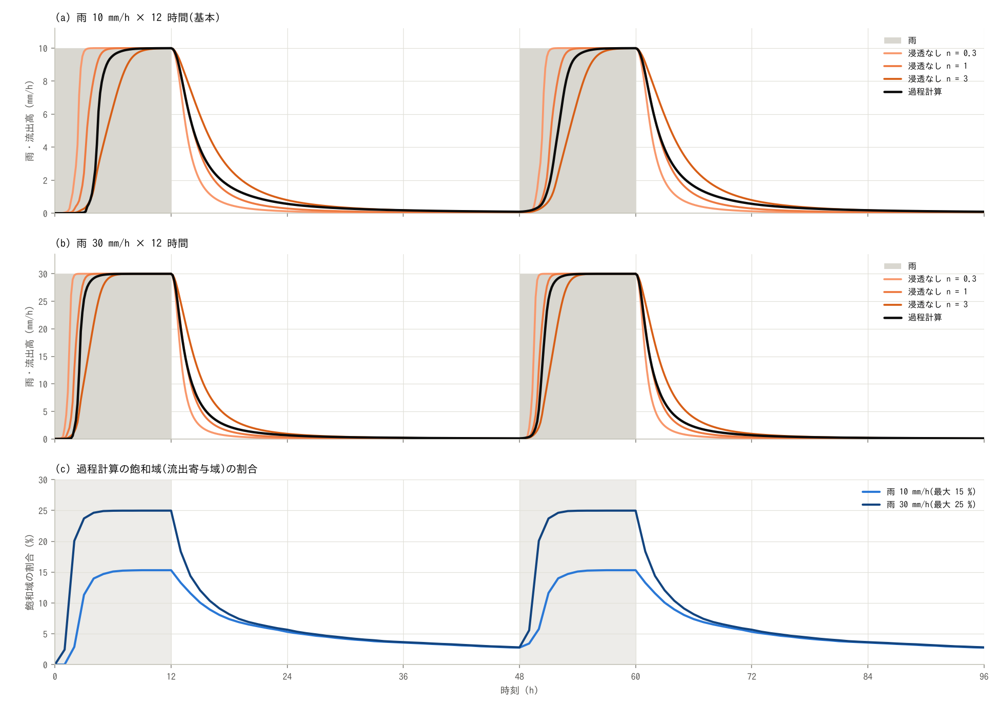

(a) 基本の雨(10 mm/h)と (b) 強い雨(30 mm/h。`make sweep` の `process_r30` と `surface_r30_*`)の、
過程計算(黒)と浸透なし(橙。粗度 0.3、1、3)。灰色は雨です。(c) 過程計算の飽和域の割合。

| 雨 (mm/h) | 飽和域の最大 (%) | 雨の 10 % に達する時刻 (h) | 50 % (h) | 90 % (h) | 48 時間の流出高 ÷ 雨 (%) | 12 h の土層の水 (mm) | 斜面の段の遅れ (h) | 同じ遅れになる粗度 | 洪水到達時間の式 (h) |
|---:|---:|---:|---:|---:|---:|---:|---:|---:|---:|
| 10 | 15.3 | 3.8 / 2.8 | 4.5 / 4.0 | 5.5 / 5.3 | 96 / 100 | 28.0 | 3.3 | 1.7 | 4.7 |
| 30 | 25.0 | 2.2 / 1.8 | 2.7 / 2.5 | 3.3 / 3.3 | 98 / 100 | 46.0 | 2.0 | 1.6 | 3.2 |

時刻は雨の開始から(1 回目 / 2 回目の雨)です。「斜面の段の遅れ」と「同じ遅れになる粗度」は
[追補](#追補-等価粗度と土層の透水係数)で説明します(ここでは、両方の雨で計算した粗度 0.3、1、3 の
遅れから内挿した値)。浸透なしの計算は次のとおりです(適合度は、同じ雨の過程計算に対する
1 回目 / 2 回目の雨の値)。

| 雨 (mm/h) | 斜面の粗度 | 雨の 50 % に達する時刻 (h) | 90 % (h) | 12 h の斜面の水深の平均 (mm) | 斜面の段の遅れ (h) | 河道の段の遅れ (h) | 適合度 |
|---:|---:|---:|---:|---:|---:|---:|---:|
| 10 | 0.3 | 2.5 | 2.8 | 10.6 | 1.1 | 1.5 | 0.71 / 0.81 |
| 10 | 1 | 3.3 | 4.3 | 22.1 | 2.3 | 1.5 | 0.92 / 0.97 |
| 10 | 3 | 5.5 | 7.5 | 44.2 | 4.7 | 1.6 | 0.93 / 0.93 |
| 30 | 0.3 | 1.5 | 1.8 | 20.5 | 0.7 | 0.9 | 0.87 / 0.90 |
| 30 | 1 | 2.2 | 2.8 | 42.7 | 1.5 | 0.9 | 0.98 / 0.99 |
| 30 | 3 | 3.5 | 4.8 | 85.4 | 3.0 | 1.0 | 0.94 / 0.94 |

- **雨が強いほど、飽和域は上流へ広がる**: 雨を 3 倍にすると、飽和域の最大は 15.3 % から 25.0 % に
  広がります。飽和域は、上流から集まる水が土層の運べる量(透水係数 × 土層厚 × 勾配)を超える
  所にでき、雨が強いほど、より小さい集水面積でこの量を超えるからです。広がり方は雨の強さほど
  ではありません(雨を 3 倍にして 1.6 倍)。雨が止んだあとの縮み方は雨の強さによらず、雨の
  12 時間後はどちらも 5 % 台、36 時間後は 2.8 % です。
- **出水は早まる**: 流出が雨の 90 % に達する時刻は 5.5 → 3.3 時間に、乾いた土で雨の 10 % を
  超える時刻は 3.8 → 2.2 時間に早まります。洪水到達時間の経験式の値も 4.7 → 3.2 時間で、
  過程計算はどちらの雨でもこの式に近い速さです。土層の水は 28 → 46 mm に増えますが、雨の 3 倍には
  なりません(飽和域では土層の容量で頭打ちになるため)。
- **合う粗度は、雨の強さではあまり変わらない**: 浸透なしの計算も、雨が強いほど早まります
  (粗度 1 の斜面の段の遅れは 2.3 → 1.5 時間。0.63 倍で、マニングの等流の関係 3^-0.4 = 0.64 倍に
  合う)。過程計算の斜面の段の遅れは 3.3 → 2.0 時間(0.60 倍)と同じくらい早まるので、同じ遅れに
  なる粗度は 1.7 → 1.6 とほとんど変わりません。適合度でみると、雨 10 mm/h では粗度 1
  (0.92 と 0.97)と粗度 3(0.93 と 0.93)の間の粗度 2 が最も近く(0.99 と 0.99)、30 mm/h では
  粗度 1(0.98 と 0.99)が粗度 3(0.94 と 0.94)より近くなって、合う粗度は少し小さい側に寄ります。雨が
  強いと、乾いた土を満たす時間が短くなって、1 回目と 2 回目の雨の違いも小さくなります(雨の
  10 % に達する時刻の差が 1.0 → 0.4 時間)。

## 追補: 等価粗度と土層の透水係数

基本の過程計算に最も近い浸透なしの粗度は 2 で、実務の山地の等価粗度(0.4〜0.8 程度)の数倍
です。この対応は、土層の側方の透水係数を 36000 mm/h(1e-2 m/s)という、ユーザーガイドの
森林流域の目安(1000〜10000 mm/h)より大きい値にして得られています。目安の範囲の 3600 mm/h では、
最も近い粗度は 10 と 5(1 回目の雨と 2 回目の雨)で、実務の値より 1 桁大きくなり、100000 mm/h では
1 で、実務の値に重なります。この節では、粗度と透水係数のこの関係を、計算結果から整理します。

### 遅れは斜面にあり、粗度の 1 桁は遅れの 4 倍に当たる

雨から出口までの遅れ(雨と流出の重心の差。2 回目の雨の 48 時間)を、河道セルへの流入を境に
「斜面の段」(雨 → 河道セル)と「河道の段」(河道セル → 出口)に分けます。河道セルへの流入は、
1 時間ごとの分布から、雨 − 斜面のセル(河道セル以外)にある水の増加 として求めます
(`plot_results.py` の `stages`)。

| 計算 | 斜面の段 (h) | 河道の段 (h) | 合計 (h) | 雨の終わりに斜面にある水 (mm) | 斜面の段が同じになる粗度 |
|---|---:|---:|---:|---:|---:|
| 浸透なし n = 0.3 | 1.1 | 1.5 | 2.6 | 10.6 | — |
| 浸透なし n = 0.6 | 1.7 | 1.5 | 3.2 | 16.1 | — |
| 浸透なし n = 1 | 2.3 | 1.5 | 3.9 | 22.1 | — |
| 浸透なし n = 2 | 3.6 | 1.6 | 5.2 | 34.2 | — |
| 浸透なし n = 3 | 4.7 | 1.6 | 6.3 | 44.2 | — |
| 浸透なし n = 5 | 6.6 | 1.5 | 8.1 | 61.6 | — |
| 浸透なし n = 10 | 10.1 | 1.4 | 11.5 | 95.2 | — |
| 過程計算 側方 3600 mm/h | 8.7 | 1.4 | 10.1 | 77.3 | 7.9 |
| 過程計算 側方 10000 mm/h | 6.0 | 1.6 | 7.6 | 52.7 | 4.3 |
| 過程計算 側方 36000 mm/h(基本) | 3.3 | 1.8 | 5.1 | 29.0 | 1.7 |
| 過程計算 側方 100000 mm/h | 1.9 | 1.9 | 3.9 | 18.0 | 0.7 |
| 過程計算 側方 3600 mm/h + 第 2 層 | 4.8 | 1.9 | 6.7 | 39.9 | 3.1 |

「雨の終わりに斜面にある水」は、60 時の斜面のセルの地表・土層・第 2 層の水の合計です(斜面の
セルの平均の水深)。粗度 30 の浸透なしは 48 時間で水が出きらないので、表から除いています。

- **違いは斜面の段にある**: 河道の段は、どの計算でも 1.4〜1.9 時間です。斜面の段は、浸透なしの
  粗度 0.3 で 1.1 時間、粗度 10 で 10.1 時間、過程計算は側方 100000 mm/h で 1.9 時間、3600 mm/h で
  8.7 時間と、計算によって大きく違います。
- **粗度は、斜面の遅れのほぼ 5/3 乗に当たる**: 浸透なしの斜面の段の遅れは、粗度の 0.62〜0.65 乗で
  増えます(マニングの等流なら 0.6 乗)。粗度を 10 倍にして遅れが 4 倍あまりになる関係で、逆に
  いうと、斜面の遅れが 2 倍違えば粗度は約 3 倍、4 倍違えば約 10 倍違います。粗度の 1 桁の違いは、
  斜面の遅れの 4 倍の違いです。
- **斜面の遅れは、斜面にある水の量でもある**: 流出が雨と釣り合っているとき、斜面の遅れは
  「斜面にある水 ÷ 雨の強さ」です。斜面の段が同じになる粗度(3600、10000、36000、100000 mm/h で
  7.9、4.3、1.7、0.7)は、同じ水を地表に貯める粗度(8.2、4.3、1.6、0.7)と合います。
- **実務の値に当たる斜面の遅れは 2 時間前後**: 粗度 0.6〜1 の浸透なしの斜面の段は 1.7〜2.3 時間、
  斜面の水は 16〜22 mm です。基本の過程計算(3.3 時間、29 mm)はその 1.3〜2 倍、3600 mm/h の
  過程計算(8.7 時間、77 mm)は 3.5〜5 倍です。等価粗度が 1 桁大きくなるのは、土層が、実務の値が
  想定するより 4 倍ほど長く水を斜面に留めるときです。

### 実務の等価粗度が表しているもの

- **有効降雨から直接流出までの遅れ**: 等価粗度法は、損失を引いた有効降雨を斜面に流して、基底流を
  分けた直接流出に合わせます。土を満たすのに使われる雨と、あとからゆっくり出てくる水は、粗度では
  なく、損失と基底流の側で扱います。この例題の比較は、雨の全量を流して、逓減まで含む流出の全体に
  合わせているので、粗度は、乾いた土を満たす時間と土層からの遅い排水も受け持ちます。土層が
  水を通しにくい設定で、1 回目の雨(乾いた土)に合う粗度が 2 回目より大きくなるのは、このため
  です(3600 mm/h で 10 と 5、10000 mm/h で 5 と 3)。
- **大きな出水での値**: 実務の値は洪水の記録から決められます。この例題の過程計算では、雨の強さを
  3 倍にしても合う粗度はあまり変わりませんが、乾いた土の影響は雨が強いほど小さくなります
  ([雨の強さと飽和域・等価粗度](#雨の強さと飽和域等価粗度))。
- **速い出水を前提にした値**: 洪水到達時間の経験式のこの流域での値(雨 10 mm/h で 4.7 時間)は、
  浸透なしの粗度 1(雨の 90 % に達する時刻 4.3 時間)に当たります。実務の等価粗度は、斜面の水が
  2 時間前後で河道に出てくる流域の値です。土層の側方流だけでこの速さを出すには、土の基質の
  透水係数では足りず、この例題では 36000〜100000 mm/h が要ります。

### 透水係数が大きいことの意味: 速い水か、速い波か

この計算の土層の側方流は、飽和帯の厚さを h、透水係数を K、有効間隙率(比湧水量)を s_y として、
流量 = K × h × 勾配、貯留 = s_y × h で表されます
([地下水モデルの解説](../../docs/users_guide/gwflow_models.md) §4)。勾配が急な斜面では、次の
2 つの量が応答を決めます。

- **応答が斜面を伝わる速さ**(運動波の波速)= K × 勾配 ÷ s_y。基本の設定(勾配の中央値 0.76)で
  137 m/h、3600 mm/h では 14 m/h です。
- **土層が運べる水の上限** = K × 土層厚 × 勾配。上流から集まる水がこれを超える所が飽和域に
  なります。

どちらも K だけでは決まりません。K を 1/10 にしても、s_y を 1/10 に、層の厚さを 10 倍にすれば、
波速も、運べる水の上限も、貯められる水(s_y × 厚さ)も変わりません(1 層のままこう変えた計算は、
[追補 2](#追補-2-1-層の側方飽和透水係数は何と等価な値か)の `process_thick`)。この層を、水を通しにくい
土層の下に置いたのが `process_l2` です。土層の側方を 3600 mm/h に下げ、その下に、厚さ 5 m・比湧水量 0.02・側方
3600 mm/h の第 2 層を置きます(土層 → 第 2 層の浸透能は 200 mm/h で、しみ込んだ水はすぐ第 2 層へ
移ります。第 2 層が満ちた所では水が土層に戻り、土層も満ちると地表に出ます)。

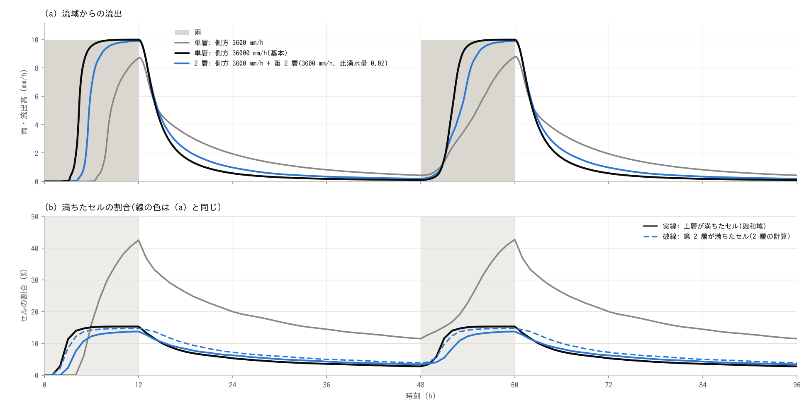

(a) 流域からの流出。灰色の線は土層の側方 3600 mm/h の単層、黒は基本(36000 mm/h の単層)、青は
土層の側方 3600 mm/h の下に第 2 層を置いた計算。(b) 満ちたセルの割合(実線は土層、破線は第 2 層)。

| 時刻 (h) | 流出 (mm/h) | 第 2 層が満ちたセル | 土層が満ちたセル(飽和域) | 第 2 層の水 | 土層の水 | 地表の水 |
|---:|---:|---:|---:|---:|---:|---:|
| 2 | 0.00 | 2.2 | 0.0 | 19.6 | 0.4 | 0.0 |
| 3 | 0.00 | 8.5 | 2.3 | 24.6 | 4.8 | 0.6 |
| 4 | 0.04 | 12.2 | 7.6 | 26.8 | 9.5 | 3.7 |
| 6 | 6.67 | 14.2 | 12.2 | 28.3 | 13.2 | 14.6 |
| 12 | 9.91 | 14.7 | 13.7 | 28.7 | 14.4 | 16.8 |
| 24 | 0.98 | 7.2 | 6.2 | 9.1 | 6.8 | 4.3 |
| 48 | 0.18 | 3.9 | 3.4 | 4.9 | 3.7 | 1.7 |

- **第 2 層を伝わる波は、10 倍の透水係数の土層と同じ速さで谷を満たす**: 第 2 層が満ちたセルは、
  2 時に 2.2 %、3 時に 8.5 %、12 時に 14.7 % で、基本の計算の飽和域(2.9、11.3、15.3 %)と
  ほぼ同じ速さで谷から広がります。第 2 層の水は 12 時に 28.7 mm で、基本の計算の土層の水
  (28.0 mm)と同じです。
- **流出は、遅い土層だけの計算よりずっと早い**: 流出が雨の 90 % に達する時刻は 7.3 時間で、
  土層の側方 3600 mm/h の単層(12 時間の雨の間に達しない)より早く、基本(5.5 時間)より遅く
  なります。斜面の段の遅れは 4.8 時間(単層の 3600 mm/h は 8.7 時間、基本は 3.3 時間)、最も近い
  粗度はどちらの雨でも 3(単層の 3600 mm/h は 10 と 5)です。基本より遅いのは、第 2 層が満ちたセルで、
  その上の土層(容量 100 mm)も満ちてからでないと水が地表に出ないからです(土層が満ちた
  セルは 3 時に 2.3 %、12 時に 13.7 %)。
- **大きな透水係数は、水が速いことと同じではない**: 水の粒子が動く速さは K × 勾配 ÷ 間隙率、
  応答が伝わる速さは K × 勾配 ÷ 比湧水量で、比湧水量(水面を上げるのに要る水)が小さい層ほど、
  水そのものより波が先に進みます。雨の前から湿っている土や風化した基岩では、比湧水量は間隙率
  よりずっと小さくなります(ユーザーガイドの目安では、風化岩で数 %)。基本の単層の
  36000 mm/h は、パイプなどの速い経路による速い水と、比湧水量の小さい層を伝わる速い波を、
  まとめて 1 つの値にした実効値と読めます。どちらが効いているかは、流出のハイドログラフ
  だけからは決められません(式の上では、K ÷ s_y と K × 厚さが同じなら同じ応答になる)。
  区別には、トレーサーや地下水位の観測が要ります。
- **第 2 層に入る水が少ないと、遅い土層が応答を決める**: この結果は、しみ込んだ水がすべて第 2 層に
  入る場合のものです。土層 → 第 2 層の浸透能(`gw2_infil_mmh`)を雨より小さくすると、入りきれない
  水は土層に残り、土層の遅い側方流が流出を決めます。ユーザーガイドの風化基岩層の目安(浸透能
  0.1〜1 mm/h)は、出水ではなく基底流を表すための値です。

### 鉛直不飽和浸透(VZ)との関係

この例題の過程計算は不飽和帯を解かず、しみ込んだ水はその時刻に土層の底の飽和帯に加わります。
流出の遅れは、土層の側方流と、土層を満たす時間だけで作られます。実際には、雨水が不飽和の土を
下るのにも時間がかかります。

谷 (2023) の VZ 流出モデル(ENCflow の [VZ 流出](../../docs/users_guide/vz.md))は、これと逆の
割り切りをします。鉛直の不飽和浸透を解き、土層の底から出口までの斜面方向の移動は遅れなしと
します(土壌と基岩の境界付近の水みちによる効率的な排水が地下水位の変化を抑える、という考え)。
斜面方向の遅れを省けるという前提は、この例題でいえば、側方流の波速が大きく、斜面の段の遅れが
短い側に当たります。3600 mm/h の単層(斜面の段 8.7 時間)のように側方流が遅いと、この前提は
成り立ちません。

鉛直の不飽和浸透だけでどのくらい遅れるかを、VZ 流出の土壌柱 1 本にこの例題と同じ雨を与えて
確かめます(`make vz`。設定は `param_vz.txt` と、雨 30 mm/h の `param_vz_r30.txt`)。流域の地形は
使わず、柱の、深さ 0.25、0.5、1 m を下向きに通る水(その土層厚のセルの排水)を見ます。土壌は
VZ 流出の試算用の既定(谷 (2023) の竜ノ口山の土壌)、初期条件は 0.1 mm/h の定常排水です。

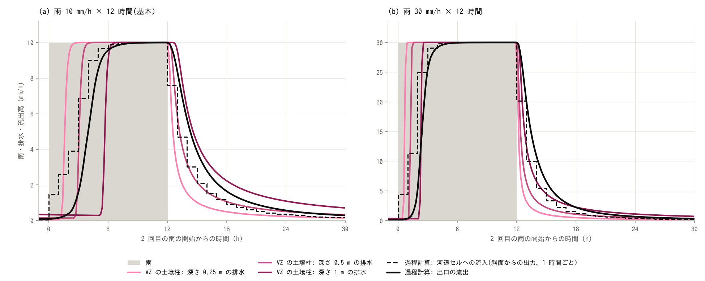

2 回目の雨の、(a) 雨 10 mm/h と (b) 30 mm/h。赤紫の線は柱の排水(薄い色から、深さ 0.25、0.5、1 m)。
黒の破線は過程計算の河道セルへの流入(斜面からの出力。1 時間ごと)、黒の実線は過程計算の出口の
流出、灰色は雨です。

| 計算 | 雨 10 mm/h: 遅れ (h) | 同じ遅れになる粗度 | 雨 30 mm/h: 遅れ (h) | 同じ遅れになる粗度 |
|---|---:|---:|---:|---:|
| VZ の土壌柱: 深さ 0.25 m の排水 | 2.3 | 1.0 | 0.9 | 0.5 |
| VZ の土壌柱: 深さ 0.5 m の排水 | 4.4 | 2.7 | 1.8 | 1.4 |
| VZ の土壌柱: 深さ 1 m の排水 | 8.0 | 6.8 | 3.4 | 3.5 |
| 過程計算(土層 0.5 m): 斜面の段 | 3.3 | 1.7 | 2.0 | 1.6 |

「遅れ」は、2 回目の雨の 48 時間の、雨と排水(過程計算は河道セルへの流入)の重心の差です。柱の
排水は、10 分ごとに記録した累積の差分です。「同じ遅れになる粗度」は、同じ雨の浸透なしの計算の
斜面の段の遅れから内挿した値です(雨 30 mm/h は粗度 0.3、1、3 の 3 つからで、深さ 1 m の値は
粗度 3 の外への外挿)。

- **鉛直の不飽和浸透だけで、同じ桁の遅れになる**: 深さ 0.5 m の排水の遅れは、雨 10 mm/h で
  4.4 時間、30 mm/h で 1.8 時間で、過程計算の斜面の段(3.3 時間と 2.0 時間)と同じ桁です。同じ
  遅れになる粗度は 2.7 と 1.4 です(過程計算は 1.7 と 1.6)。斜面方向の移動を遅れなしとしても、
  鉛直の不飽和浸透だけで、同じ程度の遅れになります。
- **出方は違う**: 柱の排水は、浸潤前線がその深さに届くまで増えず、届くと 30〜40 分で雨の 9 割に
  達します(雨 10 mm/h の深さ 0.5 m で、1 mm/h を超えるのが 3.0 時間、雨の 9 割に達するのが
  3.5 時間。1 回目の雨)。過程計算の斜面からの出力は、雨の始めから少しずつ増えます(2 回目の雨の
  1 時間目に 1.5 mm/h、4 時間目に 6.9 mm/h)。谷の飽和域と河道に降る雨がすぐに出て、飽和域が
  広がるにつれて増えるからです。雨が止んだあとの逓減は、深さ 0.5 m の排水と過程計算の出口の
  流出でよく似ています(雨の 12 時間後に 0.51 mm/h と 0.57 mm/h)。
- **深いほど遅れ、雨が強いほど大きく縮む**: 遅れは、雨 10 mm/h で、深さ 0.25 m は 2.3 時間、
  1 m は 8.0 時間です。雨を 3 倍にすると遅れは 0.4 倍になり、過程計算の斜面の段(0.6 倍)より
  大きく縮みます。そのため、同じ遅れになる粗度は、過程計算ではほとんど変わらない(1.7 → 1.6)
  のに対して、柱では雨が強いほど小さくなります(深さ 0.5 m で 2.7 → 1.4)。
- **値は目安**: 竜ノ口山の土壌は、この流域の土壌ではありません。柱は一様な深い土で、深さ 0.5 m の
  下に土層の底(基岩面)を置いていません。初期条件は、雨の前から 0.1 mm/h が流れている湿った
  状態で、1 回目と 2 回目の雨の応答はほぼ同じです(深さ 0.5 m で、1 mm/h を超える時刻はどちらも
  3.0 時間)。河道の流下(この例題で 1.4〜1.9 時間)は含みません。

実務の等価粗度(斜面の遅れ 2 時間前後)、この例題の大きな側方透水係数、VZ 流出の「斜面方向は
遅れなし」は、斜面の中の水の遅れを別々の所に割り当てていますが、斜面方向に応答が速く伝わると
いう点は共通しています。ENCflow の VZ 流出は地下水(`fn_gwflow`)と併用できないので、鉛直の
不飽和浸透と土層の側方流を合わせた計算はしていません。VZ 流出をこの流域に当てはめて、出口の
ハイドログラフを比べることもしていません。

### 貯留関数法との関係

貯留関数法(木村 1961)は、流域を 1 つのタンクとみなし、貯留 S と流出 q の関係 S = K·q^P と、
連続の式 dS/dt = 雨 − q から流出を求める方法です(ENCflow の
[貯留関数法の区画流出](../../docs/users_guide/sfm.md)。木村の方法にある有効雨量の分離は持ちません。
遅れ時間 `sfm_tl_h` は、タンク 4 だけが使います)。この例題のほかの計算の「貯留と流出の関係」に
合わせたタンクに同じ雨を与えて、何が合い、何が合わないかを見ます(`make sfm`。設定は
`param_sfm.txt` と、雨 30 mm/h の `param_sfm_r30.txt`)。タンクは 4 つです(S は mm、q は mm/h)。

- **タンク 1(K = 11.3、P = 0.6)**: 過程計算と同じ貯留になるタンクです。P は貯留関数法で慣用の
  値で、マニングの地表流の、雨と釣り合った貯留が流出の 0.6 乗に比例する関係に当たります。K は、
  過程計算が雨 10 mm/h と釣り合ったときに流域にある水 45.1 mm から、K = 45.1 ÷ 10^0.6 と
  しました。
- **タンク 2(K = 15.6、P = 0.46)**: 過程計算の 2 つの状態(雨と釣り合ったときの 45.1 mm と
  10 mm/h、2 回目の雨の直前の 5.2 mm と 0.09 mm/h)を通る K と P です。
- **タンク 3(K = 37、P = 0.167)**: VZ 流出の土壌柱の深さ 0.5 m の、雨が止んだあとの貯留
  (残留含水率より上の水)と排水の関係に合わせた K と P です。
- **タンク 4(K = 6.8、P = 0.6、遅れ時間 1.8 時間)**: 遅れ時間を使うタンクです。雨は、遅れ時間だけ
  遅れてタンクに入ります。遅れ時間は、過程計算の河道の段の遅れ(1.8 時間)にしました。K は、
  タンク 1 と同じ貯留 45.1 mm を、遅れ時間の間の水(10 mm/h × 1.8 時間 = 18 mm)とタンクに
  分けて、K = (45.1 − 18) ÷ 10^0.6 としました。

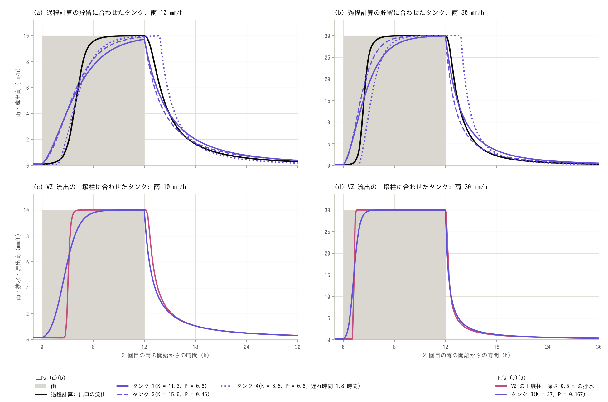

2 回目の雨の、上段はタンク 1(紫の実線)、タンク 2(紫の破線)、タンク 4(紫の点線)を過程計算の
出口の流出(黒)に、下段はタンク 3(紫)を VZ 流出の土壌柱の深さ 0.5 m の排水(赤紫)に重ねた
ものです。左は雨 10 mm/h、右は 30 mm/h(K・P・遅れ時間は同じ値のまま)。灰色は雨です。

| 計算 | K | P | 遅れ時間 (h) | 雨 10 mm/h: 遅れ (h) | 1 mm/h を超える時刻 (h) | 雨の 90 % に達する時刻 (h) | 適合度 | 雨 30 mm/h: 遅れ (h) | 適合度 | 遅れの比 |
|---|---:|---:|---:|---:|---:|---:|---:|---:|---:|---:|
| タンク 1(過程計算と同じ貯留) | 11.3 | 0.6 | 0 | 5.3 | 1.0 | 8.5 | 0.92 / 0.96 | 3.4 | 0.96 / 0.97 | 0.65 |
| タンク 2(過程計算の 2 つの状態) | 15.6 | 0.46 | 0 | 5.2 | 1.1 | 7.5 | 0.92 / 0.96 | 2.9 | 0.96 / 0.98 | 0.57 |
| タンク 4(同じ貯留を、遅れ時間とタンクに分ける) | 6.8 | 0.6 | 1.8 | 4.9 | 2.5 | 7.0 | 0.94 / 0.97 | 3.8 | 0.92 / 0.91 | 0.77 |
| 過程計算: 出口の流出 | — | — | — | 5.1 | 2.8 | 5.3 | — | 3.0 | — | 0.59 |
| タンク 3(VZ の土壌柱の逓減) | 37 | 0.167 | 0 | 4.1 | 1.1 | 4.6 | 0.96 / 0.96 | 1.8 | 0.99 / 0.99 | 0.45 |
| VZ の土壌柱: 深さ 0.5 m の排水 | — | — | — | 4.4 | 3.0 | 3.7 | — | 1.8 | — | 0.40 |

「遅れ」は 2 回目の雨の 48 時間の、雨と流出の重心の差で、時刻は 2 回目の雨の開始からです。適合度は
1 回目 / 2 回目の雨の値で、タンク 1、2、4 は過程計算の出口の流出に、タンク 3 は VZ 流出の土壌柱の
排水に対するものです。「遅れの比」は、雨 30 mm/h の遅れ ÷ 10 mm/h の遅れです。タンクの初期の
流出強度は、既定の 0.1 mm/h です。

- **過程計算と同じ貯留のタンクは、遅れは合うが、立ち上がりが合わない**: タンク 1 の遅れは
  5.3 時間で、過程計算の 5.1 時間とほぼ同じです。適合度は 0.92 と 0.96 で、雨 30 mm/h でも、
  同じ K のまま 0.96 と 0.97 です。合わないのは立ち上がりの形です。タンクの流出は雨の始めから
  増え(1 mm/h を超えるのが 1.0 時間。過程計算は 2.8 時間)、雨の 9 割に達するのは遅くなります
  (8.5 時間。過程計算は 5.3 時間)。タンクは、貯留が増えた分だけすぐに流出が増えるので、
  飽和域がつながるまで出ず、つながると急に増える過程計算の立ち上がりを表せません。P を
  過程計算に合わせたタンク 2 でも同じです。同じ雨の浸透なしの計算(粗度 2 で適合度 0.99 と
  0.99)の方がよく合うのは、地表流の計算には、斜面と河道を水が下る時間が入っているからです。
- **遅れ時間を足すと、立ち上がりの始まりは合うが、雨の強さが変わると合わなくなる**: 河道の段の
  遅れを遅れ時間にしたタンク 4 は、流出高が 1 mm/h を超える時刻が 2.5 時間で、過程計算の
  2.8 時間に近づきます。適合度も 0.94 と 0.97 に上がります。雨の 9 割に達する時刻は 7.0 時間で、
  まだ遅いままです。雨 30 mm/h では、同じ遅れ時間のままだと遅れが 3.8 時間(過程計算は 3.0 時間)に
  なり、適合度は 0.92 と 0.91 に下がります(遅れ時間のないタンク 1 は 0.96 と 0.97)。過程計算の
  河道の段の遅れは、雨が強いと 1.8 時間から 1.0 時間に縮みますが、遅れ時間は雨の強さに
  よらない一定のずらしだからです。
- **指数 P は、雨が強くなったときの遅れの縮み方を決める**: 貯留関数では、雨と釣り合ったときの
  貯留 ÷ 雨 が K·雨^(P − 1) なので、雨を 3 倍にすると、この値は 3^(P − 1) 倍になります(P = 0.6 で
  0.64 倍、0.46 で 0.55 倍、0.167 で 0.40 倍)。遅れ時間のないタンク 1、2、3 の遅れの比(0.65、0.57、
  0.45)も、ほぼこのとおりです。この例題のほかの計算の遅れの比は、浸透なしの斜面の段が 0.63〜0.64、過程計算が
  0.59、VZ 流出の土壌柱が 0.40 で、順に、P = 0.6 のタンク、0.46 と 0.6 の間、0.17 のタンクに
  当たります。同じ遅れになる粗度が雨の強さで変わらないのは、P = 0.6 に当たる流れだけです。
  過程計算に合う粗度が雨の強さであまり変わらず、VZ 流出の土壌柱では雨が強いほど小さくなる
  (2.7 → 1.4)のは、このためです。
- **VZ 流出の土壌柱の貯留と排水の関係は、指数 0.17 の貯留関数に当たる**: 柱の、雨が止んだあとの
  貯留と排水は、S = 37.0 q^0.167 に 2 % 以内のずれで乗ります(深さ 0.25 m と 1 m でも指数は
  0.165 と 0.169 で、K は深さにほぼ比例します)。この K と P のタンク 3 は、柱の排水と逓減が
  重なり(雨の 12 時間後に、どちらも 0.51 mm/h)、遅れも近くなります(雨 10 mm/h で 4.1 時間と
  4.4 時間、30 mm/h でどちらも 1.8 時間)。適合度は雨 10 mm/h で 0.96、30 mm/h で 0.99 です。
  違うのは立ち上がりで、柱の排水は浸潤前線が届く 3.0 時間まで増えないのに、タンクの流出は
  1.1 時間で 1 mm/h を超えます。貯留関数は、鉛直の不飽和浸透の「貯留と流出の関係」は表しますが、
  前線が土層を下る時間は表しません。
- **値は目安**: K・P・遅れ時間は、この例題の計算結果から決めた値で、観測で校正した値ではありません
  (`plot_results.py` が、結果から求め直した値を表のあとに出します)。過程計算の貯留は、土層・
  地表・河道の水を合わせた流域全体の値で、タンクはこれを 1 つの量で表します。実際の流域に
  貯留関数法を使うときは、K・P・遅れ時間を観測のハイドログラフで校正します。

## 追補 2: 1 層の側方飽和透水係数は、何と等価な値か

[追補](#追補-等価粗度と土層の透水係数)では、1 層の土層で経験的な出水の速さを出すには、側方飽和
透水係数を 36000〜100000 mm/h(0.01〜0.03 m/s)と、ユーザーガイドの森林流域の目安(1000〜
10000 mm/h)より大きくする必要があることを見ました。この値は土の測定値ではなく、モデルの
組み立て(1 層と、その層厚・有効間隙率)に合わせて決まる値です。地表流の等価粗度が、土を通る
ことによる遅れを肩代わりしているのと同じ意味で、「等価な値」と言えます。この節では、この値が
何を肩代わりしているか、何と等価か、どう呼ぶか、ほかのモデルではどう扱われているかをまとめます。

### 何を肩代わりしているか

この例題のほかの計算と、斜面の段の遅れが同じになる 1 層の側方飽和透水係数は、次のとおりです
(土層厚 0.5 m、有効間隙率 0.2 の 1 層として。雨 10 mm/h の 2 回目の雨)。

| 比べる計算 | 斜面の段の遅れ (h) | 同じ遅れになる側方飽和透水係数 (mm/h) | (m/s) |
|---|---:|---:|---:|
| 浸透なし: 斜面の粗度 0.6 | 1.7 | 130000(外挿) | 0.036 |
| 浸透なし: 斜面の粗度 1 | 2.3 | 70000 | 0.019 |
| 浸透なし: 斜面の粗度 2 | 3.6 | 29000 | 0.0082 |
| VZ 流出の土壌柱: 深さ 0.25 m の排水 | 2.3 | 68000 | 0.019 |
| VZ 流出の土壌柱: 深さ 0.5 m の排水 | 4.4 | 19000 | 0.0053 |
| VZ 流出の土壌柱: 深さ 1 m の排水 | 8.0 | 4600 | 0.0013 |
| 2 層: 土層の側方 3600 mm/h + 第 2 層 | 4.8 | 16000 | 0.0045 |

側方の透水係数を変えた 1 層の過程計算(3600、10000、36000、100000 mm/h で、斜面の段の遅れは 8.7、
6.0、3.3、1.9 時間)の遅れを、両対数で内挿した値です。「外挿」は、計算した範囲の外の値です。

- **地表流の等価粗度の代わり**: 実務の山地の等価粗度(0.4〜0.8 程度)の範囲にある粗度 0.6 の
  地表流と同じ遅れになるのは 13 万 mm/h(外挿)、粗度 1 で 7 万 mm/h です。
- **鉛直の不飽和浸透の代わり**: VZ 流出の土壌柱は、斜面方向の移動を遅れなしとする計算ですが、
  深さ 0.5 m の排水と同じ遅れを 1 層の側方流で作ると、1.9 万 mm/h になります(深さ 0.25 m で
  6.8 万 mm/h、1 m で 4600 mm/h)。
- **比湧水量の小さい層を伝わる波の代わり**: 2 層の計算は、どちらの層も側方飽和透水係数が
  3600 mm/h ですが、同じ遅れの 1 層に直すと 1.6 万 mm/h になります。
- **速い経路の流れだけではない**: 1 層の大きな側方飽和透水係数は、パイプなどの速い経路の流れの
  ほかに、比湧水量の小さい層を伝わる波や、鉛直の浸透にかかる時間といった、土が水を通す速さとは
  別の過程の代わりもしています。値が大きいことを、水が速く動いていることと読むことはできません
  ([追補](#透水係数が大きいことの意味-速い水か速い波か))。

### 何と等価か: 透水係数だけでは決まらない

1 層の側方流の応答を決めるのは、応答が伝わる速さ(透水係数 × 勾配 ÷ 有効間隙率)と、土層が
運べる水の上限(透水係数 × 土層厚 × 勾配)です。これを確かめるために、側方飽和透水係数と
有効間隙率を 1/10、土層厚を 10 倍にした 1 層を計算します(`make sweep` の `process_thick`)。
透水係数 ÷ 有効間隙率、透水係数 × 土層厚、貯められる水(100 mm)は、基本と同じです。

| 計算 | 側方飽和透水係数 (mm/h) | 有効間隙率 | 土層厚 (m) | 1 mm/h を超える時刻 (h) | 雨の 90 % に達する時刻 (h) | 斜面の段の遅れ (h) | 飽和域の最大 (%) | 基本に対する適合度 |
|---|---:|---:|---:|---:|---:|---:|---:|---:|
| 基本 | 36000 | 0.2 | 0.5 | 3.8 / 2.8 | 5.5 / 5.3 | 3.3 | 15.3 | — |
| 厚く、間隙の小さい 1 層 | 3600 | 0.02 | 5 | 3.8 / 2.8 | 5.5 / 5.5 | 3.4 | 14.7 | 1.000 / 1.000 |

時刻は雨の開始から(1 回目 / 2 回目の雨)で、適合度は基本の計算に対する値です。

- **透水係数が 10 倍違っても、ほぼ同じ出水になる**: 流出高が 1 mm/h を超える時刻は基本と同じで
  (3.8 時間と 2.8 時間)、基本に対する適合度は 1.000 です。流出高の差は最大 0.69 mm/h、斜面の段の
  遅れは 3.4 時間(基本は 3.3 時間)、飽和域の最大は 14.7 %(基本は 15.3 %)です。
- **残る違いは、地下水面の勾配から来る**: 側方流は、地盤の勾配に地下水面の傾きを加えた勾配で
  流れます。厚く、有効間隙率の小さい層では、同じ量の水でも地下水面が 10 倍高くなるので、
  地下水面の傾きの効果が大きくなります(この計算の式からの説明)。斜面が急なこの流域では、
  その違いは小さくなっています。
- **出水から決まるのは、透水係数そのものではない**: 出水の応答に合わせて決まるのは、透水係数 ÷
  有効間隙率 と 透水係数 × 土層厚 で、透水係数の値は、土層厚と有効間隙率を決めて初めて
  決まります。等価粗度が、斜面長の取り方と組になった値であるのと同じです。出水に対しては、
  土層厚 0.5 m、有効間隙率 0.2 の 36000 mm/h と、土層厚 5 m、0.02 の 3600 mm/h は、同じ 1 層です。
  違うのは地下水面の高さで、区別には地下水位の観測が要ります。

### どう呼ぶか: 「等価」と「実効」

- **等価粗度との対応**: 雨水流法の等価粗度は、地表の粗さの測定値ではなく、斜面の流出の遅れを
  地表流で表したときの値です。1 層の側方飽和透水係数も、斜面の中の水の遅れを 1 層の側方流で
  表したときの値で、同じ性格を持ちます。
- **地下水学の用語**: 不均質な地層を一様な媒体に置き換える研究では、十分に大きな媒体で現れる、
  媒体に固有の性質を effective(実効)、領域の大きさや条件に依存し、媒体に固有でない値を
  equivalent(等価。block とも)と呼び分けます(Renard & de Marsily 1997、Renard & Ababou 2022)。
  この例題の値はモデルの組み立てに依存するので、この呼び分けでは「等価」の側です。
- **地盤工学の用語**: 成層した地盤や異方性のある地盤を、一様で等方な地盤に置き換えたときの
  透水係数を、等価透水係数と呼びます(教科書的な用法で、この README では出典を特定して
  いません)。層に沿う流れでは、層厚で重みを付けた平均です。この意味の等価透水係数は、2 層の
  計算では 3600 mm/h のままです(どちらの層も 3600 mm/h なので)。上の表の 1.6 万 mm/h は、
  土層厚 0.5 m、有効間隙率 0.2 の 1 層で同じ遅れになる値で、何と等価かが違います。
- **この例題と ENCflow の文書での扱い**: パラメータの名前は側方飽和透水係数(`gw_ksh_mmh`)の
  ままにして、1 層で使う値はモデルの等価な値である、と説明します。「等価側方飽和透水係数」と
  いう用語は定めていません。理由は 3 つです。根拠がこの模式計算だけであること(観測との比較が
  なく、VZ 流出の土壌と第 2 層の値も模式値です)。何と等価か(遅れ、流量、地下水位)で値が
  変わり、土層厚と有効間隙率を決めないと値が定まらないこと。等価透水係数という語が、上のとおり
  別の意味ですでに使われていること。

### ほかのモデルでの扱い

側方の透水係数を、測定値ではなく校正する値として扱うことは、ほかの分布型モデルでも行われて
います。専用の呼び名は付けず、校正する値として扱うか、測定できる値に掛ける比を別のパラメータに
しています。

| モデル・研究 | 側方の透水係数の扱い |
|---|---|
| TOPMODEL(Beven & Kirkby 1979) | 側方の透過量係数(透水係数 × 厚さに当たる量)と、その深さ方向の減衰を、流域ごとに校正します |
| DHSVM(Wigmosta ほか 1994) | 鉛直とは別に、側方の飽和透水係数と、その深さ方向の減衰率を持ちます。どちらも、最も感度の高い土壌パラメータに挙げられています(Cuo ほか 2011) |
| wflow_sbm(van Verseveld ほか 2024) | 鉛直の飽和透水係数に掛ける比(KsatHorFrac)を別のパラメータにして、校正の対象にします。既定を 100 とし、1〜10000 の範囲を試した報告があります |
| tRIBS(Ivanov ほか 2004) | 土壌パラメータに、飽和の異方性比(側方 ÷ 鉛直)を持ちます |
| RRI(Sayama ほか 2012) | 側方の飽和透水係数を校正します。北海道の山地のダム流域への適用例(矢野・井郷 2021)では、0.05〜0.20 m/s(18 万〜72 万 mm/h)、土層厚 0.9〜1.2 m の組で、洪水の再現性がよいとされています |
| 斜面スケールの実測(Brooks ほか 2004) | 斜面スケールで求めた側方の飽和透水係数は、小さなコアの測定値の 3.2〜13.7 倍でした |
| 測定法と流域モデル(Davis ほか 1999) | 大きなコアで測った飽和透水係数は、小さなコアや現場透水試験の値より 1〜3 桁大きく、流域モデルの流量をよく再現しました |
| 流域モデルから得られる値(Pirastru ほか 2022 の整理) | 流域モデルから得られる側方の飽和透水係数は、点スケールの測定値より数桁大きいことがあります |
| 二重透水係数モデルの校正(Hopp ほか 2020) | 3 次元の二重透水係数モデルを流域スケールで校正すると、マクロポア領域の飽和透水係数はマトリックスの値に近くなり、単一領域のモデルを上回りませんでした |

この表は、論文の要旨、モデルの文書、検索の抜粋によるもので、本文は照合していません。

- **この例題の値は、実務で使われる範囲の中にある**: この例題の 36000〜100000 mm/h(0.01〜
  0.03 m/s)は、RRI の適用例の値(0.05〜0.20 m/s)より 1 桁小さい側です。
- **大きな値になる理由は 2 つある**: 1 つは測定のスケールで、小さな試料は速い経路を捉えにくく、
  斜面スケールの値は試料の値の数倍から 1 桁あまり大きくなります(Brooks ほか 2004、Davis ほか
  1999)。もう 1 つはモデルの組み立ての補償で、校正した値は、モデルが解いていない過程の代わりも
  します(Hopp ほか 2020 では、マクロポア領域を持つモデルを校正しても、その効果は残りません
  でした)。この例題で見た、比湧水量の小さい層や鉛直の浸透の肩代わりは、後者に当たります。

### 使うときの注意

- **測定値と比べない、測定値をそのまま入れない**: 試料や現場透水試験の飽和透水係数は、1 層の
  側方飽和透水係数の目安になりません。逆に、合わせて得た値を土の性質として読むこともできません。
- **土層厚・有効間隙率と組で決める**: 土層厚か有効間隙率を変えたら、側方飽和透水係数も決め
  直します。出水の応答が同じでも、地下水位と飽和域の広さは、組の取り方で変わります。
- **何に合わせた値かを書く**: 等価な値は、合わせた相手(出水の遅れ、ハイドログラフ、地下水位、
  飽和域)によって変わります。この例題の値は、経験式の洪水到達時間に近い出水になるように
  選んだ模式値で、観測で校正した値ではありません。
- **過程を分けて解けば、値は小さくてすむ**: 第 2 層を置いた計算では、どちらの層も 3600 mm/h の
  まま、1 層の 1.6 万 mm/h に当たる応答になります。値が不自然に大きくなるときは、1 層が
  肩代わりしている過程(比湧水量の小さい層、不飽和帯)を疑う手がかりになります。

## このモデルで表せないこと(実際の現象との違い)

- **土層は一様の模式値**: 土層厚 0.5 m・有効間隙率 0.2・透水係数は全域で同じです。実際の土層は
  場所によって厚さが違い、薄い所が先に満ちて流出の時刻を決めます(Tani 1997)。土層厚の分布は
  `fn_sd` で与えられます。結果は土層の値に強く依存します(土層 1 m と、側方の透水係数を変えた
  計算)。側方の透水係数 36000 mm/h は実測値ではなく、出水の速さが洪水到達時間の経験式に
  近くなるように選んだ実効値です([追補](#追補-等価粗度と土層の透水係数))。
- **不飽和帯を解かない**: しみ込んだ水は、その時刻に土層の底の飽和帯に加わります。雨の前の土の
  湿り具合、不飽和帯を下る時間、雨の後も土に保たれる水は表しません(土層の水は、側方流で谷へ
  抜けるまで減り続けます)。乾いた土の最初の雨で流出が出るまでの雨量(この例題で 40 mm 弱)は、
  最初の地下貯留を 0 としたことと、この扱いで決まっています。鉛直の不飽和浸透を解く機能
  ([VZ 流出](../../docs/users_guide/vz.md))は、地下水(`fn_gwflow`)と併用できません
  (土壌柱だけの計算との比較は[追補](#鉛直不飽和浸透vzとの関係))。
- **基岩・蒸発散・遮断は入れていない**: 土層の下の風化基岩への浸透とそこから出る基底流、
  蒸発散、樹冠の遮断は有効にしていません。雨の合間に土の水が減るのは、谷への排水だけです
  (第 2 層は、追補の `process_l2` で、出水を運ぶ層として使っているだけです)。
- **50 m 格子で斜面を表す**: 尾根から谷までの斜面(数百 m)を数セルで表します。飽和域は 1 セル
  (50 m)単位で、実際の渓流沿いの湿った帯(幅数 m〜数十 m)や小さな凹地より粗い表現です。
  飽和域の割合が格子幅でどう変わるかは確かめていません。
- **河道は 50 m 幅のセルで、平らな区間に水がたまる**: 河道セルの幅は格子幅の 50 m で、実際の
  渓流(数 m〜十数 m)より広く浅い流れになります。また、窪地処理をした標高には平らな区間が
  段になって残り(河道セルを通る本川 9.4 km の 40 %、河道網 42.9 km の 13 %。最も長い区間は
  0.7 km)、そこは水面の勾配だけで流れるので水がたまります。雨の終わりの地表の水 17 mm のうち
  12.8 mm が河道セルにあり、その 7 割(9.0 mm)は、平らな段の河道セル(隣の河道セルと標高が同じ
  144 セル)に平均 0.9 m の深さで載っています(最大 2.1 m)。飽和域ができてから出口の流出高が
  1 mm/h を超えるまでの 2 時間弱と、雨から出口までの遅れのうちの河道の段(1.8 時間)は、
  この水たまりを含む谷と河道の流れによるものです。実際の渓流の流下はこれより速いと考えられます。
  狭い河道はサブグリッド河道幅([河道](../../docs/users_guide/channel.md)の `fn_width`)で
  表せますが、この例題では使っていません。河道マスクのない谷(集水面積 1.3 km² まで)は、
  斜面の粗度で流れます。
- **雨は一様な矩形**: 雨の強さの時間変化と、流域内の雨の分布は与えていません。強さは 10 mm/h と
  30 mm/h の 2 通りです。
- **観測と比べていない**: 値は模式値で、流出の立ち上がりの時刻・ピーク・逓減が実際の流域に
  合うかは確かめていません。この例題が示すのは、機構のつながりと、設定を変えたときの応答の
  向きです。

## 注意

- **最初は乾いた土と空の河道**: 1 回目の雨の応答(3 時間あまりの無流出)は、この初期条件での
  値です。実際の流域には雨の前から基底流があり、谷沿いは湿っているので、実際の出水に近い条件は
  2 回目の雨です。
- **飽和域の判定**: 地下貯留が土層の容量(100 mm)との差 0.1 mm 以内のセルを飽和とします
  (飽和域の縁のセルは、流れ出る水を毎ステップの雨が補って、容量のすぐ下で揺れるため)。分布の
  出力は 1 時間ごとなので、飽和域の割合の時刻の刻みも 1 時間です。「飽和域に降った雨」は
  雨 × 飽和域の割合の積算で、その水が出口まで流れ下る時間は考えていない目安です。
- **流出の測り方と水収支**: 測線の流量(10 分ごとの瞬間値)を台形則で積算した流出高、Log の
  貯留(S_total)、積算の雨の 3 つの差は、過程計算の 96 時間で 0.13 mm です(Log の貯留は
  0.1 mm 刻み)。測線が測るのは地表の流れです。土層の中を流れて出口セルに入る水は測線に
  入らないので、その分だけ流出高が少なく出ます(96 時間の差は、側方 3600 mm/h と 10000 mm/h で
  0.05 mm 以内、100000 mm/h で 0.5 mm、土層 1 m で 0.3 mm)。
- **遅れの分け方**: 追補の「斜面の段」と「河道の段」は、1 時間ごとの分布から求めた河道セルへの
  流入を境にした重心の差で、時刻の刻みは 1 時間です。河道セルに直接降る雨(流域の 5.4 %)は、
  遅れ 0 で河道セルに入るものとして数えています。
- **河道マスクを落水線でつなぐ理由**: 元の河道マスクの線は、標高の谷線から 1 セルずれて
  途切れる所があります。そこは斜面の粗度になるので、斜面の粗度を大きくした計算では、谷線上の
  斜面扱いのセルが流れを堰き止めて上流に深い水がたまります。`make_catchment.py` は、河道
  マスクの各セルから落水線を出口までたどり、通ったセルを河道に加えます。
- **時間刻み**: dt = 3 s で、Cn_max は雨 10 mm/h の全ケースで 0.43 以下です。雨 30 mm/h の
  ケースは dt = 2 s で、0.44 以下です。

## 感度実験の入口

- `gw_ksh_mmh`(側方の透水係数)と `sd0`(土層厚): 流出の立ち上がりの時刻・ピーク・飽和域の
  広さを決めます(上の表)。`sy0`(有効間隙率)は土層の容量と、応答が斜面を伝わる速さの両方を
  変えます。
- `fn_sd`(土層厚の分布): 谷沿いや尾根で土層を薄くすると、飽和の順序が変わります
  ([test/gwtani](../../test/gwtani/) が 1 本の斜面で確かめています)。
- `param_common.txt` の `prval`(雨の強さ・長さ・2 回の間隔): 2 回の間隔を変えると、2 回目の雨の
  前に残る水(基本では土層に 4 mm、飽和域 2.8 %)が変わります。雨の強さを 15 mm/h と 20 mm/h に
  した過程計算(`dt` は 3 s と 2.5 s。例題のケースには入れていない計算)では、飽和域の最大は
  17.9 % と 20.4 % です。
- `&list_gwflow_layer2`(第 2 層): `gw2_infil_mmh`(土層 → 第 2 層の浸透能)を雨より小さくすると、
  入りきれない水が土層に残って、出水が遅くなります。`gw2_sy`(比湧水量)と `gw2_ksh_mmh` は、
  第 2 層を伝わる波の速さを変えます。
- `sweep.py` の `CASES`: 粗度を足す、過程計算の設定を変える、などのケースを 1 行で足せます。
  図と表に載せるには `plot_results.py` の `CASES` にも足します。
- `make_catchment.py --outlet I J`(出口セル。元の格子の番号): 別の集水域を切り出します。
  表示される `nx`・`ny`・`outlet_ij`・`gauge_ij` に、設定の格子数・水位規定セル・測線・
  プローブを合わせます。`--outlet 344 302` は、2.3 km 下流の、2 本の支川の合流点のすぐ上流を
  出口にした 38.2 km² です(`nx = 192`、水位規定セル (190, 33)、プローブ (189, 33)、測線
  (189, 34)–(189, 30))。出口のすぐ上流に長さ 1.5 km の平らな区間が入り、雨の終わりに深さ
  1.3〜2.4 m の水がたまります。側方 3600 mm/h の過程計算(`process_k3600` の設定)で比べると、
  流出高が 1 mm/h を超える時刻は 1 回目の雨で 7.5 → 8.3 時間、2 回目で 2.5 → 3.5 時間に遅れ、
  地表の水の最大は 18 → 25 mm に増えます(飽和域の割合と最も近い粗度は変わりません)。
- 蒸発散(`fn_evap`)、遮断(`fn_intercept`)を足すと、雨の合間の乾きを入れられます。第 2 層の
  浸透能と側方の透水係数を小さくすると(ユーザーガイドの風化基岩層の目安)、第 2 層は基底流を
  出す層になります。
- `param_vz.txt`(VZ 流出の土壌柱。追補の[鉛直不飽和浸透(VZ)との関係](#鉛直不飽和浸透vzとの関係)):
  `vz_out_depth` は排水を読む深さです(`vz_column.csv` に、各深さの累積排水 D が出ます)。
  `&list_vz_column` を足すと、土壌の値(小杉パラメータ `vz_ks_mmh`・`vz_thetas`・`vz_thetar`・
  `vz_psim`・`vz_sigma`)と初期条件(`vz_q0_mmh`)を変えられます。書かなければ試算用の既定です
  ([VZ 流出](../../docs/users_guide/vz.md))。雨 30 mm/h の `param_vz_r30.txt` は、格子と VZ 流出の
  設定を `param_vz.txt` から読みます。
- `param_sfm.txt`(貯留関数法のタンク。追補の[貯留関数法との関係](#貯留関数法との関係)):
  `sfm_k`(貯留係数 K)と `sfm_p`(指数 P。書かなければ 0.6)でタンクの応答が変わります。
  `sfm_tl_h` は遅れ時間(書かなければ 0)、`sfm_q0_mmh` は初期の流出強度です(書かなければ
  0.1 mm/h)。タンクを足すときは、区画番号のラスタ `data_sfm/zone.txt` に区画を足します(図と表で
  どの計算と比べるかは、`plot_results.py` の `SFM_VS` で決めます)。

## 参考文献

Mosley (1979)・Beven & Germann (1982)・Tani (1997) の書誌は
[地下水モデルの解説](../../docs/users_guide/gwflow_models.md)、谷 (2023) の書誌と内容の紹介は
[VZ 流出](../../docs/users_guide/vz.md)のもの、木村 (1961) の書誌は
[貯留関数法の区画流出](../../docs/users_guide/sfm.md)のもの(原典は未照合)で、ほかの書誌は検索で確認しました
(角屋・福島 (1976) は、式と係数をこれを引いた論文の検索の抜粋で確認しただけで、書誌は未照合です)。
谷 (2023) 以外の本文は照合しておらず、内容の紹介は要旨と二次資料によります。追補 2 の
「ほかのモデルでの扱い」に挙げた文献の内容は、要旨、モデルの文書、検索の抜粋によります
(Ivanov ほか (2004) の論文番号と、Sayama ほか (2012) の巻・ページは、検索では確かめていません)。

- Barnes, R., Lehman, C. and Mulla, D. (2014): Priority-flood: An optimal depression-filling
  and watershed-labeling algorithm for digital elevation models. Computers & Geosciences, 62,
  117–127.
- Beven, K. and Germann, P. (1982): Macropores and water flow in soils. Water Resources
  Research, 18, 1311–1325.
- Beven, K. J. and Kirkby, M. J. (1979): A physically based, variable contributing area model of
  basin hydrology. Hydrological Sciences Bulletin, 24(1), 43–69.
- Brooks, E. S., Boll, J. and McDaniel, P. A. (2004): A hillslope-scale experiment to measure
  lateral saturated hydraulic conductivity. Water Resources Research, 40, W04208.
- Cuo, L., Giambelluca, T. W. and Ziegler, A. D. (2011): Lumped parameter sensitivity analysis
  of a distributed hydrological model within tropical and temperate catchments. Hydrological
  Processes, 25(15), 2405–2421.
- Davis, S. H., Vertessy, R. A. and Silberstein, R. P. (1999): The sensitivity of a catchment
  model to soil hydraulic properties obtained by using different measurement techniques.
  Hydrological Processes, 13(5), 677–688.
- Dunne, T. and Black, R. D. (1970): Partial area contributions to storm runoff in a small New
  England watershed. Water Resources Research, 6(5), 1296–1311.
- Engman, E. T. (1986): Roughness coefficients for routing surface runoff. Journal of
  Irrigation and Drainage Engineering, 112(1), 39–53.
- Hewlett, J. D. and Hibbert, A. R. (1967): Factors affecting the response of small watersheds
  to precipitation in humid areas. In: Sopper, W. E. and Lull, H. W. (eds.), Forest Hydrology,
  Pergamon Press, 275–290.
- Hopp, L., Glaser, B., Klaus, J. and Schramm, T. (2020): The relevance of preferential flow in
  catchment scale simulations: Calibrating a 3D dual-permeability model using DREAM.
  Hydrological Processes, 34(5), 1237–1254.
- Ivanov, V. Y., Vivoni, E. R., Bras, R. L. and Entekhabi, D. (2004): Catchment hydrologic
  response with a fully distributed triangulated irregular network model. Water Resources
  Research, 40, W11102.
- Mosley, M. P. (1979): Streamflow generation in a forested watershed, New Zealand. Water
  Resources Research, 15, 795–806.
- Nash, J. E. and Sutcliffe, J. V. (1970): River flow forecasting through conceptual models
  part I — A discussion of principles. Journal of Hydrology, 10(3), 282–290.
- O'Callaghan, J. F. and Mark, D. M. (1984): The extraction of drainage networks from digital
  elevation data. Computer Vision, Graphics, and Image Processing, 28(3), 323–344.
- Pirastru, M., Iovino, M., Marrosu, R., Di Prima, S., Giadrossich, F. and Awada, H. (2022):
  Large-scale lateral saturated soil hydraulic conductivity as a metric for the connectivity of
  subsurface flow paths at hillslope scale. Hydrological Processes, 36(8),
  doi:10.1002/hyp.14649.
- Renard, P. and Ababou, R. (2022): Equivalent permeability tensor of heterogeneous media:
  upscaling methods and criteria (review and analyses). Geosciences, 12(7), 269.
- Renard, P. and de Marsily, G. (1997): Calculating equivalent permeability: a review. Advances
  in Water Resources, 20(5–6), 253–278.
- Sayama, T., Ozawa, G., Kawakami, T., Nabesaka, S. and Fukami, K. (2012): Rainfall–runoff–
  inundation analysis of the 2010 Pakistan flood in the Kabul River basin. Hydrological
  Sciences Journal, 57(2), 298–312.
- Tani, M. (1997): Runoff generation processes estimated from hydrological observations on a
  steep forested hillslope with a thin soil layer. Journal of Hydrology, 200, 84–109.
- Tromp-van Meerveld, H. J. and McDonnell, J. J. (2006): Threshold relations in subsurface
  stormflow: 2. The fill and spill hypothesis. Water Resources Research, 42, W02411.
- USDA Soil Conservation Service (1986): Urban hydrology for small watersheds. Technical
  Release 55 (TR-55), 2nd ed.
- van Verseveld, W. J. ほか (2024): Wflow_sbm v0.7.3, a spatially distributed hydrological
  model: from global data to local applications. Geoscientific Model Development, 17,
  doi:10.5194/gmd-17-3199-2024.
- Wigmosta, M. S., Vail, L. W. and Lettenmaier, D. P. (1994): A distributed hydrology-vegetation
  model for complex terrain. Water Resources Research, 30(6), 1665–1679.
- 角屋睦・福島晟 (1976): 中小河川の洪水到達時間. 京都大学防災研究所年報, 19(B-2), 143–152.
- 木村俊晃 (1961): 貯留関数法による洪水流出追跡法. 建設省土木研究所.
- 谷 誠 (2023): 鉛直不飽和浸透に基づく新しい洪水流出モデルの適用による山地小流域の流出機構の
  再検討. 水文・水資源学会誌, 36(1), 20–51.
- 矢野雅昭・井郷昭洋 (2021): 岩尾内ダムにおける RRI モデルによる流出予測の再現性向上 — 物理
  分布型モデルでの流域地質分布の考慮. 第 65 回(2021 年度)北海道開発技術研究発表会論文.
- wflow_sbm の水平方向の透水係数の比についての、EGU General Assembly 2024 の発表要旨
  (EGU24-8347、EGU24-11384。既定の値と、試した範囲)。
- tRIBS のモデルの文書(Model Parameters and Forcings。土壌パラメータの飽和の異方性比):
  https://tribshms.readthedocs.io/en/latest/man/Model_Parameters_Forcings.html
- 国土交通省近畿地方整備局 和歌山河川国道事務所の流域委員会の資料(等価粗度の表を河川砂防技術
  基準(案)から引き、現況の山地に N = 0.6 を使う):
  https://www-2.kkr.mlit.go.jp/wakayama/ryuiki_iinkai/ryuiki/comm08/pdf/data1/refe-data1_2.pdf
- 国土交通省北海道開発局の資料(河川砂防技術基準 調査編(平成 24 年 6 月版)の等価粗度の標準値の
  表を引く。林相のよい山地流域で 0.4〜0.8):
  https://www.hkd.mlit.go.jp/ky/kn/kawa_kei/splaat0000017ws4-att/splaat0000017wum.pdf
