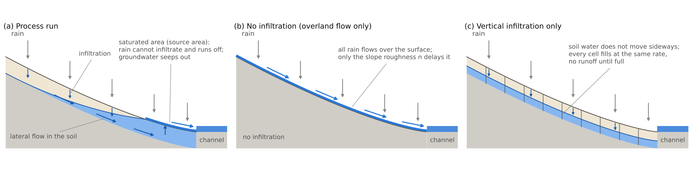
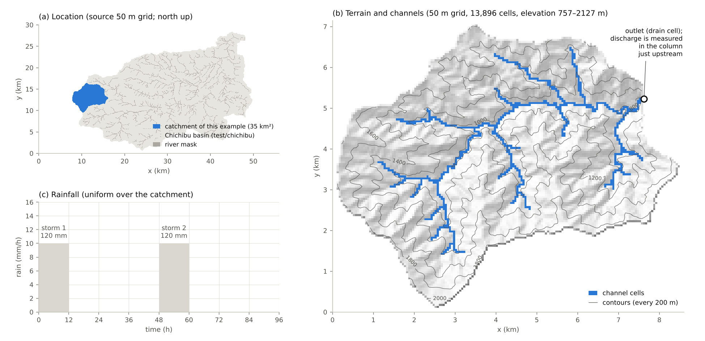
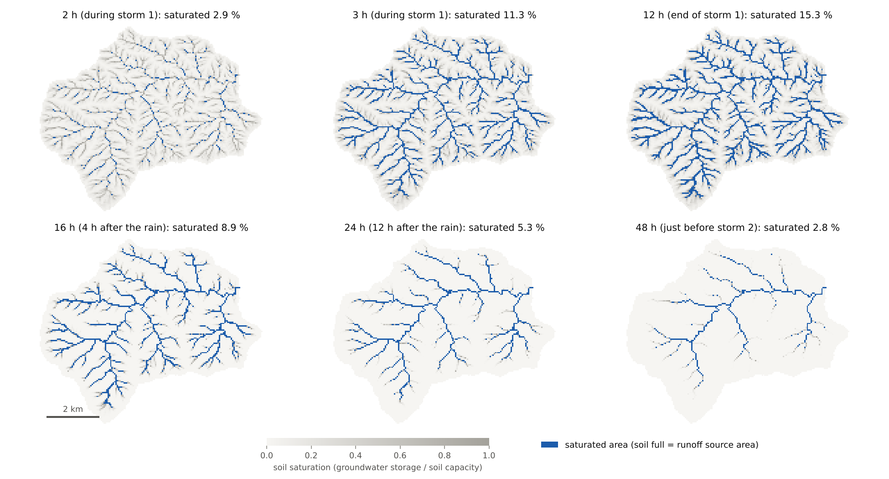
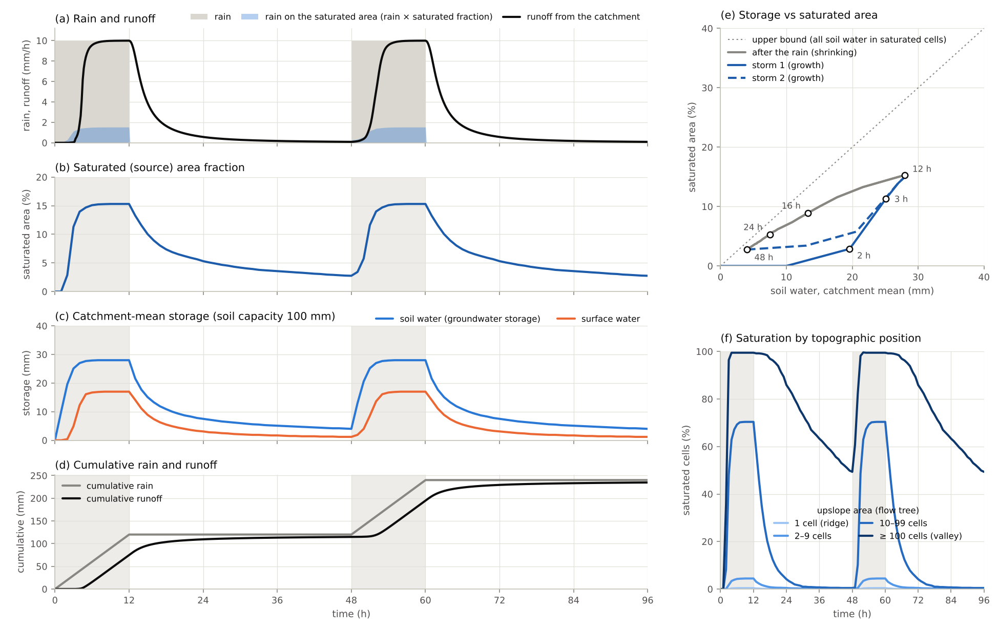
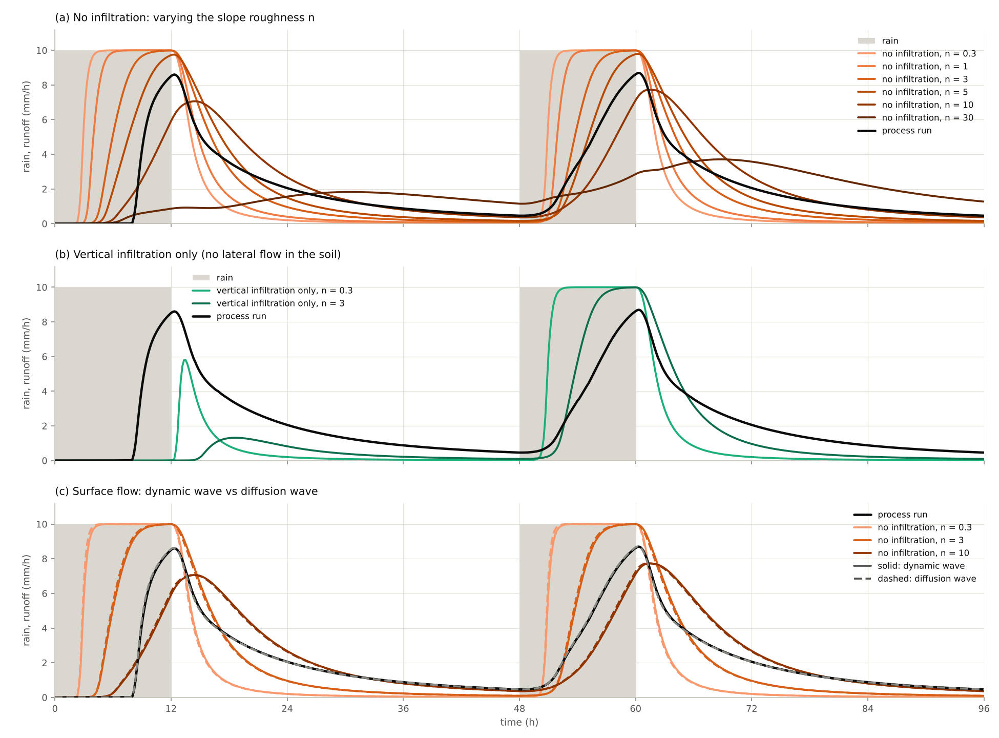
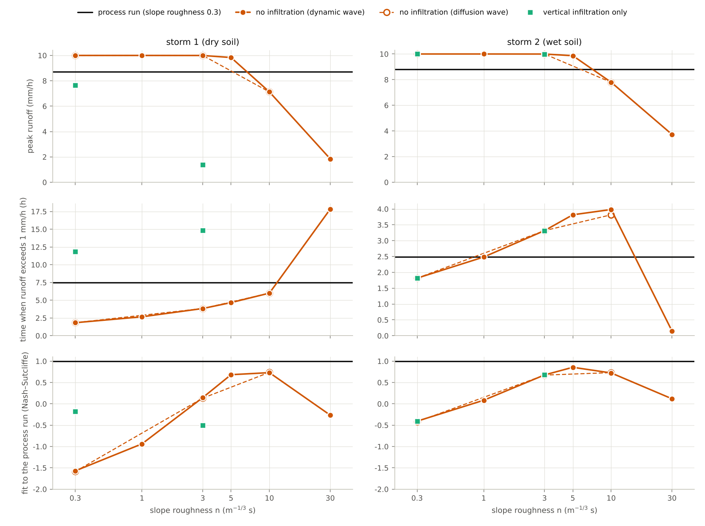
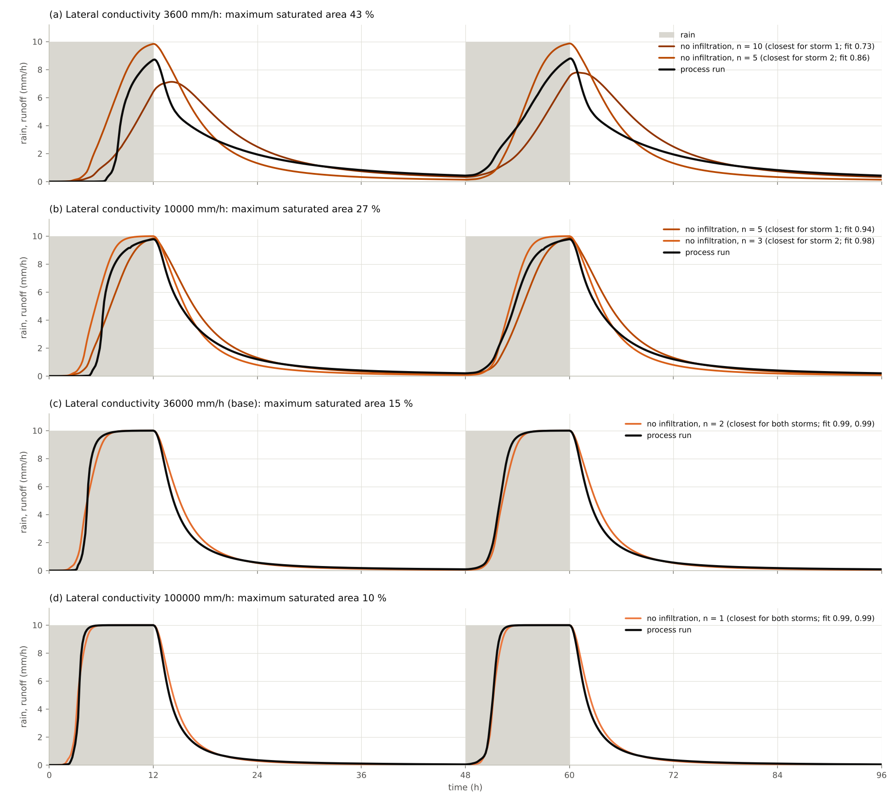
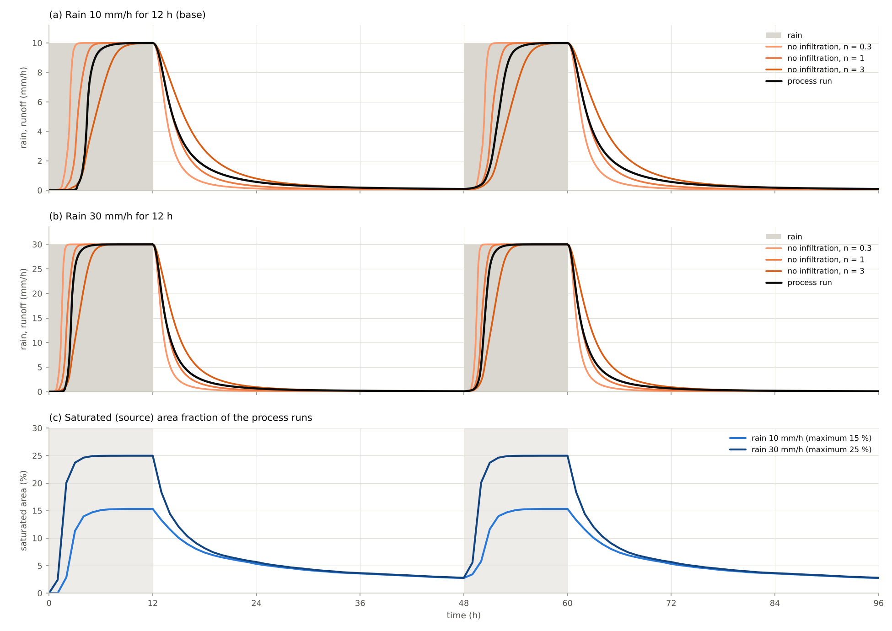
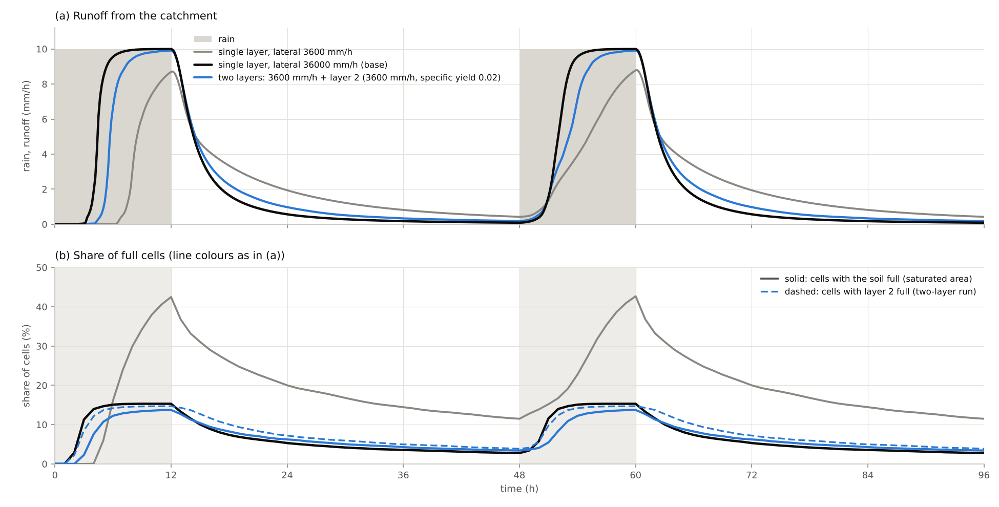
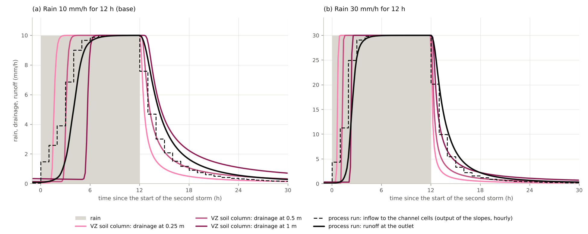

# source_area — growth and shrinkage of the runoff source area of a mountain catchment

> English mirror of examples/source_area/README.md. The Japanese file is the master copy.

[日本語](../README.md)

Most of the rain that falls on a forested mountain catchment does not run over the ground: it
infiltrates into the soil. The infiltrated water flows downslope inside the soil layer, gathers
in the valleys, and comes out at the surface where the soil has filled up (the saturated area)
to become streamflow. Only part of the catchment produces runoff; that part spreads from the
valleys onto the slopes during rain and shrinks after the rain stops (the variable source
area). This example puts the same storm twice on a 35 km² headwater catchment cut out of the
real terrain of Chichibu and looks at two things.

1. **Process run**: infiltration → lateral flow in the soil → saturated area → channel routing
   are linked in a single run, to see the growth and shrinkage of the saturated area, the
   hydrograph at the catchment outlet, and the difference between rain on dry soil and rain on
   wet soil.
2. **Can surface flow alone stand in for it?**: the same rain is computed with "no infiltration
   (all rain runs over the surface)" and with "vertical infiltration only (no lateral flow in
   the soil)" and compared with the process run, to examine whether a larger slope roughness
   (an equivalent roughness) can represent the delay of runoff caused by the passage through
   the soil. How the fitting roughness changes with the conductivity of the soil and with the
   rain intensity is also examined
   ([Supplement](#supplement-equivalent-roughness-and-the-soil-conductivity)).

The terrain is a real catchment, but the soil layer, the conductivities and the rain are
schematic uniform values; this is not a reproduction of the runoff of this catchment (nothing is
compared with observations).

**What this example shows**

- **The runoff source area (saturated area) extends up the valleys and shrinks back downstream
  after the rain**: the saturated area appears in the valleys in the second hour of rain, covers
  11 % of the catchment after 3 hours and 15 % at most. What saturates is the valleys and
  hollows with a large upslope area; the ridges and slopes (83 % of the cells) hardly saturate.
  After the rain it shrinks to 9 % in 4 hours and to 3 % in 36 hours. For the same storage the
  saturated area differs between growth and shrinkage
  ([Process run](#process-run-growth-and-shrinkage-of-the-saturated-area)).
- **The runoff is mainly water that passed through the soil, and it rises abruptly once the
  saturated area has connected along the valleys**: nearly nine tenths of the runoff is water
  that infiltrated, flowed through the soil and seeped out in the saturated area. On dry soil
  there is no runoff for a little over 3 hours, and then it reaches nine tenths of the rain in
  less than 2 hours. In the second storm, on wet soil, it rises one hour earlier.
- **Even with surface flow alone, a larger slope roughness (an equivalent roughness) makes the
  hydrograph nearly coincide**: the run that routes all the rain over the surface coincides with
  the process run, with a fit of 0.99, when the slope roughness is 2 (7 times the 0.3 of the
  process run). It cannot represent the difference between dry and wet soil, the steepness of
  the rise, or the extent of the saturated area. With vertical infiltration only, without
  lateral flow in the soil, the water that entered the soil never comes out, and the runoff of
  the first storm is only 20 mm (115 mm in the process run)
  ([Comparison with no infiltration and vertical infiltration only](#comparison-with-no-infiltration-and-vertical-infiltration-only)).
- **The equivalent roughness changes by an order of magnitude with how fast the soil conducts
  water**: as the lateral conductivity is lowered from 100000 mm/h to 3600 mm/h, the closest
  roughness rises from 1 to 10 for the first storm and 5 for the second (it is 2 for the base
  value of 36000 mm/h). One order of magnitude in roughness corresponds to a factor of 4 in
  the lag before slope water reaches the channels, and that lag is proportional to the water
  stored on the slopes. The equivalent roughness used in practice for mountains (about
  0.4–0.8) is matched at 100000 mm/h; the roughness 2 that fits the base value of 36000 mm/h
  is several times the values used in practice
  ([Soil conductivity and the equivalent roughness](#soil-conductivity-and-the-equivalent-roughness),
  [Supplement](#supplement-equivalent-roughness-and-the-soil-conductivity)).
- **Heavier rain widens the saturated area, but the equivalent roughness changes little**: with
  three times the rain, 30 mm/h, the maximum saturated area widens from 15 % to 25 %, and the
  time for the runoff to reach nine tenths of the rain advances from 5.5 to 3.3 hours. The
  roughness with the same slope lag changes from 1.7 to 1.6
  ([Rain intensity, the saturated area and the equivalent roughness](#rain-intensity-the-saturated-area-and-the-equivalent-roughness)).
- **Fast storm runoff does not need fast water; it needs a response that travels fast**: the
  speed at which the response travels down a slope is set by conductivity × slope / specific
  yield. When a layer 2 with a small specific yield is placed below a poorly conducting soil
  (3600 mm/h), layer 2 fills the valleys as fast as a soil with ten times the conductivity,
  and the closest roughness falls from 10 for the first storm and 5 for the second to 3 for
  both storms
  ([Supplement](#supplement-equivalent-roughness-and-the-soil-conductivity)).
- **Vertical unsaturated infiltration alone also gives a delay of the same order**: when the
  same rain is put on a soil column of the VZ runoff of Tani (2023) (a model that takes the
  downslope transfer as having no delay), the drainage at a depth of 0.5 m lags the rain by
  4.4 hours, the same order as the slope lag that the process run produces with lateral flow
  in the soil (3.3 hours). The soil of the column is that of another experimental site, so
  this is a rough comparison
  ([Relation to vertical unsaturated infiltration (VZ)](#relation-to-vertical-unsaturated-infiltration-vz)).

## What happens in real mountain catchments

- **Rain infiltrates and flows inside the soil**: forest soils have a high infiltration
  capacity, and rain of ordinary intensity does not run over the ground. From the records of
  small forested catchments in the eastern United States, Hewlett & Hibbert (1967) argued that
  subsurface flow predominates even in storm runoff and that separating a hydrograph into
  overland flow, interflow and base flow has little meaning for small catchments. Hillslope
  soils contain large pores and pipes, so the effective downslope conductivity is one to two
  orders of magnitude larger than that of the soil matrix (Mosley 1979; Beven & Germann 1982).
- **The source area grows and shrinks**: only part of a catchment produces runoff, and that
  part changes during a storm and with the season (the variable source area). In a small
  catchment in Vermont, Dunne & Black (1970) observed that storm runoff came mainly from
  overland flow on the saturated area, which occupied a small share of the catchment (including
  rain falling directly on it), and that this area expanded and contracted with the season and
  during storms.
- **Places where water gathers saturate first**: the soil fills more easily where the upslope
  contributing area is large and the slope is gentle. TOPMODEL (Beven & Kirkby 1979) expresses
  this relation with a topographic index and computes the extent of the source area from it.
  Thin soil fills with less rain, so the distribution of soil depth also sets the order of
  saturation (Tani 1997).
- **Nothing comes out until the wet patches connect**: subsurface flow from a hillslope often
  rises abruptly once the storm total exceeds a certain amount. On a hillslope at Panola,
  Georgia, Tromp-van Meerveld & McDonnell (2006) showed that the flow increased by orders of
  magnitude beyond 55 mm of rain, when the depressions of the bedrock surface had filled and
  the saturated patches connected down to the foot of the slope (fill and spill).
- **A fast runoff response is not the same as fast-moving water**: the response of runoff to
  rain can travel faster than the water particles themselves (for the relation in the
  lateral-flow equation of this computation, see the
  [Supplement](#supplement-equivalent-roughness-and-the-soil-conductivity)). The VZ runoff
  model of Tani (2023) assumes that efficient drainage through water pathways near the
  soil-bedrock interface keeps the groundwater level from changing much; it leaves out the
  delay of downslope subsurface flow and obtains the runoff response of small mountain
  catchments from vertical unsaturated infiltration alone
  ([VZ runoff](../../../docs/en/users_guide/vz.md) in ENCflow).
- **Engineering runoff calculations often treat hillslope flow as overland flow**: the
  kinematic wave method (also called the equivalent roughness method in Japan) solves the flow
  of rainwater on slopes as Manning-type overland flow and gives the roughness a value larger
  than that of the real ground surface (the equivalent roughness), so that it also covers the
  delay caused by the passage through the soil. The amount of rain that becomes runoff (the
  effective rainfall) is determined separately. According to documents of the Ministry of
  Land, Infrastructure, Transport and Tourism that quote the table of the Technical Criteria
  for River Works (survey volume), the standard value of the equivalent roughness is 0.4–0.8
  m⁻¹ᐟ³ s for mountain catchments with good forest cover, and one application uses 0.6 for
  mountains (both confirmed from search excerpts; the originals were not checked). Manning's
  roughness of the thin sheet flow that actually runs over the ground is tabulated as
  0.15–0.41 for grass and 0.4–0.8 for woods (Table 3-1 of USDA 1986, compiled from Engman
  1986; values confirmed from a search excerpt, the table itself was not checked).
- **A yardstick for the speed of storm runoff**: an empirical formula for the flood
  concentration time of small and medium rivers (the time for rain on the most distant part
  of the catchment to reach the outlet) is tp = C A^0.22 re^-0.35 of Kadoya & Fukushima (1976)
  (tp in minutes, A the catchment area in km², re the effective rainfall intensity in mm/h;
  C = 290 for forested hills and mountains). For the catchment of this example (35 km²) it
  gives 4.7 hours for rain of 10 mm/h and 3.2 hours for 30 mm/h (the formula and the
  coefficient were confirmed from a search excerpt of a paper that quotes them; the original
  was not checked).

## Mechanisms needed to reproduce it



Schematic cross-sections of a hillslope (not computed results). (a) Process run. Rain
infiltrates into the soil and flows downslope in the saturated zone that forms on the base of
the soil (the bedrock surface). Where the saturated zone reaches the ground surface is the
saturated area: rain falling there cannot infiltrate and runs over the surface, and groundwater
coming from upslope seeps out. (b) No infiltration. All rain runs over the surface, and only
the slope roughness delays the runoff. (c) Vertical infiltration only. Rain is stored in the
soil column of each cell and does not move sideways; nothing runs off until the soil is full.

| Real phenomenon | Representation in ENCflow | Settings |
|---|---|---|
| Rain infiltrates into the soil | Green-Ampt infiltration (constant capacity 200 mm/h). The soil stores up to 0.5 m × effective porosity 0.2 = 100 mm | `f_gwvertical = 2`, `gw_ksv_mmh`, `sd0`, `sy0` |
| Soil water flows downslope and gathers in the valleys | Lateral flow in the soil (Darcy flow in the saturated zone; nonlinear Boussinesq, 8 neighbours) | `f_gwlateral = 1`, `gw_ksh_mmh` |
| Where the soil is full, rain cannot infiltrate and groundwater seeps out | Infiltration is limited to the remaining capacity of the soil. Water that exceeds the capacity through lateral flow is handed to the surface water in the same step (return flow) | Works when the two above are enabled |
| Surface water flows down the valleys and channels | Shallow-water flow (dynamic wave). Different roughness for slopes and channel cells | `rn0`, `rn0_rw`, channel mask `fn_rw` |
| Water running over the surface infiltrates into soil that is not yet full | Infiltration acts every step on every cell that has surface water (rain and water arriving from upstream are not distinguished) | Same as above |
| Water leaves the catchment at the outlet | The single cell at the downstream end of the valley is kept empty with a prescribed stage (a complete drain) | `&list_bound_stage` |

The three runs to be compared share the terrain, the channels, the rain, the outlet and the
time step; only the treatment of the soil differs.

| Run | Infiltration | Lateral flow in the soil | Parameter file | Change from the process run |
|---|---|---|---|---|
| Process run | yes | yes | `param.txt` | — |
| Vertical infiltration only | yes | no | `param_vertical.txt` | `f_gwlateral = 0` |
| No infiltration | no | — | `param_surface.txt` | no `fn_gwflow` line (groundwater is not enabled) |

The equations and settings of each mechanism are in the user guide:
[Groundwater](../../../docs/en/users_guide/gwflow.md) and
[Groundwater models](../../../docs/en/users_guide/gwflow_models.md) (Green-Ampt in §3, lateral
flow in §4, layer 2 in §5), [Shallow-water flow](../../../docs/en/users_guide/swflow.md) and
[Boundary conditions](../../../docs/en/users_guide/boundary.md).

## Geometry and settings



(a) Location within the Chichibu basin (the 50 m grid of test/chichibu). (b) Terrain and channel
cells of the extracted catchment. (c) Rainfall.

- **Catchment**: a headwater catchment at the western end of the Chichibu basin (the upper
  Arakawa River; the 50 m grid of [test/chichibu](../../../test/chichibu/en/README.md), 1120 × 600
  cells). The outlet is one cell in the valley of the southern (right-bank) tributary (cell
  (307, 308) of the source grid), 2.3 km upstream of the confluence of two tributaries, and
  the 13,896 cells (34.74 km²) upstream of it are cut out (a window of 172 × 143 cells). The
  outlet lies just upstream of two small tributaries that enter from the right and the left
  bank. The reach from there down to the confluence is left out of the catchment, because
  water ponds on a 1.5 km flat reach produced by the depression filling
  ([Starting points for sensitivity experiments](#starting-points-for-sensitivity-experiments)).
  Elevation is 757–2127 m and the median steepest slope is 0.76 (37°; 80 % of the cells lie
  between 0.40 and 1.01). The extraction is done by `make` (`make_catchment.py`), and the
  elevations are those of the source data, unchanged.
- **Flow tree and channel cells**: each cell drains to the steepest of its 8 neighbours (D8;
  O'Callaghan & Mark 1984); on the flats left by the depression filling the receiver follows
  the order of Priority-Flood (Barnes et al. 2014). The channel cells are the 730 cells of the
  source river mask (made from the rivers of the National Land Numerical Information) plus the
  16 cells passed when the flow tree is followed from each of them down to the outlet: 746
  cells (5.4 %) in all (the line of the river mask is offset by one cell from the valley line
  of the elevations in places and is interrupted there; see [Notes](#notes)).
- **Outlet and how the discharge is measured**: the outlet cell (153, 39) is a drain kept empty
  with a prescribed stage (a stage below the bed). The catchment consists of "the cells
  upstream of the valley cell (152, 39) just west of the outlet cell" and the outlet cell, so
  all water leaving the catchment enters the outlet cell from column i = 152. The discharge
  across a transect along this column is taken as the runoff from the catchment (every 10
  minutes).
- **Soil**: depth 0.5 m, effective porosity 0.2 (it can store 100 mm), infiltration capacity
  (vertical saturated conductivity) 200 mm/h, lateral saturated conductivity 36000 mm/h
  (1e-2 m/s). All are uniform, and both the soil and the channels are empty at the start. The
  soil depth is a schematic value within the range the user guide suggests for forested
  catchments (0.5–1.5 m). The lateral conductivity is not a value of the soil matrix but an
  effective value that lumps fast paths such as pipes; it is larger than the range the user
  guide suggests for forested catchments (1000–10000 mm/h) and was chosen so that the speed of
  the storm runoff comes close to the empirical flood concentration time
  ([Supplement](#supplement-equivalent-roughness-and-the-soil-conductivity)).
- **Roughness**: slopes 0.3, channel cells 0.05 (both schematic: the slope value is taken from
  the middle of the literature values for thin sheet flow given above, 0.15–0.41 for grass and
  0.4–0.8 for woods; the channel value is that of a mountain stream with cobbles and boulders).
- **Rain**: 10 mm/h × 12 hours = 120 mm, twice, at 0–12 h and 48–60 h (uniform over the
  catchment). The first storm falls on dry soil, the second on soil that still holds water
  from the first.
- **Computation**: dynamic wave at the surface, dt = 3 s, 96 hours. The limit depth `dd` and
  the lower bound of the depth in the friction term `dv` are 0.1 mm (so that thin flow on the
  slopes is not stopped; the default is 1 mm). Fields are written every hour. The sweep also
  includes runs with the surface flow as a diffusion wave (`f_govequation = 1`, no advection
  term; the local term remains, so strictly the local inertia equation; for the terms see
  [The shallow water equations and the dynamic, diffusion and kinematic waves](../../../docs/en/users_guide/shallow_water.md#encflow)).

| Case | Parameter file | Contents |
|---|---|---|
| Process run | `param.txt` | Infiltration + lateral flow in the soil. Slope roughness 0.3 |
| Vertical infiltration only | `param_vertical.txt` | No lateral flow. Slope roughness 0.3 |
| No infiltration | `param_surface.txt` | No groundwater. Slope roughness 0.3 |
| Sweep (22 cases) | `param_sweep_<case>.txt` (made by `sweep.py` from the three above) | No infiltration with slope roughness 0.6, 1, 2, 3, 5, 10, 30; no infiltration as a diffusion wave with roughness 0.3, 3, 10; vertical infiltration only with roughness 3; the process run with slope roughness 1, as a diffusion wave, with lateral conductivity 3600, 10000 and 100000 mm/h, with soil depth 1 m, and with layer 2 (a layer of small specific yield below a soil with lateral conductivity 3600 mm/h); the process run and no infiltration (roughness 0.3, 1, 3) with the rain raised to 30 mm/h (rainfall in `param_rain30.txt`, dt = 2 s) |
| Soil column of VZ runoff (2 cases) | `param_vz.txt`, `param_vz_r30.txt` | The terrain of the catchment is not used; the same rain (10 mm/h and 30 mm/h) is put on a single reference column of VZ runoff. The soil is the trial default of VZ runoff (the soil of Tatsunokuchi-yama of Tani (2023)). For the comparison in the [supplement](#relation-to-vertical-unsaturated-infiltration-vz) |

## How to run

```
cd examples/source_area
make                      # links and inputs (make_catchment.py; a few seconds)
make run                  # the three basic cases, one after another
make sweep                # the 22 sweep cases, one after another
make vz                   # the 2 soil-column cases of VZ runoff (for the supplement; a few seconds)
python3 plot_results.py   # figs/*.png and tables (argument en writes English figures to en/figs/)
```

Rough run times (gfortran -Ofast, a 4-core machine): the process run takes 6 minutes with 3
threads. With 1 thread and four cases side by side, the process run takes 12–18 minutes,
vertical infiltration only 23–30 minutes and no infiltration 25–37 minutes; with rain of
30 mm/h the process run takes 20 minutes and no infiltration 42–54 minutes (no infiltration,
and vertical infiltration only once the soil is full, are heavy because water lies on every
cell; the 30 mm/h cases take longer because of the smaller time step). To run cases side by
side, use `make -j 4 run OMP_NUM_THREADS=1` and `make -j 4 sweep OMP_NUM_THREADS=1` (about 3
hours for the 25 cases). The results do not depend on the number of threads (the process run
with 1 thread and with 3 threads gives byte-identical transect discharge, Log and fields at
all output times). `mechanism.png` and `setup.png` do not use computed results, so they can be
drawn after `make`, before any run. If the sweep is not finished, the figures and tables are
made from the cases that are. The figure and table of the VZ soil column appear after
`make vz` (it does not use the catchment inputs, so it can be run before the other cases; the
conversion to a roughness uses the no-infiltration results of the sweep).

## Results

### Process run: growth and shrinkage of the saturated area



Soil saturation (shade of grey) and the saturated area (blue) in the process run. Top row:
during and at the end of the first storm. Bottom row: 4 hours and 12 hours after the rain, and
just before the second storm (36 hours after the rain).



(a) Rain (grey) and runoff from the catchment (black). Blue is the rain that fell on the
saturated area (rain × saturated fraction); the rest of the runoff is water that passed through
the soil. (b) Fraction of the saturated area. (c) Catchment-mean storage. (d) Cumulative rain
and runoff. (e) Soil water versus the saturated fraction (circles mark the times of the maps;
the dotted line is the upper bound, where all soil water is in saturated cells, and is the
diagonal of the panel; the upper right corner of the axes is 40 % of the soil capacity of
100 mm and of the whole catchment, 100 %). (f) Fraction of saturated cells by class of upslope
area on the flow tree.

| Storm | Soil water before the rain (mm) | Saturated area before the rain (%) | Time when runoff exceeds 1 mm/h (h) | Peak (mm/h) | Time of peak (h) | Max. saturated area (%) | Runoff in 48 h (mm) | Ratio to rain (%) |
|---|---:|---:|---:|---:|---:|---:|---:|---:|
| 1 | 0.0 | 0.0 | 3.8 | 9.99 | 12.0 | 15.3 | 114.9 | 96 |
| 2 | 4.1 | 2.8 | 2.8 | 9.99 | 12.0 | 15.3 | 119.9 | 100 |

Times are measured from the start of each storm. The peak equals the rain, 10 mm/h: the runoff
has levelled off in balance with the rain (the "time of peak" is the end of the rain). The
fraction of saturated cells by class of upslope area (on the flow tree, counting the cell
itself) is as follows.

| Class | Share of cells (%) | 2 h | 3 h | 12 h | 16 h | 24 h | 48 h |
|---|---:|---:|---:|---:|---:|---:|---:|
| 1 cell (ridge) | 39 | 0 | 0 | 0 | 0 | 0 | 0 |
| 2–9 cells | 44 | 0 | 2 | 4 | 1 | 0 | 0 |
| 10–99 cells | 11 | 8 | 48 | 70 | 27 | 4 | 0 |
| ≥ 100 cells (valley) | 5 | 36 | 96 | 99 | 99 | 86 | 49 |

- **Hardly anything saturates in the first 2 hours**: all rain infiltrates, and the
  catchment-mean soil water rises at almost the rain rate (19.6 mm at 2 h). The surface holds
  0.4 mm and there is no runoff.
- **The saturated area extends up the valleys**: the valley cells, where groundwater from
  upslope gathers, fill first (at 2 h, 36 % of the valley cells with an upslope area of 100
  cells or more; 2.9 % of the whole catchment). By 3 h almost all the valley cells (96 %) and
  48 % of the cells with an upslope area of 10–99 cells are full, 11.3 % in all, and the
  saturated area extends upstream along the valley lines in a dendritic pattern. From 5 h on it
  hardly changes, and it is 15.3 % at 12 h, the end of the rain. What saturates is the valleys
  and hollows with an upslope area of 10 cells or more (70 % of the cells with 10–99 cells and
  99 % of those with 100 or more); the ridge and slope cells (9 cells or fewer; 83 % of the
  catchment) hardly saturate at all.
- **Soil water levels off at three tenths of the capacity**: the catchment-mean soil water
  rises to 28 mm (28 % of the capacity of 100 mm) and then stays there although the rain
  continues, because on the slope cells the infiltrating rain is balanced by the water flowing
  away downslope. By 8 h inflow and outflow balance for the whole catchment as well, and the
  outlet runoff equals the rain, 10 mm/h (9.94 mm/h at 8 h).
- **After the rain it shrinks from the upstream ends**: the saturated area shrinks to 8.9 % 4
  hours after the rain, to 5.3 % after 12 hours and to 2.8 % after 36 hours (just before the
  second storm). The hollows with an upslope area of 10–99 cells dry first, 70 % → 27 % → 4 % →
  0 %; the valleys with 100 cells or more follow later, 99 % → 99 % → 86 % → 49 %, and only the
  large downstream valleys remain.
- **The same storage gives different saturated areas during growth and shrinkage**: when the
  catchment-mean soil water is 18–20 mm, the saturated area is 2.9 % during the first storm
  (2 h) and 11.6 % after the rain (14 h) (the path in (e) forms a loop). During the rain, water
  enters uniformly over the slopes; after the rain it has moved toward the valleys (the closer
  to the dotted line in (e), the more of the soil water sits in the saturated area: the
  saturated cells hold 15 % of the soil water at 2 h, 66 % at 14 h and 70 % just before the
  second storm). The catchment-mean storage alone does not determine the extent of the
  saturated area.
- **Outlet runoff rises once the saturated area has connected along the valleys**: in the
  first storm the runoff is practically zero until 3 h (0.04 mm/h) and then grows abruptly to
  1.9 mm/h at 4 h, 8.4 mm/h at 5 h and 9.6 mm/h at 6 h. For the nearly two hours between 2 h,
  when the saturated area starts to form, and 3.8 h, when the runoff exceeds 1 mm/h, the water
  leaving the saturated area infiltrates into downstream cells that are not yet full and
  travels down while filling the valleys and channels (the catchment-mean surface water is
  4.9 mm at 3 h, 12.3 mm at 4 h and 17.0 mm at 12 h; see
  [What this model does not represent](#what-this-model-does-not-represent-differences-from-the-real-phenomenon)).
- **Nearly nine tenths of the runoff is water that passed through the soil**: the rain that
  fell on the saturated area is 14 mm in the first storm and 15 mm in the second, 12 % and 13 %
  of the runoff in 48 hours. The rest infiltrated, flowed through the soil and seeped out in
  the saturated area. When the rain stops, the runoff falls to 5.7 mm/h in 2 hours and to
  2.8 mm/h in 4 hours; after that it declines slowly with the drainage of the soil (0.57 mm/h
  12 hours after the rain, 0.09 mm/h after 36 hours).
- **In the second storm, on wet soil, runoff rises one hour earlier**: before the second storm
  the saturated area is still 2.8 % and the soil holds 4 mm. The runoff exceeds 1 mm/h after
  2.8 hours (3.8 hours in the first storm) and is 1.6 mm/h in the third hour (0.04 mm/h in the
  first storm). After that it follows the same course as the first storm, and the runoff in 48
  hours equals the rain, 120 mm (114.9 mm in the first storm; the difference of 5 mm is the
  water that first filled the dry soil and channels).

Where the water in the catchment is (catchment-mean depth in mm; 50 h and 51 h are the second
and the third hour of the second storm):

| Time (h) | Runoff (mm/h) | Soil water | of which in saturated cells | Surface water | of which on channel cells | Total |
|---:|---:|---:|---:|---:|---:|---:|
| 2 | 0.00 | 19.6 | 2.9 | 0.4 | 0.3 | 20.0 |
| 3 | 0.04 | 25.1 | 11.3 | 4.9 | 2.8 | 30.0 |
| 4 | 1.88 | 27.0 | 14.0 | 12.3 | 8.7 | 39.3 |
| 6 | 9.55 | 27.9 | 15.1 | 16.7 | 12.6 | 44.6 |
| 12 | 9.99 | 28.0 | 15.3 | 17.0 | 12.8 | 45.1 |
| 14 | 5.70 | 17.7 | 11.6 | 11.1 | 9.0 | 28.7 |
| 24 | 0.57 | 7.5 | 5.3 | 3.1 | 2.8 | 10.5 |
| 48 | 0.09 | 4.0 | 2.8 | 1.2 | 1.1 | 5.2 |
| 50 | 0.38 | 20.6 | 5.8 | 4.0 | 3.6 | 24.7 |
| 51 | 1.57 | 25.2 | 11.6 | 8.6 | 6.4 | 33.8 |
| 60 | 9.99 | 28.0 | 15.3 | 17.0 | 12.8 | 45.1 |

- **During the rain the catchment stores 45 mm**: when the runoff balances the rain, the
  catchment holds 45 mm of water (28 mm in the soil and 17 mm on the surface, 12.8 mm of the
  latter on channel cells). When the rain stops this water comes out, and 12 hours later
  10.5 mm is left.
- **With water running in the channels, the catchment holds 5 mm**: just before the second
  storm (36 hours after the rain) the outlet carries 0.09 mm/h (0.9 m³/s) and the catchment
  holds 5.2 mm of water: 4.0 mm in the soil (2.8 mm of it in the saturated cells of the
  valleys) and 1.2 mm on the surface (1.1 mm of it on channel cells). The difference in runoff
  between the first and the second storm (5 mm) is the water that first built up this
  storage.
- **With the same water in the soil, a dry catchment does not yet deliver it to the outlet**:
  at 3 h of the first storm the soil holds 25.1 mm, but the surface holds only 4.9 mm and the
  runoff is 0.04 mm/h. In the third hour of the second storm (51 h) the soil water is the
  same, 25.2 mm, the surface holds 8.6 mm and the runoff is 1.6 mm/h. In the first storm
  the water has not yet spread through the dry valleys and channels.

Changing one setting of the process run at a time gives the following (`process_*` of
`make sweep`; the run with layer 2 is explained in the
[Supplement](#supplement-equivalent-roughness-and-the-soil-conductivity)).

| Changed setting | Storm | Time above 1 mm/h (h) | Peak (mm/h) | Time of peak (h) | Runoff 12 h after the rain (mm/h) | Runoff in 48 h (mm) | Max. saturated area (%) |
|---|---:|---:|---:|---:|---:|---:|---:|
| base | 1 | 3.8 | 9.99 | 12.0 | 0.57 | 114.9 | 15.3 |
| base | 2 | 2.8 | 9.99 | 12.0 | 0.57 | 119.9 | 15.3 |
| slope roughness 0.3 → 1 | 1 | 4.2 | 9.99 | 12.0 | 0.66 | 114.7 | 15.3 |
| slope roughness 0.3 → 1 | 2 | 2.8 | 9.99 | 12.0 | 0.66 | 119.9 | 15.3 |
| surface flow as a diffusion wave | 1 | 3.8 | 9.99 | 12.0 | 0.57 | 114.9 | 15.3 |
| surface flow as a diffusion wave | 2 | 2.8 | 9.99 | 12.0 | 0.57 | 119.9 | 15.3 |
| lateral conductivity 36000 → 3600 mm/h | 1 | 7.5 | 8.72 | 12.2 | 1.94 | 99.0 | 42.5 |
| lateral conductivity 36000 → 3600 mm/h | 2 | 2.5 | 8.79 | 12.2 | 1.94 | 119.9 | 42.7 |
| lateral conductivity 36000 → 10000 mm/h | 1 | 5.5 | 9.77 | 12.0 | 1.20 | 109.5 | 26.8 |
| lateral conductivity 36000 → 10000 mm/h | 2 | 3.0 | 9.78 | 12.0 | 1.20 | 119.9 | 26.8 |
| lateral conductivity 36000 → 100000 mm/h | 1 | 2.8 | 9.99 | 10.7 | 0.35 | 116.8 | 10.0 |
| lateral conductivity 36000 → 100000 mm/h | 2 | 2.5 | 9.99 | 10.7 | 0.35 | 119.7 | 10.0 |
| soil depth 0.5 → 1 m | 1 | 5.0 | 9.98 | 12.0 | 0.87 | 110.7 | 11.3 |
| soil depth 0.5 → 1 m | 2 | 2.8 | 9.98 | 12.0 | 0.87 | 119.8 | 11.3 |
| lateral conductivity 36000 → 3600 mm/h + layer 2 | 1 | 5.2 | 9.91 | 12.0 | 0.98 | 109.7 | 13.7 |
| lateral conductivity 36000 → 3600 mm/h + layer 2 | 2 | 2.7 | 9.91 | 12.0 | 0.98 | 119.8 | 13.7 |

- **The surface roughness and the flow equation change the runoff of the process run only a
  little**: raising the slope roughness from 0.3 to 1 delays the time of exceeding 1 mm/h in
  the first storm by 0.4 hours (from 3.8 to 4.2 hours) and changes the runoff 12 hours after
  the rain from 0.57 to 0.66 mm/h; the rise of the second storm and the extent of the
  saturated area do not change (in the no-infiltration runs the same change of roughness
  delays the time of exceeding 1 mm/h from 1.8 to 2.7 hours). The run with the surface flow as
  a diffusion wave is the same as the base run to the precision of the table. The surface
  roughness matters only while the water flows over the saturated area and the valleys.
- **The conductivity and the depth of the soil change the runoff a great deal**: with one
  tenth of the lateral conductivity, 3600 mm/h, the slopes drain poorly: the maximum
  saturated area widens from 15 % to 43 %, the rise of the first storm is delayed from 3.8 to
  7.5 hours, and the runoff does not balance the rain within the 12 hours of the storm (peak
  8.7 mm/h). With 10000 mm/h these are 27 % and 5.5 hours, and with 100000 mm/h 10 % and 2.8
  hours. With a soil depth of 1 m the soil can carry twice the water, so the maximum
  saturated area decreases to 11 %; the water needed to fill the valley cells also doubles,
  so the rise of the first storm is delayed to 5.0 hours (2.8 hours in the second storm, as
  in the base run).

### Comparison with no infiltration and vertical infiltration only



(a) No infiltration, with the slope roughness n varied (roughness 0.6 and 30 appear only in the
tables). (b) Vertical infiltration only. (c) Runs with the surface flow as a diffusion wave
(dashed). Black is the process run, grey the rain.



Slope roughness of the no-infiltration runs against the peak runoff (top), the time when the
runoff exceeds 1 mm/h (middle) and the fit to the process run (bottom: the coefficient of Nash &
Sutcliffe 1970 over the 48 hours of each storm; 1 is a perfect match, 0 is as good as using the
mean of the process run). The black horizontal line is the process run, green is vertical
infiltration only.

| Case | Slope roughness | Storm | Time above 1 mm/h (h) | Peak (mm/h) | Time of peak (h) | Runoff 12 h after the rain (mm/h) | Runoff in 48 h (mm) | Fit |
|---|---:|---:|---:|---:|---:|---:|---:|---:|
| process run | 0.3 | 1 | 3.8 | 9.99 | 12.0 | 0.57 | 114.9 | — |
| process run | 0.3 | 2 | 2.8 | 9.99 | 12.0 | 0.57 | 119.9 | — |
| no infiltration | 0.3 | 1 | 1.8 | 10.00 | 5.7 | 0.12 | 119.7 | 0.71 |
| no infiltration | 0.3 | 2 | 1.8 | 10.00 | 5.7 | 0.12 | 120.0 | 0.81 |
| no infiltration | 0.6 | 1 | 2.3 | 10.00 | 7.8 | 0.19 | 119.5 | 0.82 |
| no infiltration | 0.6 | 2 | 2.2 | 10.00 | 7.8 | 0.19 | 120.0 | 0.91 |
| no infiltration | 1 | 1 | 2.7 | 10.00 | 10.3 | 0.29 | 119.2 | 0.92 |
| no infiltration | 1 | 2 | 2.5 | 10.00 | 10.3 | 0.29 | 120.0 | 0.97 |
| no infiltration | 2 | 1 | 3.3 | 10.00 | 12.0 | 0.54 | 118.2 | 0.99 |
| no infiltration | 2 | 2 | 3.0 | 10.00 | 12.0 | 0.54 | 120.0 | 0.99 |
| no infiltration | 3 | 1 | 3.8 | 10.00 | 12.0 | 0.80 | 117.1 | 0.93 |
| no infiltration | 3 | 2 | 3.3 | 10.00 | 12.0 | 0.79 | 120.0 | 0.93 |
| no infiltration | 5 | 1 | 4.7 | 9.84 | 12.0 | 1.31 | 114.4 | 0.72 |
| no infiltration | 5 | 2 | 3.8 | 9.87 | 12.0 | 1.31 | 120.0 | 0.75 |
| no infiltration | 10 | 1 | 6.0 | 7.12 | 14.2 | 2.49 | 105.7 | 0.20 |
| no infiltration | 10 | 2 | 4.0 | 7.79 | 12.8 | 2.49 | 119.9 | 0.35 |
| no infiltration | 30 | 1 | 17.8 | 1.85 | 30.0 | 1.62 | 56.4 | -0.29 |
| no infiltration | 30 | 2 | 0.2 | 3.73 | 20.5 | 3.56 | 118.2 | -0.05 |
| no infiltration (diffusion wave) | 0.3 | 1 | 1.8 | 10.00 | 5.5 | 0.12 | 119.7 | 0.71 |
| no infiltration (diffusion wave) | 0.3 | 2 | 1.8 | 10.00 | 5.7 | 0.12 | 120.0 | 0.81 |
| no infiltration (diffusion wave) | 3 | 1 | 3.8 | 10.00 | 12.0 | 0.79 | 117.1 | 0.93 |
| no infiltration (diffusion wave) | 3 | 2 | 3.3 | 10.00 | 12.0 | 0.79 | 120.0 | 0.93 |
| no infiltration (diffusion wave) | 10 | 1 | 6.0 | 7.12 | 14.0 | 2.48 | 105.7 | 0.21 |
| no infiltration (diffusion wave) | 10 | 2 | 3.8 | 7.79 | 12.8 | 2.48 | 119.9 | 0.36 |
| vertical infiltration only | 0.3 | 1 | 11.8 | 7.66 | 12.8 | 0.12 | 19.7 | -0.18 |
| vertical infiltration only | 0.3 | 2 | 1.8 | 10.00 | 5.7 | 0.12 | 120.0 | 0.81 |
| vertical infiltration only | 3 | 1 | 14.8 | 1.37 | 17.5 | 0.71 | 17.1 | -0.38 |
| vertical infiltration only | 3 | 2 | 3.3 | 10.00 | 12.0 | 0.79 | 120.0 | 0.93 |

Times are measured from the start of each storm. In the cases whose peak equals the rain,
10 mm/h, the runoff has levelled off in balance with the rain, and the "time of peak" is the
time when it levelled off (12.0 h for the process run, which keeps rising very slightly until
the end of the rain). For roughness 30 the time of exceeding 1 mm/h in the second storm is
0.2 hours because the water of the first storm is still running off at a little over 1 mm/h.

The amount of water lying on the surface is as follows (the maximum catchment-mean storage, and
the depth on the cells other than channel cells at the end of each storm).

| Case | Slope roughness | Max. surface water (mm) | Mean depth at 12 h (mm) | Max. depth at 12 h (m) | Mean depth at 60 h (mm) |
|---|---:|---:|---:|---:|---:|
| process run | 0.3 | 17.0 | 4.5 | 0.82 | 4.5 |
| process run | 1 | 21.5 | 9.2 | 1.21 | 9.2 |
| process run (diffusion wave) | 0.3 | 16.9 | 4.5 | 0.82 | 4.5 |
| process run (lateral 3600 mm/h) | 0.3 | 18.4 | 6.7 | 0.79 | 6.7 |
| process run (lateral 10000 mm/h) | 0.3 | 18.2 | 5.8 | 0.82 | 5.8 |
| process run (lateral 100000 mm/h) | 0.3 | 16.1 | 3.5 | 0.82 | 3.5 |
| process run (soil 1 m) | 0.3 | 16.4 | 3.8 | 0.82 | 3.8 |
| process run (lateral 3600 mm/h + layer 2) | 0.3 | 16.8 | 4.3 | 0.82 | 4.3 |
| no infiltration | 0.3 | 23.0 | 10.6 | 0.82 | 10.6 |
| no infiltration | 0.6 | 28.3 | 16.1 | 1.04 | 16.1 |
| no infiltration | 1 | 34.0 | 22.1 | 1.21 | 22.1 |
| no infiltration | 2 | 45.4 | 34.2 | 1.62 | 34.2 |
| no infiltration | 3 | 55.0 | 44.2 | 1.92 | 44.2 |
| no infiltration | 5 | 71.4 | 61.6 | 2.40 | 61.6 |
| no infiltration | 10 | 101.6 | 93.2 | 2.92 | 95.2 |
| no infiltration | 30 | 160.8 | 117.8 | 0.60 | 162.5 |
| no infiltration (diffusion wave) | 0.3 | 22.8 | 10.6 | 0.82 | 10.6 |
| no infiltration (diffusion wave) | 3 | 54.6 | 44.2 | 1.92 | 44.2 |
| no infiltration (diffusion wave) | 10 | 101.3 | 93.2 | 2.92 | 95.2 |
| vertical infiltration only | 0.3 | 23.0 | 10.5 | 0.81 | 10.6 |
| vertical infiltration only | 3 | 55.0 | 19.2 | 0.10 | 44.2 |
| process run (rain 30 mm/h) | 0.3 | 33.4 | 10.9 | 1.65 | 11.0 |
| no infiltration (rain 30 mm/h) | 0.3 | 42.9 | 20.5 | 1.68 | 20.5 |
| no infiltration (rain 30 mm/h) | 1 | 64.2 | 42.7 | 1.92 | 42.7 |
| no infiltration (rain 30 mm/h) | 3 | 104.8 | 85.4 | 3.05 | 85.4 |

- **No infiltration with roughness 0.3 rises early and recedes early**: the runoff exceeds
  1 mm/h after 1.8 hours and reaches nine tenths of the rain after 2.8 hours (3.8 and 5.5
  hours in the process run). When the rain stops it recedes within a few hours: 0.12 mm/h
  after 12 hours (0.57 mm/h in the process run). The responses to the first and the second
  storm are the same. Because the water does not pass through the soil, there is neither the
  time needed to fill the dry soil nor the recession fed by the drainage of the soil.
- **A larger roughness brings it closer to the process run, and roughness 2 nearly coincides
  with it**: the larger the slope roughness, the later the rise and the gentler the recession.
  Of the eight values tried, the closest to the process run is roughness 2 for both storms,
  with fits of 0.99 and 0.99 (roughness 1 gives 0.92 and 0.97, roughness 3 gives 0.93 and
  0.93). Roughness 5 or more overshoots (with roughness 10 the first peak falls to 7.1 mm/h
  and comes 2 hours after the end of the rain).
- **The fitting roughness of 2 is several times the equivalent roughness used in practice**:
  roughness 2 is 7 times the slope roughness 0.3 of the process run and 2.5–5 times the
  equivalent roughness used in practice for mountains (about 0.4–0.8). Roughness 0.6, which
  corresponds to the values used in practice, gives fits of 0.82 and 0.91, and its runoff
  comes 1.5–2 hours earlier than in the process run (above 1 mm/h after 2.3 hours and nine
  tenths of the rain after 3.5 hours, against 3.8 and 5.5 hours). With roughness 2 the slope
  cells carry 34 mm of water on average at the end of the rain, about the same as the water
  the process run holds on the slopes (29 mm, soil and surface together). A large roughness
  delays the runoff by storing, as a layer of water on the surface, the water that the soil
  was storing.
- **The roughness needed is set by the amount of water the soil stores**: in the
  no-infiltration runs the depth on the slopes at the end of the rain grows with nearly the
  0.6th power of the roughness (table below; the normal depth of Manning flow,
  h = (n q / √I)^0.6, with q the discharge per unit width and I the slope). At the end of the
  rain the process run holds 29 mm on the slopes (cells other than channel cells), soil and
  surface together, and the roughness that holds this on the surface alone is
  0.3 × (29.0 / 10.6)^(5/3) = 1.6. The closest roughness, 2, is near this value. Storing
  twice the water takes 3.2 times the roughness, so the roughness needed rises steeply with
  the water the soil stores
  ([Soil conductivity and the equivalent roughness](#soil-conductivity-and-the-equivalent-roughness)).

| Slope roughness | 0.3 | 0.6 | 1 | 2 | 3 | 5 | 10 | 30 |
|---|---:|---:|---:|---:|---:|---:|---:|---:|
| Time to reach 50 % of the rain (h) | 2.5 | 2.8 | 3.3 | 4.5 | 5.5 | 7.2 | 10.8 | — |
| Time to reach 90 % of the rain (h) | 2.8 | 3.5 | 4.3 | 6.2 | 7.5 | 10.0 | — | — |
| Mean depth on the slopes at 12 h (mm) | 10.6 | 16.1 | 22.1 | 34.2 | 44.2 | 61.6 | 93.2 | 117.8 |
| Depth for roughness 0.3 × (n / 0.3)^0.6 (mm) | 10.6 | 16.1 | 21.8 | 33.1 | 42.2 | 57.3 | 86.9 | 167.9 |

Values for the first storm of the no-infiltration runs (— = not reached during the rain). The
depth is 5–7 % above the 0.6-power relation for roughness 3–10; for roughness 30 the runoff
has not yet balanced the rain at the end of the storm, so the depth is below it.

- **The rise of the process run starts later and is steeper**: with no infiltration and
  roughness 2 the runoff exceeds 1 mm/h after 3.3 hours and reaches nine tenths of the rain
  after 6.2 hours, 2.9 hours apart. In the process run these times are 3.8 and 5.5 hours,
  only 1.7 hours apart (1.9 mm/h at 4 h, 8.4 at 5 h, 9.6 at 6 h). The runoff of the process
  run does not appear until the saturated area has connected along the valleys and then
  grows abruptly. The runoff 12 hours after the rain is 0.54 and 0.57 mm/h; the recessions
  are almost the same.
- **A roughness cannot represent the difference between dry and wet soil**: the
  no-infiltration run has no memory of the soil, and its responses to the two storms differ
  only by the water left on the surface (with roughness 2 the time of exceeding 1 mm/h
  advances from 3.3 to 3.0 hours). The difference in the process run (from 3.8 to 2.8 hours)
  is larger: the rise with roughness 2 is 0.5 hours early for the first storm and 0.2 hours
  late for the second. With a less conductive soil this difference shows up as different
  fitting roughness values (10 for the first storm and 5 for the second with a lateral
  conductivity of 3600 mm/h;
  [next section](#soil-conductivity-and-the-equivalent-roughness)).
- **The fitting roughness changes with the soil**: the fitted roughness is not a property of
  the ground surface. It stands in for the conductivity and depth of the soil, and has to be
  refitted when these change
  ([next section](#soil-conductivity-and-the-equivalent-roughness)).
- **Vertical infiltration only gives nothing until the soil is full, then runoff from the
  whole catchment, and the water that went in never returns**: without lateral flow in the
  soil, the soil of every cell fills at the same rate, and all cells saturate at the same time,
  at 10 h, when the cumulative rain reaches the capacity of 100 mm (the saturated area jumps
  from 0 to 100 %). Only the 20 mm of rain after that runs over the surface; the outlet runoff
  exceeds 1 mm/h at 11.8 h and peaks at 7.7 mm/h at 12.8 h, after the rain has stopped (the
  runoff in 48 hours is 20 mm, against 114.9 mm in the process run). The 100 mm that entered
  the soil does not move downslope and never comes out. In the second storm the soil is still
  full, so the response is the same as that of no infiltration with roughness 0.3 (above
  1 mm/h after 1.8 hours, levelling off at 10 mm/h). The runoff in 96 hours is 140 mm, 95 mm
  less than the 235 mm of the process run. With a slope roughness of 3 the first peak falls to
  1.4 mm/h and is nearly 5 hours later, but the amount of water that comes out hardly changes
  (17 mm in 48 hours). It is the lateral flow in the soil that gathers water in the valleys to
  form the saturated area and keeps the runoff going after the rain.
- **The surface flow equation (dynamic wave versus diffusion wave) makes little difference**:
  when the no-infiltration runs with roughness 0.3, 3 and 10 are computed as a diffusion wave,
  the time of exceeding 1 mm/h, the peak and the runoff in 48 hours are the same as, or almost
  the same as, those of the dynamic wave at the precision of the table (the peak for roughness
  10 is 7.12 mm/h in both; in the second storm it exceeds 1 mm/h after 3.8 against 4.0 hours).
  The fits differ by 0.01 at most. The same holds for the process run (table above). At the
  rain intensity and the discharges of this example, the treatment of the soil and the
  roughness matter far more than whether the advection term is included.

### Soil conductivity and the equivalent roughness



The process run (black) with a lateral saturated conductivity of (a) 3600 mm/h, (b) 10000,
(c) 36000 (base) and (d) 100000 mm/h, each overlaid with the closest no-infiltration runs
(orange). Grey is the rain.

| Lateral conductivity (mm/h) | Max. saturated area (%) | Water on the slopes at the end of the rain (mm) | Roughness that stores the same water on the surface | Time when runoff reaches 90 % of the rain (h) | Closest roughness (fit): storm 1 | storm 2 |
|---:|---:|---:|---:|---:|---:|---:|
| 3600 | 42.7 | 77.2 | 8.2 | — / — | 10 (0.73) | 5 (0.86) |
| 10000 | 26.8 | 52.7 | 4.3 | 9.0 / 8.8 | 5 (0.94) | 3 (0.98) |
| 36000 (base) | 15.3 | 29.0 | 1.6 | 5.5 / 5.3 | 2 (0.99) | 2 (0.99) |
| 100000 | 10.0 | 18.0 | 0.7 | 4.0 / 4.0 | 1 (0.99) | 1 (0.99) |
| 3600 + layer 2 | 13.7 | 39.9 | 2.7 | 7.3 / 7.3 | 3 (0.96) | 3 (0.98) |

"Water on the slopes at the end of the rain" is the sum of the soil water and the surface water
on the cells other than channel cells at 12 h; the "roughness that stores the same water on the
surface" converts it to a roughness with the 0.6-power relation above. The times are for the
first / second storm, and — means not reached during the rain. The last row is the run with the
lateral conductivity of the soil lowered to 3600 mm/h and a layer 2 placed below it
([Supplement](#supplement-equivalent-roughness-and-the-soil-conductivity)). The fit of the
no-infiltration run of each roughness to each variant of the process run (first / second storm)
is as follows.

| Process-run variant | n = 0.3 | n = 0.6 | n = 1 | n = 2 | n = 3 | n = 5 | n = 10 | n = 30 |
|---|---:|---:|---:|---:|---:|---:|---:|---:|
| base (soil 0.5 m, lateral 36000 mm/h, slope roughness 0.3) | 0.71 / 0.81 | 0.82 / 0.91 | 0.92 / 0.97 | 0.99 / 0.99 | 0.93 / 0.93 | 0.72 / 0.75 | 0.20 / 0.35 | -0.29 / -0.05 |
| slope roughness 1 | 0.62 / 0.74 | 0.75 / 0.84 | 0.87 / 0.93 | 0.99 / 1.00 | 0.97 / 0.97 | 0.80 / 0.83 | 0.28 / 0.43 | -0.29 / -0.03 |
| lateral 3600 mm/h | -1.57 / -0.41 | -1.26 / -0.16 | -0.94 / 0.08 | -0.32 / 0.46 | 0.15 / 0.68 | 0.68 / 0.86 | 0.73 / 0.72 | -0.26 / 0.12 |
| lateral 10000 mm/h | 0.08 / 0.40 | 0.26 / 0.56 | 0.45 / 0.71 | 0.76 / 0.91 | 0.92 / 0.98 | 0.94 / 0.95 | 0.51 / 0.62 | -0.28 / 0.04 |
| lateral 100000 mm/h | 0.90 / 0.94 | 0.97 / 0.99 | 0.99 / 0.99 | 0.91 / 0.91 | 0.79 / 0.81 | 0.55 / 0.61 | 0.06 / 0.22 | -0.30 / -0.08 |
| soil 1 m | 0.41 / 0.64 | 0.55 / 0.76 | 0.69 / 0.86 | 0.91 / 0.98 | 0.97 / 0.99 | 0.87 / 0.87 | 0.37 / 0.49 | -0.27 / -0.01 |
| lateral 3600 mm/h + layer 2 | 0.36 / 0.63 | 0.50 / 0.75 | 0.65 / 0.85 | 0.89 / 0.97 | 0.96 / 0.98 | 0.87 / 0.87 | 0.37 / 0.48 | -0.27 / -0.01 |

- **The less conductive the soil, the larger the fitting roughness and the worse the shape
  matches**: a smaller lateral conductivity increases the water stored in the soil and the
  saturated area, and the runoff comes later. The closest roughness rises from 1 and 1 (first
  and second storm) at 100000 mm/h to 2 and 2 at 36000, 5 and 3 at 10000 and 10 and 5 at
  3600, and the fit falls from 0.99 and 0.99 (100000 and 36000 mm/h) to 0.73 and 0.86. In
  every case the closest roughness is near the "roughness that stores the same water on the
  surface" (0.7, 1.6, 4.3, 8.2). In the process run with 3600 mm/h the saturated area spreads
  over 43 % of the catchment, and the runoff does not balance the rain within the 12 hours of
  the storm (peak 8.7 mm/h). The effect of the wetness before the rain also becomes large (the
  runoff exceeds 1 mm/h after 7.5 hours in the first storm and 2.5 hours in the second).
- **The equivalent roughness used in practice corresponds to a soil that conducts water
  fast**: in the no-infiltration runs the runoff reaches 90 % of the rain after 2.8 hours
  with roughness 0.3 and 4.3 hours with roughness 1. The equivalent roughness used in practice
  for mountains (about 0.4–0.8) lies in between, and the value of the empirical flood
  concentration time for this catchment (4.7 hours) is close to that of roughness 1. The
  process run is this fast when the lateral conductivity is 36000–100000 mm/h (5.5 and 4.0
  hours); with 10000 mm/h it takes 9.0 hours, and with 3600 mm/h it does not reach 90 % during
  the 12 hours of rain. In terms of the closest roughness, the values used in practice are
  matched by 100000 mm/h (fits of 0.97 and 0.99 for roughness 0.6 and 0.99 and 0.99 for
  roughness 1), while 36000 mm/h corresponds to roughness 2, several times the values used in
  practice. The base value of 36000 mm/h is the one, within the 36000–100000 mm/h that
  bracket the value of the flood concentration time formula, that gives the wider saturated
  area and shows its growth and shrinkage more clearly. The equivalent roughness used in
  practice is tied to how the slope length is taken, and the definition of the flood
  concentration time is not the same as "the time to reach 90 % of the rain", so this
  correspondence is only a guide.
- **A thicker soil needs a larger roughness**: the roughness closest to the process run with
  1 m of soil is 3 (fits 0.97 and 0.99), larger than the 2 of the base run. The additional
  rain needed to fill the dry soil is what practice handles with the effective rainfall
  (losses); the roughness covers the delay of the water that does become runoff.

### Rain intensity, the saturated area and the equivalent roughness



The process run (black) and no infiltration (orange; roughness 0.3, 1, 3) under (a) the base
rain (10 mm/h) and (b) heavy rain (30 mm/h; `process_r30` and `surface_r30_*` of `make sweep`).
Grey is the rain. (c) Fraction of the saturated area in the process runs.

| Rain (mm/h) | Max. saturated area (%) | Time to reach 10 % of the rain (h) | 50 % (h) | 90 % (h) | Runoff in 48 h / rain (%) | Soil water at 12 h (mm) | Slope-stage lag (h) | Roughness with the same lag | Concentration-time formula (h) |
|---:|---:|---:|---:|---:|---:|---:|---:|---:|---:|
| 10 | 15.3 | 3.8 / 2.8 | 4.5 / 4.0 | 5.5 / 5.3 | 96 / 100 | 28.0 | 3.3 | 1.7 | 4.7 |
| 30 | 25.0 | 2.2 / 1.8 | 2.7 / 2.5 | 3.3 / 3.3 | 98 / 100 | 46.0 | 2.0 | 1.6 | 3.2 |

Times are measured from the start of each storm (first / second storm). The "slope-stage lag"
and the "roughness with the same lag" are explained in the
[Supplement](#supplement-equivalent-roughness-and-the-soil-conductivity) (here the roughness is
interpolated from the lags for roughness 0.3, 1 and 3, which were computed for both rains). The
no-infiltration runs are as follows (the fits are for the first / second storm, against the
process run under the same rain).

| Rain (mm/h) | Slope roughness | Time to reach 50 % of the rain (h) | 90 % (h) | Mean depth on the slopes at 12 h (mm) | Slope-stage lag (h) | Channel-stage lag (h) | Fit |
|---:|---:|---:|---:|---:|---:|---:|---:|
| 10 | 0.3 | 2.5 | 2.8 | 10.6 | 1.1 | 1.5 | 0.71 / 0.81 |
| 10 | 1 | 3.3 | 4.3 | 22.1 | 2.3 | 1.5 | 0.92 / 0.97 |
| 10 | 3 | 5.5 | 7.5 | 44.2 | 4.7 | 1.6 | 0.93 / 0.93 |
| 30 | 0.3 | 1.5 | 1.8 | 20.5 | 0.7 | 0.9 | 0.87 / 0.90 |
| 30 | 1 | 2.2 | 2.8 | 42.7 | 1.5 | 0.9 | 0.98 / 0.99 |
| 30 | 3 | 3.5 | 4.8 | 85.4 | 3.0 | 1.0 | 0.94 / 0.94 |

- **The heavier the rain, the further upstream the saturated area extends**: with three times
  the rain, the maximum saturated area widens from 15.3 % to 25.0 %. The saturated area forms
  where the water gathering from upslope exceeds what the soil can carry (conductivity × soil
  depth × slope), and under heavier rain this is exceeded at a smaller upslope area. The
  widening is less than proportional to the rain (1.6 times for three times the rain). The
  shrinkage after the rain does not depend on the rain intensity: in both cases the saturated
  area is a little over 5 % 12 hours after the rain and 2.8 % after 36 hours.
- **The runoff comes earlier**: the time for the runoff to reach 90 % of the rain advances from
  5.5 to 3.3 hours, and the time to exceed 10 % of the rain on dry soil from 3.8 to 2.2 hours.
  The value of the empirical flood concentration time also changes from 4.7 to 3.2 hours, and
  the process run is close to this formula under both rains. The soil water increases from 28
  to 46 mm, less than three times (in the saturated area it is capped by the soil capacity).
- **The fitting roughness changes little with the rain intensity**: the no-infiltration runs
  also become faster under heavier rain (the slope-stage lag for roughness 1 changes from 2.3
  to 1.5 hours, a factor of 0.63, in agreement with the factor 3^-0.4 = 0.64 of the normal
  depth of Manning flow). The slope-stage lag of the process run changes from 3.3 to 2.0 hours
  (a factor of 0.60), about as much, so the roughness with the same lag hardly changes, from
  1.7 to 1.6. In terms of the fit, under 10 mm/h the closest is roughness 2 (0.99 and 0.99),
  between roughness 1 (0.92 and 0.97) and roughness 3 (0.93 and 0.93); under 30 mm/h roughness
  1 (0.98 and 0.99) is closer than roughness 3 (0.94 and 0.94), so the fitting roughness
  moves slightly to the smaller side. Under heavy rain the dry soil fills sooner, so the
  difference between the first and the second storm also becomes smaller (the difference in
  the time to reach 10 % of the rain changes from 1.0 to 0.4 hours).

## Supplement: equivalent roughness and the soil conductivity

The no-infiltration roughness closest to the base process run is 2, several times the
equivalent roughness used in practice for mountains (about 0.4–0.8). This correspondence is
obtained with a lateral conductivity of the soil of 36000 mm/h (1e-2 m/s), larger than the
range the user guide suggests for forested catchments (1000–10000 mm/h). With 3600 mm/h, which
is within that range, the closest roughness is 10 and 5 (first and second storm), an order of
magnitude above the values used in practice; with 100000 mm/h it is 1 and overlaps the values
used in practice.
This section sorts out this relation between the roughness and the conductivity from the
computed results.

### The lag is on the slopes, and one order of magnitude in roughness is a factor of 4 in lag

The lag from rain to the outlet (the difference of the centroids of rain and runoff over the
48 hours of the second storm) is split at the inflow to the channel cells into a "slope stage"
(rain → channel cells) and a "channel stage" (channel cells → outlet). The inflow to the
channel cells is obtained from the hourly fields as rain minus the increase of the water on the
slope cells (the cells other than channel cells) (`stages` in `plot_results.py`).

| Run | Slope stage (h) | Channel stage (h) | Total (h) | Water on the slopes at the end of the rain (mm) | Roughness with the same slope stage |
|---|---:|---:|---:|---:|---:|
| no infiltration n = 0.3 | 1.1 | 1.5 | 2.6 | 10.6 | — |
| no infiltration n = 0.6 | 1.7 | 1.5 | 3.2 | 16.1 | — |
| no infiltration n = 1 | 2.3 | 1.5 | 3.9 | 22.1 | — |
| no infiltration n = 2 | 3.6 | 1.6 | 5.2 | 34.2 | — |
| no infiltration n = 3 | 4.7 | 1.6 | 6.3 | 44.2 | — |
| no infiltration n = 5 | 6.6 | 1.5 | 8.1 | 61.6 | — |
| no infiltration n = 10 | 10.1 | 1.4 | 11.5 | 95.2 | — |
| process run lateral 3600 mm/h | 8.7 | 1.4 | 10.1 | 77.3 | 7.9 |
| process run lateral 10000 mm/h | 6.0 | 1.6 | 7.6 | 52.7 | 4.3 |
| process run lateral 36000 mm/h (base) | 3.3 | 1.8 | 5.1 | 29.0 | 1.7 |
| process run lateral 100000 mm/h | 1.9 | 1.9 | 3.9 | 18.0 | 0.7 |
| process run lateral 3600 mm/h + layer 2 | 4.8 | 1.9 | 6.7 | 39.9 | 3.1 |

"Water on the slopes at the end of the rain" is the sum of the surface water, the soil water
and the water in layer 2 on the slope cells at 60 h (mean depth over the slope cells). No
infiltration with roughness 30 is left out of the table because its water does not drain
within the 48 hours.

- **The difference is in the slope stage**: the channel stage is 1.4–1.9 hours in every run.
  The slope stage differs widely between runs: 1.1 hours for no infiltration with roughness
  0.3 and 10.1 hours with roughness 10; 1.9 hours for the process run with a lateral
  conductivity of 100000 mm/h and 8.7 hours with 3600 mm/h.
- **The roughness corresponds to about the 5/3 power of the slope lag**: the slope-stage lag
  of the no-infiltration runs grows with the 0.62–0.65 power of the roughness (0.6 for the normal
  depth of Manning flow). Ten times the roughness gives a little over four times the lag;
  conversely, a slope lag twice as long means about 3 times the roughness, and four times as
  long about 10 times. One order of magnitude in roughness is a factor of 4 in the slope lag.
- **The slope lag is also the amount of water on the slopes**: while the runoff balances the
  rain, the slope lag equals "water on the slopes / rain intensity". The roughness with the
  same slope stage (7.9, 4.3, 1.7 and 0.7 for 3600, 10000, 36000 and 100000 mm/h) agrees with
  the roughness that stores the same water on the surface (8.2, 4.3, 1.6, 0.7).
- **The values used in practice correspond to a slope lag of about 2 hours**: for no
  infiltration with roughness 0.6–1 the slope stage is 1.7–2.3 hours and the water on the
  slopes 16–22 mm. The base process run (3.3 hours, 29 mm) is 1.3–2 times that, and the
  process run with 3600 mm/h (8.7 hours, 77 mm) 3.5–5 times. The equivalent
  roughness comes out an order of magnitude larger when the soil keeps water on the slopes
  about four times longer than the values used in practice assume.

### What the equivalent roughness used in practice represents

- **The lag from effective rainfall to direct runoff**: the equivalent roughness method routes
  the effective rainfall, after losses, over the slopes and fits it to the direct runoff,
  after separating the baseflow. The rain used to fill the soil and the water that comes out
  slowly afterwards are handled by the losses and the baseflow, not by the roughness. The
  comparison in this example routes all the rain and fits the whole runoff, recession
  included, so the roughness also has to cover the time to fill the dry soil and the slow
  drainage of the soil. This is why, with a less conductive soil, the roughness that fits the
  first storm (dry soil) is larger than for the second (10 and 5 with 3600 mm/h, 5 and 3 with
  10000 mm/h).
- **Values for large floods**: the values used in practice are determined from flood records.
  In the process run of this example the fitting roughness changes little when the rain is
  three times heavier, but the effect of dry soil becomes smaller under heavier rain
  ([Rain intensity, the saturated area and the equivalent roughness](#rain-intensity-the-saturated-area-and-the-equivalent-roughness)).
- **Values that presuppose fast storm runoff**: the value of the empirical flood concentration
  time for this catchment (4.7 hours for rain of 10 mm/h) corresponds to no infiltration with
  roughness 1 (4.3 hours to reach 90 % of the rain). The equivalent roughness used in practice
  belongs to catchments whose slope water reaches the channels in about 2 hours. Lateral flow
  in the soil alone gives this speed only with a conductivity far above that of the soil
  matrix: 36000–100000 mm/h in this example.

### What a large conductivity means: fast water or a fast wave

In this computation the lateral flow in the soil is expressed, with h the thickness of the
saturated zone, K the conductivity and s_y the effective porosity (specific yield), as
discharge = K × h × slope and storage = s_y × h
([Groundwater models](../../../docs/en/users_guide/gwflow_models.md), §4). On steep slopes two
quantities set the response.

- **The speed at which the response travels down the slope** (the celerity of the kinematic
  wave) = K × slope / s_y: 137 m/h for the base setting (median slope 0.76) and 14 m/h with
  3600 mm/h.
- **The most water the soil can carry** = K × soil depth × slope. Where the water gathering
  from upslope exceeds it, the saturated area forms.

Neither is set by K alone. If K is reduced to one tenth, s_y to one tenth and the layer is made
ten times thicker, the celerity, the most water the layer can carry and the water it can store
(s_y × thickness) all stay the same. `process_l2` checks this: the lateral conductivity of the
soil is lowered to 3600 mm/h, and a layer 2 with a thickness of 5 m, a specific yield of 0.02
and a lateral conductivity of 3600 mm/h is placed below it (the infiltration capacity from the
soil into layer 2 is 200 mm/h, so infiltrated water moves to layer 2 at once; where layer 2 is
full the water returns to the soil, and where the soil is also full it comes out at the
surface).



(a) Runoff from the catchment. The grey line is a single layer with a lateral conductivity of
the soil of 3600 mm/h, black is the base run (a single layer with 36000 mm/h), and blue is the
run with layer 2 below a soil with 3600 mm/h. (b) Share of full cells (solid: the soil; dashed:
layer 2).

| Time (h) | Runoff (mm/h) | Cells with layer 2 full | Cells with the soil full (saturated area) | Water in layer 2 | Soil water | Surface water |
|---:|---:|---:|---:|---:|---:|---:|
| 2 | 0.00 | 2.2 | 0.0 | 19.6 | 0.4 | 0.0 |
| 3 | 0.00 | 8.5 | 2.3 | 24.6 | 4.8 | 0.6 |
| 4 | 0.04 | 12.2 | 7.6 | 26.8 | 9.5 | 3.7 |
| 6 | 6.67 | 14.2 | 12.2 | 28.3 | 13.2 | 14.6 |
| 12 | 9.91 | 14.7 | 13.7 | 28.7 | 14.4 | 16.8 |
| 24 | 0.98 | 7.2 | 6.2 | 9.1 | 6.8 | 4.3 |
| 48 | 0.18 | 3.9 | 3.4 | 4.9 | 3.7 | 1.7 |

- **The wave in layer 2 fills the valleys as fast as a soil with ten times the conductivity**:
  the cells with layer 2 full are 2.2 % at 2 h, 8.5 % at 3 h and 14.7 % at 12 h, spreading from
  the valleys at almost the same speed as the saturated area of the base run (2.9, 11.3 and
  15.3 %). The water in layer 2 is 28.7 mm at 12 h, the same as the soil water of the base run
  (28.0 mm).
- **The runoff comes much earlier than with the slow soil alone**: the runoff reaches 90 % of
  the rain after 7.3 hours, earlier than the single layer with 3600 mm/h (not reached during
  the 12 hours of rain) and later than the base run (5.5 hours). The slope-stage lag is 4.8
  hours (8.7 hours for the single layer with 3600 mm/h, 3.3 hours for the base run), and the
  closest roughness is 3 for both storms (10 and 5 for the single layer with 3600 mm/h). It
  is later than the base run because, in the cells where layer 2 is full, the soil above it
  (capacity 100 mm) also has to fill before water comes out at the surface (the cells with
  the soil full are 2.3 % at 3 h and 13.7 % at 12 h).
- **A large conductivity is not the same as fast water**: water particles move at
  K × slope / porosity, while the response travels at K × slope / specific yield, so the
  smaller the specific yield (the water needed to raise the water table), the further the wave
  runs ahead of the water itself. In soil that is already wet before the rain and in weathered
  bedrock the specific yield is much smaller than the porosity (a few per cent for weathered
  rock in the guide values of the user guide). The 36000 mm/h of the base single layer can be
  read as an effective value that lumps fast water in fast paths such as pipes together with a
  fast wave travelling through layers of small specific yield. Which of them is at work cannot
  be decided from the runoff hydrograph alone (in the equations the response is the same when
  K / s_y and K × thickness are the same); telling them apart takes tracers or observations of
  the groundwater level.
- **If little water enters layer 2, the slow soil sets the response**: this result is for the
  case in which all infiltrated water enters layer 2. If the infiltration capacity from the
  soil into layer 2 (`gw2_infil_mmh`) is smaller than the rain, the water that cannot enter
  stays in the soil, and the slow lateral flow of the soil sets the runoff. The values the
  user guide suggests for a weathered bedrock layer (an infiltration capacity of 0.1–1 mm/h)
  are meant to represent baseflow, not storm runoff.

### Relation to vertical unsaturated infiltration (VZ)

The process run of this example does not solve the unsaturated zone: infiltrated water joins
the saturated zone at the base of the soil in the same step. The delay of the runoff is
produced only by the lateral flow in the soil and by the time to fill the soil. In reality,
rainwater also takes time to pass down through unsaturated soil.

The VZ runoff model of Tani (2023) ([VZ runoff](../../../docs/en/users_guide/vz.md) in ENCflow)
simplifies in the opposite way. It solves vertical unsaturated infiltration and takes the
downslope transfer from the base of the soil to the outlet as having no delay (on the view
that efficient drainage through water pathways near the soil-bedrock interface keeps the
groundwater level from changing much). In terms of this example, the premise that the
downslope delay can be left out corresponds to a large celerity of the lateral flow and a
short slope-stage lag. With slow lateral flow, as in the single layer with 3600 mm/h (slope
stage 8.7 hours), the premise does not hold.

How much delay vertical unsaturated infiltration alone produces is examined by putting the
rain of this example on a single soil column of VZ runoff (`make vz`; the settings are
`param_vz.txt` and, for a rain of 30 mm/h, `param_vz_r30.txt`). The terrain of the catchment
is not used; what is looked at is the water passing downward through depths of 0.25, 0.5 and
1 m of the column (the drainage of a cell with that soil depth). The soil is the trial default
of VZ runoff (the soil of Tatsunokuchi-yama of Tani (2023)), and the initial condition is
steady drainage at 0.1 mm/h.



The second storm, for a rain of (a) 10 mm/h and (b) 30 mm/h. The red-purple lines are the
drainage of the column (from the lightest: depths of 0.25, 0.5 and 1 m). The black dashed line
is the inflow to the channel cells of the process run (the output of the slopes, hourly), the
black solid line the runoff at the outlet of the process run, and grey the rain.

| Run | Rain 10 mm/h: lag (h) | Roughness with the same lag | Rain 30 mm/h: lag (h) | Roughness with the same lag |
|---|---:|---:|---:|---:|
| VZ soil column: drainage at 0.25 m | 2.3 | 1.0 | 0.9 | 0.5 |
| VZ soil column: drainage at 0.5 m | 4.4 | 2.7 | 1.8 | 1.4 |
| VZ soil column: drainage at 1 m | 8.0 | 6.8 | 3.4 | 3.5 |
| process run (0.5 m soil): slope stage | 3.3 | 1.7 | 2.0 | 1.6 |

The "lag" is the difference of the centroids of the rain and the drainage (for the process
run, the inflow to the channel cells) over the 48 hours of the second storm. The drainage of
the column is the difference of the cumulative value recorded every 10 minutes. The "roughness
with the same lag" is interpolated from the slope-stage lags of the no-infiltration runs under
the same rain (for 30 mm/h from the three values 0.3, 1 and 3, so the value for a depth of 1 m
is extrapolated beyond roughness 3).

- **Vertical unsaturated infiltration alone gives a delay of the same order**: the lag of the
  drainage at 0.5 m is 4.4 hours for a rain of 10 mm/h and 1.8 hours for 30 mm/h, the same
  order as the slope stage of the process run (3.3 and 2.0 hours). The roughness with the same
  lag is 2.7 and 1.4 (1.7 and 1.6 for the process run). Even with no delay in the downslope
  transfer, vertical unsaturated infiltration alone produces a delay of the same size.
- **The shape of the response differs**: the drainage of the column does not increase until
  the wetting front reaches that depth, and then reaches nine tenths of the rain in 30 to 40
  minutes (for 10 mm/h at 0.5 m it exceeds 1 mm/h after 3.0 hours and reaches nine tenths of
  the rain after 3.5 hours; first storm). The output of the slopes in the process run increases
  little by little from the start of the rain (1.5 mm/h in the first hour of the second storm,
  6.9 mm/h in the fourth), because the rain on the saturated area of the valleys and on the
  channels comes out at once and more comes as the saturated area spreads. The recession after
  the rain is much the same for the drainage at 0.5 m and the runoff at the outlet of the
  process run (0.51 and 0.57 mm/h 12 hours after the rain).
- **The lag is longer for a greater depth and shrinks strongly with heavier rain**: for
  10 mm/h the lag is 2.3 hours at a depth of 0.25 m and 8.0 hours at 1 m. With three times the
  rain the lag falls to 0.4 times, more than the slope stage of the process run (0.6 times).
  The roughness with the same lag therefore hardly changes in the process run (1.7 → 1.6),
  but becomes smaller for the column as the rain gets heavier (2.7 → 1.4 at 0.5 m).
- **The values are a guide**: the soil of Tatsunokuchi-yama is not the soil of this catchment.
  The column is a deep uniform soil, with no base of the soil (bedrock surface) below 0.5 m.
  The initial condition is a wet state with 0.1 mm/h flowing before the rain, and the
  responses to the first and the second storm are almost the same (at 0.5 m the drainage
  exceeds 1 mm/h after 3.0 hours in both). Channel routing (1.4–1.9 hours in this example) is
  not included.

The equivalent roughness used in practice (a slope lag of about 2 hours), the large lateral
conductivity of this example, and the "no downslope delay" of VZ runoff assign the delay of
the water inside the slope to different places, but they have in common that the response
travels fast in the downslope direction. VZ runoff in ENCflow cannot be combined with
groundwater (`fn_gwflow`), so no run combines vertical unsaturated infiltration with the
lateral flow in the soil. Nor is VZ runoff applied to this catchment to compare the
hydrographs at the outlet.

## What this model does not represent (differences from the real phenomenon)

- **The soil is a uniform schematic layer**: the soil depth of 0.5 m, the effective porosity of
  0.2 and the conductivities are the same everywhere. Real soil depth varies from place to
  place, and thin soil fills first and sets the timing of the runoff (Tani 1997). A
  distribution of soil depth can be given with `fn_sd`. The results depend strongly on the
  soil values (soil 1 m and the runs with other lateral conductivities). The lateral
  conductivity of 36000 mm/h is not a measured value: it is an effective value chosen so that
  the speed of the storm runoff comes close to the empirical flood concentration time
  ([Supplement](#supplement-equivalent-roughness-and-the-soil-conductivity)).
- **The unsaturated zone is not solved**: infiltrated water joins the saturated zone at the
  base of the soil in the same step. The wetness of the soil before the rain, the time needed
  to pass through the unsaturated zone, and the water retained in the soil after the rain are
  not represented (soil water keeps decreasing until it has drained to the valleys by lateral
  flow). The amount of rain needed before runoff appears in the first storm on dry soil
  (a little under 40 mm in this example) is set by the initial groundwater storage of zero and
  by this treatment. The feature that solves vertical unsaturated flow
  ([VZ runoff](../../../docs/en/users_guide/vz.md)) cannot be combined with groundwater
  (`fn_gwflow`); for a comparison with a soil column calculation alone see the
  [supplement](#relation-to-vertical-unsaturated-infiltration-vz).
- **Bedrock, evapotranspiration and interception are not included**: infiltration into the
  weathered bedrock below the soil and the baseflow from it, evapotranspiration and canopy
  interception are not enabled. Between storms the soil water decreases only by drainage to
  the valleys (layer 2 is used only in `process_l2` of the Supplement, as a layer that carries
  storm runoff).
- **Slopes are represented on a 50 m grid**: a slope from ridge to valley (a few hundred
  metres) is represented by a few cells. The saturated area is resolved in units of one cell
  (50 m), coarser than the real wet strips along streams (a few metres to a few tens of metres
  wide) and small hollows. How the saturated fraction changes with the grid size has not been
  examined.
- **Channels are 50 m wide cells, and water ponds on flat reaches**: a channel cell is as wide
  as the grid, 50 m, so the flow is wider and shallower than in real mountain streams (a few
  metres to a little over ten metres). In addition, the depression-filled elevations keep
  flat reaches as steps (40 % of the 9.4 km of main stem that runs on channel cells and 13 %
  of the 42.9 km channel network; the longest reach is 0.7 km), where water flows only by the
  slope of the water surface and therefore ponds. Of the 17 mm of surface water at the end of
  the rain, 12.8 mm is on channel cells, and 70 % of that (9.0 mm) lies on the channel cells of
  the flat steps (the 144 channel cells that have a neighbouring channel cell at the same
  elevation), 0.9 m deep on average (2.1 m at most). The nearly two hours between the
  formation of the saturated area and the moment the outlet runoff exceeds 1 mm/h, and the
  channel stage of the lag from rain to the outlet (1.8 hours), are due to the flow in the
  valleys and channels, these ponds included. Real streams probably route the water faster.
  Narrow channels can be represented with the subgrid channel width (`fn_width` in
  [Channels](../../../docs/en/users_guide/channel.md)), which this example does not use.
  Valleys without the channel mask (upslope area up to 1.3 km²) flow with the slope roughness.
- **The rain is a uniform block**: neither a variation of intensity in time nor a distribution
  of rain within the catchment is given. Two intensities are computed, 10 mm/h and 30 mm/h.
- **Nothing is compared with observations**: the values are schematic, and whether the timing
  of the rise, the peak and the recession match a real catchment has not been checked. What
  this example shows is how the mechanisms are linked and in which direction the response
  moves when a setting is changed.

## Notes

- **Dry soil and empty channels at the start**: the response to the first storm (a little over
  3 hours without runoff) belongs to this initial condition. A real catchment has baseflow
  before the rain and is wet along the valleys, so the condition closer to a real flood is the
  second storm.
- **Definition of the saturated area**: a cell is counted as saturated when its groundwater
  storage is within 0.1 mm of the soil capacity (100 mm) (cells on the edge of the saturated
  area hover just below the capacity, because the rain of each step replaces the water that
  flows out). Fields are written every hour, so the saturated fraction is also resolved to one
  hour. The "rain on the saturated area" is the integral of rain × saturated fraction; it is a
  guide that ignores the time this water needs to travel to the outlet.
- **Measuring the runoff, and the water balance**: the runoff integrated by the trapezoidal
  rule from the transect discharge (instantaneous values every 10 minutes), the storage in the
  Log (S_total) and the cumulative rain differ by 0.13 mm over the 96 hours of the process
  run (the storage in the Log is printed in steps of 0.1 mm). The transect measures the flow
  on the surface. Water that moves inside the soil into the outlet cell does not cross it, so
  the runoff comes out smaller by that amount (the difference over 96 hours is within 0.05 mm
  for lateral conductivities of 3600 and 10000 mm/h, 0.5 mm for 100000 mm/h and 0.3 mm for
  soil 1 m).
- **How the lag is split**: the "slope stage" and the "channel stage" of the Supplement are
  differences of centroids, split at the inflow to the channel cells obtained from the hourly
  fields, and are resolved to one hour. Rain falling directly on the channel cells (5.4 % of
  the catchment) is counted as entering the channel cells with no lag.
- **Why the channel mask is connected along the flow tree**: the line of the source river mask
  is offset by one cell from the valley line of the elevations in places and is interrupted
  there. Those cells get the slope roughness, so in the runs with a large slope roughness the
  slope-type cells on the valley line dam the flow and deep water ponds upstream.
  `make_catchment.py` follows the flow tree from each cell of the river mask down to the outlet
  and adds the cells it passes to the channels.
- **Time step**: with dt = 3 s, Cn_max stays at or below 0.43 in all cases with rain of
  10 mm/h. The cases with rain of 30 mm/h use dt = 2 s and stay at or below 0.44.

## Starting points for sensitivity experiments

- `gw_ksh_mmh` (lateral conductivity) and `sd0` (soil depth): they set the timing of the rise,
  the peak and the extent of the saturated area (tables above). `sy0` (effective porosity)
  changes both the capacity of the soil and the speed at which the response travels down the
  slopes.
- `fn_sd` (distribution of soil depth): thinning the soil along the valleys or on the ridges
  changes the order of saturation ([test/gwtani](../../../test/gwtani/en/README.md) checks this
  on a single slope).
- `prval` in `param_common.txt` (intensity and duration of the rain, and the interval between
  the two storms): changing the interval changes the water left before the second storm (4 mm
  in the soil and a saturated area of 2.8 % in the base run). In process runs with the rain
  intensity raised to 15 and 20 mm/h (`dt` of 3 and 2.5 s; runs that are not among the cases
  of this example), the maximum saturated area is 17.9 and 20.4 %.
- `&list_gwflow_layer2` (layer 2): if `gw2_infil_mmh` (the infiltration capacity from the soil
  into layer 2) is smaller than the rain, the water that cannot enter stays in the soil and
  the runoff comes later. `gw2_sy` (specific yield) and `gw2_ksh_mmh` change the speed of the
  wave that travels through layer 2.
- `CASES` in `sweep.py`: one line adds a case, such as another roughness or another setting of
  the process run. To show it in the figures and tables, add it to `CASES` in
  `plot_results.py` as well.
- `make_catchment.py --outlet I J` (the outlet cell, numbered on the source grid): cuts out
  another catchment. Adjust the grid size, the stage cell, the transect and the probe in the
  parameter files to the `nx`, `ny`, `outlet_ij` and `gauge_ij` it prints. `--outlet 344 302`
  puts the outlet 2.3 km downstream, just upstream of the confluence of the two tributaries
  (38.2 km²; `nx = 192`, stage cell (190, 33), probe (189, 33), transect (189, 34)–(189, 30)).
  A flat reach 1.5 km long then lies just upstream of the outlet and holds water 1.3–2.4 m
  deep at the end of the rain. Compared with the process run with a lateral conductivity of
  3600 mm/h (the setting of `process_k3600`), the runoff exceeds 1 mm/h after 8.3 instead of
  7.5 hours in the first storm and after 3.5 instead of 2.5 hours in the second, and the
  maximum surface water increases from 18 to 25 mm (the saturated fraction and the closest
  roughness do not change).
- Adding evapotranspiration (`fn_evap`) and interception (`fn_intercept`) brings in the drying
  between storms. With a smaller infiltration capacity and lateral conductivity (the values
  the user guide suggests for a weathered bedrock layer), layer 2 becomes a layer that yields
  baseflow.
- `param_vz.txt` (the soil column of VZ runoff;
  [Relation to vertical unsaturated infiltration (VZ)](#relation-to-vertical-unsaturated-infiltration-vz)
  in the supplement): `vz_out_depth` gives the depths at which the drainage is read
  (`vz_column.csv` holds the cumulative drainage D at each depth). Adding `&list_vz_column`
  changes the soil (the Kosugi parameters `vz_ks_mmh`, `vz_thetas`, `vz_thetar`, `vz_psim`,
  `vz_sigma`) and the initial condition (`vz_q0_mmh`); without it the trial default is used
  ([VZ runoff](../../../docs/en/users_guide/vz.md)). `param_vz_r30.txt`, for a rain of
  30 mm/h, reads the grid and the VZ runoff settings from `param_vz.txt`.

## References

The bibliographic details of Mosley (1979), Beven & Germann (1982) and Tani (1997) are those of
[Groundwater models](../../../docs/en/users_guide/gwflow_models.md), and the bibliographic
details and the summary of Tani (2023) are those of
[VZ runoff](../../../docs/en/users_guide/vz.md); the others were confirmed by search (for
Kadoya & Fukushima (1976) only the formula and the coefficient were confirmed, from a search
excerpt of a paper that quotes them; its bibliographic details were not checked). Except for
Tani (2023), the texts were not checked; the summaries of their contents rely on abstracts and
secondary sources.

- Barnes, R., Lehman, C. and Mulla, D. (2014): Priority-flood: An optimal depression-filling
  and watershed-labeling algorithm for digital elevation models. Computers & Geosciences, 62,
  117–127.
- Beven, K. and Germann, P. (1982): Macropores and water flow in soils. Water Resources
  Research, 18, 1311–1325.
- Beven, K. J. and Kirkby, M. J. (1979): A physically based, variable contributing area model of
  basin hydrology. Hydrological Sciences Bulletin, 24(1), 43–69.
- Dunne, T. and Black, R. D. (1970): Partial area contributions to storm runoff in a small New
  England watershed. Water Resources Research, 6(5), 1296–1311.
- Engman, E. T. (1986): Roughness coefficients for routing surface runoff. Journal of
  Irrigation and Drainage Engineering, 112(1), 39–53.
- Hewlett, J. D. and Hibbert, A. R. (1967): Factors affecting the response of small watersheds
  to precipitation in humid areas. In: Sopper, W. E. and Lull, H. W. (eds.), Forest Hydrology,
  Pergamon Press, 275–290.
- Mosley, M. P. (1979): Streamflow generation in a forested watershed, New Zealand. Water
  Resources Research, 15, 795–806.
- Nash, J. E. and Sutcliffe, J. V. (1970): River flow forecasting through conceptual models
  part I — A discussion of principles. Journal of Hydrology, 10(3), 282–290.
- O'Callaghan, J. F. and Mark, D. M. (1984): The extraction of drainage networks from digital
  elevation data. Computer Vision, Graphics, and Image Processing, 28(3), 323–344.
- Tani, M. (1997): Runoff generation processes estimated from hydrological observations on a
  steep forested hillslope with a thin soil layer. Journal of Hydrology, 200, 84–109.
- Tromp-van Meerveld, H. J. and McDonnell, J. J. (2006): Threshold relations in subsurface
  stormflow: 2. The fill and spill hypothesis. Water Resources Research, 42, W02411.
- USDA Soil Conservation Service (1986): Urban hydrology for small watersheds. Technical
  Release 55 (TR-55), 2nd ed.
- Kadoya, M. and Fukushima, A. (1976): Chūshō kasen no kōzui tōtatsu jikan [Flood
  concentration time of small and medium rivers]. Annuals of the Disaster Prevention Research
  Institute, Kyoto University, 19(B-2), 143–152 (in Japanese).
- Tani, M. (2023): Reevaluating the runoff mechanisms of small mountainous catchments by
  applying a new storm-runoff model based on the vertical unsaturated flow. Journal of Japan
  Society of Hydrology and Water Resources, 36(1), 20–51 (in Japanese with English abstract).
- A document of the river basin committee of the Wakayama Office of River and National
  Highway, Kinki Regional Development Bureau, Ministry of Land, Infrastructure, Transport and
  Tourism (it quotes the table of equivalent roughness from the Technical Criteria for River
  Works (draft) and uses N = 0.6 for present mountain land; in Japanese):
  https://www-2.kkr.mlit.go.jp/wakayama/ryuiki_iinkai/ryuiki/comm08/pdf/data1/refe-data1_2.pdf
- A document of the Hokkaido Regional Development Bureau, Ministry of Land, Infrastructure,
  Transport and Tourism (it quotes the table of standard values of the equivalent roughness
  from the Technical Criteria for River Works, survey volume (June 2012 edition): 0.4–0.8 for
  mountain catchments with good forest cover; in Japanese):
  https://www.hkd.mlit.go.jp/ky/kn/kawa_kei/splaat0000017ws4-att/splaat0000017wum.pdf
