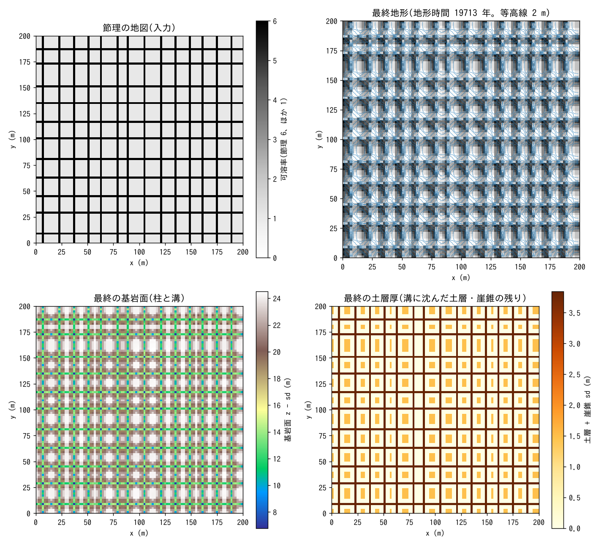
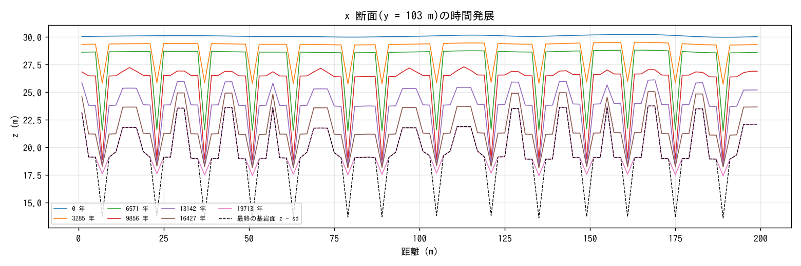
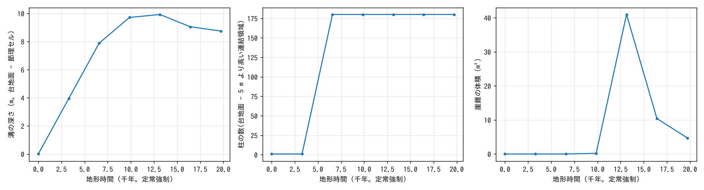

# stone_forest — 節理に沿った溶解の集中で台地が柱と溝に分かれる(石林)

[English](en/README.md)

雲南の石林(Shilin)のような**石林**(stone forest)は、石灰岩の台地が節理に沿って溶け
込まれ、節理の間の岩体が柱として残ったものです。本例題は、節理のパターンを
**可溶率の地図**(`fn_dissol`。節理の列を 6 倍)として与え、土層の下の溶食
(`f_dissol`)・基岩の崩落と崖錐(`f_rockfall`、`rf_bedrock = 1`)・崖錐の溶食の
重ね合わせで、平らな台地が柱と溝に分かれていく過程を見ます。入力はこのディレクトリの
`param.txt` と生成入力 `z.txt`・`joints.txt` だけです。機構と設定は
[石灰岩の溶食](../../docs/users_guide/geomorph.md#石灰岩の溶食f_dissol)と
[崩落と崖錐](../../docs/users_guide/geomorph.md#崩落と崖錐f_rockfall)を見てください。

**正直な注意**: 柱の配置は与えた節理の地図で決まり、モデルが自発的に作るものでは
ありません。モデルが決めるのは、溝の深まり方、壁が崩れて溝を埋める過程、崖錐の溶解、
柱の高さの上限、壁の角度です。

## 実際の石林で起きていること

- 石灰岩の台地に直交する節理の網があり、土層に覆われた状態で、土壌 CO₂ を含んだ
  涵養水が節理に沿って集中して溶解を進める(subcutaneous / subsoil dissolution)。
  節理は溝(grike、カッレン)になり、間の岩体が柱になる。
- 後に土層が剥ぎ取られる(exhumation)と柱が地表に現れる。柱の壁は節理面で、
  高さは数 m から 30 m。
- 柱の壁は崩落で後退し、落ちた岩屑は溝で溶ける。

## 再現に必要な機構と対応

| 現象 | 機構 | パラメータ |
|---|---|---|
| 節理に沿って溶解が集中する | 可溶率の地図(節理の列 6、ほか 1) | `fn_dissol = 'joints.txt'` |
| 土層の下の溶食 | 浸透量に比例する面的溶食(c_eq = 300 mg/L) | `f_dissol`, `dissol_src = 1` |
| 柱の壁の崩落 | 崩落と崖錐(基岩モード。限界高さ 8 m、2 セル窓) | `f_rockfall`, `rf_bedrock`, `rf_hc`, `rf_rc` |
| 落ちた岩屑が溝で溶ける | 崖錐の溶食(崖錐が載ったセルはまず崖錐を溶かす) | (自動) |
| 土層の剥ぎ取り | **表さない**(土層は溶食で下がる地表に載ったまま溝へ沈む) | — |

## 幾何と設定

| 項目 | 値 |
|---|---|
| 領域・格子 | 200 × 200 m、Δx = 2 m(100 × 100 セル)、四周壁 |
| 初期地形 | 平らな台地 z = 30 m(相関長 10 m・標準偏差 0.1 m の起伏) |
| 節理 | x = 一定の線を 14 m 間隔、y = 一定の線を 18 m 間隔(各線の位置に ±1 セルの乱れ)、1 セル幅、可溶率 6。節理のセルは全体の 23.5 % |
| 土層・浸透 | 土層 1 m(sy 0.2)、Green-Ampt 40 mm/h(雨は全量浸透 = 流出なし)。土層の水は管路層へ 20 mm/h で抜ける |
| 降雨 | 年平均の雨 2000 mm/yr = 0.228 mm/h を定常に(準定常強制) |
| 溶食 | c_eq = 300 mg/L、ρ_r = 2500 → k_d = 1.2×10⁻⁴、浸透量比例、残渣率 0.1 |
| 崩落 | rf_hc = 8 m、rf_rc = 4 m(2 セル窓)、崖錐の安息角 35°、relax 0.5、基岩モード、1 エッジ・1 更新の上限 0.5 m |
| 時間 | dt = 10 s、地形更新 10 分毎 × morfac 1.2×10⁵。60 日 = 地形時間 19.7 kyr。10 日毎に出力。約 1 時間(4 スレッド) |

## 実行方法

```
cd examples/stone_forest
make                                        # 実行ファイルへのリンクと入力(make_terrain.py が z.txt・joints.txt を作る)
make run                                    # 主ケース(約 1 時間)
python3 plot_results.py | tee analysis.txt  # figs/maps・sections・stats.png と数表
```

引数 `en` を付けると英語ラベルの図を en/figs/ に描きます。

## 結果



左上: 節理の地図(入力)。右上: 最終地形の陰影図。左下: 最終の基岩面 z − sd(柱と溝)。
右下: 最終の土層厚(溝に沈んだ土層と崖錐の残渣)。



y = 103 m の x 断面の時間発展(破線は最終の基岩面)。



溝の深さ(台地面の中央値 − 節理セルの中央値。基岩面で評価)、柱の数(台地面 − 5 m より
高い連結領域)、崖錐の体積の時系列。

数表(`plot_results.py`。地形時間 19 713 年):

| 項目 | 値 |
|---|---|
| 溶けた岩(台帳) | 410 941 m³(うち崖錐として溶けた岩 130 622 m³ = 32 %) |
| 崩落で移した岩(台帳。かさ) | 150 778 m³。最終の崖錐は 5 m³(溶けて残らない) |
| 地表の体積減少 | Σ(z₀ − z)Δx² = 369 847 m³ = 溶食 × (1 − 0.1)(全桁一致) |
| 台地面(非節理セルの中央値) | 30.0 → 22.1 m(400 mm/kyr。節理の間の柱の頂も残渣の下で溶ける) |
| 節理セルの削剥 / 非節理セル | 12.9 m / 7.9 m(比 1.6。与えた可溶率の比 6 より小さい = 崩落で埋まる) |
| 溝の深さ(基岩面) | 0 → 9.9 m(13 kyr)→ 8.8 m(20 kyr) |
| 柱の数 | 180(6.6 kyr 以降一定) |
| 基岩面の最大勾配角 | 75° |

- **溝が深まり柱が立つ(〜10 kyr)**: 節理のセルは 6 倍の速さで溶け、溝の深さは約 1.2 m/kyr
  で増える。6.6 kyr で溝が 8 m に達し、台地は 180 本の柱に分かれる。
- **崩落が溝を埋め、柱の高さが頭打ちになる(10 kyr 以降)**: 溝の壁(1 セル幅の溝の両側)が
  限界高さ 8 m を超えると崩れ、岩屑は溝で溶けて(崖錐として溶けた岩が全溶食の 32 %)
  残渣が溝に残る。節理セルの基岩は溶け続けるが、溝の地表は残渣と沈んだ土層で埋まり、
  **溝の深さは約 9〜10 m で飽和**する。台地面も残渣の下で溶け続けるので、柱全体が下がり
  ながら形を保つ(断面図)。柱の高さの上限は崩落の限界高さ H_c で決まる。
- **壁の角度**: 基岩面の最大勾配角は 75°。崩落が 1 セル(2 m)の段差を H_c まで許すため、
  2 m 格子では 8 m / 2 m の段 = 76° が上限になる。

## このモデルで表せないこと(実際の現象との違い)

- **柱の配置は入力**: 節理の位置と可溶率の倍率は前処理で与える。溶解の集中が流路に
  沿って自発的に強まる機構(溶存濃度の輸送と速度律速の溶食)は、このモデルにはない。
- **土層の剥ぎ取りがない**: 土層は溶食で下がる地表に載ったまま溝に沈み、柱の頂にも
  1 m の土層が残る。実際の石林は土層が剥がれて柱が露出する(乾式侵食・掃流砂を重ねれば
  表せるが、本例題では動かさない)。
- **溝の幅は 1 セル**: 節理を 1 セル幅で与えたので溝は 2 m 幅から始まり、崩落で広がる。
  実際の溝の幅は節理の開き方と溶解の側方への広がりで決まる。
- **係数は校正値ではない**: 可溶率の倍率 6 は「節理帯の方が速く溶ける」ことを表す仮の値。
  石林の形成時間(数十万年)に対し本例題の 20 kyr は短く、溝の深さの飽和を見るための設定。

## 感度実験の入口

- `make_terrain.py` の `FSOL_JOINT`(節理の倍率)、`SPACING_X/Y`(柱の幅): 溝が深まる速さと柱の太さ。
- `rf_hc`(限界高さ): 柱の高さの上限。`rf_rc`: 壁の面全体を崩すか段差だけか。
- `dissol_fres`(残渣率): 溝を埋める残渣の量。0 にすると溝は崖錐の溶解だけで埋まらなくなる。
- `tt_c` と `morfac`: 地形時間(溝の深さの飽和を見るには 10 kyr 以上)。

## 関連

- [examples/karst](../karst/) — ドリーネ群、[examples/tower_karst](../tower_karst/) — 塔と基準面
- [docs/users_guide/geomorph.md](../../docs/users_guide/geomorph.md)「石灰岩の溶食」「崩落と崖錐」
- [test/dissol](../../test/dissol/)(構成 H = 可溶率の倍率の検定)、[test/rockfall](../../test/rockfall/)(崖錐の溶食の検定)

## 参考文献

- Ford, D. and Williams, P. (2007): *Karst Hydrogeology and Geomorphology*. John Wiley & Sons, Chichester.
- Knez, M. and Slabe, T. (2001): The lithology, shape and rock relief of the pillars in the Naigu stone forest (Lunan karst, Yunnan, China). *Acta Carsologica*, 30(1), 13–24.
