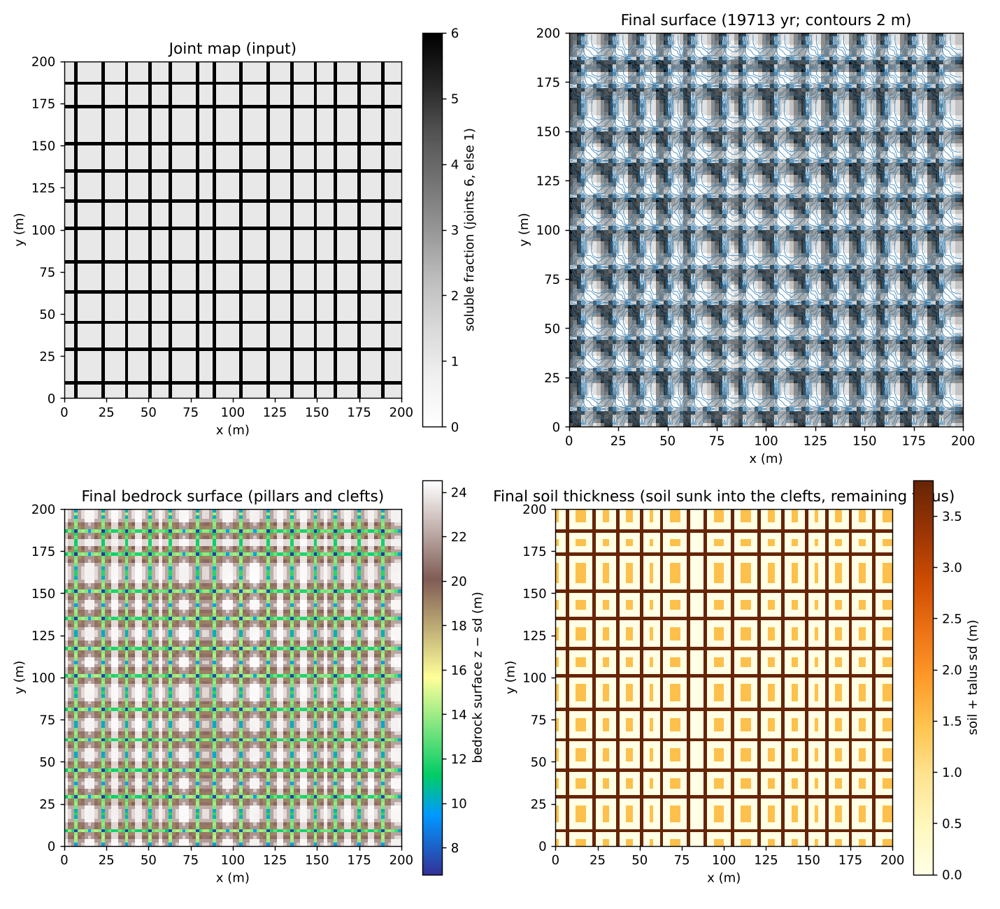
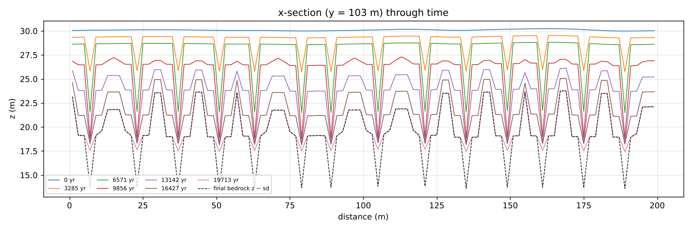
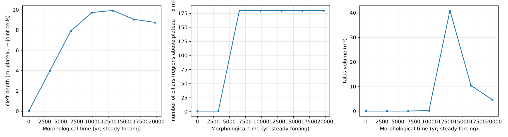

# stone_forest — a plateau split into pillars and clefts by dissolution concentrated along joints (stone forest)

> English mirror of examples/stone_forest/README.md. The Japanese file is the master copy.

[日本語](../README.md)

A **stone forest** such as Shilin in Yunnan is a limestone plateau that was dissolved along its
joints, leaving the rock between the joints standing as pillars. This example gives the joint
pattern as a **map of the soluble fraction** (`fn_dissol`; the joint lines are 6 times more
soluble) and watches a flat plateau split into pillars and clefts under the combination of
dissolution below the soil (`f_dissol`), bedrock collapse with talus (`f_rockfall`,
`rf_bedrock = 1`) and dissolution of the talus. The inputs are `param.txt` in this directory
and the generated `z.txt` and `joints.txt`. For the mechanisms and settings see
[limestone dissolution](../../../docs/en/users_guide/geomorph.md#limestone-dissolution-f_dissol)
and [rockfall and talus](../../../docs/en/users_guide/geomorph.md#rockfall-and-talus-f_rockfall).

**An honest caveat**: the arrangement of the pillars is set by the joint map that is given; the
model does not create it. What the model decides is how the clefts deepen, how the walls
collapse and fill the clefts, the dissolution of the talus, the upper limit of the pillar height
and the angle of the walls.

## What happens in a real stone forest

- A limestone plateau has an orthogonal network of joints. Under a soil cover, recharge that
  carries soil CO₂ concentrates along the joints and dissolves them (subcutaneous or subsoil
  dissolution). The joints become clefts (grikes, karren) and the rock between them pillars.
- When the soil is later stripped away (exhumation) the pillars appear at the surface. Their
  walls are joint faces, a few metres to 30 m high.
- The walls retreat by collapse and the fallen debris dissolves in the clefts.

## Mechanisms needed and how they are represented

| Phenomenon | Mechanism | Parameters |
|---|---|---|
| Dissolution concentrates along joints | Map of the soluble fraction (joint lines 6, else 1) | `fn_dissol = 'joints.txt'` |
| Dissolution below the soil | Diffuse dissolution proportional to infiltration (c_eq = 300 mg/L) | `f_dissol`, `dissol_src = 1` |
| Collapse of the pillar walls | Rockfall and talus (bedrock mode; critical height 8 m, 2-cell window) | `f_rockfall`, `rf_bedrock`, `rf_hc`, `rf_rc` |
| Fallen debris dissolves in the clefts | Talus dissolution (a cell carrying talus dissolves the talus first) | (automatic) |
| Stripping of the soil | **Not represented** (the soil rides on the surface lowered by dissolution and sinks into the clefts) | — |

## Geometry and settings

| Item | Value |
|---|---|
| Domain and grid | 200 × 200 m, Δx = 2 m (100 × 100 cells), walls on all sides |
| Initial terrain | Flat plateau z = 30 m (relief of correlation length 10 m and standard deviation 0.1 m) |
| Joints | Lines of constant x every 14 m and of constant y every 18 m (each line jittered by ±1 cell), one cell wide, soluble fraction 6. Joint cells are 23.5 % of the domain |
| Soil and infiltration | Soil 1 m (sy 0.2), Green-Ampt 40 mm/h (all rain infiltrates, no runoff). The soil water leaks to the conduit layer at 20 mm/h |
| Rain | The annual mean rain 2000 mm/yr = 0.228 mm/h given steadily (quasi-steady forcing) |
| Dissolution | c_eq = 300 mg/L, ρ_r = 2500 → k_d = 1.2×10⁻⁴, proportional to infiltration, residue fraction 0.1 |
| Collapse | rf_hc = 8 m, rf_rc = 4 m (2-cell window), talus repose 35°, relax 0.5, bedrock mode, cap 0.5 m per edge and update |
| Time | dt = 10 s, landform update every 10 min × morfac 1.2×10⁵. 60 days = 19.7 kyr of landform time. Output every 10 days. About one hour (4 threads) |

## How to run

```
cd examples/stone_forest
make                                        # link to the executable and inputs (make_terrain.py writes z.txt and joints.txt)
make run                                    # main case (about one hour)
python3 plot_results.py | tee analysis.txt  # figs/maps, sections, stats.png and the tables
```

With the argument `en` the figures are drawn with English labels into en/figs/.

## Results



Top left: joint map (input). Top right: hillshade of the final surface. Bottom left: final
bedrock surface z − sd (pillars and clefts). Bottom right: final soil thickness (soil sunk into
the clefts and the residue of the talus).



Evolution of the x-section at y = 103 m (dashed: final bedrock surface).



Cleft depth (median of the plateau minus median of the joint cells, on the bedrock surface),
number of pillars (connected regions above plateau − 5 m) and talus volume through time.

Tables (`plot_results.py`; landform time 19,713 years):

| Item | Value |
|---|---|
| Dissolved rock (ledger) | 410 941 m³ (of which 130 622 m³ = 32 % dissolved as talus) |
| Rock moved by collapse (ledger; bulk) | 150 778 m³. Final talus 5 m³ (it dissolves away) |
| Loss of surface volume | Σ(z₀ − z)Δx² = 369 847 m³ = dissolution × (1 − 0.1) (all digits agree) |
| Plateau (median of non-joint cells) | 30.0 → 22.1 m (400 mm/kyr; the pillar tops also dissolve below the residue) |
| Denudation of joint cells / non-joint cells | 12.9 m / 7.9 m (ratio 1.6; smaller than the prescribed ratio 6 because collapse fills the clefts) |
| Cleft depth (bedrock surface) | 0 → 9.9 m (13 kyr) → 8.8 m (20 kyr) |
| Number of pillars | 180 (constant after 6.6 kyr) |
| Maximum slope angle of the bedrock surface | 75° |

- **The clefts deepen and the pillars stand (to about 10 kyr)**: the joint cells dissolve six
  times faster and the cleft depth grows at about 1.2 m/kyr. At 6.6 kyr the clefts reach 8 m and
  the plateau is split into 180 pillars.
- **Collapse fills the clefts and the pillar height saturates (after 10 kyr)**: once the cleft
  walls (both sides of the one-cell-wide clefts) exceed the critical height of 8 m they collapse,
  the debris dissolves in the clefts (32 % of all dissolution is talus) and its residue stays
  there. The bedrock of the joint cells keeps dissolving, but the cleft surface fills with residue
  and sunk soil, and **the cleft depth saturates at about 9 to 10 m**. The plateau also keeps
  dissolving below its residue, so the pillars go down as a whole while keeping their form
  (sections). The upper limit of the pillar height is set by the critical height H_c.
- **Wall angle**: the maximum slope of the bedrock surface is 75°. Collapse allows a one-cell
  (2 m) step up to H_c, so on a 2 m grid the limit is a step of 8 m over 2 m = 76°.

## What this model cannot represent (differences from the real phenomenon)

- **The pillar arrangement is an input**: the joint positions and the solubility multiplier are
  given in preprocessing. The model has no mechanism by which dissolution concentrates
  spontaneously along flow paths (transport of dissolved load with rate-limited dissolution).
- **No stripping of the soil**: the soil rides on the surface lowered by dissolution and sinks
  into the clefts, and 1 m of soil remains on the pillar tops. In real stone forests the soil is
  stripped and the pillars are exposed (dry-slope erosion or bed load could represent this, but
  this example does not move the soil).
- **The clefts are one cell wide**: the joints were given one cell wide, so the clefts start 2 m
  wide and widen by collapse. Real cleft widths follow the opening of the joints and the lateral
  spread of dissolution.
- **The coefficients are not calibrated**: the multiplier 6 is a provisional value expressing
  that joint zones dissolve faster. The 20 kyr of this example is short against the formation time
  of stone forests (hundreds of kyr); it is set to show the saturation of the cleft depth.

## Starting points for sensitivity experiments

- `FSOL_JOINT` (joint multiplier) and `SPACING_X/Y` (pillar width) in `make_terrain.py`: how fast the clefts deepen and how thick the pillars are.
- `rf_hc` (critical height): upper limit of the pillar height. `rf_rc`: whether the whole wall face collapses or only the steps.
- `dissol_fres` (residue fraction): how much residue fills the clefts. With 0 the clefts no longer fill by the dissolution of the talus.
- `tt_c` and `morfac`: landform time (more than 10 kyr to see the saturation of the cleft depth).

## Related

- [examples/karst](../../karst/en/README.md) — doline fields; [examples/tower_karst](../../tower_karst/en/README.md) — towers and base level
- [docs/en/users_guide/geomorph.md](../../../docs/en/users_guide/geomorph.md) "Limestone dissolution", "Rockfall and talus"
- [test/dissol](../../../test/dissol/) (configuration H = multiplier of the soluble fraction), [test/rockfall](../../../test/rockfall/) (talus dissolution)

## References

- Ford, D. and Williams, P. (2007): *Karst Hydrogeology and Geomorphology*. John Wiley & Sons, Chichester.
- Knez, M. and Slabe, T. (2001): The lithology, shape and rock relief of the pillars in the Naigu stone forest (Lunan karst, Yunnan, China). *Acta Carsologica*, 30(1), 13–24.
