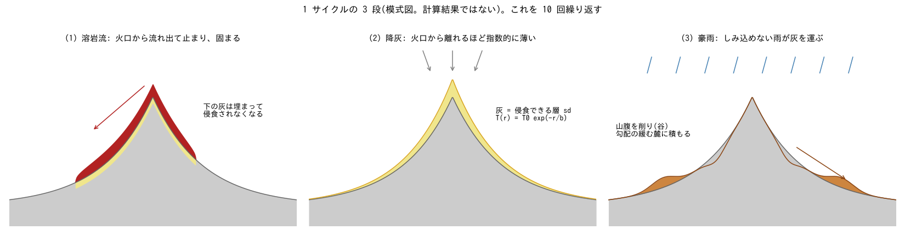
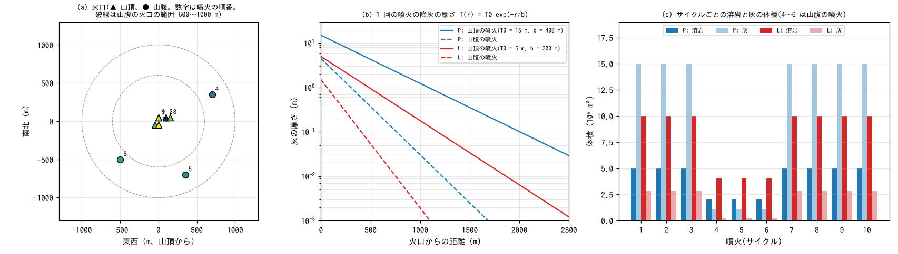
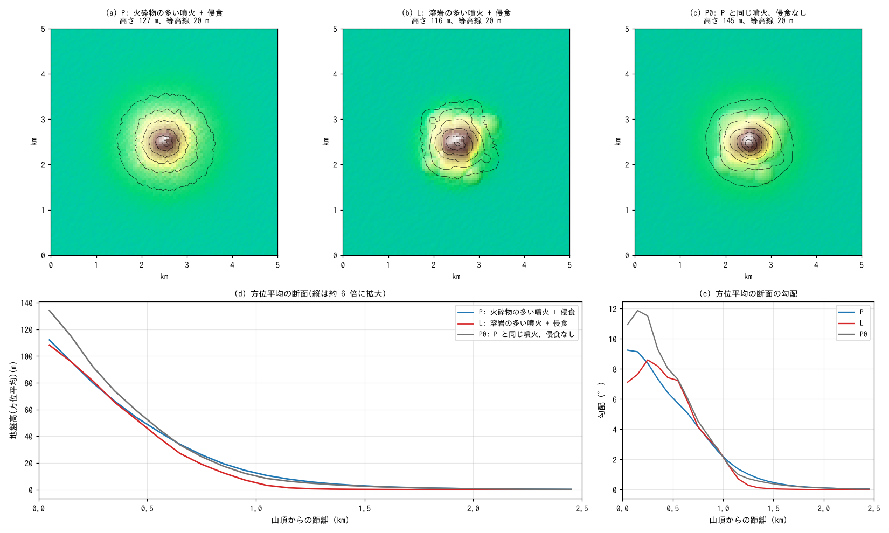
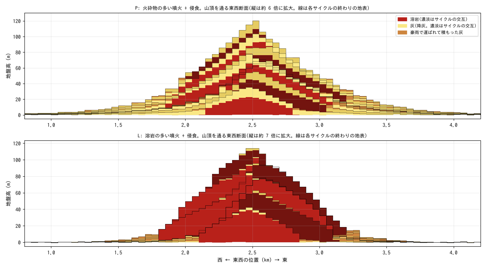
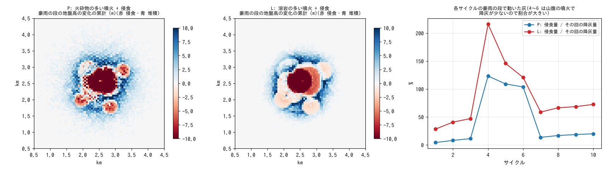

# stratovolcano — 溶岩流・降灰・侵食の繰り返しで育つ成層火山

[English](en/README.md)

平らな地面の中央付近の火口から、「溶岩流 → 降灰 → 豪雨による侵食」を 10 回繰り返し、溶岩と灰が
交互に重なった成層火山が育つ過程を計算します。1 回の噴火で出す溶岩と灰の割合を変えた 2 ケースと、
侵食のない対照を比べ、山の形と内部の層(層序)が、噴火の仕方と侵食でどう変わるかを見ます。
溶岩流([ユーザーガイドの溶岩流の章](../../docs/users_guide/lavaflow.md))、浸透
([地下水](../../docs/users_guide/gwflow.md))、表面流による土砂の運搬
([土砂・地形変化](../../docs/users_guide/geomorph.md))を、段ごとの計算をつないで連鎖させる例題です。
値は現象を見やすくするための模式値で、特定の火山の再現ではありません。

## 実際の成層火山で起きていること

- **成層火山**: 溶岩流と火砕物(降下火砕物・火砕流の堆積物)が交互に重なってできた火山です。
  断面は山頂付近が急で、麓に向かって緩くなる凹形です。この凹形は、火口の近くに厚く積もる
  火砕物と、それが崩れたり雨で流されたりして麓に作る緩い裾野でできると説明されています
  (Davidson & De Silva 2000)。主な噴火は山頂の火口から起き、山腹から噴火することもあります
  (富士山・エトナの側火山)。
- **降灰**: 噴火で降り積もる火山灰や軽石の厚さは、火口から離れるほど指数的に薄くなります
  (Pyle 1989)。風があると風下に長く伸びます。
- **噴火後の雨**: 新しい火砕物は雨がしみ込みにくく、削られやすいので、流水や泥流が火砕物を
  運び、麓に扇状地や裾野を作ります(Pierson & Major 2014)。
- **溶岩に覆われた灰**: 溶岩流に覆われた火砕物は削られにくくなり、層として残ります。成層火山の
  内部の層の重なりはこうしてできます。

## 再現に必要な機構



模式図(計算結果ではない)。1 サイクルは 3 つの段からなり、これを 10 回繰り返します。

| 実際の現象 | ENCflow での表し方 | 設定 |
|---|---|---|
| 溶岩が火口から流れ出て止まり、固まる | 等温の Bingham 粘性重力流。止まったセルの溶岩は地盤高 z に移る | `fn_lavaflow`、`lv_tauy`、`lv_vsol`・`lv_wsol` |
| 溶岩に覆われた灰は削られない | 溶岩が固まったセルの土層(灰)を埋める(sd = 0。developer.md §51.6)。土層を確保するため、溶岩の段でも地下水の計算を有効にする | 溶岩の段の `fn_gwflow` |
| 噴火で灰が降り積もる | 火口からの距離 r で指数的に薄くなる厚さ T(r) = T0 exp(−r/b) を、z と侵食できる層 sd の両方に足す(前処理。計算本体は降灰を扱わない) | `run_cycles.py` の `t0`・`b` |
| 灰の上では雨がしみ込みにくい | Green-Ampt の一定の浸透能 5 mm/h。しみ込んだ水は灰の間隙に貯まる。灰のない溶岩の上ではしみ込まない | `fn_gwflow`、`gw_ksv_mmh` |
| しみ込めない雨が斜面を流れ、灰を運んで麓に積もらせる | 浅水流 + 掃流砂(代表粒径 1 mm)。勾配の緩む所で運べる量が減って積もる | `fn_precip`、`f_fluvial`、`fluv_d50` |
| 噴火と噴火の間の長い休止期間の侵食 | 豪雨 1 回を計算し、地形変化を `morfac` = 100 倍する(この豪雨 100 回分とみなす) | `morfac` |
| 急すぎる斜面は崩れる | 安息角 33° を超えた分を崩す(この例題の勾配では働かなかった) | `f_repose`、`repose_phi` |
| 主に山頂から、ときどき山腹から噴火する | 山頂の火口を標準偏差 75 m で散らし、2 回目以降の噴火の 25% を山腹(山頂から 600〜1000 m)から出す | `run_cycles.py` の `vents` |
| 3 つの過程を順に繰り返す | 段ごとに別の計算を回し、最終の地盤高 Z と土層厚 Sd を次の段の入力にする(Python のドライバ) | `run_cycles.py` |

## 幾何と設定



(a) 火口の位置(▲ 山頂、● 山腹。数字は噴火の順番)。(b) 1 回の噴火の降灰の厚さ。(c) サイクルごとの
溶岩と灰の体積(4〜6 は山腹の噴火)。

5 km 四方、Δx = 50 m(100 × 100 セル)の平坦面(±0.5 m の乱れ。流れの対称性を破る種)から始め、
10 サイクルを計算します。四辺は自由流出です。火口の列は乱数の種(`--seed 7`)から作り、3 ケースで
同じです。山頂の噴火は 7 回(サイクル 1〜3・7〜10。火口は山頂から最大約 160 m ずれる)、山腹の
噴火は 3 回(サイクル 4・5・6。山頂から東北東へ約 780 m、南南東へ約 780 m、南西へ約 710 m)です。

| 項目 | P(主ケース) | L(比較) | P0(対照) |
|---|---|---|---|
| 噴火の性格 | 火砕物(灰)の多い噴火 | 溶岩の多い噴火 | P と同じ |
| 山頂の噴火の溶岩 | 5×10⁶ m³、降伏応力 2×10⁴ Pa | 1×10⁷ m³、5×10⁴ Pa | P と同じ |
| 山頂の噴火の灰 | 火口で 15 m、薄化距離 400 m(1 回 1.5×10⁷ m³) | 5 m、300 m(2.8×10⁶ m³) | P と同じ |
| 山腹の噴火 | 溶岩 0.4 倍、灰は厚さ 0.3 倍・薄化距離 0.5 倍 | 同じ | 同じ |
| 侵食の段 | 豪雨 50 mm/h × 1 時間、morfac = 100 | 同じ | なし |
| 計算時間(4 スレッド) | 約 7 分 | 約 7 分 | 約 1 分 |

- 降伏応力は、ユーザーガイドの型別表にある安山岩質の溶岩の範囲(10⁴〜10⁵ Pa)です。粘度
  10⁸ Pa s は時間の尺度だけを決めます(止まった形は変えない。[shield_volcano](../shield_volcano/)
  の「注意」)。噴出率は 20 m³/s です。
- 溶岩の段は、噴出の終わりから 10⁷ s(約 116 日)まで計算します。その時点でまだ流れている溶岩
  (厚い舌の先端がゆっくり進み続ける)は、その場で固まったとみなして地盤高に足し、下の灰を埋めます。
  その量は溶岩全体の P で 5.9%、L で 3.2%、P0 で 4.3% です(台帳 ledger.csv の `molten_frozen_m3`)。
- 侵食の段は dt = 1 s で 2 時間(無降雨 10 分・降雨 60 分・減水 50 分)を計算します。斜面の薄い
  流れを解くため、移動限界水深を 0.2 mm にしています([ashfall_lahar](../ashfall_lahar/) と同じ)。

## 実行方法

```bash
make              # ../../bin/ の実行ファイルへのリンク
make run          # P・L・P0 を順に計算する(合わせて約 16 分。4 スレッドの目安)
make run-P        # 1 ケースだけ計算する(run-L、run-P0 も同じ)
python3 plot_results.py      # 図と形の数値(引数 en で英語版の図を en/figs/ に)
```

各段の設定ファイルは `run_cycles.py` が作ります(設定の値と説明はスクリプトの中)。結果は
`result_<ケース>/` に、各段の ENCflow の結果(`cNN_lava/`・`cNN_ero/`)と設定ファイル、台帳
`ledger.csv`、各段の地表 `surfaces.npz` が入ります。サイクルごとに 2 つの検査を表示します。

- 溶岩の段の体積の収支: 地盤高の増えた量が噴出量と 0.1% 以内で一致する。
- 溶岩の下の灰が埋まっている: 溶岩で地盤高が上がったセルに灰が残っていない。

3 ケースとも 10 サイクルすべてで両方の検査が通ります。

## 結果



(a)〜(c) 10 サイクル後の地形(陰影と等高線)。(d) 方位平均の断面。(e) その勾配。

| 形の数値 | P(火砕物が多い + 侵食) | L(溶岩が多い + 侵食) | P0(P と同じ噴火、侵食なし) |
|---|---:|---:|---:|
| 高さ(最高点) | 127 m | 116 m | 145 m |
| 断面が高さの 10% まで下がる距離 | 1.02 km | 0.88 km | 0.93 km |
| 平均勾配(山頂から 0.1〜0.5 km) | 8.2° | 8.2° | 10.6° |
| 平均勾配(0.5〜1.0 km) | 4.1° | 4.7° | 4.8° |
| 平均勾配(1.0〜1.5 km) | 1.1° | 0.6° | 0.9° |
| 噴出した溶岩 / 降った灰 | 4.1 / 10.8 ×10⁷ m³ | 8.2 / 2.0 ×10⁷ m³ | 4.1 / 10.8 ×10⁷ m³ |
| 溶岩に埋まった灰 | 3.9×10⁷ m³ | 0.9×10⁷ m³ | 4.5×10⁷ m³ |
| 豪雨で動いた灰(降った灰に対する割合) | 1.8×10⁷ m³(16%) | 1.2×10⁷ m³(58%) | — |
| そのうち領域の外へ出た量 | 0.5% | 0.03% | — |

- **溶岩と灰の層が重なった火山になる**: どのケースも、山頂付近が急で麓に向かって緩くなる凹形の
  高まりになります(勾配は山頂から 0.1〜0.5 km で 8〜11°、1.0〜1.5 km で 1° 前後)。下の断面図の
  ように、内部では溶岩と灰が交互に重なります。
- **凹形は主に降灰の分布から来る**: 侵食のない P0 も凹形です。火口から指数的に薄くなる灰が
  重なると、山頂付近ほど急な高まりになるためです。
- **侵食は山頂を低くし、灰を麓へ移す**: 同じ噴火でも、侵食のある P は P0 より山頂が 18 m 低く、
  山頂付近の勾配は 10.6° から 8.2° に緩くなります。動いた灰(降った灰の 16%)は勾配の緩む
  0.7〜1.5 km に積もり、1.0〜1.5 km の勾配は 0.9° から 1.1° に増えます(下の侵食の図)。
- **噴火の仕方で中身が変わる**: P は灰の中に溶岩のレンズが挟まり、L は厚い溶岩の層に薄い灰が
  挟まります。L では、灰が溶岩の上に薄く載るだけなので、降った灰の 58% が豪雨で動きます。
  山腹の噴火の高まりは、L では山頂から同じ距離の周りより 16〜22 m 高く残り、P では 11〜15 m
  です(侵食のない P0 では 13〜19 m)。
- 方位平均の断面は P と L でよく似ていて、違いは主に内部の層と平面形に出ます。



山頂を通る東西断面。赤が溶岩、黄が降った灰、茶が豪雨で運ばれて積もった灰です(濃淡はサイクルの
交互)。線は各サイクルの終わりの地表で、線より上の灰が削られた所は侵食面です。



左・中: 豪雨の段の地盤高の変化の累計(赤が侵食、青が堆積)。山頂付近と山腹の噴火の灰の円錐が
削られ、そのまわりの勾配の緩む所に積もります。右: 各サイクルの豪雨の段で動いた灰の、その回の
降灰量に対する割合(4〜6 は山腹の噴火で降灰が少ないので、前に積もった灰も動いて 100% を超える)。

## このモデルで表せないこと(実際の現象との違い)

- **爆発的な噴火の力学**: 噴煙柱・火砕流・火山弾は計算しません。降灰は前処理の模式的な分布で、
  風による偏りもありません。
- **泥流(土石流)**: 使っていません。泥流のモデル(`f_debris`)は `morfac` = 1 が必須で、休止期間の
  多数の豪雨をまとめて計算できないためです。似た条件で泥流を豪雨 1 回として計算した試作では、
  1 回で動いた灰はその回の降灰の 0.4〜4% でした。噴火直後の豪雨の泥流は
  [ashfall_lahar](../ashfall_lahar/) の例題にあります。
- **時間**: 1 サイクルは「噴火 1 回 + 豪雨 100 回分の侵食」で、休止期間の年数は与えていません
  (豪雨の頻度で決まる)。溶岩の粘度も時間を縮めた値です。
- **溶岩の侵食・風化・崩壊**: 溶岩は削られない岩盤として扱います。山体崩壊、カルデラ、山頂火口の
  くぼみはできません。
- **土層は 1 層**: 溶岩の下に埋まった灰は、後で侵食で掘り出されても岩盤として扱われます。
- **残った溶岩**: 溶岩の段の終わりにまだ流れている溶岩(全体の 3〜6%)は、その場で固まったと
  みなします。
- **大きさ**: 10 回の噴火でできるのは高さ 120〜150 m の小さな若い火山です。実在の成層火山は
  はるかに多くの噴火でできています。50 m の格子では、谷の幅は格子の大きさで決まります。
- **灰の粒径**: 運ぶ灰は 1 種類(1 mm の掃流砂)です。細かい灰が浮遊して遠くへ運ばれる過程
  (`f_suspend`)は使っていません。

## 注意

- 溶岩と灰の量、降伏応力、薄化距離は模式値です。豪雨の強さ(50 mm/h)・長さ(1 時間)と
  `morfac` = 100 は侵食の強さを決めます。侵食の効果が見えるように選んだ値で、校正していません。
- `morfac` は 1 回の豪雨の地形変化を 100 倍する近似です。100 回の豪雨を順に計算した場合とは、
  地形の変化が流れに返る順番が違います(ユーザーガイドの土砂・地形変化の章の `morfac`)。

## 感度実験の入口

確かめたのは P・L・P0 の 3 ケースだけです。以下の予想は、この例題では確かめていません。

- **サイクル数**(`--ncyc`): 増やすと高く、山頂付近が急になると予想されます(山頂付近の勾配は、
  降灰だけなら回数 × T0/b に比例して増える)。山頂付近が安息角に近づくと `f_repose` が働きます。
- **侵食の強さ**(`--morfac`): 大きくすると山頂がさらに低くなり、灰が麓へ移ると予想されます。
  0 に近づけると P0 に近づきます。
- **噴火の性格**(`run_cycles.py` の `CASES`): 溶岩量・降伏応力・灰の厚さ `t0`・薄化距離 `b`。
- **火口**(`--seed`、`FLANK_P`、`FLANK_R`、`SUMMIT_SIG`): 山腹の噴火を増やすと、平面形がより
  不規則になると予想されます。
- **風**: 降灰の分布を風下に伸ばすと(`run_cycles.py` の降灰の式を変える)、非対称な山になると
  予想されます。
- **噴火直後の泥流**: 侵食の段の前に泥流の豪雨 1 回の段(`f_debris`、`morfac` = 1)を足すと、
  噴火直後の泥流と休止期間の侵食を分けて扱えます。

## 参考文献

- Davidson, J. and De Silva, S. (2000): Composite volcanoes. In: Sigurdsson, H. (ed.),
  *Encyclopedia of Volcanoes*, Academic Press, San Diego, 663 ff.
- Pierson, T. C. and Major, J. J. (2014): Hydrogeomorphic effects of explosive volcanic
  eruptions on drainage basins. *Annual Review of Earth and Planetary Sciences*, 42, 469–507.
- Pyle, D. M. (1989): The thickness, volume and grainsize of tephra fall deposits.
  *Bulletin of Volcanology*, 51, 1–15.
