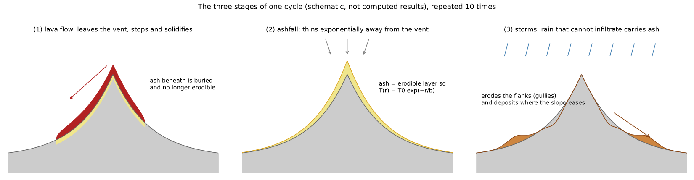
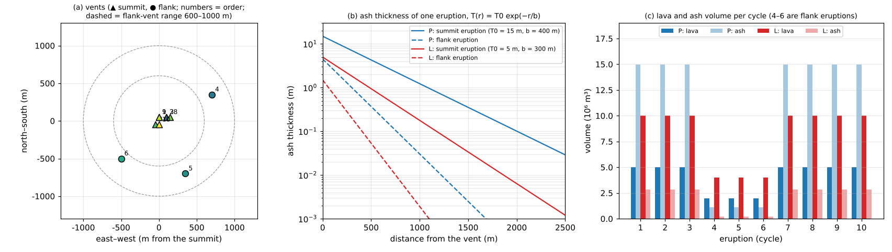
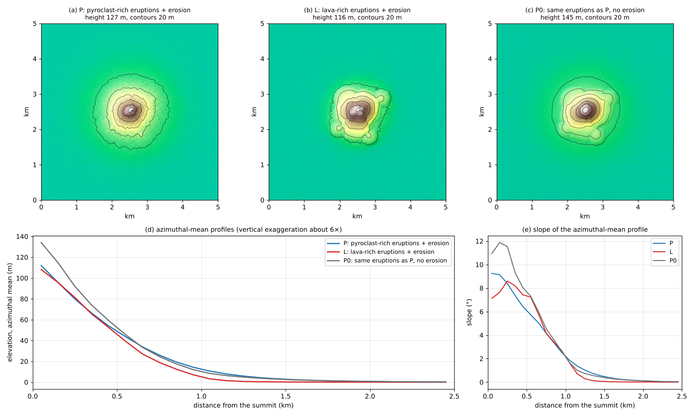
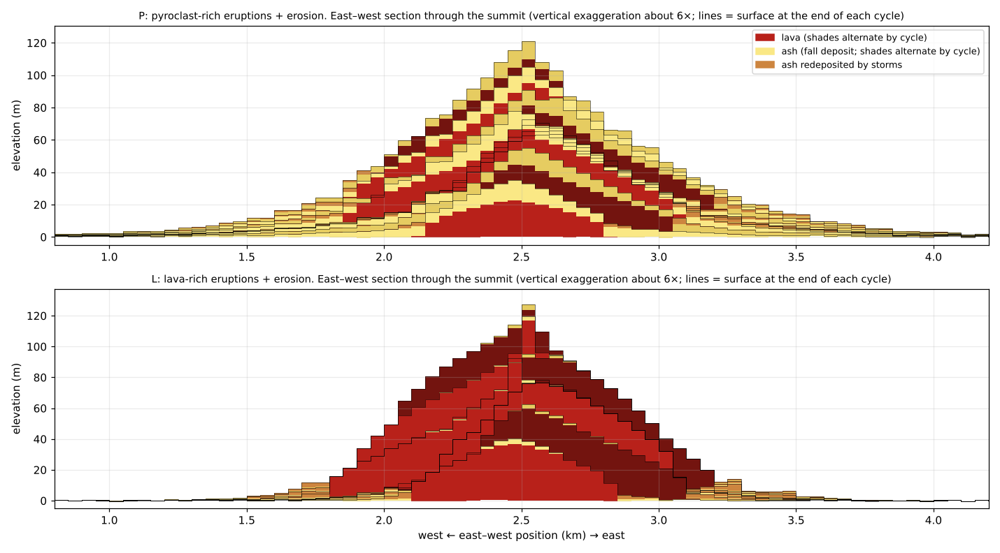
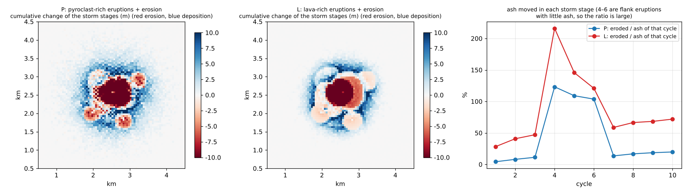
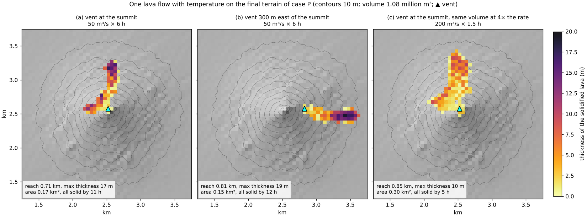
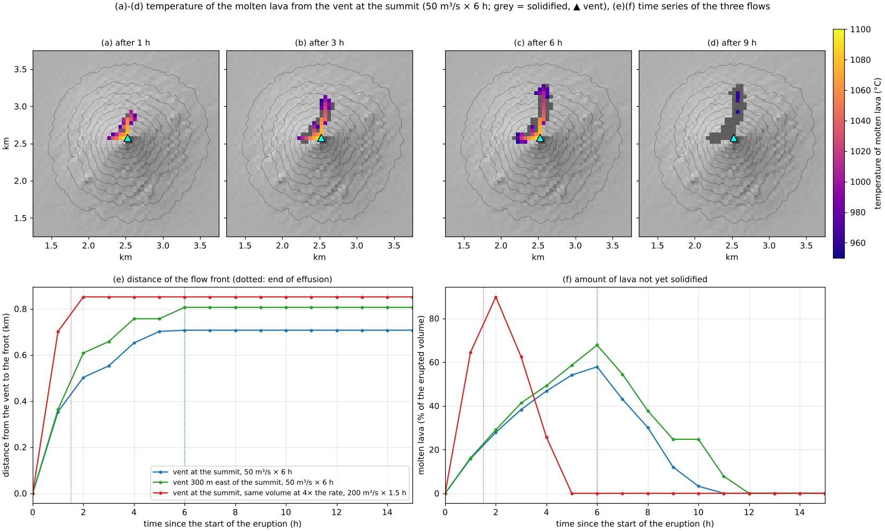

# stratovolcano — A stratovolcano growing by repeated lava flows, ashfall and erosion

> English mirror of examples/stratovolcano/README.md. The Japanese file is the master copy.

[日本語](../README.md)

From vents near the centre of a flat ground surface, the sequence "lava flow → ashfall → erosion by
storms" is repeated 10 times, and a stratovolcano of alternating lava and ash grows. Two cases that
change the proportion of lava and ash erupted in each eruption are compared with a control without
erosion, to see how the shape of the volcano and its internal layering (stratigraphy) change with the
style of eruption and with erosion. Finally, one lava flow with temperature is run over the uneven
terrain of the grown volcano, to see how its path is set by the terrain and how the lava stops as it
cools. The example chains lava flows
([lava flow chapter of the users guide](../../../docs/en/users_guide/lavaflow.md)), infiltration
([groundwater](../../../docs/en/users_guide/gwflow.md)) and sediment transport by surface flow
([sediment and landform change](../../../docs/en/users_guide/geomorph.md)) by connecting one
computation per stage. The values are schematic, chosen to make the phenomena easy to see; this is
not a reproduction of a particular volcano.

## What happens at real stratovolcanoes

- **Stratovolcanoes**: volcanoes built of alternating lava flows and pyroclastic material (fall
  deposits and pyroclastic-flow deposits). Their profile is steep near the summit and becomes gentler
  toward the foot (concave). This concave profile has been explained by pyroclastic material
  accumulating thickly near the vent and by the gentle apron at the foot formed when that material
  collapses or is washed down by rain (Davidson & De Silva 2000). Most eruptions occur at the summit
  crater, and some on the flanks (the flank vents of Fuji and Etna).
- **Ashfall**: the thickness of the ash and pumice that fall in an eruption thins exponentially with
  distance from the vent (Pyle 1989). With wind it is drawn out downwind.
- **Rain after eruptions**: fresh pyroclastic material lets little rain infiltrate and is easily
  eroded, so running water and lahars carry it away and build fans and aprons at the foot (Pierson &
  Major 2014).
- **Ash covered by lava**: pyroclastic material covered by a lava flow is hardly eroded and remains
  as a layer. This is how the layering inside a stratovolcano forms.

## Mechanisms needed for reproduction



Schematic (not computed results). One cycle consists of three stages and is repeated 10 times.

| Real phenomenon | Representation in ENCflow | Settings |
|---|---|---|
| Lava leaves the vent, stops and solidifies | isothermal Bingham viscous gravity current; the lava of stopped cells moves into the bed elevation z | `fn_lavaflow`, `lv_tauy`, `lv_vsol`, `lv_wsol` |
| Ash covered by lava is not eroded | the soil layer (ash) of cells where lava has solidified is buried (sd = 0; developer.md Sec. 51.6). To have the soil layer, the groundwater computation is also enabled in the lava stage | `fn_gwflow` of the lava stage |
| Ash falls in an eruption | a thickness T(r) = T0 exp(−r/b) that thins exponentially with the distance r from the vent is added to both z and the erodible layer sd (preprocessing; the model itself does not handle ashfall) | `t0`, `b` of `run_cycles.py` |
| Little rain infiltrates on ash | constant Green-Ampt infiltration capacity of 5 mm/h; the infiltrated water is stored in the pores of the ash. No infiltration on lava without ash | `fn_gwflow`, `gw_ksv_mmh` |
| Rain that cannot infiltrate runs down the slopes, carries ash and deposits it at the foot | shallow water flow + bedload (representative grain size 1 mm); deposition where the slope eases and the transport capacity drops | `fn_precip`, `f_fluvial`, `fluv_d50` |
| Erosion during the long repose between eruptions | one storm is computed and its landform change multiplied by `morfac` = 100 (taken as 100 such storms) | `morfac` |
| Over-steep slopes collapse | the excess over an angle of repose of 33° is removed (it did not act at the slopes of this example) | `f_repose`, `repose_phi` |
| Eruptions mostly at the summit, sometimes on the flanks | summit vents scattered with a standard deviation of 75 m; 25% of the eruptions after the first are on the flanks (600–1000 m from the summit) | `vents` of `run_cycles.py` |
| The three processes repeat in turn | one computation per stage; the final bed elevation Z and soil depth Sd become the inputs of the next stage (a Python driver) | `run_cycles.py` |
| Lava stops as it cools (the final stage only) | a lava flow with temperature: it cools by radiation and convection from its surface; as it cools its viscosity and yield stress rise and it stops, and it solidifies at the solidification temperature | `f_lvtemp` (`run_flow.py`) |

## Geometry and settings



(a) Vent positions (▲ summit, ● flank; numbers = order of eruption). (b) Ash thickness of one
eruption. (c) Lava and ash volume per cycle (4–6 are flank eruptions).

The computation starts from a flat surface (with ±0.5 m perturbations as seeds that break the
symmetry of the flow) 5 km square with Δx = 50 m (100 × 100 cells) and runs 10 cycles. All four edges
are free outflow. The vent sequence is made from a random seed (`--seed 7`) and is the same in the
three cases. There are 7 summit eruptions (cycles 1–3 and 7–10; the vent is at most about 160 m from
the summit) and 3 flank eruptions (cycles 4, 5 and 6; about 780 m east-northeast, 780 m
south-southeast and 710 m southwest of the summit).

| Item | P (main case) | L (comparison) | P0 (control) |
|---|---|---|---|
| Style of eruption | rich in pyroclastics (ash) | rich in lava | as P |
| Lava of a summit eruption | 5×10⁶ m³, yield stress 2×10⁴ Pa | 1×10⁷ m³, 5×10⁴ Pa | as P |
| Ash of a summit eruption | 15 m at the vent, thinning distance 400 m (1.5×10⁷ m³ each) | 5 m, 300 m (2.8×10⁶ m³) | as P |
| Flank eruptions | lava 0.4 times, ash 0.3 times as thick with half the thinning distance | same | same |
| Erosion stage | storm of 50 mm/h for 1 hour, morfac = 100 | same | none |
| Run time (4 threads) | about 7 minutes | about 7 minutes | about 1 minute |

- The yield stresses are in the range for andesitic lava (10⁴–10⁵ Pa) of the type table of the users
  guide. The viscosity of 10⁸ Pa s only sets the time scale (it does not change the shape at rest;
  "Notes" of [shield_volcano](../../shield_volcano/en/README.md)). The effusion rate is 20 m³/s.
- The lava stage is computed until 10⁷ s (about 116 days) after the end of the effusion. Lava still
  flowing at that time (the fronts of thick lobes keep advancing slowly) is taken as solidified in
  place, added to the bed elevation, and buries the ash beneath. Its amount is 5.9% of all the lava
  in P, 3.2% in L and 4.3% in P0 (`molten_frozen_m3` of the ledger ledger.csv).
- The erosion stage is computed for 2 hours with dt = 1 s (10 minutes without rain, 60 minutes of
  rain, 50 minutes of recession). To resolve the thin flows on the slopes, the minimum moving water
  depth is 0.2 mm (as in [ashfall_lahar](../../ashfall_lahar/en/README.md)).

## How to run

```bash
make              # links to the executables in ../../bin/
make run          # P, L and P0 in turn (about 16 minutes in total, with 4 threads)
make run-P        # one case only (also run-L, run-P0)
make run-flow     # final stage: one lava flow with temperature on the final terrain of P (run-P first; about 1 minute)
python3 plot_results.py      # figures and shape numbers (argument en draws the English figures in en/figs/)
python3 plot_flow.py         # figures of the final stage (same)
```

`run_cycles.py` writes the settings file of each stage (the values and their explanations are in the
script). The results go to `result_<case>/`: the ENCflow results of each stage (`cNN_lava/`,
`cNN_ero/`) and their settings files, the ledger `ledger.csv`, and the surface after each stage
`surfaces.npz`. Two checks are printed for every cycle.

- Volume balance of the lava stage: the increase of the bed elevation agrees with the erupted volume
  within 0.1%.
- The ash under the lava is buried: no ash remains in cells whose bed elevation rose with lava.

Both checks pass in all 10 cycles of the three cases.

## Results



(a)–(c) Topography after 10 cycles (shading and contours). (d) Azimuthal-mean profiles. (e) Their
slopes.

| Shape numbers | P (pyroclast-rich + erosion) | L (lava-rich + erosion) | P0 (same eruptions as P, no erosion) |
|---|---:|---:|---:|
| Height (highest point) | 127 m | 116 m | 145 m |
| Distance at which the profile falls to 10% of the height | 1.02 km | 0.88 km | 0.93 km |
| Mean slope (0.1–0.5 km from the summit) | 8.2° | 8.2° | 10.6° |
| Mean slope (0.5–1.0 km) | 4.1° | 4.7° | 4.8° |
| Mean slope (1.0–1.5 km) | 1.1° | 0.6° | 0.9° |
| Erupted lava / fallen ash | 4.1 / 10.8 ×10⁷ m³ | 8.2 / 2.0 ×10⁷ m³ | 4.1 / 10.8 ×10⁷ m³ |
| Ash buried by lava | 3.9×10⁷ m³ | 0.9×10⁷ m³ | 4.5×10⁷ m³ |
| Ash moved by storms (fraction of the fallen ash) | 1.8×10⁷ m³ (16%) | 1.2×10⁷ m³ (58%) | — |
| Of which left the domain | 0.5% | 0.03% | — |

- **A volcano of stacked lava and ash layers forms**: in every case the edifice is concave, steep near
  the summit and gentler toward the foot (slopes of 8–11° at 0.1–0.5 km from the summit and about 1°
  at 1.0–1.5 km). As in the section figure below, lava and ash alternate inside.
- **The concave shape comes mainly from the ashfall pattern**: P0, without erosion, is also concave.
  Ash that thins exponentially from the vent piles up into an edifice that is steeper toward the
  summit.
- **Erosion lowers the summit and moves ash to the foot**: with the same eruptions, P is 18 m lower
  at the summit than P0, and the slope near the summit eases from 10.6° to 8.2°. The moved ash (16%
  of the fallen ash) is deposited at 0.7–1.5 km where the slope eases, and the slope at 1.0–1.5 km
  increases from 0.9° to 1.1° (erosion figure below).
- **The style of eruption changes the interior**: in P, lenses of lava are interbedded in ash; in L,
  thin ash is interbedded in thick lava. In L the ash lies only thinly on the lava, so 58% of the
  fallen ash is moved by the storms. The mounds of the flank eruptions stand 16–22 m above their
  surroundings at the same distance from the summit in L and 11–15 m in P (13–19 m in P0 without
  erosion).
- The azimuthal-mean profiles of P and L are much alike; the difference shows mainly in the internal
  layering and the plan shape.



East–west section through the summit. Red is lava, yellow is fallen ash, and brown is ash carried and
redeposited by storms (shades alternate by cycle). The lines are the surface at the end of each cycle;
where ash above a line has been removed, the line is an erosion surface.



Left and centre: cumulative change of the bed elevation in the storm stages (red erosion, blue
deposition). The summit area and the ash cones of the flank eruptions are eroded, and the material
is deposited around them where the slope eases. Right: ash moved in the storm stage of each cycle as
a fraction of the ash that fell in that cycle (4–6 are flank eruptions with little ash; earlier ash
also moves, so the fraction exceeds 100%).

## Final stage: one lava flow with temperature (run_flow.py)



The lava stages of the 10 cycles use the isothermal model: the viscosity is a value that compresses
time, and the shape at rest is set by the yield stress. In the final stage, a lava flow with temperature
(`f_lvtemp = 1`;
[temperature mode in the lava flow chapter of the users guide](../../../docs/en/users_guide/lavaflow.md#temperature-mode-f_lvtemp--1))
is run once over the uneven terrain built by the main case P. The lava cools by radiation and
convection from its surface; as it cools its viscosity and yield stress rise and it stops, and it
solidifies at the solidification temperature. We look at how the path is set by the unevenness of the
terrain and how the lava stops as it cools.

| Item | Setting |
|---|---|
| Terrain | the bed elevation of P after 10 cycles (`result_P/data/z_10.txt`; 5 km square, 50 m grid, 127 m high). The soil layer (ash) is not read |
| Vents | S: the summit (the highest cell of the final terrain), E: 300 m east of the summit, S4: the summit |
| Effusion | S and E: 50 m³/s for 6 hours. S4: the same volume at 4 times the rate (200 m³/s for 1.5 hours). The volume is 1.08 million m³ in all three |
| Lava (illustrative) | viscosity 1×10⁴ Pa·s and yield stress 1×10³ Pa at the eruption temperature 1100 °C, temperature sensitivities 0.03 1/K (10 times after cooling by 77 K), solidification temperature 950 °C, effective emissivity 0.95, convective heat transfer coefficient 70 W/m²/K, specific heat 1150 J/kg/K, air temperature 15 °C |
| Time | 1 day (time step 10 s; lava thickness, temperature and bed elevation written every hour) |

The lava values are an illustrative set meant for something like a basaltic andesite, not the values
of a particular lava or of the literature. The temperature computation proceeds in real time, so the
viscosity is of the size of real lava (time cannot be compressed as in the isothermal stages). With the
real viscosity of andesite (10⁶ Pa·s or more), the lava would flow a few cells on the 50 m grid and
stop, and no flow down the slope would be seen.

`run_flow.py` writes the settings files. The results go to `result_P/flow_S/`, `flow_E/` and
`flow_S4/`, and the ledger to `result_P/flow.csv`. Two checks are printed for each run, and all three
runs pass them.

- The increase of the bed elevation agrees with the erupted volume (within the rounding of the output
  digits), and no molten lava remains.
- The heat ledger closes (the residual is about 1e-15 of the erupted heat).

| | S (summit) | E (300 m east of the summit) | S4 (summit, 4 times the rate) |
|---|---:|---:|---:|
| Reach (from the vent, to cells 5 cm thick or more) | 0.71 km | 0.81 km | 0.85 km |
| Area | 0.17 km² | 0.15 km² | 0.30 km² |
| Maximum thickness | 17 m | 19 m | 10 m |
| Time when all lava has solidified | 11 h | 12 h | 5 h |
| Heat lost by radiation and convection (relative to the erupted heat) | 9.7%, 4.9% | 9.7%, 4.9% | 9.4%, 4.5% |

- **The path is set by the unevenness of the terrain**: the lava from the summit vent (a) splits into two
  valleys, to the north and to the west. Moving the vent 300 m east (b) gives a single flow along the
  eastern valley. The rises and valleys made by the lava flows, ashfall and erosion of the 10 cycles
  decide where the lava goes.
- **It stops as it cools**: in every run the front advances while the effusion continues and stops
  within an hour after the effusion ends ((e) in the figure below). The lava stops by cooling from its
  front, and lava piles up behind it and thickens (19 m near the front of E).
- **A higher effusion rate flows further and wider**: erupting the same volume at 4 times the rate (c)
  extends the reach from 0.71 km to 0.85 km and the area 1.8 times, and the maximum thickness becomes 60%.
  The difference is likely smaller than in the check on a uniform slope (test/lava configuration 9; the
  reach 2.6 times) because on the volcano the flow splits into valleys and spreads sideways.
- **Thin, wide flows solidify early**: the amount of molten lava is largest around the end of the
  effusion (58% of the erupted volume in S, 90% in S4) and then decreases as the lava cools. S4 spreads
  thinly and has all solidified in 5 hours; S and E take 11–12 hours.
- The solidified lava becomes ground still holding about 85% of the erupted heat (it solidifies once it
  has cooled to the solidification temperature 950 °C, and its cooling afterwards is not computed).



(a)–(d) Temperature of the molten lava of the flow from the summit vent (S) (grey = solidified lava).
Near the vent it is close to the eruption temperature, and the lava cools and solidifies from the front
and the margins. (e) Distance from the vent to the flow front. (f) Amount of lava not yet solidified
(fraction of the erupted volume). Dotted lines: end of the effusion.

## What this model cannot represent (differences from the real phenomena)

- **Dynamics of explosive eruptions**: eruption columns, pyroclastic flows and ballistics are not
  computed. The ashfall is a schematic distribution of the preprocessing, without bias by the wind.
- **Lahars (debris flows)**: not used. The lahar model (`f_debris`) requires `morfac` = 1 and cannot
  lump the many storms of the repose period into one computation. In prototypes that computed lahars
  under similar conditions as a single storm, one storm moved 0.4–4% of the ash of that eruption.
  Lahars in a storm right after an eruption are in the [ashfall_lahar](../../ashfall_lahar/en/README.md)
  example.
- **Time**: one cycle is "one eruption + the erosion of 100 storms"; the length of the repose period
  in years is not given (it depends on the storm frequency). The lava viscosity is also a value that
  compresses time.
- **Erosion, weathering and collapse of lava**: lava is treated as non-erodible bedrock. Flank
  collapse, calderas and summit craters do not form.
- **One soil layer**: ash buried under lava is treated as bedrock even if later erosion exposes it.
- **Remaining lava**: lava still flowing at the end of a lava stage (3–6% of the total) is taken as
  solidified in place.
- **Size**: 10 eruptions make a small young volcano 120–150 m high. Real stratovolcanoes are built by
  far more eruptions. On the 50 m grid, the width of valleys is set by the cell size.
- **Grain size of the ash**: the ash carried has one size (1 mm bedload). The suspension of fine ash
  that is carried far (`f_suspend`) is not used.
- **Lava of the final stage**: the values are illustrative and not calibrated. Cooling is represented
  by one effective emissivity, so thick lava ponds cool faster than in reality and the time of
  solidification is not reliable (limits of the temperature mode in the users guide). The emissivity,
  convective coefficient and specific heat have no defaults yet, and the example values have not been
  checked against original sources. On the 50 m grid one flow is 2–4 cells wide, and the reach has a
  resolution of 50 m. The lava flow of the final stage is run only once and is not fed back into the
  building of the terrain by the 10 cycles. It differs from the lava flows of the isothermal stages in
  the treatment of the viscosity (a time-compressing value or a real one) and in the way of solidifying
  (a speed threshold or temperature), so the two are not compared under the same conditions.

## Notes

- The amounts of lava and ash, the yield stresses and the thinning distances are schematic. The storm
  intensity (50 mm/h), duration (1 hour) and `morfac` = 100 set the strength of the erosion. They
  were chosen to make the effect of erosion visible and are not calibrated.
- `morfac` is an approximation that multiplies the landform change of one storm by 100. Compared with
  computing 100 storms in turn, the order in which the landform change feeds back on the flow differs
  (`morfac` in the sediment and landform change chapter of the users guide).

## Starting points for sensitivity experiments

Only the three cases P, L and P0 and the three runs of the final stage have been checked. The
expectations below have not been checked in this example.

- **Number of cycles** (`--ncyc`): more cycles are expected to make the volcano higher and steeper
  near the summit (with ashfall alone, the slope near the summit grows in proportion to the number of
  eruptions × T0/b). When the summit area approaches the angle of repose, `f_repose` acts.
- **Strength of erosion** (`--morfac`): a larger value is expected to lower the summit further and
  move more ash to the foot; approaching 0 approaches P0.
- **Style of eruption** (`CASES` of `run_cycles.py`): lava volume, yield stress, ash thickness `t0`
  and thinning distance `b`.
- **Vents** (`--seed`, `FLANK_P`, `FLANK_R`, `SUMMIT_SIG`): more flank eruptions are expected to make
  the plan shape more irregular.
- **Wind**: drawing the ashfall out downwind (change the ashfall formula of `run_cycles.py`) is
  expected to give an asymmetric volcano.
- **Lahars right after eruptions**: adding a stage of one lahar storm (`f_debris`, `morfac` = 1)
  before the erosion stage would separate the lahars right after an eruption from the erosion of the
  repose period.
- **Vents and lava of the final stage** (`RUNS` and `LAVA` of `run_flow.py`): the valley the lava
  follows changes with the vent position (checked at two places, the summit and 300 m east of it). A
  lower effective emissivity is expected to make the lava cool more slowly and flow further. On the final
  terrain of L (`--case L`), the lava is expected to follow the valleys of the lava-rich volcano.

## References

- Davidson, J. and De Silva, S. (2000): Composite volcanoes. In: Sigurdsson, H. (ed.),
  *Encyclopedia of Volcanoes*, Academic Press, San Diego, 663 ff.
- Pierson, T. C. and Major, J. J. (2014): Hydrogeomorphic effects of explosive volcanic
  eruptions on drainage basins. *Annual Review of Earth and Planetary Sciences*, 42, 469–507.
- Pyle, D. M. (1989): The thickness, volume and grainsize of tephra fall deposits.
  *Bulletin of Volcanology*, 51, 1–15.
