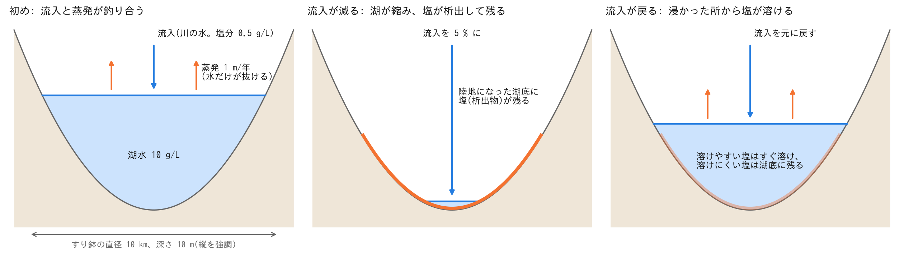
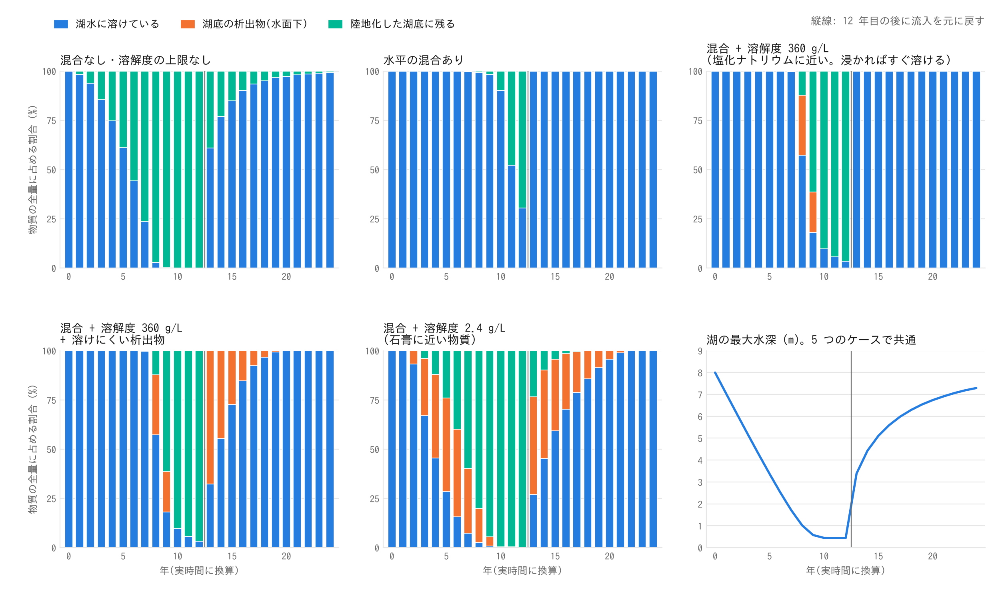
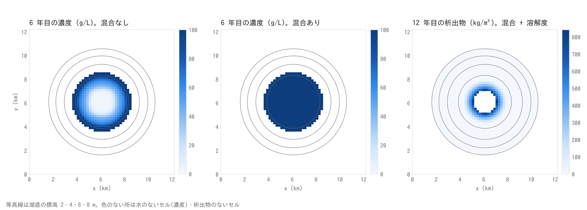
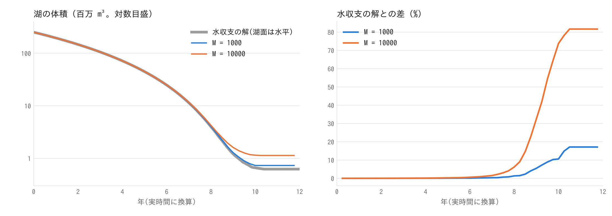

# terminal_lake — 流入が減った湖の縮小と塩分の上昇、陸地になった湖底に残る塩、水位が戻るときの溶け出し

[English](en/README.md)

出口のない湖は、流れ込む水と湖面からの蒸発が釣り合う大きさに落ち着きます。流入が減ると湖は縮み、
蒸発は水だけを抜くので塩分が上がります。飽和に達した塩は析出し、湖が縮むにつれて陸地になった湖底に
残ります。流入が戻ると水位が上がり、浸かった所から塩がまた溶けます。この例題は、すり鉢形の模式的な
湖で、流入を 5 % に絞って 12 年、元に戻して 13 年の計 25 年を
[時間の圧縮](../../docs/users_guide/time.md#時間の圧縮長期の水塩収支の計算)で計算し、湖の中の混合・
溶解度・析出物の溶けやすさの与え方で、塩の行き先がどう変わるかを比べます。値は現象を見やすくする
ための模式値で、特定の湖の再現ではありません。

## 実際の湖で起きていること

- **湖の縮小と塩分の上昇**: 中央アジアのアラル海は、流れ込む川の水が灌漑に使われて流入が減り、
  1960 年代から縮みました。1960 年ごろの平均の塩分は約 10 g/L で(Micklin 1988)、縮んだ後の南側の
  水域では 100 g/L を超え(Micklin & Aladin 2008)、東側の浅い水域では 140〜180 g/L と報告されて
  います(Crétaux ら 2009)。
- **析出の順序**: 塩分が上がると、溶けにくい物質から順に析出します(炭酸塩 → 石膏 → 芒硝 → 岩塩)。
  アラル海の湖底の析出物は、石膏が約半分、芒硝が約 4 割、岩塩が 1 割弱と見積もられています
  (Zavialov & Zavialov 2010)。
- **水位の回復**: 北側の小アラル海では、2005 年に完成したコカラル堤防で水位が上がり、塩分が
  下がりました(NASA Earth Observatory)。
- **陸地になった湖底の塩がどう溶けるか**を調べた研究は、この例題の準備では見つけていません。下の
  「溶けやすさ」の比較は、仮定の違いが結果をどう変えるかを見るための計算です。

## 再現に必要な機構



湖の断面の模式図です(計算結果ではありません)。流入(青の矢印)は塩を少し含み、蒸発(橙の矢印)は
水だけを抜きます。湖が縮むと、塩(橙の帯)は湖底に析出して陸地に残り、水が戻ると浸かった所から溶けます。

| 実際の現象 | ENCflow での表し方 | 設定 |
|---|---|---|
| 川からの流入と、その塩 | 湖の中心の 5 × 5 セルへの内部ソースと、同じセルへの点源 | `&list_bound_source`(`fn_src_cell`)、`fn_wq_pt_cell`・`wq_pt_series` |
| 蒸発は水だけを抜き、塩は残る | 蒸発散(年平均値を一定で与える)。水質の物質は水柱に残る | `fn_evap`(`f_evmodel = 1`) |
| 風などによる湖の中の混合 | 水平の混合係数(濃度の差に比例する流束) | `wq_diff` |
| 飽和と析出、陸地に残る塩 | 溶解度。超えた分と干上がったセルの塩は析出物(分布 B)になる | `wq_csat` |
| 水が戻ったときの溶け出し(溶けやすい・溶けにくい) | 飽和まで瞬時に溶かすか、物質移動係数つきで溶かす | `wq_kdis` |
| 数十年かけて進む | 時間の圧縮(圧縮率 M = 1000。速さを 1000 倍、期間を 1/1000) | 設定ファイルの値の読み替え |

## 幾何と設定

12.2 km × 12.2 km、dx = dy = 200 m(61 × 61 セル)。地形は放物面のすり鉢(中心からの距離 5 km で
高さ 10 m)です。初期水位は 8 m(湖の半径 4.5 km、面積 63 km²、体積 2.5 億 m³)、湖水の塩分は 10 g/L。

- **蒸発**: 年 1 m(一年中同じ速さ)。
- **流入**: 初めの湖で蒸発と釣り合う流量 Q0 = 1.99 m³/s を基準に、5 % に絞って 12 年、その後 Q0 に
  戻して 13 年。流入水の塩分は 0.5 g/L。川は作らず、湖の中心の 1 km 四方(5 × 5 セル)へ直接入れます
  (圧縮した流入を 1 セルに集めると、縮んだ湖の水面を盛り上げるので、広げて与えます)。
- **水平の混合係数**: 1 m²/s(広がり 1〜2 km の湖・海の水平の混合の目安。
  [水質](../../docs/users_guide/wq.md#水平の混合wq_diff))。
- **時間の圧縮**: 蒸発・流入・塩の負荷・混合係数・溶解の係数を 1000 倍にし、25 年を 9.13 日で計算します
  (dt = 5 s)。濃度と溶解度は変えません。

| ケース | 設定ファイル | 内容 |
|---|---|---|
| 混合なし | param_nomix.txt | 移流と蒸発による濃縮だけ(混合係数・溶解度を与えない) |
| 混合あり | param_mix.txt | 水平の混合係数を与える |
| 混合 + 溶解度 | param_salt.txt | さらに溶解度 360 g/L(塩化ナトリウムに近い物質。浸かればすぐ溶ける) |
| 混合 + 溶解度 + 溶けにくい析出物 | param_slow.txt | さらに溶解の物質移動係数 8.64e-4 m/day(水深 1 m の水が飽和に近づく時定数が約 3 年) |
| 溶けにくい物質 | param_gypsum.txt | 石膏に近い物質(湖水 1.5 g/L、流入水 0.1 g/L、溶解度 2.4 g/L) |
| 圧縮率の確かめ | param_mix_m10000.txt | 「混合あり」の最初の 12 年を圧縮率 10000 で計算する |

設定ファイルは `gen_param.py` が書き出したもので、実時間の値(流入・蒸発・負荷・係数・期間)と圧縮率を
変えた比較は、このスクリプトを元に作れます。

## 実行方法

```
cd examples/terminal_lake
make                    # リンクと入力(gen_data.py)
make run                # 6 ケースを順に計算(1 スレッドで計 50 分ほど)
python3 plot_results.py # figs/*.png と数表(引数 en で英語版を en/figs/ に)
```

## 結果



塩(物質)の全量に占める割合の年ごとの変化。青 = 湖水に溶けている、橙 = 水面下の湖底の析出物、
緑 = 陸地になった湖底に残る(水深 5 cm 未満のセルにある分)。右下は湖の最大水深。



左・中: 6 年目の湖水の濃度(混合なし・混合あり)。右: 12 年目の析出物(混合 + 溶解度)。

湖は 12 年で最大水深 8 m → 0.44 m、面積 63 km² → 2.8 km²、体積 2.5 億 m³ → 72 万 m³ に縮み、流入を
戻すと 24 年目に最大水深 7.3 m、面積 57 km² まで戻ります(どのケースも同じ)。

| 塩のゆくえ (%): 湖水 / 水面下の析出物 / 陸地 | 4 年 | 8 年 | 12 年 | 13 年 | 16 年 | 24 年 |
|---|---:|---:|---:|---:|---:|---:|
| 混合なし | 75 / 0 / 25 | 3 / 0 / 97 | 0 / 0 / 100 | 61 / 0 / 39 | 90 / 0 / 10 | 99 / 0 / 1 |
| 混合あり | 100 / 0 / 0 | 99 / 0 / 1 | 31 / 0 / 69 | 100 / 0 / 0 | 100 / 0 / 0 | 100 / 0 / 0 |
| 混合 + 溶解度 | 100 / 0 / 0 | 57 / 30 / 12 | 3 / 0 / 97 | 100 / 0 / 0 | 100 / 0 / 0 | 100 / 0 / 0 |
| 混合 + 溶解度 + 溶けにくい析出物 | 100 / 0 / 0 | 57 / 30 / 12 | 3 / 0 / 97 | 32 / 68 / 0 | 85 / 15 / 0 | 100 / 0 / 0 |
| 溶けにくい物質 | 45 / 43 / 12 | 3 / 17 / 80 | 0 / 0 / 100 | 27 / 50 / 24 | 70 / 28 / 2 | 100 / 0 / 0 |

| 湖水の平均の濃度 (g/L) | 4 年 | 8 年 | 12 年 | 13 年 | 16 年 | 24 年 |
|---|---:|---:|---:|---:|---:|---:|
| 混合なし | 26 | 18 | 1.6 | 35 | 20 | 14 |
| 混合あり | 35 | 620 | 1070 | 57 | 22 | 14 |
| 混合 + 溶解度 | 35 | 359 | 117 | 57 | 22 | 14 |
| 混合 + 溶解度 + 溶けにくい析出物 | 35 | 359 | 117 | 18 | 18 | 14 |
| 溶けにくい物質 | 2.4 | 2.4 | 1.3 | 2.3 | 2.3 | 2.2 |

- **混合なし**: 流入水が中心から淡水を広げ、湖の縁の水だけが濃くなります(6 年目に中心 1.3 g/L、縁は
  1000 g/L 超)。縁の濃い水から先に干上がるので、8 年目には塩の 97 % が陸地になった湖底に残ります。
  溶解度を与えていないので、塩は乾いたセルの水柱の量として残り(濃度の分布には出ません)、水が戻ると
  その場で全量が溶けます。
- **混合あり**: 湖の塩分はほぼ一様に上がります(6 年目に 100〜105 g/L)。ただし溶解度の上限がないので、
  8 年目に 620 g/L、12 年目に 1000 g/L を超えます。実際には飽和して析出する濃さです。
- **混合 + 溶解度**(塩化ナトリウムに近い物質): 8 年目までに飽和(360 g/L)して析出が始まり、12 年目には
  塩の 97 %(245 万 t)が陸地になった湖底の析出物になります。析出物は、飽和した後に湖が引いた範囲
  (約 9 km²)に残り、最後に水が引いた所で最大 840 kg/m² です。流入が戻ると、半年で全量が溶け、
  湖水は 57 g/L(初めの約 6 倍)まで上がってから、流入水で薄まります(24 年目に 14 g/L)。
- **溶けにくい析出物**: 同じ析出物でも、溶ける速さを抑えると、水が戻って 1 年後に溶けているのは 32 %、
  4 年後に 85 % で、全量が溶けるのに約 8 年かかります。湖水の塩分は 18 g/L 前後にとどまり、
  高い塩分の時期が現れません。
- **溶けにくい物質**(石膏に近い物質): 湖が縮み始めて 2 年ほどで飽和し(4 年目に 43 % が水面下の
  析出物)、12 年目には全量が陸地に残ります。水が戻っても、湖水の濃度は飽和に近い 2.3 g/L で頭打ちの
  まま、析出物は 9〜10 年かけて溶けます(溶けている割合は 13 年目に 27 %、16 年目に 70 %、20 年目に 96 %)。
- 物質の収支(湖水 + 析出物 = 初期量 + 流入の負荷)は、どのケースも相対 1e-8 以内で閉じます。

### 圧縮率の確かめ



「混合あり」の最初の 12 年の湖の体積を、湖面を水平とみなした水収支の式 dV/dt = Q − E·A(V) の解
(このラスタ地形の面積と体積で解いた常微分方程式)と比べます。

| 水収支の解との体積の差 | 2 年 | 4 年 | 6 年 | 8 年 | 10 年 | 12 年 |
|---|---:|---:|---:|---:|---:|---:|
| 湖の体積(水収支の解、百万 m³) | 147 | 72 | 25 | 4.0 | 0.66 | 0.62 |
| 湖の最大水深 (m) | 6.1 | 4.3 | 2.5 | 1.0 | 0.41 | 0.40 |
| 圧縮率 1000 | +0.00 % | +0.03 % | +0.10 % | +1.3 % | +11 % | +17 % |
| 圧縮率 10000 | +0.03 % | +0.11 % | +0.58 % | +6.2 % | +74 % | +82 % |

湖が深いうち(水深 2.5 m 以上)の差は、圧縮率 1000 で 0.1 % 以下、10000 でも 0.6 % 以下です。湖が浅く
小さくなると差が急に増えます。圧縮した計算では、湖の縁の蒸発を補う水が実際の 1000 倍・10000 倍の
速さで流れるので、浅い水では摩擦が効いて湖面が中心から縁へ傾き、同じ面積でも体積が大きくなるためです。
この例題の塩のゆくえは、差の大きい時期の湖水が塩の 3 % しか持たないので、ほとんど変わりません。浅い
水域の水位や体積そのものを見たいときは、圧縮率を下げます。

## 結果の読み方と限界

- **濃度は流れに作用しません**。濃い水が沈んで底にたまる成層や、塩分が高いほど蒸発しにくくなる
  効果は表しません。湖の中の混合は、風による流れなどを解かずに、与えた混合係数で決まります。
- **物質は 1 種類**です。溶解度の小さい順に析出する順序(炭酸塩 → 石膏 → 芒硝 → 岩塩)や物質の間の
  作用、温度による溶解度の変化は表しません。物質ごとに溶解度を変えた別の計算にします(この例題の
  「混合 + 溶解度」と「溶けにくい物質」)。
- **溶けにくい析出物の物質移動係数(8.64e-4 m/day)は例示**で、実測に基づく値ではありません。
  溶ける速さの違いが結果をどう変えるかを見るための値です。
- **析出物は動きません**。風による飛散(塩を含む砂塵)、土砂による埋没、湖底の土の中へのしみ込みは
  表しません(この例題は地下水を使っていません)。
- **蒸発は一年中同じ速さ**で、季節変化と降水はありません。時間の圧縮は、洪水のような速い現象を
  表しません([時間の圧縮](../../docs/users_guide/time.md#時間の圧縮長期の水塩収支の計算)の前提)。
  縮んだ後の浅い湖(水深 0.4 m)の体積は、圧縮の影響で 2 割ほど大きめに出ています(上の表)。
- **格子**は 200 m で、最も縮んだ湖は 70 セルほどです。湖岸の位置は格子の幅より細かくは表せません。

## 参考文献

「実際の湖で起きていること」の記述は、次の文献・資料の要点を Web 検索の結果の要約で確かめたもので、
本文は確認していません。

- Micklin, P. P. (1988): Desiccation of the Aral Sea: a water management disaster in the Soviet Union. *Science*, 241, 1170–1176.(1960 年ごろの塩分)
- Micklin, P. and Aladin, N. V. (2008): Reclaiming the Aral Sea. *Scientific American*, 2008 年 4 月号。(縮小後の体積と塩分)
- Crétaux, J.-F., Létolle, R. and Calmant, S. (2009): Investigations on Aral Sea regressions from mirabilite deposits and remote sensing. *Aquatic Geochemistry*, 15. doi:10.1007/s10498-008-9051-2(東側の水域の塩分)
- Zavialov and Zavialov (2010): アラル海の湖底の析出物の量の見積もり。EGU General Assembly 2010 の要旨 EGU2010-15141(<https://meetingorganizer.copernicus.org/EGU2010/EGU2010-15141.pdf>)
- NASA Earth Observatory: North Aral Sea Recovery(<https://science.nasa.gov/earth/earth-observatory/north-aral-sea-recovery-7645>)(小アラル海の水位と塩分の回復)
