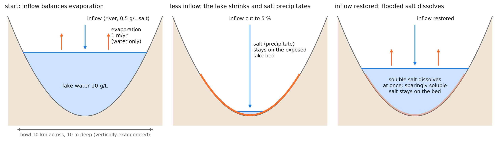
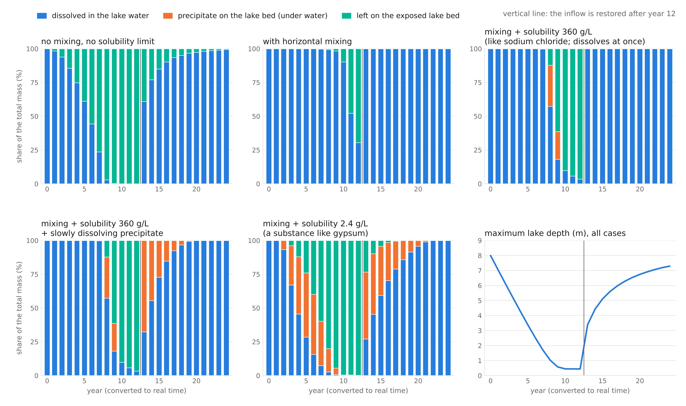
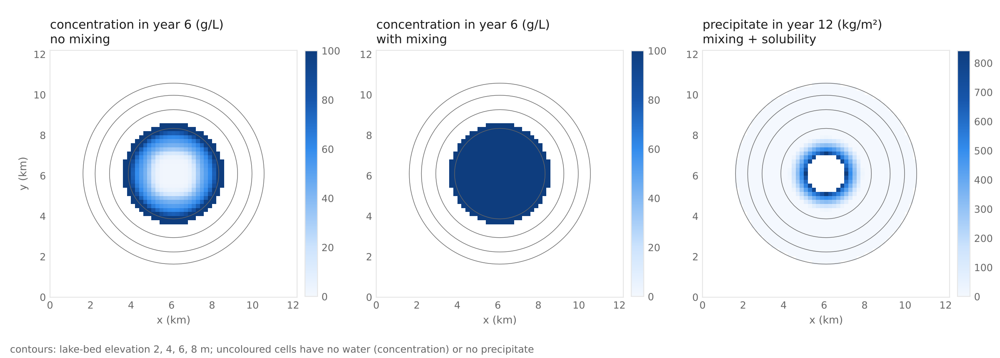
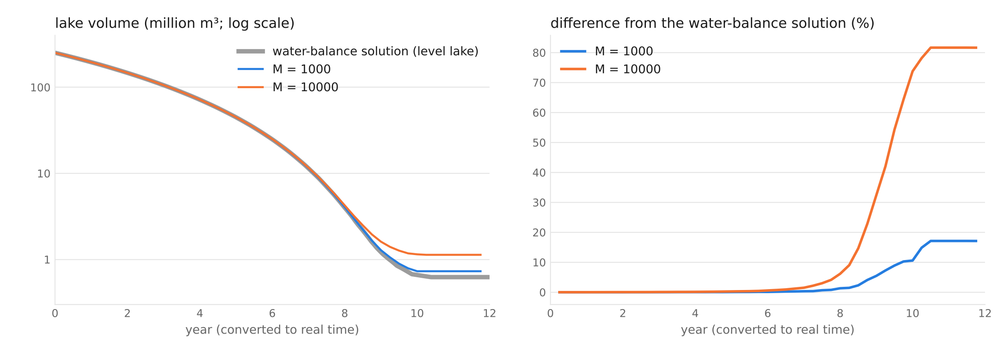

# terminal_lake — a lake shrinking and concentrating as its inflow decreases, salt left on the exposed bed, and its release when the level recovers

> English mirror of examples/terminal_lake/README.md. The Japanese file is the master copy.

[日本語](../README.md)

A lake without an outlet settles at the size where the inflow balances the evaporation from its
surface. When the inflow decreases, the lake shrinks, and since evaporation removes water only,
its salinity rises. Salt that reaches saturation precipitates and, as the lake shrinks, stays on
the bed that has become land. When the inflow returns, the level rises and the salt dissolves
again from where it is flooded. This example takes a schematic bowl-shaped lake, cuts the inflow
to 5 % for 12 years and restores it for 13 years, computes the 25 years with
[time compression](../../../docs/en/users_guide/time.md#time-compression-long-term-water-and-salt-balances),
and compares how the fate of the salt changes with the way the mixing within the lake, the
solubility and the ease of dissolution of the precipitate are given. The values are schematic,
chosen to show the phenomenon clearly, and do not reproduce a particular lake.

## What happens in a real lake

- **Shrinking and rising salinity**: the Aral Sea in Central Asia has shrunk since the 1960s
  because the water of the rivers flowing into it was used for irrigation. The mean salinity was
  about 10 g/L around 1960 (Micklin 1988); in the southern water body after the shrinking it
  exceeded 100 g/L (Micklin & Aladin 2008), and 140-180 g/L is reported for the shallow eastern
  water body (Crétaux et al. 2009).
- **Order of precipitation**: as the salinity rises, substances precipitate in the order of
  increasing solubility (carbonates → gypsum → mirabilite → halite). The precipitate on the bed
  of the Aral Sea is estimated to be about half gypsum, about 40 % mirabilite and a little under
  10 % halite (Zavialov & Zavialov 2010).
- **Recovery of the level**: in the northern Small Aral Sea, the Kokaral dike completed in 2005
  raised the level and lowered the salinity (NASA Earth Observatory).
- **How the salt on the exposed bed dissolves**: no study of this was found in the preparation
  of this example. The comparison of the "ease of dissolution" below is a calculation to see how
  different assumptions change the result.

## Mechanisms needed for the reproduction



A schematic cross-section of the lake (not a computed result). The inflow (blue arrow) carries a
little salt, and evaporation (orange arrows) removes water only. When the lake shrinks, the salt
(orange band) precipitates on the bed and stays on land, and it dissolves from where it is
flooded when the water returns.

| Real phenomenon | Representation in ENCflow | Settings |
|---|---|---|
| River inflow and its salt | An internal source on the 5 × 5 cells at the centre of the lake and a point source on the same cells | `&list_bound_source` (`fn_src_cell`), `fn_wq_pt_cell`, `wq_pt_series` |
| Evaporation removes water only and the salt stays | Evapotranspiration (the annual mean given as a constant). The water-quality substance stays in the water column | `fn_evap` (`f_evmodel = 1`) |
| Mixing within the lake by wind and the like | A horizontal mixing coefficient (a flux proportional to the concentration difference) | `wq_diff` |
| Saturation and precipitation, salt left on land | A solubility. The excess and the salt of cells that dry up become precipitate (field B) | `wq_csat` |
| Release when the water returns (easy or hard to dissolve) | Dissolved instantly up to saturation, or with a mass-transfer coefficient | `wq_kdis` |
| It proceeds over decades | Time compression (compression factor M = 1000: speeds × 1000, period × 1/1000) | The reading of the values in the parameter files |

## Geometry and settings

12.2 km × 12.2 km, dx = dy = 200 m (61 × 61 cells). The terrain is a paraboloid bowl (10 m high
at 5 km from the centre). The initial level is 8 m (lake radius 4.5 km, area 63 km², volume
250 million m³) and the salinity of the lake water is 10 g/L.

- **Evaporation**: 1 m per year (constant all year).
- **Inflow**: based on the discharge Q0 = 1.99 m³/s that balances the evaporation of the initial
  lake; cut to 5 % for 12 years, then restored to Q0 for 13 years. The salinity of the inflow is
  0.5 g/L. No river is built: the inflow is put directly on the 1 km square (5 × 5 cells) at the
  centre of the lake (a compressed inflow concentrated on one cell would raise the surface of the
  shrunken lake, so it is spread).
- **Horizontal mixing coefficient**: 1 m²/s (a guide for horizontal mixing in lakes and the sea
  at patch sizes of 1-2 km;
  [Water quality](../../../docs/en/users_guide/wq.md#horizontal-mixing-wq_diff)).
- **Time compression**: the evaporation, the inflow, the salt load, the mixing coefficient and the
  dissolution coefficient are multiplied by 1000, and 25 years are computed in 9.13 days
  (dt = 5 s). The concentrations and the solubility are not changed.

| Case | Parameter file | Content |
|---|---|---|
| No mixing | param_nomix.txt | Advection and concentration by evaporation only (no mixing coefficient, no solubility) |
| Mixing | param_mix.txt | A horizontal mixing coefficient is given |
| Mixing + solubility | param_salt.txt | In addition, a solubility of 360 g/L (a substance like sodium chloride; dissolves at once when flooded) |
| Mixing + solubility + slowly dissolving precipitate | param_slow.txt | In addition, a mass-transfer coefficient of dissolution of 8.64e-4 m/day (water 1 m deep approaches saturation with a time constant of about 3 years) |
| Sparingly soluble substance | param_gypsum.txt | A substance like gypsum (lake water 1.5 g/L, inflow 0.1 g/L, solubility 2.4 g/L) |
| Check of the compression factor | param_mix_m10000.txt | The first 12 years of "Mixing" computed with a compression factor of 10000 |

The parameter files were written by `gen_param.py`; comparisons with other real-time values
(inflow, evaporation, load, coefficients, period) and compression factors can be made from this
script.

## How to run

```
cd examples/terminal_lake
make                    # link and inputs (gen_data.py)
make run                # the 6 cases in turn (about 50 minutes in total on 1 thread)
python3 plot_results.py # figs/*.png and the tables (argument en: English version in en/figs/)
```

## Results



Yearly change of the shares of the total salt (substance). Blue = dissolved in the lake water,
orange = precipitate on the lake bed under water, green = left on the bed that has become land
(the part in cells with less than 5 cm of water). Bottom right: maximum depth of the lake.



Left and centre: concentration of the lake water in year 6 (no mixing, mixing). Right:
precipitate in year 12 (mixing + solubility).

In 12 years the lake shrinks from a maximum depth of 8 m to 0.44 m, from 63 km² to 2.8 km² and
from 250 million m³ to 0.72 million m³; with the inflow restored it returns to a maximum depth
of 7.3 m and 57 km² by year 24 (the same in every case).

| Fate of the salt (%): lake water / precipitate under water / land | Year 4 | Year 8 | Year 12 | Year 13 | Year 16 | Year 24 |
|---|---:|---:|---:|---:|---:|---:|
| No mixing | 75 / 0 / 25 | 3 / 0 / 97 | 0 / 0 / 100 | 61 / 0 / 39 | 90 / 0 / 10 | 99 / 0 / 1 |
| Mixing | 100 / 0 / 0 | 99 / 0 / 1 | 31 / 0 / 69 | 100 / 0 / 0 | 100 / 0 / 0 | 100 / 0 / 0 |
| Mixing + solubility | 100 / 0 / 0 | 57 / 30 / 12 | 3 / 0 / 97 | 100 / 0 / 0 | 100 / 0 / 0 | 100 / 0 / 0 |
| Mixing + solubility + slowly dissolving precipitate | 100 / 0 / 0 | 57 / 30 / 12 | 3 / 0 / 97 | 32 / 68 / 0 | 85 / 15 / 0 | 100 / 0 / 0 |
| Sparingly soluble substance | 45 / 43 / 12 | 3 / 17 / 80 | 0 / 0 / 100 | 27 / 50 / 24 | 70 / 28 / 2 | 100 / 0 / 0 |

| Mean concentration of the lake water (g/L) | Year 4 | Year 8 | Year 12 | Year 13 | Year 16 | Year 24 |
|---|---:|---:|---:|---:|---:|---:|
| No mixing | 26 | 18 | 1.6 | 35 | 20 | 14 |
| Mixing | 35 | 620 | 1070 | 57 | 22 | 14 |
| Mixing + solubility | 35 | 359 | 117 | 57 | 22 | 14 |
| Mixing + solubility + slowly dissolving precipitate | 35 | 359 | 117 | 18 | 18 | 14 |
| Sparingly soluble substance | 2.4 | 2.4 | 1.3 | 2.3 | 2.3 | 2.2 |

- **No mixing**: the inflow spreads fresh water from the centre and only the water at the rim of
  the lake concentrates (in year 6, 1.3 g/L at the centre and more than 1000 g/L at the rim). The
  concentrated water at the rim dries up first, so by year 8, 97 % of the salt is left on the bed
  that has become land. No solubility is given, so the salt stays as the column amount of dry
  cells (it does not appear in the concentration field), and all of it dissolves on the spot when
  the water returns.
- **Mixing**: the salinity of the lake rises almost uniformly (100-105 g/L in year 6). Without a
  solubility limit, however, it reaches 620 g/L in year 8 and exceeds 1000 g/L in year 12:
  concentrations at which a real brine would be saturated and precipitate.
- **Mixing + solubility** (a substance like sodium chloride): saturation (360 g/L) is reached and
  precipitation starts by year 8, and by year 12, 97 % of the salt (2.45 million t) is
  precipitate on the bed that has become land. The precipitate stays within the area from which
  the lake receded after saturation (about 9 km²), with a maximum of 840 kg/m² where the water
  receded last. When the inflow returns, all of it dissolves within half a year, and the lake
  water rises to 57 g/L (about 6 times the initial value) before being diluted by the inflow
  (14 g/L in year 24).
- **Slowly dissolving precipitate**: with the same precipitate but a limited dissolution rate,
  32 % is dissolved one year after the water returns and 85 % after 4 years; dissolving all of it
  takes about 8 years. The salinity of the lake water stays around 18 g/L and no period of high
  salinity appears.
- **Sparingly soluble substance** (a substance like gypsum): saturation is reached about 2 years
  after the lake starts to shrink (43 % is precipitate under water in year 4), and by year 12 all
  of it is left on land. Even when the water returns, the concentration of the lake water stays
  capped near saturation at 2.3 g/L, and the precipitate takes 9-10 years to dissolve (the
  dissolved share is 27 % in year 13, 70 % in year 16 and 96 % in year 20).
- The mass balance (lake water + precipitate = initial amount + load of the inflow) closes within
  a relative 1e-8 in every case.

### Check of the compression factor



The lake volume of the first 12 years of "Mixing" is compared with the solution of the water
balance dV/dt = Q − E·A(V) for a level lake surface (an ordinary differential equation solved
with the area and volume of this raster terrain).

| Difference of the volume from the water-balance solution | Year 2 | Year 4 | Year 6 | Year 8 | Year 10 | Year 12 |
|---|---:|---:|---:|---:|---:|---:|
| Lake volume (water-balance solution, million m³) | 147 | 72 | 25 | 4.0 | 0.66 | 0.62 |
| Maximum depth of the lake (m) | 6.1 | 4.3 | 2.5 | 1.0 | 0.41 | 0.40 |
| Compression factor 1000 | +0.00 % | +0.03 % | +0.10 % | +1.3 % | +11 % | +17 % |
| Compression factor 10000 | +0.03 % | +0.11 % | +0.58 % | +6.2 % | +74 % | +82 % |

While the lake is deep (2.5 m or more), the difference is 0.1 % or less with a compression factor
of 1000 and 0.6 % or less even with 10000. It grows rapidly once the lake becomes shallow and
small: in the compressed calculation, the water that makes up for the evaporation at the rim of
the lake flows 1000 or 10000 times faster than in reality, so friction matters in shallow water,
the lake surface slopes from the centre to the rim, and the volume is larger for the same area.
The fate of the salt in this example hardly changes, because the lake water holds only 3 % of the
salt during the period of large differences. To look at the level or the volume of a shallow
water body itself, lower the compression factor.

## How to read the results, and limits

- **The concentration does not act on the flow.** Stratification, with dense water sinking and
  collecting at the bottom, and the reduction of evaporation at high salinity are not represented.
  The mixing within the lake is set by the given mixing coefficient, without solving wind-driven
  currents and the like.
- **There is one substance.** The order of precipitation by increasing solubility (carbonates →
  gypsum → mirabilite → halite), the interactions between substances and the change of solubility
  with temperature are not represented. Run a separate calculation for each substance with its
  own solubility ("Mixing + solubility" and "Sparingly soluble substance" in this example).
- **The mass-transfer coefficient of the slowly dissolving precipitate (8.64e-4 m/day) is an
  illustration**, not a value based on measurements. It is a value for seeing how a difference in
  the dissolution rate changes the result.
- **The precipitate does not move.** Scattering by wind (dust containing salt), burial by
  sediment and seepage into the soil of the lake bed are not represented (this example does not
  use groundwater).
- **Evaporation is constant all year**; there are no seasonal changes and no precipitation. Time
  compression does not represent fast phenomena such as floods (the premises of
  [time compression](../../../docs/en/users_guide/time.md#time-compression-long-term-water-and-salt-balances)).
  The volume of the shallow lake after shrinking (0.4 m deep) comes out about 20 % too large
  because of the compression (table above).
- **The grid** is 200 m, and the lake at its smallest is about 70 cells. The position of the
  shore cannot be represented more finely than the grid width.

## References

The statements in "What happens in a real lake" were checked against the key points of the
following literature and material through the summaries of web search results; the texts
themselves were not read.

- Micklin, P. P. (1988): Desiccation of the Aral Sea: a water management disaster in the Soviet Union. *Science*, 241, 1170–1176. (salinity around 1960)
- Micklin, P. and Aladin, N. V. (2008): Reclaiming the Aral Sea. *Scientific American*, April 2008 issue. (volume and salinity after the shrinking)
- Crétaux, J.-F., Létolle, R. and Calmant, S. (2009): Investigations on Aral Sea regressions from mirabilite deposits and remote sensing. *Aquatic Geochemistry*, 15. doi:10.1007/s10498-008-9051-2 (salinity of the eastern water body)
- Zavialov and Zavialov (2010): estimate of the amount of precipitate on the bed of the Aral Sea. Abstract EGU2010-15141 of the EGU General Assembly 2010 (<https://meetingorganizer.copernicus.org/EGU2010/EGU2010-15141.pdf>)
- NASA Earth Observatory: North Aral Sea Recovery (<https://science.nasa.gov/earth/earth-observatory/north-aral-sea-recovery-7645>) (recovery of the level and salinity of the Small Aral Sea)
