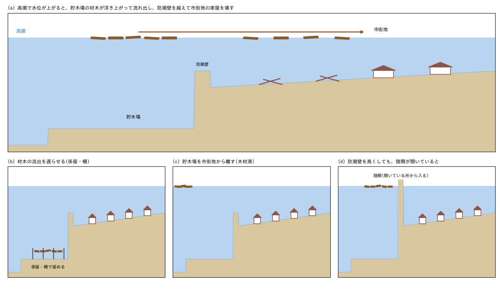
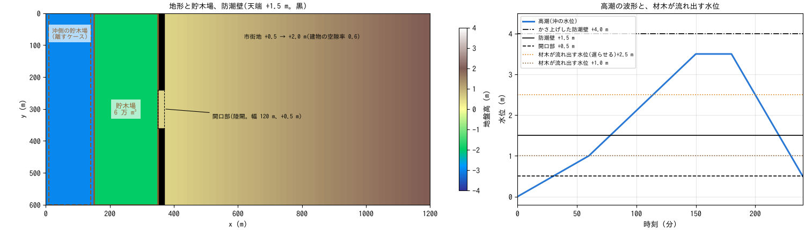
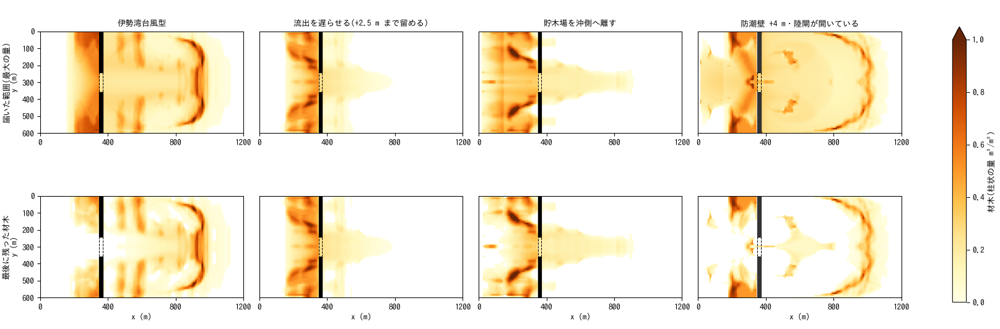
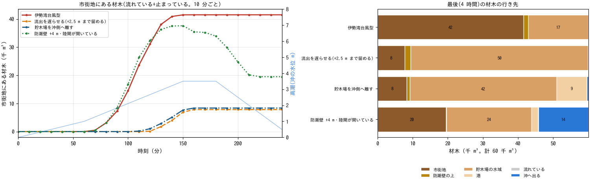
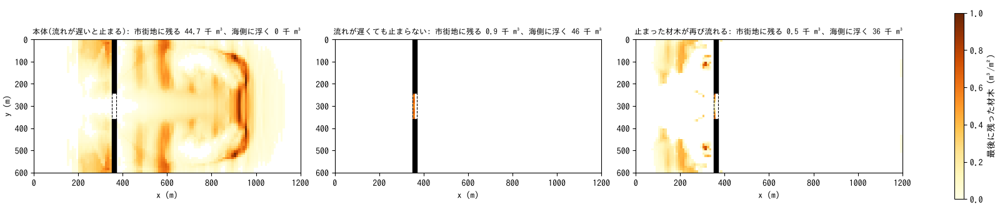

# timberyard — 高潮による貯木場からの材木の流入(伊勢湾台風型)

[English](en/README.md)

台風の高潮で海の水位が上がると、港の貯木場に浮かべた原木が浮き上がって流れ出し、防潮壁を
越えた水とともに市街地へ流れ込みます。1959 年の伊勢湾台風では、名古屋港の貯木場から流れ
出した原木が木造住宅を壊し、被害を大きくしました。この例題は、高潮の浸水と材木の流出・
運搬・堆積を一つの計算で解き、伊勢湾台風型の配置と、材木の流出を遅らせる、貯木場を市街地
から離す、防潮壁を高くする(ただし陸閘が開いている)の 3 つの対策を比べます。値は現象を
見やすくするための模式値で、伊勢湾台風の再現ではありません。

## 実際の高潮で起きていること

- **伊勢湾台風の高潮**: 1959 年 9 月の伊勢湾台風では、名古屋港の潮位が 3.89 m に達し
  (名古屋地方気象台)、伊勢湾周辺を中心に死者・行方不明者は 5,098 名にのぼりました
  (内閣府 2008)。
- **貯木場の原木が市街地を襲った**: 名古屋港の貯木場の当時の貯木量は約 100 万石(1 石 ≒
  0.28 m³)で、そのうち約 42 万石(約 12 万 m³)が、堤防を越えた海水とともに周辺の市街地に
  流れ込みました。原木は 1 本が直径約 1 m・長さ約 5 m・重さ数トンに及び、木造住宅などを
  壊しました。大量の木材が高潮の危険のある場所に集まっていたことも、災害を激しくした要因
  とされています(内閣府 2008)。
- **その後の対策**: 名古屋港では、延長 8,250 m の高潮防波堤が 1962〜1964 年に築かれ
  (国土交通省中部地方整備局 2013)、木材の流出を受けて木材を扱う木材港が設けられました
  (名古屋港の資料)。防潮壁や防潮堤には道路を通す開口部(陸閘)があり、高潮の前に閉める
  必要があります。

## 再現に必要な機構



(a) 高潮で水位が上がると、貯木場の材木が浮き上がって流れ出し、防潮壁を越えて市街地へ入る。
(b)〜(d) 比べる 3 つの対策。

| 実際の現象 | ENCflow での表し方 | 設定 |
|---|---|---|
| 高潮で海の水位が上がる | 沖の水位の時系列を、領域の西端の 1 列(海域マスク)に与える(波浪は扱わない) | `fn_tide`(`tival`) |
| 防潮壁と開口部(陸閘) | 地形の段(天端 +1.5 m、開口部 +0.5 m) | `fn_z` |
| 水位が上がると、係留が外れて材木が流れ出す | 貯木場の水深が閾値(平常の水深 + 余裕)を超えると、材木のストックが流れる材木に変わる | `fn_driftwood`、`dw_hrec`、`dw_wrec` |
| 材木は流れに乗って運ばれる | 流れる材木の量を水と同じ流れで運ぶ | (自動) |
| 浅い所や流れの止まった所で材木が止まる | 喫水より浅い所や流速の遅い所で、流れる材木を止まった材木に変える | `dw_wstop`、`dw_vstop` |
| 建物が流れを妨げる | 建物の空隙率(建物が 4 割を占める) | `fn_gv` |

## 幾何と設定



左: 地形と貯木場(茶の枠)、沖側の貯木場(「離す」ケース。茶の破線)、防潮壁(黒)と開口部。
右: 高潮の波形と、防潮壁・開口部の天端、材木が流れ出し始める水位。

1,200 m × 600 m、dx = dy = 10 m(120 × 60 セル)。西から順に:

| x (m) | セル番号 i | 地形 | 役割 |
|---|---|---|---|
| 0〜10 | 1 | z = −3 m、海域マスク | 高潮の水位を与える列 |
| 10〜150 | 2〜15 | z = −3 m | 港(通常セル+初期水位) |
| 150〜350 | 16〜35 | z = −2 m | **貯木場**。材木 0.5 m³/m² × 200 m × 600 m = **6 万 m³** |
| 350〜370 | 36〜37 | z = +1.5 m | 岸壁・防潮壁。中央の y = 240〜360 m(j = 25〜36)は**開口部 z = +0.5 m**(陸閘が開いている所) |
| 370〜1,200 | 38〜120 | z = +0.5 → +2.0 m | 市街地。建物の空隙率 0.6(建物が 4 割を占める) |

- **高潮**: 沖の水位を 60 分で +1.0 m(天文潮)、150 分で +3.5 m(ピーク)まで上げ、
  30 分保ってから 240 分で +0.5 m に下げます。初期の水位は 0 m で、港と貯木場は水に浸かり、
  陸は乾いています。東・北・南の辺は閉じています(防潮壁の背後の閉じた低地)。
- **材木**: ラワン原木級(直径 0.6 m・比重 0.5 → 喫水 0.3 m)。貯木場の水深が 3.0 m
  (平常の水深 2.0 m + 1.0 m。水位 +1.0 m)を超えると流れ出し始め、0.5 m³/m² が 42 分で
  流れ出す速さです。流れる材木は、喫水より浅い所や流速 0.02 m/s 未満の所で止まります。
- 計算は 4 時間、dt = 0.5 s。

| ケース | 設定ファイル | 貯木場 | 材木が流れ出す水位 | 防潮壁の天端 | 開口部 |
|---|---|---|---|---|---|
| 伊勢湾台風型 | param.txt | 防潮壁の前(x 150〜350 m) | +1.0 m | +1.5 m | 開いている |
| 流出を遅らせる | param_hold.txt | 防潮壁の前 | +2.5 m(係留や柵で留める。模式) | +1.5 m | 開いている |
| 貯木場を離す | param_far.txt | 港の沖側(x 10〜140 m)に同じ 6 万 m³ | +1.0 m | +1.5 m | 開いている |
| 防潮壁 +4 m・陸閘が開いている | param_wall4.txt | 防潮壁の前 | +1.0 m | +4.0 m(高潮を越えない) | 開いている |

## 実行方法

```
cd examples/timberyard
make                    # リンクと入力(make_terrain.py)
make run                # 4 ケースを順に計算(1 ケース 4 スレッドで 1 分前後)
make supp               # 補足の 2 ケース(任意)
python3 plot_results.py # figs/*.png と数表(引数 en で英語版を en/figs/ に)
```

## 結果



上: 材木の届いた範囲(流れる材木と止まった材木の和の期間最大。Wd9999)、下: 4 時間後に
残った材木(Wd9998)。黒 = 防潮壁、破線 = 開口部。



左: 市街地にある材木(流れている+止まっている。10 分ごと)と高潮(薄い青)。右: 4 時間後の
材木の行き先(千 m³)。

| ケース | 材木が流れ出した時刻 | 市街地に入り始めた時刻 | 市街地にあった材木の最大 | 届いた範囲(市街地の割合 / 最も遠い所) | 4 時間後に市街地に残る | 貯木場の水域・港に残る | 沖へ出る |
|---|---:|---:|---:|---:|---:|---:|---:|
| 伊勢湾台風型 | 65〜105 分 | 70 分 | 41,521 m³ | 87 % / x 1,125 m | 41,521 m³ | 17,086 m³ | 0 |
| 流出を遅らせる | 115〜160 分 | 120 分 | 7,824 m³ | 28 % / x 785 m | 7,824 m³ | 50,514 m³ | 0 |
| 貯木場を離す | 65〜125 分 | 110 分 | 8,366 m³ | 23 % / x 915 m | 8,366 m³ | 50,244 m³ | 474 m³ |
| 防潮壁 +4 m・陸閘が開いている | 65〜105 分 | 70 分 | 37,642 m³ | 88 % / x 1,125 m | 19,515 m³ | 26,062 m³ | 14,174 m³ |

材木は計 6 万 m³ です。残りは防潮壁の上(100〜1,700 m³)と、流れている分(防潮壁 +4 m で
145 m³)です。表と図は 2026-10-31 に既定 f_opening_dynamic = 3 で再計算した値です
(developer.md §68.41)。

- **伊勢湾台風型では、材木の約 7 割が市街地に入って残る**: 水位が +1.0 m を越えた 65 分に
  材木が流れ出し始め、105 分には全部が流れ出します。高潮の立ち上がりの間は開口部から、
  78 分からは防潮壁の全長を越えて市街地へ水が流れ込み、材木は 70 分から市街地に入ります。
  市街地は高潮のピーク(+3.5 m)で水がたまって流れが止まり、材木はそこで止まります。
  4.2 万 m³(69 %)が市街地に残り、届いた範囲は市街地の 87 %、東端近くの x = 1,125 m まで
  です。
- **材木の流出を遅らせると、市街地に入る材木は 5 分の 1 になる**: 水位が +2.5 m を越えるまで
  材木を留めると、流れ出すのは 115〜160 分です。そのころには市街地はすでに深く浸かっていて
  流れ込む水が少なく、市街地に入る材木は 0.8 万 m³、届く範囲は 28 % です。残りは貯木場の
  水域で止まります。流れの遅い所で止まる規則を外しても(補足の「流れが遅くても止まらない」
  と同じ設定)、市街地に入る材木の最大は 1.3 万 m³ で、伊勢湾台風型の同じ設定の 5.5 万 m³ の
  4 分の 1 以下にとどまります。
- **貯木場を離しても、市街地に入る材木は 5 分の 1 になる**: 流れ出し始めは同じ 65 分ですが、
  材木は港を渡って防潮壁に着くまでに時間がかかり、市街地に入り始めるのは 110 分です。市街地
  に入るのは 0.8 万 m³(14 %)で、大半は防潮壁の前の水域で止まります。
- **防潮壁を高くしても、陸閘が開いていると材木は市街地の奥まで届く**: 高潮は +4 m の防潮壁を
  越えませんが、幅 120 m の開口部から市街地が浸水し(最大の浸水深 3.11 m)、材木は開口部を
  抜ける速い流れ(最大 2.1 m/s)に乗って市街地の 88 % まで届きます。開口部の流体力(最大
  4.5 m³/s²)は伊勢湾台風型(1.5 m³/s²)の 3 倍です。引き潮の流れも開口部に集まって速く流れ
  出し、材木の一部(1.4 万 m³)を沖へ運ぶので、4 時間後に市街地に残るのは 2.0 万 m³ です。
  開口部も閉じれば、この高潮(+3.5 m)は市街地に入りません。

## このモデルで表せないこと(実際の現象との違い)

- **材木は水と同じ速さで流れる**: 材木の重さによる遅れ、1 本ごとの向きや回転、家屋への
  衝突や引っ掛かり、堰き止めは表しません。材木が家屋にぶつかる力は、最大流速(V9999)と
  材木の大きさから後処理で求めます(国総研資料 905 の衝撃力の式、FEMA P-646)。
- **材木の流れ出し方は水深の閾値で決める**: 係留の強さや柵の構造は表しません。「流出を
  遅らせる」は、流れ出し始める水深を上げただけの模式です。
- **家屋の破壊は計算しない**: この例題は材木の行き先だけを見ます。家屋の破壊と組み合わせる
  例は [tsunami_town](../tsunami_town/README.md) の補足です。
- **波浪と風は扱わない**: 高潮は沖の水位の上昇だけで与えます。
- **規模**: 領域は 1.2 km × 0.6 km、材木は 6 万 m³(伊勢湾台風で市街地に流れ込んだ量の半分
  ほど)です。値は模式値です。

## 注意

- **港と貯木場は海域マスクにしない**: 海域マスクのセルには材木を置けず、材木が運ばれることも
  ないので、浸水と材木の運搬を解く範囲(港・貯木場・市街地)はすべて通常のセルにし、初期の
  水位で港と貯木場を満たします。海域マスクは高潮の水位を与える西端の 1 列だけです。
- **流れ出し始める水深は、平常の水深より高くする**: `dw_hrec` を貯木場の平常の水深(2.0 m)
  にすると、計算を始めた途端に材木が流れ出します。平常の水深 + 余裕にすると、流れ出す時刻を
  高潮の水位で決められます。`dw_wrec` は、流れ出しにかかる時間(ストック ÷ 速さ)で決めます。
- **「どこまで届いたか」と「どこに残ったか」**: Wd9999 は材木が通った所も含む期間最大の量
  (届いた範囲。ハザードマップ向け)、Wd9998 は最後に残った量です。体積への換算は、柱状の
  量 × 空隙率 × セルの面積です。台帳(driftwood.csv)の残っている材木・流れている材木・
  止まった材木の和は、初めの 6 万 m³ から沖へ出た分(西端の列から領域外へ出た分)だけ
  減ります。
- **市街地は閉じた低地**: 東・北・南の辺が閉じているので、市街地は高潮のピークで水がたまって
  流れが止まり、材木の大半はそこで止まります(止まる規則の効き方は補足)。

## 感度実験の入口

- `tival`(高潮の高さと長さ): 防潮壁を越える量と、市街地で流れが止まる時間。
- make_terrain.py の防潮壁の天端・開口部の行の範囲: 流れ込む場所と開口部の流れの速さ。
- `dw_hrec`・`dw_wrec`: 材木が流れ出し始める水位と、流れ出しにかかる時間。
- `dw_vstop`・`dw_wfloat`・`dw_vfloat`: 材木がどこに残るか(補足)。
- `dw_dlog`・`dw_sglog`: 喫水(浅い所で止まる水深)。
- `fn_gv`: 建物の割合。空隙率を下げると、同じ材木の量でも柱状の量が増え、流速も上がります。

## 補足: 材木がどこに残るか

材木を止める規則を変えた 2 ケースと、伊勢湾台風型を比べます。

| ケース | 設定ファイル | 変えたもの |
|---|---|---|
| 流れが遅くても止まらない | param_vstop0.txt | `dw_vstop = 0`(喫水より浅い所だけで止まる) |
| 止まった材木が再び流れる | param_refloat.txt | `dw_wfloat = 0.005`・`dw_vfloat = 0.05`(止まった材木が、流速 0.05 m/s を超える流れで再び流れる) |



| ケース | 市街地にあった材木の最大 | 届いた範囲(市街地の割合) | 4 時間後に市街地に残る(止まっている+浮いている) | 港・貯木場の水域に浮いている | 沖へ出る |
|---|---:|---:|---:|---:|---:|
| 本体(伊勢湾台風型) | 41,521 m³ | 87 % | 41,521 m³ | 0 | 0 |
| 流れが遅くても止まらない | 54,901 m³ | 98 % | 1,009 m³ | 46,103 m³ | 7,625 m³ |
| 止まった材木が再び流れる | 56,451 m³ | 96 % | 601 m³ | 36,235 m³ | 8,584 m³ |

- **届く範囲は止める規則によらない**: どのケースも、市街地には一時 4.2〜5.6 万 m³ が入り、
  市街地の 9 割前後に届きます。
- **残る場所は止める規則で大きく変わる**: 流れの遅い所で止まらなければ、材木は高潮のピークの
  間も浮いたままで、引き潮で港と貯木場の水域へ戻り、市街地に残るのは 1 千 m³ 程度です。
  止まった材木が再び流れる場合も同じです。実際には、水が引いた後に市街地に残る材木も、
  海へ戻る材木もあります。本体(市街地に残る量の多い側)と補足(少ない側)で幅を示すのが
  実用的です。

## 参考文献

- 内閣府(2008): 災害教訓の継承に関する専門調査会報告書 1959 伊勢湾台風.
  https://www.bousai.go.jp/kyoiku/kyokun/kyoukunnokeishou/rep/1959_isewan_typhoon/
- 名古屋地方気象台: 伊勢湾台風(昭和 34 年台風第 15 号).
  https://www.data.jma.go.jp/nagoya/shosai/info/kakojirei/isewantaihu.pdf
- 国土交通省中部地方整備局名古屋港湾事務所(2013): 名古屋港高潮防波堤.
  https://www.pa.cbr.mlit.go.jp/file/topics/20130704-bouhatei_nagoyakou.pdf
- 名古屋港の資料(伊勢湾台風を受けた高潮防波堤と木材港の整備).
  https://www.n-jcp.jp/wp-content/uploads/2019/12/6babad77b4d2d66e76bcd09c0c2258f5.pdf
- 国土技術政策総合研究所(2016): 土石流・流木対策設計技術指針 解説. 国総研資料 第 905 号.
- FEMA (2012): Guidelines for Design of Structures for Vertical Evacuation from Tsunamis,
  Second Edition. FEMA P-646.
