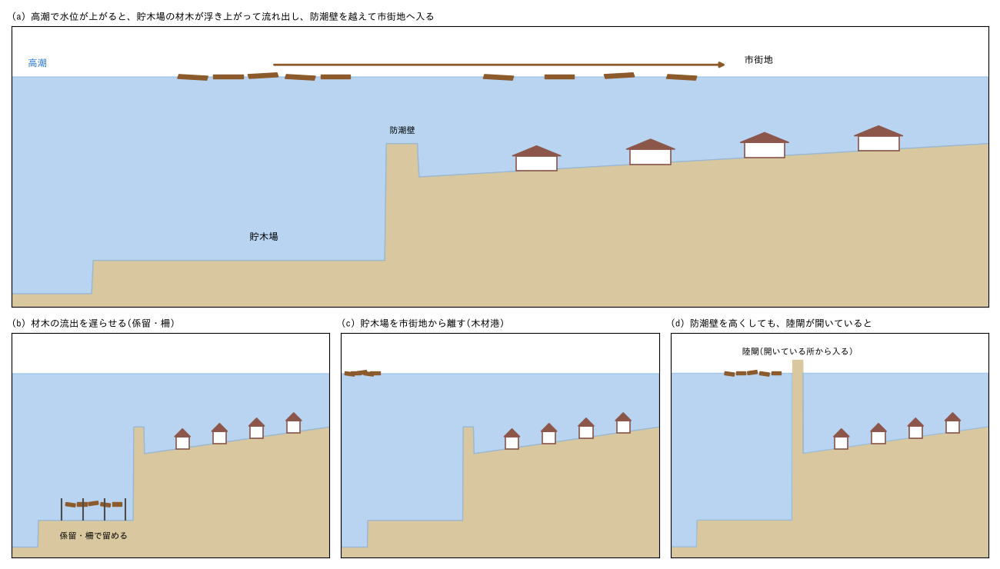
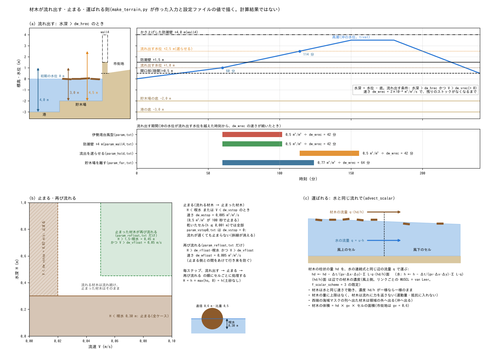
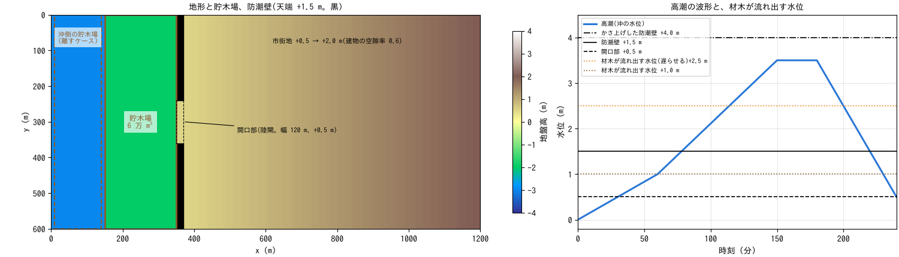
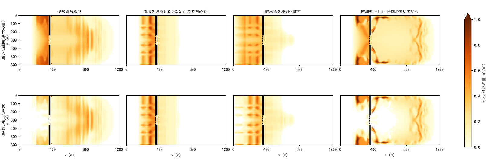
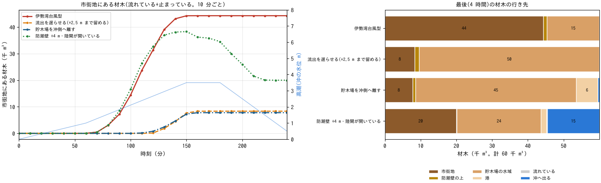
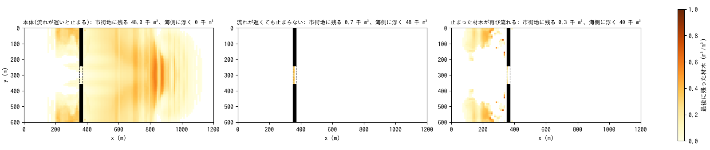

# timberyard — 高潮による貯木場からの材木の流入(伊勢湾台風型)

[English](en/README.md)

台風の高潮で海の水位が上がると、港の貯木場に浮かべた原木が浮き上がって流れ出し、防潮壁を
越えた水とともに市街地へ流れ込みます。1959 年の伊勢湾台風では、名古屋港の貯木場から流れ
出した原木が木造住宅を壊し、被害を大きくしました。この例題は、高潮の浸水と材木の流出・
運搬・堆積を一つの計算で解き、伊勢湾台風型の配置と、材木の流出を遅らせる、貯木場を市街地
から離す、防潮壁を高くする(ただし陸閘が開いている)の 3 つの対策を比べます。値は現象を
見やすくするための模式値で、伊勢湾台風の再現ではありません。

## 実際の高潮で起きていること

- **伊勢湾台風の高潮**: 1959 年 9 月の伊勢湾台風では、名古屋港の潮位が 3.89 m に達し
  (名古屋地方気象台)、伊勢湾周辺を中心に死者・行方不明者は 5,098 名にのぼりました
  (内閣府 2008)。
- **貯木場の原木が市街地を襲った**: 名古屋港の貯木場の当時の貯木量は約 100 万石(1 石 ≒
  0.28 m³)で、そのうち約 42 万石(約 12 万 m³)が、堤防を越えた海水とともに周辺の市街地に
  流れ込みました。原木は 1 本が直径約 1 m・長さ約 5 m・重さ数トンに及び、木造住宅などを
  壊しました。大量の木材が高潮の危険のある場所に集まっていたことも、災害を激しくした要因
  とされています(内閣府 2008)。
- **その後の対策**: 名古屋港では、延長 8,250 m の高潮防波堤が 1962〜1964 年に築かれ
  (国土交通省中部地方整備局 2013)、木材の流出を受けて木材を扱う木材港が設けられました
  (名古屋港の資料)。防潮壁や防潮堤には道路を通す開口部(陸閘)があり、高潮の前に閉める
  必要があります。

## 再現に必要な機構



(a) 高潮で水位が上がると、貯木場の材木が浮き上がって流れ出し、防潮壁を越えて市街地へ入る。
(b)〜(d) 比べる 3 つの対策。

| 実際の現象 | ENCflow での表し方 | 設定 |
|---|---|---|
| 高潮で海の水位が上がる | 沖の水位の時系列を、領域の西端の 1 列(海域マスク)に与える(波浪は扱わない) | `fn_tide`(`tival`) |
| 防潮壁と開口部(陸閘) | 地形の段(天端 +1.5 m、開口部 +0.5 m) | `fn_z` |
| 水位が上がると、係留が外れて材木が流れ出す | 貯木場の水深が閾値(平常の水深 + 余裕)を超えると、材木のストックが流れる材木に変わる | `fn_driftwood`、`dw_hrec`、`dw_wrec` |
| 材木は流れに乗って運ばれる | 流れる材木の量を水と同じ流れで運ぶ | (自動) |
| 浅い所や流れの止まった所で材木が止まる | 喫水より浅い所や流速の遅い所で、流れる材木を止まった材木に変える | `dw_wstop`、`dw_vstop` |
| 建物が流れを妨げる | 建物の空隙率(建物が 4 割を占める)と家屋の平均寸法 10 m。水がたまるのは建物の外だけで、家屋の抗力が流れを遅くする | `fn_gv`、`fn_bb` |



入力と設定ファイルの値で描いた図(計算結果ではない)。(a) 流れ出す: 貯木場のセルの水深が
dw_hrec を超え、流速が dw_vrec(= 0)を超えると、材木のストックが速さ dw_wrec = 2×10⁻⁴ m³/m²/s
で流れる材木に変わります(残りのストックがなくなるまで)。貯木場の底は −2.0 m なので、
dw_hrec = 3.0 m は水位 +1.0 m(平常の水深 2.0 m + 1.0 m)、流出を遅らせるケースの 4.5 m は
水位 +2.5 m、貯木場を離すケース(港の底 −3.0 m)の 4.0 m は水位 +1.0 m にあたります。
沖の水位が流れ出す水位を越えるのは 60 分(遅らせるケースは 114 分)で、0.5 m³/m² のストックは
42 分(港の沖側の 0.77 m³/m² は 64 分)で流れ出します。結果の表の時刻(65〜105 分など)は、
5 分ごとに記録した台帳から読んだ値です。(b) 止まる: 流れる材木は、水深が喫水 0.30 m(直径
0.6 m・比重 0.5 の丸太が半分沈む深さ)より浅い所か、流速が dw_vstop = 0.02 m/s より遅い所で、
速さ dw_wstop = 0.005 m³/m²/s で止まった材木になります(乾いたセルでは全部)。本体で材木が
市街地に残るのは、高潮のピークで市街地の流れが止まり、斜線の範囲に入るからです。補足の
param_vstop0.txt はこの流速の条件を外し、param_refloat.txt は、止まった材木を水深 0.45 m
(喫水の 1.5 倍)かつ流速 0.05 m/s を超える所で、速さ dw_wfloat = 0.005 m³/m²/s で再び流します
(緑。止まる側との間をあけて行き来を防ぐ)。(c) 運ばれる: 流れる材木の量は、水の連続式と同じ
辺の流量に辺での材木の濃度を掛けて運びます。材木は水と同じ速さで動き、量に上限はなく、流れに
力を返しません。西端の海域マスクの列へ出た材木は領域の外へ出ます(表の「沖へ出る」)。
流れ出す・止まる速さの式は ENCflow 独自の簡略化で、閾値は校正値です。喫水は横向きの円柱の
浮力の釣り合いから求めます([流木モデルの解説](../../docs/users_guide/driftwood_models.md) §1・§2)。

## 幾何と設定



左: 地形と貯木場(茶の枠)、沖側の貯木場(「離す」ケース。茶の破線)、防潮壁(黒)と開口部。
右: 高潮の波形と、防潮壁・開口部の天端、材木が流れ出し始める水位。

1,200 m × 600 m、dx = dy = 10 m(120 × 60 セル)。西から順に:

| x (m) | セル番号 i | 地形 | 役割 |
|---|---|---|---|
| 0〜10 | 1 | z = −3 m、海域マスク | 高潮の水位を与える列 |
| 10〜150 | 2〜15 | z = −3 m | 港(通常セル+初期水位) |
| 150〜350 | 16〜35 | z = −2 m | **貯木場**。材木 0.5 m³/m² × 200 m × 600 m = **6 万 m³** |
| 350〜370 | 36〜37 | z = +1.5 m | 岸壁・防潮壁。中央の y = 240〜360 m(j = 25〜36)は**開口部 z = +0.5 m**(陸閘が開いている所) |
| 370〜1,200 | 38〜120 | z = +0.5 → +2.0 m | 市街地。建物の空隙率 0.6(建物が 4 割を占める)、家屋の平均寸法 10 m(木造の戸建て住宅の平面の代表寸法) |

- **高潮**: 沖の水位を 60 分で +1.0 m(天文潮)、150 分で +3.5 m(ピーク)まで上げ、
  30 分保ってから 240 分で +0.5 m に下げます。初期の水位は 0 m で、港と貯木場は水に浸かり、
  陸は乾いています。東・北・南の辺は閉じています(防潮壁の背後の閉じた低地)。
- **材木**: ラワン原木級(直径 0.6 m・比重 0.5 → 喫水 0.3 m)。貯木場の水深が 3.0 m
  (平常の水深 2.0 m + 1.0 m。水位 +1.0 m)を超えると流れ出し始め、0.5 m³/m² が 42 分で
  流れ出す速さです。流れる材木は、喫水より浅い所や流速 0.02 m/s 未満の所で止まります。
- 計算は 4 時間、dt = 0.5 s。

| ケース | 設定ファイル | 貯木場 | 材木が流れ出す水位 | 防潮壁の天端 | 開口部 |
|---|---|---|---|---|---|
| 伊勢湾台風型 | param.txt | 防潮壁の前(x 150〜350 m) | +1.0 m | +1.5 m | 開いている |
| 流出を遅らせる | param_hold.txt | 防潮壁の前 | +2.5 m(係留や柵で留める。模式) | +1.5 m | 開いている |
| 貯木場を離す | param_far.txt | 港の沖側(x 10〜140 m)に同じ 6 万 m³ | +1.0 m | +1.5 m | 開いている |
| 防潮壁 +4 m・陸閘が開いている | param_wall4.txt | 防潮壁の前 | +1.0 m | +4.0 m(高潮を越えない) | 開いている |

## 実行方法

```
cd examples/timberyard
make                    # リンクと入力(make_terrain.py)
make run                # 4 ケースを順に計算(1 ケース 4 スレッドで 1 分前後)
make supp               # 補足の 2 ケース(任意)
python3 plot_results.py # figs/*.png と数表(引数 en で英語版を en/figs/ に。make の後なら計算前でも説明図 mechanism・setup・laws は描ける)
```

## 結果



上: 材木の届いた範囲(流れる材木と止まった材木の和の期間最大。Wd9999)、下: 4 時間後に
止まっている材木(Wd9998。浮いている分は含まない)。黒 = 防潮壁、破線 = 開口部。



左: 市街地にある材木(流れている+止まっている。10 分ごと)と高潮(薄い青)。右: 4 時間後の
材木の行き先(千 m³)。

| ケース | 材木が流れ出した時刻 | 市街地に入り始めた時刻 | 市街地にあった材木の最大 | 届いた範囲(市街地の割合 / 最も遠い所) | 4 時間後に市街地に残る | 貯木場の水域・港に残る | 沖へ出る |
|---|---:|---:|---:|---:|---:|---:|---:|
| 伊勢湾台風型 | 65〜105 分 | 70 分 | 47,347 m³ | 87 % / x 1,125 m | 47,347 m³ | 11,751 m³ | 0 |
| 流出を遅らせる | 115〜160 分 | 120 分 | 12,091 m³ | 32 % / x 635 m | 12,091 m³ | 46,296 m³ | 0 |
| 貯木場を離す | 65〜125 分 | 120 分 | 11,355 m³ | 31 % / x 735 m | 11,355 m³ | 47,074 m³ | 404 m³ |
| 防潮壁 +4 m・陸閘が開いている | 65〜105 分 | 70 分 | 38,310 m³ | 89 % / x 1,125 m | 38,093 m³ | 21,877 m³ | 14 m³ |

材木は計 6 万 m³ です。残りは防潮壁の上(15〜1,600 m³)です。

- **伊勢湾台風型では、材木の 8 割が市街地に入って残る**: 水位が +1.0 m を越えた 65 分に
  材木が流れ出し始め、105 分には全部が流れ出します。高潮の立ち上がりの間は開口部から、
  78 分からは防潮壁の全長を越えて市街地へ水が流れ込み、材木は 70 分から市街地に入ります。
  市街地は高潮のピーク(+3.5 m)で水がたまって流れが止まり、材木はそこで止まります。
  4.7 万 m³(79 %)が市街地に残り、届いた範囲は市街地の 87 %、東端近くの x = 1,125 m まで
  です。
- **材木の流出を遅らせると、市街地に入る材木は 4 分の 1 になる**: 水位が +2.5 m を越えるまで
  材木を留めると、流れ出すのは 115〜160 分です。そのころには市街地はすでに深く浸かっていて
  流れ込む水が少なく、市街地に入る材木は 1.2 万 m³、届く範囲は 32 % です。残りは貯木場の
  水域で止まります。流れの遅い所で止まる規則を外しても(補足の「流れが遅くても止まらない」
  と同じ設定)、市街地に入る材木の最大は 1.3 万 m³ で、伊勢湾台風型の同じ設定の 5.7 万 m³ の
  4 分の 1 以下にとどまります。
- **貯木場を離しても、市街地に入る材木は 4 分の 1 になる**: 流れ出し始めは同じ 65 分ですが、
  材木は港を渡って防潮壁に着くまでに時間がかかり、市街地に入り始めるのは 120 分です。市街地
  に入るのは 1.1 万 m³(19 %)で、大半は防潮壁の前の水域で止まります。
- **防潮壁を高くしても、陸閘が開いていると材木は市街地の奥まで届く**: 高潮は +4 m の防潮壁を
  越えませんが、幅 120 m の開口部から市街地が浸水し(最大の浸水深 3.10 m)、材木は開口部を
  抜ける速い流れ(最大 2.1 m/s)に乗って市街地の 89 % まで届きます。開口部の流体力(最大
  3.8 m³/s²)は伊勢湾台風型(1.5 m³/s²)の 2.5 倍です。市街地の中の流れは家屋の抗力で遅く、
  高潮のピーク(150〜180 分)には流速 0.02 m/s を下回る所が市街地の 3 割に広がるので、浮いて
  いた材木はピークの間に市街地で止まり(170 分にはほぼ全部)、引き潮で沖へ運ばれる材木は
  14 m³ だけです。4 時間後に市街地に残るのは 3.8 万 m³ です。
  開口部も閉じれば、この高潮(+3.5 m)は市街地に入りません。

## このモデルで表せないこと(実際の現象との違い)

- **材木は水と同じ速さで流れる**: 材木の重さによる遅れ、1 本ごとの向きや回転、家屋への
  衝突や引っ掛かり、堰き止めは表しません。材木が家屋にぶつかる力は、最大流速(V9999)と
  材木の大きさから後処理で求めます(国総研資料 905 の衝撃力の式、FEMA P-646)。
- **材木の流れ出し方は水深の閾値で決める**: 係留の強さや柵の構造は表しません。「流出を
  遅らせる」は、流れ出し始める水深を上げただけの模式です。
- **家屋の破壊は計算しない**: この例題は材木の行き先だけを見ます。家屋の破壊と組み合わせる
  例は [tsunami_town](../tsunami_town/README.md) の補足です。
- **波浪と風は扱わない**: 高潮は沖の水位の上昇だけで与えます。
- **規模**: 領域は 1.2 km × 0.6 km、材木は 6 万 m³(伊勢湾台風で市街地に流れ込んだ量の半分
  ほど)です。値は模式値です。

## 注意

- **港と貯木場は海域マスクにしない**: 海域マスクのセルには材木を置けず、材木が運ばれることも
  ないので、浸水と材木の運搬を解く範囲(港・貯木場・市街地)はすべて通常のセルにし、初期の
  水位で港と貯木場を満たします。海域マスクは高潮の水位を与える西端の 1 列だけです。
- **流れ出し始める水深は、平常の水深より高くする**: `dw_hrec` を貯木場の平常の水深(2.0 m)
  にすると、計算を始めた途端に材木が流れ出します。平常の水深 + 余裕にすると、流れ出す時刻を
  高潮の水位で決められます。`dw_wrec` は、流れ出しにかかる時間(ストック ÷ 速さ)で決めます。
- **「どこまで届いたか」と「どこに残ったか」**: Wd9999 は材木が通った所も含む期間最大の量
  (届いた範囲。ハザードマップ向け)、Wd9998 は最後に止まっている量(浮いている分は含まない)
  です。体積への換算は、柱状の量 × 空隙率 × セルの面積です。台帳(driftwood.csv)の残って
  いる材木・流れている材木・止まった材木の和は、初めの 6 万 m³ から沖へ出た分(西端の列から
  領域外へ出た分)だけ減ります。
- **市街地は閉じた低地**: 東・北・南の辺が閉じているので、市街地は高潮のピークで水がたまって
  流れが止まり、材木の大半はそこで止まります(止まる規則の効き方は補足)。

## 感度実験の入口

- `tival`(高潮の高さと長さ): 防潮壁を越える量と、市街地で流れが止まる時間。
- make_terrain.py の防潮壁の天端・開口部の行の範囲: 流れ込む場所と開口部の流れの速さ。
- `dw_hrec`・`dw_wrec`: 材木が流れ出し始める水位と、流れ出しにかかる時間。
- `dw_vstop`・`dw_wfloat`・`dw_vfloat`: 材木がどこに残るか(補足)。
- `dw_dlog`・`dw_sglog`: 喫水(浅い所で止まる水深)。
- `fn_gv`・`fn_bb`: 建物の割合と家屋の平均寸法。空隙率を下げると、同じ水量・材木の量でも水深と柱状の
  量が増えます。家屋の抗力は (1 − 空隙率)/寸法 に比例するので、建物の割合を上げるか寸法を小さく
  すると、市街地の流れが遅くなります。

## 補足: 材木がどこに残るか

材木を止める規則を変えた 2 ケースと、伊勢湾台風型を比べます。

| ケース | 設定ファイル | 変えたもの |
|---|---|---|
| 流れが遅くても止まらない | param_vstop0.txt | `dw_vstop = 0`(喫水より浅い所だけで止まる) |
| 止まった材木が再び流れる | param_refloat.txt | `dw_wfloat = 0.005`・`dw_vfloat = 0.05`(止まった材木が、流速 0.05 m/s を超える流れで再び流れる) |



3 ケースの 4 時間後に止まっている材木(Wd9998)。浮いている材木は色に含まない。各図の題の
「市街地に残る」は市街地に止まっている分と浮いている分の和、「海側に浮く」は市街地より海側に
浮いている量。

| ケース | 市街地にあった材木の最大 | 届いた範囲(市街地の割合) | 4 時間後に市街地に残る(止まっている+浮いている) | 港・貯木場の水域に浮いている | 沖へ出る |
|---|---:|---:|---:|---:|---:|
| 本体(伊勢湾台風型) | 47,347 m³ | 87 % | 47,347 m³ | 0 | 0 |
| 流れが遅くても止まらない | 56,553 m³ | 97 % | 738 m³ | 47,736 m³ | 7,522 m³ |
| 止まった材木が再び流れる | 58,447 m³ | 93 % | 300 m³ | 39,465 m³ | 7,932 m³ |

- **届く範囲は止める規則によらない**: どのケースも、市街地には一時 4.7〜5.8 万 m³ が入り、
  市街地の 9 割前後に届きます。
- **残る場所は止める規則で大きく変わる**: 流れの遅い所で止まらなければ、材木は高潮のピークの
  間も浮いたままで、引き潮で港と貯木場の水域へ戻り、市街地に残るのは数百 m³ です。
  止まった材木が再び流れる場合も同じです。実際には、水が引いた後に市街地に残る材木も、
  海へ戻る材木もあります。本体(市街地に残る量の多い側)と補足(少ない側)で幅を示すのが
  実用的です。

## 参考文献

- 内閣府(2008): 災害教訓の継承に関する専門調査会報告書 1959 伊勢湾台風.
  https://www.bousai.go.jp/kyoiku/kyokun/kyoukunnokeishou/rep/1959_isewan_typhoon/
- 名古屋地方気象台: 伊勢湾台風(昭和 34 年台風第 15 号).
  https://www.data.jma.go.jp/nagoya/shosai/info/kakojirei/isewantaihu.pdf
- 国土交通省中部地方整備局名古屋港湾事務所(2013): 名古屋港高潮防波堤.
  https://www.pa.cbr.mlit.go.jp/file/topics/20130704-bouhatei_nagoyakou.pdf
- 名古屋港の資料(伊勢湾台風を受けた高潮防波堤と木材港の整備).
  https://www.n-jcp.jp/wp-content/uploads/2019/12/6babad77b4d2d66e76bcd09c0c2258f5.pdf
- 国土技術政策総合研究所(2016): 土石流・流木対策設計技術指針 解説. 国総研資料 第 905 号.
- FEMA (2012): Guidelines for Design of Structures for Vertical Evacuation from Tsunamis,
  Second Edition. FEMA P-646.
