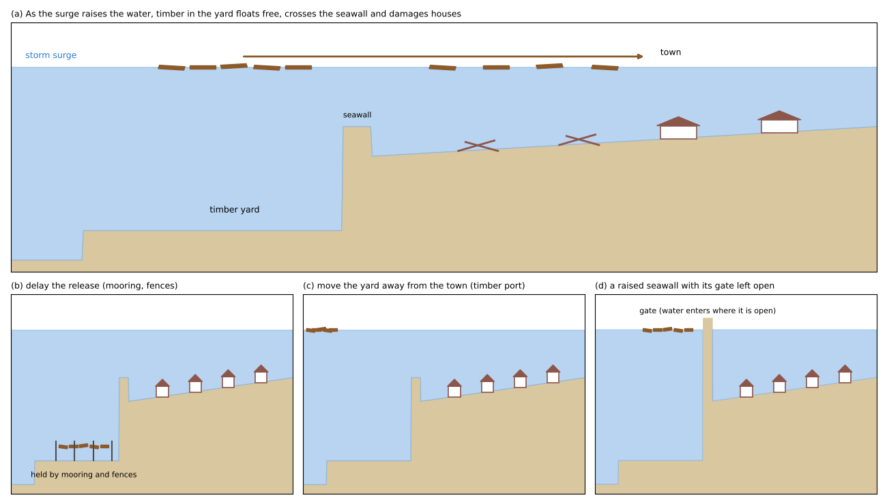
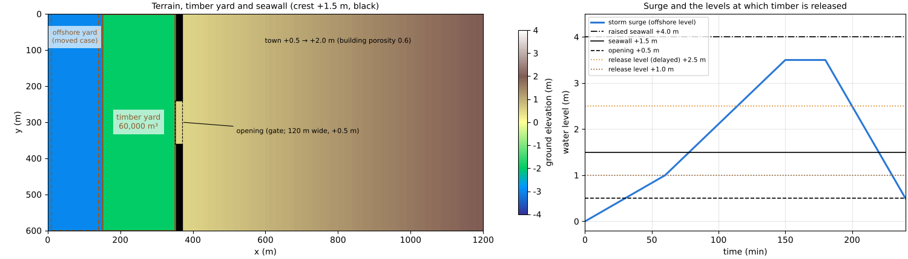
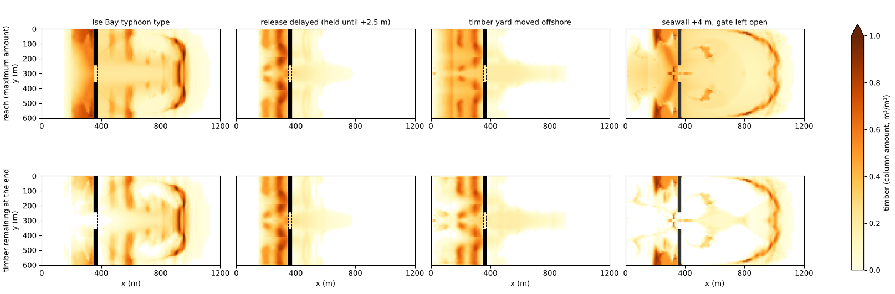
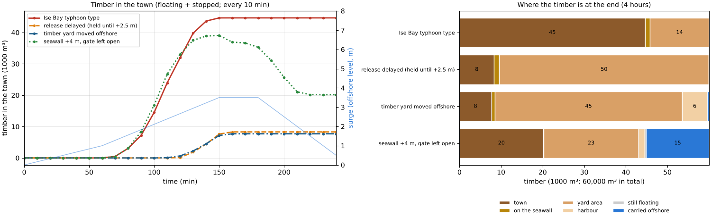
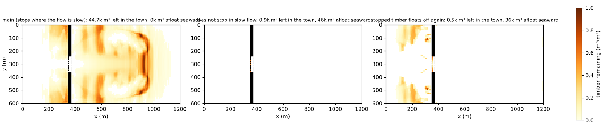

# timberyard — timber washed from a timber yard into a town by a storm surge (Ise Bay typhoon type)

> English mirror of examples/timberyard/README.md. The Japanese file is the master copy.

[日本語](../README.md)

When a typhoon storm surge raises the sea, logs floating in a port's timber yard rise, float away
and flow into the town with the water that overtops the seawall. In the Ise Bay Typhoon of 1959,
logs washed out of the timber yards of Nagoya Port destroyed wooden houses and made the damage
much worse. This example solves the surge inundation and the release, transport and deposition
of the timber in a single run, and compares the Ise Bay type layout with three countermeasures:
delaying the release of the timber, moving the timber yard away from the town, and raising the
seawall (but with its gate left open). The values are schematic, chosen to make the phenomena
easy to see; the example does not reproduce the Ise Bay Typhoon.

## What happens in a real storm surge

- **The storm surge of the Ise Bay Typhoon**: in the Ise Bay Typhoon of September 1959, the tide
  level at Nagoya Port reached 3.89 m (Nagoya Local Meteorological Office), and 5,098 people died
  or went missing, mainly around Ise Bay (Cabinet Office 2008).
- **Logs from the timber yards struck the town**: the timber yards of Nagoya Port held about
  1 million koku (1 koku ≈ 0.28 m³) at the time, and about 420,000 koku (about 120,000 m³) of it
  flowed into the surrounding town with the sea water that overtopped the dikes. The logs were
  up to about 1 m in diameter, about 5 m long and several tonnes in weight, and they destroyed
  wooden houses and other buildings. The concentration of a large amount of timber in a place at
  risk of storm surges was also named as a factor that made the disaster severe (Cabinet Office
  2008).
- **Countermeasures afterwards**: at Nagoya Port, a storm-surge breakwater 8,250 m long was
  built in 1962-1964 (Chubu Regional Development Bureau, MLIT 2013), and, in response to the
  outflow of timber, a timber port for handling timber was established (Nagoya Port materials).
  Seawalls and coastal dikes have openings (gates) for roads, which must be closed before a
  storm surge.

## Mechanisms needed for the reproduction



(a) As the surge raises the water, timber in the yard floats free, crosses the seawall and
enters the town. (b)-(d) The three countermeasures compared.

| Real phenomenon | How ENCflow represents it | Settings |
|---|---|---|
| A storm surge raises the sea | A time series of the offshore water level is given to the westmost column of the domain (sea mask; waves are not treated) | `fn_tide` (`tival`) |
| A seawall and its opening (gate) | A step in the terrain (crest +1.5 m, opening +0.5 m) | `fn_z` |
| As the water rises, the moorings fail and the timber floats away | When the depth in the timber yard exceeds a threshold (normal depth + margin), the timber stock turns into floating timber | `fn_driftwood`, `dw_hrec`, `dw_wrec` |
| The timber is carried by the flow | The floating timber is carried with the same flow as the water | (automatic) |
| Timber stops where it is shallow or the flow stops | Floating timber turns into stopped timber where the water is shallower than its draft or the flow is slow | `dw_wstop`, `dw_vstop` |
| Buildings obstruct the flow | Building porosity (buildings occupy 40 % of the area) | `fn_gv` |

## Geometry and settings



Left: terrain with the timber yard (brown frame), the offshore yard (the "moved" case; brown
dashed frame), the seawall (black) and its opening. Right: storm surge, the crests of the
seawall and the opening, and the levels at which timber starts to float away.

1,200 m × 600 m, dx = dy = 10 m (120 × 60 cells). From west to east:

| x (m) | Cell index i | Terrain | Role |
|---|---|---|---|
| 0-10 | 1 | z = −3 m, sea mask | column that receives the surge level |
| 10-150 | 2-15 | z = −3 m | harbour (ordinary cells + initial water level) |
| 150-350 | 16-35 | z = −2 m | **timber yard**. Timber 0.5 m³/m² × 200 m × 600 m = **60,000 m³** |
| 350-370 | 36-37 | z = +1.5 m | quay and seawall. The central y = 240-360 m (j = 25-36) is an **opening at z = +0.5 m** (where a gate is open) |
| 370-1,200 | 38-120 | z = +0.5 → +2.0 m | town. Building porosity 0.6 (buildings occupy 40 %) |

- **Storm surge**: the offshore level rises to +1.0 m in 60 minutes (astronomical tide) and to
  +3.5 m at 150 minutes (peak), stays for 30 minutes and falls to +0.5 m at 240 minutes. The
  initial water level is 0 m, so the harbour and the timber yard are under water and the land is
  dry. The east, north and south edges are closed (a closed lowland behind the seawall).
- **Timber**: lauan logs (diameter 0.6 m, specific gravity 0.5 → draft 0.3 m). Timber starts to
  float away when the depth in the yard exceeds 3.0 m (normal depth 2.0 m + 1.0 m; water level
  +1.0 m), at a rate that releases 0.5 m³/m² in 42 minutes. Floating timber stops where the
  water is shallower than its draft or the flow is slower than 0.02 m/s.
- The run is 4 hours, dt = 0.5 s.

| Case | Settings file | Timber yard | Water level at which timber floats away | Seawall crest | Opening |
|---|---|---|---|---|---|
| Ise Bay typhoon type | param.txt | in front of the seawall (x 150-350 m) | +1.0 m | +1.5 m | open |
| Release delayed | param_hold.txt | in front of the seawall | +2.5 m (held by mooring or fences; schematic) | +1.5 m | open |
| Timber yard moved away | param_far.txt | the same 60,000 m³ on the offshore side of the harbour (x 10-140 m) | +1.0 m | +1.5 m | open |
| Seawall +4 m, gate left open | param_wall4.txt | in front of the seawall | +1.0 m | +4.0 m (not overtopped by the surge) | open |

## How to run

```
cd examples/timberyard
make                    # links and inputs (make_terrain.py)
make run                # run the 4 cases in turn (about 1 minute per case on 4 threads)
make supp               # the 2 supplement cases (optional)
python3 plot_results.py # figs/*.png and the table (with the argument en, the English version goes to en/figs/)
```

## Results



Top: reach of the timber (maximum over the run of floating plus stopped timber; Wd9999).
Bottom: timber remaining after 4 hours (Wd9998). Black = seawall, dashed = opening.



Left: timber in the town (floating + stopped; every 10 minutes) and the surge (light blue).
Right: where the timber is after 4 hours (1000 m³).

| Case | Timber floats away | Timber starts entering the town | Maximum timber in the town | Reach (share of the town / farthest point) | Left in the town after 4 hours | Left in the yard area and harbour | Carried offshore |
|---|---:|---:|---:|---:|---:|---:|---:|
| Ise Bay typhoon type | 65-105 min | 70 min | 44,658 m³ | 87 % / x 1,125 m | 44,658 m³ | 14,206 m³ | 0 |
| Release delayed | 115-160 min | 120 min | 8,302 m³ | 29 % / x 785 m | 8,302 m³ | 50,447 m³ | 0 |
| Timber yard moved away | 65-125 min | 120 min | 7,703 m³ | 27 % / x 905 m | 7,703 m³ | 51,049 m³ | 432 m³ |
| Seawall +4 m, gate left open | 65-105 min | 70 min | 39,055 m³ | 88 % / x 1,125 m | 20,165 m³ | 24,263 m³ | 15,099 m³ |

There is 60,000 m³ of timber in total. The rest is on the seawall (100-1,300 m³) and still
floating (368 m³ with the +4 m seawall).

- **In the Ise Bay type, three quarters of the timber enters the town and stays**: timber starts
  to float away at 65 minutes, when the water exceeds +1.0 m, and is all released by 105 minutes.
  Water flows into the town through the opening while the surge rises, and over the whole length
  of the seawall from 78 minutes; timber enters the town from 70 minutes. At the surge peak
  (+3.5 m) the town fills and the flow stops, and the timber stops there. 45,000 m³ (74 %) stays
  in the town, and the timber reaches 87 % of the town, as far as x = 1,125 m near the east end.
- **Delaying the release cuts the timber entering the town to a fifth**: if the timber is held
  until the water exceeds +2.5 m, it floats away at 115-160 minutes. By then the town is already
  deep under water and little water flows in, so only 8,000 m³ of timber enters the town and it
  reaches 29 % of the town. The rest stops in the yard area. Even without the rule that stops
  timber in slow flow (the same setting as "does not stop in slow flow" in the supplement), the
  maximum timber in the town is 13,000 m³, less than a quarter of the 56,000 m³ of the Ise Bay
  type with the same setting.
- **Moving the timber yard away also cuts the timber entering the town to a fifth**: timber
  starts to float away at the same 65 minutes, but it takes time to cross the harbour and reach
  the seawall, and it starts entering the town only at 120 minutes. 8,000 m³ (13 %) enters the
  town, and most of the timber stops in the water in front of the seawall.
- **Raising the seawall does not keep the timber out if the gate is left open**: the surge does
  not overtop the +4 m seawall, but the town floods through the 120 m opening (maximum depth
  3.11 m), and the timber rides the fast flow through the opening (up to 2.1 m/s) to reach 88 %
  of the town. The load at the opening (up to 4.5 m³/s²) is three times that of the Ise Bay type
  (1.5 m³/s²). The ebb flow also gathers at the opening and leaves fast, carrying part of the
  timber (15,000 m³) offshore, so 20,000 m³ stays in the town after 4 hours. With the opening
  closed as well, this surge (+3.5 m) does not enter the town.

## What this model cannot represent (differences from real phenomena)

- **Timber moves at the speed of the water**: the lag due to the weight of the timber, the
  orientation and rotation of each log, impacts on and snagging against houses, and damming are
  not represented. The force of timber hitting a house is obtained by post-processing from the
  maximum velocity (V9999) and the size of the timber (the impact formula of NILIM Technical
  Note 905, FEMA P-646).
- **How the timber floats away is set by a depth threshold**: the strength of moorings and the
  structure of fences are not represented. "Release delayed" is a schematic that only raises the
  depth at which timber starts to float away.
- **House destruction is not computed**: this example looks only at where the timber goes. An
  example combining it with house destruction is the supplement of
  [tsunami_town](../../tsunami_town/en/README.md).
- **Waves and wind are not treated**: the storm surge is given only as the rise of the offshore
  level.
- **Scale**: the domain is 1.2 km × 0.6 km and the timber 60,000 m³ (about half of what flowed
  into the town in the Ise Bay Typhoon). The values are schematic.

## Notes

- **Do not put the harbour and the timber yard under the sea mask**: sea-mask cells cannot hold
  timber and do not carry it, so the whole area where inundation and timber transport are solved
  (harbour, yard and town) is made of ordinary cells, and the harbour and the yard are filled by
  the initial water level. The sea mask is only the westmost column that receives the surge level.
- **Set the release depth above the normal depth**: if `dw_hrec` equals the normal depth of the
  yard (2.0 m), the timber floats away as soon as the run starts. With the normal depth plus a
  margin, the time of release is set by the surge level. `dw_wrec` is set from the time the
  release takes (stock ÷ rate).
- **"How far it reached" and "where it remained"**: Wd9999 is the maximum amount over the run,
  including where timber only passed (the reach; for hazard maps), and Wd9998 is what remained at
  the end. The volume is the column amount × porosity × cell area. In the ledger (driftwood.csv),
  the sum of the remaining stock, floating timber and stopped timber falls from the initial
  60,000 m³ by the amount carried offshore (out of the domain through the westmost column).
- **The town is a closed lowland**: the east, north and south edges are closed, so the town fills
  at the surge peak and the flow stops, and most of the timber stops there (the supplement shows
  how the stopping rules matter).

## Starting points for sensitivity tests

- `tival` (surge height and duration): how much overtops the seawall, and how long the flow in
  the town stops.
- The seawall crest and the rows of the opening in make_terrain.py: where the water flows in and
  how fast the flow through the opening is.
- `dw_hrec`, `dw_wrec`: the water level at which timber starts to float away, and how long the
  release takes.
- `dw_vstop`, `dw_wfloat`, `dw_vfloat`: where the timber remains (supplement).
- `dw_dlog`, `dw_sglog`: the draft (the depth below which timber stops).
- `fn_gv`: the share of buildings. A lower porosity gives a larger column amount for the same
  timber and a faster flow.

## Supplement: where the timber remains

Two cases with different rules for stopping timber are compared with the Ise Bay type.

| Case | Settings file | What changes |
|---|---|---|
| Does not stop in slow flow | param_vstop0.txt | `dw_vstop = 0` (timber stops only where the water is shallower than its draft) |
| Stopped timber floats off again | param_refloat.txt | `dw_wfloat = 0.005`, `dw_vfloat = 0.05` (stopped timber floats off again in a flow faster than 0.05 m/s) |



| Case | Maximum timber in the town | Reach (share of the town) | Left in the town after 4 hours (stopped + floating) | Afloat in the harbour and yard area | Carried offshore |
|---|---:|---:|---:|---:|---:|
| Main (Ise Bay type) | 44,658 m³ | 87 % | 44,658 m³ | 0 | 0 |
| Does not stop in slow flow | 56,359 m³ | 98 % | 947 m³ | 46,293 m³ | 7,115 m³ |
| Stopped timber floats off again | 58,067 m³ | 96 % | 510 m³ | 35,677 m³ | 7,744 m³ |

- **The reach does not depend on the stopping rules**: in every case, 45,000-58,000 m³ is in the
  town at some point, and the timber reaches about 90 % of the town.
- **Where the timber remains depends strongly on the stopping rules**: if timber does not stop in
  slow flow, it stays afloat through the surge peak and returns to the harbour and the yard area
  with the ebb, leaving less than 1,000 m³ in the town. The same happens when stopped timber
  floats off again. In reality, after the water recedes, some timber remains in the town and some
  returns to the sea. Showing the range with the main case (more timber left in the town) and the
  supplement (less) is practical.

## References

- Cabinet Office (2008): Report of the Expert Panel on the Inheritance of Disaster Lessons: the
  1959 Ise Bay Typhoon (in Japanese).
  https://www.bousai.go.jp/kyoiku/kyokun/kyoukunnokeishou/rep/1959_isewan_typhoon/
- Nagoya Local Meteorological Office: The Ise Bay Typhoon (Typhoon No. 15 of 1959) (in Japanese).
  https://www.data.jma.go.jp/nagoya/shosai/info/kakojirei/isewantaihu.pdf
- Nagoya Port Office, Chubu Regional Development Bureau, MLIT (2013): The Nagoya Port storm-surge
  breakwater (in Japanese).
  https://www.pa.cbr.mlit.go.jp/file/topics/20130704-bouhatei_nagoyakou.pdf
- Nagoya Port materials (building the storm-surge breakwater and the timber port after the Ise Bay
  Typhoon) (in Japanese).
  https://www.n-jcp.jp/wp-content/uploads/2019/12/6babad77b4d2d66e76bcd09c0c2258f5.pdf
- National Institute for Land and Infrastructure Management (2016): Commentary on the technical
  guideline for the design of debris flow and driftwood countermeasures. NILIM Technical Note
  No. 905 (in Japanese).
- FEMA (2012): Guidelines for Design of Structures for Vertical Evacuation from Tsunamis, Second
  Edition. FEMA P-646.
