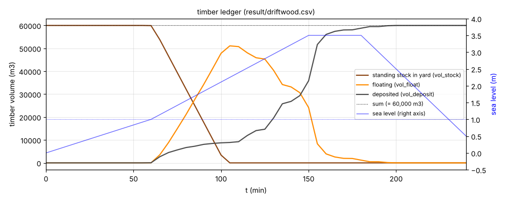
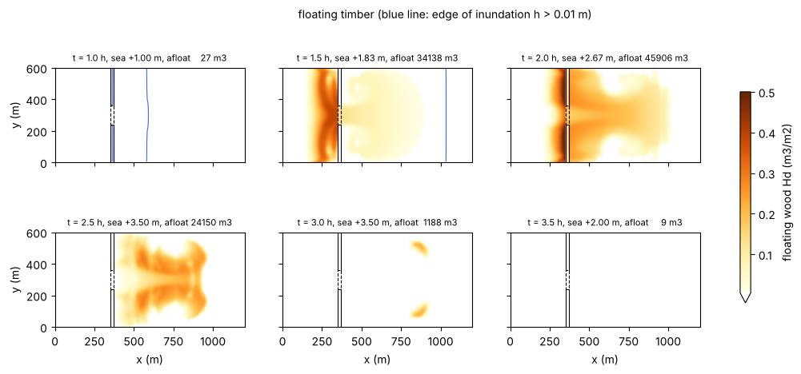
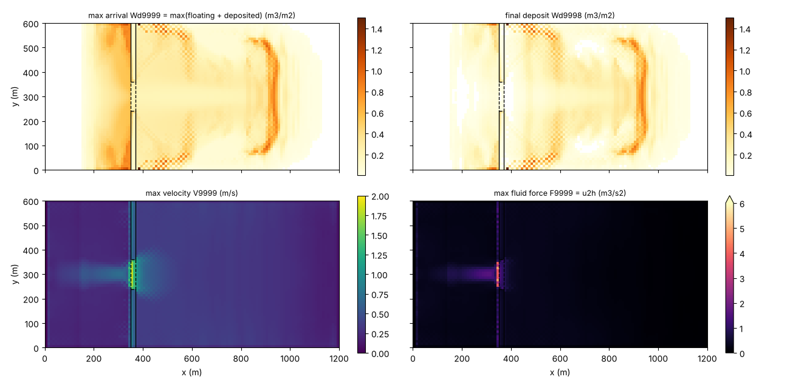
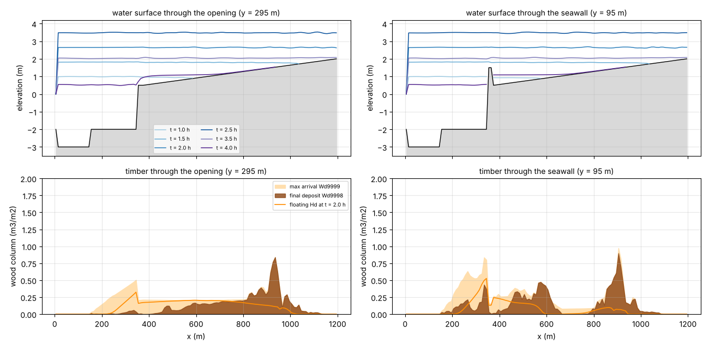

# timberyard — timber influx from a log yard by storm surge (idealized Isewan-typhoon-type case)

> English mirror of examples/timberyard/README.md. The Japanese file is the master copy.

[日本語](../README.md)

Logs floating in a coastal log yard lose their moorings as the storm surge
raises the water level, drift out, ride the inundation flow over the seawall
and enter and deposit in the town. This case estimates that phenomenon with the
combination of the **driftwood module fn_driftwood** (docs/users_guide/driftwood.md,
developer.md §50) and **tide forcing fn_tide** (users_guide/tide.md).
The aim is to show the "pattern" for setting up, in practice, the type of event
in which raw logs washed out of the log yards of Nagoya Port by the 1959 Isewan
typhoon struck the town; no code change is involved (settings only).
One main case plus three sensitivity cases that show what the settings mean.

## Geometry and settings


Left: terrain, timber stock (brown frame), seawall (black) and opening (dashed).
Right: the storm-surge hydrograph with the crest levels of the opening and the
seawall and the water level at which timber release starts.

1,200 m × 600 m, dx = dy = 10 m (120 × 60 cells). From west to east:

| x (m) | cell index i | terrain | role |
|---|---|---|---|
| 0–10 | 1 | z = −3 m, sea mask | inlet of the tide forcing (storm-surge hydrograph) |
| 10–150 | 2–15 | z = −3 m | harbour water (normal cells + initial water level) |
| 150–350 | 16–35 | z = −2 m | **log yard**. Timber stock 0.5 m³/m² × 200 m × 600 m = **60,000 m³** |
| 350–370 | 36–37 | z = +1.5 m | quay and seawall. The central y = 240–360 m (j = 25–36) is an **opening at z = +0.5 m** |
| 370–1,200 | 38–120 | gentle slope z = +0.5 → +2.0 m | town. Buildings are represented by a void fraction **gv = 0.6** (40 % building coverage) |

The initial water level is a uniform T.P. 0 m (f_htype=2; the harbour and log
yard are flooded, the land is dry). The tide is given as a uniform time series
on the single column of sea cells at the west edge: 0 → +1.0 m (60 min;
astronomical tide) → **+3.5 m (150 min; peak)** → held for 30 min → +0.5 m
(240 min). The east, north and south edges are the default walls (a closed
lowland = the below-sea-level zone behind the seawall). dt = 0.5 s, 4 hours
(Cn_max ≈ 0.42). The run takes a little under 1 minute.

The timber is of lauan-log class (representative diameter dw_dlog = 0.6 m, wood
specific gravity dw_sglog = 0.5 → draft 0.3 m, derived automatically from the
buoyancy balance). The driftwood parameters are as follows (param.txt).

```
&list_driftwood
  fn_dwstock = 'stock.txt'  ! 0.5 m3/m2 on the log-yard cells only (60,000 m3 in total)
  dw_dlog = 0.6             ! representative diameter (m)
  dw_sglog = 0.5            ! wood specific gravity -> draft 0.3 m
  dw_wrec = 2.0e-4          ! release rate (m/s). 0.5 m3/m2 is released in 42 min
  dw_hrec = 3.0             ! depth threshold of release = normal depth 2.0 m + 1.0 m
  dw_vrec = 0.0             ! no velocity threshold (released as soon as it floats)
  dw_wstop = 0.005          ! grounding deposition rate (m/s)
  dw_vstop = 0.02           ! velocity threshold of slow-flow deposition (m/s; deposit once stalled in the town)
/
```

## Key points of the setup (reasons for the settings)

1. **Do not make the log yard and harbour water a sea mask**. Sea cells cannot
   hold a timber stock and driftwood advection does not act on them. Represent
   the whole region where inundation and timber transport are solved as normal
   cells + initial water level (f_htype=2), and restrict the sea mask + tide
   forcing (fn_tide) to the offshore boundary column (here the single west-edge
   column). This is the same practice as for tsunami sediment
   (users_guide/geomorph.md, "The sea mask and the fate of sediment").
   hsea0 = 2.0 m is the apparent water column thickness of the sea cells (the
   value that provides the dry test, boundary depth and friction in inundation
   where the sea is the supply side; users_guide/tide.md).
2. **Give the timber stock only on the log-yard cells** with fn_dwstock
   (make_terrain.py writes stock.txt). A uniform value dw_stock0 would turn the
   standing trees of the town into "driftwood" as well.
3. **Use hydraulic recruitment as "mooring loss and floating-off by the surge"**.
   Setting dw_hrec to 3.0 m, above the normal depth of the log yard (2.0 m),
   makes the release start only when the water level exceeds +1.0 m (t = 60 min),
   so that the generation is synchronized with the surge. dw_vrec = 0 (released
   as soon as it floats); dw_wrec is the rate at which the whole stock is
   released within the duration of the surge (0.5 m³/m² ÷ 2.0e-4 m/s = 2,500 s
   ≈ 42 min → release complete at 105 min). Erosion entrainment (dw_droot) and
   the sediment / landform-change modules are not needed.
4. **Represent the seawall and the opening by the terrain**. A wall with crest
   +1.5 m and a low opening at +0.5 m (openings of land-lock gates and sluices,
   deteriorated sections, etc.). This surge overtops the wall by 2 m, so the
   role of the opening becomes "the place where inflow concentrates during the
   rising stage of the surge" ("Properties to know" below).
5. **Represent the buildings of the town by the void fraction fn_gv** (0.6).
   The conversion to timber volume is column quantity × gv × cell area (the
   column quantity in m³/m² is the amount per unit area of the void part).
6. **Deposition takes 2 paths**. Grounding (depth < draft 0.3 m) via dw_wstop,
   and slow-flow stalling via dw_vstop (velocity < 0.02 m/s). At the surge peak
   the town is flooded like a pond and the flow stops, so most of the deposition
   in the town occurs through dw_vstop. Refloating is the default dw_wfloat = 0
   (deposited timber never moves again = the upper-bound view of what remains
   in the town). These two are the calibration parameters that decide "where
   it remains" (sensitivity cases a and b).

## How to run

```
cd examples/timberyard
make                                   # link to ../../bin/encflow
python3 make_terrain.py                # z.txt sw.txt gv.txt stock.txt
./encflow param.txt                    # main case (about 1 minute)
python3 plot_results.py                # figs/*.png and the tables

# Sensitivity cases (optional; output in result_*; plot_results.py adds comparison rows to the tables)
./encflow param_vstop0.txt             # a: dw_vstop = 0 (no slow-flow deposition)
./encflow param_refloat.txt            # b: with refloating (dw_wfloat = 0.005, dw_vfloat = 0.05)
python3 make_terrain.py 4.0            # terrain z_wall4.txt for c (seawall crest +4.0 m)
./encflow param_wall4.txt              # c: the seawall is not overtopped by the surge (inflow through the opening only)
```

Output (result/): frames every 30 min of H (depth), V (velocity), **Hd (column
quantity of moving timber)** and **Wd (deposited timber)**, the final frame
(9998), the run maxima (H9999, V9999, **Wd9999 = maximum arrival
max(moving + deposited)** and F9999 = maximum fluid force u²h), and
driftwood.csv (the volume ledger, every 5 min).

## Results (2026-10-17; gfortran, dt = 0.5 s, f_advection_scheme = 3)



The volume ledger (driftwood.csv). The sum of the three ledgers — remaining
stock in the yard, moving and deposited — is always 60,000 m³ (conserved to
machine precision because the domain is closed). Release starts at 60 min, when
the water level exceeds +1.0 m, and is complete at 105 min (peak of moving
timber 51,090 m³). Deposition has two stages: a gradual part inside the log yard
right after release (~9,000 m³), and **a sudden part when the flow in the town
stops during the held peak of the surge (150–160 min)**.



Time evolution of the moving timber Hd (the blue line is the inundation edge).
t = 1.0 h: inundation of the town through the opening leads (the timber is still
in the yard). 1.5 h: the released timber enters the town behind the opening.
2.0 h: the seawall is overtopped along its full length (water level +2.67 m)
and timber crosses the whole length of the wall into the back of the town
(x ≈ 900 m). 2.5 h: the town is flooded to +3.5 m, the flow stops and
deposition proceeds. 3.0 h: almost all is deposited.



Top left Wd9999 (maximum arrival = hazard map), top right Wd9998 (final
deposition), bottom left V9999 (maximum velocity), bottom right F9999 (maximum
fluid force). Velocity and fluid force concentrate at the opening (1.8 m/s),
but the final timber deposition is nearly uniform in y, with an arc-shaped ridge
of deposition at the back of the town, x ≈ 900–950 m (the front of the moving
timber at the moment it stalled).



Profiles along the row through the opening (y = 295 m) and a row across the
seawall (y = 95 m). Top: time evolution of the water surface; bottom: maximum
arrival (light brown), final deposition (dark brown) and moving timber at
t = 2.0 h (orange).

| Zone | Final deposition (Wd9998 × gv × area) | Share | Max. column quantity |
|---|---|---|---|
| Harbour (x 10–150 m) | 0 m³ | 0 % | — |
| Log yard (150–350 m) | 12,814 m³ | 21.4 % | 0.97 m³/m² |
| Quay and seawall (350–370 m) | 855 m³ | 1.4 % | 0.39 m³/m² |
| Town (370–1,200 m) | **46,330 m³** | **77.2 %** | 0.95 m³/m² |
| Total | 60,000 m³ | 100 % | |

Breakdown within the town (x 370–500 / 500–700 / 700–900 / 900–1,200 m): 4,438 /
16,177 / 12,476 / 13,239 m³. The deposition in the 12 rows behind the opening
(y 240–360 m; 20 % of the 60 rows) is 9,569 m³ (21 % of the town), so there is
no concentration in y. The timber reaches (Wd9999 > 0.01 m³/m²) 4,358 of the
4,980 town cells (88 %), farthest at x ≈ 1,125 m (near the east edge). Maximum
depth in the town 3.11 m, maximum velocity 1.10 m/s (1.80 m/s at the opening).

| Time | Tide level | Event |
|---|---|---|
| 30 min | +0.5 m | inundation of the town starts over the opening |
| 60 min | +1.0 m | the depth in the log yard exceeds dw_hrec = 3.0 m and timber release starts |
| 78 min | +1.5 m | the seawall is overtopped along its full length |
| 105 min | +2.25 m | release complete; peak of moving timber 51,090 m³ |
| 150–180 min | +3.5 m | surge peak; the town is flooded, the flow stops and most of the timber deposits |
| 195 min | +2.75 m | moving timber down to 140 m³ (almost all deposited; the rest by 230 min) |
| 240 min | +0.5 m | ebb; the town is draining through the opening (water level +1.55 m) |

### Sensitivity cases

| Case | Setting | Arrival in the town Σ Wd9999 | Final deposition: town | Log yard | Still floating | Outflow from the system |
|---|---|---|---|---|---|---|
| main | param.txt | 63,806 m³ | **46,330** | 12,814 | 0 | 0 |
| a | dw_vstop = 0 (no slow-flow deposition) | 74,787 | 272 | 0 | 45,046 | 9,250 |
| b | with refloating (dw_wfloat = 0.005, dw_vfloat = 0.05) | 84,062 | 117 | 7,514 | 35,747 | 10,152 |
| c | seawall crest +4.0 m (inflow through the opening only) | 58,289 | 20,637 | 20,804 | 495 | 16,862 |

"Arrival" is the sum of Wd9999 over the town cells (an envelope of the run
maximum, so it can exceed 60,000 m³). The outflow from the system is the ledger
difference 60,000 − (stock + moving + deposited) (the part that left into the
sea cells at the west edge).

## How to read the results

- **Wd9999 is "how far it reaches", Wd9998 is "where it remains"**. Wd9999 is
  the envelope of the run-maximum arrival max(moving + deposited), and cells
  that timber merely passed through keep a value (= for hazard maps). Use the
  final frame Wd9998 for the final deposition distribution and the mass
  accounting. The conversion to timber volume is column quantity × gv × cell
  area (the tables of plot_results.py). Because the domain is closed, the sum
  of the ledgers equals the initial stock 60,000 m³ to machine precision (this
  can be checked on every row of driftwood.csv).
- **Indicator of house damage**: the fluid force of the water itself is F9999
  (= u²h; clear water, so identical to the u²h of engineering practice; × ρw
  gives the force per unit width in N/m). In this case it concentrates at the
  opening (maximum 13 m³/s²) and behind it at x ≈ 370–500 m (maximum inside
  the town 1.1 m³/s²).
- **The impact force of timber on houses** is not computed inside the model
  (individual impacts are beyond its applicability), but all inputs of the
  impact-force formulas are available from the outputs. The practical standard
  (NILIM Technical Note No. 905 §4.3) is a post-processing method that computes
  the impact force of driftwood "by applying the impact-force formula for
  boulders, with the velocity of the flow and the maximum diameter of the
  driftwood", so giving ENCflow's maximum velocity V9999 (or the velocity
  frames) and the properties of the representative log (dw_dlog) to that
  formula (or to the driftwood impact formula of FEMA P-646) yields an
  impact-force map consistent with the guideline. Which groups of houses the
  timber reaches is judged from Wd9999 and Hd.

## Properties to know (reasons for the settings)


- **Synchronize the timing of release with the surge through dw_hrec**. If the
  threshold is set to the normal depth, release starts at the beginning of the
  run and the timber scatters into the harbour before the surge. Setting it to
  the normal depth + a margin (here +1.0 m) lets the tide level specify the
  time at which "the water rises and the moorings come loose". dw_wrec is set
  from the time needed for release (stock ÷ rate).
- **The role of the opening changes with the stage**. During the rising stage
  of the surge (30–78 min) inflow comes only through the opening, and the first
  timber (1.5 h) enters behind the opening. At the peak the surge overtops the
  wall by 2 m, so timber crosses the whole length of the wall and the final
  deposition becomes nearly uniform in y. Velocity and fluid force (V9999,
  F9999) remain concentrated at the opening, so "the inflow concentrates at the
  opening" shows in the distribution of fluid force but not in the deposition
  distribution. Even in sensitivity case c, where the wall is not overtopped
  (crest +4.0 m), the town is flooded to +3.5 m within 30 min through the
  120 m wide opening, and the jet from the opening (2.2 m/s) carries the timber
  farther in (13,432 m³ at x 900–1,200 m). Seeing the effect of the seawall
  requires scenario comparisons such as narrowing the opening or keeping the
  peak level below the crest.
- **Most of the deposition in the town occurs by "stalling"** (dw_vstop). The
  town is a lowland closed by walls on the east, north and south, flooded at the
  surge peak so that the flow stops (V < 0.02 m/s). The moving timber then
  deposits where it is, and the front at the moment of stalling becomes the
  arc-shaped ridge at x ≈ 900–950 m. **With dw_vstop = 0 (sensitivity a) the
  timber stays afloat as long as the depth exceeds the draft, and returns to
  the harbour and sea through the opening on the ebb** (final deposition in
  the town 1,041 m³, still floating 39,238 m³, outflow from the system
  14,318 m³). The reach (Wd9999) is nearly the same as in the main case
  (89 % → 100 %), so **"how far it reaches" is insensitive to the deposition
  parameters, while "where it remains" is sensitive**. Use the main case for
  the upper-bound view of what remains in the town, and case a to allow for
  the part that returns on the ebb.
- **The 25 % remaining in the log yard** is released timber that immediately
  redeposited through dw_vstop in the still water of the yard (V < 0.02 m/s).
  In reality this part is moved by waves and harbour currents; with
  dw_vstop = 0 (sensitivity a) the remainder is 0. Use that case for the
  upper-bound estimate of the influx into the town.
- **Enabling refloating lets the ebb sweep the town** (sensitivity b). With
  dw_wfloat > 0, the timber deposited during the stalling stage floats again in
  the ebb flow (V > dw_vfloat) (cumulative deposition 700,000 m³ and refloating
  690,000 m³ = 11 round trips of exchange), and only 449 m³ finally remains in
  the town. In practice, show the range with the two cases: the main case
  (upper bound of the remainder) and b (lower bound).
- **Timber is advected at the same speed as the water (no inertia, no
  individual logs)**. At t = 1.5 h the timber front (x ≈ 600 m) lags behind the
  inundation edge (x ≈ 1,000 m) because release starts 30 min after the
  inundation, not because of any independent motion of the timber. The
  trajectory, orientation and rotation of individual logs and jamming against
  houses and bridge piers are out of scope (users_guide/driftwood.md, "What is
  not modeled").
- **The east, north and south edges are walls (default)**. The town is flooded
  to +3.5 m as a closed lowland (the pattern of southern Nagoya in the Isewan
  typhoon). For a town with a drainage outlet behind it, give a boundary from
  users_guide/boundary.md.

## Entry points for sensitivity experiments

- Peak level and duration of the surge (tival): overtopping volume and the
  length of the stalling stage → reach and deposited amount. Keeping the peak
  below the crest (+1.5 m) restricts the inflow to the opening.
- Seawall crest (argument of make_terrain.py), width and crest of the opening
  (the row range corresponding to J_OPEN and z in make_terrain.py):
  concentration of the inflow and the jet velocity → F9999 and reach.
- dw_vstop, dw_wfloat, dw_vfloat: decide "where it remains", as above.
- dw_dlog, dw_sglog: draft (the depth of grounding deposition). With specific
  gravity 0.5 the draft is half the diameter. Dry softwood (0.4) sits
  shallower; water-logged hardwood (0.8 or more) deeper.
- fn_gv: building coverage. Lowering the void fraction raises the column
  quantity for the same timber volume and also raises the velocity.
- dw_hrec, dw_wrec: start time and duration of release (synchronization with
  the surge).

## Related

- Feature description and parameter table: docs/users_guide/driftwood.md; tide: users_guide/tide.md
- List of application cases: docs/users_guide/usecases.md ("Timber influx from coastal log yards by storm surge")
- Design and verification: docs/developer.md §50 (driftwood module)
- Self-check test: test/driftwood
