# tower_karst — 平野に残る裸岩の塔(タワーカルスト。差別溶食と裾の崩落)

[English](en/README.md)

湿潤熱帯のカルストで、石灰岩の塔(峰林、fenglin)が平野の上に残る過程を、
[石灰岩の溶食](../../docs/users_guide/geomorph.md#石灰岩の溶食f_dissol)(f_dissol。しみ込む
水による面的な溶食、裸岩の流出水による岩面の溶食、湛水に接する壁の側方溶食)と
[崩落と崖錐](../../docs/users_guide/geomorph.md#崩落と崖錐f_rockfall)(f_rockfall。土層のない
基岩も崩す)の重ね合わせで見る例題です。塔は裸岩で雨がすぐ流れ去り、平野は土層に覆われて
雨がしみ込むという違いだけで、平野と塔の裾が速く溶けて塔の比高が増すかを見ます。ドリーネ群の
形成は [karst](../karst/README.md) を見てください。値は形成の様式を見るための模式値で、実際の
地形の速さや形の再現ではありません。

## 実際のタワーカルストで起きていること

- **平野に立つ塔**: 湿潤熱帯の石灰岩地域では、平らな平野の上に急な壁の塔が立ち並びます
  (中国南部の桂林が代表例)。塔の群れが根元でつながった峰叢(fengcong)から、平野に孤立する
  峰林(fenglin)へ移っていくことが多いと考えられています(Waltham 2008)。
- **平野と裾が速く溶ける**: 平野は土や沖積層に覆われ、土壌中の二酸化炭素を取り込んだ攻撃性の
  高い水が、平野と塔の裾を溶かします。裸岩の塔では雨がすぐ流れ去り、岩面はあまり溶けません。
  削剥の速さは、しみ込む水の量と水が溶かせる量に比例するので、雨が多く土壌の二酸化炭素が多い
  湿潤熱帯で大きくなります(White 1984)。
- **裾の切れ込みと崩落**: 塔の裾は、平野の水面の近くで溶かされて切れ込み(ノッチ、足元の洞)が
  でき、支えを失った壁が崩れます。崩落を繰り返して、塔は急な壁を保ったまま細く、低くなって
  いきます(Ford and Williams 2007; Waltham 2008)。崩れた岩屑は裾に積もります。

## 再現に必要な機構

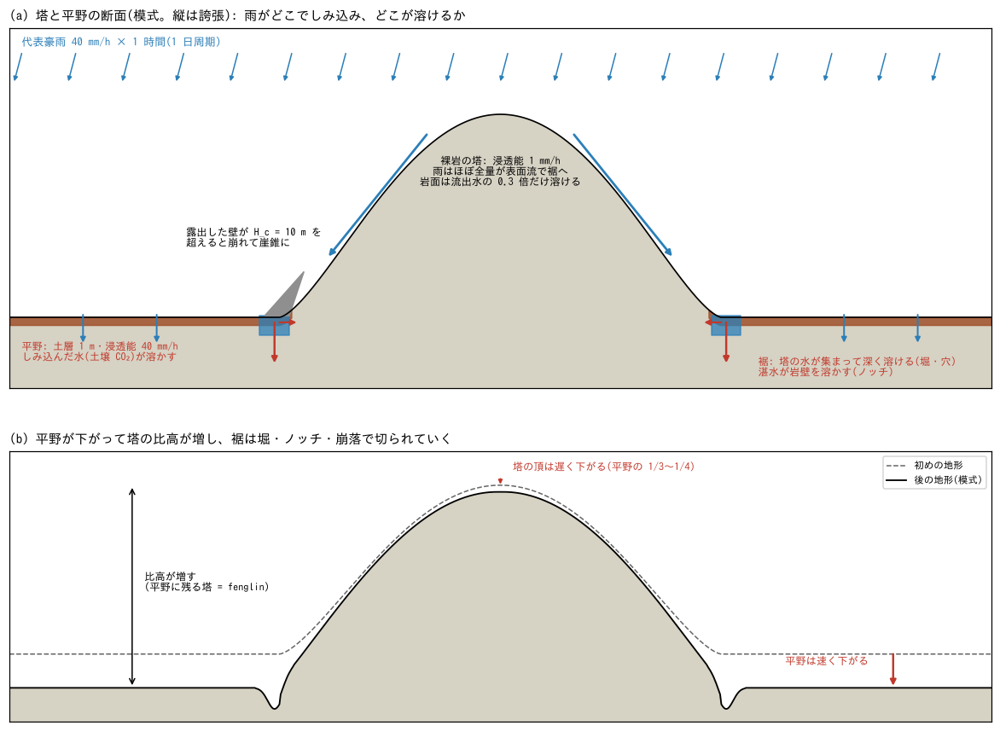

模式図(縦は誇張)。(a) 塔と平野の断面: 裸岩の塔では雨がほぼ全量流れ去って裾に集まり、岩面は
流出水の一部でしか溶けない。平野では土層を通ってしみ込んだ水が溶かし、塔の水が集まる裾は
深く溶けて堀や穴になる。裾にたまった水は岩の壁を溶かし(ノッチ)、露出した壁が限界の高さを
超えると崩れて崖錐になる。(b) 平野が速く下がり、塔の頂はゆっくり下がるので、塔の比高が増す。

| 実際の現象 | モデルの機構 | 設定 |
|---|---|---|
| 平野では雨がしみ込み、裸岩の塔では流れ去る | 浸透能の分布(平野 40 mm/h、裸岩 1 mm/h)と土層厚の分布(平野 1 m、裸岩 0.001 m) | `fn_gw_ksv = 'ksv.txt'`、`fn_sd = 'sd.txt'` |
| しみ込んだ水が石灰岩を溶かす | 浸透量に比例する溶食(c_eq = 300 mg/L → k_d = 1.2×10⁻⁴) | `f_dissol = 1`、`dissol_ceq` |
| 裸岩の面も少し溶ける | 裸岩で発生した流出水 × 0.3 の溶食(上流から流れてきた水は飽和とみなして数えない) | `dissol_src = 3`、`dissol_fsurf = 0.3`、`dissol_sdsurf` |
| 塔の水が裾に集まり、裾を深く溶かす | 浅水流で裾に集まった水がしみ込み、その分だけ溶ける | (浅水流と Green-Ampt) |
| 裾にたまった水が壁を溶かす(ノッチ) | 側方溶食: 湛水の溶かす力を濡れた壁にも配る | `dissol_lat = -1` |
| 切られた壁が崩れて崖錐になる | 崩落と崖錐。窓の中の最低点との落差が H_c を超えた分を崩し、土層のない基岩も崩す | `f_rockfall`、`rf_hc = 10`、`rf_rc = 10`、`rf_bedrock = 1` |
| 地下へ消える水(亀裂の網) | 土層の水を管路層(受け皿)へ 20 mm/h で抜く。吸込穴はない | `gwc_leak_layer = 1`、`gwc_leak_mmh = 20`、`gwc_inlet = 0` |
| 溶け残りが土として残る | 溶けた岩の体積の 1 割を土層に残す | `dissol_fres = 0.1` |
| 長い時間 | 代表的な豪雨を 1 日周期で繰り返し、地形の変化だけを morfac 倍に加速する | `t_cycle_c = "1d"`、`morfac = 5000` |

吸込穴を使わないので、水の取り込みは浸透能で頭打ちになり、[karst](../karst/README.md) のような
「豪雨の中で窪みに水が集まって暴走する」正のフィードバックは起きにくくなります。ただし塔の裾に
集まる水がしみ込む穴は 1 回の豪雨で数十 cm 掘れるので、morfac は 5×10³ にとどめています
(注意を参照)。

## 幾何と設定

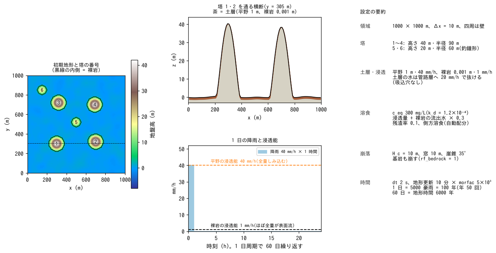

左: 初期地形と塔の番号(黒線の内側 = 裸岩。破線 = 横断の位置)。中上: 塔 1・2 を通る横断
(茶 = 土層)。中下: 1 日の降雨と浸透能。右: 設定の要約。

1000 m × 1000 m、Δx = 10 m(100 × 100 セル)、四周は壁。

- **地形**: 平野(z ≈ 0。相関長 ≈ 30 m・標準偏差 0.3 m の起伏)の上に、釣鐘形の丘を 4 つ
  (塔 1〜4: 高さ 40 m・半径 90 m)と小丘を 2 つ(塔 5・6: 高さ 20 m・半径 60 m)置きます。
  z > 5 m のセルを裸岩とします。
- **土層と浸透**: 平野は土層 1 m(比産出率 0.2)・Green-Ampt 40 mm/h、裸岩は土層 0.001 m・1 mm/h
  (`sd.txt`・`ksv.txt`)。土層の水は管路層(亀裂の網の受け皿)へ 20 mm/h で抜けます。吸込穴は
  ありません。
- **降雨**: 代表的な豪雨 40 mm/h × 1 時間を、1 日周期で 60 日繰り返します。
- **溶食**: c_eq = 300 mg/L(湿潤熱帯の土層の下の水)、ρ_r = 2500 kg/m³ → k_d = 1.2×10⁻⁴。浸透量
  + 裸岩の流出水 × 0.3(`dissol_src = 3`)、残渣率 0.1、側方溶食は自動配分(`dissol_lat = -1`)。
- **崩落**: 限界高さ H_c = 10 m(塔の壁 20 m の半分)、窓の半径 10 m、崖錐の安息角 35°、1 回の更新で
  超過の半分を緩和、基岩も崩す(`rf_bedrock = 1`)、1 エッジ・1 更新の上限 1 m。
- **時間**: dt = 2 s、地形の更新は 10 分ごとで morfac = 5×10³(1 日 = 5000 回の豪雨。年に 50 回
  なら 100 年)。60 日 = 地形時間 6000 年。10 日ごとに出力します。計算は 1〜2 時間(4 スレッド)。

| ケース | 設定ファイル | 内容 | 計算時間の目安 |
|---|---|---|---|
| 主ケース | param.txt | 上の設定(溶食 + 側方溶食 + 崩落) | 1〜2 時間(4 スレッド) |

## 実行方法

```
cd examples/tower_karst
make                                        # 実行ファイルへのリンクと入力(make_terrain.py が z.txt・sd.txt・ksv.txt を作る)
make run                                    # 主ケース(1〜2 時間)
python3 plot_setup.py                       # figs/mechanism.png・setup.png(計算結果は使わない)
python3 plot_results.py | tee analysis.txt  # figs/maps・sections・towers・hydrograph.png と数表
python3 make_terrain.py --steady            # 準定常強制用の浸透能 ksv_steady.txt(下の「1 Myr」の節)
./encflow param_steady.txt > Screen_steady.log          # 準定常強制で 0.99 Myr(約 1 時間)
python3 plot_results.py param_steady.txt steady | tee analysis_steady.txt   # figs/*_steady.png
python3 make_terrain.py --steady --base     # 基準面つきの入力 z_base・gwc_bot・gwc_outfall・uplift・sol_base・ksv_base.txt(下の「基準面」の節)
./encflow param_base.txt > Screen_base.log  # 基準面(地下水面)+ 隆起で 0.99 Myr(4 スレッドで約 3 時間)
python3 plot_results.py param_base.txt steady | tee analysis_base.txt       # figs/*_base.png
./encflow param_base_hc50.txt > Screen_base_hc50.log   # 感度変種 rf_hc = 50 m(入力は共通。約 3 時間)
python3 plot_results.py param_base_hc50.txt steady | tee analysis_base_hc50.txt   # figs/*_base_hc50.png
```

引数 `en` を付けると英語ラベルの図を en/figs/ に描きます(`python3 plot_setup.py en`、
`python3 plot_results.py en`)。

## 結果

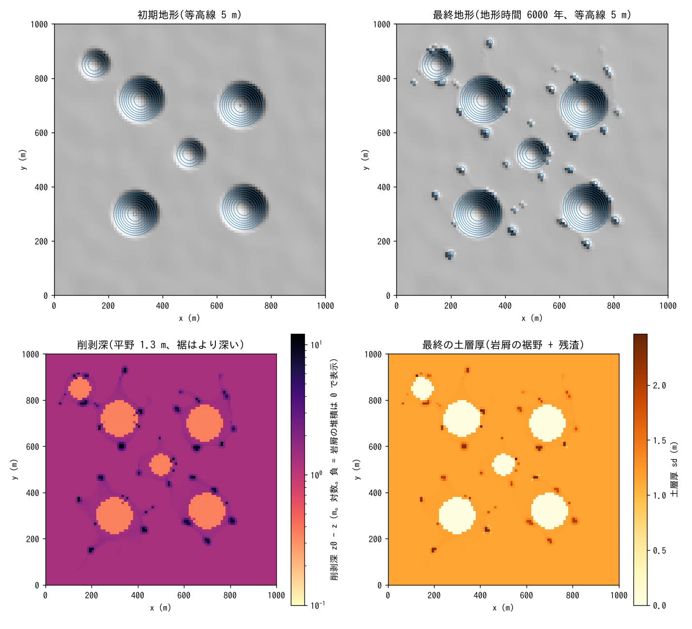

左上: 初期地形(等高線 5 m)、右上: 最終地形(地形時間 6000 年)。左下: 削剥深 z₀ − z(対数。平野は
1.3 m、裾はより深い)。右下: 最終の土層厚(岩屑の裾野と残渣)。

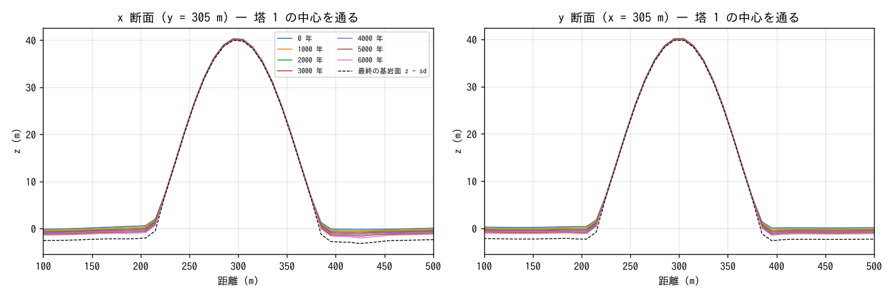

塔 1 の中心を通る x 断面と y 断面の時間発展(破線 = 最終の基岩面 z − sd)。

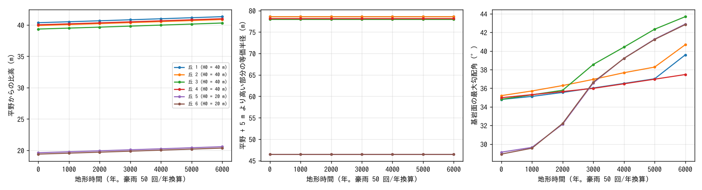

左: 平野からの比高、中: 平野 + 5 m より高い部分の等価半径、右: 基岩面の最大の勾配角(塔ごと)。

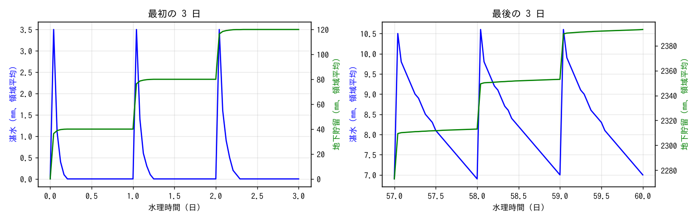

最初の 3 日(左)と最後の 3 日(右)の、領域平均の湛水(青)と地下貯留(緑)。

収支の確認(`plot_results.py` の数表。地形時間 6000 年 = 豪雨 30 万回を年 50 回で換算):

| 項目 | 値 |
|---|---|
| 水収支 | 最終の S_total = 2.400 m = 降雨の累計 40 mm × 60 日(質量保存。終わりの方では湛水の一部が翌日まで残る) |
| 溶けた岩(台帳) | 1 465 645 m³(うち崖錐として溶けた岩 2 153 m³) |
| 崩落で移した岩(台帳。かさ) | 2 440 m³(4.5 万エッジ更新)。最終の崖錐 Σht Δx² = 30 m³(最大 0.05 m。崖錐は溶ける。developer.md §86.7) |
| 地表の体積の減少 | Σ(z₀ − z)Δx² = 1 319 080 m³ = 溶食 × (1 − 0.1) = 1 319 080 m³(全桁一致。崩落は体積を保存するので寄与しない) |
| 平野(湛水しなかったセル)の削剥 | 中央値 1.30 m = 216 mm/kyr |
| 裾(湛水した平野のセル 258 個)の削剥 | 中央値 2.7 m、最大 12.1 m |
| 土層(岩屑と残渣) | 平野 1.14 m(初期 1 m)、裸岩の範囲 0.04 m(初期 0.001 m)、最大 2.5 m(裾。崖錐の残渣) |

| 地形時間 (年) | 平野 (m) | 塔 1〜4 の頂の高さ (m) | 塔 1〜4 の比高 (m) | 小丘 5・6 の比高 (m) | 基岩面の最大の勾配角 |
|---|---|---|---|---|---|
| 0 | 0.0 | 39.3〜40.3 | 39.3〜40.4 | 19.4〜19.6 | 29〜35° |
| 3000 | −0.67 | 39.1〜40.2 | 39.8〜40.8 | 19.9〜20.1 | 36〜39° |
| 6000 | −1.32 | 39.0〜40.0 | 40.3〜41.3 | 20.4〜20.6 | 37〜48° |

(勾配角は towers.png の右の図の 6 つの丘の値の範囲。)

- **差別溶食が比高を増やす**: 平野は 216 mm/kyr で一様に下がり、塔の頂は裸岩の流出水の溶食
  (流出水 × 0.3)で 50 mm/kyr(6000 年で 0.3 m)しか下がらないので、比高はその差の 1.0 m だけ
  増えます。等価半径はほとんど変わらず、形の変化は裾に集中します。
- **裾の堀と穴**: 塔の雨は裾の最も低いセルに集まってしみ込むので、裾の環は平野の 2 倍(3 m)、
  集水の多い数セルは 10 m 級に下がります(削剥深の図の、塔の周りの黒い点。平野の起伏の谷筋に
  沿った筋は、水が流れてしみ込んだ経路)。実際のカルストの「塔の足元の吸込穴・足元の洞」に
  当たります。
- **裾の急化と崩落**: 裾が下がると下の斜面が急になります(基岩面の最大の勾配角 35° → 37〜48°)。
  崩落は露出面が H_c = 10 m を超えた所(裾の穴が 10 m 級に達したセルの壁)だけで起き、移した岩は
  溶食の 0.2 %(2.4 千 m³)で、崖錐は穴の中で溶けて残らず(最大 0.05 m)、残渣が土層に残ります。塔の壁はまだ後退していません
  (6000 年では裾の切り込みが数 m で、壁の大部分は H_c 未満のため)。H_c を小さくするか地形時間を
  延ばすと、壁が崩れて後退する段階に入ります。
- **湛水**: 初めのうちは、豪雨の直後の湛水(領域平均 3.5 mm)が数時間でしみ込んで消えます。終わり
  の方では湛水が 1 日で消えず、次の豪雨の前にも領域平均で約 7 mm が残ります(裾の深い穴に
  たまった水が、浸透能 40 mm/h では 1 日でしみ込みきらないためとみられます)。
- **小丘**(高さ 20 m)も 6000 年では消えません。塔が消えることや、峰叢から峰林への移行には、
  平野の低下が塔の高さに達する数万年の地形時間が要ります(morfac 5×10³ では 1 日 = 100 年なので、
  リスタートを連鎖させて 600 日 = 6 万年)。

## 準定常強制で 1 Myr を走らせる(param_steady.txt)

桂林の塔は比高 100〜300 m で、平野の低下 100〜200 mm/kyr なら 10⁶ 年の桁です。主ケースの
6000 年では平野が 1.3 m 下がるだけなので、地形時間を 2 桁以上延ばす試みとして、代表豪雨の
反復をやめ、**年平均の雨 2000 mm/yr = 0.228 mm/h を定常に与えて morfac = 6×10⁶** にします
(60 日 = 0.99 Myr)。豪雨の中で湛水が集まって穴が掘れる正帰還(morfac の上限の原因)が
なくなるので、溶食は線形・局所に戻り、大きな morfac が許されます。裸岩の浸透能は、年平均の
雨の下で豪雨と同じ年浸透率 2.5 % になる 0.0057 mm/h にします(`make_terrain.py --steady`)。
失うのは豪雨時の裾の湛水(側方溶食のノッチ)、残るのは塔の流出水が裾へ集まって浸透する集中と、
塔の岩面の表面流源、崩落です。安全弁 `dissol_dzmax = 0.3 m`(平野の 1 更新 0.027 m の 10 倍)。

| 項目 | 値 |
|---|---|
| 地形時間 | 985 626 年(60 日 × 6×10⁶) |
| 平野の削剥 | 中央値 212.8 m = 216 mm/kyr(主ケースと同じ速さ。線形なので当然) |
| 塔の頂 | 40 → −165 m(165 m 低下。表面流源の 70 mm/kyr ではなく、崩落による消耗) |
| 平野からの比高 | 40 → 62 m(164 kyr)→ 48 m(1 Myr)。等価半径 79 → 55 m、壁 35° → 85° |
| 裾の穴 | 地表は平野より 38 m 低いだけだが、基岩面 z − sd は −463 m(残渣 215 m の下) |
| 崩落で移した岩 | 4 646 万 m³(溶食 2.4 億 m³ の 19 %)。うち崖錐として溶けた岩 2 254 万 m³(最終の崖錐はほぼ 0)。安全弁の発動 28 596 セル更新 |

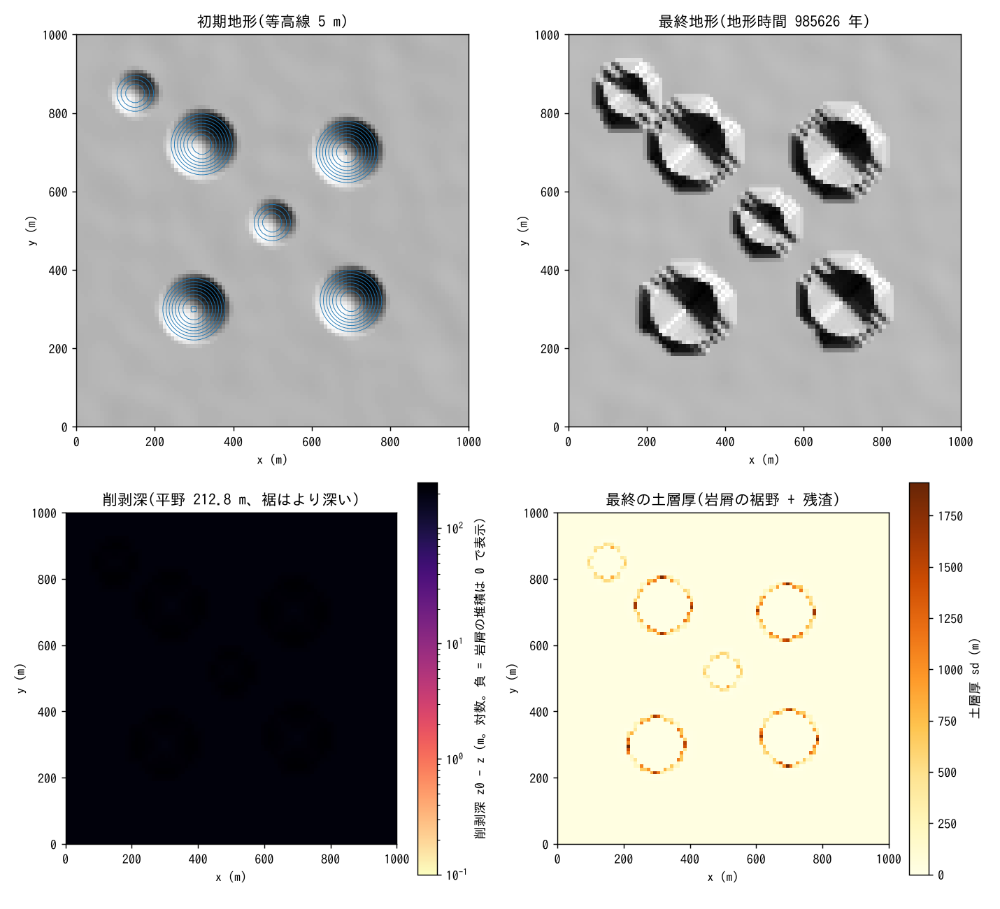
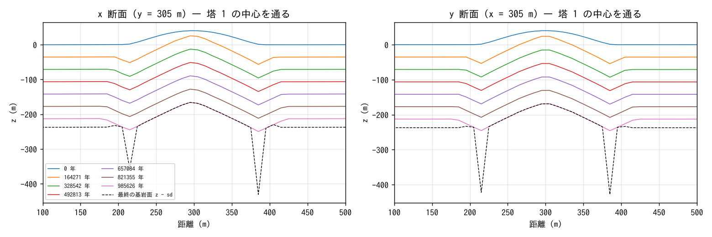
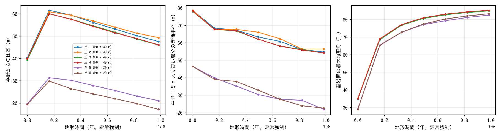

**読み取れること。** 数値的には 1 時間の計算で Myr が安定に走ります。平野は 216 mm/kyr で
下がり続け、最初の 164 kyr で比高が 40 → 61 m に増えて「平野の低下が塔を残す」機構は働きます。
しかし、その後は塔が**崩落で消耗して**比高が減ります。原因は定常強制がむき出しにした
モデルの 2 つの欠落で、係数の問題ではありません。

1. **落ちた石灰岩が溶けなかった(解消済み)。** 最初の試走では床の溶食が「z を下げ sd を保つ」
   規約のままだったので、裾に積もった崖錐(sd・ht)の下で基岩だけが溶け続け、崖錐の柱が
   不死身のまま 1.35 km 沈みました。石灰岩の岩屑は岩盤と同じ速さで溶けるので、溶食の
   水量を崖錐 ht → 基岩の順に使うようにしました(developer.md §86.7。上の表はその後の
   再計算)。崖錐は溶けて消えますが、その残渣(不溶。残渣率 0.1)は裾のセルに 215 m 積もり、
   その下で基岩が安全弁の 0.3 m/更新で溶け続けるので、塔が崩れ込む「コンベア」自体は
   残ります(基岩面 −463 m。断面図の破線)。根本の原因は次の 2 です。
2. **裾に基準面(地下水面)がない。** 管路層は深さ 1000 m・容量 2000 m の「地下へ消える
   受け皿」なので、裾の穴に底がありません。実際の塔の足元は地下水面(= 河川の基準面)に
   あって、穴は水面で止まり、溶食は側方(足元のノッチ・洞)へ向かいます。これが fenglin の
   機構そのものです。吐口の水頭で地下水面を固定し、隆起(`f_uplift`)で陸を基準面に対して
   上げる構成 param_base.txt で表します(次の節)。

また、豪雨の反復では裾の湛水が 261 セルに広がっていたのが、定常の薄い水膜では各塔の
最も低い数セルに全部集まる点が、裾の集中を極端にしています(定常化の副作用)。

## 基準面(地下水面)と隆起(param_base.txt)

前節の 2(裾に基準面がない)を補う構成です。東端の 1 列を基準面の河道(z = −5 m。不溶・不透水、
東の辺は自由流出)にし、管路層に側方通水(線形則 0.05 m²/s)と河道の列の吐口(オリフィス
Cd·A = 0.15 m²)を与え、水頭底を絶対標高 −45 m の地図(`fn_gwc_bot`)にして初期の地下水面を
河道の高さ −5 m に置きます(`make_terrain.py --steady --base`)。河道以外の陸を `f_uplift` で
0.2 mm/yr(200 mm/kyr)隆起させ、溶食の水量は「岩への涵養」`dissol_src = 5`(土層 → 管路層の
交換量 + 裸岩の流出水 × 0.3。developer.md §86.8)にします。浸透量ベースの源では、残渣で厚くなる
土層が morfac 倍の浸透を受け止めて穴に底がなくなる(最初の本計算は 120 kyr で発散)ためです。
ほかは param_steady.txt と同じです。

| 項目 | 値 |
|---|---|
| 地形時間 | 985 626 年(60 日 × 6×10⁶)。隆起 200 m |
| 平野 | 溶食 209.5 m(213 mm/kyr)− 隆起 200 m = 正味 9.5 m の低下(中央値)。残渣の土層 1 → 24 m、基岩面の中央値 −33 m |
| 塔の頂 | 40.3 → 57.3〜59.4 m(隆起 200 m − 低下 181〜183 m)。最初の 164 kyr は 80 mm/kyr、以後は平野と同じ速さ |
| 平野からの比高 | 40 → 66〜69 m(164 kyr で到達し、以後一定。小丘は 20 → 36 m)。等価半径 79 → 82 m(不変) |
| 塔の形 | 放物面の丘 → 勾配 37〜41° の円錐(崖錐の安息角 35° に近い)。基岩面の最大勾配 82° は裾の穴の壁 |
| 裾の穴 | 地表は平野とほぼ同じ高さ(残渣で埋まる。sd 最大 92 m)、基岩面は −94 m |
| 地下水面 | −5 → −7.8〜−9.5 m(吐口の放流 0 m³。残渣の土層が管路の水を吸う) |
| 崩落で移した岩 | 3 217 万 m³(溶食 2.26 億 m³ の 14 %)。うち崖錐として溶けた岩 1 770 万 m³(最終の崖錐 5 000 m³)。安全弁の発動 650 万セル更新(平均 750 セル/更新 = 裾と流路) |

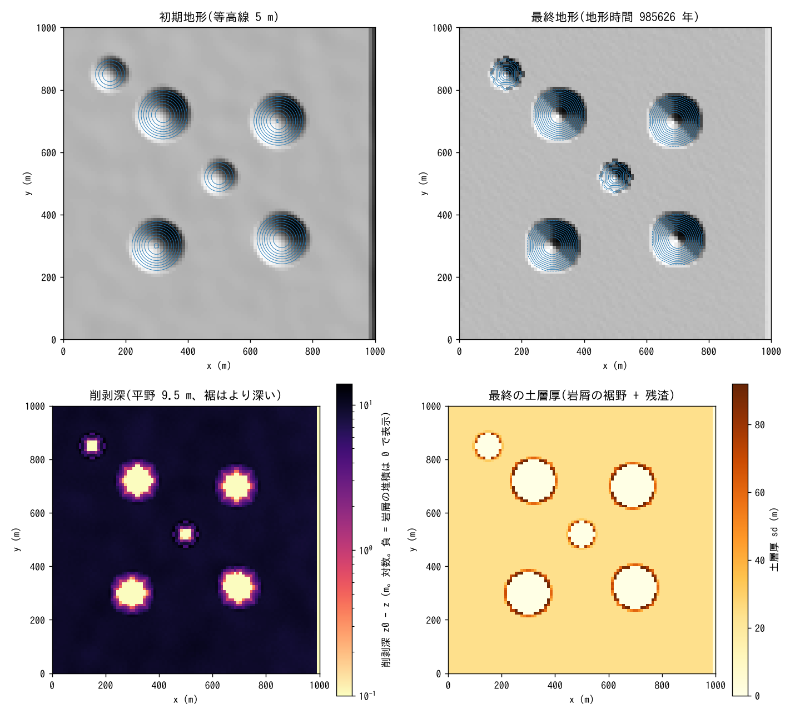
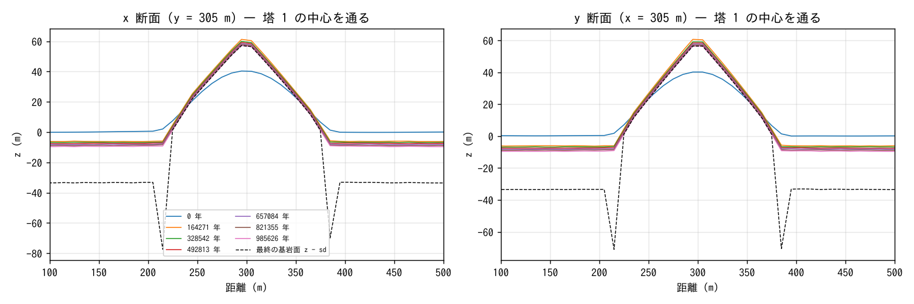
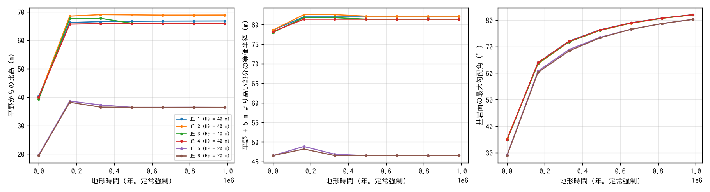

**読み取れること。** 隆起を足すと塔は消耗せず、比高 66〜69 m・半径 82 m の円錐として 1 Myr
残ります(前節では 48 m まで減り続けました)。平野は土層下の涵養(雨の全量)で 213 mm/kyr 溶けて
隆起 200 mm/kyr とほぼ釣り合い、塔は最初の 164 kyr だけ表面流源の速さ(80 mm/kyr ≈ 浸透 2.5 % +
流出水 × 0.3)で下がって比高を稼ぎ、以後は裾の集中溶食(安全弁が平均 750 セル/更新で発動)で
足元を切られ、崖錐の安息角の円錐に崩れながら平野と同じ速さで下がります。「平野の低下 − 塔の低下」
で比高が増える段階と、崩落が塔を平野に従わせる段階の 2 段です。桂林のような垂直壁の柱には
なりません。壁の形は `rf_hc`(限界高さ 10 m = 1 セルの落差で崩れる弱い岩)が決めているので、
塊状石灰岩の 50 m にすると崩れずに立つ壁になります(次の小節)。

**できていないこと。**

1. **地下水面が河道に固定されませんでした。** 吐口は管路水頭が河道の水面を超えたときだけ放流する
   フラップつきなので、水頭が −5 m から上がらなければ働きません。実際には溶けた岩の 1 割が残渣の
   土層になり(平野で 24 m、裾で 92 m)、その貯留が管路の水を吸って水頭は −9.5 m まで下がりました。
   morfac で岩 → 土の転換が水理時間の涵養より 20 倍速く進む(岩が溶けて生まれる貯留を雨が
   満たしきれない)準定常化の副作用で、残渣率 `dissol_fres = 0` にすれば消えます(未計算)。
2. **平野の溶食は地下水面に関係なく続きます。** 涵養源は土層 → 管路層の交換量に比例し、基岩面が
   地下水面より下(平野で 24 m 下)にあっても溶かします。「飽和帯では溶けない(地下水面で溶食平野が
   止まる)」機構はなく、平野が基準面に張りつく期待は、隆起と溶食の速さの釣り合い(213 対
   200 mm/kyr)でしか実現していません。
3. **残渣が運ばれません。** 実際の溶食平野の残渣は河川が運び去りますが、この構成では掃流砂・
   浮遊砂を有効にしていないので平野に 24 m 積もり、地表(−9.5 m)は河道(−5 m)より低くなっています
   (地表水は土層に浸透して消えるので湛水はしません)。
4. **裾の穴は埋まっただけです。** 基岩の穴(−94 m)は残渣 92 m で埋まって地表は平野と同じ高さ
   ですが、側方溶食のノッチ(裾の湛水)は定常の薄い水膜では生じません(前節と同じ)。

### 感度: 限界高さ rf_hc = 50 m(塊状石灰岩。param_base_hc50.txt)

param_base.txt の `rf_hc` だけを 10 → 50 m(1 セルの落差 50 m = 79° まで崩れない岩)にした
変種です(入力は共通。`./encflow param_base_hc50.txt`)。

| 項目 | 値 |
|---|---|
| 平野 | 溶食 209 m − 隆起 200 m = 正味 9.4 m の低下(rf_hc = 10 m と同じ)。残渣の土層 24 m、地下水面 −5 → −7.4〜−9.5 m |
| 塔の頂 | 40 → 231 m(隆起 200 m − 低下 9 m)。小丘は 20 → 149 m(821 kyr 以降は崩落で頭打ち) |
| 平野からの比高 | 40 → 240 m(直線的に増加。小丘 158 m)。等価半径 79 → 82 m(不変) |
| 塔の形 | 平らな頂と 69〜75° の壁(基岩面の最大勾配 83°)。壁には H_c = 50 m ごとの段 |
| 崩落で移した岩 | 1 248 万 m³(溶食 2.17 億 m³ の 6 %。rf_hc = 10 m では 14 %)。うち崖錐として溶けた岩 825 万 m³ |

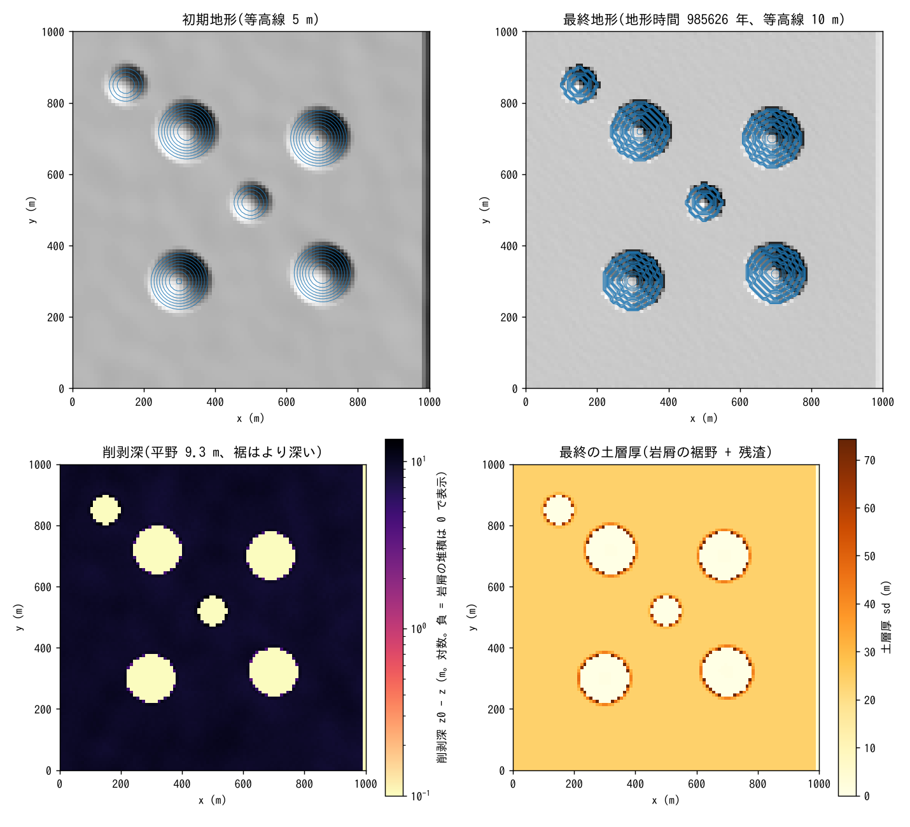
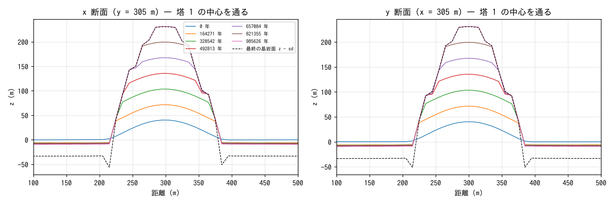
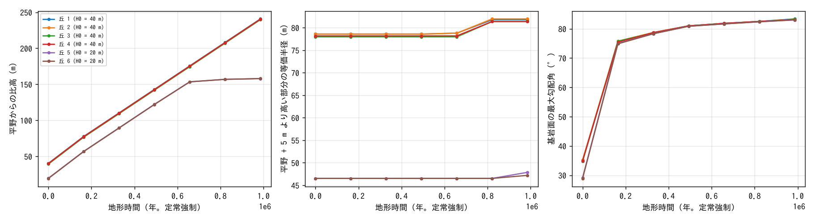

**読み取れること。** 限界高さを塊状石灰岩の値にすると塔は崩れずに立ち、1 Myr で比高 240 m・
壁 75° の柱(桂林の 100〜300 m の桁)になります。崩落が塔を平野に従わせる前節の段階がなくなり、
比高は「隆起 − 塔の頂の低下」で直線的に増えます。壁の段は、自由面が H_c を超えた分だけ崩れる
崩落則が格子 10 m の上で作る階段で、H_c と格子幅の比で決まるモデルの形です。

**注意(係数ではなくモデルの副作用)。** 塔の頂の低下が 9 mm/kyr しかない(表面流源の
70 mm/kyr が働いていない)のは、頂に溜まる残渣(溶けた岩の 1 割、0.2 m)が `dissol_sdsurf = 0.1 m`
を超えて「裸岩」の判定を外し、表面流源を止めるためです(浸透能の地図は静的なので浸透は 2.5 % の
まま = 涵養源の 6 mm/kyr だけが残る)。実際の裸岩の塔では残渣は流されて残らないので、この比高の
増え方(ほぼ隆起速度)は過大で、表面流源が効き続ければ 200 − 76 = 124 mm/kyr 程度です。急な裸岩に
残渣を残さない(または流出水で運ぶ)扱いが要ります(handoff.md)。

## このモデルで表せないこと(実際の現象との違い)

- **崩落は瞬時の緩和**: 崩落は限界高さ `rf_hc` で決まる瞬時の緩和(速さの法則ではない)で、崖錐の
  安息角 `rf_phi` で広がります。岩屑は崖錐と土層として裾に残り、崖錐の安息角のほかは、クリープや
  掃流砂を有効にしない限り動きません(この例題では動かさない)。
- **流路に沿った溶食は表さない**: 塔の岩面の溶食は、その岩面で発生した流出水の 0.3 倍の溶かす力
  だけを使います。上流から流れてきた水は飽和とみなして数えないので、流路に沿って溶食が集中する
  こと(溶食の溝。カッレン)は表しません。
- **壁の後退はまだ見えない**: 裾のノッチは、側方溶食が「湛水に接する壁」に働くので、豪雨の直後に
  裾が湛水する時間だけ効きます。6000 年の計算では壁の後退は見えず、裾の穴と岩屑が主な変化です。
  塔の後退を見るには地形時間を 10 倍以上にします。
- **洞窟は形を持たない**: 管路層は地下へ消えた水の受け皿で、足元の洞や地下の水系の形は扱いません。
- **係数は校正値ではない**: c_eq = 300 mg/L は湿潤熱帯の土層の下の水の上寄りの値、平野の削剥
  (216 mm/kyr)は熱帯カルストの値としては大きい側です。地形時間は「1 日の周期 = 代表的な豪雨
  1 回、年 50 回」の換算です。

## 注意

- **morfac の上限**: 吸込穴があるとき([karst](../karst/README.md))より緩いものの、上限はあります。
  裾の穴は 1 回の豪雨(浸透 40 mm/h × 湛水の続く時間)で数十 cm 掘れるので、10⁴ では穴の段差が 9 m
  に達した時点で流れが破綻しました(5×10³ で安定)。
- **基岩の崩落**: 塔は土層のない基岩なので `rf_bedrock = 1` が要ります(既定の 0 では、土層が 0 以下
  のセルは崩れない)。
- **四周は壁**: 平野の水は浸透でしか消えません。排水の早い平野(横の地下水の流れや河川)を表すには、
  横の流れや吐口を足します。
- 検証: [test/dissol](../../test/dissol/README.md)(溶食の解析解との比較)、
  [test/rockfall](../../test/rockfall/README.md)(崩落と崖錐。基岩版を含む)。

## 感度実験の入口

- `rf_hc`(限界高さ)と `rf_rc`(窓): 壁の崩れ方。H_c を小さくすると壁が崩れて後退する段階に早く入ります。
- `dissol_ceq`: 溶ける速さ。`dissol_fsurf`: 塔の頂の下がる速さ(比高の増え方)。
- ksv.txt・sd.txt を作る make_terrain.py の `KSV_PLAIN`・`KSV_ROCK`・`SD_PLAIN`: 平野と塔の水の分け方。
- `tt_c` とリスタートの連鎖: 地形時間(塔の後退・消滅には数万年)。Myr は準定常強制
  (param_steady.txt。上の節)で。
- param_base.txt(基準面と隆起)の `rf_hc`: 10 m では崖錐の安息角の円錐、50 m では壁 75° の柱
  (param_base_hc50.txt。上の節)。その間と、`dissol_sdsurf` を大きくして頂の残渣に表面流源を
  止めさせない組み合わせ。`dissol_fres = 0`: 残渣の土層が地下水面を下げる副作用の切り分け。
  `uplift0`: 隆起と平野の溶食(213 mm/kyr)の釣り合い。

## 参考文献

- Ford, D. and Williams, P. (2007): *Karst Hydrogeology and Geomorphology*. John Wiley & Sons,
  Chichester.
- Waltham, T. (2008): Fengcong, fenglin, cone karst and tower karst. *Cave and Karst Science*, 35(3),
  77–88.(要旨で確認)
- White, W. B. (1984): Rate processes: chemical kinetics and karst landform development. In: La Fleur,
  R. G. (ed.) *Groundwater as a Geomorphic Agent*, Allen & Unwin, 227–248.
