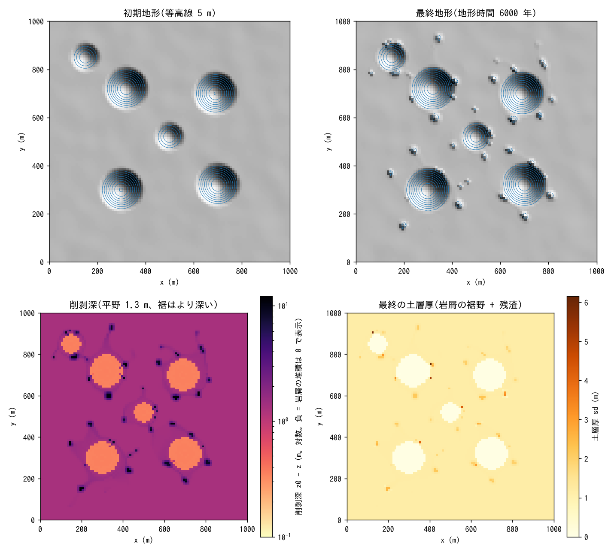
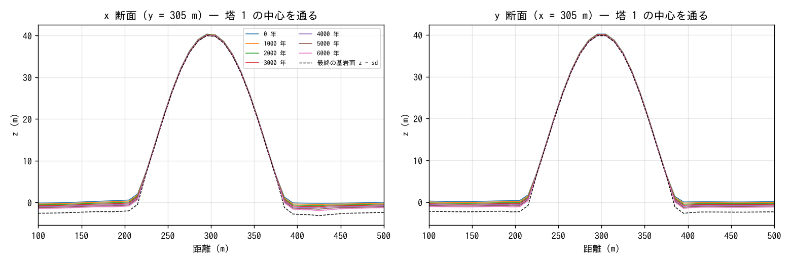
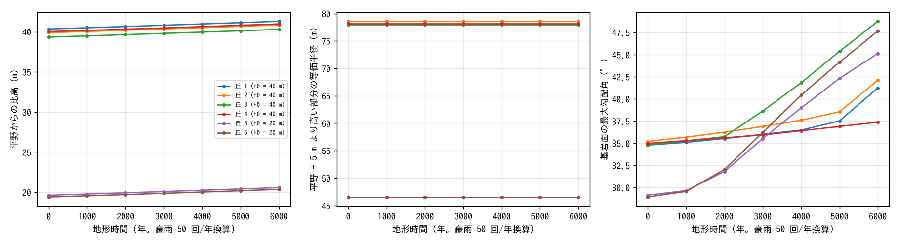

# examples/tower_karst — 平野に残る裸岩の塔(タワーカルスト)の形成実験

湿潤熱帯のカルストで、石灰岩の塔(fenglin)が平野の上に残る過程を、
**溶食 f_dissol**(浸透量に比例する面的溶食+湛水に接する岩壁の側方溶食)
と**崩落と崖錐 f_rockfall**(基岩モード `rf_bedrock = 1`)の重ね合わせで見る
例題です。入力はこのディレクトリの `param.txt` と生成入力 `z.txt`・`sd.txt`・
`ksv.txt` だけです(developer.md §86・§48.7、docs/karst_plan.md §2.5・§2.6)。
ドリーネ群の形成は [examples/karst](../karst/) を参照してください。

## 成因(モデルの中の因果)

- 塔は裸岩で浸透能が小さく(1 mm/h)、雨はほぼ全量が表面流として裾へ
  流れ下る。平野は土層(1 m)に覆われ浸透能が大きい(40 mm/h)ので、
  自分の雨と塔から来た水を浸透させる。溶食は浸透量に比例し(土壌 CO₂ を
  経た攻撃性の高い水)、裸岩ではそこで発生した流出水の 0.3 倍も岩面で
  溶けるので、**平野と塔の裾が速く、塔はその 1/3 程度の速さで下がる**。
- 裾のセルは塔からの集水で特に多く浸透し、堀(moat)状に下がる。裾の
  湛水に接する岩壁は側方溶食(濡れ面の面積比で配分)でノッチ状に削られる。
- 裾が下がって露出した岩壁(窓 1 セル内の最低点との落差)が限界高さ
  H_c = 10 m を超えると、超過分が崩落して崖錐(ht。土層 sd にも入る)として
  裾に積もる。塔は土層のない基岩なので `rf_bedrock = 1` で崩す。崖錐が裾を
  埋めるほど露出面が低くなり、崩落は止まる。
- 吸込穴を使わないので取水は浸透能で頭打ちになり、豪雨内の正帰還が暴走
  しない。ただし塔の裾に集まる水が浸透する穴は 1 豪雨で数十 cm 掘れるので、
  morfac は 5×10³ に留める(10⁴ では穴の段差 9 m で流れが発散した)。

## 設定

| 項目 | 値 |
|---|---|
| 領域・格子 | 1000 × 1000 m、Δx = 10 m(100 × 100 セル)、四周壁 |
| 初期地形 | 平野(z ≈ 0。相関長 ≈ 30 m・標準偏差 0.3 m の起伏)に釣鐘形の丘 4 つ(高さ 40 m・半径 90 m)と小丘 2 つ(20 m・60 m)。z > 5 m を裸岩とする |
| 土層・浸透 | 平野: 土層 1 m(sy 0.2)・Green-Ampt 40 mm/h、裸岩: 土層 1e-3 m・1 mm/h(`sd.txt`・`ksv.txt`)。土層の水は管路層(亀裂網の受け皿)へ 20 mm/h で抜ける。吸込穴なし |
| 降雨 | 代表豪雨 40 mm/h × 1 h、1 日周期で反復 |
| 溶食 | c_eq = 300 mg/L(湿潤熱帯の土層下)、ρ_r = 2500 → k_d = 1.2×10⁻⁴、浸透量 + 裸岩の流出水 × 0.3(dissol_src = 3)、残渣率 0.1、側方溶食 dissol_lat = −1(自動配分) |
| 崩落 | rf_hc = 10 m(塔の壁 20 m の半分)、窓 rf_rc = 10 m、崖錐の安息角 35°、relax = 0.5、基岩モード rf_bedrock = 1、1 エッジ・1 更新の上限 1 m |
| 時間 | dt = 2 s、地形更新 10 分毎 × morfac 5×10³(1 日 = 5×10³ 豪雨 = 年 50 回なら 100 年)。60 日 = 地形時間 6 kyr。10 日毎に出力。約 1〜2 時間(4 スレッド) |

```
make                                       # ../../bin/encflow へのリンク
python3 make_terrain.py                    # z.txt, sd.txt, ksv.txt
./encflow param.txt > Screen.log           # 約 1〜2 時間
python3 plot_results.py | tee analysis.txt # figs/*.png + 数表
```

## 検算

`plot_results.py` の数表(地形時間 6000 年 = 豪雨 300000 回を年 50 回で換算):

| 項目 | 値 |
|---|---|
| 水収支 | 最終 S_total = 2.400 m = 降雨累計 40 mm × 60 日(質量保存。湛水は毎日浸透で消える) |
| 溶けた岩(台帳) | 1 465 945 m³ |
| 崩落で移した岩(台帳。かさ) | 2 493 m³(4.4 万エッジ更新)。最終の崖錐 Σht Δx² = 2 172 m³(最大 3.7 m) |
| 地表の体積減少 | Σ(z₀ − z)Δx² = 1 319 350 m³ = 溶食 × (1 − 0.1) = 1 319 350 m³(全桁一致。崩落は保存形で寄与しない) |
| 平野(湛水しなかったセル)の削剥 | 中央値 1.30 m = 216 mm/kyr |
| 裾(湛水した平野セル 261 個)の削剥 | 中央値 2.8 m、最大 12.1 m |
| 土層(岩屑+残渣) | 平野 1.14 m(初期 1 m)、裸岩域 0.04 m(初期 0.001 m)、最大 6.2 m(裾の崖錐) |

## 結果







| 地形時間 (年) | 平野 (m) | 塔 1〜4 の頂高 (m) | 塔 1〜4 の比高 (m) | 小丘 5・6 の比高 (m) | 裾の基岩面の最大勾配角 |
|---|---|---|---|---|---|
| 0 | 0.0 | 39.3〜40.3 | 39.3〜40.4 | 19.4〜19.6 | 29〜35° |
| 3000 | −0.67 | 39.1〜40.1 | 39.8〜40.8 | 19.9〜20.1 | 35〜38° |
| 6000 | −1.32 | 39.0〜40.0 | 40.3〜41.3 | 20.4〜20.6 | 38〜48° |

- **差別溶食が比高を増やす**。平野は 216 mm/kyr で一様に下がり、塔の頂は
  裸岩の表面流源(流出水 × 0.3)で 50 mm/kyr(6 kyr で 0.3 m)しか下がらない
  ので、比高は差の 1.0 m だけ増える。等価半径はほぼ不変で、形の変化は裾に
  集中する。
- **裾の堀と穴**。塔の雨は裾の最も低いセルに集まって浸透するので、裾の
  環は平野の 2 倍(3 m)、集水の多い数セルは 10 m 級に下がる(削剥深の図の
  塔の周りの黒い点。平野の起伏の谷筋に沿った筋は水が流れて浸透した経路)。
  実際のカルストの「塔の足元の吸込穴・足元の洞」に対応する。
- **裾の急化と崩落**。裾が下がると下部斜面が急になる(基岩面の最大勾配角
  35° → 37〜49°)。崩落は露出面が H_c = 10 m を超えた所(裾の穴が 10 m 級に
  達したセルの壁)だけで起き、移した岩は溶食の 0.2 %(2.5 千 m³)、崖錐は
  穴の中に最大 3.7 m 積もる。塔の壁はまだ後退していない(6 kyr では裾の
  切り込みが数 m で、壁の大部分は H_c 未満のため)。H_c を小さくするか
  地形時間を延ばすと、壁が崩れて後退する段階に入る。
- **小丘**(高さ 20 m)も 6 kyr では消えない。塔の消滅や fengcong → fenglin
  への移行は、平野の低下が塔の高さに達する数十 kyr の地形時間が要る
  (morfac 5×10³ では 1 日 = 100 年なので、リスタート連鎖で 600 日 = 60 kyr)。

## 読み方の注意

- 係数は校正値ではありません。c_eq = 300 mg/L は湿潤熱帯の土層下の涵養水の
  上寄り、平野の削剥 240 mm/kyr 程度は熱帯カルストの文献域(数十〜
  数百 mm/kyr)の上端です。地形時間は「1 日の周期 = 代表豪雨 1 回、年 50 回」
  の換算です。
- 崩落は限界高さ `rf_hc` で決まる瞬時の緩和(速度則ではない)で、崖錐の
  安息角 `rf_phi` で広がります。岩屑は崖錐 ht と土層 sd として裾に残り、
  崖錐の安息角以外では、クリープ・掃流砂を有効にしない限り動きません
  (本例題は動かさない)。塔は土層のない基岩なので `rf_bedrock = 1` が要ります
  (既定 0 では sd ≤ 0 のセルは崩れない)。
- 塔の岩面の溶食は表面流源(`dissol_src = 3`)で、塔で発生した流出水の
  0.3 倍の溶解能をその岩面で使います。上流から流れてきた水は飽和とみなし
  数えないので、流路に沿った溶食の集中(カッレン)は表しません。
- 裾のノッチは側方溶食が「湛水に接する壁」に働くため、豪雨直後に裾が
  湛水する時間だけ効きます。6 kyr の本計算では壁の後退は見えず、裾の穴と
  岩屑が主な変化です。塔の後退を見るには地形時間を 10 倍以上にします。
- morfac の上限は吸込穴のときより緩いが無限ではありません。裾の穴は 1 豪雨
  (浸透 40 mm/h × 湛水の継続時間)で数十 cm 掘れるので、10⁴ では穴の段差が
  9 m に達した時点で流れが発散しました(5×10³ で安定)。
- 四周は壁で、平野の水は浸透でしか消えません。排水の早い平野(側方地下水流や
  河川)を表すには側方流や吐口を足します。

## 関連

- [examples/karst](../karst/) — ドリーネ群、morfac の上限、側方溶食・崩落の対照
- [docs/users_guide/geomorph.md](../../docs/users_guide/geomorph.md)「石灰岩の溶食」「崩落と崖錐」、
  [sediment.md](../../docs/users_guide/sediment.md) — 式と既定値の根拠
- [test/dissol](../../test/dissol/)・[test/rockfall](../../test/rockfall/) — 解析検証、
  [docs/karst_plan.md](../../docs/karst_plan.md) — 設計と限界
