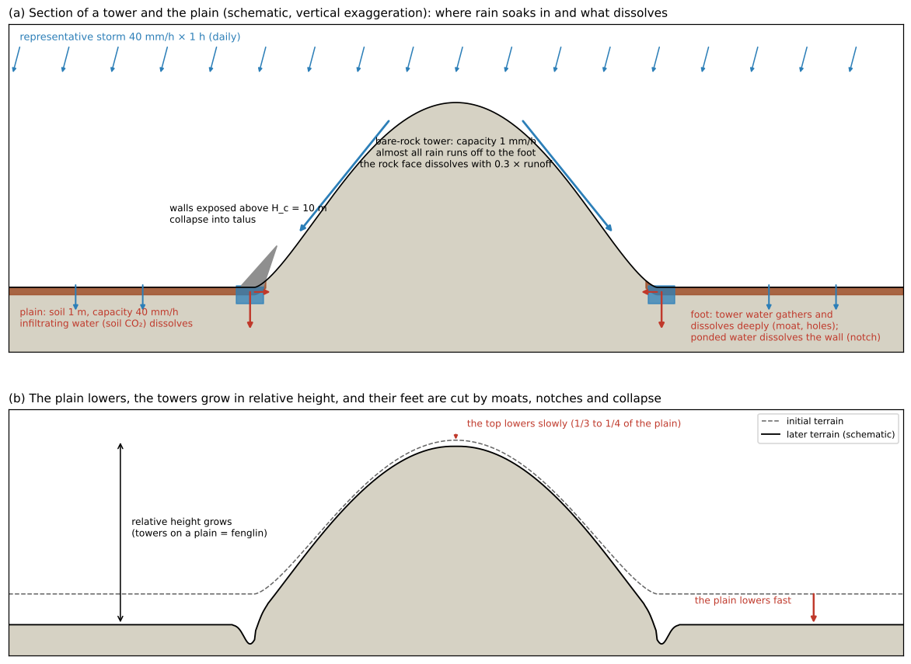
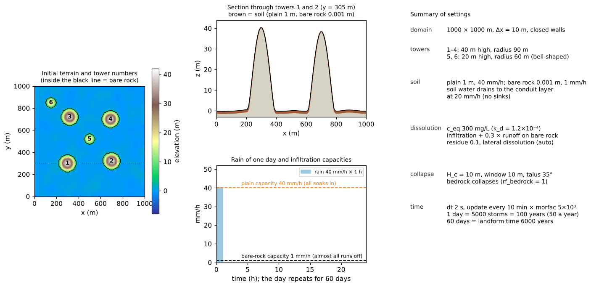
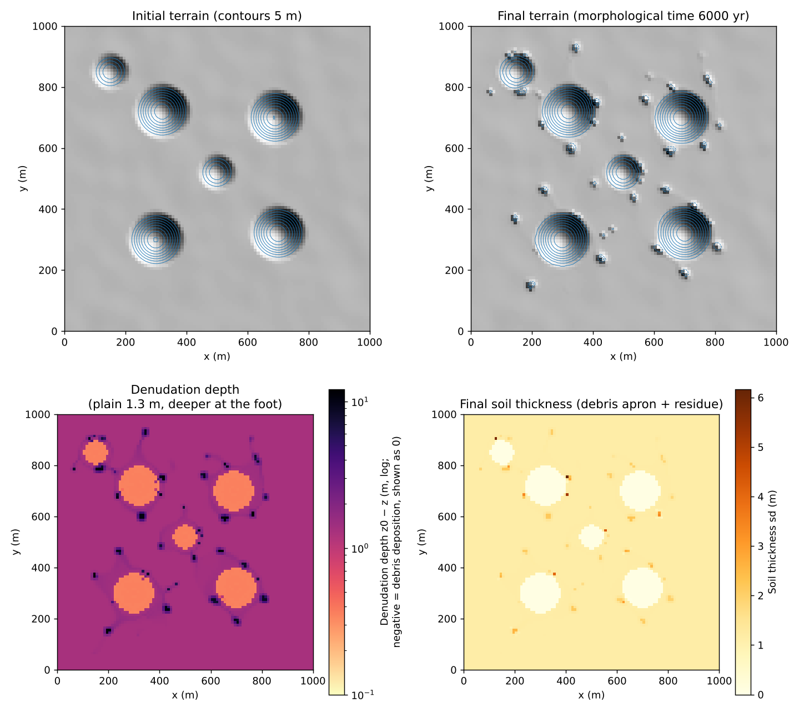
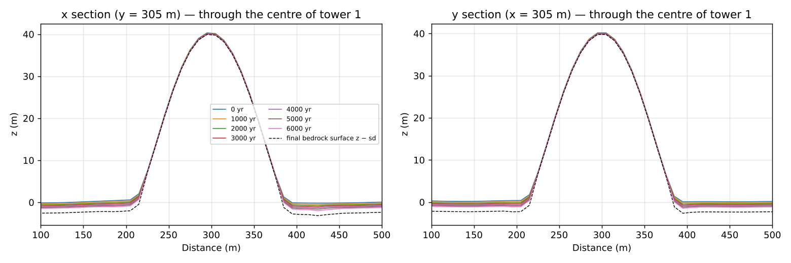
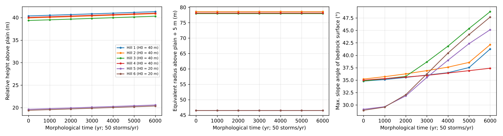
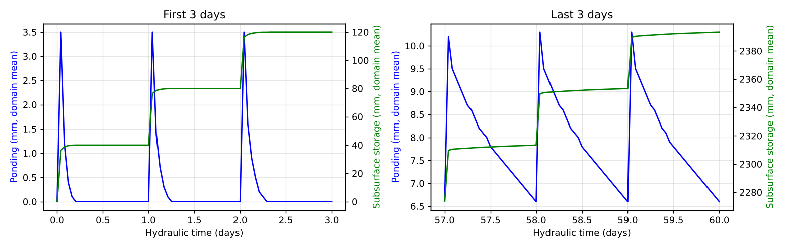

# tower_karst — bare-rock towers left on a plain (tower karst: differential dissolution and collapse at the feet)

> English mirror of examples/tower_karst/README.md. The Japanese file is the master copy.

[日本語](../README.md)

This example looks at how limestone towers (peak forest, fenglin) remain standing on a plain in
humid tropical karst, by superposing
[limestone dissolution](../../../docs/en/users_guide/geomorph.md#limestone-dissolution-f_dissol)
(f_dissol: diffuse dissolution by infiltrating water, dissolution of rock faces by runoff on bare
rock, and lateral dissolution of walls in contact with ponded water) and
[rockfall and talus](../../../docs/en/users_guide/geomorph.md#rockfall-and-talus-f_rockfall)
(f_rockfall; bedrock without soil also collapses). With only the difference that rain runs off
the bare-rock towers at once while the plain is covered by soil into which rain soaks, it looks
at whether the plain and the feet of the towers dissolve faster and the towers rise relative to
the plain. For the formation of a doline field see [karst](../../karst/en/README.md). The values
are schematic, chosen to show the style of formation, and do not reproduce the rates or forms of
real landforms. The figures of the results have Japanese labels (shared with the Japanese
version).

## What happens in real tower karst

- **Towers standing on a plain**: in humid tropical limestone regions, towers with steep walls
  stand in rows on a flat plain (Guilin in southern China is the classic example). It is thought
  that they often develop from peak clusters joined at their bases (fengcong) into peak forests
  isolated on a plain (fenglin) (Waltham 2008).
- **The plain and the feet dissolve fast**: the plain is covered by soil and alluvium, and
  aggressive water that has taken up carbon dioxide in the soil dissolves the plain and the feet
  of the towers. On bare-rock towers the rain runs off at once, and the rock faces dissolve little.
  The denudation rate is proportional to the amount of infiltrating water and how much it can
  dissolve, so it is large in the humid tropics, with much rain and abundant soil carbon dioxide
  (White 1984).
- **Notches at the feet and collapse**: the feet of the towers are dissolved near the water level
  of the plain into notches (foot caves), and the walls that lose their support collapse. Through
  repeated collapse the towers become thinner and lower while keeping steep walls (Ford and
  Williams 2007; Waltham 2008). The collapsed debris accumulates at the feet.

## Mechanisms needed for the reproduction



Schematic (vertical exaggeration). (a) Section of a tower and the plain: on a bare-rock tower,
almost all the rain runs off and gathers at the foot, and the rock face dissolves with only part
of the runoff. On the plain, water infiltrating through the soil dissolves the rock, and the foot,
where the tower water gathers, dissolves deeply into moats and holes. Water ponded at the foot
dissolves the rock wall (notch), and exposed walls above the critical height collapse into talus.
(b) The plain lowers fast and the tower tops lower slowly, so the relative height of the towers
grows.

| Real phenomenon | Mechanism in the model | Setting |
|---|---|---|
| Rain soaks in on the plain and runs off the bare-rock towers | Distribution of infiltration capacity (plain 40 mm/h, bare rock 1 mm/h) and of soil thickness (plain 1 m, bare rock 0.001 m) | `fn_gw_ksv = 'ksv.txt'`, `fn_sd = 'sd.txt'` |
| Infiltrating water dissolves limestone | Dissolution proportional to infiltration (c_eq = 300 mg/L → k_d = 1.2×10⁻⁴) | `f_dissol = 1`, `dissol_ceq` |
| Bare rock faces also dissolve a little | Dissolution by 0.3 × the runoff generated on bare rock (water flowing in from upstream is treated as saturated and not counted) | `dissol_src = 3`, `dissol_fsurf = 0.3`, `dissol_sdsurf` |
| The tower water gathers at the foot and dissolves it deeply | Water gathered at the foot by shallow-water flow soaks in and dissolves accordingly | (shallow-water flow and Green-Ampt) |
| Water ponded at the foot dissolves the wall (notch) | Lateral dissolution: the dissolving power of the pond is also distributed to wetted walls | `dissol_lat = -1` |
| Undercut walls collapse into talus | Rockfall and talus: the part of the drop to the lowest point within a window above H_c collapses, and bedrock without soil also collapses | `f_rockfall`, `rf_hc = 10`, `rf_rc = 10`, `rf_bedrock = 1` |
| Water disappearing underground (fracture networks) | Soil water drains at 20 mm/h to the conduit layer (a receptacle). No sinks | `gwc_leak_layer = 1`, `gwc_leak_mmh = 20`, `gwc_inlet = 0` |
| Residue remains as soil | 10 % of the dissolved rock volume stays in the soil | `dissol_fres = 0.1` |
| A long time | A representative storm is repeated on a daily cycle and only the landform change is accelerated by morfac | `t_cycle_c = "1d"`, `morfac = 5000` |

Without sinks, the intake of water is capped by the infiltration capacity, so the positive feedback
of [karst](../../karst/en/README.md), in which "water gathers into a depression and runs away within
a storm", is less likely. Still, the holes at the tower feet, where the gathered water soaks in, can
deepen by tens of centimetres in one storm, so morfac is kept at 5×10³ (see the notes).

## Geometry and settings



Left: initial terrain and tower numbers (inside the black line = bare rock; dashed = position of the
section). Upper middle: section through towers 1 and 2 (brown = soil). Lower middle: rain of one day
and infiltration capacities. Right: summary of the settings.

1000 m × 1000 m, Δx = 10 m (100 × 100 cells), closed walls on all four sides.

- **Terrain**: on a plain (z ≈ 0; undulation with a correlation length of ≈ 30 m and a standard
  deviation of 0.3 m), four bell-shaped hills (towers 1 to 4: 40 m high, radius 90 m) and two small
  hills (towers 5 and 6: 20 m high, radius 60 m) are placed. Cells with z > 5 m are bare rock.
- **Soil and infiltration**: the plain has soil 1 m (specific yield 0.2) and Green-Ampt 40 mm/h; bare
  rock has soil 0.001 m and 1 mm/h (`sd.txt`, `ksv.txt`). Soil water drains at 20 mm/h to the conduit
  layer (receptacle of the fracture network). There are no sinks.
- **Rain**: a representative storm of 40 mm/h × 1 hour, repeated on a daily cycle for 60 days.
- **Dissolution**: c_eq = 300 mg/L (water below the soil in the humid tropics), ρ_r = 2500 kg/m³ →
  k_d = 1.2×10⁻⁴. Infiltration + 0.3 × runoff on bare rock (`dissol_src = 3`), residue 0.1, automatic
  lateral dissolution (`dissol_lat = -1`).
- **Collapse**: critical height H_c = 10 m (half of a 20 m tower wall), window radius 10 m, angle of
  repose of talus 35°, half of the excess relaxed per update, bedrock also collapses
  (`rf_bedrock = 1`), cap of 1 m per edge and update.
- **Time**: dt = 2 s; the landform is updated every 10 minutes with morfac = 5×10³ (1 day = 5000
  storms; at 50 a year, 100 years). 60 days = landform time 6000 years. Output every 10 days. The run
  takes 1 to 2 hours (4 threads).

| Case | Settings file | Content | Run time (approx.) |
|---|---|---|---|
| Main case | param.txt | the settings above (dissolution + lateral dissolution + collapse) | 1 to 2 hours (4 threads) |

## How to run

```
cd examples/tower_karst
make                                        # link to the executable and inputs (make_terrain.py writes z.txt, sd.txt, ksv.txt)
make run                                    # main case (1 to 2 hours)
python3 plot_setup.py                       # figs/mechanism.png, setup.png (does not use the results)
python3 plot_results.py | tee analysis.txt  # figs/maps, sections, towers, hydrograph.png and the tables
```

With the argument `en` the figures are drawn with English labels into en/figs/
(`python3 plot_setup.py en`, `python3 plot_results.py en`).

## Results



Upper left: initial terrain (contours every 5 m), upper right: final terrain (landform time 6000
years). Lower left: denudation depth z₀ − z (logarithmic; 1.3 m on the plain, deeper at the feet).
Lower right: final soil thickness (debris apron and residue).



Evolution of the x and y sections through the centre of tower 1 (dashed = final bedrock surface
z − sd).



Left: height relative to the plain, middle: equivalent radius of the part higher than the plain +
5 m, right: maximum slope angle of the bedrock surface (each tower).



Domain-mean ponding (blue) and groundwater storage (green) over the first 3 days (left) and the last
3 days (right).

Budget check (tables of `plot_results.py`; landform time 6000 years = 300,000 storms at 50 a year):

| Item | Value |
|---|---|
| Water balance | final S_total = 2.400 m = cumulative rain 40 mm × 60 days (mass conserved; near the end part of the ponding remains until the next day) |
| Dissolved rock (ledger) | 1 465 947 m³ |
| Rock moved by collapse (ledger; bulk) | 2 493 m³ (44,000 edge updates). Final talus Σht Δx² = 2 172 m³ (up to 3.7 m) |
| Loss of surface volume | Σ(z₀ − z)Δx² = 1 319 352 m³ = dissolution × (1 − 0.1) = 1 319 352 m³ (all digits agree; collapse conserves volume and does not contribute) |
| Denudation of the plain (cells that did not pond) | median 1.30 m = 216 mm/kyr |
| Denudation of the feet (261 plain cells that ponded) | median 2.8 m, maximum 12.1 m |
| Soil (debris and residue) | plain 1.14 m (initially 1 m), bare-rock area 0.04 m (initially 0.001 m), up to 6.2 m (talus at the feet) |

| Landform time (years) | Plain (m) | Top height of towers 1–4 (m) | Relative height of towers 1–4 (m) | Relative height of small hills 5, 6 (m) | Maximum slope angle of the bedrock surface |
|---|---|---|---|---|---|
| 0 | 0.0 | 39.3–40.3 | 39.3–40.4 | 19.4–19.6 | 29–35° |
| 3000 | −0.67 | 39.1–40.1 | 39.8–40.8 | 19.9–20.1 | 36–39° |
| 6000 | −1.32 | 39.0–40.0 | 40.3–41.3 | 20.4–20.6 | 37–49° |

(The slope angles are the range over the six hills in the right panel of towers.png.)

- **Differential dissolution increases the relative height**: the plain is lowered uniformly at
  216 mm/kyr, while the tower tops are lowered by dissolution with runoff on bare rock (0.3 × runoff)
  at only 50 mm/kyr (0.3 m in 6000 years), so the relative height grows by the difference of 1.0 m.
  The equivalent radius hardly changes, and the changes of form concentrate at the feet.
- **Moats and holes at the feet**: the tower rain gathers into the lowest cells at the feet and soaks
  in, so the ring at the feet goes down twice as much as the plain (3 m), and a few cells with much
  inflow go down by 10 m or so (the black dots around the towers in the denudation map; the streaks
  along the valley lines of the plain undulation are paths along which water flowed and soaked in).
  They correspond to "sinks and foot caves at the base of towers" of real karst.
- **Steepening of the feet and collapse**: as the feet go down, the lower slopes steepen (maximum slope
  angle of the bedrock surface 35° → 37 to 49°). Collapse occurs only where the exposed face exceeds
  H_c = 10 m (walls of cells where the holes at the feet reached about 10 m); the moved rock is 0.2 % of
  the dissolution (2.5 thousand m³), and talus accumulates up to 3.7 m in the holes. The tower walls have
  not retreated yet (in 6000 years the undercut at the feet is a few metres, and most of the walls are
  below H_c). With a smaller H_c or a longer landform time, the stage in which the walls collapse and
  retreat begins.
- **Ponding**: at first, the ponding just after each storm (3.5 mm domain mean) soaks in and disappears
  within a few hours. Near the end the ponding no longer disappears within a day, and about 6.6 mm
  (domain mean) remains before the next storm (apparently because the water in the deep holes at the
  feet cannot soak in within a day at an infiltration capacity of 40 mm/h).
- **The small hills** (20 m high) do not disappear in 6000 years either. The disappearance of towers and
  the transition from fengcong to fenglin need a landform time of tens of thousands of years, until the
  lowering of the plain reaches the tower heights (with morfac 5×10³, 1 day = 100 years, so chained
  restarts of 600 days = 60,000 years).

## What this model cannot represent (differences from the real phenomenon)

- **Collapse is an instantaneous relaxation**: collapse is an instantaneous relaxation set by the
  critical height `rf_hc` (not a rate law), and the talus spreads at the angle of repose `rf_phi`. The
  debris remains at the feet as talus and soil and does not move except by the angle of repose of the
  talus unless creep or bedload is switched on (not in this example).
- **Dissolution along flow paths is not represented**: dissolution of the tower rock faces uses only 0.3
  times the dissolving power of the runoff generated on that face. Water flowing in from upstream is
  treated as saturated and not counted, so the concentration of dissolution along flow paths (solution
  runnels, karren) is not represented.
- **Wall retreat is not yet visible**: the notches at the feet act only while the feet are ponded just
  after storms, because lateral dissolution acts on "walls in contact with ponded water". In this
  6000-year run no wall retreat is seen; the holes at the feet and the debris are the main changes. To
  see the towers retreat, extend the landform time by 10 times or more.
- **Caves have no shape**: the conduit layer is a receptacle for water that disappeared underground; the
  shapes of foot caves and underground drainage are not treated.
- **The coefficients are not calibrated**: c_eq = 300 mg/L is on the high side for water below the soil
  in the humid tropics, and the denudation of the plain (216 mm/kyr) is on the large side for tropical
  karst. The landform time uses the conversion "one daily cycle = one representative storm, 50 a year".

## Notes

- **Upper limit of morfac**: looser than with sinks ([karst](../../karst/en/README.md)) but not unlimited.
  The holes at the feet deepen by tens of centimetres in one storm (infiltration at 40 mm/h × duration of
  ponding), so with 10⁴ the flow broke down once the steps of the holes reached 9 m (stable with 5×10³).
- **Collapse of bedrock**: the towers are bedrock without soil, so `rf_bedrock = 1` is needed (with the
  default 0, cells with soil of 0 or less do not collapse).
- **Closed walls**: water on the plain disappears only by infiltration. For a plain that drains quickly
  (lateral groundwater flow or rivers), add lateral flow or outfalls.
- Verification: [test/dissol](../../../test/dissol/en/README.md) (comparison of dissolution with the
  analytical solution), [test/rockfall](../../../test/rockfall/en/README.md) (rockfall and talus,
  including the bedrock version).

## Starting points for sensitivity experiments

- `rf_hc` (critical height) and `rf_rc` (window): how the walls collapse. A smaller H_c brings on the
  stage in which the walls collapse and retreat sooner.
- `dissol_ceq`: rate of dissolution. `dissol_fsurf`: rate at which the tower tops go down (how fast the
  relative height grows).
- `KSV_PLAIN`, `KSV_ROCK`, `SD_PLAIN` in make_terrain.py, which writes ksv.txt and sd.txt: how water is
  divided between the plain and the towers.
- `tt_c` and chained restarts: landform time (tens of thousands of years for tower retreat and
  disappearance).

## References

- Ford, D. and Williams, P. (2007): *Karst Hydrogeology and Geomorphology*. John Wiley & Sons,
  Chichester.
- Waltham, T. (2008): Fengcong, fenglin, cone karst and tower karst. *Cave and Karst Science*, 35(3),
  77–88. (checked against the abstract)
- White, W. B. (1984): Rate processes: chemical kinetics and karst landform development. In: La Fleur,
  R. G. (ed.) *Groundwater as a Geomorphic Agent*, Allen & Unwin, 227–248.
