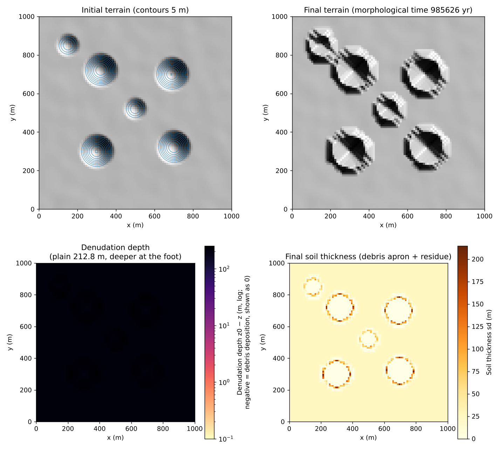
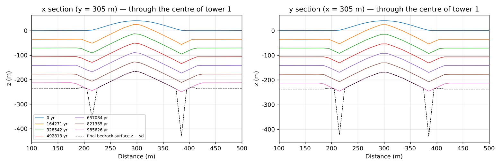
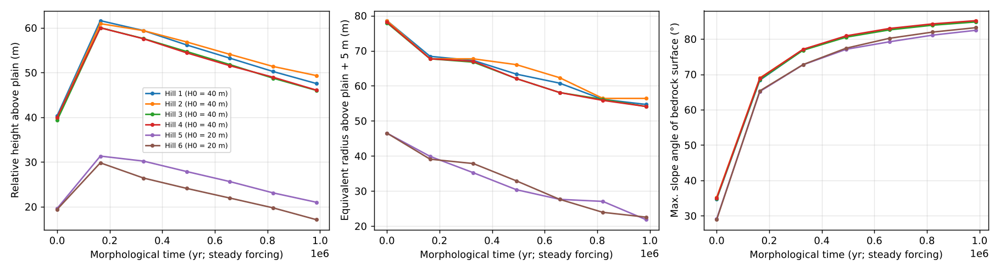
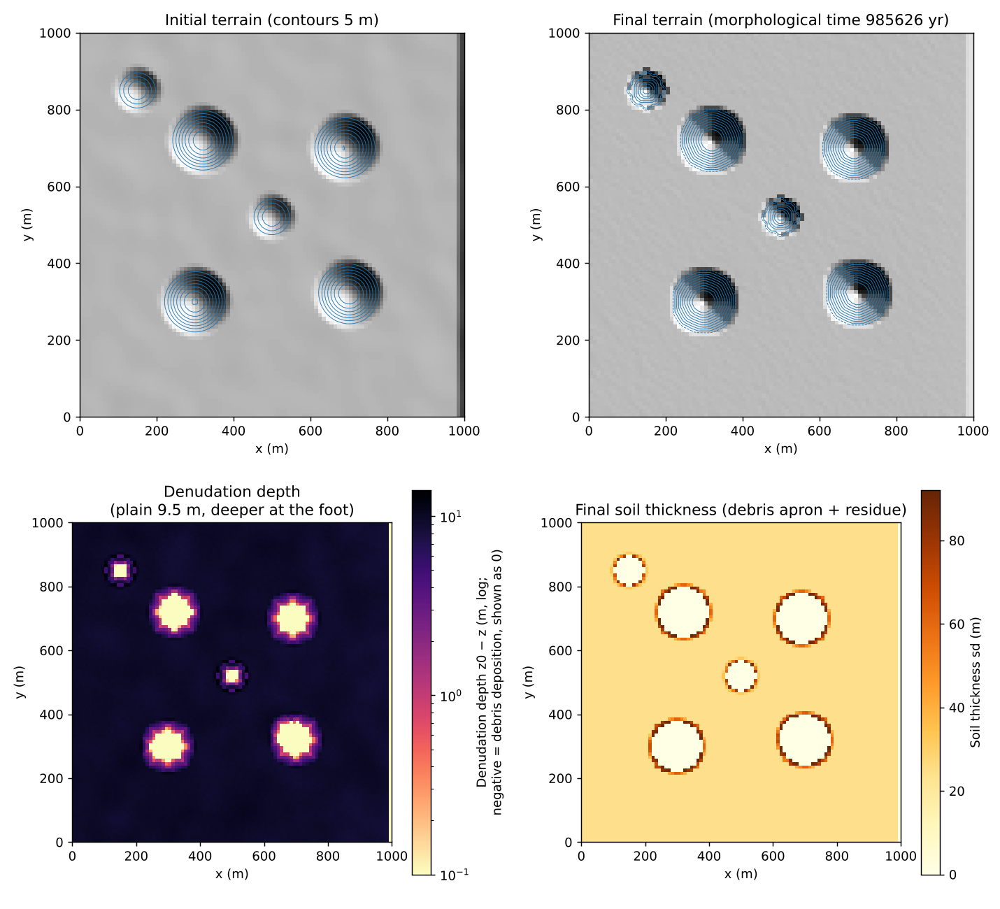
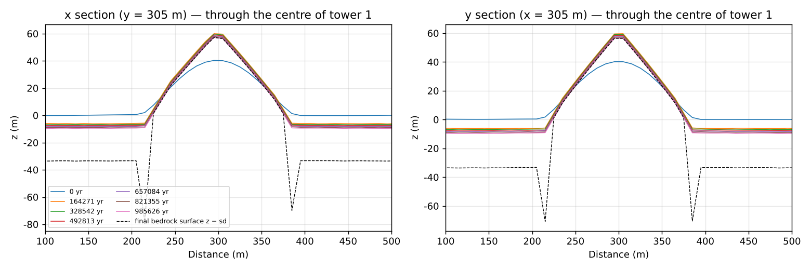
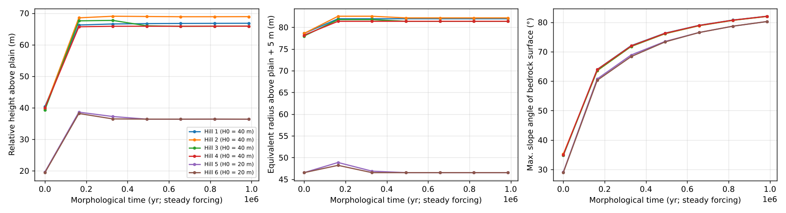

# tower_karst — bare-rock towers left on a plain (tower karst: differential dissolution and collapse at the feet)

> English mirror of examples/tower_karst/README.md. The Japanese file is the master copy.

[日本語](../README.md)

This example looks at how limestone towers (peak forest, fenglin) remain standing on a plain in
humid tropical karst, by superposing
[limestone dissolution](../../../docs/en/users_guide/geomorph.md#limestone-dissolution-f_dissol)
(f_dissol: diffuse dissolution by infiltrating water, dissolution of rock faces by runoff on bare
rock, and lateral dissolution of walls in contact with ponded water) and
[rockfall and talus](../../../docs/en/users_guide/geomorph.md#rockfall-and-talus-f_rockfall)
(f_rockfall; bedrock without soil also collapses). With only the difference that rain runs off
the bare-rock towers at once while the plain is covered by soil into which rain soaks, it looks
at whether the plain and the feet of the towers dissolve faster and the towers rise relative to
the plain. For the formation of a doline field see [karst](../../karst/en/README.md). The values
are schematic, chosen to show the style of formation, and do not reproduce the rates or forms of
real landforms. The figures of the results have Japanese labels (shared with the Japanese
version).

## What happens in real tower karst

- **Towers standing on a plain**: in humid tropical limestone regions, towers with steep walls
  stand in rows on a flat plain (Guilin in southern China is the classic example). It is thought
  that they often develop from peak clusters joined at their bases (fengcong) into peak forests
  isolated on a plain (fenglin) (Waltham 2008).
- **The plain and the feet dissolve fast**: the plain is covered by soil and alluvium, and
  aggressive water that has taken up carbon dioxide in the soil dissolves the plain and the feet
  of the towers. On bare-rock towers the rain runs off at once, and the rock faces dissolve little.
  The denudation rate is proportional to the amount of infiltrating water and how much it can
  dissolve, so it is large in the humid tropics, with much rain and abundant soil carbon dioxide
  (White 1984).
- **Notches at the feet and collapse**: the feet of the towers are dissolved near the water level
  of the plain into notches (foot caves), and the walls that lose their support collapse. Through
  repeated collapse the towers become thinner and lower while keeping steep walls (Ford and
  Williams 2007; Waltham 2008). The collapsed debris accumulates at the feet.

## Mechanisms needed for the reproduction


Schematic (vertical exaggeration). (a) Section of a tower and the plain: on a bare-rock tower,
almost all the rain runs off and gathers at the foot, and the rock face dissolves with only part
of the runoff. On the plain, water infiltrating through the soil dissolves the rock, and the foot,
where the tower water gathers, dissolves deeply into moats and holes. Water ponded at the foot
dissolves the rock wall (notch), and exposed walls above the critical height collapse into talus.
(b) The plain lowers fast and the tower tops lower slowly, so the relative height of the towers
grows.

| Real phenomenon | Mechanism in the model | Setting |
|---|---|---|
| Rain soaks in on the plain and runs off the bare-rock towers | Distribution of infiltration capacity (plain 40 mm/h, bare rock 1 mm/h) and of soil thickness (plain 1 m, bare rock 0.001 m) | `fn_gw_ksv = 'ksv.txt'`, `fn_sd = 'sd.txt'` |
| Infiltrating water dissolves limestone | Dissolution proportional to infiltration (c_eq = 300 mg/L → k_d = 1.2×10⁻⁴) | `f_dissol = 1`, `dissol_ceq` |
| Bare rock faces also dissolve a little | Dissolution by 0.3 × the runoff generated on bare rock (water flowing in from upstream is treated as saturated and not counted) | `dissol_src = 3`, `dissol_fsurf = 0.3`, `dissol_sdsurf` |
| The tower water gathers at the foot and dissolves it deeply | Water gathered at the foot by shallow-water flow soaks in and dissolves accordingly | (shallow-water flow and Green-Ampt) |
| Water ponded at the foot dissolves the wall (notch) | Lateral dissolution: the dissolving power of the pond is also distributed to wetted walls | `dissol_lat = -1` |
| Undercut walls collapse into talus | Rockfall and talus: the part of the drop to the lowest point within a window above H_c collapses, and bedrock without soil also collapses | `f_rockfall`, `rf_hc = 10`, `rf_rc = 10`, `rf_bedrock = 1` |
| Water disappearing underground (fracture networks) | Soil water drains at 20 mm/h to the conduit layer (a receptacle). No sinks | `gwc_leak_layer = 1`, `gwc_leak_mmh = 20`, `gwc_inlet = 0` |
| Residue remains as soil | 10 % of the dissolved rock volume stays in the soil | `dissol_fres = 0.1` |
| A long time | A representative storm is repeated on a daily cycle and only the landform change is accelerated by morfac | `t_cycle_c = "1d"`, `morfac = 5000` |

Without sinks, the intake of water is capped by the infiltration capacity, so the positive feedback
of [karst](../../karst/en/README.md), in which "water gathers into a depression and runs away within
a storm", is less likely. Still, the holes at the tower feet, where the gathered water soaks in, can
deepen by tens of centimetres in one storm, so morfac is kept at 5×10³ (see the notes).

## Geometry and settings


Left: initial terrain and tower numbers (inside the black line = bare rock; dashed = position of the
section). Upper middle: section through towers 1 and 2 (brown = soil). Lower middle: rain of one day
and infiltration capacities. Right: summary of the settings.

1000 m × 1000 m, Δx = 10 m (100 × 100 cells), closed walls on all four sides.

- **Terrain**: on a plain (z ≈ 0; undulation with a correlation length of ≈ 30 m and a standard
  deviation of 0.3 m), four bell-shaped hills (towers 1 to 4: 40 m high, radius 90 m) and two small
  hills (towers 5 and 6: 20 m high, radius 60 m) are placed. Cells with z > 5 m are bare rock.
- **Soil and infiltration**: the plain has soil 1 m (specific yield 0.2) and Green-Ampt 40 mm/h; bare
  rock has soil 0.001 m and 1 mm/h (`sd.txt`, `ksv.txt`). Soil water drains at 20 mm/h to the conduit
  layer (receptacle of the fracture network). There are no sinks.
- **Rain**: a representative storm of 40 mm/h × 1 hour, repeated on a daily cycle for 60 days.
- **Dissolution**: c_eq = 300 mg/L (water below the soil in the humid tropics), ρ_r = 2500 kg/m³ →
  k_d = 1.2×10⁻⁴. Infiltration + 0.3 × runoff on bare rock (`dissol_src = 3`), residue 0.1, automatic
  lateral dissolution (`dissol_lat = -1`).
- **Collapse**: critical height H_c = 10 m (half of a 20 m tower wall), window radius 10 m, angle of
  repose of talus 35°, half of the excess relaxed per update, bedrock also collapses
  (`rf_bedrock = 1`), cap of 1 m per edge and update.
- **Time**: dt = 2 s; the landform is updated every 10 minutes with morfac = 5×10³ (1 day = 5000
  storms; at 50 a year, 100 years). 60 days = landform time 6000 years. Output every 10 days. The run
  takes 1 to 2 hours (4 threads).

| Case | Settings file | Content | Run time (approx.) |
|---|---|---|---|
| Main case | param.txt | the settings above (dissolution + lateral dissolution + collapse) | 1 to 2 hours (4 threads) |

## How to run

```
cd examples/tower_karst
make                                        # link to the executable and inputs (make_terrain.py writes z.txt, sd.txt, ksv.txt)
make run                                    # main case (1 to 2 hours)
python3 plot_setup.py                       # figs/mechanism.png, setup.png (does not use the results)
python3 plot_results.py | tee analysis.txt  # figs/maps, sections, towers, hydrograph.png and the tables
python3 make_terrain.py --steady            # infiltration map ksv_steady.txt for the quasi-steady forcing (section "1 Myr" below)
./encflow param_steady.txt > Screen_steady.log          # 0.99 Myr with quasi-steady forcing (about 1 hour)
python3 plot_results.py param_steady.txt steady | tee analysis_steady.txt   # figs/*_steady.png
python3 make_terrain.py --steady --base     # inputs with the base level: z_base, gwc_bot, gwc_outfall, uplift, sol_base, ksv_base.txt (section "base level" below)
./encflow param_base.txt > Screen_base.log  # 0.99 Myr with a base level (water table) and uplift (about 3 hours on 4 threads)
python3 plot_results.py param_base.txt steady | tee analysis_base.txt       # figs/*_base.png
```

With the argument `en` the figures are drawn with English labels into en/figs/
(`python3 plot_setup.py en`, `python3 plot_results.py en`).

## Results


Upper left: initial terrain (contours every 5 m), upper right: final terrain (landform time 6000
years). Lower left: denudation depth z₀ − z (logarithmic; 1.3 m on the plain, deeper at the feet).
Lower right: final soil thickness (debris apron and residue).


Evolution of the x and y sections through the centre of tower 1 (dashed = final bedrock surface
z − sd).


Left: height relative to the plain, middle: equivalent radius of the part higher than the plain +
5 m, right: maximum slope angle of the bedrock surface (each tower).


Domain-mean ponding (blue) and groundwater storage (green) over the first 3 days (left) and the last
3 days (right).

Budget check (tables of `plot_results.py`; landform time 6000 years = 300,000 storms at 50 a year):

| Item | Value |
|---|---|
| Water balance | final S_total = 2.400 m = cumulative rain 40 mm × 60 days (mass conserved; near the end part of the ponding remains until the next day) |
| Dissolved rock (ledger) | 1 465 645 m³ (of which 2 153 m³ dissolved as talus) |
| Rock moved by collapse (ledger; bulk) | 2 440 m³ (45,000 edge updates). Final talus Σht Δx² = 30 m³ (up to 0.05 m; talus dissolves, developer.md §86.7) |
| Loss of surface volume | Σ(z₀ − z)Δx² = 1 319 080 m³ = dissolution × (1 − 0.1) = 1 319 080 m³ (all digits agree; collapse conserves volume and does not contribute) |
| Denudation of the plain (cells that did not pond) | median 1.30 m = 216 mm/kyr |
| Denudation of the feet (258 plain cells that ponded) | median 2.7 m, maximum 12.1 m |
| Soil (debris and residue) | plain 1.14 m (initially 1 m), bare-rock area 0.04 m (initially 0.001 m), up to 2.5 m (residue of the talus at the feet) |

| Landform time (years) | Plain (m) | Top height of towers 1–4 (m) | Relative height of towers 1–4 (m) | Relative height of small hills 5, 6 (m) | Maximum slope angle of the bedrock surface |
|---|---|---|---|---|---|
| 0 | 0.0 | 39.3–40.3 | 39.3–40.4 | 19.4–19.6 | 29–35° |
| 3000 | −0.67 | 39.1–40.2 | 39.8–40.8 | 19.9–20.1 | 36–39° |
| 6000 | −1.32 | 39.0–40.0 | 40.3–41.3 | 20.4–20.6 | 37–48° |

(The slope angles are the range over the six hills in the right panel of towers.png.)

- **Differential dissolution increases the relative height**: the plain is lowered uniformly at
  216 mm/kyr, while the tower tops are lowered by dissolution with runoff on bare rock (0.3 × runoff)
  at only 50 mm/kyr (0.3 m in 6000 years), so the relative height grows by the difference of 1.0 m.
  The equivalent radius hardly changes, and the changes of form concentrate at the feet.
- **Moats and holes at the feet**: the tower rain gathers into the lowest cells at the feet and soaks
  in, so the ring at the feet goes down twice as much as the plain (3 m), and a few cells with much
  inflow go down by 10 m or so (the black dots around the towers in the denudation map; the streaks
  along the valley lines of the plain undulation are paths along which water flowed and soaked in).
  They correspond to "sinks and foot caves at the base of towers" of real karst.
- **Steepening of the feet and collapse**: as the feet go down, the lower slopes steepen (maximum slope
  angle of the bedrock surface 35° → 37 to 48°). Collapse occurs only where the exposed face exceeds
  H_c = 10 m (walls of cells where the holes at the feet reached about 10 m); the moved rock is 0.2 % of
  the dissolution (2.4 thousand m³); the talus dissolves in the holes and does not remain (up to 0.05 m),
  leaving its residue in the soil. The tower walls have
  not retreated yet (in 6000 years the undercut at the feet is a few metres, and most of the walls are
  below H_c). With a smaller H_c or a longer landform time, the stage in which the walls collapse and
  retreat begins.
- **Ponding**: at first, the ponding just after each storm (3.5 mm domain mean) soaks in and disappears
  within a few hours. Near the end the ponding no longer disappears within a day, and about 7 mm
  (domain mean) remains before the next storm (apparently because the water in the deep holes at the
  feet cannot soak in within a day at an infiltration capacity of 40 mm/h).
- **The small hills** (20 m high) do not disappear in 6000 years either. The disappearance of towers and
  the transition from fengcong to fenglin need a landform time of tens of thousands of years, until the
  lowering of the plain reaches the tower heights (with morfac 5×10³, 1 day = 100 years, so chained
  restarts of 600 days = 60,000 years).

## Running 1 Myr with quasi-steady forcing (param_steady.txt)

The towers of Guilin stand 100 to 300 m above the plain; at a plain lowering of 100 to 200 mm/kyr
that takes of the order of 10⁶ years. In the main case the plain lowers only 1.3 m in 6000 years,
so as an attempt to extend the landform time by two orders of magnitude, the repeated storm is
replaced by **the annual mean rain of 2000 mm/yr = 0.228 mm/h given steadily, with morfac = 6×10⁶**
(60 days = 0.99 Myr). The positive feedback within a storm, where ponded water gathers and digs a
pit (the reason for the upper limit of morfac), disappears, dissolution becomes linear and local
again, and a large morfac is allowed. The infiltration capacity of bare rock is set to 0.0057 mm/h,
which gives the same annual infiltration fraction of 2.5 % under the mean rain as under the storms
(`make_terrain.py --steady`). What is lost is the ponding at the feet during storms (the notch of
lateral dissolution); what remains is the concentration of the tower runoff that gathers and
infiltrates at the feet, the surface source on the tower faces, and collapse. Safety valve
`dissol_dzmax = 0.3 m` (ten times the 0.027 m per update of the plain).

| Item | Value |
|---|---|
| Landform time | 985,626 years (60 days × 6×10⁶) |
| Lowering of the plain | median 212.8 m = 216 mm/kyr (the same rate as the main case, as it is linear) |
| Tower tops | 40 → −165 m (165 m lower; not the 70 mm/kyr of the surface source but consumption by collapse) |
| Height above the plain | 40 → 62 m (164 kyr) → 48 m (1 Myr). Equivalent radius 79 → 55 m, walls 35° → 85° |
| Foot pits | the surface is only 38 m below the plain, but the bedrock z − sd is at −463 m under 215 m of residue |
| Rock moved by collapse | 46.5 million m³ (19 % of the 240 million m³ dissolved), of which 22.5 million m³ dissolved as talus (almost no talus remains). Valve fired in 28,596 cell updates |





**What can be read off.** Numerically, a million years runs stably in an hour. The plain keeps
lowering at 216 mm/kyr, the relative height grows from 40 to 61 m in the first 164 kyr, so the
mechanism "the lowering plain leaves the towers standing" works. After that, however, the towers
are **consumed by collapse** and the relative height decreases. The cause is two gaps of the model
that the steady forcing lays bare, not the coefficients.

1. **Fallen limestone did not dissolve (fixed).** In the first trial floor dissolution still
   followed the rule "lower z, keep sd", so under the talus (sd, ht) piled at the feet only the
   bedrock kept dissolving and the column of talus sank immortal to 1.35 km. Limestone debris
   dissolves as fast as the bedrock, so the water of dissolution is now spent on the talus ht first
   and then on the bedrock (developer.md §86.7; the table above is the rerun). The talus now
   dissolves away, but its residue (insoluble, residue fraction 0.1) piles up 215 m in the foot
   cells and the bedrock below keeps dissolving at the valve's 0.3 m per update, so the "conveyor"
   into which the tower collapses remains (bedrock surface at −463 m, dashed line in the sections).
   The root cause is item 2.
2. **No base level (water table) at the feet.** The conduit layer is a sink 1000 m deep with a
   capacity of 2000 m, so the foot pits have no bottom. The feet of real towers stand at the water
   table, which is the base level of the rivers; the pits stop at the water surface and dissolution
   turns sideways into the foot notches and caves. That is the fenglin mechanism itself. Fixing the
   water table with an outfall head and raising the land against it by uplift (`f_uplift`) is the
   configuration param_base.txt (next section).

In addition, whereas the ponding at the feet spread over 261 cells under the repeated storms, the
thin steady film gathers all of it into the few lowest cells of each tower, which makes the
concentration at the feet extreme (a side effect of the steady forcing).

## Base level (water table) and uplift (param_base.txt)

This configuration supplies item 2 of the previous section (no base level at the feet). The
easternmost column becomes the river of the base level (z = −5 m; insoluble and impermeable, with
free outflow on the eastern edge), the conduit layer is given lateral conductance (linear law,
0.05 m²/s) and an outfall in the river column (orifice Cd·A = 0.15 m²), and the bottom of the head
is a map at the absolute elevation −45 m (`fn_gwc_bot`) so that the initial water table lies at the
river level of −5 m (`make_terrain.py --steady --base`). The land other than the river is uplifted
by `f_uplift` at 0.2 mm/yr (200 mm/kyr), and the water of dissolution is the "recharge to the rock"
`dissol_src = 5` (soil → conduit-layer exchange + 0.3 × the runoff of bare rock; developer.md §86.8),
because with the infiltration-based source the soil layer thickened by residue takes up morfac times
the infiltration and the pits have no bottom (the first production run diverged at 120 kyr).
Everything else is as in param_steady.txt.

| Item | Value |
|---|---|
| Landform time | 985,626 years (60 days × 6×10⁶). Uplift 200 m |
| Plain | dissolution 209.5 m (213 mm/kyr) − uplift 200 m = net lowering 9.5 m (median). Residue soil 1 → 24 m, median bedrock surface −33 m |
| Tower tops | 40.3 → 57.3 to 59.4 m (uplift 200 m − lowering 181 to 183 m). 80 mm/kyr in the first 164 kyr, then the same rate as the plain |
| Height above the plain | 40 → 66 to 69 m (reached at 164 kyr, constant afterwards; the small hills 20 → 36 m). Equivalent radius 79 → 82 m (unchanged) |
| Tower shape | paraboloid hill → cone of 37 to 41° (close to the talus angle of repose 35°). The maximum bedrock slope of 82° is the wall of the foot pits |
| Foot pits | the surface is at about the plain level (buried in residue; sd up to 92 m); the bedrock surface is at −94 m |
| Water table | −5 → −7.8 to −9.5 m (outfall discharge 0 m³; the residue soil soaks up the conduit water) |
| Rock moved by collapse | 32.2 million m³ (14 % of the 226 million m³ dissolved), of which 17.7 million m³ dissolved as talus (5,000 m³ of talus remains). Valve fired in 6.5 million cell updates (750 cells per update on average: the feet and the flow paths) |





**What can be read off.** With uplift the towers are not consumed: they survive the million years as
cones 66 to 69 m high and 82 m in radius (in the previous section the height kept falling to 48 m).
The plain dissolves at 213 mm/kyr by the recharge under the soil (all of the rain), which almost
balances the uplift of 200 mm/kyr; the towers go down at the rate of the surface source (80 mm/kyr
≈ 2.5 % infiltration + 0.3 × runoff) only during the first 164 kyr, gaining relative height, and
afterwards their feet are cut by the concentrated dissolution at the feet (the valve fires in 750
cells per update on average) and they go down at the same rate as the plain, collapsing into cones
at the angle of repose of the talus. There are two stages: relative height grows as "lowering of the
plain − lowering of the towers", then collapse makes the towers follow the plain. They do not become
vertical-walled pillars like those of Guilin. The wall form is set by `rf_hc` (critical height 10 m
= weak rock that fails at a one-cell drop), so with the 50 to 100 m of massive limestone walls that
stand without failing should appear (not computed; see "Starting points for sensitivity
experiments").

**What did not work.**

1. **The water table was not held at the river.** The outfall has a flap and discharges only while
   the conduit head is above the river water surface, so it does nothing unless the head rises above
   −5 m. In fact one tenth of the dissolved rock becomes residue soil (24 m on the plain, 92 m at the
   feet), whose storage soaks up the conduit water, and the head fell to −9.5 m. This is a side
   effect of the quasi-steady acceleration: with morfac the conversion of rock into soil runs 20
   times faster than the recharge in hydraulic time (the rain cannot fill the storage created by
   dissolution); it disappears with a residue fraction `dissol_fres = 0` (not computed).
2. **Dissolution of the plain continues regardless of the water table.** The recharge source is
   proportional to the soil → conduit-layer exchange and dissolves the bedrock even where its surface
   is below the water table (24 m below on the plain). There is no mechanism "no dissolution in the
   saturated zone (the corrosion plain stops at the water table)", and the expectation that the plain
   clings to the base level is realised only through the balance of uplift and dissolution rate
   (213 against 200 mm/kyr).
3. **The residue is not carried away.** On real corrosion plains the rivers remove the residue, but
   bedload and suspended load are not enabled here, so 24 m pile up on the plain and the surface
   (−9.5 m) ends below the river (−5 m) (there is no ponding, because the surface water infiltrates
   into the soil and disappears).
4. **The foot pits are merely filled.** The bedrock pits (−94 m) are filled with 92 m of residue and
   the surface is at the plain level, but the notches of lateral dissolution (ponding at the feet)
   do not form under the thin steady film (as in the previous section).

## What this model cannot represent (differences from the real phenomenon)

- **Collapse is an instantaneous relaxation**: collapse is an instantaneous relaxation set by the
  critical height `rf_hc` (not a rate law), and the talus spreads at the angle of repose `rf_phi`. The
  debris remains at the feet as talus and soil and does not move except by the angle of repose of the
  talus unless creep or bedload is switched on (not in this example).
- **Dissolution along flow paths is not represented**: dissolution of the tower rock faces uses only 0.3
  times the dissolving power of the runoff generated on that face. Water flowing in from upstream is
  treated as saturated and not counted, so the concentration of dissolution along flow paths (solution
  runnels, karren) is not represented.
- **Wall retreat is not yet visible**: the notches at the feet act only while the feet are ponded just
  after storms, because lateral dissolution acts on "walls in contact with ponded water". In this
  6000-year run no wall retreat is seen; the holes at the feet and the debris are the main changes. To
  see the towers retreat, extend the landform time by 10 times or more.
- **Caves have no shape**: the conduit layer is a receptacle for water that disappeared underground; the
  shapes of foot caves and underground drainage are not treated.
- **The coefficients are not calibrated**: c_eq = 300 mg/L is on the high side for water below the soil
  in the humid tropics, and the denudation of the plain (216 mm/kyr) is on the large side for tropical
  karst. The landform time uses the conversion "one daily cycle = one representative storm, 50 a year".

## Notes

- **Upper limit of morfac**: looser than with sinks ([karst](../../karst/en/README.md)) but not unlimited.
  The holes at the feet deepen by tens of centimetres in one storm (infiltration at 40 mm/h × duration of
  ponding), so with 10⁴ the flow broke down once the steps of the holes reached 9 m (stable with 5×10³).
- **Collapse of bedrock**: the towers are bedrock without soil, so `rf_bedrock = 1` is needed (with the
  default 0, cells with soil of 0 or less do not collapse).
- **Closed walls**: water on the plain disappears only by infiltration. For a plain that drains quickly
  (lateral groundwater flow or rivers), add lateral flow or outfalls.
- Verification: [test/dissol](../../../test/dissol/en/README.md) (comparison of dissolution with the
  analytical solution), [test/rockfall](../../../test/rockfall/en/README.md) (rockfall and talus,
  including the bedrock version).

## Starting points for sensitivity experiments

- `rf_hc` (critical height) and `rf_rc` (window): how the walls collapse. A smaller H_c brings on the
  stage in which the walls collapse and retreat sooner.
- `dissol_ceq`: rate of dissolution. `dissol_fsurf`: rate at which the tower tops go down (how fast the
  relative height grows).
- `KSV_PLAIN`, `KSV_ROCK`, `SD_PLAIN` in make_terrain.py, which writes ksv.txt and sd.txt: how water is
  divided between the plain and the towers.
- `tt_c` and chained restarts: landform time (tens of thousands of years for tower retreat and
  disappearance). For a million years use the quasi-steady forcing (param_steady.txt, section above).
- `rf_hc` of 50 to 100 m (massive limestone) in param_base.txt (base level and uplift): whether walls that
  stand without failing appear instead of cones at the angle of repose of the talus. `dissol_fres = 0`:
  isolates the side effect of the residue soil lowering the water table. `uplift0`: the balance of uplift
  and the dissolution of the plain (213 mm/kyr).

## References

- Ford, D. and Williams, P. (2007): *Karst Hydrogeology and Geomorphology*. John Wiley & Sons,
  Chichester.
- Waltham, T. (2008): Fengcong, fenglin, cone karst and tower karst. *Cave and Karst Science*, 35(3),
  77–88. (checked against the abstract)
- White, W. B. (1984): Rate processes: chemical kinetics and karst landform development. In: La Fleur,
  R. G. (ed.) *Groundwater as a Geomorphic Agent*, Allen & Unwin, 227–248.
