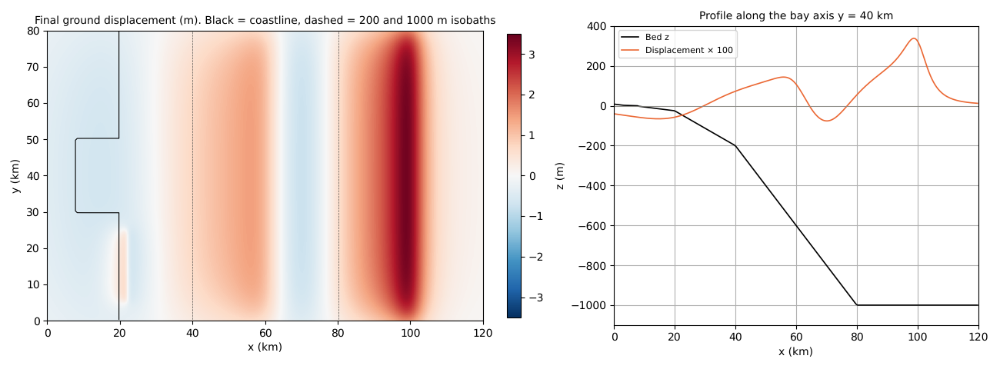
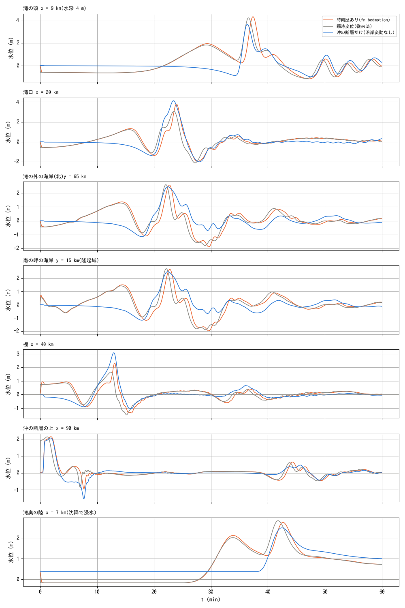
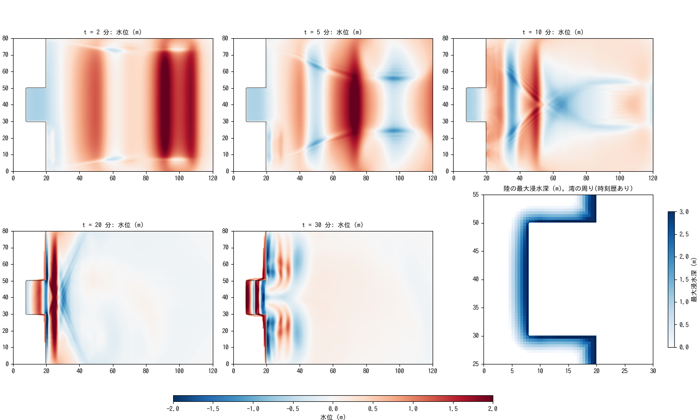

# tsunami_coast — coastal subsidence and uplift versus the offshore fault tsunami, with their time lag (fn_bedmotion)

> English mirror of examples/tsunami_coast/README.md. The Japanese file is the master copy.

[日本語](../README.md)

The ground deformation of a fault reaches not only the offshore seabed but also
the coast and the land. In the Tohoku-oki earthquake the coast subsided by
0.5–1 m, and in the Kanto earthquake the Sagami Bay coast was uplifted by 1–2 m.
[fn_bedmotion](../../../docs/en/users_guide/bedmotion.md) moves the bed
elevation z as a time history without distinguishing land from sea (the water
column h is unchanged and the water surface moves together with the bed), so
**the positive wave heading into the subsided area, the wave spreading from the
uplifted area and the flooding of the subsided plain** are computed in the same
run as the tsunami from the offshore fault. This example compares three cases
on an idealised coast with a bay. No code changes (settings only).

## Setup

- Domain 120 km × 80 km, Δx = Δy = 500 m. Land to the west (coastline at
  x = 20 km); at y = 30–50 km a bay 12 km deep (head at x = 8 km; depth
  2 → 25 m). A shelf (25 → 200 m, x = 20–40 km) and a slope (→ 1000 m at
  x = 80 km). The land is a coastal plain of 0.5 m/km for 5 km from the
  waterline (with 0.6 m of subsidence, 1.2 km goes below sea level). East,
  north and south are long-wave radiation boundaries; the "solved sea"
  configuration (f_htype=2, still-water level 0).
- Faults ([fault2disp_all.txt](../fault2disp_all.txt) → bm/; strike N–S, dipping west):

| Segment | Position and geometry | Slip | Time | Effect |
|---|---|---|---|---|
| 1 deep (beneath the coast) | upper edge x = 60 km, depth 8 km; width 40 km; dip 20° | 5 m | t = 0, 20 s | coast to bay subsides 0.5–0.6 m; the outer shelf (x ≈ 40–60 km) is uplifted 0.7–1.4 m |
| 2 shallow (offshore) | upper edge x = 100 km, depth 5 km; width 30 km; dip 15° | 8 m | t = 30 s, 20 s | main tsunami (3.4 m uplift offshore, −1.4 m subsidence) |
| 3 splay fault (south of the bay mouth) | upper edge x = 22 km, y = 15 km, depth 1 km; width 8 km; dip 60° | 2 m | t = 0, 10 s | the cape and the surrounding shelf are uplifted 0.5–0.8 m |

| Case | Settings | Meaning |
|---|---|---|
| With time history | param_full.txt (bm/bmlist.txt; 11 snapshots at 5 s intervals) | the intended use of fn_bedmotion |
| Instantaneous displacement | param_inst.txt (the final displacement at t = 0) | the same as the conventional "shift the initial water level and bed to their post-event values" |
| Offshore fault only | param_offshore.txt (bm_off/; segment 2 only) | the case where the coastal ground deformation is ignored |

```
make                        # links, z.txt, bm/ (fault2disp), bm_off/
./encflow param_full.txt    # 20 s each (gfortran, 4 threads; dt = 1.5 s, 60 min)
./encflow param_inst.txt
./encflow param_offshore.txt
python3 plot_results.py     # figs/*.png and tables
```

## Results







| Probe | With time history: arrival (min) / max / min (m) | Instantaneous displacement: arrival / max / min | Offshore fault only: arrival / max / min |
|---|---:|---:|---:|
| Bay head x = 9 km (depth 4 m) | 18.2 / 4.29 / -1.16 | 18.1 / 4.19 / -1.14 | 25.1 / 3.63 / -0.98 |
| Bay mouth x = 20 km | 4.0 / 3.78 / -1.96 | 3.8 / 3.05 / -2.11 | 12.0 / 4.12 / -2.01 |
| Coast outside the bay (north) y = 65 km | 2.7 / 2.58 / -1.89 | 2.6 / 2.61 / -1.79 | 10.1 / 2.46 / -1.15 |
| Coast of the southern cape y = 15 km (uplifted area) | 0.5 / 2.68 / -1.98 | 0.5 / 2.73 / -1.89 | 10.1 / 2.51 / -1.17 |
| Shelf x = 40 km | 3.3 / 2.33 / -1.36 | 3.8 / 1.66 / -1.50 | 3.8 / 3.09 / -1.05 |
| Above the offshore fault x = 90 km | 1.4 / 2.14 / -0.94 | 0.8 / 2.13 / -0.88 | 1.5 / 2.07 / -1.53 |
| Land at the bay head x = 7 km (flooded by subsidence) | 27.5 / 2.76 / -0.18 | 27.4 / 2.84 / -0.18 | 38.9 / 2.49 / 0.37 |

Arrival = the time at which the change in depth exceeds 0.1 m (motion together
with the bed does not change the depth, so only the waves and the inflow are
picked up; at the land probe, the start of flooding). The maximum flood depth on
the land at the bay head is 2.94 m with time history, 3.02 m instantaneous and
2.12 m offshore only. The flooded land area is 301 / 299 / 266 km² (recomputed on
2026-10-31 with the default f_opening_dynamic = 3; developer.md §68.41).

- **With the coastal deformation included, the disturbance at the coast starts
  10 minutes earlier.** With the offshore fault only, the arrival at the coast
  takes 10 min (bay mouth 12 min, bay head 25 min), but when the subsidence
  beneath the coast and the uplift of the outer shelf occur at t = 0, the water
  level starts moving at 2.6–2.7 min on the coast and from 0.5 min at the cape
  (uplifted area). In the probe time series (bay head, bay mouth, coast), the
  first slow positive wave (1–1.5 m, 10–15 min) is the inflow into the subsided
  area and the wave from the uplift of the shelf, and the sharp wave at 20–25 min
  that follows is the tsunami from the offshore fault.
- **Flooding of the subsided plain**: at the bay head the water surface first
  drops with the subsidence (−0.6 m), and its recovery by inflow from the
  surroundings becomes a positive wave as it is. The land at the bay head floods
  from 27.5 min (38.9 min with the offshore fault only), with a maximum flood
  depth of 3.0 m (2.1 m offshore only). The subsided land remains under water
  after the tsunami has receded (depth 0.7 m at 60 min; the difference from the
  1.0 m residual with the offshore fault only is the difference in bed elevation).
- **Response inside the bay**: the inflow into the subsided area and the
  offshore tsunami overlap inside the bay, and the maximum level at the bay head
  is 4.3 m (3.6 m offshore only). At the bay mouth the time-history case gives
  3.78 m against 3.05 m for the instantaneous displacement (+24%), and on the
  shelf 2.33 m against 1.66 m (+40%): **even a time lag of about 50 seconds
  changes how the waves overlap**. This is because the phase difference between
  the waves of the deep segment (t = 0) and the shallow segment (t = 30 s)
  interferes on the shelf. The instantaneous displacement (the conventional
  method) roughly reproduces the arrival times and the overall amplitudes, but
  the details of the near-field waveforms depend on the time lag.
- The uplift of the cape (segment 3) emits a local positive wave at 0.5 min,
  which becomes the first wave on the southern coast (a 1.5 m rise after a
  −0.6 m drawdown).

## Notes

- Cells in the sea mask (sw > 0) do not move their bed, so the tsunami
  computation uses the "solved sea" configuration (f_htype=2).
- The inflow into the subsided area appears as a recovery of the water level
  over several minutes rather than as a "wave". It changes greatly with the
  coastal topography (levees, river mouths, slope of the plain) and the grid
  resolution.
- The time history of the displacement model (t_r and the rise of each segment)
  is often poorly known for real earthquakes and is an assumption here.
- The spatial scale of the deformation (tens of km) is much longer than the
  depth, so the hydrostatic approximation suffices. In the near field of short
  displacements (splay faults, submarine landslides) use the non-hydrostatic
  f_nh_bottom.
