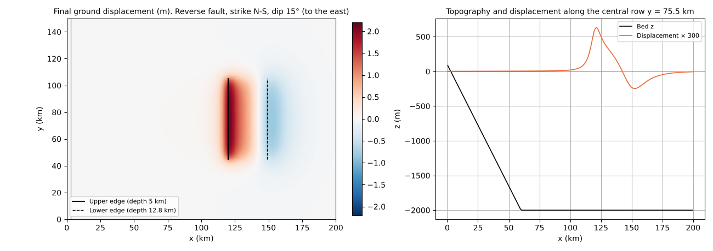
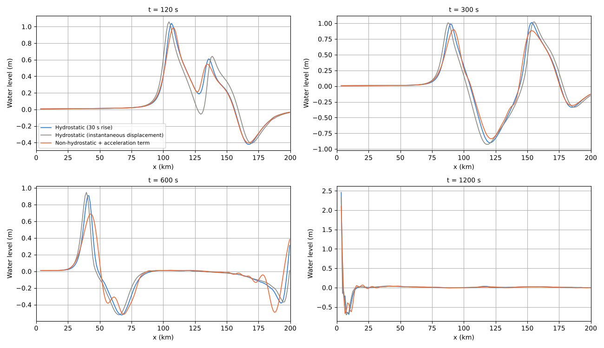
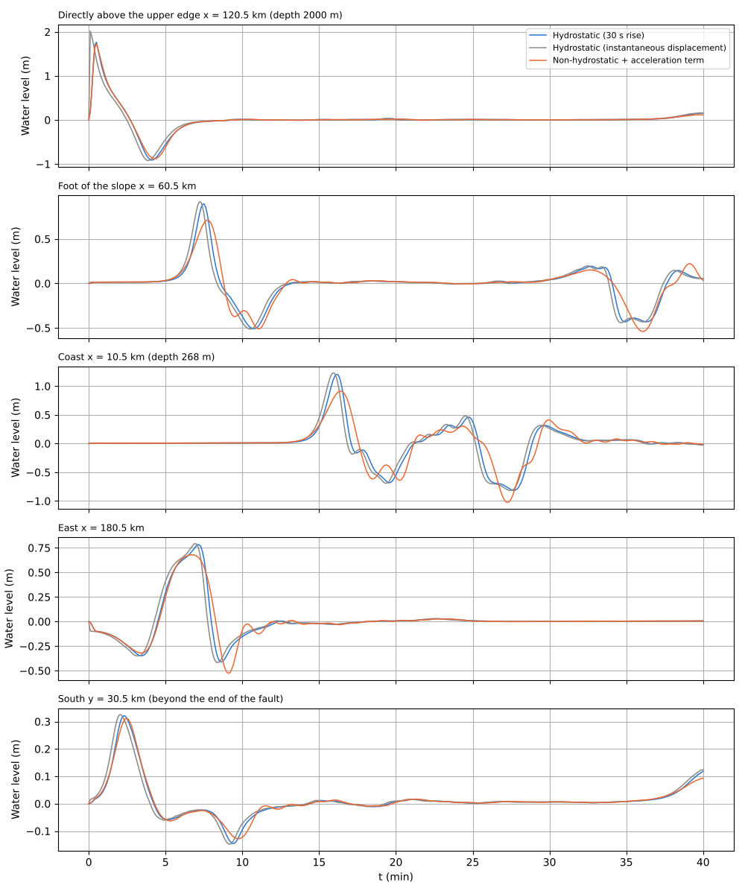

# tsunami_fault — generating a tsunami from fault parameters (fn_bedmotion + utils/fault2disp)

> English mirror of examples/tsunami_fault/README.md. The Japanese file is the master copy.

[日本語](../README.md)

An example in which the ground displacement of an idealised reverse fault is
computed with [utils/fault2disp](../../../utils/fault2disp/README.en.md)
(Okada 1985) and [prescribed bed motion fn_bedmotion](../../../docs/en/users_guide/bedmotion.md)
moves the bed elevation z as a time history to generate, propagate and run up a
tsunami. No code changes (settings only). Three cases are compared:
hydrostatic / instantaneous displacement / non-hydrostatic + acceleration term.

## Setup

- Domain 200 km × 150 km, Δx = Δy = 1 km. For x ≥ 60 km a flat sea 2000 m
  deep; for x < 60 km a uniform slope toward the coast (+100 m at x = 0;
  shoreline at x ≈ 2.9 km). The west edge is land (a wall); east, north and
  south are long-wave radiation boundaries. The "solved sea" configuration
  (f_htype=2, still-water level e0 = 0).
- Fault (fault2disp.txt): strike N–S (upper-edge centre x = 120 km, y = 75 km),
  dip 15° (descending to the east), length 60 km, width 30 km, upper-edge depth
  5 km, slip 5 m, reverse (rake 90°), half-sine rise over 30 s from t = 0. The
  final displacement has a maximum uplift of 2.10 m (x ≈ 121 km, directly above
  the upper edge) and a maximum subsidence of −0.82 m (x ≈ 152 km, beyond the
  lower edge). Snapshots: 11 at 3 s intervals (bm/).

```
make                        # link to encflow, z.txt, bm/ (runs fault2disp)
./encflow param_h.txt       # hydrostatic (30 s rise)
./encflow param_inst.txt    # hydrostatic, the final displacement applied instantaneously at t = 0 (equivalent to the initial-water-level method)
./encflow param_nh.txt      # non-hydrostatic (f_nonhydrostatic=1) + acceleration term of the moving bed (f_nh_bottom=1)
python3 plot_results.py     # figs/*.png and tables
```

Computation time: hydrostatic 8 s, non-hydrostatic 22 s (gfortran, 4 threads; dt = 2 s, 40 min).

## Results







| Probe | Hydrostatic (30 s rise) max (m) / arrival (s) / min (m) | Hydrostatic (instantaneous displacement) max (m) / arrival (s) / min (m) | Non-hydrostatic + acceleration term max (m) / arrival (s) / min (m) |
|---|---:|---:|---:|
| Directly above the upper edge x = 120.5 km (depth 2000 m) | 1.768 / 30 / -0.912 | 2.022 / 6 / -0.922 | 1.732 / 30 / -0.882 |
| Foot of the slope x = 60.5 km | 0.896 / 450 / -0.509 | 0.918 / 432 / -0.513 | 0.712 / 462 / -0.536 |
| Coast x = 10.5 km (depth 268 m) | 1.220 / 972 / -0.898 | 1.248 / 960 / -0.906 | 0.924 / 990 / -1.003 |
| East x = 180.5 km | 0.781 / 426 / -0.411 | 0.791 / 414 / -0.418 | 0.679 / 402 / -0.527 |
| South y = 30.5 km (beyond the end of the fault) | 0.322 / 138 / -0.145 | 0.325 / 126 / -0.148 | 0.311 / 150 / -0.127 |

- **The effect of the rise time** is small. With 30 s (shorter than the time
  for the wave to cross the fault width, 30 km / 140 m/s ≈ 210 s), apart from
  the maximum water level directly above the source going from 2.02 to 1.77 m,
  the wave heights after propagation differ by 2–3% and the arrivals are delayed
  by 12–18 s (the centroid of the rise). The single snapshot of the
  instantaneous displacement gives the same result as the conventional way of
  prescribing "initial water level = ground displacement".
- **Non-hydrostatic**: the 30 km wide uplift and the roughly 15 km wide
  subsidence have kH ≈ 0.4–0.8 for a depth of 2000 m, so the dispersion of the
  one-layer NH model (ω² = gHk²/(1 + k²H²/4)) disperses the wave during
  propagation and a train of undulations follows the leading wave. The leading
  wave height goes from 0.90 to 0.71 m at the foot of the slope (−20%), from
  1.22 to 0.92 m at the coast (−24%) and from 0.78 to 0.68 m in the east
  (−13%). The contribution of the acceleration term (the one-layer
  approximation of the Kajiura filter) is 1.77 → 1.73 m directly above the
  source (−2%; kH is small, so F ≈ 1), and most of the difference comes from
  the dispersion during propagation. For a source of this size the hydrostatic
  (non-dispersive) model errs on the side of overestimating the coastal wave
  heights by 20–30% (long-wave dispersion is a known property of tsunamis in
  the far field and from short sources). The CG iterations average 216 per step
  (27,000 cells in the whole domain).
- At the southern point (beyond the end of the fault) the three cases differ by
  less than 4%.

## Giving the fault in longitude/latitude (fault2disp_ll.txt)

With `f_lonlat = 1` the fault position is given in longitude and latitude,
converted to grid coordinates by a transverse Mercator projection (UTM and the
Japanese plane rectangular coordinate system are special cases; origin, scale
factor and false easting/northing in the namelist), and the strike is corrected
to grid north for the meridian convergence. fault2disp_ll.txt is an example that
places the lower-left corner of the grid at (140.0°E, 34.0°N) and the upper-edge
centre at (141.30°E, 34.68°N) in a projection with central meridian 141°E and
origin latitude 34°N; running it prints the conversion result (x_ll ≈ −92.4 km,
upper-edge centre x ≈ 27.5 km = 119.9 km within the grid, convergence +0.17°).

## Georeferencing and the plane rectangular coordinate system (fault2disp_bil.txt, fault2disp_jpr.txt)

`make inputs` also builds the bil+hdr version z.bil / z.hdr from z.txt.
fault2disp_bil.txt gives only fn_z = 'z.bil' (f_input_mode = 2) and takes the
grid (nx, ny, dx, dy, x_ll, y_ll) from the georeferencing in the hdr (the
u_h·∇z term is also added). fault2disp_jpr.txt is an example with f_jpr = 1
that writes the upper-edge centre in the order (X northing, Y easting); it
gives the same displacement as fault2disp.txt. In a georeferenced analysis
x_ll, y_ll (= the origin of the projected coordinate system) are taken from the
file, so the fault position can be written in the absolute coordinates of the
plane rectangular system. For GeoTIFF, result_gtif/Z0000.tif produced by
param_gtif.txt (a 2 s run that reads the bil and writes Z0000.tif with
f_output_mode = 4) is read by fault2disp_gtif.txt (f_input_mode = 4) and
agrees likewise.

## Usage notes

- A real fault is given by the segment table in fault2disp.txt (≤ 50).
  Positions are in the projected coordinates of the grid (m); conversion from
  longitude/latitude is up to the user. Delayed rupture is t_r(k); the rise of
  each segment is t_rise(k) and f_rise(k).
- For a fault above steep seabed topography, give fn_z to add the contribution
  of the horizontal displacement u_h·∇z (Tanioka & Satake 1996).
- A submarine landslide triggered by the earthquake can be placed in the same
  run with f_bedslide (fn_bedmotion is applied incrementally;
  docs/users_guide/bedmotion.md).
