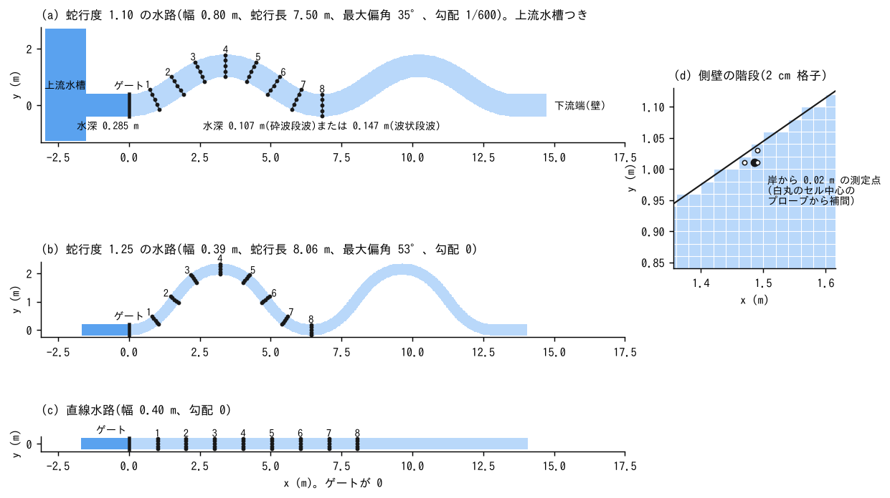
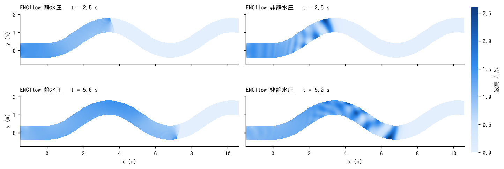
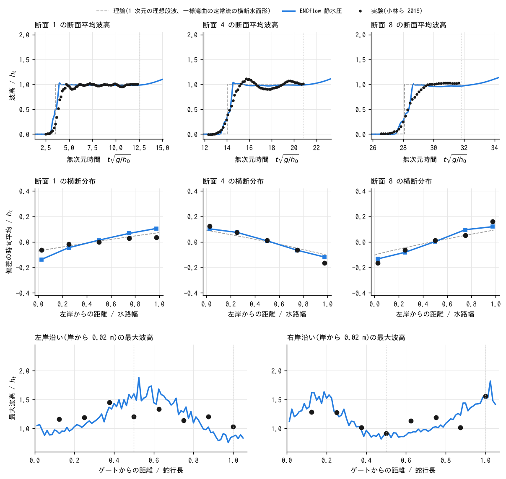
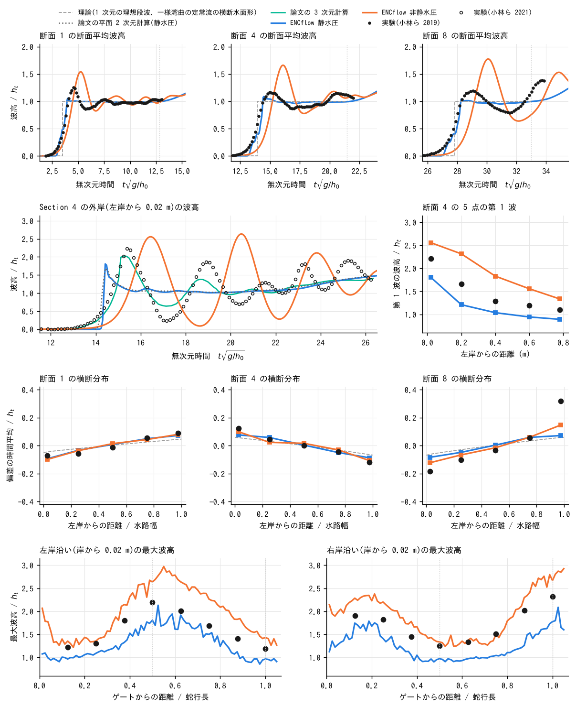
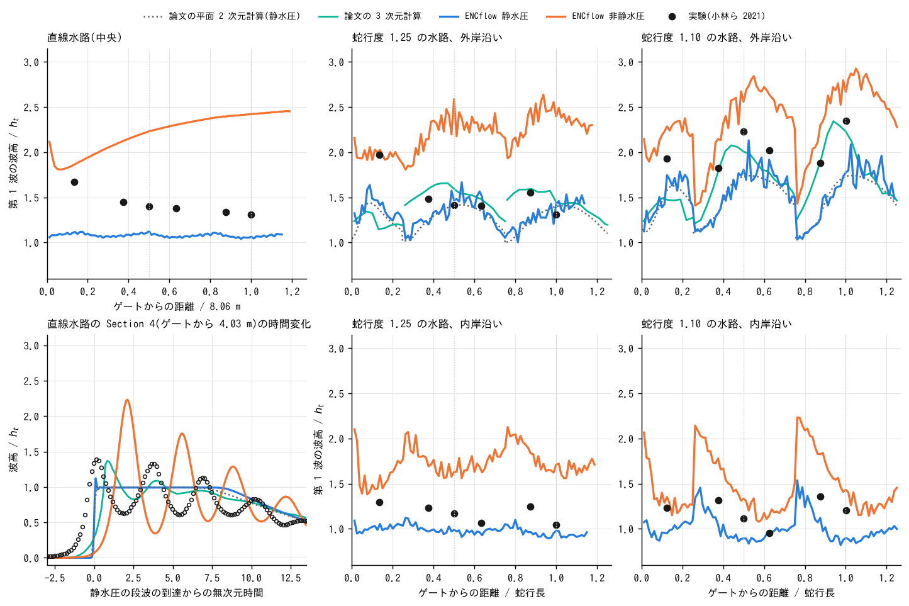
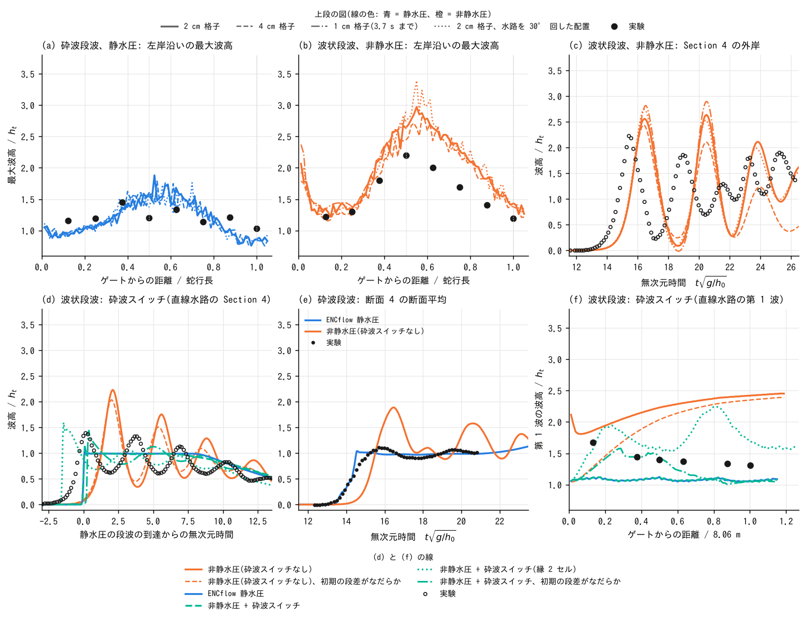

# tsunami_meander — 蛇行水路を進む段波の水理実験(小林ら 2019・2021)を静水圧・非静水圧で計算し、計測と比べる

[English](en/README.md)

河川を遡上する津波を模した水理実験を計算し、計測と比べる例題です。広島大学の小林ら(2019・2021)は、ゲートを
急開して作った段波を蛇行水路に進ませ、岸沿いの波高の時間変化を測りました。段波は、先端が砕ける**砕波段波**と、
先端がソリトン分裂の波列になる**波状段波**の 2 種類です。この例題は、蛇行度 1.10・蛇行度 1.25 の蛇行水路と
直線水路を 2 cm の直交格子に載せ(側壁は格子の階段)、ENCflow の静水圧の計算(浅水流方程式)と 1 層非静水圧
補正の計算で段波を進ませて、論文の図から読み取った波高と比べます。

**結果の要約**(波高は、理論の段波波高を 1 とする比):

- **砕波段波(段波のフルード数 1.53)は、静水圧の計算で合います。** 断面平均の波高は計測と 4 % 以内、到達時刻は
  無次元時間 0.2(0.03 秒)以内で合い、湾曲部の横断方向の水面の傾きは向きが合って、湾曲の頂点で計測の 7〜8 割
  です。両岸の最大波高は、外岸で平均 0.16 大きく、内岸で 0.14 小さく出ます。
- **波状段波(フルード数 1.32)は、どちらの計算も定量的には合いません。** 静水圧の計算は波列を作らず、外岸の
  第 1 波(計測 1.8〜2.4)を平均 0.4 小さく計算します。1 層非静水圧の計算は波列を作り、周期も計測に近い
  (無次元時間 4.05 と 3.52)ものの、第 1 波を平均 0.4 大きく、到達を 0.2 秒遅く計算します。直線水路では、計測の
  第 1 波が進むにつれて 1.67 から 1.31 へ下がるのに、計算では 1.85 から 2.42 へ育ちます。計測の波状段波は第 1 波が
  砕け始める領域にあり、1 層非静水圧補正には、分散を保ったまま砕波で波を減衰させる仕組みがないためです。
- **計測値は、2 つの計算の間に入ります。** 静水圧の計算 ≤ 計測 ≤ 非静水圧の計算が、3 つの水路の第 1 波の波高の
  30 点のうち 27 点、蛇行度 1.10 の水路の両岸の最大波高の 16 点のうち 15 点で成り立ちます。
- **水路の形による違いは、静水圧の計算に出ます。** 計測の外岸の第 1 波は、直線水路に対して、蛇行度 1.10(幅が
  広い)の水路で 1.43 倍、蛇行度 1.25(幅が狭い)の水路で 1.07 倍です(6 断面の平均)。静水圧の計算では、段波の
  先端が外岸に斜めに当たってできる高まりが、同じ計算の直線水路の 1.51 倍と 1.28 倍になり、水路による違いが
  出ます(蛇行度 1.25 では大きすぎる)。非静水圧の計算は 1.10 倍と 1.04 倍で、違いがほとんど出ません。

段波のフルード数が 1.3 を超える所では、ENCflow の 1 層非静水圧補正は第 1 波の波高の上限の目安にしかならず、
平均の波高・到達時刻・湾曲部の水位差は静水圧の計算で足ります。これがこの例題の結論です(理由と、ほかの限界は
「このモデルで表せないこと・精度の限界」)。



## 実験とデータ

- **水路**: 蛇行水路の中心線は sine-generated curve θ = θmax sin(2π s / Lm)(s は中心線に沿う距離、θ は水路の
  軸からの偏角)で、蛇行は 2 波長です。断面は矩形です。

  | 水路 | 幅 B (m) | 蛇行長 Lm (m) | 最大偏角 θmax | 蛇行度 | B / Lm | 勾配 | ゲートの上流 |
  |---|---|---|---|---|---|---|---|
  | 蛇行度 1.10 | 0.80 | 7.50 | 35° | 1.10 | 0.11 | 1/600 | 直線部 1.50 m の先に上流水槽(1.45 m × 3.96 m) |
  | 蛇行度 1.25 | 0.39 | 8.06 | 53° | 1.25 | 0.048 | 0 | 直線部 1.66 m(上流端は壁) |
  | 直線 | 0.40 | — | — | 1.00 | — | 0 | 直線部 1.68 m(上流端は壁) |

- **段波**: 蛇行の始点に置いたゲートの上流に水深 h0 = 0.285 m、下流に h1 の静水をためて、ゲートを手で急開します
  (開放に 0.2〜0.3 秒)。h1 = 0.107 m が砕波段波、0.147 m が波状段波です。1 次元の理論(湿潤床のダム破壊の解)の
  段波は次のとおりで、波高はすべてこの**理論の段波波高 h_t** で割って示します。時間は t √(g/h0) で無次元にします
  (無次元時間 1 が 0.17 秒)。

  | 段波 | h1 (m) | 段波の背後の水深 (m) | 段波の波速 (m/s) | 理論の段波波高 h_t (m) | 段波のフルード数 |
  |---|---|---|---|---|---|
  | 砕波段波 | 0.107 | 0.184 | 1.567 | 0.0771 | 1.53 |
  | 波状段波 | 0.147 | 0.210 | 1.580 | 0.0629 | 1.32 |

- **計測**: サーボ式波高計で、測定断面(蛇行の始点から中心線に沿って Lm / 8 ごと。断面 1〜8)の波高の時間変化を
  測り、3 回の平均を計測値にしています。小林ら(2019)は蛇行度 1.10 の水路の 2 種類の段波を 1 断面 5 点(右岸から
  0.02・0.20・0.40・0.60・0.78 m)で、小林ら(2021)は 3 つの水路の波状段波を両岸から 0.02 m の点(直線水路は
  中央)で測っています。断面 1・2・7・8 は右岸が外岸、断面 3〜6 は左岸が外岸です。
- **この例題が使う計測値**(`data_kobayashi/`。論文の図から読み取った数値。読み取り方と分解能は「データの出典と利用条件」):

  | ファイル | 論文の図 | 内容 |
  |---|---|---|
  | `k2019_fig2_fig3_section_mean.csv` | 2019 図-2・3 | 蛇行度 1.10、断面 1・4・8 の断面平均波高の時間変化(2 種類の段波) |
  | `k2019_fig4_fig5_transverse.csv` | 2019 図-4・5 | 同、断面平均からの偏差の時間平均の横断分布と、論文の解析解 |
  | `k2019_fig8_max_height.csv` | 2019 図-8 | 同、両岸沿いの最大波高(断面 1〜8) |
  | `k2019_fig10_section4.csv` | 2019 図-10 | 同、波状段波の断面 4 の 5 点の波高(到達の前後) |
  | `k2021_fig4_first_wave.csv` | 2021 図-4 | 3 つの水路の波状段波の第 1 波の波高(外岸・内岸・直線) |
  | `k2021_fig5_outer_bank.csv` | 2021 図-5 | 蛇行水路の外岸沿いの第 1 波の波高と、論文の平面 2 次元計算・3 次元計算 |
  | `k2021_fig6_sec4_outer.csv` | 2021 図-6 | 蛇行水路の Section 4 の外岸の波高の時間変化と、論文の 2 つの計算 |
  | `k2021_fig2_straight_sec4.csv` | 2021 図-2 | 直線水路の Section 4 の波高の時間変化と、論文の計算 |

  論文の平面 2 次元計算は一般座標系の浅水流方程式(流下方向 2 cm、横断方向 1 cm)、3 次元計算は OpenFOAM の
  interFoam です。比較の目安として図に重ねます。

## 入力の作り方

`make_init.py` が、水路ごとに領域マスク・地盤高・初期水位・プローブを作ります(`python3 make_init.py --dx 0.01` で
1 cm 格子、`--rot 30` で格子に対して水路を 30° 回した配置、`--smooth 0.3` で初期水位の段差をなだらかにした水面)。

- **格子と側壁**: 2 cm の正方格子に、セル中心が中心線から B / 2 以内にあるセルを水路として残します(領域マスク)。
  水路の外は計算しないので、側壁は格子の階段です(上の図の (d))。幅は蛇行度 1.10 の水路で 40 セル、ほかの 2 つで
  約 20 セルです(マスクの面積から求めた平均の幅は 0.80・0.39・0.40 m)。蛇行度 1.10 の水路は有効セル 4.97 万です。
- **地盤高と初期水位**: 地盤高はゲートの位置を 0 とし、蛇行度 1.10 の水路だけ水路の軸の方向に 1/600 で下がる平面
  です。初期水位はゲートの上流が 0.285 m、下流が h1 の水平な水面(流速 0)で、t = 0 にこの段差から計算を始めます。
- **粗度**: Manning の粗度係数は 0.014 です(小林ら 2021 の平面 2 次元計算の値)。
- **測定点とプローブ**: 測定点は、測定断面 1〜8 の 5 点(右岸から 0.02 m・B/4・B/2・3B/4・B − 0.02 m)と、岸沿い
  (岸から 0.02 m。蛇行水路)または中心線沿い(直線水路)の Lm / 80 ごとの点です。プローブはセルの値を記録する
  (補間しない)ので、測定点を囲む 4 つのセル中心のうち水路の中にあるものにプローブを置いて 0.01 秒ごとの水深を
  記録し、後処理で双 1 次補間の重みで平均して測定点の値にします(上の図の (d))。

論文に書かれていないことは、次のように置いています。

- **上流水槽**(蛇行度 1.10 の水路): 水槽の底は水路と同じ高さにします(論文の平面 2 次元計算と同じ簡略)。水槽の
  横方向の位置(水路の中心から右へ 1.26 m、左へ 2.70 m)は論文の図から読みました。水槽の水位を保つ排水路と、
  水槽への給水は入れません。
- **勾配の向きと水深の位置**: 1/600 を水路の軸の方向の勾配とし、h0 と h1 をゲートの位置の水深とします(下流の
  静水は水面が水平なので、下流ほど深く、断面 8 で 0.011 m 深い)。
- **ゲート**: 開放の動きは入れず、t = 0 に瞬時に開いたとします。
- **蛇行度 1.25 の水路のゲートの位置**: 論文の図のとおり蛇行の始点に置きます。博士論文(小林 2023)の本文には
  「ゲートは s = 2.0 m、蛇行の始点は s = 2.5 m」という記述もあり、ゲートが蛇行の始点の 0.5 m 上流にあった可能性が
  あります。
- **直線水路**: 全長を蛇行度 1.25 の水路と同じ 15.76 m とし、測定断面はゲートから 8.06 / 8 m ごとに置きます
  (論文の図-4 の横軸から)。

## 計算の設定

| 構成 | 水路 | 段波 | 圧力 | 入力 |
|---|---|---|---|---|
| `bk_h` | 蛇行度 1.10 | 砕波段波 | 静水圧 | `param_bk_h.txt` |
| `ub_h` | 蛇行度 1.10 | 波状段波 | 静水圧 | `param_ub_h.txt` |
| `ub_nh` | 蛇行度 1.10 | 波状段波 | 非静水圧 | `param_ub_nh.txt` |
| `str_h`・`str_nh` | 直線 | 波状段波 | 静水圧・非静水圧 | `param_str_h.txt`・`param_str_nh.txt` |
| `s125_h`・`s125_nh` | 蛇行度 1.25 | 波状段波 | 静水圧・非静水圧 | `param_s125_h.txt`・`param_s125_nh.txt` |

| 項目 | 値 | 根拠 |
|---|---|---|
| 格子 | 2 cm | 非静水圧補正は格子が水深の半分以下であることが要る([解説](../../docs/users_guide/nonhydrostatic.md) §1)。水深 0.15〜0.3 m の 1/7〜1/15。格子間隔を変えたときの差は「感度」 |
| 時間刻み | 0.002 s、6.5 s まで | クーラン数 0.2〜0.3。段波は 6.5 秒で 10 m 進み、下流端に届かない |
| 静水圧の計算のエッジ水深 | `f_hcap_upwind = 2`(上流側の水深) | 段波の先端の 1 セル幅の跳ねを抑える([移流項のスキーム](../../docs/users_guide/advection.md) §5)。既定の 1 との差は「感度」 |
| 非静水圧の計算 | `f_nonhydrostatic = 1`、`nh_hmin = 0.01` | 1 層非静水圧補正を全域で解く。`nh_hmin`(これより浅いセルは静水圧のまま)の既定 0.1 m は実規模の値で、この水路の水深(0.11〜0.29 m)と同じ大きさなので下げる |
| 砕波スイッチ | 使わない | 下の「砕波スイッチ」 |

ほかは既定のままです(移流項は運動量保存形)。

**砕波スイッチ**: 1 層非静水圧補正の砕波スイッチ(`f_nh_breaking = 1`)は、水面勾配が 0.3 を超えたセルとその縁
(水深の 2 倍の幅)を静水圧に切り替えます。初期水位の段差は勾配が 0.3 を大きく超えるので、スイッチを入れると
計算の最初から段波の先端が静水圧になり、静水圧の段波は急なままなので、スイッチは最後まで外れません。波状段波に
スイッチを入れた計算は、静水圧の計算と同じ結果になります(直線水路で確かめた「感度」の `str_nhb`)。初期の段差を
なだらかにしても、第 1 波の前面の勾配が 0.3 を超えた時点でスイッチが掛かり、その先は静水圧の段波になります
(「感度」の `str_nhb_s`)。波列を保ったまま第 1 波が砕ける状態は、スイッチでは表せません。このため波状段波の
非静水圧の計算はスイッチなしで行い、砕波段波は静水圧で計算します。

## 実行方法

```bash
cd examples/tsunami_meander
make              # 実行ファイルへのリンクと入力(make_init.py)
make run          # 既定の 7 構成を順に計算する
make figs         # 図と数表(日英)
make sens         # 感度の 12 構成(「感度」。任意)
```

計算時間は、4 コアの計算機で 2 構成を 2 スレッドずつ並べて回したとき、`ub_nh` が 6 分、`bk_h`・`ub_h`・`s125_nh` が
3 分、直線水路の 2 構成と `s125_h` が 0.6〜1.5 分で、7 構成の和は約 18 分でした。非静水圧の計算は、同じ格子の
静水圧の計算の 2〜3 倍の時間がかかります(共役勾配法が 1 ステップに平均 75〜83 回の反復)。

水路は閉じているので、画面と Log の S 列(領域平均の貯留高)は最後まで一定です(蛇行度 1.10 の水路の波状段波で
0.2023 m)。画面出力の末尾には、非静水圧の計算の反復回数と未収束の回数(0 回)が出ます。

## 結果

数値は `python3 plot_results.py` の数表(表 1〜7)から写しています。

### 波高の定義と比べ方

- **波高**は、初期の下流の水位からの水位の上昇を、理論の段波波高 h_t で割った値です。
- **比べる時間の範囲**: ゲートから上流へ進んだ負の波は、直線部の上流端(蛇行度 1.10 の水路では水槽との境)で反射して
  段波を追いかけます。この影響が届く時刻を 1 次元の特性曲線で求めると、断面 1・4・8 で無次元時間 12.6・20.8・31.8
  (砕波段波)で、論文の図の時間の範囲の終わり(12.3・20.8・31.7)と合います。**最大波高**はこの時刻までの最大です。
- **第 1 波の波高**: 非静水圧の計算と計測は、最初の山の高さです。静水圧の計算には波列がないので、到達から波 1 周期分
  (無次元時間 3.5)の間の最大を、それに当たる量として示します(段波の先端が側壁に当たってできる高まり)。
- **時刻の原点**: 蛇行度 1.10 の水路の計測は、理論の段波の到達と時刻が合います(原点はゲートの開放が終わった時刻)。蛇行度 1.25 の
  水路と直線水路の論文の図は、段波の到達がゲートからの距離と合わないので(原点が不明)、この 2 つの水路は時刻に
  よらない第 1 波の波高だけを比べ、直線水路の時間変化は静水圧の段波の到達をそろえて重ねます。

### 水面の形



蛇行度 1.10 の水路の波状段波です。静水圧の計算(左)は、1 本の不連続な前線が進み、前線は湾曲部で外岸側が遅れて
斜めになります。非静水圧の計算(右)は、前線が波列に分かれ、波の山が両岸で反射しながら進んで、外岸で高く
なります。

### 砕波段波(蛇行度 1.10 の水路)



| 断面 | 到達(理論 / 計測 / 計算) | 到達後の平均波高(計測 / 計算) |
|---|---|---|
| 1 | 3.51 / 3.81 / 3.62 | 0.98 / 0.99 |
| 4 | 14.04 / 14.25 / 14.29 | 1.00 / 0.98 |
| 8 | 28.07 / 28.30 / 28.36 | 1.00 / 0.97 |

到達は、断面平均波高が 0.5 を横切る無次元時刻です。

- **断面平均**: 計算の段波は理論の波速で進み、到達時刻は計測と 0.2 以内(0.03 秒)、到達後の平均波高は 4 % 以内で
  合います。計測の立ち上がりは計算より緩やかで、計測には断面 4 で振幅 0.1 ほどの水面の振動がありますが、静水圧の
  計算には出ません。
- **横断分布**: 湾曲部では外岸側の水位が高くなります。到達後の時間平均で見た両岸(岸から 0.02 m)の偏差は、湾曲の
  頂点の断面 4 で計測 +0.12・−0.16(左岸・右岸)に対して計算 +0.10・−0.12、断面 8 で計測 −0.17・+0.16 に対して
  計算 −0.13・+0.12 で、向きが合い、大きさは計測の 7〜8 割です。断面 1 では計算の傾き(−0.14・+0.11)が計測
  (−0.06・+0.03)の 2〜3 倍あります。
- **両岸の最大波高**: 計測の最大波高(外岸 1.0〜1.6、内岸 0.9〜1.2)に対して、計算は外岸で平均 0.16 大きく(RMSE
  0.24)、内岸で 0.14 小さく(RMSE 0.16)出ます。計算の外岸の最大は、段波の先端が側壁に斜めに当たる瞬間の鋭い
  高まり(幅は 0.07 秒ほど)で、計測の立ち上がりにはこの鋭さがありません。内岸で計測が大きいのは、計算にない水面の
  振動の分です。岸沿いの計算値は、隣り合う 5 点の中央値から、ほとんどの点で 0.03 以内ですが、1 割ほどの点が
  0.1〜0.4 外れます。側壁の階段のためです(測定点のまわりの階段の形が、点ごとに違う)。

### 波状段波(蛇行度 1.10 の水路)



| | 第 1 の山(時刻 / 波高) | 次の谷 | 第 2 の山 | 周期 |
|---|---|---|---|---|
| 計測(小林ら 2021) | 15.39 / 2.23 | 17.15 / 0.24 | 18.91 / 1.86 | 3.52 |
| 論文の 3 次元計算 | 15.25 / 2.02 | 17.13 / 0.64 | 18.65 / 1.38 | 3.40 |
| ENCflow 非静水圧 | 16.42 / 2.56 | 18.65 / 0.09 | 20.47 / 2.64 | 4.05 |

Section 4 の外岸(左岸から 0.02 m)の波形です。静水圧の段波の到達(波高 0.5)は、論文の平面 2 次元計算が 14.22、
ENCflow が 14.33 で、先端の高まりは 1.68 と 1.81 です。

- **静水圧の計算**: 断面平均波高の到達(計測 3.60・13.85・27.74 に対して 3.60・14.15・27.96)と到達後の平均
  (計測 0.99〜1.03 に対して 0.98〜0.99)は合いますが、波列がありません。両岸の最大波高は、外岸で平均 0.38、
  内岸で 0.31 小さく出ます。論文の平面 2 次元計算と同じ性質で、Section 4 の外岸の波形も論文の計算に重なります。
- **非静水圧の計算**: 段波の先端が波列に分かれ、Section 4 の外岸の周期は 4.05(計測 3.52)です。第 1 の山は計測より
  0.33 高く、1.0(0.18 秒)遅く、谷は深く、第 2 の山は計測が 1.86 に下がるのに計算は 2.64 のままです。両岸の最大
  波高は、外岸で平均 0.42(RMSE 0.44)、内岸で 0.16(RMSE 0.22)大きく出ます。断面平均波高の最初の山も、計測の
  1.17〜1.25 に対して 1.5〜1.8 です。
- **到達の遅れ**: 非静水圧の計算の断面平均波高の到達は、静水圧の計算より 0.4〜0.7(0.06〜0.12 秒)遅れ、遅れは
  下流ほど大きくなります。段差から波列が育つ間、計算の先頭の波は静水圧の段波より遅く進みます(直線水路の第 1 の山の
  速さは、ゲートから 1〜4 m で 1.53 m/s、4〜8 m で 1.56 m/s。理論の段波は 1.58 m/s)。計測の断面平均波高の到達は
  理論の段波と 0.1 以内で合い、この遅れがありません。計測の時刻の原点はゲートの開放が終わった時刻で(開放に
  0.2〜0.3 秒。小林 2023)、時刻の比較にはこの程度の不確かさがありますが、下流ほど大きくなる遅れは原点の取り方では
  説明できません。
- **断面 4 の 5 点**: 第 1 の山は内岸から外岸へ向かって高くなります(計測 1.10 → 2.21、非静水圧の計算 1.33 → 2.56)。
  山が外岸に着くのは内岸より遅く、その差は計測で 1.3(0.23 秒)、計算で 1.1(0.18 秒)です。
- **計測値は 2 つの計算の間**: 両岸の最大波高の 16 点のうち 15 点で、静水圧の計算 ≤ 計測 ≤ 非静水圧の計算です
  (残る 1 点は断面 6 の内岸で、計測 1.51 に対して非静水圧の計算が 1.50)。

### 第 1 波の波高と水路の形



| | Section 1 | 3 | 4 | 5 | 7 | 8 |
|---|---|---|---|---|---|---|
| 直線水路: 計測 | 1.67 | 1.45 | 1.40 | 1.38 | 1.33 | 1.31 |
| 直線水路: 静水圧 / 非静水圧 | 1.11 / 1.85 | 1.06 / 2.13 | 1.12 / 2.23 | 1.06 / 2.30 | 1.08 / 2.39 | 1.06 / 2.42 |
| 蛇行度 1.25 の外岸: 計測 | 1.97 | 1.48 | 1.41 | 1.41 | 1.55 | 1.31 |
| 蛇行度 1.25 の外岸: 静水圧 / 非静水圧 | 1.47 / 2.00 | 1.20 / 2.14 | 1.47 / 2.59 | 1.56 / 2.23 | 1.21 / 2.49 | 1.43 / 2.39 |
| 蛇行度 1.10 の外岸: 計測 | 1.93 | 1.82 | 2.23 | 2.02 | 1.88 | 2.35 |
| 蛇行度 1.10 の外岸: 静水圧 / 非静水圧 | 1.74 / 2.28 | 1.32 / 2.14 | 1.81 / 2.56 | 1.92 / 2.64 | 1.26 / 2.30 | 1.78 / 2.67 |

- **直線水路**: 計測の第 1 波は、ゲートのすぐ下流(1 m)で 1.67 あり、進むにつれて下がって 8 m で 1.31 になります。
  非静水圧の計算は、1 m で 1.85(計測の 1.1 倍)から 8 m で 2.42(1.9 倍)へ育ちます。波列の周期は計測と同じ
  3.52 です(図の左下)。静水圧の段波の到達から数えた第 1 の山の時刻は、計測の +0.2 に対して計算は +2.1 です。
  静水圧の計算の 1.06〜1.12 は、不連続な先端の数値的な跳ねです(まっすぐな水路の浅水流方程式の段波に、山は
  ありません)。砕波のない分散性の波の理論では、段波の先頭の波は段波波高の 2 倍かそれ以上へ向かって育ちます(Gurevich and
  Pitaevskii 1974、El ら 2006。[test/nhbore](../../test/nhbore/README.md))。計算はこの理論のとおりに振る舞い、
  計測はそうなりません。波高 2.2 は初期水深の 0.94 倍に当たり、孤立波が砕けずにいられる高さ(水深の約 0.8 倍)を
  超えています。
- **蛇行度 1.25 の水路**: 計測の外岸の第 1 波は、Section 1 を除いて直線水路とほとんど同じ(1.3〜1.6)です。静水圧の
  計算の先端の高まり(1.2〜1.6)はこれに近く、非静水圧の計算(2.0〜2.6)は大きすぎます。
- **蛇行度 1.10 の水路**: 計測の外岸の第 1 波は直線水路の 1.2〜1.8 倍(1.8〜2.4)で、湾曲の頂点(Section 4・8)で
  最大です。静水圧の計算の高まりも湾曲の頂点とその少し下流(Section 4・5・8)で最大(1.8〜1.9)になり、蛇行度
  1.25 の水路の同じ断面(1.4〜1.6)より大きく出ます。非静水圧の計算は 2.1〜2.7 で、蛇行度 1.25 の水路・直線水路の
  値(2.0〜2.6・1.9〜2.4)と大きくは変わりません。
- **まとめ**: 外岸の第 1 波の、直線水路に対する比(6 断面の平均どうし)は、計測が蛇行度 1.25 で 1.07、蛇行度 1.10 で
  1.43、静水圧の計算が 1.28 と 1.51、非静水圧の計算が 1.04 と 1.10 です。外岸の増幅が水路の形で変わること(小林ら
  2021 の主題)は、段波の先端が外岸に斜めに当たる効果として静水圧の計算に出ます(蛇行度 1.25 では大きすぎる)。
  非静水圧の計算は、直線水路ですでに波が大きすぎ、岸での増幅が小さいので、蛇行度 1.10 の水路の外岸で計測に近く
  見える(+0.4)のは、2 つのずれが打ち消し合った結果です(岸沿いの非静水圧の値には、壁ぎわのセルの 5 % ほどの
  低下も含まれる。「このモデルで表せないこと・精度の限界」)。第 1 波の波高の 30 点のうち、静水圧の計算 ≤ 計測 ≤
  非静水圧の計算から外れるのは、蛇行度 1.25 の水路の外岸の 3 点(Section 4・5・8。静水圧の高まりが計測を
  0.06〜0.15 上回る)だけです。

## 感度

`make sens` で、蛇行度 1.10 の水路(8 構成)と直線水路(4 構成)の設定を変えた 12 構成を計算します。数値は
`plot_results.py` の表 7 から写しています。



| 構成 | 変えた所 |
|---|---|
| `str_nhb` | 直線水路の波状段波の非静水圧の計算に、砕波スイッチを入れる(`f_nh_breaking = 1`、`f_hcap_upwind = 2`) |
| `str_nhb2` | 同、スイッチの縁を 2 セルに狭める(`nh_break_margin = 2`) |
| `str_nh_s`・`str_nhb_s` | 直線水路の初期水位の段差を、幅 0.3 m の tanh のなだらかな水面にする(水面勾配の最大 0.23)。スイッチなしと、スイッチつき |
| `bk_nh` | 砕波段波を非静水圧(スイッチなし)で計算する |
| `bk_h_c1` | 砕波段波の静水圧の計算のエッジ水深を、既定(`f_hcap_upwind = 1`)にする |
| `bk_h_r30`・`ub_nh_r30` | 格子に対して水路を 30° 回す |
| `bk_h_d4`・`ub_nh_d4` | 4 cm 格子(時間刻み 0.004 s) |
| `bk_h_d1`・`ub_nh_d1` | 1 cm 格子(時間刻み 0.001 s。第 1 湾曲部を過ぎる 3.7 s まで = 断面 1〜4) |

- **砕波スイッチ**(図の (d)・(f)): 直線水路の第 1 波の波高は次のとおりです(非静水圧のスイッチなしは最初の山、ほかは
  到達から 1 周期の間の最大)。

  | | Section 1 | 3 | 4 | 5 | 7 | 8 |
  |---|---|---|---|---|---|---|
  | 計測 | 1.67 | 1.45 | 1.40 | 1.38 | 1.33 | 1.31 |
  | 静水圧 `str_h` | 1.11 | 1.06 | 1.12 | 1.06 | 1.08 | 1.06 |
  | 非静水圧 `str_nh` | 1.85 | 2.13 | 2.23 | 2.30 | 2.39 | 2.42 |
  | 非静水圧 + スイッチ `str_nhb` | 1.11 | 1.06 | 1.13 | 1.07 | 1.07 | 1.06 |
  | 同、縁 2 セル `str_nhb2` | 1.52 | 1.67 | 1.60 | 1.64 | 2.07 | 1.71 |
  | なだらかな初期値、非静水圧 `str_nh_s` | 1.26 | 1.84 | 2.04 | 2.16 | 2.31 | 2.35 |
  | なだらかな初期値、非静水圧 + スイッチ `str_nhb_s` | 1.24 | 1.44 | 1.44 | 1.22 | 1.00 | 1.05 |

  スイッチを入れた計算(`str_nhb`)は、静水圧の計算と同じです(Section 4 の到達も 14.97 で同じ)。初期の段差で計算の
  最初にスイッチが掛かり、静水圧になった段波の先端は水面勾配が 1.7〜1.9 で、判定の 0.3 を超え続けます。初期の段差を
  なだらかにすると(`str_nhb_s`)、はじめはスイッチなしの計算(`str_nh_s`)と同じに波列が育ち、第 1 波の前面の勾配が
  0.3 を超える 1.5〜2.0 秒(先端がゲートから 2〜3 m)でスイッチが掛かります。その後の先端は静水圧の段波(水面勾配
  1.3〜2.5)で、スイッチは外れず、第 1 波は下がって、ゲートから 6 m より下流で静水圧の計算と同じ高さになります。
  Section 3・4 で計測に近い値になるのは、スイッチが掛かった直後の移り変わりの区間だからで、その下流では、計測が
  波列を保つのに、計算は波列を失います。スイッチなしの計算は、初期の段差をなだらかにしても同じ高さへ育ちます。
  縁を 2 セルに狭めた計算(`str_nhb2`)は、第 1 波が断面ごとに不規則で、Section 4 の到達が静水圧の計算(理論の
  波速)より 1.5(0.26 秒)早くなります。
- **砕波段波を非静水圧で計算すると**(図の (e)): `bk_nh` は、計測にない波列を作ります。断面 4 の断面平均波高の
  最初の山が 1.89(計測 1.11、静水圧の計算 1.04)、両岸の最大波高が外岸で 2.8〜4.5(偏り +2.40)、内岸で 1.6〜2.8
  (+0.84)になり、断面平均波高の到達は静水圧の計算より 0.5〜1.3 遅れます。
- **エッジ水深**: `f_hcap_upwind` を既定の 1(両側の平均)にすると(`bk_h_c1`)、段波の先端の高まりが大きくなり、
  外岸の最大波高の偏りが +0.16 から +0.44(RMSE 0.24 から 0.50)になります(Section 4 の外岸の高まりは 1.60 から
  1.94)。内岸の偏り(−0.14 と −0.10)と到達時刻(差 0.11 以内)は、ほとんど変わりません。
- **水路の向き**(図の (a)〜(c) の点線): 水路を 30° 回すと、側壁の階段の形が変わります。両岸の最大波高は、断面ごとに
  最大 0.22 変わります(16 点の平均の差は −0.03 と +0.01)。偏りは、砕波段波の静水圧の計算で外岸 +0.16 → +0.11・
  内岸 −0.14 → −0.15、波状段波の非静水圧の計算で +0.42 → +0.44・+0.16 → +0.17 です。断面平均波高の到達は 0.02 以内で
  同じで、Section 4 の外岸の波形も重なります(第 1 の山 2.56 と 2.74、周期 4.05 と 3.99)。
- **格子間隔**(図の (a)〜(c)): 4 cm 格子では、両岸の最大波高が 2 cm 格子より平均 0.07(砕波段波の静水圧)・0.15
  (波状段波の非静水圧)低く、点ごとには最大 0.40・0.31 違います。断面平均波高の到達は 0.1 以内で同じです。
  1 cm 格子(断面 1〜4)では、砕波段波の静水圧の計算の両岸の最大波高は、2 cm 格子と 0.09 以内で同じです(8 点の
  平均の差は 0.00)。波状段波の非静水圧の計算は、断面 1〜3 の両岸では 0.05 以内で同じですが、断面 4 の外岸で 0.26
  高くなります。Section 4 の外岸の第 1 の山は、4 cm・2 cm・1 cm 格子で 2.44・2.56・2.82 と、格子を細かくするほど
  高くなり、2 cm 格子では収束していません(計測は 2.23。断面平均波高の最初の山は 1.62・1.66・1.68 で、ほぼ収束)。
  周期は 4.08・4.05・3.93 で、計測(3.52)に近づきます。岸から 0.02 m の点は、4 cm 格子では壁に接するセルの中心、
  2 cm 格子では壁に接するセルと 2 つ目のセルの境、1 cm 格子では 2 つ目と 3 つ目のセルの境に当たるので、壁ぎわの
  セルで波の山が低くなる性質(「このモデルで表せないこと・精度の限界」)の入り方も、格子で変わります。

感度の 12 構成の計算時間の和は、既定の構成と同じ条件(2 スレッド)で約 1.5 時間でした(1 cm 格子の `ub_nh_d1` が
39 分、`bk_h_d1` が 14 分、水路を 30° 回した `ub_nh_r30` が 13 分)。

### 感度実験の入口

- `python3 make_init.py --dx 0.01 --suffix _d1`: 1 cm 格子の入力(`dt` を半分にする。同じ時間の計算量は、静水圧で
  約 8 倍、非静水圧で約 12 倍)。
- `python3 make_init.py --rot 45 --suffix _r45`: 格子に対する水路の向き。45° では水路の直線部が格子の斜めに
  沿います。
- `python3 make_init.py --channels str --smooth 0.5 --suffix _s5`: 初期水位の段差をなだらかにする幅(ゲートの開放に
  かかる時間の代わり)。
- `make_init.py` の `RN`(粗度)・`BORES`(下流の水深)・`CHANNELS`(幅・蛇行長・最大偏角・勾配): 小林ら(2021)は、
  幅だけを入れ替えた水路(蛇行度 1.25 で幅 0.86 m、蛇行度 1.10 で幅 0.36 m)の数値実験で、外岸沿いの増幅は
  無次元幅 B / Lm が大きくなると現れ、蛇行度が大きいほど大きくなることを示しています。
- `f_hcap_upwind`(静水圧の計算の段波の先端)、`nh_hmin`、`dt`。

## このモデルで表せないこと・精度の限界

- **砕け始める波状段波**: 計測の波状段波(フルード数 1.32)は、第 1 波が砕け始める領域にあります(直線水路の
  実験では、波状段波の先頭の波はフルード数 1.25〜1.3 前後で砕け始める。Favre 1935、Treske 1994)。1 層非静水圧
  補正には、分散を保ったまま波の山の砕波で減衰させる仕組みがなく、第 1 波は育ち続けます。砕波スイッチは、掛かった
  所の段波の先端をまるごと静水圧の段波に置き換え、一度掛かると外れないので、中間の状態(山だけが砕ける波列)を
  表しません。スイッチの縁を狭めて山だけを抑える使い方は、結果が不規則になります(「感度」)。段波のフルード数が
  1.3 を超える波状段波の第 1 波の波高は、この例題の 2 つの計算の間にある、としか言えません。なだらかな津波が
  河道で波状段波になる計算でも、スイッチを入れると、第 1 波の前面の勾配が 0.3 を超えた時点から波列が消えます。
- **水路の形による増幅の違い**: 非静水圧の計算には現れません(「第 1 波の波高と水路の形」)。
- **砕波段波と波状段波の選び分け**: スイッチなしの非静水圧の計算は、砕波段波(フルード数 1.53)でも波列を作り、
  計測にない大きな波が出ます(「感度」)。静水圧にするか非静水圧にするかは、段波のフルード数を見て利用者が
  選びます。
- **側壁の階段**: 岸沿いの最大波高は、1 割ほどの点が隣り合う点から 0.1〜0.4 外れ、格子に対する水路の向きでも
  変わります(「感度」)。岸の 1 点の最大波高を、この幅より細かく読むことはできません。
- **非静水圧の計算の壁ぎわのセル**: 直線水路の非静水圧の計算では、岸から 0.02 m の点の第 1 波が、水路の中央より
  5 % 低く出ます(壁に接するセルで 8 %、壁から 2 つ目のセルで 3 %。3 つ目から内側は中央と同じ)。まっすぐな水路では
  横断方向に一様になるはずの量なので、これは壁ぎわのセルの計算上の性質です(静水圧の計算では 0.5 % の差)。
  蛇行水路の岸沿いの非静水圧の値にも、同じ程度の低下が含まれます。
- **静水圧の段波の先端**: 先端の高まりの大きさは、エッジ水深の取り方(`f_hcap_upwind`)と格子で変わります
  (「感度」)。計測の立ち上がりは砕波の区間(数 cm〜十数 cm)に広がっていて、計算の不連続とは形が違います。
- **格子の収束**: 砕波段波の静水圧の計算の両岸の最大波高は、2 cm 格子と 1 cm 格子で 0.1 以内で同じです。波状段波の
  非静水圧の計算の外岸の第 1 波は、格子を細かくするほど高くなり、2 cm 格子では収束していません(「感度」)。
- **3 次元の流れ**: 湾曲部の二次流、砕波の渦、流速の鉛直分布は表しません。同じ水路のフルード数 3.99 の砕波段波
  では、静水圧の平面 2 次元計算が波高を過大に計算することが報告されています(小林 2023、Kobayashi and Uchida
  2022)。この例題は扱いません。
- **時刻**: ゲートの開放(0.2〜0.3 秒)を入れていないので、時刻の比較には 0.1〜0.3 秒(無次元時間 1 前後)の
  不確かさがあります。蛇行度 1.25 の水路と直線水路は、時刻を比べていません。
- **比べている時間**: 上流端の影響が届くまで(断面 8 で 5.4〜5.6 秒)です。その後の水位は上流水槽の形と排水路で
  決まり、この例題の入力(水槽の底の高さ・排水路なし)では比べられません。
- **計測値の読み取り**: `data_kobayashi/` は論文の図の座標から読んだ値で、分解能は波高で 0.003〜0.008、無次元時間で
  0.01〜0.03 です。2019 の図-4・5 は、凡例の線種が本文の記述と入れ違っていると判断して読んでいます
  (「データの出典と利用条件」)。
- **実際の河川との違い**: 実験は静水にゲート急開の段波を進ませたもので、河川の流れ・河床の起伏・複断面・
  河口からの津波の波形は含みません。水深 0.1〜0.3 m の模型で確かめたことが、実規模でそのまま成り立つとは
  限りません。

## データの出典と利用条件

`data_kobayashi/` の CSV は、次の 2 つの論文の図に描かれた点と線の座標を、`extract_figs.py` で数値として読み取ったものです。
論文の図と本文は含みません。

- 小林大祐・内田龍彦・河原能久 (2019): 蛇行水路における段波の伝播特性に関する実験的研究. 河川技術論文集, 25,
  249–254. doi:10.11532/river.25.0_249
- 小林大祐・内田龍彦・太田一行 (2021): 蛇行水路における波状段波の増幅特性. 土木学会論文集 B1(水工学), 77(2),
  I_1183–I_1188. doi:10.2208/jscejhe.77.2_I_1183

- **読み取り方**: 論文の図は、グラフがベクタ図形のまま PDF に入っています。`pdftocairo -svg` でページを SVG にし、
  マーカーの中心と折れ線の頂点の座標を取り出して、図の枠と目盛線の位置に目盛の数値を当てはめた 1 次式で値に
  直します(当てはめの残差は目盛の 0.01 以下)。手作業の読み取りではありません。PDF の中の座標は約 0.3 pt に
  丸められていて、これが分解能を決めます(各 CSV の冒頭に書いてあります)。
- **再現**: 2 つの PDF を J-STAGE から入手して `python3 extract_figs.py <2019 の PDF> <2021 の PDF> data_kobayashi` を
  実行すると、同じ CSV ができます(要 poppler-utils の `pdftocairo`)。
- **判断を入れた所**: 2019 の図-4・5 の凡例は実線を「実験波高」、点付きの破線を「解析波高」としていますが、点付きの
  破線が 5 点(測定点は 1 断面 5 点)の折れ線で、本文の記述(断面 8 の外岸で実測が解析解よりかなり大きい)とも合う
  ので、点付きの破線を計測値、実線を解析解として読んでいます。
- **利用条件**: 数値を再利用するときは、上の 2 つの論文を出典として示してください。計測の生データは公開されて
  いません。

## 参考文献

- 小林大祐 (2023): 水路平面形状と透過性抵抗体が跳水・段波機構に与える影響とその数値解析法. 広島大学 博士論文
  (甲第 9187 号). <https://hiroshima.repo.nii.ac.jp/records/2002273>(実験の方法: ゲートの開放時間、時刻の原点、
  波高計の位置。フルード数 3.99 の砕波段波)
- Kobayashi, D. and Uchida, T. (2022): Experimental and numerical investigation of breaking bores in straight and
  meandering channels with different Froude numbers. *Coastal Engineering Journal*, 64(3), 442–457.
  doi:10.1080/21664250.2022.2118431(フルード数 3.99 と 1.53 の砕波段波。この例題は使っていません)
- Stoker, J. J. (1957): *Water Waves*. Interscience.(湿潤床のダム破壊の解)
- Gurevich, A. V. and Pitaevskii, L. P. (1974): Nonstationary structure of a collisionless shock wave.
  *Sov. Phys. JETP*, 38, 291–297.
- El, G. A., Grimshaw, R. H. J. and Smyth, N. F. (2006): Unsteady undular bores in fully nonlinear shallow-water
  theory. *Phys. Fluids*, 18, 027104.
- Favre, H. (1935): *Étude théorique et expérimentale des ondes de translation dans les canaux découverts*. Dunod,
  Paris. / Treske, A. (1994): Undular bores (Favre-waves) in open channels — experimental studies. *J. Hydraul. Res.*,
  32(3), 355–370.(波状段波の先頭の波が砕け始める条件。二次文献による。原典は未照合)

## 関連文書

- [非静水圧補正(1 層モデル)の解説](../../docs/users_guide/nonhydrostatic.md)(方程式、砕波スイッチ、適用範囲)
- 検定: [test/nhbore](../../test/nhbore/README.md)(直線水路の undular bore)、
  [test/dambreak](../../test/dambreak/README.md)(湿潤床のダム破壊の Stoker 解)、
  [test/nhbreak](../../test/nhbreak/README.md)(砕波スイッチ)
- 例題: [tsunami_fault](../tsunami_fault/README.md)(断層津波の静水圧と非静水圧)
