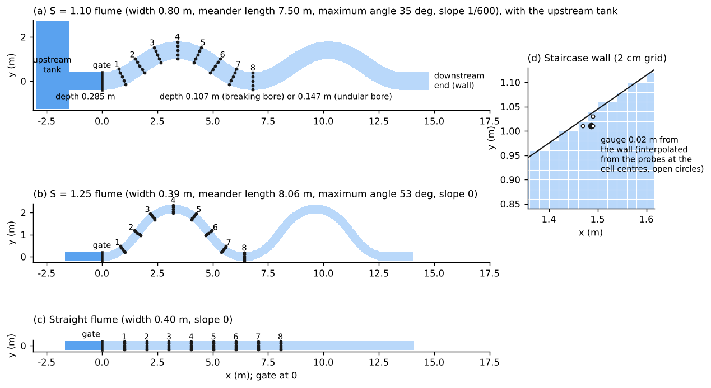
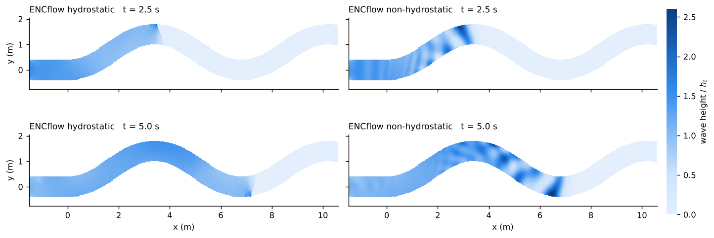
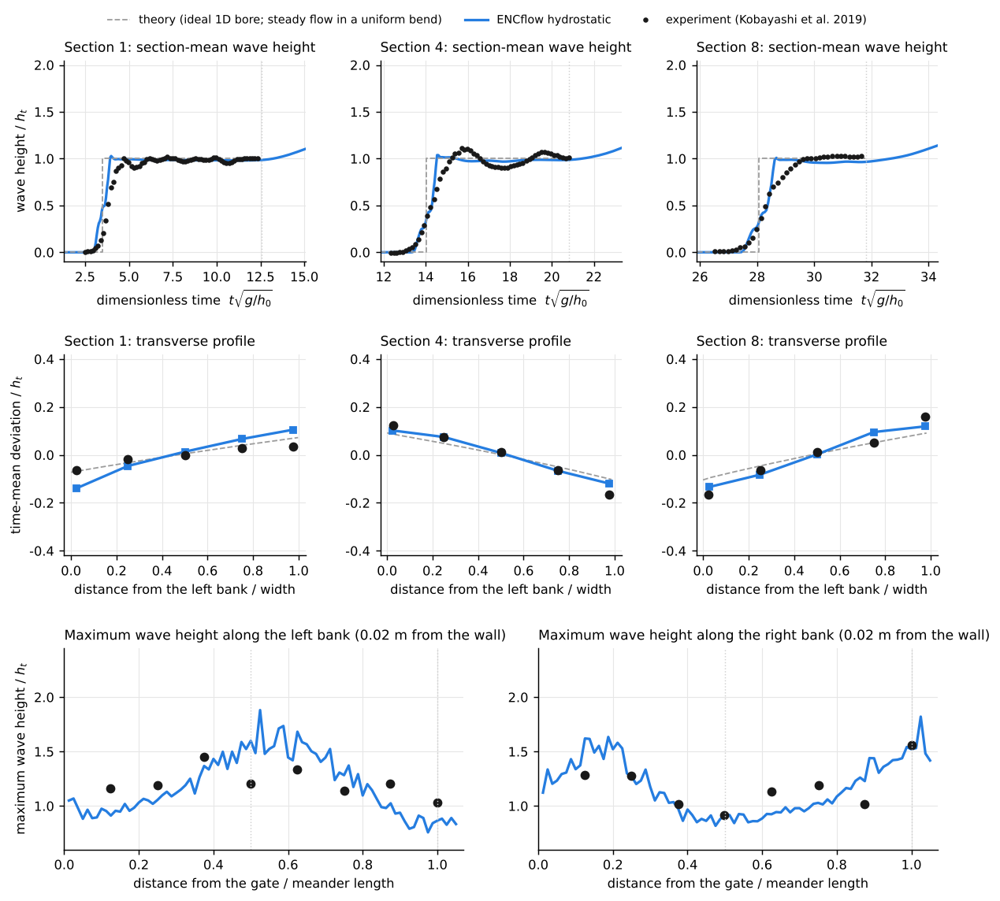
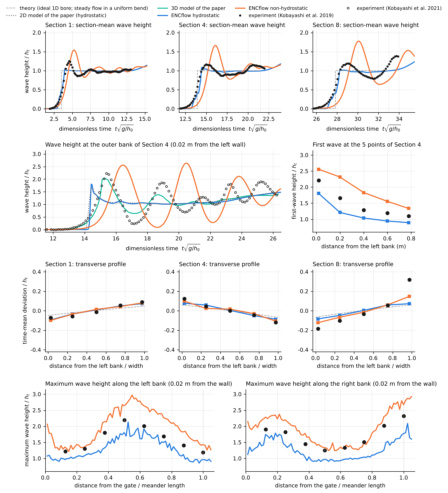
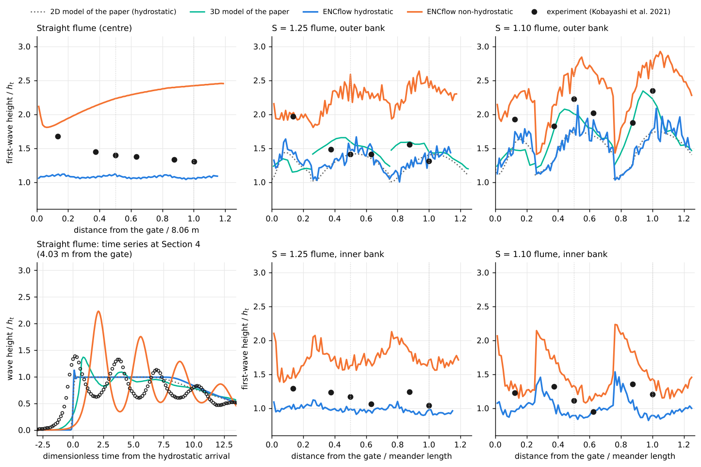
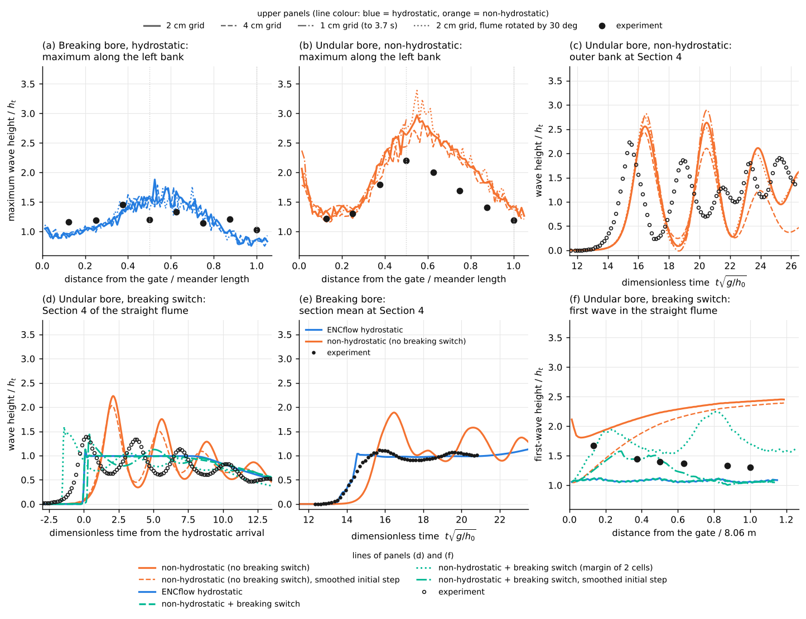

# tsunami_meander — Flume experiments of bores in meandering channels (Kobayashi et al. 2019, 2021) computed with the hydrostatic and the non-hydrostatic model and compared with the measurements

English mirror of [examples/tsunami_meander/README.md](../README.md).

This example computes flume experiments that model a tsunami running up a river, and compares the results with the
measurements. Kobayashi et al. (2019, 2021) of Hiroshima University generated bores by suddenly opening a gate, let them
travel along meandering channels, and measured the time series of the wave height along the banks. There are two kinds
of bore: a **breaking bore**, whose front breaks, and an **undular bore**, whose front becomes a wave train by soliton
fission. The example places the meandering flumes of sinuosity 1.10 and 1.25 and a straight flume on a 2 cm square grid
(the side walls are staircases of the grid), runs the bores with the hydrostatic computation of ENCflow (shallow water
equations) and with the one-layer non-hydrostatic correction, and compares the wave heights with values read from the
figures of the papers.

**Summary of the results** (wave heights are ratios to the theoretical bore height):

- **The breaking bore (bore Froude number 1.53) agrees with the hydrostatic run.** The section-mean wave height agrees
  with the measurements within 4 % and the arrival time within 0.2 in dimensionless time (0.03 s); the transverse tilt
  of the water surface in the bends has the right direction and, at the bend apexes, 70 to 80 % of the measured size.
  The maximum wave heights along the banks are on average 0.16 too high at the outer bank and 0.14 too low at the inner
  bank.
- **Neither run reproduces the undular bore (Froude number 1.32) quantitatively.** The hydrostatic run has no wave
  train and gives a first wave at the outer bank (measured 1.8 to 2.4) that is 0.4 too low on average. The one-layer
  non-hydrostatic run does form a wave train with a period close to the measured one (dimensionless time 4.05 against
  3.52), but its first wave is 0.4 too high on average and arrives 0.2 s late. In the straight flume the measured first
  wave falls from 1.67 to 1.31 as the bore travels, whereas the computed one grows from 1.85 to 2.42. The measured
  undular bore lies in the range where the first wave starts to break, and the one-layer non-hydrostatic correction has
  no mechanism that damps the waves by breaking while keeping the dispersion.
- **The measurements fall between the two runs.** Hydrostatic ≤ measured ≤ non-hydrostatic holds at 27 of the 30
  points of the first-wave height in the three flumes and at 15 of the 16 points of the maximum wave height along the
  banks of the S = 1.10 flume.
- **The dependence on the channel shape appears in the hydrostatic run.** The measured first wave at the outer bank is
  1.43 times that of the straight flume in the S = 1.10 (wide) flume and 1.07 times in the S = 1.25 (narrow) flume
  (means of six sections). In the hydrostatic run the peak formed where the front of the bore meets the outer bank
  obliquely is 1.51 and 1.28 times the value of the same run in the straight flume, so the difference between the
  flumes appears (too large in the S = 1.25 flume). In the non-hydrostatic run the ratios are 1.10 and 1.04, and the
  difference hardly appears.

Where the bore Froude number exceeds 1.3, the one-layer non-hydrostatic correction of ENCflow is no more than a guide to
the upper bound of the first-wave height, and the hydrostatic run is sufficient for the mean wave height, the arrival
time and the water-level difference across the bends. This is the conclusion of the example (the reasons and the other
limits are in "What this model cannot represent, and the limits of accuracy").



## Experiments and data

- **Flumes**: the centreline of the meandering flumes is a sine-generated curve θ = θmax sin(2π s / Lm) (s is the
  distance along the centreline, θ the angle from the flume axis) with two wavelengths. The cross-section is
  rectangular.

  | Flume | Width B (m) | Meander length Lm (m) | Maximum angle θmax | Sinuosity | B / Lm | Slope | Upstream of the gate |
  |---|---|---|---|---|---|---|---|
  | S = 1.10 | 0.80 | 7.50 | 35° | 1.10 | 0.11 | 1/600 | 1.50 m straight reach, then the upstream tank (1.45 m × 3.96 m) |
  | S = 1.25 | 0.39 | 8.06 | 53° | 1.25 | 0.048 | 0 | 1.66 m straight reach (wall at the upstream end) |
  | Straight | 0.40 | — | — | 1.00 | — | 0 | 1.68 m straight reach (wall at the upstream end) |

- **Bores**: still water of depth h0 = 0.285 m is held upstream of a gate at the start of the meander and of depth h1
  downstream, and the gate is opened suddenly by hand (the opening takes 0.2 to 0.3 s). h1 = 0.107 m gives the breaking
  bore and 0.147 m the undular bore. The bores of the one-dimensional theory (wet-bed dam-break solution) are as
  follows, and all wave heights are divided by this **theoretical bore height h_t**. Time is made dimensionless as
  t √(g/h0) (dimensionless time 1 is 0.17 s).

  | Bore | h1 (m) | Depth behind the bore (m) | Bore celerity (m/s) | Theoretical bore height h_t (m) | Bore Froude number |
  |---|---|---|---|---|---|
  | Breaking | 0.107 | 0.184 | 1.567 | 0.0771 | 1.53 |
  | Undular | 0.147 | 0.210 | 1.580 | 0.0629 | 1.32 |

- **Measurements**: servo-type wave gauges recorded the time series of the wave height at the measurement sections
  (every Lm / 8 along the centreline from the start of the meander; sections 1 to 8), and the average of three runs is
  the measured value. Kobayashi et al. (2019) measured both bores in the S = 1.10 flume at five points per section
  (0.02, 0.20, 0.40, 0.60 and 0.78 m from the right bank); Kobayashi et al. (2021) measured the undular bore in the
  three flumes at 0.02 m from both banks (at the centre in the straight flume). The right bank is the outer bank at
  sections 1, 2, 7 and 8, and the left bank at sections 3 to 6.
- **Measurements used in this example** (`data_kobayashi/`; numbers read from the figures of the papers. The method
  and the resolution are in "Source of the data and conditions of use"):

  | File | Figure | Contents |
  |---|---|---|
  | `k2019_fig2_fig3_section_mean.csv` | 2019 Figs. 2, 3 | S = 1.10, time series of the section-mean wave height at sections 1, 4, 8 (both bores) |
  | `k2019_fig4_fig5_transverse.csv` | 2019 Figs. 4, 5 | same, transverse profile of the time-mean deviation from the section mean, and the analytical solution of the paper |
  | `k2019_fig8_max_height.csv` | 2019 Fig. 8 | same, maximum wave height along both banks (sections 1 to 8) |
  | `k2019_fig10_section4.csv` | 2019 Fig. 10 | same, wave height at the five points of section 4 around the arrival of the undular bore |
  | `k2021_fig4_first_wave.csv` | 2021 Fig. 4 | height of the first wave of the undular bore in the three flumes (outer bank, inner bank, straight) |
  | `k2021_fig5_outer_bank.csv` | 2021 Fig. 5 | height of the first wave along the outer bank of the meandering flumes, and the 2D and 3D models of the paper |
  | `k2021_fig6_sec4_outer.csv` | 2021 Fig. 6 | time series of the wave height at the outer bank of Section 4 of the meandering flumes, and the two models of the paper |
  | `k2021_fig2_straight_sec4.csv` | 2021 Fig. 2 | time series of the wave height at Section 4 of the straight flume, and the models of the paper |

  The 2D model of the paper solves the shallow water equations in generalised coordinates (2 cm along the flume, 1 cm
  across) and the 3D model is interFoam of OpenFOAM. They are drawn in the figures as a guide.

## How the input is made

`make_init.py` writes the domain mask, the bed elevation, the initial water level and the probes of each flume
(`python3 make_init.py --dx 0.01` for a 1 cm grid, `--rot 30` for a flume rotated by 30° against the grid,
`--smooth 0.3` for a water surface in which the initial step is smoothed).

- **Grid and side walls**: on a 2 cm square grid, the cells whose centres lie within B / 2 of the centreline are kept
  as the flume (domain mask). Outside the flume nothing is computed, so the side walls are staircases of the grid
  (panel (d) of the figure above). The width is 40 cells in the S = 1.10 flume and about 20 cells in the other
  two (the mean widths obtained from the area of the masks are 0.80, 0.39 and 0.40 m). The S = 1.10 flume has
  49.7 thousand valid cells.
- **Bed elevation and initial water level**: the bed elevation is 0 at the gate, and only the S = 1.10 flume is a
  plane falling at 1/600 along the flume axis. The initial water level is horizontal, 0.285 m upstream of the gate and
  h1 downstream (zero velocity), and the computation starts from this step at t = 0.
- **Roughness**: Manning's roughness coefficient is 0.014 (the value of the 2D model of Kobayashi et al. 2021).
- **Gauges and probes**: the gauges are five points of measurement sections 1 to 8 (0.02 m, B/4, B/2, 3B/4 and
  B − 0.02 m from the right bank) and points every Lm / 80 along the banks (0.02 m from the wall; meandering flumes) or
  along the centreline (straight flume). A probe records the value of a cell (no interpolation), so probes are placed
  at those of the four cell centres around a gauge that lie inside the flume, the depth is recorded every 0.01 s, and
  in post-processing the records are averaged with bilinear weights to give the value at the gauge (panel (d) of the
  figure above).

What the papers do not state is set as follows.

- **Upstream tank** (S = 1.10 flume): the tank floor is at the level of the flume bed (the same simplification as the
  2D model of the paper). The lateral position of the tank (1.26 m to the right and 2.70 m to the left of the flume
  centre) was read from the figure of the paper. The drainage channels that hold the water level of the tank and the
  inflow to the tank are not included.
- **Direction of the slope and position of the depths**: 1/600 is taken as the slope along the flume axis, and h0 and
  h1 as the depths at the gate (the still water downstream has a horizontal surface, so it is deeper downstream:
  0.011 m deeper at section 8).
- **Gate**: the motion of the gate is not included; the gate is taken as opened instantly at t = 0.
- **Position of the gate in the S = 1.25 flume**: at the start of the meander, as in the figure of the paper. The text
  of the doctoral thesis (Kobayashi 2023) also says "the gate is at s = 2.0 m and the meander starts at s = 2.5 m", so
  the gate may have been 0.5 m upstream of the start of the meander.
- **Straight flume**: the total length is taken as 15.76 m, the same as the S = 1.25 flume, and the measurement
  sections are placed every 8.06 / 8 m from the gate (from the abscissa of Fig. 4 of the paper).

## Settings of the computation

| Run | Flume | Bore | Pressure | Input |
|---|---|---|---|---|
| `bk_h` | S = 1.10 | breaking | hydrostatic | `param_bk_h.txt` |
| `ub_h` | S = 1.10 | undular | hydrostatic | `param_ub_h.txt` |
| `ub_nh` | S = 1.10 | undular | non-hydrostatic | `param_ub_nh.txt` |
| `str_h`, `str_nh` | straight | undular | hydrostatic, non-hydrostatic | `param_str_h.txt`, `param_str_nh.txt` |
| `s125_h`, `s125_nh` | S = 1.25 | undular | hydrostatic, non-hydrostatic | `param_s125_h.txt`, `param_s125_nh.txt` |

| Item | Value | Basis |
|---|---|---|
| Grid | 2 cm | the non-hydrostatic correction needs a grid spacing of half the depth or less ([explanation](../../../docs/en/users_guide/nonhydrostatic.md) §1); 1/7 to 1/15 of the depth of 0.15 to 0.3 m. The difference from other grid spacings is in "Sensitivity" |
| Time step | 0.002 s, to 6.5 s | Courant number 0.2 to 0.3. The bore travels 10 m in 6.5 s and does not reach the downstream end |
| Edge depth of the hydrostatic runs | `f_hcap_upwind = 2` (upstream depth) | suppresses the one-cell spike at the front of a bore ([advection schemes](../../../docs/en/users_guide/advection.md) §5). The difference from the default 1 is in "Sensitivity" |
| Non-hydrostatic runs | `f_nonhydrostatic = 1`, `nh_hmin = 0.01` | the one-layer non-hydrostatic correction solved over the whole domain. The default 0.1 m of `nh_hmin` (cells shallower than this stay hydrostatic) is a field-scale value of the same size as the depths in these flumes (0.11 to 0.29 m), so it is lowered |
| Breaking switch | not used | "Breaking switch" below |

Everything else is the default (the advection term is the momentum-conserving one).

**Breaking switch**: the breaking switch of the one-layer non-hydrostatic correction (`f_nh_breaking = 1`) switches the
cells whose surface slope exceeds 0.3, and a margin around them (twice the depth wide), to hydrostatic. The step in the
initial water level has a slope far above 0.3, so with the switch the front of the bore is hydrostatic from the start
of the computation, and since a hydrostatic bore stays steep the switch never releases. A run of the undular bore with
the switch gives the same result as the hydrostatic run (`str_nhb` in "Sensitivity", checked in the straight flume).
Even when the initial step is smoothed, the switch acts as soon as the slope of the front face of the first wave
exceeds 0.3, and from there on the front is a hydrostatic bore (`str_nhb_s` in "Sensitivity"). The switch cannot
represent a first wave that breaks while the wave train is kept. The non-hydrostatic runs of the undular bore are
therefore made without the switch, and the breaking bore is computed hydrostatically.

## How to run

```bash
cd examples/tsunami_meander
make              # link to the executable and the input (make_init.py)
make run          # the seven default runs, one after another
make figs         # figures and tables (Japanese and English)
make sens         # the twelve sensitivity runs ("Sensitivity"; optional)
```

On a 4-core machine, with two runs side by side on 2 threads each, `ub_nh` took 6 minutes, `bk_h`, `ub_h` and
`s125_nh` 3 minutes each, and the two runs of the straight flume and `s125_h` 0.6 to 1.5 minutes each; the sum over
the seven runs was about 18 minutes. A non-hydrostatic run takes 2 to 3 times as long as the hydrostatic run on the
same grid (the conjugate gradient solver makes 75 to 83 iterations per step on average).

The flumes are closed, so the S column of the screen output and the Log (domain-mean storage depth) stays constant to
the end (0.2023 m for the undular bore in the S = 1.10 flume). The end of the screen output shows the number of
iterations of the non-hydrostatic solver and the number of steps that did not converge (0).

## Results

The numbers are copied from the tables printed by `python3 plot_results.py` (Tables 1 to 7).

### Definition of the wave heights and how they are compared

- The **wave height** is the rise of the water level above the initial downstream level, divided by the theoretical
  bore height h_t.
- **Time span compared**: the negative wave travelling upstream from the gate is reflected at the upstream end of the
  straight reach (the junction with the tank in the S = 1.10 flume) and follows the bore. The time at which this
  influence arrives, from the one-dimensional characteristics, is dimensionless time 12.6, 20.8 and 31.8 at sections
  1, 4 and 8 (breaking bore), which matches the ends of the time spans of the figures of the paper (12.3, 20.8 and
  31.7). The **maximum wave height** is the maximum up to this time.
- **Height of the first wave**: for the non-hydrostatic runs and the measurements, the height of the first crest. The
  hydrostatic runs have no wave train, so the maximum within one wave period (dimensionless time 3.5) after the
  arrival is shown as the corresponding quantity (the peak formed where the front of the bore meets the side wall).
- **Origin of time**: the measurements in the S = 1.10 flume agree in time with the arrival of the theoretical bore
  (the origin is the time the opening of the gate ended). In the figures of the paper for the S = 1.25 flume and the
  straight flume the arrival of the bore does not match the distance from the gate (the origin is unknown), so for
  these two flumes only the height of the first wave, which does not depend on time, is compared, and the time series
  of the straight flume is overlaid by aligning the arrival of the hydrostatic bore.

### Shape of the water surface



The undular bore in the S = 1.10 flume. In the hydrostatic run (left) a single discontinuous front advances, and in
the bends the front lags on the outer-bank side and becomes oblique. In the non-hydrostatic run (right) the front
splits into a wave train, and the crests advance while being reflected at both banks and become high at the outer
bank.

### Breaking bore (S = 1.10 flume)



| Section | Arrival (theory / measured / computed) | Mean wave height after arrival (measured / computed) |
|---|---|---|
| 1 | 3.51 / 3.81 / 3.62 | 0.98 / 0.99 |
| 4 | 14.04 / 14.25 / 14.29 | 1.00 / 0.98 |
| 8 | 28.07 / 28.30 / 28.36 | 1.00 / 0.97 |

The arrival is the dimensionless time at which the section-mean wave height crosses 0.5.

- **Section mean**: the computed bore travels at the theoretical celerity; the arrival time agrees with the
  measurements within 0.2 (0.03 s) and the mean wave height after arrival within 4 %. The measured rise is more
  gradual than the computed one, and the measurements show an oscillation of the water surface of amplitude about 0.1
  at section 4, which the hydrostatic run does not have.
- **Transverse profile**: in the bends the water level is higher on the outer-bank side. The time-mean deviations
  after arrival at the two banks (0.02 m from the wall) are, at section 4 at the bend apex, +0.12 and −0.16 measured
  (left and right bank) against +0.10 and −0.12 computed, and at section 8, −0.17 and +0.16 measured against −0.13
  and +0.12 computed: the direction agrees and the size is 70 to 80 % of the measured one. At section 1 the computed
  tilt (−0.14 and +0.11) is 2 to 3 times the measured one (−0.06 and +0.03).
- **Maximum wave height along the banks**: against the measured maxima (1.0 to 1.6 at the outer bank, 0.9 to 1.2 at the
  inner bank), the computed ones are on average 0.16 higher at the outer bank (RMSE 0.24) and 0.14 lower at the inner
  bank (RMSE 0.16). The computed maximum at the outer bank is a sharp peak at the instant the front of the bore meets
  the side wall obliquely (about 0.07 s wide), and the measured rise has no such sharpness. The measured values are
  larger at the inner bank because of the oscillation of the water surface that the computation lacks. Along a bank,
  most computed values lie within 0.03 of the median of five neighbouring points, but about one point in ten departs
  by 0.1 to 0.4. This is caused by the staircase wall (the shape of the staircase around a measurement point differs
  from point to point).

### Undular bore (S = 1.10 flume)



| | First crest (time / height) | Following trough | Second crest | Period |
|---|---|---|---|---|
| Measured (Kobayashi et al. 2021) | 15.39 / 2.23 | 17.15 / 0.24 | 18.91 / 1.86 | 3.52 |
| 3D model of the paper | 15.25 / 2.02 | 17.13 / 0.64 | 18.65 / 1.38 | 3.40 |
| ENCflow non-hydrostatic | 16.42 / 2.56 | 18.65 / 0.09 | 20.47 / 2.64 | 4.05 |

The wave form at the outer bank of Section 4 (0.02 m from the left wall). The arrival of the hydrostatic bore (height
0.5) is 14.22 in the 2D model of the paper and 14.33 in ENCflow, and the peak at the front is 1.68 and 1.81.

- **Hydrostatic run**: the arrival of the section-mean wave height (3.60, 14.15 and 27.96 against the measured 3.60,
  13.85 and 27.74) and the mean after arrival (0.98 to 0.99 against the measured 0.99 to 1.03) agree, but there is no
  wave train. The maximum wave heights along the banks are on average 0.38 too low at the outer bank and 0.31 too low
  at the inner bank. This is the same behaviour as the 2D model of the paper, and the wave form at the outer bank of
  Section 4 also coincides with that model.
- **Non-hydrostatic run**: the front of the bore splits into a wave train, with a period of 4.05 at the outer bank of
  Section 4 (measured 3.52). The first crest is 0.33 higher than measured and 1.0 (0.18 s) late, the trough is deeper,
  and the second crest stays at 2.64 while the measured one falls to 1.86. The maximum wave heights along the banks are
  on average 0.42 too high at the outer bank (RMSE 0.44) and 0.16 too high at the inner bank (RMSE 0.22). The first
  crest of the section-mean wave height is also 1.5 to 1.8 against the measured 1.17 to 1.25.
- **Delay of the arrival**: the arrival of the section-mean wave height of the non-hydrostatic run is 0.4 to 0.7 (0.06
  to 0.12 s) later than that of the hydrostatic run, and the delay grows downstream. While the wave train develops
  from the step, the leading wave of the computation travels more slowly than the hydrostatic bore (in the straight
  flume the first crest travels at 1.53 m/s from 1 to 4 m from the gate and at 1.56 m/s from 4 to 8 m; the theoretical
  bore travels at 1.58 m/s). The measured arrival of the section-mean wave height agrees with the theoretical bore
  within 0.1 and has no such delay. The origin of time of the measurements is the time the opening of the gate ended
  (the opening took 0.2 to 0.3 s; Kobayashi 2023), so comparisons of time carry an uncertainty of this size, but a
  delay that grows downstream cannot be explained by the choice of the origin.
- **Five points of section 4**: the first crest grows from the inner to the outer bank (1.10 → 2.21 measured, 1.33 →
  2.56 in the non-hydrostatic run). The crest reaches the outer bank later than the inner bank, by 1.3 (0.23 s) in the
  measurements and 1.1 (0.18 s) in the computation.
- **The measurements lie between the two runs**: at 15 of the 16 points of the maximum wave height along the banks,
  hydrostatic ≤ measured ≤ non-hydrostatic (the remaining point is the inner bank at section 6, where the
  non-hydrostatic run gives 1.50 against the measured 1.51).

### Height of the first wave and the shape of the flume



| | Section 1 | 3 | 4 | 5 | 7 | 8 |
|---|---|---|---|---|---|---|
| Straight flume: measured | 1.67 | 1.45 | 1.40 | 1.38 | 1.33 | 1.31 |
| Straight flume: hydrostatic / non-hydrostatic | 1.11 / 1.85 | 1.06 / 2.13 | 1.12 / 2.23 | 1.06 / 2.30 | 1.08 / 2.39 | 1.06 / 2.42 |
| Outer bank, S = 1.25: measured | 1.97 | 1.48 | 1.41 | 1.41 | 1.55 | 1.31 |
| Outer bank, S = 1.25: hydrostatic / non-hydrostatic | 1.47 / 2.00 | 1.20 / 2.14 | 1.47 / 2.59 | 1.56 / 2.23 | 1.21 / 2.49 | 1.43 / 2.39 |
| Outer bank, S = 1.10: measured | 1.93 | 1.82 | 2.23 | 2.02 | 1.88 | 2.35 |
| Outer bank, S = 1.10: hydrostatic / non-hydrostatic | 1.74 / 2.28 | 1.32 / 2.14 | 1.81 / 2.56 | 1.92 / 2.64 | 1.26 / 2.30 | 1.78 / 2.67 |

- **Straight flume**: the measured first wave is 1.67 just downstream of the gate (1 m) and falls as the bore travels,
  to 1.31 at 8 m. In the non-hydrostatic run it grows from 1.85 at 1 m (1.1 times the measured value) to 2.42 at 8 m
  (1.9 times). The period of the wave train is the same as measured, 3.52 (lower left panel); counted from the arrival
  of the hydrostatic bore, the first crest comes at +0.2 in the measurements and +2.1 in the computation. The values
  1.06 to 1.12 of the hydrostatic run are a numerical overshoot at the discontinuous front (a bore of the shallow
  water equations in a straight channel has no crest). In the theory of dispersive waves without breaking, the leading
  wave of a bore grows towards twice the bore height or more (Gurevich and Pitaevskii 1974; El et al. 2006;
  [test/nhbore](../../../test/nhbore/en/README.md)). The computation behaves as this theory says, and the measurements
  do not. A wave height of 2.2 is 0.94 times the initial depth, above the height at which a solitary wave can exist
  without breaking (about 0.8 times the depth).
- **S = 1.25 flume**: the measured first wave at the outer bank is almost the same as in the straight flume (1.3 to
  1.6) except at Section 1. The peak at the front of the hydrostatic run (1.2 to 1.6) is close to it, and the
  non-hydrostatic run (2.0 to 2.6) is too high.
- **S = 1.10 flume**: the measured first wave at the outer bank is 1.2 to 1.8 times that of the straight flume (1.8 to
  2.4), largest at the bend apexes (Sections 4 and 8). The peak of the hydrostatic run is also largest at the bend
  apexes and a little downstream of them (Sections 4, 5 and 8; 1.8 to 1.9) and larger than at the same sections of the
  S = 1.25 flume (1.4 to 1.6). The non-hydrostatic run gives 2.1 to 2.7, not much different from its values in the
  S = 1.25 flume and the straight flume (2.0 to 2.6 and 1.9 to 2.4).
- **In short**: the ratio of the first wave at the outer bank to that in the straight flume (means of six sections) is
  1.07 for S = 1.25 and 1.43 for S = 1.10 in the measurements, 1.28 and 1.51 in the hydrostatic run, and 1.04 and 1.10
  in the non-hydrostatic run. That the amplification at the outer bank changes with the shape of the flume (the subject
  of Kobayashi et al. 2021) appears in the hydrostatic run as the effect of the front of the bore meeting the outer
  bank obliquely (too large in the S = 1.25 flume). In the non-hydrostatic run the wave is already too high in the
  straight flume and the amplification at the bank is small, so its apparent closeness to the measurements at the outer
  bank of the S = 1.10 flume (+0.4) is the result of two deviations cancelling (the non-hydrostatic values along a bank
  also include a lowering of about 5 % in the cells next to the wall; see "What this model cannot represent, and the
  limits of accuracy"). Of the 30 points of the first-wave height, only three at the outer bank of the S = 1.25 flume
  fall outside hydrostatic ≤ measured ≤ non-hydrostatic (Sections 4, 5 and 8, where the hydrostatic peak exceeds the
  measurement by 0.06 to 0.15).

## Sensitivity

`make sens` computes twelve runs in which the settings of the S = 1.10 flume (eight runs) and the straight flume
(four runs) are changed. The numbers are copied from Table 7 of `plot_results.py`.



| Run | What is changed |
|---|---|
| `str_nhb` | the breaking switch added to the non-hydrostatic run of the undular bore in the straight flume (`f_nh_breaking = 1`, `f_hcap_upwind = 2`) |
| `str_nhb2` | same, with the margin of the switch narrowed to 2 cells (`nh_break_margin = 2`) |
| `str_nh_s`, `str_nhb_s` | the initial step of the straight flume smoothed to a tanh of width 0.3 m (maximum surface slope 0.23); without and with the switch |
| `bk_nh` | the breaking bore computed non-hydrostatically (without the switch) |
| `bk_h_c1` | the edge depth of the hydrostatic run of the breaking bore set to the default (`f_hcap_upwind = 1`) |
| `bk_h_r30`, `ub_nh_r30` | the flume rotated by 30° against the grid |
| `bk_h_d4`, `ub_nh_d4` | 4 cm grid (time step 0.004 s) |
| `bk_h_d1`, `ub_nh_d1` | 1 cm grid (time step 0.001 s; to 3.7 s, when the bore has passed the first bend = sections 1 to 4) |

- **Breaking switch** (panels (d) and (f)): the heights of the first wave in the straight flume are as follows (first
  crest for the non-hydrostatic runs without the switch, maximum within one period after arrival for the others).

  | | Section 1 | 3 | 4 | 5 | 7 | 8 |
  |---|---|---|---|---|---|---|
  | Measured | 1.67 | 1.45 | 1.40 | 1.38 | 1.33 | 1.31 |
  | Hydrostatic `str_h` | 1.11 | 1.06 | 1.12 | 1.06 | 1.08 | 1.06 |
  | Non-hydrostatic `str_nh` | 1.85 | 2.13 | 2.23 | 2.30 | 2.39 | 2.42 |
  | Non-hydrostatic + switch `str_nhb` | 1.11 | 1.06 | 1.13 | 1.07 | 1.07 | 1.06 |
  | Same, margin of 2 cells `str_nhb2` | 1.52 | 1.67 | 1.60 | 1.64 | 2.07 | 1.71 |
  | Smoothed initial step, non-hydrostatic `str_nh_s` | 1.26 | 1.84 | 2.04 | 2.16 | 2.31 | 2.35 |
  | Smoothed initial step, non-hydrostatic + switch `str_nhb_s` | 1.24 | 1.44 | 1.44 | 1.22 | 1.00 | 1.05 |

  The run with the switch (`str_nhb`) equals the hydrostatic run (the arrival at Section 4 is also the same, 14.97).
  The switch acts on the initial step at the start of the computation, and the front of the bore, now hydrostatic, has
  a surface slope of 1.7 to 1.9, which stays above the criterion of 0.3. When the initial step is smoothed
  (`str_nhb_s`), the wave train first develops as in the run without the switch (`str_nh_s`), and the switch acts at
  1.5 to 2.0 s (front 2 to 3 m from the gate), when the slope of the front face of the first wave exceeds 0.3. From
  then on the front is a hydrostatic bore (surface slope 1.3 to 2.5), the switch does not release, and the first wave
  falls to the height of the hydrostatic run beyond 6 m from the gate. The values close to the measurements at
  Sections 3 and 4 belong to the transition just after the switch has acted; further downstream the measurements keep
  the wave train and the computation loses it. Without the switch, the run grows to the same height when the initial
  step is smoothed. With the margin narrowed to 2 cells (`str_nhb2`) the first wave varies irregularly from section to
  section, and the bore arrives at Section 4 earlier than the hydrostatic run (theoretical celerity) by 1.5 (0.26 s).
- **The breaking bore computed non-hydrostatically** (panel (e)): `bk_nh` forms a wave train that the measurements do
  not have. The first crest of the section-mean wave height at section 4 is 1.89 (measured 1.11, hydrostatic run
  1.04), the maximum wave heights along the banks are 2.8 to 4.5 at the outer bank (bias +2.40) and 1.6 to 2.8 at the
  inner bank (+0.84), and the section-mean wave height arrives 0.5 to 1.3 later than in the hydrostatic run.
- **Edge depth**: with `f_hcap_upwind` at the default 1 (mean of the two sides; `bk_h_c1`) the peak at the front of the
  bore becomes larger, and the bias of the maximum wave height at the outer bank goes from +0.16 to +0.44 (RMSE from
  0.24 to 0.50; the peak at the outer bank of Section 4 goes from 1.60 to 1.94). The bias at the inner bank (−0.14 and
  −0.10) and the arrival times (within 0.11) hardly change.
- **Orientation of the flume** (dotted lines in panels (a) to (c)): rotating the flume by 30° changes the shape of the
  staircase walls. The maximum wave heights along the banks change by up to 0.22 from section to section (the mean
  differences over 16 points are −0.03 and +0.01). The bias goes from +0.16 to +0.11 at the outer bank and from −0.14
  to −0.15 at the inner bank for the hydrostatic run of the breaking bore, and from +0.42 to +0.44 and from +0.16 to
  +0.17 for the non-hydrostatic run of the undular bore. The arrival of the section-mean wave height is the same
  within 0.02, and the wave forms at the outer bank of Section 4 coincide (first crest 2.56 and 2.74, period 4.05 and
  3.99).
- **Grid spacing** (panels (a) to (c)): on the 4 cm grid the maximum wave heights along the banks are on average 0.07
  (hydrostatic run of the breaking bore) and 0.15 (non-hydrostatic run of the undular bore) lower than on the 2 cm
  grid, with differences of up to 0.40 and 0.31 at single points. The arrival of the section-mean wave height is the
  same within 0.1. On the 1 cm grid (sections 1 to 4) the maximum wave heights along the banks of the hydrostatic run of the breaking
  bore are the same as on the 2 cm grid within 0.09 (mean difference over 8 points 0.00). For the non-hydrostatic run
  of the undular bore they are the same within 0.05 at both banks of sections 1 to 3, but 0.26 higher at the outer
  bank of section 4. The first crest at the outer bank of Section 4 is 2.44, 2.56 and 2.82 on the 4 cm, 2 cm and 1 cm
  grids: it rises as the grid is refined and has not converged on the 2 cm grid (measured 2.23; the first crest of
  the section-mean wave height is 1.62, 1.66 and 1.68, nearly converged). The period is 4.08, 4.05 and 3.93 and
  approaches the measured one (3.52). The point 0.02 m from the wall is the centre of the cell next to the wall on
  the 4 cm grid, the boundary between that cell and the second cell on the 2 cm grid, and the boundary between the
  second and the third cell on the 1 cm grid, so the way the lowering of the crests in the cells next to the wall
  ("What this model cannot represent, and the limits of accuracy") enters also changes with the grid.

The sum of the computation times of the twelve sensitivity runs, under the same conditions as the default runs
(2 threads), was about 1.5 hours (`ub_nh_d1` on the 1 cm grid 39 minutes, `bk_h_d1` 14 minutes, and `ub_nh_r30` with
the flume rotated by 30° 13 minutes).

### Starting points for sensitivity experiments

- `python3 make_init.py --dx 0.01 --suffix _d1`: input on a 1 cm grid (halve `dt`; for the same simulated time the
  computation is about 8 times as long for a hydrostatic run and about 12 times for a non-hydrostatic run).
- `python3 make_init.py --rot 45 --suffix _r45`: orientation of the flume against the grid. At 45° the straight
  reaches of the flume run along the diagonals of the grid.
- `python3 make_init.py --channels str --smooth 0.5 --suffix _s5`: width over which the initial step is smoothed (a
  substitute for the time the gate takes to open).
- `RN` (roughness), `BORES` (downstream depths) and `CHANNELS` (width, meander length, maximum angle, slope) in
  `make_init.py`: Kobayashi et al. (2021) show, with numerical experiments on flumes whose widths alone are exchanged
  (S = 1.25 with a width of 0.86 m, S = 1.10 with 0.36 m), that the amplification along the outer bank appears when
  the dimensionless width B / Lm becomes large and grows with the sinuosity.
- `f_hcap_upwind` (the front of the bore in the hydrostatic runs), `nh_hmin`, `dt`.

## What this model cannot represent, and the limits of accuracy

- **An undular bore that starts to break**: the measured undular bore (Froude number 1.32) lies in the range where the
  first wave starts to break (experiments in straight channels find that the leading wave of an undular bore starts
  to break at a Froude number of about 1.25 to 1.3; Favre 1935; Treske 1994). The one-layer non-hydrostatic correction
  has no mechanism that damps the wave crests by breaking while keeping the dispersion, and the first wave keeps
  growing. Where it acts, the breaking switch replaces the whole front of the bore with a hydrostatic bore and does
  not release once it has acted, so it does not represent the intermediate state (a wave train in which only the
  crests break). Narrowing the margin of the switch to cap only the crests gives irregular results ("Sensitivity").
  All that can be said of the first-wave height of an undular bore with a Froude number above 1.3 is that it lies
  between the two runs of this example. In a computation in which a smooth tsunami becomes an undular bore in a river
  channel, too, the wave train disappears with the switch from the moment the slope of the front face of the first
  wave exceeds 0.3.
- **Difference of the amplification with the shape of the flume**: it does not appear in the non-hydrostatic run
  ("Height of the first wave and the shape of the flume").
- **Choosing between a breaking and an undular bore**: the non-hydrostatic run without the switch forms a wave train
  for the breaking bore (Froude number 1.53) as well, with large waves that the measurements do not have
  ("Sensitivity"). The user chooses between the hydrostatic and the non-hydrostatic run from the bore Froude number.
- **Staircase side walls**: about one point in ten of the maximum wave height along a bank departs from its
  neighbours by 0.1 to 0.4, and the values also change with the orientation of the flume against the grid
  ("Sensitivity"). The maximum wave height at a single point on a bank cannot be read more finely than this.
- **Cells next to the wall in the non-hydrostatic run**: in the non-hydrostatic run of the straight flume, the first
  wave at the points 0.02 m from the wall is 5 % lower than at the centre of the flume (8 % in the cell next to the
  wall and 3 % in the second cell from the wall; from the third cell inwards it is the same as at the centre). In a
  straight channel this quantity should be uniform across the flume, so this is a numerical property of the cells next
  to the wall (the difference is 0.5 % in the hydrostatic run). The non-hydrostatic values along the banks of the
  meandering flumes include a lowering of the same size.
- **The front of a hydrostatic bore**: the size of the peak at the front changes with the definition of the edge depth
  (`f_hcap_upwind`) and with the grid ("Sensitivity"). The measured rise is spread over the breaking zone (several cm
  to more than ten cm) and differs in shape from the computed discontinuity.
- **Grid convergence**: the maximum wave heights along the banks of the hydrostatic run of the breaking bore are the
  same within 0.1 on the 2 cm and the 1 cm grid. The first wave at the outer bank of the non-hydrostatic run of the
  undular bore rises as the grid is refined and has not converged on the 2 cm grid ("Sensitivity").
- **Three-dimensional flow**: secondary flow in the bends, the vortices of breaking and the vertical distribution of
  velocity are not represented. For the breaking bore of Froude number 3.99 in the same flumes it is reported that the
  hydrostatic 2D model overestimates the wave height (Kobayashi 2023; Kobayashi and Uchida 2022). This example does
  not treat it.
- **Time**: the opening of the gate (0.2 to 0.3 s) is not included, so comparisons of time carry an uncertainty of
  0.1 to 0.3 s (about 1 in dimensionless time). Times are not compared for the S = 1.25 flume and the straight flume.
- **Time span compared**: until the influence of the upstream end arrives (5.4 to 5.6 s at section 8). The water level
  after that is governed by the shape of the upstream tank and the drainage channels, and cannot be compared with the
  input of this example (level of the tank floor, no drainage channels).
- **Reading of the measurements**: `data_kobayashi/` holds values read from the coordinates of the figures of the
  papers, with a resolution of 0.003 to 0.008 in wave height and 0.01 to 0.03 in dimensionless time. Figs. 4 and 5 of
  the 2019 paper were read on the judgement that the line styles of the legend are exchanged with respect to the text
  ("Source of the data and conditions of use").
- **Difference from a real river**: the experiments send a bore from a sudden gate opening into still water, and do
  not include the river flow, the relief of the bed, a compound cross-section or the wave form of a tsunami entering
  from the river mouth. What is confirmed in a model 0.1 to 0.3 m deep does not necessarily hold at full scale.

## Source of the data and conditions of use

The CSV files in `data_kobayashi/` are the coordinates of the points and lines drawn in the figures of the following
two papers, read as numbers with `extract_figs.py`. The figures and the text of the papers are not included.

- Kobayashi, D., Uchida, T. and Kawahara, Y. (2019): Experimental study of tsunami propagation in a meandering channel
  (in Japanese). *Advances in River Engineering*, 25, 249–254. doi:10.11532/river.25.0_249
- Kobayashi, D., Uchida, T. and Ota, K. (2021): Amplification characteristic of an undular bore in meandering channel
  (in Japanese). *Journal of JSCE, Ser. B1 (Hydraulic Engineering)*, 77(2), I_1183–I_1188.
  doi:10.2208/jscejhe.77.2_I_1183

- **How the values were read**: the charts in the papers are embedded in the PDF as vector graphics. Each page is
  converted to SVG with `pdftocairo -svg`, the coordinates of the marker centres and of the vertices of the lines are
  taken, and they are converted to values with a linear fit that assigns the tick values to the positions of the frame
  and the grid lines of the chart (the residual of the fit is 0.01 of a tick value or less). The values were not read
  by hand. The coordinates in the PDF are rounded to about 0.3 pt, which sets the resolution (written at the top of
  each CSV file).
- **Reproduction**: obtain the two PDFs from J-STAGE and run
  `python3 extract_figs.py <PDF of 2019> <PDF of 2021> data_kobayashi` to make the same CSV files (requires `pdftocairo` of
  poppler-utils).
- **Where a judgement was made**: the legend of Figs. 4 and 5 of the 2019 paper names the solid line "measured" and
  the dashed line with markers "analytical", but the dashed line with markers is a polyline of five points (there are
  five measurement points per section) and it also agrees with the text (at the outer bank of section 8 the measured
  value is much larger than the analytical solution), so the dashed line with markers was read as the measurements and
  the solid line as the analytical solution.
- **Conditions of use**: when reusing the numbers, cite the two papers above as the source. The raw measured data are
  not published.

## References

- Kobayashi, D. (2023): Experimental investigations and numerical models on the influence of channel planforms and
  permeable resistance on hydraulic jumps and bores (in Japanese). Doctoral thesis, Hiroshima University (Ko No. 9187).
  <https://hiroshima.repo.nii.ac.jp/records/2002273> (method of the experiments: opening time of the gate, origin of
  time, position of the wave gauges; the breaking bore of Froude number 3.99)
- Kobayashi, D. and Uchida, T. (2022): Experimental and numerical investigation of breaking bores in straight and
  meandering channels with different Froude numbers. *Coastal Engineering Journal*, 64(3), 442–457.
  doi:10.1080/21664250.2022.2118431 (breaking bores of Froude number 3.99 and 1.53; not used in this example)
- Stoker, J. J. (1957): *Water Waves*. Interscience. (wet-bed dam-break solution)
- Gurevich, A. V. and Pitaevskii, L. P. (1974): Nonstationary structure of a collisionless shock wave.
  *Sov. Phys. JETP*, 38, 291–297.
- El, G. A., Grimshaw, R. H. J. and Smyth, N. F. (2006): Unsteady undular bores in fully nonlinear shallow-water
  theory. *Phys. Fluids*, 18, 027104.
- Favre, H. (1935): *Étude théorique et expérimentale des ondes de translation dans les canaux découverts*. Dunod,
  Paris; Treske, A. (1994): Undular bores (Favre-waves) in open channels — experimental studies. *J. Hydraul. Res.*,
  32(3), 355–370. (onset of breaking of the leading wave of an undular bore; taken from secondary sources, the
  originals were not checked)

## Related documents

- [The non-hydrostatic correction (one-layer model)](../../../docs/en/users_guide/nonhydrostatic.md) (equations,
  breaking switch, range of validity)
- Verification: [test/nhbore](../../../test/nhbore/en/README.md) (undular bore in a straight channel),
  [test/dambreak](../../../test/dambreak/en/README.md) (Stoker solution of the wet-bed dam break),
  [test/nhbreak](../../../test/nhbreak/en/README.md) (breaking switch)
- Example: [tsunami_fault](../../tsunami_fault/en/README.md) (hydrostatic and non-hydrostatic runs of a fault tsunami)
