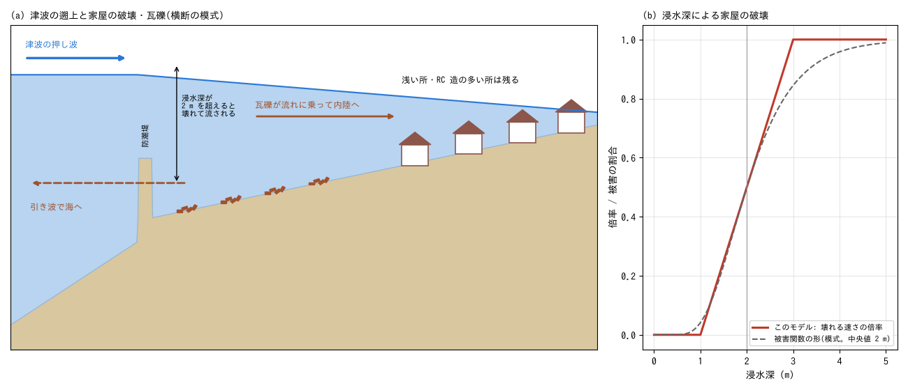
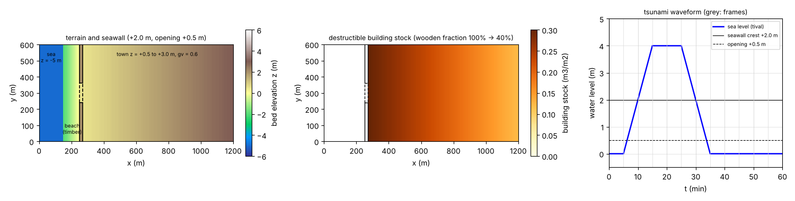
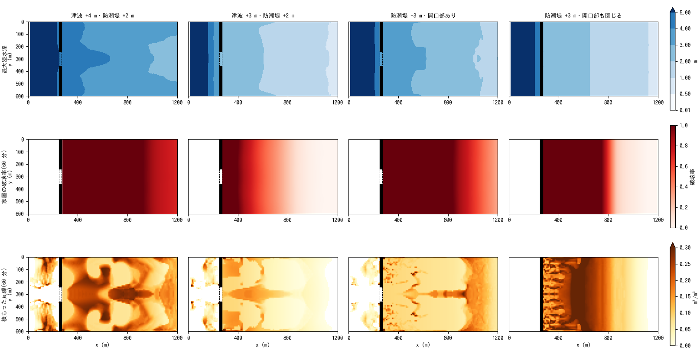
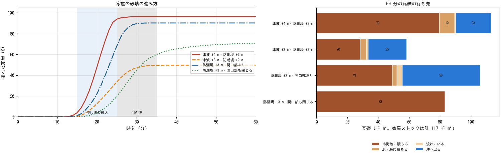
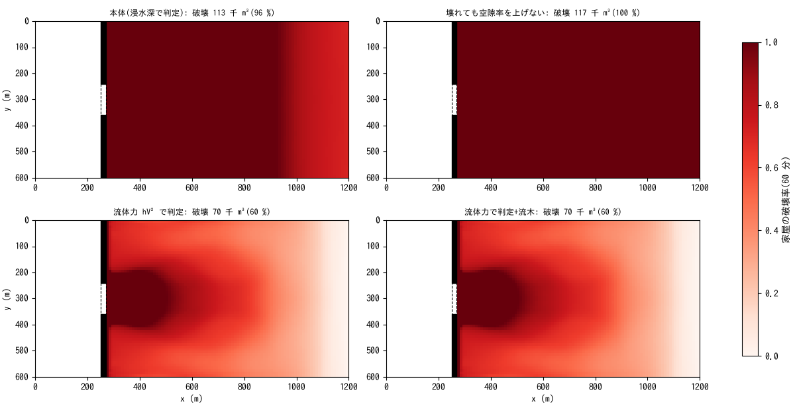
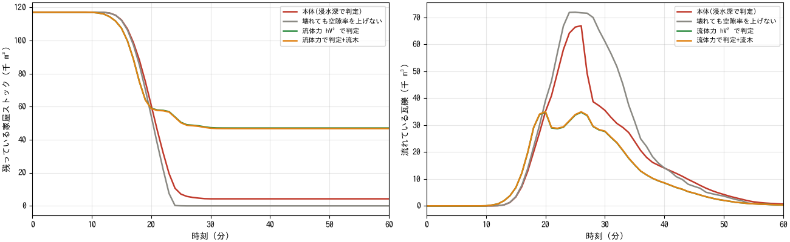

# tsunami_town — 津波による木造家屋の破壊と瓦礫の行き先

[English](en/README.md)

津波が防潮堤を越えて市街地に流れ込むと、深く浸かった木造家屋が壊れて押し流され、瓦礫に
なって流れに乗ります。瓦礫は内陸へ運ばれて積もり、一部は引き波で海へ出ていきます。この
例題は、津波の遡上、浸水深による家屋の破壊、瓦礫の運搬と堆積を一つの計算で解き、津波の
高さ、防潮堤の高さ、防潮堤の開口部(陸閘・水門)を閉じるかどうかで、被害と瓦礫の行き先が
どう変わるかを比べます。値は現象を見やすくするための模式値で、特定の津波の再現では
ありません。

## 実際の津波で起きていること

- **木造家屋の被害は浸水深 2 m を境に急に増える**: 津波の強さと被害の対応では、木造家屋は
  浸水深 1 m 程度で一部が壊れ、2 m を超えると全面的に壊れます(首藤 1993)。2011 年の東日本大震災の被害を
  集計した被害関数でも、木造家屋の全壊・流失の割合は浸水深 2 m 前後で急に増えます
  (Suppasri et al. 2013)。鉄筋コンクリート造・鉄骨造の建物は、再使用が難しくなるほど
  壊れる割合が低いことが報告されています(国土交通省 2011〜2012)。
- **壊れた家屋は瓦礫になって運ばれ、陸に残るものと海へ出るものに分かれる**: 東日本大
  震災では、岩手・宮城・福島の 3 県の沿岸で、陸に残った災害廃棄物が約 1,600 万 t、津波
  堆積物が約 1,000 万 t と推計されました(内閣府 2013)。同じ 3 県から海へ流れ出たのは
  約 500 万 t で、その約 3 割が漂流ごみになったと推計されています(環境省 2012)。
- **防潮堤の開口部を閉めることが命がけの作業になる**: 防潮堤には道路や川を通す開口部
  (陸閘・水門)があり、閉めなければそこから津波が入ります。東日本大震災では消防団員の
  死者・行方不明者が 254 名にのぼり(消防庁 2012)、水門・陸閘を操作する人の犠牲を受けて、
  国は操作する人の安全を最優先にし、自動化・遠隔操作化を進めるようガイドラインを改訂
  しました(国土交通省 2013)。

## 再現に必要な機構



(a) 津波が防潮堤を越え、深く浸かった海側の家屋が壊れて瓦礫になり、内陸へ運ばれ、引き波で
海へ戻る。(b) このモデルの家屋の破壊は、浸水深が 1 m を超えると始まり、3 m で最も速く
なる(壊れる速さの倍率。破線は被害関数の形を示す模式)。

| 実際の現象 | ENCflow での表し方 | 設定 |
|---|---|---|
| 沖から津波が押し寄せる | 沖の水位の時系列を、領域の西端の 1 列(海域マスク)に与える。津波の発生と伝播は扱わない | `fn_tide`(`tival`) |
| 防潮堤と開口部 | 地形の段(天端 +2 m、開口部 +0.5 m) | `fn_z` |
| 建物が流れを妨げる | 建物の空隙率(建物が 4 割を占める) | `fn_gv` |
| 浸水深の深い所で木造家屋が壊れる | 浸水深が 1 m を超えると家屋ストックが瓦礫に変わり始め、3 m 以上で最も速く変わる(被害関数の幅の近似) | `fn_bldgdebris`、`f_bdcrit = 1`、`bd_hcrit`・`bd_hcrit2` |
| 内陸ほど鉄筋コンクリート造が増える | 家屋ストックに木造率を織り込む(海側 100 % → 内陸 40 %) | `fn_bdstock`、`fn_bdfrac` |
| 壊れた家屋の跡は流れを通す | 壊れた割合に応じて建物の空隙率を上げる | `f_bdgv = 1` |
| 瓦礫が流れに乗って運ばれ、浅い所・流れの止まった所に積もる | 瓦礫の量を水と同じ流れで運び、浅い所(喫水より浅い)や流れの遅い所で積もらせる | `bd_wstop`、`bd_vstop` |
| 引き波で瓦礫が海へ出る | 海と浜も通常のセル(解く海)にし、瓦礫が海を経て西端から領域外へ出られるようにする | `fn_sw`(西端の 1 列だけ海域) |

## 幾何と設定



左: 地形と防潮堤(黒。中央の破線が開口部)。中: 壊れうる家屋ストック(木造率込み)と、結果
を集計する 3 つの地帯。右: 津波の波形(沖の水位)と防潮堤の天端。

1,200 m × 600 m、dx = dy = 10 m(120 × 60 セル)。西から順に:

| x (m) | セル番号 i | 地形 | 役割 |
|---|---|---|---|
| 0〜10 | 1 | z = −5 m、海域マスク | 津波の水位を与える列 |
| 10〜150 | 2〜15 | z = −5 m | 海(通常セル+初期水位) |
| 150〜250 | 16〜25 | z = −2 → 0 m | 浜 |
| 250〜270 | 26〜27 | z = +2.0 m | 防潮堤。中央の y = 240〜360 m(j = 25〜36)は**開口部 z = +0.5 m**(陸閘・水門・道路の切れ目が開いている所) |
| 270〜1,200 | 28〜120 | z = +0.5 → +3.0 m | 市街地。建物の空隙率 0.6(建物が 4 割を占める)。家屋ストック 0.3 m³/m² × 木造率(海側 100 % → 内陸 40 %)= 計 117,180 m³ |

- **津波**: 沖の水位を 5 分後から 10 分で +4 m(または +3 m)まで上げ、10 分保ってから
  10 分で戻します(1 波だけの理想化)。初期の水位は 0 m で、海と浜が水に浸かり、陸は
  乾いています。東・北・南の辺は閉じています(市街地は閉じた低地)。
- **家屋の破壊**: 浸水深が 1 m を超えると壊れ始め、3 m 以上で最も速く壊れます(家屋
  ストック 0.3 m³/m² が 10 分で全壊する速さ)。壊れた量の 3 割はその場に積もり(瓦・基礎
  など)、7 割が瓦礫として流れに乗ります。瓦礫は代表寸法 0.3 m・見かけ比重 0.5(喫水
  0.15 m)で、喫水より浅い所や流速 0.05 m/s 未満の所で積もります。
- 計算は 1 時間、dt = 0.5 s。

| ケース | 設定ファイル | 津波 | 防潮堤の天端 | 開口部 |
|---|---|---|---|---|
| 津波 +4 m・防潮堤 +2 m | param.txt | +4 m | +2 m | 開いている(+0.5 m) |
| 津波 +3 m・防潮堤 +2 m | param_t3.txt | +3 m | +2 m | 開いている |
| 防潮堤 +3 m・開口部あり | param_wall3.txt | +4 m | +3 m | 開いている |
| 防潮堤 +3 m・開口部も閉じる | param_wall3c.txt | +4 m | +3 m | 閉じる(+3 m) |

## 実行方法

```
cd examples/tsunami_town
make                    # リンクと入力(make_terrain.py)
make run                # 4 ケースを順に計算(1 ケース 4 スレッドで 20 秒前後)
make supp               # 補足の 3 ケース(任意)
python3 plot_results.py # figs/*.png と数表(引数 en で英語版を en/figs/ に)
```

## 結果



上: 最大浸水深、中: 60 分の家屋の破壊率(壊れて瓦礫になった割合)、下: 60 分に積もって
いる瓦礫(柱状の量)。黒 = 防潮堤、破線 = 開いている開口部。



左: 壊れた家屋の割合の時間変化(青い帯 = 押し波が最大の 10 分、灰色の帯 = 引き波)。右:
60 分の瓦礫の行き先(千 m³)。

| ケース | 市街地の最大浸水深(最大 / 平均) | 2 m 以上浸かった面積 | 壊れた家屋(全体 / 海側 / 中ほど / 内陸) | 市街地に積もる | 浜・海に積もる | 沖へ出る |
|---|---:|---:|---:|---:|---:|---:|
| 津波 +4 m・防潮堤 +2 m | 4.83 / 3.62 m | 100 % | 96 / 100 / 100 / 88 % | 88,547 m³ | 7,029 m³ | 16,672 m³ |
| 津波 +3 m・防潮堤 +2 m | 2.82 / 1.76 m | 35 % | 49 / 94 / 48 / 6 % | 29,387 m³ | 4,047 m³ | 23,419 m³ |
| 防潮堤 +3 m・開口部あり | 3.87 / 2.72 m | 84 % | 90 / 100 / 100 / 70 % | 49,683 m³ | 2,390 m³ | 50,076 m³ |
| 防潮堤 +3 m・開口部も閉じる | 2.96 / 1.87 m | 42 % | 71 / 100 / 97 / 13 %(35 分で 60 / 100 / 68 / 10 %) | 83,131 m³ | 0 | 0 |

海側 = x 270〜500 m、中ほど = 500〜800 m、内陸 = 800〜1,200 m。壊れた家屋は、家屋ストックの
うち 60 分までに瓦礫になった割合です。瓦礫の量は家屋ストックと同じ単位(m³)で、60 分に
まだ流れている分(数百〜数千 m³)は表から省いています。

- **津波 +4 m では市街地のほぼ全部が壊れる**: 津波は防潮堤を 2 m 越え、市街地の全域が
  2 m 以上浸かります。海側と中ほどの家屋は全壊し、鉄筋コンクリート造が多い内陸でも木造の
  88 % が壊れます。壊れた家屋の大半(8.9 万 m³)は市街地に積もり、1.7 万 m³(壊れた量の
  15 %)が引き波で沖へ出ます。
- **津波が 1 m 低いと、壊れる家屋は半分になる**: +3 m の津波では、2 m 以上浸かるのは海側を
  中心に市街地の 35 % だけです。海側は 94 % 壊れますが、中ほどは 48 %、内陸は 6 % に下がり
  ます。被害が浸水深 2 m を境に急に増えるため、津波の高さの少しの違いで被害の広がりが
  大きく変わります。壊れた家屋が海に近いので、瓦礫の 4 割(2.3 万 m³)が引き波で沖へ出ます。
- **防潮堤を高くしても、開口部が開いていると効果は小さい**: 天端を +3 m に上げても、幅
  120 m の開口部から津波が入り、市街地の 84 % が 2 m 以上浸かって 90 % の家屋が壊れます。
  引き波も開口部に集まって速く流れ出るので、瓦礫の半分(5.0 万 m³)が沖へ運ばれます。
- **開口部も閉じると、内陸が守られる**: 防潮堤を 1 m 越える分だけが入り、内陸の破壊は
  13 % に下がります。瓦礫は防潮堤の内側にすべて残り、沖へは出ません。ただし、入った水は
  閉じた防潮堤の内側に残り(60 分で市街地の平均 1.3 m)、このモデルでは浸水が続く間も
  家屋が壊れ続けます。引き波が終わる 35 分の破壊は 60 %(中ほど 68 %)で、その後の湛水中に
  71 %(中ほど 97 %)まで増えます。流れのない水に浸かっている家屋が流されることは実際には
  少ないので、この増えた分は過大です(下の「このモデルで表せないこと」)。

## このモデルで表せないこと(実際の現象との違い)

- **浸かっている時間でも壊れる**: このモデルの家屋の破壊は、浸水深で決まる速さで時間とともに
  進みます(浸水深 3 m で 10 分で全壊)。実際の被害関数は最大の浸水深と被害の関係で、浸かって
  いた時間は含みません。押し波の間はこの違いは小さいのですが、閉じた防潮堤の内側のように
  水が残ると、流れのない湛水でも壊れ続けます。流れの力で判定する方法(補足の流体力 hV² の
  判定)では、湛水中には壊れません。
- **瓦礫は水と同じ速さで流れる**: 個々の家屋や瓦礫の動き、建物への衝突、引っ掛かりによる
  堰き止めは表しません。瓦礫がぶつかる力は、最大流速と瓦礫の大きさから後処理で求めます
  (FEMA P-646、国総研資料 905 の衝突力の式)。
- **積もった瓦礫は地形にならない**: 積もった瓦礫は地盤を上げず、壊れた家屋の跡を再び
  塞ぐこともありません。
- **津波は 1 波だけ**: 実際の津波は何波も来て、後の波は前の波が作った瓦礫を運びます。
- **防潮堤は壊れない**: 越流で防潮堤の陸側の地盤が掘られて堤防が壊れることや、地盤の沈下は
  扱いません。
- **規模**: 領域は 1.2 km × 0.6 km で、市街地は閉じた低地です。値は模式値です。

## 注意

- **海と浜は海域マスクにしない**: 海域マスクのセルには瓦礫を置けず、瓦礫が運ばれることも
  ないので、浸水と瓦礫の運搬を解く範囲(海・浜・市街地)はすべて通常のセルにし、初期の水位
  で海を満たします。海域マスクは津波の水位を与える西端の 1 列だけです。
- **家屋ストックに木造率を織り込む**: 壊れうる家屋の量は 0.3 m³/m² × 木造率です。
  `fn_bdfrac`(木造率)は、全部壊れても空隙率が上がる上限を決めます(鉄筋コンクリート造の
  建物は残るので、空隙率は 1 まで上がらない)。
- **「どこまで届いたか」と「どこに残ったか」**: Bd9999 は瓦礫が通った所も含む最大の量
  (届いた範囲)、最後のフレームの Bd は積もって残った量です。体積への換算は、柱状の量 ×
  空隙率 × セルの面積です。空隙率は家屋が壊れると変わるので、全体の量は台帳
  (bldgdebris.csv。そのときの空隙率で換算済み)を使います。
- **沖へ出た瓦礫**: 家屋ストックの総量から、残っている家屋・流れている瓦礫・積もった瓦礫を
  引いた量で、西端の列から領域外へ出た分です。

## 感度実験の入口

- `tival`(津波の高さと長さ): 浸水深が 2 m を超える範囲が被害の広がりを決めます。
- make_terrain.py の防潮堤の天端・開口部の行の範囲: 入る水の量と、引き波の通り道。
- `bd_hcrit`・`bd_hcrit2`(壊れ始める浸水深と、最も速く壊れる浸水深)と `bd_wdes`(壊れる
  速さ): 被害関数の位置と幅、浸かっている時間の効き方。
- `fn_bdstock`・`fn_bdfrac`(木造率): 鉄筋コンクリート造の建物を増やすシナリオ。
- `bd_fsink`(その場に積もる割合)・`bd_vstop`(積もる流速): 瓦礫がどこに残るか、どれだけ
  沖へ出るか。

## 補足: 判定の方法・流木・空隙率への帰還

本体(津波 +4 m・防潮堤 +2 m)と同じ津波・地形で、家屋の壊れ方の決め方を変えた 3 ケースと
比べます。

| ケース | 設定ファイル | 変えたもの |
|---|---|---|
| 壊れても空隙率を上げない | param_oneway.txt | `f_bdgv = 0`(壊れた家屋の跡も流れを妨げたまま) |
| 流体力 hV² で判定 | param_load.txt | `f_bdcrit = 2`、壊れ始める hV² 1.0 m³/s²、最も速く壊れる 4.0 m³/s² |
| 流体力で判定+流木 | param_load_dw.txt | 上に加え、浜に材木 6 万 m³(1.0 m³/m²)を置き、流れた材木の重さを流体力に加える(`fn_driftwood`) |





| ケース | 壊れた家屋(全体 / 海側 / 中ほど / 内陸) | 市街地の最大浸水深(最大 / 平均) | 沖へ出た瓦礫 |
|---|---:|---:|---:|
| 本体(浸水深で判定) | 96 / 100 / 100 / 88 % | 4.83 / 3.62 m | 16,672 m³ |
| 壊れても空隙率を上げない | 100 / 100 / 100 / 100 % | 5.65 / 4.40 m | 33,745 m³ |
| 流体力 hV² で判定 | 60 / 83 / 67 / 31 % | 4.63 / 3.66 m | 18,585 m³ |
| 流体力で判定+流木 | 61 / 83 / 67 / 31 % | 4.63 / 3.66 m | 18,663 m³ |

- **空隙率への帰還**: 壊れた家屋の跡が流れを通すと、水が広い面積に広がって水位が下がり、
  内陸の破壊が減ります(全壊 100 % → 96 %)。帰還がないと市街地は「空隙 0.6 の狭い容器」の
  まま満たされて、最大浸水深が 5.65 m になります。引き波で沖へ出る瓦礫も、帰還ありでは半分です。
  実際の被災地がどちらに近いかは、壊れた跡が「流れを通す更地」になるか、「瓦礫で塞がれた
  まま」かで変わります(このモデルは前者)。
- **判定の方法**: 流体力 hV² で判定すると、壊れるのは流れの強い所(開口部から流れ込む流れの
  通り道、防潮堤を越えて落ちる所)に集まり、内陸へ向かって減ります(全体 60 %)。流れのない
  湛水では壊れません。閾値 1.0〜4.0 m³/s² はこの例題の水だけの最大流体力(F9999。市街地の
  中央値 8.6、内陸 5.8 m³/s²)を見て置いた校正値で、実務の値ではありません。実務の被害関数と
  直接つながるのは浸水深の判定、流れの力や流木・瓦礫の連鎖を見るのは流体力の判定、と使い
  分けます。
- **流木の寄与は数 %**: 浜の材木 6 万 m³ のうち 3.6 万 m³ が流れ出しますが、流木込みの最大
  流体力(Fd9999)は水だけ(F9999)より最大 5 %(平均 3 %)大きいだけで、壊れる家屋は
  0.3 ポイントしか増えません。材木が浸水域(約 56 ha)に広がると柱状の量は 0.06 m³/m² 程度に
  しかならず、水深 3〜5 m の水に比べて重さが数 % にとどまるためです。流木が建物に引っ掛かって
  集まる効果は表しません(流木の章の適用限界)。

## 参考文献

- 環境省(2012): 東日本大震災により海に流出した災害廃棄物の総量の推計結果について.
  https://www.env.go.jp/press/14948.html
- 国土交通省(2011〜2012): 東日本大震災による被災現況調査結果について(第 1 次・第 2 次報告).
  https://www.mlit.go.jp/toshi/toshi-hukkou-arkaibu.html
- 国土交通省(2013): 津波・高潮対策における水門・陸閘等管理システムガイドライン(改訂).
  https://www.mlit.go.jp/report/press/port07_hh_000040.html
- 内閣府(2013): 平成 25 年版 防災白書(東日本大震災の災害廃棄物と津波堆積物).
  https://www.bousai.go.jp/kaigirep/hakusho/h25/honbun/1b_1s_02_02.htm
- 消防庁(2012): 東日本大震災を踏まえた大規模災害時における消防団活動のあり方等に関する
  検討会 中間報告書.
- Shuto, N. (1993): Tsunami intensity and disasters. In: Tinti, S. (ed.), Tsunamis in the World,
  Kluwer, 197–216.
- Suppasri, A., Mas, E., Charvet, I., Gunasekera, R., Imai, K., Fukutani, Y., Abe, Y. and
  Imamura, F. (2013): Building damage characteristics based on surveyed data and fragility
  curves of the 2011 Great East Japan tsunami. Natural Hazards, 66(2), 319–341.
- FEMA (2012): Guidelines for Design of Structures for Vertical Evacuation from Tsunamis,
  Second Edition. FEMA P-646.
- 国土技術政策総合研究所(2016): 土石流・流木対策設計技術指針 解説. 国総研資料 第 905 号.
