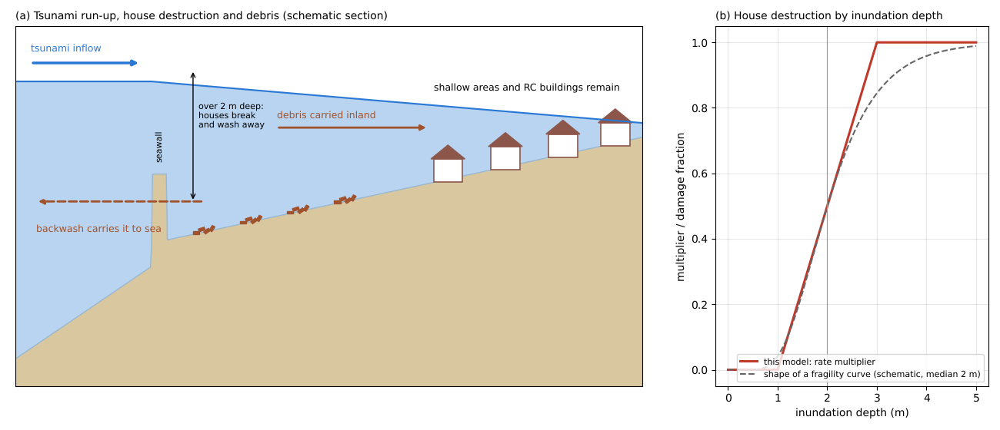
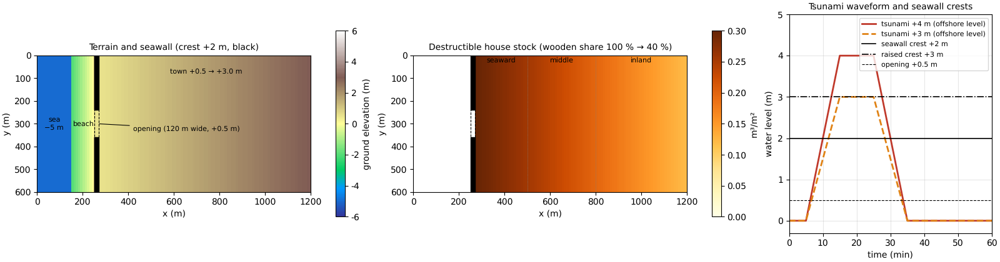
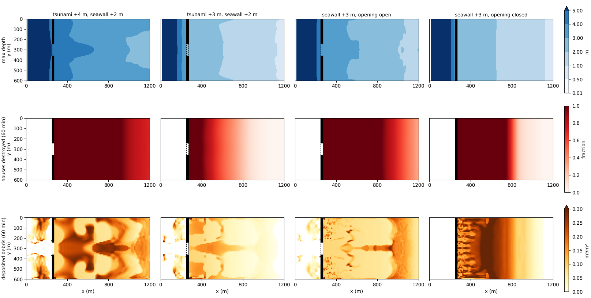
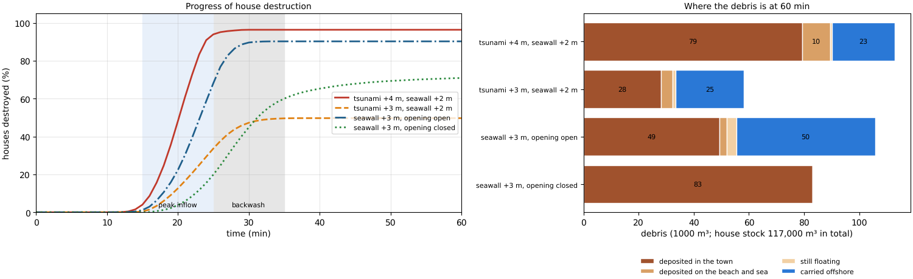
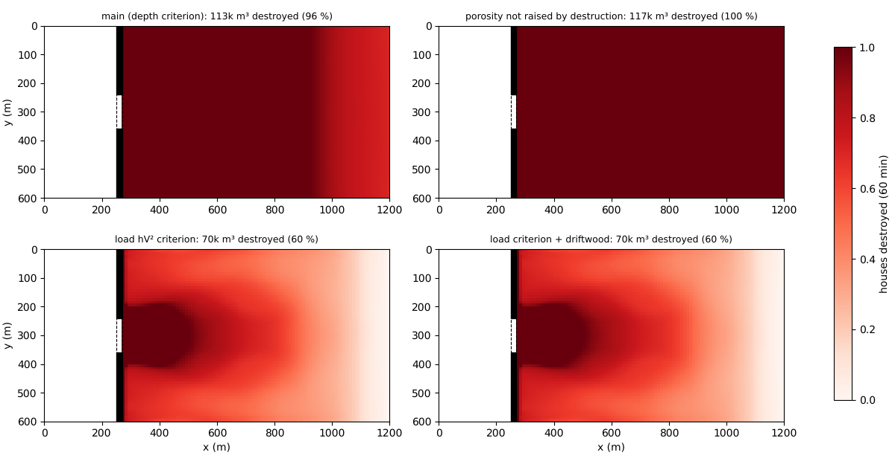
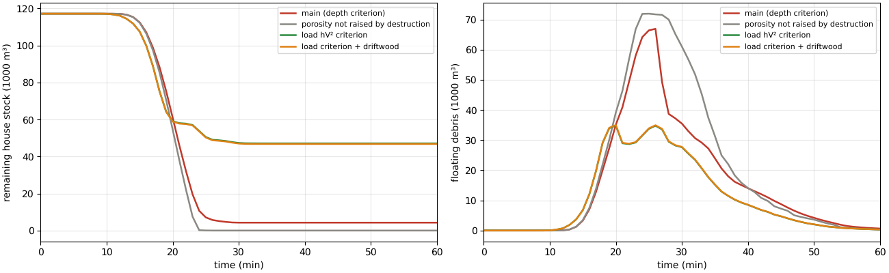

# tsunami_town — wooden houses destroyed by a tsunami, and where the debris goes

> English mirror of examples/tsunami_town/README.md. The Japanese file is the master copy.

[日本語](../README.md)

When a tsunami overtops a seawall and flows into a town, deeply flooded wooden houses break
and are swept away, becoming debris carried by the flow. The debris is carried inland and
deposited, and part of it goes out to sea with the backwash. This example solves the tsunami
run-up, the destruction of houses by inundation depth, and the transport and deposition of
debris in a single run, and compares how the damage and the fate of the debris change with the
tsunami height, the seawall height and whether the opening in the seawall (a land lock or sluice
gate) is closed. The values are schematic, chosen to make the phenomena easy to see; the
example does not reproduce any particular tsunami.

## What happens in a real tsunami

- **Damage to wooden houses rises sharply around 2 m of inundation**: in the correspondence
  between tsunami intensity and damage, wooden houses are partly destroyed at about 1 m of
  inundation and totally destroyed above 2 m (Shuto 1993). Fragility functions compiled from the
  damage of the 2011 Great East Japan Earthquake also show the share of wooden houses destroyed
  or washed away rising sharply around 2 m (Suppasri et al. 2013). Reinforced concrete and steel
  buildings were reported to be damaged beyond reuse at a low rate (MLIT 2011-2012).
- **Destroyed houses become debris that is carried away, part of it staying on land and part
  going to sea**: in the Great East Japan Earthquake, the disaster waste left on land along the
  coasts of Iwate, Miyagi and Fukushima was estimated at about 16 million t, and the tsunami
  deposits at about 10 million t (Cabinet Office 2013). About 5 million t was estimated to have
  flowed into the sea from the same three prefectures, about 30 % of which became drifting
  debris (Ministry of the Environment 2012).
- **Closing the openings in a seawall is life-threatening work**: seawalls have openings
  (land locks and sluice gates) for roads and rivers, and if they are not closed the tsunami
  enters through them. In the Great East Japan Earthquake 254 volunteer firefighters died or
  went missing (Fire and Disaster Management Agency 2012); in response to the loss of people
  operating sluice gates and land locks, the government revised its guidelines to put the safety
  of the operators first and to promote automation and remote operation (MLIT 2013).

## Mechanisms needed for the reproduction



(a) The tsunami overtops the seawall; deeply flooded houses near the shore break into debris,
which is carried inland and returns to sea with the backwash. (b) In this model, house
destruction starts once the inundation depth exceeds 1 m and is fastest at 3 m (the multiplier
of the destruction rate; the dashed line is a schematic of the shape of a fragility curve).

| Real phenomenon | How ENCflow represents it | Settings |
|---|---|---|
| A tsunami arrives from offshore | A time series of the offshore water level is given to the westmost column of the domain (sea mask). The generation and propagation of the tsunami are not treated | `fn_tide` (`tival`) |
| A seawall and its opening | A step in the terrain (crest +2 m, opening +0.5 m) | `fn_z` |
| Buildings obstruct the flow | Building porosity (buildings occupy 40 % of the area) | `fn_gv` |
| Wooden houses break where the inundation is deep | The house stock starts to turn into debris once the inundation depth exceeds 1 m, fastest above 3 m (an approximation of the width of a fragility curve) | `fn_bldgdebris`, `f_bdcrit = 1`, `bd_hcrit`, `bd_hcrit2` |
| Reinforced concrete buildings become more common inland | The wooden share is folded into the house stock (100 % on the seaward side → 40 % inland) | `fn_bdstock`, `fn_bdfrac` |
| The sites of destroyed houses let the flow through | The building porosity rises with the destroyed fraction | `f_bdgv = 1` |
| Debris rides the flow and settles where it is shallow or the flow stops | The debris is carried with the same flow as the water and settles where it is shallow (below its draft) or the flow is slow | `bd_wstop`, `bd_vstop` |
| The backwash carries debris to sea | The sea and the beach are ordinary cells too (a solved sea), so that debris can pass through the sea and leave the domain at the west end | `fn_sw` (only the westmost column is sea) |

## Geometry and settings



Left: terrain and seawall (black; the dashed part in the middle is the opening). Centre:
destructible house stock (wooden share included) and the three zones used for the totals.
Right: tsunami waveforms (offshore level) and seawall crests.

1,200 m × 600 m, dx = dy = 10 m (120 × 60 cells). From west to east:

| x (m) | Cell index i | Terrain | Role |
|---|---|---|---|
| 0-10 | 1 | z = −5 m, sea mask | column that receives the tsunami level |
| 10-150 | 2-15 | z = −5 m | sea (ordinary cells + initial water level) |
| 150-250 | 16-25 | z = −2 → 0 m | beach |
| 250-270 | 26-27 | z = +2.0 m | seawall. The central y = 240-360 m (j = 25-36) is an **opening at z = +0.5 m** (where a land lock, sluice gate or road gap is open) |
| 270-1,200 | 28-120 | z = +0.5 → +3.0 m | town. Building porosity 0.6 (buildings occupy 40 %). House stock 0.3 m³/m² × wooden share (100 % seaward → 40 % inland) = 117,180 m³ in total |

- **Tsunami**: the offshore level rises from 5 minutes to +4 m (or +3 m) in 10 minutes, stays
  for 10 minutes and returns in 10 minutes (a single idealised wave). The initial water level is
  0 m, so the sea and the beach are under water and the land is dry. The east, north and south
  edges are closed (the town is a closed lowland).
- **House destruction**: houses start to break once the inundation exceeds 1 m and break fastest
  above 3 m (a rate at which 0.3 m³/m² of house stock is fully destroyed in 10 minutes). 30 % of
  the destroyed amount settles on the spot (tiles, foundations and so on) and 70 % rides the flow
  as debris. The debris has a representative size of 0.3 m and an apparent specific gravity of
  0.5 (draft 0.15 m), and it settles where the water is shallower than its draft or the flow is
  slower than 0.05 m/s.
- The run is 1 hour, dt = 0.5 s.

| Case | Settings file | Tsunami | Seawall crest | Opening |
|---|---|---|---|---|
| Tsunami +4 m, seawall +2 m | param.txt | +4 m | +2 m | open (+0.5 m) |
| Tsunami +3 m, seawall +2 m | param_t3.txt | +3 m | +2 m | open |
| Seawall +3 m, opening open | param_wall3.txt | +4 m | +3 m | open |
| Seawall +3 m, opening closed | param_wall3c.txt | +4 m | +3 m | closed (+3 m) |

## How to run

```
cd examples/tsunami_town
make                    # links and inputs (make_terrain.py)
make run                # run the 4 cases in turn (about 20 seconds per case on 4 threads)
make supp               # the 3 supplement cases (optional)
python3 plot_results.py # figs/*.png and the table (with the argument en, the English version goes to en/figs/)
```

## Results



Top: maximum inundation depth; middle: houses destroyed at 60 minutes (the fraction turned into
debris); bottom: debris deposited at 60 minutes (column amount). Black = seawall, dashed = open
opening.



Left: share of houses destroyed over time (blue band = the 10 minutes of peak inflow, grey band =
backwash). Right: where the debris is at 60 minutes (1000 m³).

| Case | Max inundation depth in the town (max / mean) | Area flooded ≥ 2 m | Houses destroyed (all / seaward / middle / inland) | Deposited in the town | Deposited on the beach and sea | Carried offshore |
|---|---:|---:|---:|---:|---:|---:|
| Tsunami +4 m, seawall +2 m | 4.82 / 3.62 m | 100 % | 96 / 100 / 100 / 89 % | 79,424 m³ | 10,049 m³ | 22,784 m³ |
| Tsunami +3 m, seawall +2 m | 2.80 / 1.76 m | 36 % | 50 / 94 / 48 / 6 % | 28,221 m³ | 4,135 m³ | 24,814 m³ |
| Seawall +3 m, opening open | 3.86 / 2.71 m | 84 % | 90 / 100 / 100 / 70 % | 49,270 m³ | 2,734 m³ | 50,352 m³ |
| Seawall +3 m, opening closed | 2.96 / 1.85 m | 41 % | 71 / 100 / 97 / 13 % (60 / 100 / 68 / 10 % at 35 min) | 83,071 m³ | 0 | 0 |

Seaward = x 270-500 m, middle = 500-800 m, inland = 800-1,200 m. "Houses destroyed" is the
fraction of the house stock turned into debris by 60 minutes. Debris is in the same units as
the house stock (m³); the amount still floating at 60 minutes (hundreds to thousands of m³) is
left out of the table. The tables and figures show the values recomputed on 2026-10-31
with the default f_opening_dynamic = 3 (developer.md §68.41).

- **With a +4 m tsunami almost the whole town is destroyed**: the tsunami overtops the seawall
  by 2 m and the whole town is flooded 2 m or more. Houses on the seaward side and in the middle
  are all destroyed, and even inland, where reinforced concrete buildings are more common, 89 %
  of the wooden houses break. Most of the destroyed houses (79 thousand m³) settle in the town,
  and 23 thousand m³ (20 % of the destroyed amount) goes offshore with the backwash.
- **A tsunami 1 m lower destroys half as many houses**: with a +3 m tsunami, only 36 % of the
  town, mainly on the seaward side, is flooded 2 m or more. The seaward side is 94 % destroyed,
  but the middle falls to 48 % and inland to 6 %. Because damage rises sharply around 2 m of
  inundation, a small difference in tsunami height changes the extent of the damage a lot. The
  destroyed houses are close to the sea, so 40 % of the debris (25 thousand m³) goes offshore
  with the backwash.
- **Raising the seawall does little while the opening is open**: even with the crest raised to
  +3 m, the tsunami enters through the 120 m opening, 84 % of the town is flooded 2 m or more and
  90 % of the houses break. The backwash also gathers at the opening and flows out fast, carrying
  half of the debris (50 thousand m³) offshore.
- **Closing the opening as well protects the inland area**: only the water overtopping the
  seawall by 1 m enters, and the inland destruction falls to 13 %. All the debris stays behind
  the seawall and none goes offshore. However, the water that entered stays behind the closed
  seawall (1.3 m on average over the town at 60 minutes), and in this model houses keep breaking
  while they stay flooded. The destruction at 35 minutes, when the backwash ends, is 60 % (68 %
  in the middle), and it grows to 71 % (97 % in the middle) during the standing water that
  follows. Houses standing in still water are rarely swept away in reality, so this increase is
  an overestimate (see "What this model cannot represent" below).

## What this model cannot represent (differences from real phenomena)

- **Houses also break with time under water**: in this model house destruction progresses with
  time at a rate set by the inundation depth (fully destroyed in 10 minutes at 3 m). Real
  fragility functions relate the maximum inundation depth to the damage and do not include the
  time under water. The difference is small while the tsunami flows in, but where water stays,
  as behind the closed seawall, houses keep breaking even in still water. With a criterion based
  on the force of the flow (the load hV² criterion in the supplement), houses do not break in
  standing water.
- **Debris moves at the speed of the water**: the motion of individual houses or pieces of
  debris, their impact on buildings and damming by snagging are not represented. The impact
  force of debris is obtained by post-processing from the maximum velocity and the size of the
  debris (the impact formulas of FEMA P-646 and NILIM Technical Note 905).
- **Deposited debris does not become terrain**: deposited debris does not raise the ground and
  does not block the sites of destroyed houses again.
- **Only one wave**: a real tsunami arrives in several waves, and later waves carry the debris
  made by earlier ones.
- **The seawall does not fail**: erosion of the ground on the landward side of the seawall by
  overtopping, which can make the seawall fail, and ground subsidence are not treated.
- **Scale**: the domain is 1.2 km × 0.6 km, and the town is a closed lowland. The values are
  schematic.

## Notes

- **Do not put the sea and the beach under the sea mask**: sea-mask cells cannot hold debris and
  do not carry it, so the whole area where inundation and debris transport are solved (sea,
  beach and town) is made of ordinary cells, and the sea is filled by the initial water level.
  The sea mask is only the westmost column that receives the tsunami level.
- **Fold the wooden share into the house stock**: the destructible amount is 0.3 m³/m² × wooden
  share. `fn_bdfrac` (wooden share) sets the upper limit to which the porosity can rise even when
  everything is destroyed (reinforced concrete buildings remain, so the porosity does not reach 1).
- **"How far it reached" and "where it remained"**: Bd9999 is the maximum amount including where
  debris only passed (the reach), and Bd in the last frame is what settled and remained. The
  volume is the column amount × porosity × cell area. The porosity changes as houses break, so
  use the ledger (bldgdebris.csv, converted with the porosity at each time) for the totals.
- **Debris carried offshore**: the total house stock minus the remaining houses, the floating
  debris and the deposited debris; it is what left the domain through the westmost column.

## Starting points for sensitivity tests

- `tival` (tsunami height and duration): the area flooded more than 2 m deep sets the extent of
  the damage.
- The seawall crest and the rows of the opening in make_terrain.py: how much water enters, and the
  path of the backwash.
- `bd_hcrit`, `bd_hcrit2` (the depth at which houses start to break and at which they break
  fastest) and `bd_wdes` (how fast they break): the position and width of the fragility curve and
  how much the time under water matters.
- `fn_bdstock`, `fn_bdfrac` (wooden share): scenarios with more reinforced concrete buildings.
- `bd_fsink` (share that settles on the spot) and `bd_vstop` (velocity below which debris settles):
  where the debris remains and how much goes offshore.

## Supplement: the destruction criterion, driftwood and porosity feedback

With the same tsunami and terrain as the main case (tsunami +4 m, seawall +2 m), three cases
change how house destruction is decided.

| Case | Settings file | What changes |
|---|---|---|
| Porosity not raised by destruction | param_oneway.txt | `f_bdgv = 0` (the sites of destroyed houses keep obstructing the flow) |
| Load hV² criterion | param_load.txt | `f_bdcrit = 2`, destruction starts at hV² = 1.0 m³/s² and is fastest at 4.0 m³/s² |
| Load criterion + driftwood | param_load_dw.txt | as above, plus 60,000 m³ of timber (1.0 m³/m²) on the beach whose weight is added to the load once it floats (`fn_driftwood`) |





| Case | Houses destroyed (all / seaward / middle / inland) | Max inundation depth in the town (max / mean) | Debris carried offshore |
|---|---:|---:|---:|
| Main (depth criterion) | 96 / 100 / 100 / 89 % | 4.82 / 3.62 m | 22,784 m³ |
| Porosity not raised by destruction | 100 / 100 / 100 / 100 % | 5.66 / 4.44 m | 34,872 m³ |
| Load hV² criterion | 60 / 82 / 66 / 30 % | 4.64 / 3.66 m | 19,440 m³ |
| Load criterion + driftwood | 60 / 83 / 66 / 30 % | 4.63 / 3.65 m | 19,516 m³ |

- **Porosity feedback**: when the sites of destroyed houses let the flow through, the water
  spreads over a larger area, the level falls and inland destruction decreases (100 % → 96 %).
  Without the feedback the town fills as a "narrow container with 0.6 porosity" and the maximum
  inundation depth reaches 5.65 m. The debris going offshore with the backwash is also halved with
  the feedback. Which is closer to a real disaster area depends on whether the sites of destroyed
  houses become "open ground that lets the flow through" or stay "blocked by debris" (this model
  assumes the former).
- **Destruction criterion**: with the load hV² criterion, destruction concentrates where the flow
  is strong (the path of the flow entering through the opening, where water falls over the
  seawall) and decreases inland (60 % in all). Houses do not break in standing water. The
  thresholds of 1.0-4.0 m³/s² are calibration values set from the water-only maximum load of this
  example (F9999; median 8.6 m³/s² over the town, 5.8 inland), not practical values. The depth
  criterion links directly to the fragility functions used in practice; the load criterion is for
  looking at the force of the flow and the chain with driftwood and debris.
- **Driftwood adds a few percent**: 36,000 of the 60,000 m³ of timber on the beach floats away,
  but the maximum load including driftwood (Fd9999) is only up to 5 % (3 % on average) larger
  than the water-only load (F9999), and the houses destroyed increase by less than 1 point. Spread
  over the flooded area (about 56 ha), the timber is only about 0.06 m³/m² as a column, a few
  percent of the weight of 3-5 m of water. Driftwood gathering by snagging on buildings is not
  represented (a limit stated in the driftwood chapter).

## References

- Ministry of the Environment (2012): Estimate of the total amount of disaster waste that flowed
  into the sea in the Great East Japan Earthquake (in Japanese).
  https://www.env.go.jp/press/14948.html
- MLIT (2011-2012): Results of the survey of damage in the Great East Japan Earthquake (1st and
  2nd reports) (in Japanese). https://www.mlit.go.jp/toshi/toshi-hukkou-arkaibu.html
- MLIT (2013): Guidelines for the management systems of sluice gates and land locks for tsunami
  and storm surge measures (revised) (in Japanese).
  https://www.mlit.go.jp/report/press/port07_hh_000040.html
- Cabinet Office (2013): White Paper on Disaster Management 2013 (disaster waste and tsunami
  deposits of the Great East Japan Earthquake) (in Japanese).
  https://www.bousai.go.jp/kaigirep/hakusho/h25/honbun/1b_1s_02_02.htm
- Fire and Disaster Management Agency (2012): Interim report of the study group on volunteer
  fire corps activities in large-scale disasters after the Great East Japan Earthquake (in
  Japanese).
- Shuto, N. (1993): Tsunami intensity and disasters. In: Tinti, S. (ed.), Tsunamis in the World,
  Kluwer, 197–216.
- Suppasri, A., Mas, E., Charvet, I., Gunasekera, R., Imai, K., Fukutani, Y., Abe, Y. and
  Imamura, F. (2013): Building damage characteristics based on surveyed data and fragility
  curves of the 2011 Great East Japan tsunami. Natural Hazards, 66(2), 319–341.
- FEMA (2012): Guidelines for Design of Structures for Vertical Evacuation from Tsunamis,
  Second Edition. FEMA P-646.
- National Institute for Land and Infrastructure Management (2016): Commentary on the technical
  guideline for the design of debris flow and driftwood countermeasures. NILIM Technical Note
  No. 905 (in Japanese).
