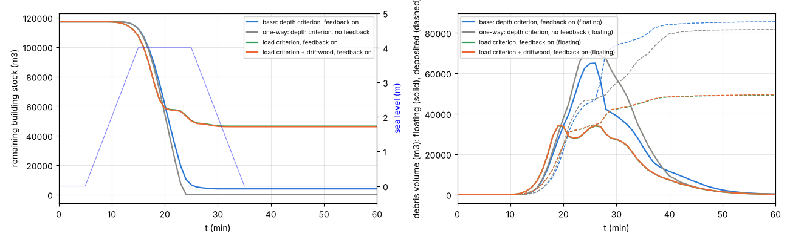
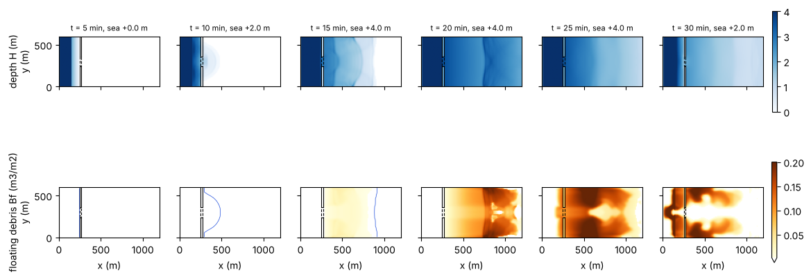
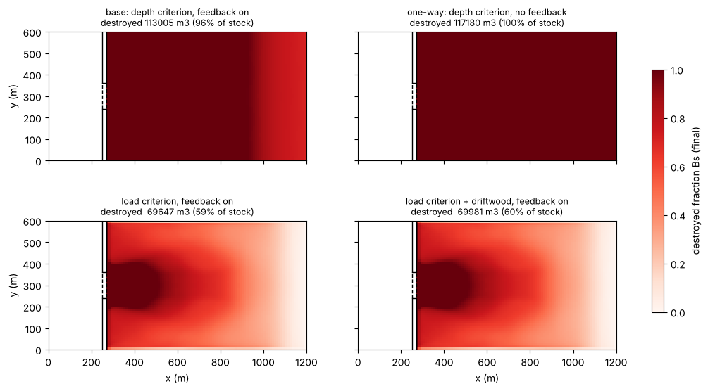
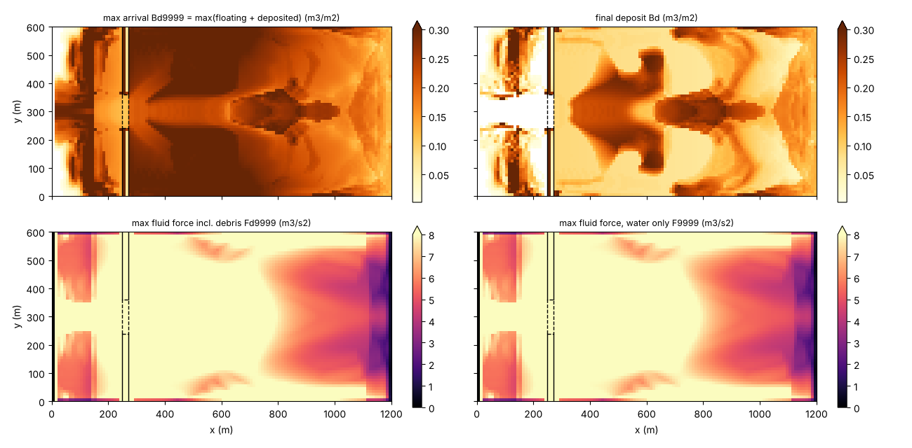
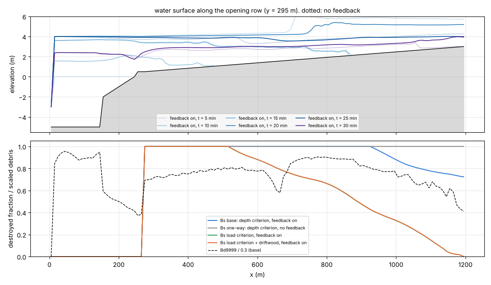

# tsunami_town — house destruction, debris flow and deposition by a tsunami running up into a town (idealized case)

> English mirror of examples/tsunami_town/README.md. The Japanese file is the master copy.

[日本語](../README.md)

A tsunami runs up into a low-lying coastal town, destroys wooden houses,
carries the debris inland and deposits it. This phenomenon is estimated
with the combination of the **building destruction and debris module
fn_bldgdebris**
([docs/users_guide/bldgdebris.md](../../../docs/en/users_guide/bldgdebris.md),
developer.md §63) and the **tide forcing fn_tide** (the tsunami waveform),
plus, in the comparison cases, the **driftwood module fn_driftwood** (§50).
Four things can be compared side by side on the same terrain with the same
waveform: the damage-function type destruction criterion, the raster
transport of debris, the effect of the void-ratio change caused by
destruction feeding back to the flow, and the increase of destructive
force by driftwood. No code change (settings only). One main case plus
three comparison cases.

## Geometry and setup


Left: terrain, the coastal dike (black) and the opening (dashed). Center:
destructible building stock (wooden fraction included; 100 % on the sea
side → 40 % inland). Right: the tsunami waveform (idealized leading wave
only).

1,200 m × 600 m, dx = dy = 10 m (120 × 60 cells). From the west:

| x (m) | Cell index i | Terrain | Role |
|---|---|---|---|
| 0–10 | 1 | z = −5 m, sea mask | Entrance of the tide forcing (tsunami waveform) |
| 10–150 | 2–15 | z = −5 m | Sea (ordinary cells + initial water level = a solved sea) |
| 150–250 | 16–25 | z = −2 → 0 m | Beach and log yard. In the driftwood case, timber stock 1.0 m³/m² (60,000 m³ in total) |
| 250–270 | 26–27 | z = +2.0 m | Coastal dike. The center y = 240–360 m (j = 25–36) is an **opening at z = +0.5 m** |
| 270–1,200 | 28–120 | Gentle slope z = +0.5 → +3.0 m | Town. Building void ratio **gv = 0.6**. Building stock 0.3 m³/m² × wooden fraction (100 % → 40 %) = **117,180 m³ in total**. Destructible share fn_bdfrac = wooden fraction |

The initial water level is a uniform T.P. 0 m (f_htype=2). The tsunami is
given as a uniform time series on the sea cells of the westernmost column:
starting 5 minutes in, it reaches **+4.0 m** in 10 minutes, holds for
10 minutes, and returns to 0 m in 10 minutes (leading wave only; it
overtops the dike crest of +2.0 m by 2 m). The east, north and south edges
are the default walls. dt = 0.5 s, 1 hour. The computation takes a little
over 1 minute per case.

Debris has a representative size of 0.3 m and an apparent specific gravity
of 0.5 (draft 0.15 m). The destruction criterion of the main case is the
inundation depth (f_bdcrit=1), a linear ramp from the threshold 1.0 m to
3.0 m (an approximation of the width of the damage function of wooden
houses in the Tohoku tsunami), destruction rate 5.0e-4 m/s (0.3 m³/m²
fully destroyed in 10 minutes), sinking fraction 0.3, velocity threshold
of slow-flow deposition 0.05 m/s, and feedback to the void ratio on
(f_bdgv=1).

| Case | Parameter file | Criterion | Feedback | Driftwood | Purpose |
|---|---|---|---|---|---|
| Main | param.txt | Inundation depth 1.0–3.0 m | Yes | — | Damage-function type destruction criterion + feedback |
| One-way | param_oneway.txt | Ditto | **No** | — | Control for the effect of the feedback |
| Load | param_load.txt | Load 1.0–4.0 m³/s² | Yes | — | Fluid-force based criterion |
| Load + driftwood | param_load_dw.txt | Ditto | Yes | **Yes** | Increase of destructive force by driftwood |

## Key points of the setup (reasons for the settings)

1. **Do not put the sea, the beach and the town in the sea mask.** Debris
   and driftwood cannot be placed on sea cells and advection does not act
   there, so the whole range in which inundation and transport are solved
   is represented by ordinary cells + initial water level, and the sea
   mask + tide forcing is limited to the westernmost column (the same
   style as examples/timberyard). The tsunami is received as an offshore
   water-level time series (generation and propagation are external).
2. **Fold the wooden fraction into the building stock fn_bdstock.** The
   volume that can become debris is 0.3 m³/m² × wooden fraction, assuming
   more RC and tsunami-resistant structures further inland.
   **fn_bdfrac (= wooden fraction)** sets the upper bound of the
   void-ratio feedback: the RC structures keep occupying their footprint
   even after total destruction, so gv rises only to gv0 + (1 − gv0)·fw.
3. **The inundation-depth criterion is a reinterpretation of the damage
   function.** A linear ramp in which destruction starts at threshold 1
   (1.0 m) and the destructible rate reaches 1 at threshold 2 (3.0 m).
   Read the median of the damage function as the midpoint of the two
   thresholds and its width as the ramp width. The destruction rate is
   set from "time to total destruction = stock ÷ rate" (here 10 minutes =
   the holding time of the incoming wave).
4. **The thresholds of the load criterion (f_bdcrit=2) are in the unit of
   F9999** (m³/s², freshwater-normalized). Look at the distribution of the
   water-only maximum fluid force F9999 and place the two values "total
   destruction up to here, no damage beyond here" at thresholds 1 and 2.
   The driftwood and debris terms are included in the load Fd9999 (see
   the reading below).
5. **In the driftwood case the recruitment threshold dw_hrec is set above
   the normal water depth on the beach** (3.0 m). The timber is washed
   out only once the tsunami raises the water level (the same style as
   timberyard).
6. **The feedback to the void ratio f_bdgv** is compared by switching 0/1
   in the same case (the one-way case). With the feedback, the water of
   destroyed cells spreads over a larger area, the water level falls, and
   the destruction inland decreases.

## How to run

```
cd examples/tsunami_town
make                                   # link to ../../bin/encflow
python3 make_terrain.py                # the z sw gv bdstock bdfrac dwstock .txt files
./encflow param.txt                    # main case (about 1 minute)
./encflow param_oneway.txt             # no feedback
./encflow param_load.txt               # load criterion
./encflow param_load_dw.txt            # load criterion + driftwood
python3 plot_results.py                # figs/*.png and tables (draws only the result_* that exist)
```

Output (result/): frames of H and V every 5 minutes, **Bf (moving debris),
Bd (deposited debris), Bs (destruction ratio of houses)**, run maxima
(H9999, V9999, F9999, **Bd9999 = maximum reach of the debris**,
**Fd9999 = maximum fluid force including driftwood and debris**), and
bldgdebris.csv (the volume ledger, every minute). The driftwood case also
writes Hd, Wd and driftwood.csv.

## Results (2026-10-17; gfortran, dt = 0.5 s, f_advection_scheme = 3)



Left: remaining building stock (4 cases) and the tsunami waveform. Right:
moving debris (solid) and deposited debris (dashed). Destruction begins
around 10 minutes, when the dike is overtopped, and proceeds during the
holding period of the incoming wave (15–25 minutes). The main case with
feedback (blue) stops at 96 %, while the case without feedback (gray) is
totally destroyed. The load criterion (green, orange) gives 59 %, nearly
identical with and without driftwood.



Time evolution of inundation depth H (top) and moving debris Bf (bottom)
in the main case. 10 min: inundation starts through the opening, and
debris generation appears behind the dike. 15–20 min: the whole dike is
overtopped, the town is flooded up to +4 m, and the debris moves inland
with the front (x ≈ 900 m). 26 min: debris peak (66,595 m³ floating).
30 min: the debris begins to return seaward with the drawdown.



Final destruction ratio Bs. With the inundation-depth criterion (top row)
almost the entire town is totally destroyed, but with feedback (left) the
destruction ratio inland (x > 900 m) stays at 0.83 on average (minimum
0.71). The load criterion (bottom row) gives total destruction in the jet
region behind the opening, high values on the overtopped parts of the
dike (stripes in the y direction), and a linear decrease inland. The
difference with and without driftwood (left and right) is invisible.



Maximum reach of debris Bd9999 (top left), final deposition (top right),
maximum fluid force including driftwood and debris Fd9999 (bottom left),
and water-only F9999 (bottom right) in the main case. The debris reaches
the whole town (reach x ≈ 1,195 m = the eastern edge), and the final
deposition concentrates along the axis of the jet from the opening and in
the stagnant areas inland. The debris that went out to sea with the
drawdown (coloring on the beach and sea) is also visible.



Profiles along the row through the opening (y = 295 m). Top: time
evolution of the water surface (solid = with feedback, dotted = without).
At 25 minutes the water surface without feedback piles up to more than
+5 m (water is forced into the narrow storage of void ratio 0.6), whereas
with feedback it is around +4 m (the void ratio of totally destroyed cells
becomes 1 and the same water spreads over a larger area). Bottom:
destruction ratio (4 cases) and maximum reach of debris (main case,
normalized by 0.3).

| Case | Destroyed volume | Destruction ratio | Final deposition | Floating remainder | Outflow from the system (to sea) | Maximum depth in the town |
|---|---|---|---|---|---|---|
| Main (depth, with feedback) | **113,005 m³** | **96.4 %** | 86,574 | 1,173 | 25,258 | 4.81 m |
| One-way (no feedback) | 117,180 | 100.0 % | 81,816 | 387 | 34,977 | 5.65 m |
| Load criterion | 69,647 | 59.4 % | 48,295 | 379 | 20,973 | 4.80 m |
| Load criterion + driftwood | 69,981 | 59.7 % | 48,510 | 385 | 21,087 | 4.81 m |

Breakdown of the main case (x 270–500 / 500–800 / 800–1,200 m):
38,430 / 40,793 / 33,782 m³ (total / total / 89 %). The outflow from the
system is the ledger residual total stock − (remaining stock + floating +
deposited), the part that went out to the sea cells on the drawdown. Of
the 60,000 m³ of timber in the driftwood case, 35,795 m³ was washed out,
16,917 m³ deposited and 18,589 m³ returned to the sea.

## How to read the results

- **The last frame of Bs (destruction ratio) is the damage-ratio map.**
  Conversion to numbers of houses or monetary values is post-processing
  (stock × Bs × gv × area for the debris volume, a building register for
  the number of houses).
- **Bd9999 shows "how far it reaches", the last frame of Bd "where it
  remains"** (the same distinction as Wd9999 / Wd9998 for driftwood). The
  conversion to volume is columnar amount × gv × cell area; since gv
  changes with the feedback, **use the values of the ledger CSV** (the CSV
  is already converted with the current gv. In a closed domain the sum
  equals the total stock to machine precision; in this case it decreases
  only by the outflow to the sea cells).
- **The difference between Fd9999 and F9999 is the contribution of the
  floating material.** In this case the difference is at most 6 % (in the
  jet region behind the opening), and the effect on the destruction ratio
  is 0.3 points. 60,000 m³ of timber spread over the 70 ha of inundated
  area amounts to only about 0.1 m³/m² of columnar amount, and the added
  mass against a 3–5 m water column stays at a few %. The effect of
  driftwood **concentrating** by jamming or catching on houses is not
  represented in a raster (the application limits in
  [users_guide/driftwood.md](../../../docs/en/users_guide/driftwood.md)),
  so read the driftwood term of this module as "the average increase of
  load in a flow with dilute floating material". The impact load of
  individual pieces is post-processed from V9999 and the representative
  diameter as before (NILIM Technical Note 905 §4.3, FEMA P-646).
- **The effect of the feedback appears in both water level and
  destruction ratio.** Without feedback the town is filled as "a narrow
  container of void ratio 0.6", the water level is high, and everything
  is destroyed. With feedback, the void space of the totally destroyed
  seaward cells opens, the water spreads, the inundation depth inland
  falls and the destruction ratio decreases (96 % vs 100 %). At the same
  time the debris returning to the sea on the drawdown decreases by 30 %
  (25,258 vs 34,977 m³) and the debris remaining inland increases (86,574
  vs 81,816 m³). Which is closer to reality depends on whether a
  destroyed lot becomes "cleared ground that passes the flow" or "stays
  blocked by debris". This module takes the former (deposited debris does
  not re-close the void space); the latter is out of scope.

## Properties to know (reasons for the settings)


- **The inundation-depth criterion is decided by "the inundation depth
  alone"**, so the chain including driftwood and debris appears only in
  the load criterion (f_bdcrit=2). Use the depth criterion when connecting
  directly to practical damage functions, and the load criterion to see
  the chain. To fit both thresholds from the same damage records, the
  practical way is to compare the water-only F9999 and H9999 distributions
  with the damage ratio.
- **The load thresholds 1.0–4.0 m³/s² are calibration values placed from
  the F9999 distribution of this case** (median 5–9, 4–5 inland), not
  practical values. Raising the thresholds concentrates the destruction
  on the sea side and makes the driftwood and debris contribution (a
  few %) matter in the cells near the threshold, but the size of the
  contribution itself does not change.
- **The destruction rate trades off against the exposure time.** A larger
  bd_wdes destroys almost everything the moment the threshold is exceeded
  (approaching the "instantaneous judgement" of a damage function); a
  smaller one lets the duration of the incoming wave matter (houses
  survive a short tsunami).
- **The sinking fraction bd_fsink is the lower bound of "the debris that
  stays in place".** With 0.3, 30 % of the stock deposits on the spot and
  the remaining 70 % floats and is carried inland or to sea. Use 0 for an
  upper-bound assessment of the reach.
- **The debris returns to the sea on the drawdown.** Since the domain is
  not closed, the ledger residual becomes the outflow from the system.
  The ratio of the debris remaining in the town after the drawdown (final
  Bd) to the debris that went to sea (a problem for harbors and channels
  as floating objects) is sensitive to the slow-flow deposition threshold
  of dw/bd (bd_vstop) and refloating (bd_wfloat, off by default).
- **The east, north and south edges are walls (default).** The town fills
  as a closed lowland. For a town with a drainage outlet behind it, give
  the boundaries of
  [users_guide/boundary.md](../../../docs/en/users_guide/boundary.md).

## Starting points for sensitivity experiments

- Peak level and duration of the tsunami (tival): the destruction ratio
  of the depth criterion is sensitive to the water level, and the load
  criterion to the velocity (the drop of the overtopping flow, the jet
  through the opening).
- Dike crest and width of the opening (make_terrain.py): determine the
  spatial pattern of the load criterion.
- fn_bdfrac (wooden fraction) and fn_gv: scenarios of tsunami-proofing
  and urbanization. Replace the stock and fw together (item 2 of "Key
  points of the setup" in this README).
- bd_hcrit / bd_hcrit2, bd_fcrit / bd_fcrit2: median and width of the
  damage function.
- bd_wdes, bd_fsink, bd_vstop, bd_wfloat: see "Properties to know" above.
- Amount and placement of driftwood (dwstock.txt): the contribution of
  the driftwood term is determined by "the columnar amount of timber
  relative to the water column". A concentrated log yard (timberyard
  type) placed right in front of the opening increases the contribution.

## Related

- Description of the feature and parameter table: [docs/users_guide/bldgdebris.md](../../../docs/en/users_guide/bldgdebris.md); driftwood: [users_guide/driftwood.md](../../../docs/en/users_guide/driftwood.md); tide: [users_guide/tide.md](../../../docs/en/users_guide/tide.md)
- List of applications: [docs/users_guide/usecases.md](../../../docs/en/users_guide/usecases.md)
- Design, verification and literature cross-check: docs/developer.md §63 (the building destruction and debris module and the void ratio as a state variable; in Japanese)
- Self-verification tests: [test/bldgdebris](../../../test/bldgdebris/en/README.md) (conservation laws, one-way coupling, volume conservation under feedback, restart) and [test/gvchange](../../../test/gvchange/en/README.md) (unit check of void-ratio changes) (in Japanese)
- Example of the same type: [examples/timberyard](../../timberyard/en/README.md) (timber influx from a log yard by a storm surge)
