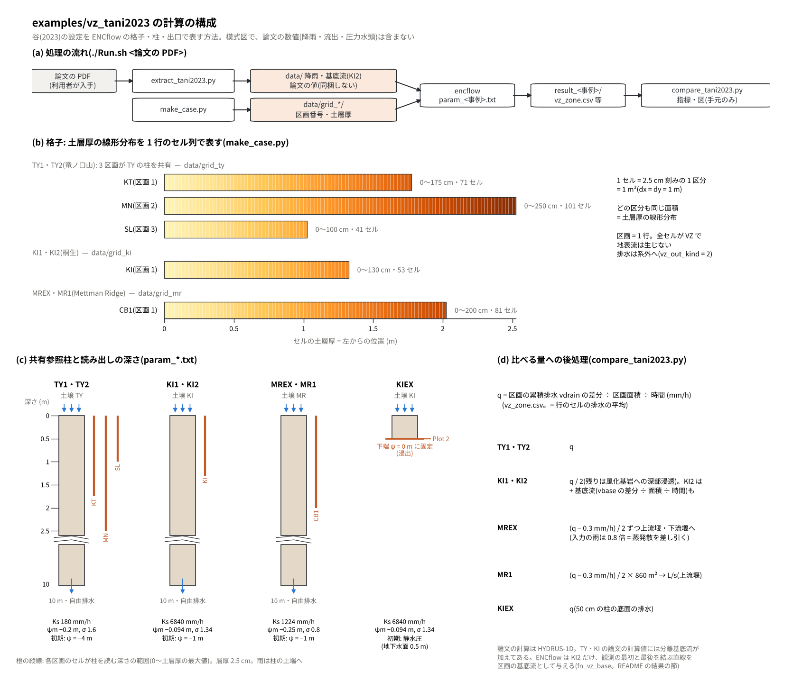

# examples/vz_tani2023 — 谷(2023)の VZ 流出モデルの再現(7 事例)

[English](en/README.md)

谷(2023)[^tani2023]が HYDRUS-1D で行った VZ 流出モデルの計算を、ENCflow の
鉛直不飽和浸透(VZ)流出([fn_vz](../../docs/users_guide/vz.md))で同じ設定のまま
計算し直し、論文の計算流出強度・圧力水頭と比べる例題です。論文の全 7 事例を扱います。

| 事例 | 対象 | 図 |
|---|---|---|
| KIEX | 桐生水文試験地の小斜面 Plot 2(9 m²、土層 50 cm)の人工降雨実験(1981 年。太田ら 1983) | 図−12 |
| MREX | Mettman Ridge(米国オレゴン州)のゼロ次谷 CB1(860 m²)の人工降雨実験(1992 年 5〜6 月) | 図−11 |
| MR1 | 同じ CB1 の表層崩壊が起きた自然降雨(1996 年 11 月) | 図−13 |
| TY1・TY2 | 竜ノ口山森林理水試験地(岡山市)の北谷 KT 17.27 ha・南谷 MN 22.61 ha・斜面 SL 500 m²(1987 年 7 月・1976 年 9 月) | 図−14・図−15 |
| KI1・KI2 | 桐生水文試験地(滋賀県。風化花崗岩、5.99 ha)(1982 年 8 月・2006 年 7 月) | 図−16・図−17 |

論文の計算値と比べることで、ENCflow の 1 次元 Richards 式の計算核(柱の内部の
圧力水頭の変化)と区画の読み出し(土層厚の深さの排水を流域で積分)を、独立な実装の
結果に対して確かめます。

## 論文の数値の扱い(データは同梱しません)

論文の降雨・観測流出強度・計算流出強度は図にしかありません。この例題は数値を
リポジトリに置かず、利用者が J-STAGE から論文の PDF を入手し、
`extract_tani2023.py` が図のベクトル描画の座標から `data/` に取り出します
(降雨の棒、観測の記号または曲線、計算値の曲線、圧力水頭・水理水頭の曲線)。

- 対象の PDF: <https://www.jstage.jst.go.jp/article/jjshwr/36/1/36_36.1741/_pdf/-char/ja>
  (2026-10-26 に入手した版の SHA-256 をスクリプトに記録。版が違えば警告を出します)
- 時間軸は図の目盛りから較正し(日付の軸は 0 時の主目盛り。日付のラベルは日の中央)、
  縦軸は主目盛りから較正します。読み取りは表−1 と照合します(スクリプトが毎回表示):

  | 事例 | 図の降雨の棒 | 照合(表−1) |
  |---|---|---|
  | KIEX | 3 段(53.4・26.4・79.8 mm/h、0〜2.83 h) | 最大 79.76 mm/h(79.8)、合計 164.13 mm(164.0) |
  | MREX | 約 12 時間ごとの平均の棒(昼夜の変動)、1.34〜1.95 mm/h | 合計 270.95 mm(276.6。−2.0 %) |
  | MR1 | 1 時間の棒 80 本(11/16〜19) | 照合なし(図はイベント(総雨量 292.2 mm・112 h)の始まりを含まない) |
  | TY1 | 1 時間の棒 48 本 | 最大 14.50 mm/h(14.5)、合計 132.35 mm(131.5。+0.6 %) |
  | TY2 | 1 時間の棒 112 本 | 最大 14.30 mm/h(14.3)、合計 376.56 mm(374.9。+0.4 %) |
  | KI1 | 1 時間の棒 29 本 | 最大 30.00 mm/h(30.0)。図はイベント(348.9 mm・58 h)の一部 |
  | KI2 | 1 時間の棒 91 本 | 合計 340.66 mm(341.3。−0.2 %) |

- 観測の出典(論文による): TY は森林総合研究所関西支所の水文観測、KI は京都大学の
  水文観測、MREX は Anderson 博士の提供データ、MR1 は Montgomery et al.(2009)の図、
  KIEX は太田ら(1983)の図。

## 設定(論文の記述 → ENCflow)

共通: 長さ 10 m・刻み 2.5 cm・下端は自由排水の土壌柱(論文 Ⅱ.2。KIEX を除く)、
小杉式(表−2)。土層厚は「線形分布」(0 cm から最大値まで 2.5 cm 刻みの区分が同じ
面積)で、1 区分 = 1 セル(1 m²)、1 流域 = 1 行の区画にします(`make_case.py`)。
0 cm の区分は土層厚 0 のセル(雨がそのまま排水)です。全セルが VZ で地表流は生じず、
排水は系外へ出します(`vz_out_kind = 2`)。流出強度は区画の累積排水 vdrain の時間差分
を区画面積で割り、論文がモデルの外で行った後処理を同じように適用します
(`compare_tani2023.py`)。

下の図は、この構成をまとめたものです(論文の数値は含みません)。(a) は処理の流れ、
(b) は各格子のセル列で、左からの位置がそのセルの土層厚です。(c) は土壌ごとの共有
参照柱と、各区画のセルが柱を読む深さの範囲(橙の縦線)、(d) は比べる量への後処理です。



| 事例 | 土壌 | 土層厚 | 初期条件 | 論文の後処理(比較時に適用) | 時刻 0 と期間 |
|---|---|---|---|---|---|
| KIEX | KI | 50 cm の柱、底面の ψ = 0 に固定して浸出(`f_vz_bottom = 2`) | 静水圧: 底面 ψ = 0、地表 ψ = −50 cm(`vz_wt0 = 0.5`) | なし(底面の排水 = 流出強度) | 降雨の開始、7 h |
| MREX | MR | 0〜200 cm(81 区分) | ψ = −100 cm | 降雨の 20 % を蒸発散として除く(入力を 0.8 倍)。排水から深部浸透 0.3 mm/h を引き、1/2 ずつ上流堰・下流堰へ | 1992-05-27 00:00、9 日 |
| MR1 | MR | 0〜200 cm | ψ = −100 cm | 排水から 0.3 mm/h を引き、1/2 を上流堰へ(× 860 m² で L/s) | 1996-11-16 00:00、4 日 |
| TY1 | TY | KT 0〜175・MN 0〜250・SL 0〜100 cm(3 区画が柱を共有) | ψ = −400 cm | なし | 1987-07-14 06:00、7 日 |
| TY2 | TY | 同上 | ψ = −400 cm | なし | 1976-09-08 12:00、5.5 日 |
| KI1 | KI | 0〜130 cm(53 区分。平均 65 cm が中央値) | ψ = −100 cm | 排水の 1/2 を深部浸透とし、残りを流出に | 1982-08-01 00:00、1.5 日 |
| KI2 | KI | 0〜130 cm | ψ = −100 cm | 同上 | 2006-07-14 10:00、8.6 日 |

| 土壌(表−2) | θr | θs | ψm | σ | Ks | ENCflow |
|---|---|---|---|---|---|---|
| TY(竜ノ口山) | 0.230 | 0.370 | −20.0 cm | 1.60 | 5.0×10⁻³ cm/s | `vz_ks_mmh = 180`、`vz_psim = -0.200` |
| KI(桐生) | 0.212 | 0.507 | −9.4 cm | 1.34 | 1.9×10⁻¹ cm/s | `vz_ks_mmh = 6840`、`vz_psim = -0.094` |
| MR(Mettman Ridge) | 0.180 | 0.500 | −25.0 cm | 0.80 | 3.4×10⁻² cm/s | `vz_ks_mmh = 1224`、`vz_psim = -0.250` |

論文の TY・KI の計算値には、観測から分離した基底流が加えてあります(論文 Ⅲ.1)。
分離線は論文から復元できないので、ENCflow の流出強度(排水)には加えていません。
KI2 だけは、観測の最初と最後を結ぶ直線を近似の基底流として区画に与え
(`extract_tani2023.py` が `data/base_KI2.txt` を書き、`param_ki2.txt` の
`fn_vz_base` で読む。[利用者ガイドの基底流](../../docs/users_guide/vz.md#基底流))、
排水 + 基底流も論文の計算値と比べます(結果の節)。ENCflow 側の拡張として、
土層厚 0 のセルと静水圧の初期条件 `vz_wt0` を入れました(developer.md §87.2)。

## 実行

```bash
cd examples/vz_tani2023
make                          # bin/ の実行ファイルへのリンクと格子入力 data/grid_*/
./Run.sh <論文の PDF>         # 抽出 → 7 事例の計算 → 比較(計算は 1 事例 0〜40 s)
./Run.sh                      # 抽出済みなら計算と比較だけ
python3 plot_setup.py         # 構成の図 figs/setup.png(論文の数値を使わないので PDF なしで描ける。en で英語版)
```

抽出には Python の pdfminer.six(`pip install pdfminer.six`)が要ります。
matplotlib があれば `result_<事例>/fig_<事例>.png` に、降雨と、論文の計算値・
ENCflow・観測の流出強度を重ねた図を、`fig_<事例>_psi.png` に圧力水頭(水理水頭)の
図を描きます(論文の数値を含むので、図もリポジトリには置きません)。柱の鉛直分布を
30 分ごと(KIEX は 10 分ごと)に出力するので、計算結果は 7 事例で約 110 MB です。
2026-10-27 より前に抽出した `data/` には KI2 の基底流 `base_KI2.txt` がないので、
`./Run.sh <論文の PDF>` で抽出をやり直してください。

## 結果(2026-10-26。gfortran 13.3、既定の数値設定)

`compare_tani2023.py` の出力です。log10 比は log10(ENCflow / 論文の計算値)、
p90 はその絶対値の 90 % 値(0.1 で約 26 %、0.03 で約 7 % の比)。下限 1・下限 2 は
比べる点の論文の計算値の下限(KIEX 1・10 mm/h、MREX 0.1・0.3 mm/h、MR1 0.1・
0.3 L/s、TY・KI 0.1・0.5 mm/h)。ピーク時刻は論文の計算値の主な極大と、最も近い
ENCflow の極大との時刻差の中央値です。比べたのは線形分布の計算値(MREX・MR1・KI の
QcC)です。

| 事例 | 比べた量 | 下限 1: 中央値 / p90 | 下限 2: 中央値 / p90 | ピーク 論文 / ENCflow | ピーク時刻の差 |
|---|---|---|---|---|---|
| KIEX | 流出強度 | −0.031 / 0.085 | −0.010 / 0.085 | 79.8 / 79.8 mm/h(−0.0 %) | +0.15 h |
| MREX | 各堰の流出強度 QcC | +0.001 / 0.040 | +0.002 / 0.025 | 0.525 / 0.536 mm/h(+2.2 %) | +0.49 h |
| MR1 | 上流堰の流出量 QcC | −0.008 / 0.059 | −0.005 / 0.031 | 1.49 / 1.47 L/s(−1.8 %) | −0.10 h |
| TY1 KT | 流出強度 | −0.042 / 0.113 | −0.020 / 0.065 | 4.29 / 4.13 mm/h(−3.9 %) | −0.10 h |
| TY1 MN | 流出強度 | −0.036 / 0.246 | −0.029 / 0.097 | 2.79 / 2.90 mm/h(+4.0 %) | −0.18 h |
| TY1 SL | 流出強度 | −0.010 / 0.149 | −0.008 / 0.060 | 7.42 / 7.15 mm/h(−3.7 %) | −0.11 h |
| TY2 KT | 流出強度 | −0.005 / 0.026 | −0.005 / 0.021 | 8.65 / 8.68 mm/h(+0.4 %) | −0.09 h |
| TY2 MN | 流出強度 | −0.003 / 0.089 | −0.003 / 0.029 | 6.31 / 6.46 mm/h(+2.3 %) | +0.07 h |
| KI1 | 流出強度 QcC | −0.021 / 0.114 | −0.016 / 0.093 | 14.6 / 14.5 mm/h(−0.4 %) | +0.15 h |
| KI2 | 流出強度 QcC | −0.149 / 0.400 | −0.144 / 0.420 | 4.21 / 3.91 mm/h(−7.2 %) | −0.05 h |
| KI2 + 基底流(モデルに与えた直線) | 同上 | +0.002 / 0.105 | +0.001 / 0.080 | 4.21 / 4.31 mm/h(+2.4 %) | −0.05 h |

- **KIEX・MREX・MR1・TY2** は論文の計算値にほぼ重なります(下限 2 で 90 % の点が
  5〜22 % 以内、ピーク差 2.3 % 以内)。同じ式・同じ設定を独立に解いた結果どうしの
  一致で、ENCflow の計算核と読み出しが論文の計算を再現していると言えます。KIEX は
  下端固定圧の短い柱と静水圧の初期条件、MREX・MR1 は深部浸透の差し引きと堰への
  配分、TY は 3 流域での柱の共有を含めて確かめています。
- **TY1・KI1** も流出強度の大きい範囲では 90 % の点が 15〜25 % 以内、ピーク差 4 %
  以内です。逓減の低流量期に ENCflow が低いのは、論文の計算値に加えられた基底流の
  分です。
- **KI2** は ENCflow の値が中央値で約 3 割低く出ます。差(論文 − ENCflow)は時間に
  ほぼ比例して 0.1 から 0.6 mm/h へ増え、論文の分離基底流(流出の立ち上がりと終わりを
  直線で結ぶ。論文 Ⅲ.1)の形をしています。風化花崗岩の桐生は基底流が大きく、流出の
  小さい KI2 ではその寄与が目立ちます。近似として「観測の最初の値(0.11 mm/h)から
  最後の値(0.63 mm/h)への直線」を区画の基底流としてモデルに与えると
  (`fn_vz_base`)、排水 + 基底流は中央値 +0.001・p90 0.080 になります(この直線は
  論文の分離線そのものではなく、確認のための近似です)。基底流は出口で足すだけで、
  柱の計算と排水は与えないときと同じです。
- **MR1** は、論文が計算をいつから始めたかが書かれておらず、図はイベントの途中
  (11/16)から始まるので、図の左端から初期条件 ψ = −100 cm で始めました。前半の
  小さい流出では ENCflow がやや低いですが、強い雨以降はよく合います。
- **MREX** の図の降雨は約 12 時間ごとの平均で、論文が使った降雨(昼夜で変わる人工
  降雨の記録)より粗いため、日周変動は再現できません。平均的な流出強度と立ち上がり・
  逓減は合います。
- ピーク時刻の差 ±0.2 h 程度は、ENCflow の流出強度を記録間隔の平均で求めている
  こと、論文の曲線の点が 1 時間ごとであることなどによる大きさです(MREX の +0.49 h は
  12 時間平均の降雨による日周の極大の比較)。
- 観測との比較(論文 Ⅳ・Ⅴ の議論)は図で確かめられます。論文と同じく、この例題は
  観測に合わせる調整をしていません。圧力水頭は次の節で比べます。

## 圧力水頭(水理水頭)の比較

論文の圧力水頭・水理水頭の図も、`extract_tani2023.py` が深さごとの曲線として
`data/psi_<事例>.csv` に取り出します。深さごとの線種(実線・破線・点線・一点鎖線・
二点鎖線)を、線幅と PDF の描画順(深さの順)、点と線分の数の比で見分け、仕様と
照合します。ENCflow 側は柱の鉛直分布の出力(`f_vz_outprof = 1`)の層中心の ψ を深さで
線形補間し、水理水頭は地表面を基準に ψ − 深さとします。

| 図 | 量 | 深さ |
|---|---|---|
| 図−12(b) | KIEX の圧力水頭の計算値(太田ら 1983 のもの。下記) | 10・30 cm |
| 図−11(d) | MREX の水理水頭の計算値 | 0.225・0.475・0.75・1.025 m |
| 図−11(c) | MREX の nest 5-4 の水理水頭の観測値(標高) | 0.22・0.48・0.74・1.02 m |
| 図−13(c) | MR1 の水理水頭の計算値 | 0.225・0.475・0.75・1.025 m |
| 図−14(i) | TY1 の圧力水頭の計算値 | 10・30・50・100・150・200 cm |
| 図−14(d)〜(g) | TY1 の SL のテンシオメータの観測値(T1・T1.5・T3・T4) | 10〜50 cm |
| 図−15(d) | TY2 の圧力水頭の計算値 | 10・30・50・100・150・200・250 cm |
| 図−16(c)・図−17(c) | KI1・KI2 の圧力水頭の計算値 | 10・30・65・130・200・300 cm |

到達時刻は湿潤前線の到達として、値が水準を下から超えた最初の時刻です(TY・KI は
ψ = −50 cm、MR1 は −60 cm、KIEX は −15 cm。MREX は観測が標高で基準が分からない
ので、計算値も含めて「最初の値と最大値の中間」)。差は ENCflow − 論文 (cm) で、
ENCflow の出力時刻ごとに、論文の曲線が図の枠の中にある区間で比べました。

| 事例 | 深さ | 到達時刻の差 ENCflow − 論文 (h) | 差の中央値 (cm) | 差の 90 % 値 (cm) |
|---|---|---|---|---|
| TY2 | 10・30・50・100・150・200・250 cm | −0.10・+0.14・+0.21・+0.04・−0.08・+0.04・−0.76 | +0.1(全深さ) | 0.4〜1.3 |
| KI1 | 10・30・65・130・200・300 cm | −0.17・+0.17・+0.17・+0.48・+0.08・−0.20 | 0.0〜+0.5 | 0.5〜2.0 |
| KI2 | 10・30・65・130・200・300 cm | −0.20・+0.17・+0.25・+0.64・+1.49・+1.50 | 0.0〜+0.4 | 0.7〜1.1 |
| MREX | 0.225・0.475・0.75・1.025 m | +0.42・+1.11・+1.74・+2.33 | +1.6〜+1.7 | 2.2〜2.3 |
| MR1 | 0.225・0.475・0.75・1.025 m | —(図の始めから水準より上)・+8.2・+7.6・+9.9 | +0.6〜+0.9 | 4.2〜33.7 |
| TY1 | 10・30・50・100・150・200 cm | +1.09・+2.27・+15.7・+4.20・+2.04・—(ENCflow は期間内に届かない) | −0.2〜0.0(200 cm を除く) | 2.0〜102 |
| KIEX | 10・30 cm(太田ら 1983 の計算値と) | 0.00・+0.07 | 0.0・+1.0 | 0.3・4.9 |

- **TY2・KI1・KI2** は、前線の到達時刻が 0.1〜3 m の全深さで ±0.8 h 以内(KI2 の
  2・3 m は 75〜105 h 後の到達で +1.5 h)、差の中央値が 0.5 cm 以内です。流出強度
  だけでなく柱の内部の水分移動も、論文の計算(HYDRUS-1D)を再現しています。
- **MREX** は到達がやや遅く(+0.4〜+2.3 h。深いほど大きい)、準定常の値が 1.6 cm
  高めです。論文の計算値の曲線は 10.1 h から描かれ、図の降雨の棒(約 12 時間の平均)は
  11.6 h から始まるので、降雨の与え方の違いが考えられます(確かめていません)。
- **MR1** は図の左端から ψ = −100 cm で始めたため(流出強度の節)、前線の到達が
  8〜10 h 遅れますが、到達後は重なり、差の中央値は 1 cm 以内です。
- **TY1** は第 1 の降雨(7/14。図の棒で 20.4 mm)の後に ENCflow の土壌が論文より
  乾いていて、50 cm の到達が 15.7 h 遅れ、200 cm には期間内に届きません。第 2 の
  降雨(7/16)以降は重なります。同じ土壌と初期条件(論文本文)の TY2 は全深さで
  一致するので、計算核や設定ではなく第 1 の降雨の入力の違いが考えられます。確認として
  第 1 の降雨だけを 1.3 倍にすると、30〜200 cm の到達時刻の差が −1.4〜−0.3 h になり
  (50 cm は −11.7 h。論文の曲線が −50 cm 付近をゆっくり上がるので到達時刻の定義に
  敏感)、流出強度の p90(下限 2)も KT 0.065 → 0.031(MN 0.097 → 0.106、SL 0.060 →
  0.057)になりました。図の棒の合計は表−1 の総雨量と合っており(+0.6 %)、論文の
  計算に使われた降雨が図の棒と違うのかは分かりません。例題は図の棒のままです。
- **KIEX** の図−12(b) は、論文の注記(英文: "Panel b shows a scan of Figure 7
  presented by Ohta et al. (1983)")では太田ら(1983)の図を読み取ったもので、論文の
  VZ モデルの計算値ではありません。30 cm の値が逓減期に初期値(−20 cm)より下がる
  ことも、論文の設定(底面 ψ = 0 の 50 cm の柱では、雨が止んでも底面を地下水面とする
  静水圧 = 初期条件より乾かない)と合わず、別のモデルの計算と考えられます。10 cm は
  よく重なり、30 cm は逓減期に ENCflow が高くなります(7 h で −18.7 cm 対 −24.7 cm。
  ENCflow は静水圧の −20 cm に近づく)。

観測との比較(論文が定性的に議論しているもの。この例題は観測に合わせる調整を
していません):

| 観測 | 深さ | 到達時刻 観測 / ENCflow / 論文の計算 (h) | 差の中央値 ENCflow − 観測 (cm) |
|---|---|---|---|
| TY1 T1 | 10・46 cm | 8.2 / 8.1 / 7.0、16.8 / 60.5 / — | −3.7、−23.2 |
| TY1 T1.5 | 10・30・50 cm | 6.9 / 8.1 / 7.0、7.0 / 19.5 / 17.2、7.0 / 65.2 / 49.5 | −3.5、−10.5、−4.5 |
| TY1 T3 | 10・40 cm | 9.3 / 8.1 / 7.0、16.6 / 38.5 / — | −7.6、−14.9 |
| TY1 T4 | 10・30・50 cm | 6.9 / 8.1 / 7.0、80.8 / 19.5 / 17.2、88.6 / 65.2 / 49.5 | −6.0、−0.7、+0.4 |
| MREX nest 5-4 | 0.22・0.48・0.74・1.02 m | 14.6 / 18.1 / 17.9、23.1 / 27.1 / 25.8、35.0 / 36.2 / 34.8、47.8 / 46.2 / 44.1 | 立ち上がりの大きさ 観測 0.80・0.84・0.68・0.47 m、ENCflow 0.52 m |

- **TY1** の 10 cm は、4 地点の観測・ENCflow・論文の計算の到達時刻が 6.9〜9.3 h に
  揃います。T1・T1.5・T3 の 30〜50 cm は観測の方がずっと早く(第 1 の降雨のうちに
  7〜17 h)、鉛直 1 次元の計算(論文・ENCflow とも)より速やかに深部が湿ります。
  T4 は逆に遅れます。差の中央値は観測が図の枠の中にある時刻の値です。
- **MREX** の立ち上がりの時刻は、ENCflow・論文の計算とも観測と ±4 h 以内です
  (浅い 0.22・0.48 m は観測が 3.5〜4 h 早い)。観測は標高なので値そのものは比べず、
  図は最初の値からの変化で重ねます。

## 降雨の時刻の割り当て(推定)

図の 1 時間の降雨の棒は正時を中心に描かれており、その雨が正時の前の 1 時間か後の
1 時間かは図から決まりません。棒の位置のまま・±0.5 h・±1.0 h で計算し、論文の
計算値が下限 2 以上の点の p90 が最小になる割り当てを採りました
(`extract_tani2023.py` の `RAIN_SHIFT_H`。KI2 は基底流の直線を与えた比較)。

| 事例 | −1.0 h | −0.5 h | 棒の位置のまま | +0.5 h | +1.0 h |
|---|---|---|---|---|---|
| TY1 KT | — | 0.207 | 0.171 | **0.065** | 0.096 |
| TY2 KT | 0.100 | **0.020** | 0.067 | 0.157 | — |
| KI1 | 0.188 | **0.093** | 0.142 | 0.304 | 0.444 |
| KI2 | 0.184 | **0.080** | 0.118 | 0.271 | 0.354 |
| MR1 | 0.059 | **0.031** | 0.047 | 0.089 | 0.114 |

TY1 だけが正時から始まる 1 時間、ほかは正時までの 1 時間に当たります。TY1 だけ
向きが違う理由は論文からは分かりません(TY1 は Tani et al.(2020)でも使われた事例
なので、図の作り方の違いと推測されますが、確かめていません)。KIEX(棒は降雨の開始
0 h から)と MREX(約 12 時間の平均の棒)はずらしていません。

## この例題でまだ扱っていないこと

- 土層厚の「調査分布」(KI・MR の度数分布)は論文に数値がなく、線形分布だけを
  扱えます(論文でも両者の差は小さいと報告されています)。MR1 の下流堰の計算値
  (調査分布の 3 倍)も同じ理由で比べていません。
- 論文の計算値に加えられた基底流そのもの(分離線は論文から復元できません)。
- 図−14(h)(TY1 の各地点の土壌層の底面付近の圧力水頭)。深さが図にないので
  比べていません。
- TY1 の第 1 の降雨の後の圧力水頭の差の原因(圧力水頭の節。論文の計算に使われた
  降雨を確かめられません)。

## 参考文献

[^tani2023]: 谷 誠 (2023): 鉛直不飽和浸透に基づく新しい洪水流出モデルの適用による山地小流域の流出機構の再検討. 水文・水資源学会誌, 36(1), 20–51. doi:10.3178/jjshwr.36.1741

- Kosugi, K. (1996): Lognormal distribution model for unsaturated soil hydraulic properties. *Water Resources Research*, 32(9), 2697–2703.
- Šimůnek, J., Šejna, M., Saito, H., Sakai, M. and van Genuchten, M. Th. (2013): The Hydrus-1D software package for simulating the movement of water, heat, and multiple solutes in variably saturated media, Version 4.17. HYDRUS Software Series 3, Department of Environmental Sciences, University of California Riverside, 344 pp.(論文の計算に使われたソフトウェア)
