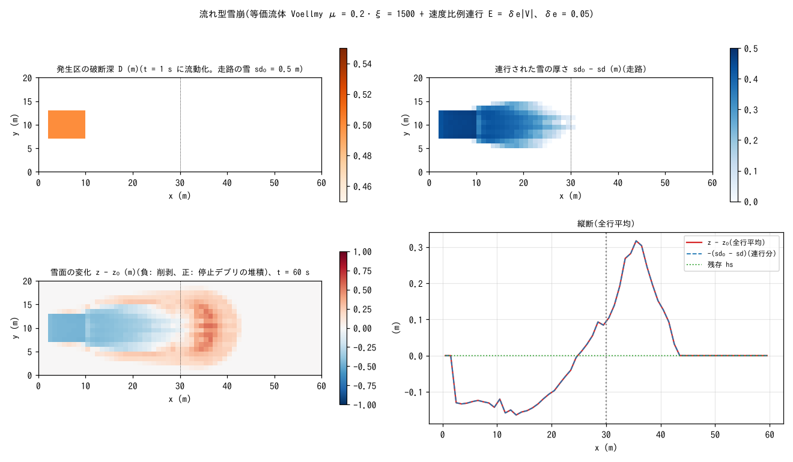

# test/avalanche — 流れ型雪崩(等価流体 Voellmy + 速度比例連行)の疎通と保存則

[English](en/README.md)

土砂流動モデルを援用した**流れ型雪崩**の構成(developer.md §28.8 の
「雪崩への適用」、[ユーザーガイドの適用例の雪崩](../../docs/users_guide/geomorph_applications.md#5-雪崩流れ型))の検定です。
Voellmy 抵抗則の等価流体(`f_dbres = 4`)に、走路の雪を削り込む
**速度比例連行** E = δe|V|(`f_dbed = 4`。連行のみ、堆積は停止 `f_dbstop`)を
組み合わせ、発生区の破断で流動化した雪が走路の雪を取り込んで成長し、
遷緩点下で停止・堆積する一連の過程を検定します。入れ物の読み替えは
sd = 連行可能な雪の厚さ、hs = 流動中の雪の実質体積、z = 雪面込み標高
(z − sd = 地山)、fluv_porosity = 雪の空隙率です。

## 構成

| 項目 | 値 |
|---|---|
| 地形 | slope_break(tanθ = 0.4 の斜面 → x = 30 m から平坦)、60 m × 20 m(Δx = 1 m) |
| 雪 | 走路の雪 sd₀ = 0.5 m(全域、z は雪面込み)、空隙率 λ = 0.1(C* = 0.9、hs ≈ 雪厚) |
| 発生区 | 破断深 D = 0.5 m を i ∈ [3, 10], j ∈ [8, 13] に与え(`make_init.py`)、t = 1 s に一斉流動化。疑似間隙水 relsat = 0.15 |
| 抵抗則 | Voellmy μ = 0.2、ξ = 1500 m/s²(雪崩の慣用域) |
| 連行 | δe = 0.05(V = 5 m/s で 0.25 m/s の削り込み)。濃度 C ≥ `db_cmin` = 0.02 の密な流動体セルのみ(希薄な裾の暴走防止) |
| 停止 | 低速凝集 `f_dbstop = 1`(停止 → 雪面 z へ固定)、w_stop = 0.1 |
| 時間 | dt = 0.02 s、60 s(全停止) |

| ファイル | 内容 |
|---|---|
| `Check_avalanche.py <save>` | (1) 固体台帳 \|Σhs + (1 − λ)Σ(z − z₀)\| < 1e-9、(2) 共動更新 max\|(sd − sd₀) − (z − z₀)\| < 1e-10、(3) 連行の活性: 走路(発生区外)で min(sd − sd₀) < −0.05 m、(4) 成長: 連行固体 / 放出固体 > 0.2、(5) 停止: 残存 Σhs /(放出 + 連行)< 0.3 |
| `Fig.py` | 下の図 `figs/avalanche.png` |

上の表は構成 1(`param.txt`)です。

### 構成 2〜5: 一様な斜面の一斉発生(連行した雪の運動量・Hungr の則・連行する流動深の下限)

連行則の選択子(developer.md §127)を、時間だけの常微分方程式の解と比べる構成です。勾配 S = 0.5 の一様な斜面
(600 m × 40 m、Δx = 2 m)の全面で、厚さ D = 0.5 m の雪が t = 0 に一斉に動き出し、下の雪(厚さ 3 m)を
取り込みます。流れに沿う変化がないので、領域の中央の流速 u(水平)と流動深 h_t = h + hs(鉛直)は

```text
du/dt   = g cos²θ (S − μ) − g u² / (ξ h_t cos²θ) − [f_dbmom = 1 のとき] u E / h_t
dh_t/dt = E
```

に従います(cos²θ = 1/(1 + S²)。`f_gravity_correction = 2` の斜面に沿う抵抗の形。独自の整理)。E は雪面の
低下速度で、速度比例連行では δe u、Hungr の則では E_r h_t u です。最後の項が、取り込んだ雪を静止から流速まで
加速する分です。キャリアは雪と一緒に授受し(`f_dbwet = 1`・`db_satbed = db_relsat = 1`)、流動深を解と
比べるので停止・堆積は切ってあります(`f_dbstop = 0`)。μ = 0.2、ξ = 1500 m/s²、dt = 0.005 s、8 秒。

| 構成 | 設定ファイル | 連行 | 取り込んだ雪の運動量 |
|---|---|---|---|
| 2 | `param_sh0.txt` | 速度比例 δe = 0.02 | 数えない(`f_dbmom = 0`。既定) |
| 3 | `param_shm.txt` | 同上 | 数える(`f_dbmom = 1`) |
| 4 | `param_shh.txt` | Hungr の則(`f_dbed = 5`、`db_er` = 0.02 /m) | 数える |
| 5 | `param_sht.txt` | 速度比例 + 連行する流動深の下限 `db_hent` = 0.6 m(流動深 0.5 m なので連行しない) | 数える |

`param_shm1.txt`・`param_shm2.txt` は、構成 3 を 4 秒で保存して復元する組です。最後の保存(state.dat・
swflow_enc.dat と、`f_dbmom = 1` の私有ファイル geomorph_debris.dat)が通しの計算とビット一致することを
`Run.sh` が確かめます。入力は `make_init.py sheet` が作ります。`Check_sheet.py` の判定は、(a) 8 秒後の u・h_t と
解の差が 1 % 未満、(b) 固体の台帳 Σhs + (1 − λ)Σ(z − z₀) が初期の雪の 1e-9 倍未満、(c) 構成 4 の体積の成長
ln(h_t/D)/E_r が、進んだ距離の解と 1 % 未満、(d) 構成 5 の中央部で連行がないこと(残りの雪の厚さが 3 m のまま)。

## 実行

```bash
make
./Run.sh          # 入力の生成 → 実行(構成 1〜5 とリスタートの組)→ Check(10 秒ほど)
./Run_MPI.sh 4    # MPI。保存が逐次とバイト一致
python3 Fig.py    # figs/avalanche.png(引数 en で英語版を en/figs/ に)
```

## 図



左上: 発生区の破断深 D = 0.5 m。右上: 連行された雪の厚さ sd₀ − sd。
発生区から遷緩点までの走路で雪が削り取られています。深さは斜面の上部で最大 0.47 m
(層厚 0.5 m の 95 %)で、斜面の下部ほど浅くなります。
左下: 雪面の変化 z − z₀。走路は削剥で負、遷緩点(x = 30 m)の前後
x = 25〜43 m に停止デブリが最大 0.56 m 堆積しています。右下: 縦断(全行平均)。
z − z₀ と −(sd₀ − sd) の 2 本が重なるのは共動更新の恒等(z と sd が
同じ量だけ動く)そのものです。60 s の時点で、まだ流れている雪(残存 hs)は
ありません。

## 所見

| 検定 | 計算値 | 判定 |
|---|---|---|
| (1) 固体台帳 | 1e-13 m·cell 程度以下(丸め誤差) | PASS |
| (2) 共動更新 | 1e-14 m 程度以下(丸め誤差) | PASS |
| (3) 連行の活性 | 走路 min(sd − sd₀) = −0.471 m(層厚 0.5 m) | PASS |
| (4) 成長 | 連行固体 39.1 / 放出固体 21.6 = 1.81 倍 | PASS |
| (5) 停止 | 残存 Σhs /(放出 + 連行)= 0.000 | PASS |

- 連行で雪崩は放出量の約 2.8 倍に成長し、60 s までに全量が停止して、
  遷緩点の前後に堆積します。台帳と共動更新は機械精度です。
- 連行可能層は既存の土層厚 sd を読み替えて与え、共動更新・台帳・
  クランプ・2 パス MPI 構造をすべて再利用しています(新規状態・新
  パラメータなし。δe は `db_delte` を共用)。積雪モジュール(SWE)とは
  結合しない設計で、SWE → sd は前処理で変換します(§28.8)。
- 煙型雪崩は対象外、発生はシナリオ(破断深の指定)、衝撃圧は雪密度で
  換算する、という限界をユーザーガイドに明記しています。

- 成長比(連行 / 放出)は 2026-10-18〜31 の既定 2 で 2.51(2026-10-18 の変更の影響。旧既定
  f_opening_dynamic = 1 を明示すると 2.96。記録当時 2.78 で、残りの差は §68.37・§68.39 の移流の
  修正。2026-10-24 確認)、2026-10-31 からの既定 3 で 2.22(§68.41)。2026-11-04 の降伏の
  静止判定の修正(§28.16)の直前のコードでは 2.41(残存 0.054、最大堆積 0.68 m。10-31 の記録との差は
  その後のコードの変更による。切り分けはしていない)、修正後は 2.36(残存 0.067、最大堆積 0.81 m)。
  急勾配の重力補正の修正(同日。§91)の後は 2.23(残存 0.014、最大堆積 0.79 m。斜面に斜めの辺で
  大きく出ていた有効重力が正しくなり、流れがやや遅くなって連行が減った)。2026-11-05 のセルの流出の
  合計による抑制とエッジ水深の上流側の修正(§94・§95)の後は 2.57(残存 0.071)、急勾配の重力補正を既定の 2
  (斜面に沿う摩擦。§93)に揃えた後は 2.58(残存 0.077、最大堆積 0.82 m)。2026-11-06 に 2 が混合体流動の
  抵抗則も斜面に沿って評価する変更(developer.md §101)の後は 2.43(残存 0.079、最大堆積 0.64 m。急な走路で
  Voellmy の乱流項が 1/cos⁴θ 倍になって流れが遅くなり、連行が減った)。2026-11-10 に今の既定(その後の
  f_advection_donor = 3 などを含む。切り分けはしていない)で回し直すと 2.53(残存 0.092、最大堆積 0.85 m)。
  2026-11-13 にエッジ水深の頭打ちの既定を f_dry_head_cap = 2 にした後は 2.53 のまま(連行固体
  54.8 → 54.5、残存 0.089、最大堆積 0.83 m。developer.md §108)。2026-11-15 に屈曲直後の辺の風上値の既定を
  f_advection_bend = 1 にした後は 2.46(連行固体 53.2、残存 0.101、最大堆積 0.92 m。developer.md §110)。
  2026-11-16 にエッジ水深の頭打ちの既定を f_dry_head_cap = 3、側方面の移流の既定を f_advection_lateral = 1 に
  した後は 1.99(連行固体 43.0、残存 0.000、最大堆積 0.56 m。developer.md §110.32)。変わるのは
  f_dry_head_cap = 3 の側で(3 のまま f_advection_lateral = 0 にすると 1.97、f_dry_head_cap = 2 に戻すと 2.48)、
  最終の雪面で比べると、走路が広がり(1 cm を超えて削られた行は、x = 14.5・19.5 m の列で 8 → 10 行)、
  斜面の下部で削られる深さが小さくなる(列ごとの最大が、x = 19.5・24.5・28.5 m で 0.47・0.48・0.50 m →
  0.40・0.31・0.13 m)。仕組みは調べていない。2026-11-21 に移流項の 4 つの値(f_advection_donor = 4・
  f_advection_bend = 2・f_advection_lateral = 2・f_dry_head_cap = 4)を既定にした後は 1.81(連行固体 39.1、残存 0.000、
  最大堆積 0.49 m。developer.md §114)。変わるのは主に f_advection_bend = 2 の分で(1 に戻すと 1.95)、
  f_advection_donor か f_advection_lateral を 1 つだけ古い値に戻すと 1.77、f_dry_head_cap を 3 に戻しても 1.81 のまま。
  表・本文の値と図はこの計算のもの。

### 構成 2〜5(一様な斜面)

| 構成 | 8 秒後の流速 (m/s) 計算 / 解 | 流動深 (m) 計算 / 解 | 判定 |
|---|---|---|---|
| 2 速度比例、運動量を数えない | 14.260 / 14.301 | 1.752 / 1.759 | PASS |
| 3 速度比例、運動量を数える | 9.309 / 9.328 | 1.433 / 1.438 | PASS |
| 4 Hungr の則、運動量を数える | 8.819 / 8.828 | 1.293 / 1.299 | PASS |
| 5 流動深の下限(連行しない) | 10.989 / 11.001 | 0.500 / 0.500 | PASS |

- 既定(構成 2)は、質量を加速する項のない解に合います。取り込んだ雪を静止から加速する分を数えると
  (構成 3)、8 秒後の流速は 14.3 → 9.3 m/s に下がり、運動量を保存する解に合います。
- 構成 4 の ln(h_t/D)/E_r は 47.52 m で、進んだ距離の解 47.73 m に合います(流動深が進んだ距離 x に対して
  D exp(E_r x) で増える)。
- 固体の台帳は初期の雪の 1e-14 倍以下、構成 5 の中央部の雪の厚さの変化は 0 です。
- 構成 3 のリスタートの組は、3 つの保存ファイルが通しの計算とビット一致します。MPI(np = 1・2・4。-O2 の
  厳密数学のビルド)の保存は、全構成で逐次とバイト一致します。

## 関連文書

- [docs/users_guide/geomorph.md](../../docs/users_guide/geomorph.md) — 雪崩(流れ型)の設定の型、μ/ξ の慣用域、読み替えの対応表
- developer.md §28.8(等価流体モード、速度比例連行 f_dbed=4、雪崩援用の設計判断)、§127(Hungr の則 f_dbed=5・連行する流動深の下限 db_hent・取り込んだ質量の運動量 f_dbmom)
- [test/volcano](../volcano/)(Voellmy 等流の解析解)、[test/slide](../slide/)(瞬時流動化)
