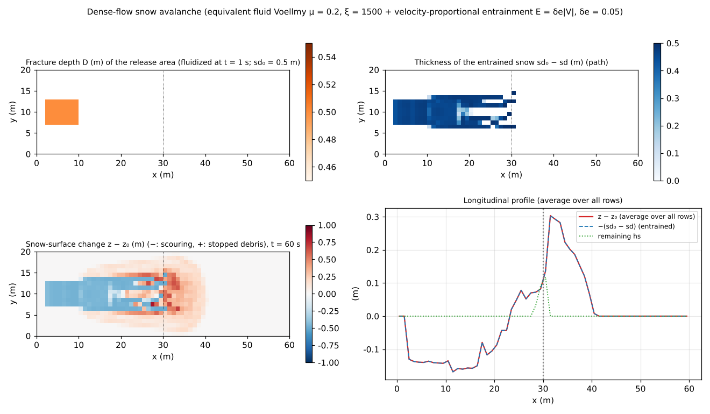

# test/avalanche — dense-flow snow avalanche (equivalent fluid Voellmy + velocity-proportional entrainment): operation and conservation

> English mirror of test/avalanche/README.md. The Japanese file is the master copy.

[日本語](../README.md)

A check of the **dense-flow snow avalanche** configuration that borrows the
sediment-flow model ("application to avalanches" in developer.md §28.8; the
avalanche paragraph of users_guide/geomorph.md). It combines the equivalent
fluid with the Voellmy resistance law (`f_dbres = 4`) and the
**velocity-proportional entrainment** E = δe|V| that scours the snow along the
path (`f_dbed = 4`; entrainment only, deposition by stopping `f_dbstop`), and
checks the whole sequence in which the snow fluidized by fracture in the
release area grows by incorporating the snow along the path and stops and
deposits below the slope break. The reinterpretation of the reservoirs is
sd = entrainable snow depth, hs = net volume of flowing snow, z = elevation
including the snow surface (z − sd is the ground), fluv_porosity = porosity
of the snow.

## Configuration

| Item | Value |
|---|---|
| Terrain | slope_break (slope with tanθ = 0.4 → flat from x = 30 m), 60 m × 20 m (Δx = 1 m) |
| Snow | Snow along the path sd₀ = 0.5 m (whole domain; z includes the snow surface), porosity λ = 0.1 (C* = 0.9, hs ≈ snow depth) |
| Release area | Fracture depth D = 0.5 m given at i ∈ [3, 10], j ∈ [8, 13] (`make_init.py`), fluidized all at once at t = 1 s. Pseudo pore water relsat = 0.15 |
| Resistance law | Voellmy μ = 0.2, ξ = 1500 m/s² (the customary range for avalanches) |
| Entrainment | δe = 0.05 (scouring of 0.25 m/s at V = 5 m/s). Only dense flowing cells with concentration C ≥ `db_cmin` = 0.02 (prevents runaway in the dilute fringe) |
| Stopping | Low-speed consolidation `f_dbstop = 1` (stop → fixed to the snow surface z), w_stop = 0.1 |
| Time | dt = 0.02 s, 60 s (everything stopped) |

| File | Contents |
|---|---|
| `Check_avalanche.py <save>` | (1) solid ledger \|Σhs + (1 − λ)Σ(z − z₀)\| < 1e-9, (2) co-update max\|(sd − sd₀) − (z − z₀)\| < 1e-10, (3) entrainment activity: min(sd − sd₀) < −0.05 m on the path (outside the release area), (4) growth: entrained solid / released solid > 0.2, (5) stopping: remaining Σhs / (released + entrained) < 0.3 |
| `Fig.py` | The figure `en/figs/avalanche.png` below (`python3 Fig.py en`; `figs/avalanche.png` is the Japanese version) |

## Running

```bash
make
./Run.sh          # generate dbinit → run → Check (1 s)
./Run_MPI.sh 4    # MPI; state.dat is byte-identical to the serial run
python3 Fig.py en # en/figs/avalanche.png
```

## Figure



Top left: fracture depth D = 0.5 m of the release area. Top right: thickness
of the entrained snow sd₀ − sd. Along the path from the release area to the
slope break the snow is scoured through its full depth (0.5 m). Bottom left:
change of the snow surface z − z₀. The path is negative from scouring, and
stopped debris deposits up to 0.64 m around the slope break (x = 30 m) at
x = 24–42 m. Bottom right: longitudinal profile (average over all rows).
That the two curves z − z₀ and −(sd₀ − sd) coincide is the co-update
identity itself (z and sd move by the same amount), and some snow that
is still flowing (remaining hs) is left near the slope break (7.9 % of the
total).

## Findings

| Check | Computed | Result |
|---|---|---|
| (1) Solid ledger | −3.4e-14 m·cell | PASS |
| (2) Co-update | 2.1e-14 m | PASS |
| (3) Entrainment activity | path min(sd − sd₀) = −0.500 m (full depth) | PASS |
| (4) Growth | entrained solid 52.4 / released solid 21.6 = 2.43 times | PASS |
| (5) Stopping | remaining Σhs / (released + entrained) = 0.079 | PASS |

- By entrainment the avalanche grows to about 3.4 times the released amount,
  and 92 % stops and deposits around the slope break. The ledger and the
  co-update are at machine precision.
- The entrainable layer is given by reinterpreting the existing soil depth
  sd, and the co-update, ledger, clamp and two-pass MPI structure are all
  reused (no new state and no new parameters; δe shares `db_delte`). By
  design it is not coupled with the snowpack module (SWE); SWE → sd is
  converted in preprocessing (§28.8).
- The limits — powder-snow avalanches are out of scope, release is a
  scenario (prescribed fracture depth), and impact pressures are converted
  with the snow density — are stated explicitly in the user's guide.

- The growth ratio (entrained / released) was 2.51 with the default 2 of
  2026-10-18 to 31 (reflecting the changes of 2026-10-18: with the former default
  f_opening_dynamic = 1 written explicitly it is 2.96; 2.78 when recorded, the
  remaining difference coming from the advection fixes of §68.37 and §68.39;
  confirmed 2026-10-24) and is 2.22 with the default 3 since 2026-10-31 (§68.41). The code
  just before the fix of the yield rest check of 2026-11-04 (§28.16) gave 2.41 (remaining 0.054,
  largest deposit 0.68 m; the difference from the record of 10-31 comes from later changes to
  the code, not separated out), and the fixed code gives 2.36 (remaining 0.067,
  largest deposit 0.81 m). After the fix of the steep-slope gravity correction (same day;
  §91) it is 2.23 (remaining 0.014, largest deposit 0.79 m; the effective gravity, which came
  out too large on edges oblique to the slope, is now right, so the flow is slightly slower
  and entrains less). After the suppression of excessive outflow by the cell total and the fix of the
  upwind side of the edge depth of 2026-11-05 (§94, §95) it is 2.57 (remaining 0.071), and with the
  steep-slope gravity correction aligned to the default 2 (friction along the slope; §93) it is 2.58
  (remaining 0.077, largest deposit 0.82 m). After the change of 2026-11-06 by which 2 also evaluates
  the resistance laws of mixture flows along the slope (developer.md §101) it is 2.43 (remaining 0.079,
  largest deposit 0.64 m; on the steep path the turbulent term of Voellmy is 1/cos⁴θ times larger, the
  flow is slower and entrains less). The table, the values in the text and the figures are from this
  computation.

## Related documents

- [docs/users_guide/geomorph.md](../../../docs/en/users_guide/geomorph.md) — setup pattern for (dense-flow) avalanches, customary ranges of μ/ξ, table of reinterpretations
- developer.md §28.8 (equivalent-fluid mode, velocity-proportional entrainment f_dbed=4, design decisions for the avalanche application)
- [test/volcano](../../volcano/en/README.md) (analytical solution of Voellmy uniform flow), [test/slide](../../slide/en/README.md) (instantaneous fluidization)
