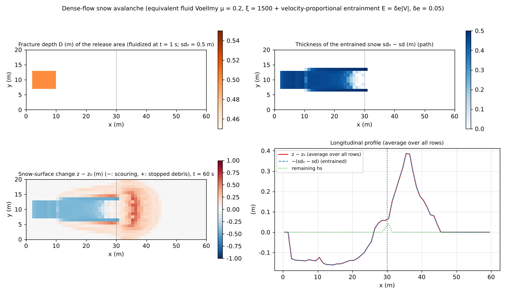

# test/avalanche — dense-flow snow avalanche (equivalent fluid Voellmy + velocity-proportional entrainment): operation and conservation

> English mirror of test/avalanche/README.md. The Japanese file is the master copy.

[日本語](../README.md)

A check of the **dense-flow snow avalanche** configuration that borrows the
sediment-flow model ("application to avalanches" in developer.md §28.8; the
avalanche paragraph of users_guide/geomorph.md). It combines the equivalent
fluid with the Voellmy resistance law (`f_dbres = 4`) and the
**velocity-proportional entrainment** E = δe|V| that scours the snow along the
path (`f_dbed = 4`; entrainment only, deposition by stopping `f_dbstop`), and
checks the whole sequence in which the snow fluidized by fracture in the
release area grows by incorporating the snow along the path and stops and
deposits below the slope break. The reinterpretation of the reservoirs is
sd = entrainable snow depth, hs = net volume of flowing snow, z = elevation
including the snow surface (z − sd is the ground), fluv_porosity = porosity
of the snow.

## Configuration

| Item | Value |
|---|---|
| Terrain | slope_break (slope with tanθ = 0.4 → flat from x = 30 m), 60 m × 20 m (Δx = 1 m) |
| Snow | Snow along the path sd₀ = 0.5 m (whole domain; z includes the snow surface), porosity λ = 0.1 (C* = 0.9, hs ≈ snow depth) |
| Release area | Fracture depth D = 0.5 m given at i ∈ [3, 10], j ∈ [8, 13] (`make_init.py`), fluidized all at once at t = 1 s. Pseudo pore water relsat = 0.15 |
| Resistance law | Voellmy μ = 0.2, ξ = 1500 m/s² (the customary range for avalanches) |
| Entrainment | δe = 0.05 (scouring of 0.25 m/s at V = 5 m/s). Only dense flowing cells with concentration C ≥ `db_cmin` = 0.02 (prevents runaway in the dilute fringe) |
| Stopping | Low-speed consolidation `f_dbstop = 1` (stop → fixed to the snow surface z), w_stop = 0.1 |
| Time | dt = 0.02 s, 60 s (everything stopped) |

| File | Contents |
|---|---|
| `Check_avalanche.py <save>` | (1) solid ledger \|Σhs + (1 − λ)Σ(z − z₀)\| < 1e-9, (2) co-update max\|(sd − sd₀) − (z − z₀)\| < 1e-10, (3) entrainment activity: min(sd − sd₀) < −0.05 m on the path (outside the release area), (4) growth: entrained solid / released solid > 0.2, (5) stopping: remaining Σhs / (released + entrained) < 0.3 |
| `Fig.py` | The figure `en/figs/avalanche.png` below (`python3 Fig.py en`; `figs/avalanche.png` is the Japanese version) |

## Running

```bash
make
./Run.sh          # generate dbinit → run → Check (1 s)
./Run_MPI.sh 4    # MPI; state.dat is byte-identical to the serial run
python3 Fig.py en # en/figs/avalanche.png
```

## Figure



Top left: fracture depth D = 0.5 m of the release area. Top right: thickness
of the entrained snow sd₀ − sd. Along the path from the release area to the
slope break the snow is scoured through its full depth (0.5 m). Bottom left:
change of the snow surface z − z₀. The path is negative from scouring, and
stopped debris deposits up to 0.61 m downstream of the slope break at
x = 30–45 m. Bottom right: longitudinal profile (average over all rows).
That the two curves z − z₀ and −(sd₀ − sd) coincide is the co-update
identity itself (z and sd move by the same amount), and the remaining hs is
nearly zero.

## Findings

| Check | Computed | Result |
|---|---|---|
| (1) Solid ledger | −2.5e-14 m·cell | PASS |
| (2) Co-update | 1.0e-14 m | PASS |
| (3) Entrainment activity | path min(sd − sd₀) = −0.500 m (full depth) | PASS |
| (4) Growth | entrained solid 54.3 / released solid 21.6 = 2.51 times | PASS |
| (5) Stopping | remaining Σhs / (released + entrained) = 0.017 | PASS |

- By entrainment the avalanche grows to about 3.5 times the released amount,
  and 98.3% stops and deposits below the slope break. The ledger and the
  co-update are at machine precision.
- The entrainable layer is given by reinterpreting the existing soil depth
  sd, and the co-update, ledger, clamp and two-pass MPI structure are all
  reused (no new state and no new parameters; δe shares `db_delte`). By
  design it is not coupled with the snowpack module (SWE); SWE → sd is
  converted in preprocessing (§28.8).
- The limits — powder-snow avalanches are out of scope, release is a
  scenario (prescribed fracture depth), and impact pressures are converted
  with the snow density — are stated explicitly in the user's guide.

## Related documents

- [docs/users_guide/geomorph.md](../../../docs/en/users_guide/geomorph.md) — setup pattern for (dense-flow) avalanches, customary ranges of μ/ξ, table of reinterpretations
- developer.md §28.8 (equivalent-fluid mode, velocity-proportional entrainment f_dbed=4, design decisions for the avalanche application)
- [test/volcano](../../volcano/en/README.md) (analytical solution of Voellmy uniform flow), [test/slide](../../slide/en/README.md) (instantaneous fluidization)
