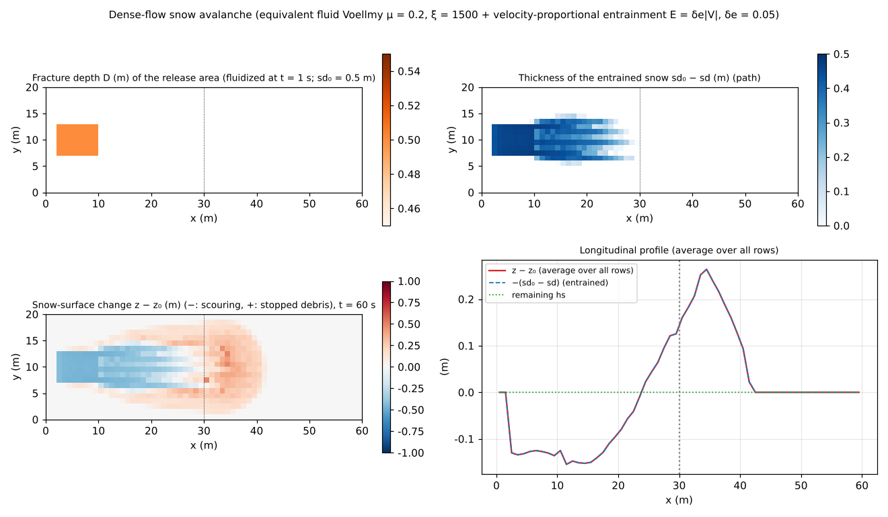

# test/avalanche — dense-flow snow avalanche (equivalent fluid Voellmy + velocity-proportional entrainment): operation and conservation

> English mirror of test/avalanche/README.md. The Japanese file is the master copy.

[日本語](../README.md)

A check of the **dense-flow snow avalanche** configuration that borrows the
sediment-flow model ("application to avalanches" in developer.md §28.8; the
[snow avalanches](../../../docs/en/users_guide/geomorph_applications.md#5-snow-avalanches-dense-flow) on the applications page of the user's guide). It combines the equivalent
fluid with the Voellmy resistance law (`f_dbres = 4`) and the
**velocity-proportional entrainment** E = δe|V| that scours the snow along the
path (`f_dbed = 4`; entrainment only, deposition by stopping `f_dbstop`), and
checks the whole sequence in which the snow fluidized by fracture in the
release area grows by incorporating the snow along the path and stops and
deposits below the slope break. The reinterpretation of the reservoirs is
sd = entrainable snow depth, hs = net volume of flowing snow, z = elevation
including the snow surface (z − sd is the ground), fluv_porosity = porosity
of the snow.

## Configuration

| Item | Value |
|---|---|
| Terrain | slope_break (slope with tanθ = 0.4 → flat from x = 30 m), 60 m × 20 m (Δx = 1 m) |
| Snow | Snow along the path sd₀ = 0.5 m (whole domain; z includes the snow surface), porosity λ = 0.1 (C* = 0.9, hs ≈ snow depth) |
| Release area | Fracture depth D = 0.5 m given at i ∈ [3, 10], j ∈ [8, 13] (`make_init.py`), fluidized all at once at t = 1 s. Pseudo pore water relsat = 0.15 |
| Resistance law | Voellmy μ = 0.2, ξ = 1500 m/s² (the customary range for avalanches) |
| Entrainment | δe = 0.05 (scouring of 0.25 m/s at V = 5 m/s). Only dense flowing cells with concentration C ≥ `db_cmin` = 0.02 (prevents runaway in the dilute fringe) |
| Stopping | Low-speed consolidation `f_dbstop = 1` (stop → fixed to the snow surface z), w_stop = 0.1 |
| Time | dt = 0.02 s, 60 s (everything stopped) |

| File | Contents |
|---|---|
| `Check_avalanche.py <save>` | (1) solid ledger \|Σhs + (1 − λ)Σ(z − z₀)\| < 1e-9, (2) co-update max\|(sd − sd₀) − (z − z₀)\| < 1e-10, (3) entrainment activity: min(sd − sd₀) < −0.05 m on the path (outside the release area), (4) growth: entrained solid / released solid > 0.2, (5) stopping: remaining Σhs / (released + entrained) < 0.3 |
| `Fig.py` | The figure `en/figs/avalanche.png` below (`python3 Fig.py en`; `figs/avalanche.png` is the Japanese version) |

The tables above are configuration 1 (`param.txt`).

### Configurations 2 to 5: a sheet released at once on a uniform slope (momentum of the entrained snow, Hungr's law, minimum flow depth for entrainment)

These configurations compare the options of the entrainment law (developer.md §129) with the solutions of
ordinary differential equations in time only. Over the whole of a uniform slope of S = 0.5 (600 m × 40 m,
Δx = 2 m), a layer of snow D = 0.5 m thick starts to move at t = 0 and takes up the snow below (3 m thick).
Nothing varies along the flow, so the velocity u (horizontal) and the flow depth h_t = h + hs (vertical) at
the centre of the domain follow

```text
du/dt   = g cos²θ (S − μ) − g u² / (ξ h_t cos²θ) − [when f_dbmom = 1] u E / h_t
dh_t/dt = E
```

(cos²θ = 1/(1 + S²); the form of the slope-parallel resistance of `f_gravity_correction = 2`; our own
arrangement). E is the lowering rate of the snow surface: δe u for the velocity-proportional law and
E_r h_t u for Hungr's law. The last term is the acceleration of the entrained snow from rest to the flow
velocity. The carrier is exchanged together with the snow (`f_dbwet = 1`, `db_satbed = db_relsat = 1`), and
stopping and deposition are switched off (`f_dbstop = 0`) because the flow depth is compared with the
solution. μ = 0.2, ξ = 1500 m/s², dt = 0.005 s, 8 s.

| Configuration | Settings file | Entrainment | Momentum of the entrained snow |
|---|---|---|---|
| 2 | `param_sh0.txt` | velocity-proportional, δe = 0.02 | not counted (`f_dbmom = 0`, the default) |
| 3 | `param_shm.txt` | same | counted (`f_dbmom = 1`) |
| 4 | `param_shh.txt` | Hungr's law (`f_dbed = 5`, `db_er` = 0.02 /m) | counted |
| 5 | `param_sht.txt` | velocity-proportional + minimum flow depth for entrainment `db_hent` = 0.6 m (the flow depth is 0.5 m, so nothing is entrained) | counted |

`param_shm1.txt` and `param_shm2.txt` save configuration 3 at 4 s and restore it. `Run.sh` checks that the
final save (state.dat, swflow_enc.dat and geomorph_debris.dat, the private file of `f_dbmom = 1`) is
bit-identical to the uninterrupted run. The inputs are written by `make_init.py sheet`. `Check_sheet.py`
judges (a) u and h_t after 8 s within 1 % of the solution, (b) the solid ledger Σhs + (1 − λ)Σ(z − z₀) below
1e-9 of the initial snow, (c) the volume growth of configuration 4, ln(h_t/D)/E_r, within 1 % of the distance
travelled in the solution, and (d) no entrainment in the central part of configuration 5 (the remaining snow
stays 3 m thick).

## Running

```bash
make
./Run.sh          # generate the inputs → run (configurations 1 to 5 and the restart pair) → Check (about 10 s)
./Run_MPI.sh 4    # MPI; the saves are byte-identical to the serial run
python3 Fig.py en # en/figs/avalanche.png
```

## Figure



Top left: fracture depth D = 0.5 m of the release area. Top right: thickness
of the entrained snow sd₀ − sd. Along the path from the release area to the
slope break the snow is scoured. The depth is at most 0.44 m on the upper
slope (88 % of the 0.5 m layer) and becomes shallower toward the lower slope.
Bottom left: change of the snow surface z − z₀. The path is negative from
scouring, and stopped debris deposits up to 0.56 m around the slope break
(x = 30 m) at x = 25–43 m. Bottom right: longitudinal profile (average over
all rows). That the two curves z − z₀ and −(sd₀ − sd) coincide is the
co-update identity itself (z and sd move by the same amount). At 60 s no
snow is still flowing (remaining hs).

## Findings

| Check | Computed | Result |
|---|---|---|
| (1) Solid ledger | about 1e-13 m·cell or less (round-off) | PASS |
| (2) Co-update | about 1e-14 m or less (round-off) | PASS |
| (3) Entrainment activity | path min(sd − sd₀) = −0.438 m (layer 0.5 m) | PASS |
| (4) Growth | entrained solid 42.6 / released solid 21.6 = 1.97 times | PASS |
| (5) Stopping | remaining Σhs / (released + entrained) = 0.000 | PASS |

- By entrainment the avalanche grows to about 3.0 times the released amount,
  and all of it stops by 60 s and deposits around the slope break. The ledger
  and the co-update are at machine precision.
- The entrainable layer is given by reinterpreting the existing soil depth
  sd, and the co-update, ledger, clamp and two-pass MPI structure are all
  reused (no new state and no new parameters; δe shares `db_delte`). By
  design it is not coupled with the snowpack module (SWE); SWE → sd is
  converted in preprocessing (§28.8).
- The limits — powder-snow avalanches are out of scope, release is a
  scenario (prescribed fracture depth), and impact pressures are converted
  with the snow density — are stated explicitly in the user's guide.

- The growth ratio (entrained / released) was 2.51 with the default 2 of
  2026-10-18 to 31 (reflecting the changes of 2026-10-18: with the former default
  f_opening_dynamic = 1 written explicitly it is 2.96; 2.78 when recorded, the
  remaining difference coming from the advection fixes of §68.37 and §68.39;
  confirmed 2026-10-24) and is 2.22 with the default 3 since 2026-10-31 (§68.41). The code
  just before the fix of the yield rest check of 2026-11-04 (§28.16) gave 2.41 (remaining 0.054,
  largest deposit 0.68 m; the difference from the record of 10-31 comes from later changes to
  the code, not separated out), and the fixed code gives 2.36 (remaining 0.067,
  largest deposit 0.81 m). After the fix of the steep-slope gravity correction (same day;
  §91) it is 2.23 (remaining 0.014, largest deposit 0.79 m; the effective gravity, which came
  out too large on edges oblique to the slope, is now right, so the flow is slightly slower
  and entrains less). After the suppression of excessive outflow by the cell total and the fix of the
  upwind side of the edge depth of 2026-11-05 (§94, §95) it is 2.57 (remaining 0.071), and with the
  steep-slope gravity correction aligned to the default 2 (friction along the slope; §93) it is 2.58
  (remaining 0.077, largest deposit 0.82 m). After the change of 2026-11-06 by which 2 also evaluates
  the resistance laws of mixture flows along the slope (developer.md §101) it is 2.43 (remaining 0.079,
  largest deposit 0.64 m; on the steep path the turbulent term of Voellmy is 1/cos⁴θ times larger, the
  flow is slower and entrains less). Rerun on 2026-11-10 with the current defaults (including the
  later f_advection_donor = 3 and others; not separated out) it is 2.53 (remaining 0.092, largest
  deposit 0.85 m). After the default of the edge-depth cap became f_dry_head_cap = 2 on 2026-11-13
  it stays at 2.53 (entrained solid 54.8 → 54.5, remaining 0.089, largest deposit 0.83 m;
  developer.md §108). After the default of the upwind value on the edge just after a bend became
  f_advection_bend = 1 on 2026-11-15 it is 2.46 (entrained solid 53.2, remaining 0.101, largest deposit
  0.92 m; developer.md §110). After the default of the edge-depth cap became f_dry_head_cap = 3 and the
  default of the advection on side faces became f_advection_lateral = 1 on 2026-11-16 it is 1.99
  (entrained solid 43.0, remaining 0.000, largest deposit 0.56 m; developer.md §110.32). The change comes
  from f_dry_head_cap = 3 (with 3 kept and f_advection_lateral = 0 it is 1.97; with f_dry_head_cap = 2
  restored it is 2.48). Compared on the final snow surface, the path widens (the rows scoured by more
  than 1 cm go from 8 to 10 in the columns at x = 14.5 and 19.5 m) and the scouring depth on the lower
  slope becomes smaller (the largest value of each column goes from 0.47, 0.48 and 0.50 m to 0.40, 0.31
  and 0.13 m at x = 19.5, 24.5 and 28.5 m). The mechanism has not been examined. After the four values of
  the advection term (f_advection_donor = 4, f_advection_bend = 2, f_advection_lateral = 2,
  f_dry_head_cap = 4) became the default on 2026-11-21 it is 1.81 (entrained solid 39.1, remaining 0.000,
  largest deposit 0.49 m; developer.md §114). The change comes mainly from f_advection_bend = 2 (with 1
  restored it is 1.95); restoring only f_advection_donor or only f_advection_lateral to the old value gives
  1.77, and restoring f_dry_head_cap to 3 keeps 1.81. After the blockage ratio of the dynamic reassignment
  of blocked openings was corrected on 2026-11-25 to be measured with the flow depth h + hs, it is 1.97
  (entrained solid 42.6, remaining 0.000, largest deposit 0.56 m; developer.md §130. How far the snow
  surface on both sides of the path lowered by entrainment counts as a blockage is now set by the flow depth
  instead of the water depth of the carrier. The largest scoured depth per column is 0.43, 0.37, 0.26 and
  0.15 m at x = 14.5, 19.5, 24.5 and 28.5 m). The table, the values in the text and the figures are from
  this computation.

### Configurations 2 to 5 (uniform slope)

| Configuration | Velocity after 8 s (m/s), computed / solution | Flow depth (m), computed / solution | Result |
|---|---|---|---|
| 2 velocity-proportional, momentum not counted | 14.260 / 14.301 | 1.752 / 1.759 | PASS |
| 3 velocity-proportional, momentum counted | 9.309 / 9.328 | 1.433 / 1.438 | PASS |
| 4 Hungr's law, momentum counted | 8.819 / 8.828 | 1.293 / 1.299 | PASS |
| 5 minimum flow depth (no entrainment) | 10.989 / 11.001 | 0.500 / 0.500 | PASS |

- The default (configuration 2) agrees with the solution without the term that accelerates the mass. Counting
  the acceleration of the entrained snow from rest (configuration 3) lowers the velocity after 8 s from 14.3
  to 9.3 m/s, in agreement with the momentum-conserving solution.
- In configuration 4, ln(h_t/D)/E_r is 47.52 m, in agreement with the distance travelled in the solution,
  47.73 m (the flow depth grows as D exp(E_r x) with the distance travelled x).
- The solid ledger is below 1e-14 of the initial snow, and the snow depth in the central part of
  configuration 5 does not change.
- In the restart pair of configuration 3 the three save files are bit-identical to the uninterrupted run. The
  saves of the MPI runs (np = 1, 2, 4; strict-math -O2 builds) are byte-identical to the serial run in all
  configurations.

## Related documents

- [docs/users_guide/geomorph.md](../../../docs/en/users_guide/geomorph.md) — setup pattern for (dense-flow) avalanches, customary ranges of μ/ξ, table of reinterpretations
- developer.md §28.8 (equivalent-fluid mode, velocity-proportional entrainment f_dbed=4, design decisions for the avalanche application), §129 (Hungr's law f_dbed=5, minimum flow depth for entrainment db_hent, momentum of the entrained mass f_dbmom)
- [test/volcano](../../volcano/en/README.md) (analytical solution of Voellmy uniform flow), [test/slide](../../slide/en/README.md) (instantaneous fluidization)
