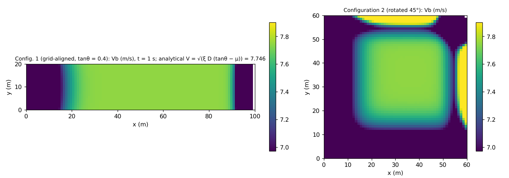
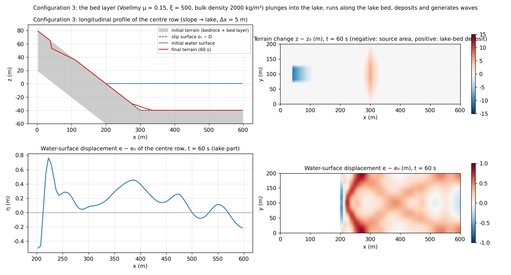
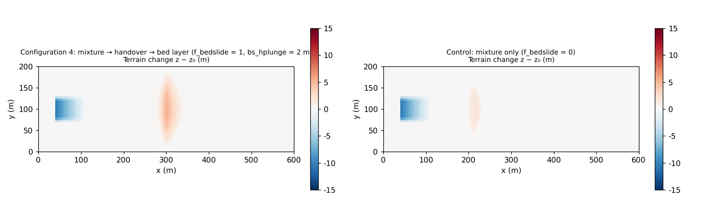

# test/bedslide — moving bed layer (f_bedslide): analytical Voellmy speed, slope → lake plunge, handover from the mixture

> English mirror of test/bedslide/README.md. The Japanese file is the master copy.

[日本語](../README.md)

A verification of the **moving bed layer** module for landslide tsunamis
(`f_bedslide = 1` in `&list_geomorph`; a soil mass running beneath the water
is solved as an inertialess bed layer hb that lifts the water surface.
docs/landslide_tsunami_plan.md, developer.md §61). It consists of four
configurations, and pass/fail is decided not by a reference comparison but
by the self-checks of `Check_bedslide.py` (ledger, speed, transport, wave
generation).

1. **Grid-aligned benchmark** (`param_bench.txt`): a bed layer of thickness
   D = 1 m is placed over the whole of a uniform slope (tanθ = 0.4), and the
   terminal speed of the Voellmy law (μ = 0.1, ξ = 200),
   V = √(ξ D (tanθ − μ)) = 7.746 m/s, is compared with the speed Vb of the
   interior cells and the volume passing a cross-section.
2. **45°-rotated benchmark** (`param_rot.txt`): the same slope and layer
   rotated 45° with respect to the grid. A grid-dependence detector that
   catches a normalization error (a factor √2) in the 8-direction
   distribution.
3. **Slope → lake** (`param.txt`): a soil mass (19,110 m³) on the slope is
   released at 1 s, plunges into the lake, runs along the lake bed, deposits
   and generates waves. The ledger, the water volume, the underwater run,
   the wave generation and the release ledger are checked.
4. **Handover from the mixture** (`param_plunge.txt` with the control
   `param_mix.txt`): on land the mass flows as the mixture (hs) of the
   debris-flow model, and in cells with a ponded depth of 2 m or more it is
   handed over to the bed layer hb (`bs_hplunge`). Compared with the control
   (no handover), in which the mass does not reach the lake bed.

## Configuration

| Item | Configuration 1 | Configuration 2 | Configurations 3 / 4 |
|---|---|---|---|
| Grid | 100 m × 20 m, Δx = 1 m | 60 m × 60 m, Δx = 1 m | 600 m × 200 m, Δx = 5 m |
| Terrain | Uniform slope tanθ = 0.4 (`zbench.txt`) | Uniform slope rotated 45° (`zrot.txt`) | Slope → lake (water surface 0 m, lake bed −40 m; `z.txt`) |
| Bed layer | Uniform D = 1 m over the whole domain, released at t = 0 | Same as left | Planar slip surface D on the slope (`db.txt`), released at t = 1 s |
| Resistance law | Voellmy μ = 0.1, ξ = 200, bulk density 2000 kg/m³ (dry = no buoyancy) | Same as left | Voellmy μ = 0.15, ξ = 500, 2000 kg/m³ (r = 0.5 under water) |
| Time | dt = 0.05 s, 1 s | Same as left | dt = 0.05 s, 60 s |

The bed-layer update is driven by the surface gradient and has no inertia,
and it satisfies the stability condition by automatic sub-cycling
(`bs_cfl = 0.4`). The reason for a uniform layer over the whole domain
without layer ends is that, with a finite band, the deposit at the
destination rides on the ground surface and the following material cannot
climb the step and jams (see the note in `make_init.py`).

| File | Contents |
|---|---|
| `make_init.py zbench\|dbbench\|zrot\|dbrot\|z\|db` | Generation of the terrain and the bed-layer thickness (the constants are paired with the Check) |
| `Check_bedslide.py bench\|tsunami\|plunge` | Configurations 1 and 2: (1) ledger Σdz = Σdsd = 0 and bedrock surface unchanged, (2) Vb of the interior cells within 0.5% of V, (3) cross-section passage speed within 10% of V. Configuration 3: ledger, Σh unchanged, deposition on the lake bed, wave generation, release ledger. Configuration 4: solid and water ledgers, handover volume, arrival at the lake bed, and the control does not arrive |
| `Fig.py` | The figures below, `en/figs/*.png` (`python3 Fig.py en`; `figs/*.png` is the Japanese version) |

## Running

```bash
make
./Run.sh          # input generation → configurations 1 and 2 → Check bench → configuration 3 → Check tsunami → configuration 4 and control → Check plunge (about 7 s)
./Run_MPI.sh 4    # MPI. state.dat and geomorph_bedslide.dat are byte-identical with the serial run (-O2 strict math)
python3 Fig.py en # en/figs/bench.png, tsunami.png, plunge.png
```

## Figures



Left: bed-layer speed Vb of configuration 1 (t = 1 s). The 100 interior
cells agree with the analytical value 7.7460 m/s to **0.00%**; only the
upstream end (thinning) and the downstream wall (backwater of the deposit)
deviate. Right: configuration 2 (rotated 45°). Vb of the 79 interior cells
agrees with the analytical value to 0.14%, showing that the layer moves
isotropically even on a grid oblique to the slope.



Configuration 3. Top left: longitudinal profile of the centre row. The soil
mass above the slip surface (dashed) plunges into the lake within 60 s, runs
to the flat part of the lake bed (−40 m) at x ≥ 300 m and deposits 5.3 m
(grey is bedrock + bed layer, red is the final terrain). Top right:
distribution of the terrain change; lowering of the source area (blue) and
deposition on the lake bed (red). Bottom left and right: water-surface
displacement. The drawdown behind the plunge point and the leading wave
spreading across the lake (maximum 1.0 m) are visible.



Configuration 4 (left) and the control (right). The mass that flowed over
land as a debris flow (mixture) becomes, with the handover, a bed layer in
the cells with a ponded depth of 2 m or more and runs along the lake bed
(deposit 5.2 m, handover 18,319 m³ = 96% of the release); without the
handover it stops near the shoreline and does not reach the lake bed
(deposit on the flat part 0 m).

## Findings

| Check | Computed value | Verdict |
|---|---|---|
| Configuration 1: interior Vb | 7.7460 m/s (analytical 7.7460, 0.00%) | PASS |
| Configuration 1: cross-section passage speed | 7.519 m/s (−2.9% = agrees with the boundary layer 2·ld/ny of the 2 wall rows) | PASS |
| Configuration 2: interior Vb | 7.736–7.746 m/s (0.14%) | PASS |
| Configuration 2: cross-section passage speed | 7.175 m/s (−7.4%; wall ends + staircase cross-section) | PASS |
| Configuration 3: ledger / Σh | Σdz −1.1e-11, max\|Δ(z − sd)\| 9e-13 / Σh unchanged (+1.6e-3 m·cell) | PASS |
| Configuration 3: lake-bed deposition / wave generation | flat lake bed max dz 5.20 m / water-surface maximum 0.51 m (flat part of the lake bed) | PASS |
| Configuration 3: release ledger | released 19,110 = stopped 16,650 + moving 2,460 m³ | PASS |
| Configuration 4: handover | 17,750 m³, lake-bed max dz 5.14 m; control 0.00 m | PASS |

- The 45°-rotated benchmark is a detector for a wrong normalization of the
  8-direction distribution, which makes the passage speed come out √2 times
  too large (a real detection recorded in §61); the difference from the
  grid-aligned case stays within 4.6%.
- Configuration 3 shows that the underwater runout, which in stage 0
  (mixture only; work/slide_tsunami) stopped within 50 m of the shoreline,
  is resolved by the bed layer. Whereas with the mixture the increase of the
  column height at the plunge becomes a wave directly, the bed layer lifts
  the bottom while running under water, so for the same volume the
  near-field wave is lower and the deposit reaches the lake bed.
- The handover of configuration 4 is operated with `f_bsplunge = 1` (the
  ponded depth is referred to the initial water surface), `f_bsvplunge = 1`
  (only after the speed of the mixture has dropped to or below the terminal
  speed of the bed layer) and `bs_tstop = 10 s` (only cells that stayed slow
  are fixed) (§61.5–61.10).
- MPI np = 2, 4 are byte-identical with the serial run in all three
  configurations with the -O2 strict-math build (with -Ofast only the
  tsunami configuration shows the fast-math difference between builds; a
  known item of §28.5).

## Related documents

- [docs/users_guide/geomorph.md](../../../docs/en/users_guide/geomorph.md) — settings of the moving bed layer (`f_bedslide`, `fn_bsinit`, `bs_*`, handover)
- [docs/landslide_tsunami_plan.md](../../../docs/landslide_tsunami_plan.md) (in Japanese) — design plan (§6 verification, §4.7 handover)
- developer.md §61 (implementation, verification record, remaining work, handover)
