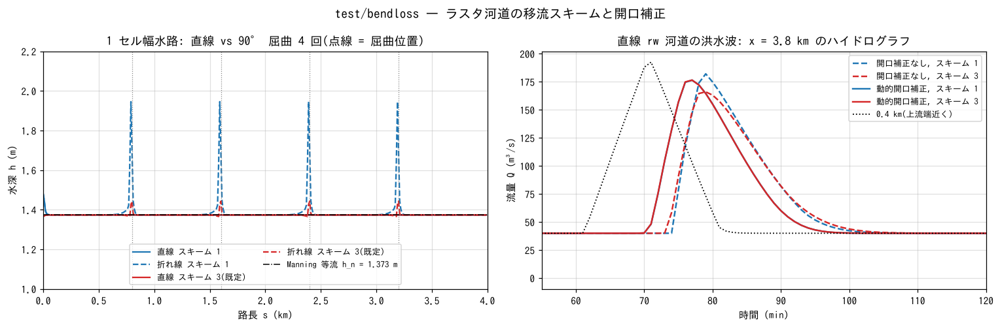

# test/bendloss — experiments on advection schemes and opening correction in raster channels (one-cell-wide channels)

> English mirror of test/bendloss/README.md. The Japanese file is the master copy.

[日本語](../README.md)

A set of experimental cases that isolate, for channels in raster
representation (one cell wide, 90° bends, diagonal, subgrid width, levee
walls), whether the advection scheme and the opening correction produce
**artificial losses or attenuation**, by comparison with the Manning
uniform-flow solution, the analytical solution of spatially varied flow and
a straight channel (developer.md §68.8–68.32). There is no regression
comparison with a reference; each experiment is judged by its check
script (`Check_bendloss.py`, `Check_lateral.py`) and analytical values. It
is also the record of the experiments that gave the basis for adopting the
default scheme (f_advection_scheme = 3, f_opening_dynamic = 1; the latter was changed to 2 on 2026-10-18, §68.38) (the table
of §68.19).

## Configuration (base case)

| Item | Value |
|---|---|
| Channel | Δx = 10 m, length 400 cells (4 km), bed slope S = 0.005 (along the channel), n = 0.03. `Make_channel.py` generates the terrain, the mask and the on-path cell table `path_*.csv` |
| Inflow and outflow | Section inflow Q = 40 m³/s (q = 4 m²/s) at the start on the west edge; the end is a free outflow on the east edge. Outside the channel the mask is 0 (wall) |
| Straight / zigzag | `param_straight.txt` (402 × 5) / `param_zigzag.txt` (240 × 164; five straight reaches of 80 cells, east → north → east → north → east, four bends) |
| Uniform flow (Manning) | h_n = 1.373 m, u = 2.91 m/s, Fr = 0.79, u²/2g = 0.433 m |
| Time | 2 h (to steady state). The flood-wave cases have a triangular wave 40 → 200 → 40 m³/s (60 → 70 → 80 min) after 60 min of steadying, 2.5 h |

| File | Contents |
|---|---|
| `Run.sh [suffix ...]` | Generates and runs the straight and zigzag channels and shows with `Check_bendloss.py` the reach-averaged depth and the head loss K per bend. No suffix = param as it is (scheme 1), `_s3` = scheme 3, `_h2` = f_hcap_upwind 2, `_s3h2` |
| `Make_channel.py <kind>` | straight / zigzag / wave10 / width / diag / diagw[W] / zigzagw / stair / stair3 / steep / sbreak / lower (terrain generation; see the header) |
| `Make_lateral.py` / `Check_lateral.py` | Generation of channels with lateral inflow and comparison with the analytical solution of spatially varied flow |
| `param_*.txt` | The experiments below (name suffixes `_s1` / `_s3` = scheme, `_noadv` = no advection term, `dyn` = dynamic opening correction, `nolev` = no levee, `o0` / `o1` = wall + opening correction off / on) |
| `Fig.py` | The figure below, `figs/bendloss.png` |

## Running

```bash
make
./Run.sh "" _s3                # straight and zigzag × scheme 1 / 3 (2 h each; tens of seconds)
python3 Make_channel.py wave10 # straight rw channel for the flood wave
for p in param_wave_nolev_s1 param_wave_nolev_s3 param_wave_dyn_s1 param_wave_dyn_s3; do ./encflow $p.txt; done
python3 Fig.py                 # figs/bendloss.png
```

`param_wave_nolev_s3.txt` / `param_wave_dyn_s3.txt` are copies of the `_s1`
files made with
`sed 's/f_advection_scheme = 1/f_advection_scheme = 3/; s/_s1/_s3/'`
(the other `_s3` versions are made in the same way).

## Figures



Left: distribution along the channel of the steady depth for the straight
(solid) and zigzag (dashed) channels. For both schemes 1 and 3 the straight
and zigzag channels coincide, and **the head loss per bend is 0.000 m
(K = 0.00)** (the property after the fix of §68.8). The bend cells
themselves show a local rise of the depth (2.15 m with scheme 1, 1.87 m
with scheme 3), but it does not appear in the reach average. The depth is
1.789 m (+30%) rather than Manning's 1.373 m because a one-cell-wide
channel lacks the diagonal edges, so with the default p_diagratio the flow
passes only through the passage width of the axis edges (lpy = 0.42) (it
agrees with p_diagratio = 0); the experiment looks only at the difference
between straight and zigzag.
Right: hydrograph at x = 3.8 km of the flood wave in the straight rw channel
(landside = bed + 10 m). Without the opening correction (dashed) the peak
of scheme 3 attenuates more than that of scheme 1 (peaks 182.1 /
166.1 m³/s), but with the dynamic opening correction (solid), which makes
the edge velocity = the cell velocity, both schemes agree (176.5 /
176.5 m³/s). This confirms the hypothesis that in a one-cell-wide channel
lacking the diagonal edges the edge velocity is 1/lpy = 2.4 times the cell
velocity, and the momentum-conservative advection written in edge
velocities amplifies the acceleration and deceleration 2.4 times
(§68.13–68.14).

## Findings (summary)

| Experiment | Result | Record |
|---|---|---|
| 90° bends (straight vs zigzag) | Bend loss 0.000 m, K = 0.00 (both schemes 1 and 3) | §68.8 |
| Flood-wave peak at 3.8 km (m³/s) | Without opening correction: 182.1 / 166.1; dynamic opening correction: 176.5 / 176.5 (scheme 1 / 3) | §68.13–68.14 |
| Subgrid channel width W = 4 m | Scheme 3 agrees exactly with Manning (h 2.380 m, u 4.202 m/s) | §68.9, 68.11 |
| Diagonal one-cell channel | Agrees with Manning when the width is specified (capped at the natural width 7.07 m) | §68.11 |
| Channel with lateral inflow | Scheme 3 is 0.98–0.99 of the analytical solution, scheme 1 is 1.7–2.5 times it (becomes subcritical) | §68.17 |
| Stepped bed | The advection term carries the dissipation at the steps (a difference only for n = 0.03, Q 40 → 200) | §68.20 |

Below are the detailed records of each experiment (the dates are the dates
of execution; the numbers are from the code of that time).

---

## Attenuation of the flood wave (param_straight_wave.txt)

A triangular wave (40 → 200 → 40 m³/s) is put into the straight channel
and the peaks are recorded at the transects x = 0.4, 2.0 and 3.8 km.
`f_advection_scheme` and `p_diagratio` are varied (copied with sed and
run). Results of 2026-10-02 (peak m³/s at 3.8 km):

| | p_diagratio default | p_diagratio = 0 |
|---|---|---|
| Scheme 1 | 185.1 | 181.7 |
| Scheme 3 | 173.0 | 181.8 |

In a one-cell-wide channel lacking the diagonal edges the edge velocity is
1/lpy = 2.4 times the cell velocity, and the momentum-conservative
advection written in edge velocities amplifies the acceleration and
deceleration 2.4 times (without diagonals = when the edge velocity and the
cell velocity agree, both schemes agree).

## Consistency with the subgrid channel width (param_width.txt)

`python3 Make_channel.py width` builds a straight channel of W = 4 m
(wfrac = 0.4) (landside at bed + 3 m, with an explicit wall bank0 = 1.
Until 2026-10-04 it was bank0 = 0, but a levee of height 0 whose crest is
at or below the ground no longer forms a wall, so it was changed to +1 m;
there is no overtopping, so the results are unchanged), and
`./encflow param_width.txt` computes the steady flow. The uniform-flow
depth for q_channel = 40/4 = 10 m²/s is 2.380 m. Results of 2026-10-02
(average over cells 20–300):

| | h (m) | m (per cell width) | u (in the channel) | Remarks |
|---|---|---|---|---|
| Scheme 1 (default) | 3.46 | 1.72 | 2.56 | Unsteady, overtopping (Runge 18–29%, frequent ex_flux) |
| Scheme 1 + f_channel_advection=0 | 2.380 | 4.000 | 4.202 | Agrees with Manning |
| Scheme 3 | 2.380 | 4.000 | 4.202 | Agrees with Manning |

Combination with the section shape σ (p_sect_m) is unverified, because in
this synthetic case the run diverges even with the advection term dropped
(ex_flux fires in all cells during the initial transient) (§68.9).

## Diagonal one-cell channel (param_diag.txt)

`python3 Make_channel.py diag` builds an 8-connected one-cell channel at
45° (only the first 3 cells in the x direction, length 400 cells, slope
measured along the channel). Q = 28.28 m³/s so that q = 4 m²/s per natural
width (cell area / channel length = dx²/dr = 7.07 m). Results of 2026-10-02
(reach average, default p_diagratio):

| Channel | Passage width / natural width | Steady depth | Ratio to Manning |
|---|---|---|---|
| Axis-aligned one cell (param_straight) | 4.14 / 10 = 0.41 | 1.789 m | +30% |
| Diagonal one cell (param_diag) | 4.14 / 7.07 = 0.59 | 1.612 m | +17% |

The conveyance also drops on the diagonal, but less than along the axis
(with the default p_diagratio the passage widths of all 8 directions are
equal, 4.14 m, and the natural width of the diagonal is smaller).
Note: if the inflow section is placed in the corner cell (1,1) of the
domain, the set of normal + diagonal faces is incomplete and only 63% of
the total discharge enters (constraint (5) of §18).

## After the symmetrization of the opening correction (2026-10-02; §68.11)

Generated with `width[W]`, `diagw[W]` (diagonal; the 3 cells at each end
are axis-aligned) and `zigzagw` (zigzag + landside + W=10) of
`Make_channel.py`. `diagwe[W]` is a variant that places the end on the east
edge while keeping it diagonal (param_diagwe4.txt; verification of the
width correction of boundary faces, §68.26. Before the correction, the
free-outflow face without width correction drained the storage of the
narrow channel completely and the run diverged within seconds). The
10-minute ramp-up of the inflow is kept for diagnostics (not required after
the correction).

| Case | W | h (computed) | h (Manning, q=Q/W) |
|---|---|---|---|
| Straight axis width10 | 10 m | 1.373 | 1.373 |
| Diagonal diagw | 7.07 m (natural width) | 1.373 | 1.373 |
| Diagonal diagw4 | 4 m | 1.933 | 1.933 |
| Diagonal diagw10 | 10 m | 1.373 (capped at the natural width) | 1.115 |
| Diagonal end diagwe4 (end on the east edge, kept diagonal; §68.26, §68.30) | 4 m | 1.933 (1.934–1.936 up to the end) | 1.933 |
| Zigzag + levee zigzagw | 10 m | reach average 1.373 | 1.373 |
| Zigzag W=4 (width_zigzagw4.txt = width_zigzagw with 10 → 4; §68.32) | 4 m | straight 2.380 (with walls) / 1.970 (without walls = inconsistency of the velocity normalization) | 2.380 |

Uniform flow with σ (section shape, §26; the face flux is area-based u·vh,
§68.28). The expected value is the numerical solution of
Q/W = (1/n)·h^{2/3}·√S·vh(h):

| Case | W | D | h (computed) | h (expected) |
|---|---|---|---|---|
| width10 + p_sect_m=0.5 (wrk) | 10 m | 3 m | 1.983 | 1.983 |
| width_sect (W=4, initial water 2.5 m) | 4 m | 3 m | 3.00–3.04 | 3.027 (just above bankfull) |
| sectvar (D=3 → 1.5 → no levee; param_sectvar.txt / bank_sectvar.txt) | 10 m | 3 / 1.5 / 0 | 1.983 / 1.694 / 1.374 | 1.983 / 1.694 / 1.373 |

The σ cases use terrain with the landside at bed +2.9 m
(`python3 Make_channel.py lower z_width.txt rw_width.txt z_width_sect.txt 0.1`;
likewise for width10). Since a wall can only form on an edge whose crest
is higher than the ground on both sides (§68.29 (B)), the landside is
placed below the crest of D = 3 (bed +3) (width_sect uses bank0 = 0.1 with
the landside datum, so the crest = bed +3). Before 2026-10-04 the terrain
had landside = crest (bed +3), and ground at the same height as the crest
was treated as a wall (the 2.95–3.07 of width_sect is that value).

## 2×2 of scheme × opening correction (no width) (param_{wave,zz}_{nolev,o0,o1}_s*.txt)

developer.md §68.13. With `python3 Make_channel.py wave10` (rw channel
with landside = bed + 10 m) and z_zigzagw / rw_zigzagw (the width file is
not used), three representations of the channel × schemes 1/3 are
compared. nolev = no levee (the dry landside cells block), o0 = high wall
(bank0 = 10 m) without opening correction, o1 = the same wall with opening
correction. Scheme 3 is copied in the manner of
`sed 's/f_advection_scheme = 1/f_advection_scheme = 3/; s/_s1/_s3/' param_wave_o1_s1.txt > param_wave_o1_s3.txt`.
The flood wave is a triangular wave (60 → 70 → 80 min) after 60 min of
steadying. Results of 2026-10-02 (peak m³/s at 3.8 km, steady depth m):

| | nolev | o0 (wall) | o1 (wall + opening correction) |
|---|---|---|---|
| Scheme 1 | 182.2 (h 1.789) | 182.2 (h 1.789) | 176.5 (h 1.373) |
| Scheme 3 | 166.1 (h 1.789) | 166.1 (h 1.789) | 176.5 (h 1.373) |

Dry cells act identically to walls (nolev and o0 give identical Logs), and
once the opening correction makes the edge velocity = the cell velocity the
peaks of both schemes agree (confirmation of the amplification hypothesis).

## Dynamic opening correction (param_{wave,zz}_dyn_s*.txt)

developer.md §68.14. The terrain without levees (nolev) with
`f_opening_dynamic = 1` added. The passage-width share of openings whose
diagonal target ground is above the water surface is reassigned every step
to the open edges (the dynamic version of the same rule as wall + static
opening correction). Results of 2026-10-02: for the flood wave, the
discharge records of the three transects are byte-identical to o1 (wall +
opening correction) (peak 176.5 at 3.8 km, uniform flow 1.373 m, for both
schemes 1 and 3). The zigzag has a reach average of 1.373–1.374 m and zero
bend loss. The differences from the wall version are only near the bend
cells (because the edge velocity toward a dry, high lateral cell remains in
the reconstruction).

## Channel with lateral inflow (Make_lateral.py / Check_lateral.py)

developer.md §68.17. Rain is applied to a hillslope strip beside the channel
(bed + 5 m), and the steady flow with lateral inflow entering the channel
through the side edges (no momentum in the flow direction) is compared with
the solution of the ordinary differential equation of spatially varied flow
(Chow). `python3 Make_lateral.py` generates the cases,
`./encflow param_lat1r_s1.txt` etc. run them, and
`python3 Check_lateral.py lat1r _s1 _s3` compares. Results of 2026-10-02
(depth ratio ENC / physical solution at 1/2/3 km):

| | Scheme 1 | Scheme 3 |
|---|---|---|
| One-sided lateral inflow (lat1r) | 1.72 / 1.89 / 2.00 (becomes subcritical) | 0.992 / 0.992 / 0.992 |
| Two-sided lateral inflow (lat2r) | 2.17 / 2.55 / 2.44 (unsteady) | 0.975 / 0.977 / 0.978 |

## Stepped bed (Make_channel.py stair / stair3, param_stair{,3}_dyn_{noadv,s1}.txt)

The fact that the bed of a real DEM is a succession of grid-scale steps (in
the 100 m chichibu grid the drop from a channel cell to the adjacent channel
cell has a median slope of 0.12, with 8 steps over 2 m per km) is mimicked
with a one-cell channel. stair has 1 m every 200 m (mean slope 0.005, the
same as wave10), stair3 has 3 m every 100 m (mean 0.03). The treads are
horizontal. The inflow is the same triangular wave 40 → 200 → 40 m³/s as
param_wave. No advection term (f_govequation=1), scheme 1 and scheme 3
(copied with sed) are compared to confirm that the advection term carries
the dissipation at the steps (developer.md §68.20).
For stair3, combinations of roughness and discharge were also prepared:
stair3n (n = 0.15), stair3q (inflow 1 → 5 → 1 m³/s), stair3nq (both). The
dissipation at the steps is effective only when the velocity head is
comparable to the step height (n = 0.03, Q 40 → 200); otherwise the three
agree.
