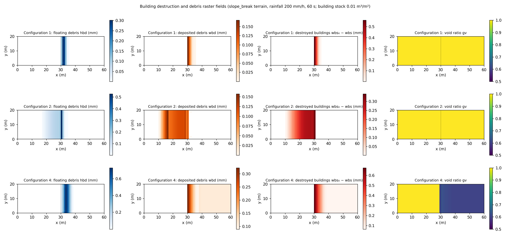

# test/bldgdebris — building destruction and debris raster fields (fn_bldgdebris): operation, conservation and one-way coupling

> English mirror of test/bldgdebris/README.md. The Japanese file is the master copy.

[日本語](../README.md)

A check of the **building destruction and debris module** (`fn_bldgdebris`,
[the building-debris chapter of the user's guide](../../../docs/en/users_guide/bldgdebris.md),
developer.md §63), in which the building stock is destroyed by inundation
depth or hydrodynamic force into debris that is carried as the same kind of
raster fields as driftwood (floating hbd, deposited wbd). Because the column
quantities of debris are on a void-area basis, volume conservation is checked
with weighting by the current void ratio gv. It also checks that enabling
driftwood at the same time does not change the driftwood side (one-way
coupling), that the feedback to the void ratio `f_bdgv` conserves water
volume, restart, and the equivalence of the defaults.

## Configuration

Common: slope_break terrain, 60 m × 20 m (Δx = 1 m), rainfall 200 mm/h, 60 s,
walls on all four sides, building stock 0.01 m³/m², representative debris
size 5 mm, apparent specific gravity 0.5.

| Configuration | File | Contents |
|---|---|---|
| 1 | `param.txt` | Depth criterion (`f_bdcrit = 1`: linear ramp from 4 to 8 mm), sinking share 0.3, one-way (`f_bdgv = 0`) |
| 2 / 2′ | `param_dw.txt` / `param_dwonly.txt` | Driftwood + debris (load criterion `f_bdcrit = 2`) / driftwood only. The state.dat and driftwood.dat of the two are byte-identical = one-way coupling |
| 3 | `param_rt1.txt` → `param_rt2.txt` | Split continuation by restart (byte comparison with the continuous run) |
| 4 / 4′ | `param_gv.txt` / `param_gv0.txt` | gv = 0.6 on the flat part (`gv.txt`) with / without the void-ratio feedback. The total storage S(t) in the Log agrees = water volume conservation |
| 5 / 5′ | `param_min.txt` / `param_minx.txt` | Byte identity between an empty `&list_bldgdebris` and explicitly given defaults |

| File | Contents |
|---|---|
| `Check_bldgdebris.py <save>` | (1) volume conservation \|Σ(hbd + wbd) gv + Σwbs − Σwbs₀\| < 1e-9, (2) activity: destruction > 1e-3 and deposition > 1e-3 m·cell, (3) arrival: max(hbd + wbd) > 0 on the flat part |
| `gv.txt` / `bdstock_min.txt` | Void-ratio distribution of configuration 4 / stock of configuration 5′ |
| `Fig.py` | The figure `en/figs/bldgdebris.png` below (`python3 Fig.py en`; `figs/bldgdebris.png` is the Japanese version) |

## Running

```bash
make
./Run.sh          # configuration 1 → 2, 2′ → restart → 4, 4′ → 5, 5′; PASS if all pass (about 8 s)
./Run_MPI.sh 4
python3 Fig.py en # en/figs/bldgdebris.png
```

## Figure



Top row (configuration 1): depth criterion. Houses are destroyed in the 1–3
cells just below the slope break where the ponding on the flat part exceeds
4 mm (second column from the right); the debris splits into floating (left)
and deposited (center) parts and reaches about 5 m downstream.
Middle row (configuration 2): load criterion. Destruction also occurs by the
hydrodynamic force of the supercritical flow on the slope; the houses on the
lower half of the slope are destroyed and the debris flows down and deposits.
Even with driftwood enabled at the same time, the driftwood results are
byte-identical to the driftwood-only calculation.
Bottom row (configuration 4): void ratio 0.6 on the flat part (right).
Because the column quantities of debris are on a void-area basis, the values
come out larger for the same volume. Even when the deposition of debris
feeds back into the void ratio, the total storage S(t) agrees with the run
without feedback.

## Findings

| Configuration | Volume conservation | Destruction / deposition (m·cell) | Arrival on the flat part | Result |
|---|---|---|---|---|
| 1 depth criterion | 2.7e-14 | 0.023 / 0.0070 | 0.41 mm | PASS |
| 2 driftwood + debris (load criterion) | 2.8e-14 | 0.086 / 0.042 | 0.63 mm | PASS. state.dat and driftwood.dat byte-identical to 2′ |
| 3 restart | bldgdebris.dat and state.dat byte-identical to the continuous run | | | PASS |
| 4 void-ratio feedback | 6.6e-14 | 0.085 / 0.076 | 0.91 mm | PASS. S(t) agrees with 4′ |
| 5 defaults | −1.0e-11 | 15.3 / 6.6 | 0.12 m | PASS. Byte-identical to 5′ |

- The volume, weighted by gv, is conserved to machine precision, and it is
  also confirmed that the change of the void ratio conserves water volume
  (§63.6 B2).
- The only action of debris → flow is the void-ratio feedback, and
  driftwood → debris is one-way through the added mass in the load criterion
  (the agreement of 2 and 2′ is the proof).
- An example of application to a real site is examples/tsunami_town
  (comparisons of without / with driftwood, criterion 1 / 2, feedback
  0 / 1).

- The destruction / deposition of configuration 2 was 0.125 / 0.078 with the
  default 2 of 2026-10-18 to 31, larger than the earlier record (0.083 / 0.039)
  because of the change of the default on 2026-10-18 (f_opening_dynamic = 2;
  developer.md §68.38; with the former default 1 written explicitly the earlier
  values are reproduced; confirmed 2026-10-24). With the default 3 since
  2026-10-31 it is 0.086 / 0.042, close to the former default 1 (2 sped up the
  flow on steep slopes; §68.41).

## Related documents

- [docs/users_guide/bldgdebris.md](../../../docs/en/users_guide/bldgdebris.md) — destruction criterion (`f_bdcrit`), sinking share, void-ratio feedback, recommended values by pattern
- developer.md §63 (design, verification plan and records A1–B2, defaults)
