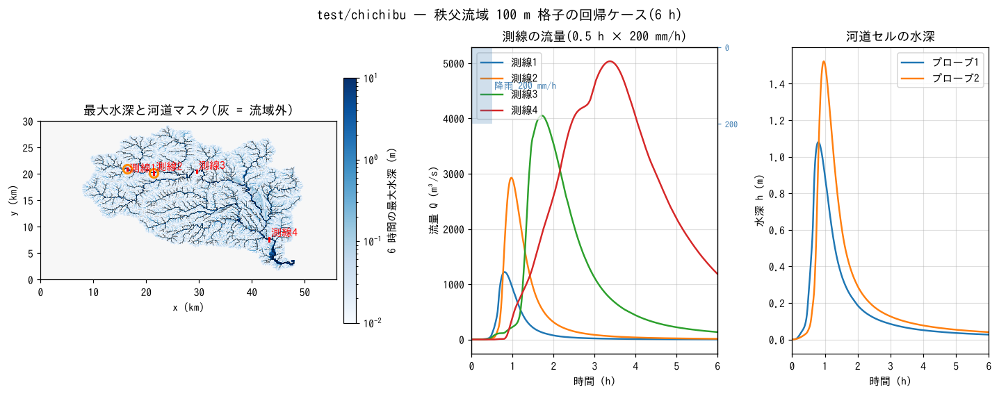

# test/chichibu — real-terrain regression case of the Chichibu catchment at 100 m grid, and the derived experiments

> English mirror of test/chichibu/README.md. The Japanese file is the master copy.

[日本語](../README.md)

A **catchment-scale regression case** that applies uniform rainfall of
200 mm/h × 30 min to the real terrain of the Chichibu catchment in the upper
Arakawa River basin (560 × 300 cells, Δx = 100 m). It fixes the behaviour of
the ENC grid on real terrain (roughness of channel cells through the channel
mask, collection from hillslopes to channels, propagation of the flood
wave), and many of the design decisions on advection schemes, opening
correction, resolution and channel representation were evaluated on this
catchment (the series of records in developer.md §68). `param.txt` is the
regression case with a reference; the other `param*.txt` reproduce the
experiments of §68. The tutorial on the same catchment at 200 m grid is
[tutorials/chichibu](../../../tutorials/chichibu/en/README.md).

## Configuration (regression case param.txt)

| Item | Value |
|---|---|
| Domain and grid | 56 km × 30 km, 560 × 300 cells (Δx = 100 m). `data_chichibu/` (elevation `Chichibu_100m_filled2.txt` (depression-filled), catchment mask, channel mask) |
| Roughness | Slopes n = 0.15, channel cells (fn_rw) n = 0.02 |
| Rainfall | 200 mm/h from 0 to 30 min, 0 thereafter (surface flow is the only process; no infiltration or interception) |
| Computation | Dynamic wave (f_govequation = 0), the default ENC settings (f_advection_scheme = 3, f_opening_dynamic = 2 (changed from 1 on 2026-10-18; §68.38), f_dry_head_cap = 1). `p_adv_upwind_index = 0.1`, dt = 2.5 s, 6 h |
| Records | Discharge at transects 1–4 (the main stem from upstream to downstream; x = 16.5 / 21.5 / 29.6 / 43.3 km), depth at 2 probes (channel cells on transects 1 and 2) |

| File | Contents |
|---|---|
| `Run.sh` / `Run_MPI.sh N` | Compares Log.txt with the reference (ULP = 1) |
| `Fig.py` | The figure below, `figs/chichibu.png` |
| `Plot_chichibu_flux.plt` / `Plot_chichibu_map.plt` / `Plot_flux.plt` | Display of the discharge and the distributions with gnuplot |

## Running

```bash
make
./Run.sh          # 6 h computation (a few minutes on 4 cores) + reference comparison
./Run_MPI.sh 4
python3 Fig.py    # figs/chichibu.png
```

## Figure



Left: maximum depth over the 6 hours (logarithmic colour). The rainfall
collects from the hillslopes into the channels, and flows several metres
deep form in the channel cells (black dots) of the main stem and the
tributaries. Inundation (around 1 m) also spreads over the lowlands of the
valley floor. Middle: discharge at transects 1–4. The peak becomes larger
and later from upstream to downstream, and at the most downstream transect
4 it is 5035 m³/s @ 3.37 h. Right: depth at the probes. Even after the
rainfall ends (0.5 h) the channel depth keeps increasing for more than an
hour, showing the delay of the collection from the hillslopes.

## Findings

| Transect | Position | Peak discharge (m³/s) | Peak time (h) |
|---|---|---|---|
| 1 | Uppermost main stem (x = 16.5 km) | 1221 | 0.80 |
| 2 | x = 21.5 km | 2928 | 0.97 |
| 3 | x = 29.6 km | 4053 | 1.72 |
| 4 | 4.6 km upstream of the catchment outlet (x = 43.3 km) | 5035 | 3.37 |

- The reference is the Log of the default settings (scheme 3, dynamic
  opening correction). The verdict of `Run.sh` is PASS (rerun on 2026-10-24;
  Log.txt identical to the reference). The table and figure above were
  recomputed the same day with the default (f_opening_dynamic = 2; §68.38) and
  are 2–7 % larger than the values with the former default 1 (4926 m³/s @
  3.48 h at transect 4).
- **The domain is closed** (outside the catchment mask is wall; the S column
  of the Log is constant at the total rainfall of 100 mm). Water accumulates
  in the channel cell (479, 35) at the outlet, reaching a depth of 33 m at
  6 h, and the backwater runs up the main stem to x = 41.7 km, including
  transect 4 (the 6 h depth of 1.07 m at transect 4 is a value in the
  backwater zone). The peak (3.37 h) is before this influence. In practical
  computations place a free-outflow boundary (`&list_bound`) at the outlet.
- This case is also a guide to convergence: on the 50 / 100 / 200 m grids of
  the same catchment the most downstream peak changes with resolution
  (larger for finer grids; the supplement of tutorials/chichibu compares
  200 / 100 / 50 m). The real representation of the channels (stepped bed,
  one cell wide) is the main cause of the difference between advection
  schemes; the diagnosis is in §68.14–68.20.

## Derived experiments (param_*.txt)

None of them has a reference; run them with `./encflow param_xxx.txt` and
the output goes to `result_xxx/` (`dir_result` is set). Name suffixes:
`_s1` / `_s3` = f_advection_scheme 1 / 3, `_noadv` = no advection term
(f_govequation = 1), `base` = no opening correction,
`dyn` = f_opening_dynamic = 1.

| Group | Files | Contents | Record |
|---|---|---|---|
| Advection scheme | `param_base_{noadv,s1,s3}.txt` | Scheme comparison without opening correction (100 m) | §68.8 follow-up, §68.12 |
| Dynamic opening correction | `param_dyn_{noadv,s1,s3}.txt`, `param_dyn2_{s1,s3}.txt` | f_opening_dynamic = 1 (channel edges) / 2 (all edges) | §68.14 |
| Restriction of the donor | `param_dyn_s3_donor1.txt` | f_advection_donor = 1 (restricts the donor on channel–channel edges to channel cells) | §68.18 |
| Cap for dry receivers | `param_cap.txt` | f_dry_head_cap = 1 (now the default; byte-identical with the reference) | §68.16 |
| Resolution | `param50_*.txt` (`data_chichibu_50m`), `param200_*.txt` (the 200 m data of tutorials), `param500_*.txt` / `param500r_*.txt` (`data_chichibu_500m`; r = aggregated from the 100 m channel mask) | base / dyn × s1 / s3 on the 50 / 200 / 500 m grids | §68.14, §68.18 |
| Sub-grid channel width | `param_w{50,100}_{s1,s3}.txt` (`width_chichibu{50,100}.txt`), `param200_w{50,100}_s3.txt` | Channel width specified by fn_width (100 m = grid width, 50 m) | §68.12, §68.24 |
| Zero-height levee (walled natural banks) | `param_lev0*_s1.txt`, `param_lev1_{s1,s3}.txt`, `param_lev5_s3.txt` | Combinations of bank0 / f_bank_datum / f_bank_aggr / f_bank_opening of &list_channel (lev0 = no opening correction, lev1 = with it, lev5 = bank0 = 5 m) | §68.12, §68.25, §68.29 |
| Longitudinal transects | `param_reach_{s1,s3}.txt`, `record_reach.txt`, `path_mainstem.csv` | Follows the attenuation of the flood wave with 12 transects along the main stem (s = 0–42 km (path length along the main stem of path_mainstem.csv; transect 12 is the former transect 4)) | §68.17 |

Main results (peak at the most downstream transect 4, from the table of
§68.19): the difference between schemes 1 and 3 narrows with the dynamic
opening correction (scheme 3: 3773 → 4857 m³/s), and with
f_advection_donor = 1 it approaches further, to 5656 m³/s (100 m), the value
of the 50 m grid. The walled natural banks (lev1) complete the 6 h but are
rough, with Runge 12% and frequent ex_flux; for natural banks the wall-less
width mode is recommended (§68.25, §68.29).

## Related documents

- [tutorials/chichibu](../../../tutorials/chichibu/en/README.md) — the 200 m tutorial on the same catchment (procedure; resolution comparison in the supplement)
- [docs/users_guide/geoinfo.md](../../../docs/en/users_guide/geoinfo.md) — input of terrain, masks and the channel mask
- developer.md §68 (design record of the advection and opening correction for raster channels: §68.7, 68.12, 68.14, 68.16–68.20, 68.24, 68.25, 68.29)
