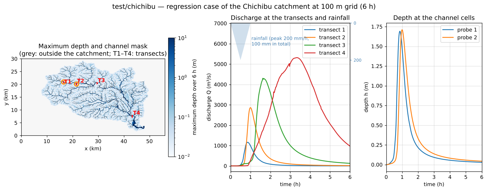

# test/chichibu — real-terrain regression case of the Chichibu catchment at 100 m grid, and the derived experiments

> English mirror of test/chichibu/README.md. The Japanese file is the master copy.

[日本語](../README.md)

A **catchment-scale regression case** that applies uniform rainfall of
100 mm in total (peak 200 mm/h, one hour) to the real terrain of the Chichibu catchment in the upper
Arakawa River basin (560 × 300 cells, Δx = 100 m). It fixes the behaviour of
the ENC grid on real terrain (roughness of channel cells through the channel
mask, collection from hillslopes to channels, propagation of the flood
wave), and many of the design decisions on advection schemes, opening
correction, resolution and channel representation were evaluated on this
catchment (the series of records in developer.md §68). `param.txt` is the
regression case with a reference; the other `param*.txt` reproduce the
experiments of §68. The tutorial on the same catchment at 200 m grid is
[tutorials/chichibu](../../../tutorials/chichibu/en/README.md).

## Configuration (regression case param.txt)

| Item | Value |
|---|---|
| Domain and grid | 56 km × 30 km, 560 × 300 cells (Δx = 100 m). `data_chichibu/` (elevation `Chichibu_100m_filled2.txt` (depression-filled), catchment mask, channel mask `Chichibu_100m_river_flowline.txt` (moved onto the flow lines of the elevation)) |
| Roughness | Slopes n = 0.15, channel cells (fn_rw) n = 0.02 |
| Rainfall | A triangle of 0 at 0 min, 200 mm/h at 30 min and 0 at 60 min (100 mm in total; surface flow is the only process; no infiltration or interception) |
| Computation | [Dynamic wave](../../../docs/en/users_guide/shallow_water.md) (f_govequation = 0), the default ENC settings (f_advection_scheme = 3, f_opening_dynamic = 3 (changed from 1 to 2 on 2026-10-18 and from 2 to 3 on 2026-10-31; §68.38, §68.41), f_dry_head_cap = 2 (changed from 1 on 2026-11-13; §108), f_advection_donor = 3 (changed from 0 on 2026-11-09; §102)). `p_adv_upwind_index = 0.1`, dt = 2.5 s, 6 h |
| Records | Discharge at transects 1–4 (the main stem from upstream to downstream; x = 16.5 / 21.5 / 29.6 / 43.3 km), depth at 2 probes (channel cells on transects 1 and 2) |

| File | Contents |
|---|---|
| `Run.sh` / `Run_MPI.sh N` | Compares Log.txt with the reference (ULP = 1) |
| `Fig.py` | The figure below, `en/figs/chichibu.png` (`python3 Fig.py en`; `figs/chichibu.png` is the Japanese version) |
| `Plot_chichibu_flux.plt` / `Plot_chichibu_map.plt` / `Plot_flux.plt` | Display of the discharge and the distributions with gnuplot |

## Running

```bash
make
./Run.sh          # 6 h computation (a few minutes on 4 cores) + reference comparison
./Run_MPI.sh 4
python3 Fig.py en # en/figs/chichibu.png
```

## Figure



Left: maximum depth over the 6 hours (logarithmic colour). The rainfall
collects from the hillslopes into the channels, and flows several metres
deep form in the channel cells (black dots) of the main stem and the
tributaries. Inundation (around 1 m) also spreads over the lowlands of the
valley floor. Middle: discharge at transects 1–4 and the rainfall. The peak becomes larger
and later from upstream to downstream, and at the most downstream transect
4 it is 5328 m³/s @ 3.28 h. Right: depth at the probes. Even after the
peak of the rainfall (0.5 h) the channel depth keeps increasing for 0.35–0.5 hours
(the peak is at 0.85 h at probe 1 and 1.00 h at probe 2), showing the delay
of the collection from the hillslopes.

## Findings

| Transect | Position | Peak discharge (m³/s) | Peak time (h) |
|---|---|---|---|
| 1 | Uppermost main stem (x = 16.5 km) | 1159 | 0.87 |
| 2 | x = 21.5 km | 2862 | 1.00 |
| 3 | x = 29.6 km | 4316 | 1.67 |
| 4 | 4.6 km upstream of the catchment outlet (x = 43.3 km) | 5328 | 3.28 |

- The reference is the Log of the default settings (scheme 3, dynamic
  opening correction, f_advection_donor = 3, f_dry_head_cap = 2). The table and figure above are the
  values after the default of the edge-depth cap became f_dry_head_cap = 2 and the channel mask was
  moved onto the flow lines of the elevation on 2026-11-13; compared with the values before (original
  channel mask, default 1; 1179 @ 0.83 h, 2956 @ 0.97 h, 4474 @ 1.60 h and 5759 m³/s @ 3.08 h at
  transects 1–4), the peaks are 1.7–7.5 % smaller and 2–12 minutes later. The switch of the default
  alone accounts for −0.9 to +1.7 % and at most one minute (with 1, channel water climbed onto
  rain-wetted valley-wall cells above its level), and the rest is due to the channel mask (the
  valley-wall cells that carried the channel roughness return to the slope roughness;
  developer.md §108.8, §109.4).
  The values before are those after the default became f_advection_donor = 3 on 2026-11-09; compared with
  the default 0 before that (1197 @ 0.82 h, 2862 @ 0.98 h, 3974 @ 1.77 h and
  4830 m³/s @ 3.53 h at transects 1–4), the peaks at transects 3 and 4 are 13 and
  19 % larger and 0.2 and 0.5 hours earlier (the artificial brake from thin films
  on rain-wetted banks acting as momentum donors of the main channel is removed;
  [docs/en/users_guide/advection_donor.md](../../../docs/en/users_guide/advection_donor.md)). The values with the default 0 were
  recomputed on 2026-11-01 with the default (f_opening_dynamic = 3) after the fix of §68.42
  (lateral face flux from the real link discharges); they are 0.4–3.4 % smaller than the
  values of the default 3 before the fix (1202 @ 0.82 h, 2882 @ 0.98 h, 4025 @ 1.72 h and
  5002 m³/s @ 3.40 h at transects 1–4) and 2–4 % smaller than the values with the default 2
  of 2026-10-18 to 31 (1221 @ 0.80 h, 2928 @ 0.97 h, 4053 @ 1.72 h and 5035 m³/s @ 3.37 h),
  because the sheet flow on the hillslopes is slower and the lateral momentum exchange along
  walls and pool edges drops to the real flux (with the former default 1: 4926 m³/s @ 3.48 h at
  transect 4).
- **The domain is closed** (outside the catchment mask is wall; the S column
  of the Log is constant at the total rainfall of 100 mm). Water accumulates
  in the channel cell (479, 35) at the outlet, reaching a depth of 34 m (water
  level 141.4 m) at 6 h, and the backwater runs up the main stem to x = 41.6 km,
  including transect 4 (the 6 h depth of 5.63 m at transect 4 is a value in the
  backwater zone). The peak (3.28 h) is before this influence (the pond level of
  131 m at 3.3 h is below the bed of transect 4, 137 m). In practical
  computations place a free-outflow boundary (`&list_bound`) at the outlet.
- This case is also a guide to convergence: on the 50 / 100 / 200 m grids of
  the same catchment the most downstream peak changes with resolution
  (larger for finer grids; the supplement of tutorials/chichibu compares
  200 / 100 / 50 m). The real representation of the channels (stepped bed,
  one cell wide) is the main cause of the difference between advection
  schemes; the diagnosis is in §68.14–68.20.

## Derived experiments (param_*.txt)

None of them has a reference; run them with `./encflow param_xxx.txt` and
the output goes to `result_xxx/` (`dir_result` is set). Name suffixes:
`_s1` / `_s3` = f_advection_scheme 1 / 3, `_noadv` = no advection term
(f_govequation = 1; the local inertia equation), `base` = no opening correction,
`dyn` = f_opening_dynamic = 1.

| Group | Files | Contents | Record |
|---|---|---|---|
| Advection scheme | `param_base_{noadv,s1,s3}.txt` | Scheme comparison without opening correction (100 m) | §68.8 follow-up, §68.12 |
| Dynamic opening correction | `param_dyn_{noadv,s1,s3}.txt`, `param_dyn2_{s1,s3}.txt` | f_opening_dynamic = 1 (channel edges) / 2 (all edges) | §68.14 |
| Choice of the donor | `param_dyn_s3_donor3.txt` | f_advection_donor = 3 (only faces whose donor on line k carries almost no water are treated as neutral; the default since 2026-11-09). It replaces the former `param_dyn_s3_donor1.txt` (f_advection_donor = 1, restricting the donor on channel–channel edges to channel cells) after option 1 was removed (2026-11-07) | §68.18, §102 |
| Cap for dry receivers | `param_cap.txt` | f_dry_head_cap = 1 (the default until 2026-11-13; with the original channel mask) | §68.16 |
| Resolution | `param50_*.txt` (`data_chichibu_50m`), `param200_*.txt` (the 200 m data of tutorials), `param500_*.txt` / `param500r_*.txt` (`data_chichibu_500m`; r = aggregated from the 100 m channel mask) | base / dyn × s1 / s3 on the 50 / 200 / 500 m grids | §68.14, §68.18 |
| Sub-grid channel width | `param_w{50,100}_{s1,s3}.txt` (`width_chichibu{50,100}.txt`), `param200_w{50,100}_s3.txt` | Channel width specified by fn_width (100 m = grid width, 50 m) | §68.12, §68.24 |
| Zero-height levee (walled natural banks) | `param_lev0*_s1.txt`, `param_lev1_{s1,s3}.txt`, `param_lev5_s3.txt` | Combinations of bank0 / f_bank_datum / f_bank_aggr / f_bank_opening of &list_channel (lev0 = no opening correction, lev1 = with it, lev5 = bank0 = 5 m) | §68.12, §68.25, §68.29 |
| Longitudinal transects | `param_reach_{s1,s3}.txt`, `record_reach.txt`, `path_mainstem.csv` | Follows the attenuation of the flood wave with 12 transects along the main stem (s = 0–42 km (path length along the main stem of path_mainstem.csv; transect 12 is the former transect 4)) | §68.17 |

Main results (peak at the most downstream transect 4, from the table of
§68.19): the difference between schemes 1 and 3 narrows with the dynamic
opening correction (scheme 3: 3773 → 4857 m³/s), and with
f_advection_donor = 1 it approached further, to 5656 m³/s (100 m), the value
of the 50 m grid (both with the code of that time; option 1 was removed on
2026-11-07 and replaced by 3, which contains most of its effect; with the
current code `param_dyn_s3_donor3.txt` gives 5,745 m³/s; §102). The walled natural banks (lev1) complete the 6 h but are
rough, with Runge 12% and frequent ex_flux; for natural banks the wall-less
width mode is recommended (§68.25, §68.29).

## Related documents

- [tutorials/chichibu](../../../tutorials/chichibu/en/README.md) — the 200 m tutorial on the same catchment (procedure; resolution comparison in the supplement)
- [docs/users_guide/geoinfo.md](../../../docs/en/users_guide/geoinfo.md) — input of terrain, masks and the channel mask
- developer.md §68 (design record of the advection and opening correction for raster channels: §68.7, 68.12, 68.14, 68.16–68.20, 68.24, 68.25, 68.29)
