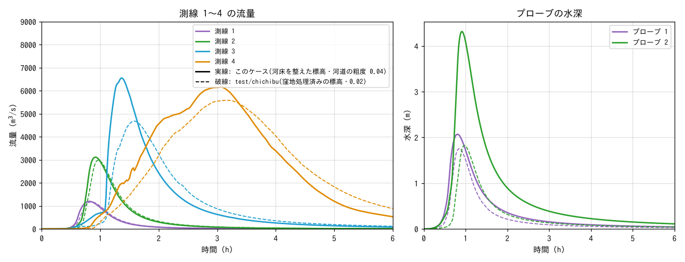

# test/chichibu_cond — 秩父流域 100 m 格子の回帰ケース(河床を整えた標高)

[English](en/README.md)

[test/chichibu](../chichibu/README.md) の回帰ケースと同じ設定で、入力を標準のデータに替えた
**流域規模の回帰ケース**です。地盤高は、河床を整えた標高 `Chichibu_100m_cond.txt`
([データの README](../chichibu/data_chichibu/README.md) の「河床を整えた標高」)、河道セルの粗度は 0.04 です。
データは test/chichibu のものを共有します(`dir_data = "../chichibu/data_chichibu"`)。

## 目的

既定の設定の実地形での挙動を、教材 [tutorials/chichibu](../../tutorials/chichibu/README.md) の Step 2 以降と
同じ種類の入力(河床を整えた標高と、山地の河道の粗度)で固定します。

test/chichibu の回帰ケースは、窪地処理済みの標高(河道に平坦な区間と段差が残る)と河道の粗度 0.02 のまま
残してあります。段々の河床は、流れが急に変わる所が多く、計算の退行を見つける力が強いためです
(developer.md §68 の派生実験の基準でもあります)。2 つの回帰ケースは、入力のこの 2 点だけが違います。

## 構成

| 項目 | 値 |
|---|---|
| 領域・格子 | 56 km × 30 km、560 × 300 セル(Δx = 100 m)。標高 `Chichibu_100m_cond.txt`、流域マスク `Chichibu_100m_basin.txt`、河道マスク `Chichibu_100m_river_flowline.txt` |
| 粗度 | 斜面 n = 0.15、河道セル(fn_rw)n = 0.04 |
| 降雨 | 0 分に 0、30 分に 200 mm/h、60 分に 0 の三角形(総雨量 100 mm。地表流のみ。浸透・遮断なし) |
| 計算 | 動的波(f_govequation = 0)、既定の ENC 設定、dt = 2.5 s、6 時間。流域の出口は閉じたまま |
| 記録 | test/chichibu と同じ測線 1〜4(本流の上流から下流)の流量と、プローブ 2 点(測線 1・2 の河道セル)の水深 |

| ファイル | 内容 |
|---|---|
| `Run.sh` / `Run_MPI.sh N` | Log.txt を reference と比較(ULP = 1) |
| `Fig.py` | 下の図 `figs/chichibu_cond.png`(`../chichibu/result` に test/chichibu の回帰ケースの結果があれば、破線で重ねる) |

## 実行

```bash
make
./Run.sh          # 6 h の計算(4 コアで数分)+ reference 比較
./Run_MPI.sh 4
python3 Fig.py    # figs/chichibu_cond.png(引数 en で英語版を en/figs/ に)
```

## 結果



左: 測線 1〜4 の流量。右: プローブの水深。実線がこのケース、破線が test/chichibu の回帰ケースです。

| 測線 | 位置 | test/chichibu(窪地処理済みの標高・河道 0.02) | このケース(河床を整えた標高・河道 0.04) |
|---|---|---|---|
| 1 | 本流最上流(x = 16.5 km) | 1,175 m³/s・0.85 h | 1,197 m³/s・0.82 h |
| 2 | x = 21.5 km | 2,985 m³/s・0.97 h | 3,116 m³/s・0.92 h |
| 3 | x = 29.6 km | 4,682 m³/s・1.58 h | 6,555 m³/s・1.37 h |
| 4 | 流域出口の上流 4.6 km(x = 43.3 km) | 5,585 m³/s・3.17 h | 6,185 m³/s・3.07 h |

- 河床を整えると、河道の粗度を 2 倍にしても、洪水波は速く大きくなります(測線 3 のピークが 1.4 倍、
  測線 4 が 1.1 倍)。窪地処理済みの標高では、河道の平坦な区間に水が溜まって、波が遅れるためです。
  どちらが実際に近いかは、観測と照合していないので分かりません。
- プローブの水深の最大は 2.07 m(0.80 h)と 4.32 m(0.92 h)で、test/chichibu(1.76 m・1.82 m)より
  深くなります(河道の粗度が大きいことと、河道セルが両脇より深く切れ込んで流れが集まることによると
  みています)。
- 時間刻み 2.5 s で、Cn_max(10 分ごとの表示の最大)は 0.64、V_max は 20.1 m/s です
  (test/chichibu は 0.76・25.1 m/s)。
- S 列は、雨の終わった 1 時間目から 0.10000000000000 m で一定です(出口を閉じた流域の質量保存)。
- 出口を閉じているので、流出した水は出口の手前に湛まります(6 時間後の水深 36.4 m)。湛水は上流へ
  伸びて、171 分から測線 4 の流量を下げます(304 分には、出口を開けた計算より 575 m³/s = 34 % 小さい)。
  **ピーク(184 分)は、出口を開けても同じです。** 出口を開けて確かめるには、`&list_sysparam` に
  `fn_boundary = "-"` を、末尾に次を足します(流域出口の河道セル 2 つを、水位が河床より低い
  完全排水口にする)。

  ```
  &list_bound_stage
    stage_cell(:,1,1) = 479, 36
    stage_cell(:,2,1) = 479, 37
    stage_eta(1) = 100.0
  /
  ```

## 検証

- reference は、既定の設定(スキーム 3・f_opening_dynamic = 3・f_advection_donor = 3・f_dry_head_cap = 3・
  f_advection_bend = 1・f_advection_lateral = 1)の Log です。
- 逐次と MPI(np = 1・2・4)の Log が、reference と一致します(ULP = 1)。
- 夜間の CI が、test/chichibu と同じく、逐次・MPI(np = 1・2・4)・`-fcheck=all` のビルドで回します。

## 関連

- [test/chichibu](../chichibu/README.md) — 同じ流域の回帰ケース(窪地処理済みの標高)と派生実験
- [tutorials/chichibu](../../tutorials/chichibu/README.md) — 同じ流域の 200 m 格子の教材(河床を整えた標高の説明は Step 2)
- developer.md §111 — 河床を整えた標高の経緯と、このケースを足した記録
