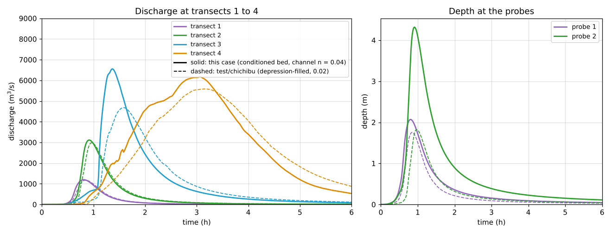

> English mirror of test/chichibu_cond/README.md. The Japanese file is the master copy.

[日本語](../README.md)

# test/chichibu_cond -- regression case of the Chichibu catchment on a 100 m grid (elevation with a conditioned channel bed)

A **catchment-scale regression case** with the same settings as the regression
case of [test/chichibu](../../chichibu/en/README.md) but with the standard
input data: the ground elevation is the elevation with a conditioned channel
bed, `Chichibu_100m_cond.txt` ("Elevation with a conditioned channel bed" in
the [data README](../../chichibu/en/data_chichibu/README.md)), and the
roughness of the channel cells is 0.04. The data are shared with test/chichibu
(`dir_data = "../chichibu/data_chichibu"`).

## Purpose

It fixes the behaviour of the default settings on real terrain with the same
kind of input as Step 2 onward of the tutorial
[tutorials/chichibu](../../../tutorials/chichibu/en/README.md) (an elevation
with a conditioned channel bed and a mountain-channel roughness).

The regression case of test/chichibu is kept with the depression-filled
elevation (flat reaches and steps remain along the channels) and a channel
roughness of 0.02. A stepped bed has many places where the flow changes
abruptly and is therefore good at catching regressions of the computation (it
is also the baseline of the derived experiments of developer.md §68). The two
regression cases differ only in these two inputs.

## Configuration

| Item | Value |
|---|---|
| Domain and grid | 56 km x 30 km, 560 x 300 cells (Δx = 100 m). Elevation `Chichibu_100m_cond.txt`, catchment mask `Chichibu_100m_basin.txt`, channel mask `Chichibu_100m_river_flowline.txt` |
| Roughness | hillslopes n = 0.15, channel cells (fn_rw) n = 0.04 |
| Rainfall | a triangle of 0 at 0 min, 200 mm/h at 30 min, 0 at 60 min (100 mm in total; surface flow only, no infiltration or interception) |
| Computation | dynamic wave (f_govequation = 0), default ENC settings, dt = 2.5 s, 6 hours. The catchment outlet stays closed |
| Records | the same transects 1 to 4 (upstream to downstream along the main stem) and the same two probes (channel cells on transects 1 and 2) as test/chichibu |

| File | Contents |
|---|---|
| `Run.sh` / `Run_MPI.sh N` | compares Log.txt with the reference (ULP = 1) |
| `Fig.py` | the figure below, `en/figs/chichibu_cond.png` (`python3 Fig.py en`; `figs/chichibu_cond.png` is the Japanese version). If `../chichibu/result` holds the result of the regression case of test/chichibu, it is overlaid with dashed lines |

## Running

```bash
make
./Run.sh          # 6 h computation (a few minutes on 4 cores) + comparison with the reference
./Run_MPI.sh 4
python3 Fig.py en # en/figs/chichibu_cond.png (without en: the Japanese version in figs/)
```

## Results



Left: discharge at transects 1 to 4. Right: depth at the probes. Solid lines
are this case, dashed lines the regression case of test/chichibu.

| Transect | Location | test/chichibu (depression-filled elevation, channel 0.02) | This case (conditioned bed, channel 0.04) |
|---|---|---|---|
| 1 | uppermost main stem (x = 16.5 km) | 1,175 m³/s, 0.85 h | 1,197 m³/s, 0.82 h |
| 2 | x = 21.5 km | 2,985 m³/s, 0.97 h | 3,116 m³/s, 0.92 h |
| 3 | x = 29.6 km | 4,682 m³/s, 1.58 h | 6,555 m³/s, 1.37 h |
| 4 | 4.6 km upstream of the catchment outlet (x = 43.3 km) | 5,585 m³/s, 3.17 h | 6,185 m³/s, 3.07 h |

- With the conditioned bed the flood wave is faster and larger even though the
  channel roughness is doubled (the peak at transect 3 is 1.4 times, at
  transect 4 1.1 times as large). With the depression-filled elevation, water
  collects on the flat reaches of the channel and the wave is delayed. Which of
  the two is closer to reality is not known, because there is no comparison
  with observations.
- The maximum depths at the probes are 2.07 m (0.80 h) and 4.32 m (0.92 h),
  deeper than in test/chichibu (1.76 m and 1.82 m); we attribute this to the
  larger channel roughness and to the channel cells cutting deeper below the
  cells on both sides, which concentrates the flow.
- With the time step of 2.5 s, Cn_max (the largest value in the 10-minute
  display) is 0.64 and V_max is 20.1 m/s (0.76 and 25.1 m/s in test/chichibu).
- The S column stays constant at 0.10000000000000 m from the end of the rain
  at 1 hour on (mass conservation of a catchment with a closed outlet).
- Because the outlet is closed, the runoff ponds just upstream of it (36.4 m
  deep after 6 hours). The pond grows upstream and lowers the discharge at
  transect 4 from 171 min on (at 304 min it is 575 m³/s = 34 % smaller than in
  a computation with the outlet open). **The peak (184 min) is the same with
  the outlet open.** To check with the outlet open, add `fn_boundary = "-"` to
  `&list_sysparam` and append the following (it turns the two channel cells at
  the catchment outlet into a perfect drain with a level below the bed).

  ```
  &list_bound_stage
    stage_cell(:,1,1) = 479, 36
    stage_cell(:,2,1) = 479, 37
    stage_eta(1) = 100.0
  /
  ```

## Verification

- The reference is the Log of the default settings (scheme 3,
  f_opening_dynamic = 3, f_advection_donor = 3, f_dry_head_cap = 3,
  f_advection_bend = 1, f_advection_lateral = 1).
- The Logs of the serial run and of MPI (np = 1, 2, 4) agree with the reference
  (ULP = 1).
- The nightly CI runs it like test/chichibu: serial, MPI (np = 1, 2, 4) and a
  build with `-fcheck=all`.

## Related

- [test/chichibu](../../chichibu/en/README.md) -- the regression case of the same catchment (depression-filled elevation) and the derived experiments
- [tutorials/chichibu](../../../tutorials/chichibu/en/README.md) -- the 200 m tutorial of the same catchment (Step 2 explains the conditioned channel bed)
- developer.md §111 -- how the conditioned bed came about, and the record of adding this case
