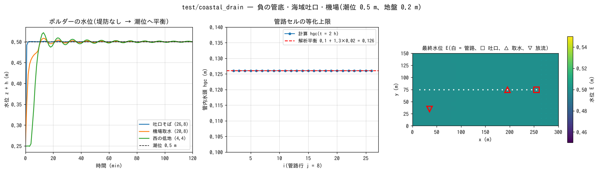

# test/coastal_drain — drainage of a below-sea-level polder: negative invert, sea outfall and pumping station

> English mirror of test/coastal_drain/README.md. The Japanese file is the master copy.

[日本語](../README.md)

With a polder at ground level 0.2 m and a sea at a constant tide level of
0.5 m (a below-sea-level zone), this regression test checks three features
of the conduit continuum layer (`f_gwconduit`; [the groundwater chapter of
the users guide](../../../docs/en/users_guide/gwflow.md)) at the same time
(developer.md §46.5 (7)(8)).

- (7) **Negative invert elevation** (`fn_gwc_bot` = −1.8 m, 2 m below the
  ground surface at 0.2 m)
- (8b) **Outfall in a sea cell** (`fn_gwc_outfall`; discharge by the head
  difference from the tide level, with a flap)
- (8a) **Pumping station** (`f_pump_src = 1` in `&list_struct_pump` =
  intake directly from the conduits)

Since there is no levee, the sea intrudes into the polder and the whole
system equilibrates toward the tide level. This final state is determined
analytically (water level over the whole domain = tide level, in-pipe head
= the equalization cap of the outfall), so it can be used as a check in
addition to the regression comparison.

## Configuration

| Item | Value |
|---|---|
| Domain and grid | 300 m × 150 m, 30 × 15 cells (Δx = 10 m). Ground z = 0.2 m, the 4 eastern columns (i ≥ 27) are sea (`sw.txt`; 60 cells). The sea bottom −2 m in `z.txt` is a record in the data; in the computation the elevation of the sea cells is placed as tide level 0.5 m − hsea0 2.5 m = −2.0 m |
| Water | Initial h₀ = 0.05 m, constant tide level 0.5 m (`titype = 2`). n = 0.03 |
| Conduit | One conduit at i = 2–26 in row j = 8 (`cnd.txt`). Capacity cap = 0.1 m, invert −1.8 m, slot sy 0.02, inlets 0.01, outfall at i = 26 (discharging to the sea cell (27, 8)) |
| Pumping station | Takes water from the conduit at (20, 8) and discharges 0.04 m³/s to the western lowland (4, 4) when hgc > 0.05 m (returned within the domain) |
| Time | dt = 0.25 s, 2 h. 3 probes (near the outfall, the intake, the discharge destination) |

| File | Contents |
|---|---|
| `Run.sh` / `Run_MPI.sh N` | Compare Log.txt with the reference (ULP = 0, excluding the Runge column) |
| `Run_stiff.sh` | Stiff variant `param_stiff.txt` (slot_sy = 0.002 → subcycling N = 2). No reference. Checked against the analytical equilibrium hgc = 0.1 + 1.3 × 0.002 = 0.1026 |
| `gen_data.py` | Record of the generation of `data_cd/` (the data are committed) |
| `Fig.py` | The figure `figs/coastal_drain.png` below |

## Running

```bash
make
./Run.sh          # 2 h computation (tens of seconds) + reference comparison
./Run_MPI.sh 2
./Run_stiff.sh
python3 Fig.py    # figs/coastal_drain.png
```

## Figures



Left: time series of the water level. The cell near the outfall reaches the
tide level within 1 minute by the intrusion of the sea, and the western
lowland, which also receives the discharge of the pumping station,
converges to the tide level 0.5 m in 20 minutes while oscillating. Center:
the final distribution of the in-pipe head hgc of the conduit cells. All
cells agree to 4 digits with the analytical equilibrium
0.1 + (0.5 − (−0.8)) × 0.02 = 0.1260 m (slot storage for the 1.3 m
difference between the crown head −0.8 m and the tide level). This is a
numerical demonstration that in-pipe water with a head below the tide level
cannot be discharged by a gravity outfall, i.e. "a below-sea-level system
requires a pumping station". Right: the final water level E. It is 0.5 m
over the whole domain (h = 0.30 m); the head difference from the sea is
ΔH = 0, so the flap is closed and there is no backflow.

## Findings

| Check | Computed | Analytical |
|---|---|---|
| Final water level E | 0.4988–0.5000 m (all of the land) | Tide level 0.5 m |
| Conduit cell hgc (all 25 cells) | 0.1260 m | cap + (0.5 − (−0.8))·slot_sy = 0.1260 m |
| Cumulative outfall discharge | 7.028 m³ (screen "outfall discharge total"; value after the promotion of the defaults on 2026-10-18) | — |
| Regression | Log.txt agrees with the reference at ULP = 0 | PASS |

- Before the implementation, a negative invert map was rejected by par_stop
  (§46.5 (7)).
- The full-field outputs and the Log of np = 1, 2, 4 agree with the serial
  run, and the serial and np = 2 runs with -fcheck=all complete cleanly.
- The pumping station keeps circulating within the domain even after the
  equilibrium is reached. To complete the interior drainage, use the
  practical configuration that separates the sea with a levee and sends the
  discharge of the pumping station to the sea side (outside the domain)
  (the pump section of users_guide/structure.md). The water-quality
  coupling with sewers is in [test/sewer_wq](../../sewer_wq/en/README.md).

## Related documents

- [docs/users_guide/gwflow.md](../../../docs/en/users_guide/gwflow.md) — conduit continuum layer (`&list_gwflow_conduit`: cap / cnd / bot / outfall / inlet)
- [docs/users_guide/structure.md](../../../docs/en/users_guide/structure.md) — pumps (`f_pump_src`)
- developer.md §46.5 (design and verification of the extensions (4)–(8) of the conduit continuum layer) (in Japanese)
