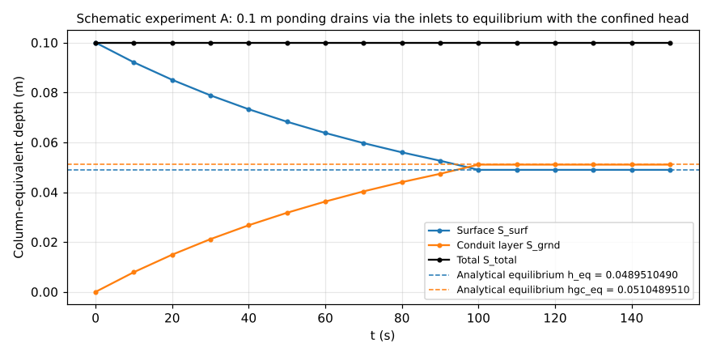
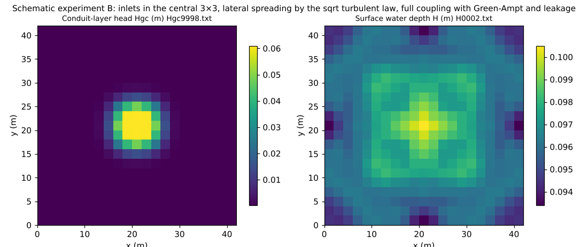

# test/conduit — analytical equilibrium of the conduit continuum layer (f_gwconduit) and symmetry of the full coupling

> English mirror of test/conduit/README.md. The Japanese file is the master copy.

[日本語](../README.md)

A verification case of the **conduit continuum layer** (`f_gwconduit = 1` in
`&list_gwflow`;
[the groundwater chapter of the users' guide](../../../docs/en/users_guide/gwflow.md#conduit-continuum-layer-f_gwconduit1-list_gwflow_conduit)),
which represents sub-grid conduit networks such as sewer networks, bedrock
fracture networks and agricultural tile drains as an equivalent continuum.
It consists of two schematic experiments (developer.md §46).

- **Schematic experiment A** (`param.txt`): uniform ponded water drops
  through the inlets into the conduit layer, and after the conduits fill the
  confined head rises and comes to equilibrium with the surface water level.
  Since there is no lateral flow and every cell follows the same ordinary
  differential equation, **the equilibrium values are determined
  analytically**, and it is confirmed that S_surf / S_grnd on the screen
  agree with them to all printed digits. Has a reference.
- **Schematic experiment B** (`param_lat.txt`): the inlets are only in the
  central 3×3 cells, and the lateral spreading by the sqrt turbulent law
  inside the conduit layer, Green-Ampt vertical infiltration and the leakage
  and inflow between the conduits and the soil layer are all enabled, to
  confirm mass conservation through all the coupling paths and 8-direction
  isotropy (point symmetry and transpose symmetry).

## Configuration

| Item | Schematic experiment A | Schematic experiment B |
|---|---|---|
| Domain and grid | 42 m × 42 m, 21 × 21 cells (Δx = 2 m), flat z = 0, n = 0.05, walls on all four sides | Same as left |
| Initial condition | Uniform ponding h₀ = 0.1 m | Same as left |
| Inlets | Uniform over all cells, `gwc_inlet = 0.01` per m² (one per 100 m²) | Central 3×3 cells only (`data_conduit/inlet.txt`) |
| Conduit layer | Capacity `gwc_cap = 0.05` m (columnar), invert depth 2 m, unconfined storage coefficient 0.05, pseudo-slot 0.001, no lateral conveyance | Lateral sqrt turbulent law (`f_gwc_fluxlaw = 2`), with conductance |
| Soil layer | None (impermeable surface) | Green-Ampt infiltration + leakage and inflow between the conduits and the soil layer |
| Time | dt = 0.05 s, 150 s (the conduit layer is updated every step) | dt = 0.05 s, 120 s |

Analytical equilibrium of schematic experiment A: the bottom of the conduit
head zbot = z₀ − 2 = −2 m, the crown level hcrown = zbot + cap/sy = −1 m. At
equilibrium the surface water level h equals the confined head
hcrown + (hgc − cap)/slot_sy, and h + hgc = 0.1 m, so

  hgc_eq = 51.1/1001 = 0.0510489510… m, h_eq = 0.1 − hgc_eq = 0.0489510489… m

| File | Contents |
|---|---|
| `param.txt` / `param_lat.txt` | Schematic experiment A / B |
| `data_conduit/inlet.txt` | Inlet density distribution of B (non-zero only in the central 3×3) |
| `Run.sh` / `Run_MPI.sh N` | Regression test of A (serial / MPI) |
| `Run_lat.sh` / `Run_lat_MPI.sh N` | Run of B (result_lat/) |
| `Fig.py` | Draws the figures below, `en/figs/*.png` (`python3 Fig.py en`; `figs/*.png` are the Japanese versions) |

## Running

```bash
make
./Run.sh            # A: compares Log.txt with the reference (ULP = 1)
./Run_MPI.sh 4
./Run_lat.sh        # B: output to result_lat/ (about 2.5 min)
./Run_lat_MPI.sh 4  # MPI of B. The rule is bit-identity with the serial run
python3 Fig.py en   # en/figs/equilibrium.png, en/figs/lateral.png (also prints the tables)
```

## Figures



The surface S_surf decreases through the weir-type → orifice-type inflow at
the inlets, the conduit layer S_grnd increases, and both reach the
analytical equilibrium values (dashed) at about 100 s and thereafter stay at
rest without oscillation. The total S_total remains 0.1 m, unchanged to 14
digits. The absence of oscillation after reaching equilibrium is the work of
eq_inflow, which limits the inflow when the conduits are full by the
equilibrium condition (§46.4).



Left: conduit-layer head Hgc at the final time (120 s). The water that
entered through the inlets of the central 3×3 spreads radially through the
8-direction conductances of the sqrt turbulent law, and the centre is
surcharged above the capacity 0.05 m (maximum 0.06 m). The distribution is
point-symmetric and transpose-symmetric with error 0.0 (bit-exact), showing
the isotropy of the 8-direction distribution of ENC. Right: surface water
depth H at the same time. The surface flow toward the inlets and the
exchange of inflow and leakage with the surcharged centre produce a gentle
relief of 0.094–0.101 m.

## Findings

| Quantity | Computed value | Analytical value |
|---|---|---|
| A: S_surf (150 s) | 0.04895104895105 m | h_eq = 0.04895104895105 m |
| A: S_grnd (150 s) | 0.05104895104895 m | hgc_eq = 0.05104895104895 m |
| A: S_total | 0.10000000000000 m, unchanged at all times | 0.1 m |
| B: S_total | 0.10000000000000 m, unchanged (120 s) | — |
| B: point and transpose symmetry of Hgc | Maximum deviation 0.0 | — |

- Schematic experiment A confirms that the basic operation of the conduit
  layer — the inlet inflow law (weir → orifice), the pseudo-slot confined
  branch after the conduits fill, and the equilibrium with the surface —
  agrees with the analytical equilibrium **to all printed digits**.
- Schematic experiment B confirms that mass is conserved and the
  distribution is exactly symmetric even when lateral spreading, vertical
  infiltration, leakage and inflow all act at once. The Logs of MPI
  np = 1, 2, 4 agree completely with the serial run (§46.4).
- That a restart round trip (save at 75 s → restore and run to 150 s) is
  bit-identical with a straight-through run is also confirmed in §46.4.
- Examples of application in the field are
  [examples/qanat](../../../examples/qanat/en/README.md) (collection by a
  horizontal gallery) and
  [examples/sewer_hybrid](../../../examples/sewer_hybrid/en/README.md) (urban
  sewer network) (§46.5: trunk sewers and galleries are represented by
  cell-by-cell map heterogeneity within a single instance of the conduit
  layer).

## Related documents

- [docs/users_guide/gwflow.md](../../../docs/en/users_guide/gwflow.md) — parameters of the conduit continuum layer (capacity, invert depth, storage coefficient, inlets, flux law, outfalls)
- developer.md §46 (design, verification record, extension policy)
