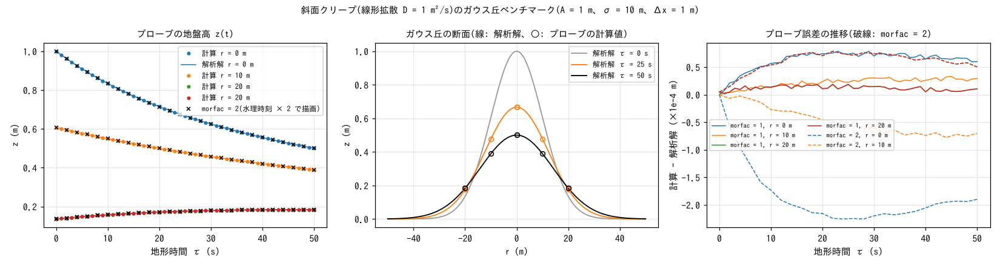

# test/creep — 斜面クリープ(線形拡散)のガウス丘ベンチマーク

[English](en/README.md)

地形変化モジュールの斜面クリープ(`&list_geomorph` の `f_creep = 1`、
[ユーザーガイドの地形変化の章](../../docs/users_guide/geomorph.md))を、
等方線形拡散 ∂z/∂t = D∇²z の解析解で検定します。水は置かず(h₀ = 0、
降雨なし)、地形変化だけが動くケースです。あわせて、地形更新だけを
加速する係数 **morfac** について、morfac = 2 × 25 s が morfac = 1 × 50 s
と同じ地形を与えること(MORFAC 方式の等価性)を確かめます
(developer.md §19 の地形変化モジュールの実装)。reference との比較ではなく
解析解との比較で合否を判定する、環境非依存のテストです。同じガウス丘で、
土層だけが動く深さ依存クリープ(`creep_hstar`、developer.md §88.8)も検定します
([下の節](#深さ依存クリープcreep_hstar))。

## 構成

| 項目 | 値 |
|---|---|
| 領域・格子 | 101 m × 101 m、101 × 101 セル(Δx = 1 m)、四周壁 |
| 初期地形 | ガウス丘 z = A exp(−r²/2σ²)、A = 1 m、σ = 10 m(user_geoinfo `gaussian_hill`。中心セル (51, 51)) |
| クリープ | 拡散係数 D = 1 m²/s、毎ステップ更新(dts = dt = 0.1 s)。陽解法の安定条件 D dts (1/dx² + 1/dy²) ≤ 1/2 → dts ≤ 0.25 s |
| 時間 | dt = 0.1 s、50 s(`param.txt`、morfac = 1)/ 25 s(`param_morfac2.txt`、morfac = 2。地形時間は同じ 50 s) |
| 計測 | プローブ 4 点: 丘の中心 r = 0、x 方向 r = 10, 20 m、y 方向 r = 20 m。1 s 毎に z を記録 |

解析解(地形時間 τ = 水理時刻 × morfac):

  z(r, τ) = A σ² / (σ² + 2Dτ) · exp(−r² / (2(σ² + 2Dτ)))

τ = 50 s で σ² + 2Dτ = 200 m² となり、丘の高さは 1 m → 0.5 m、幅は √2 倍に
広がります。

| ファイル | 内容 |
|---|---|
| `param.txt` / `param_morfac2.txt` | morfac = 1(50 s)/ morfac = 2(25 s)。`param.txt` は終了時の状態を `save/` に保存する(深さ依存クリープの比較用) |
| `param_hstar_*.txt`・`sdzero.txt` | 深さ依存クリープの 4 構成と、裸岩の構成の土層厚 0 の分布 |
| `Check_analytic.py` | プローブ CSV の z(t) を解析解と比較し、最大絶対誤差 < 5e-3 m で PASS |
| `Check_hstar.py <構成>` | 深さ依存クリープの検定(save の z・sd を読む) |
| `Fig.py` | 下の図 `figs/profile.png` を描く |

A・σ・D・中心セルは `param*.txt`、`src/user_geoinfo.f90` の
`gaussian_hill`、`Check_analytic.py`・`Check_hstar.py` で対になっています。
変えるときは同時に変えてください。

## 実行

```bash
make
./Run.sh          # 6 構成を実行し、Check_analytic.py・Check_hstar.py で検定(すべて PASS で PASS。数秒)
./Run_MPI.sh 4    # Run.sh の後に。深さ依存クリープは逐次の save(save_hstar_*_serial)とバイト比較
python3 Fig.py    # figs/profile.png(引数 en で英語版を en/figs/ に)
```

## 図



左: プローブの地盤高 z(t)(点)と解析解(線)。4 点とも線の上に乗り、
morfac = 2 の結果(×。水理時刻を 2 倍して地形時間で描画)も同じ曲線に
重なります。中: 解析解の断面(τ = 0, 25, 50 s)とプローブの計算値(○)。
右: 計算 − 解析解の推移。morfac = 1 では最大 7.9e-5 m(丘の高さの
0.008%)、morfac = 2 では 2.3e-4 m で、いずれも時間離散化 O(dts) の
範囲です(morfac は実効時間刻みを 2 倍にするので誤差も約 3 倍)。

## 所見

| ケース | 最大絶対誤差(4 プローブ) | 判定(許容 5e-3 m) |
|---|---|---|
| morfac = 1、50 s | 7.76e-5 m(r = 0)、3.3e-5(r = 10)、1.9e-5(r = 20) | PASS |
| morfac = 2、25 s | 2.29e-4 m(r = 0)、7.6e-5(r = 10)、7.9e-5(r = 20) | PASS |

- クリープは 4 近傍の保存形フラックス(5 点ラプラシアン)で、等方線形
  拡散に厳密に整合するため解析解と直接比べられます。x 方向と y 方向の
  r = 20 m のプローブが同じ値になること(等方性)も確認できます。
- 土砂体積は反対称フラックスの集計により機械精度で保存されます。
- morfac の等価性は、「1 回の計算 = morfac 回の同一イベント分の地形
  変化」という解釈の根拠です。差は O(dts) の時間離散化だけです。
- このケースは将来 8 近傍化する際の検出器でもあります: 重みの正規化を
  誤ると実効拡散係数が D からずれ、解析解との比較で直ちに現れます
  (§19)。
- MPI np = 1, 2, 4 のプローブ CSV は逐次とビット一致します(§19 の検証記録)。

## 深さ依存クリープ(creep_hstar)

`creep_hstar = H_c > 0` では、流量 q = −D (1 − e^{−H/H_c}) ∇z(H は供給側 = 高い側のセルの
土層厚 sd)で土層だけが動きます(z と sd を同じ量だけ動かす)。同じガウス丘に一様な
土層を置いた 4 構成で、全構成に共通の (a) 岩盤面 z − sd が初期のまま(1e-12 m)、
(b) 土層の総量 Σ sd A の保存(相対 1e-12。四周は壁)、(c) sd ≥ 0 と、構成ごとの項目を
`Check_hstar.py` で検定します。

| 構成 | ファイル | 内容 | 構成ごとの判定 |
|---|---|---|---|
| 厚い土層 | `param_hstar_thick.txt` | sd0 = 10 m、H_c = 0.05 m(利用可能率 1 − e^{−200} = 1) | 全セルの z が従来の線形拡散(`param.txt` の save)と 1e-12 m 以内。プローブの解析解比較(`Check_analytic.py`)も行う |
| 薄い土層 | `param_hstar_thin.txt` | sd0 = 2 cm、H_c = 0.1 m(利用可能率 0.18 から) | 丘の頂部の土層が剥がれ(sd < 0.1 sd0)、脚部に溜まる(max sd > sd0) |
| 供給量制限 | `param_hstar_lim.txt` | sd0 = H_c = 2 mm。中腹では 1 回の更新の流出要求が土層厚を超え、掃流砂と共有の供給量制限が働く | 薄い土層と同じ |
| 裸岩 | `param_hstar_bare.txt` | 土層厚 0 の分布 `sdzero.txt` | z が初期のまま(1e-12 m)、sd = 0 のまま |

検証記録(2026-10-27。gfortran 13.3 / Open MPI 4.1、既定の -Ofast ビルド):

- 厚い土層: 従来の線形拡散と max|Δz| = 1.8e-15 m(流量を固体体積に換算して戻す丸め)、
  プローブの解析解との誤差は従来と同じ 7.76e-5 m。岩盤面の不変 4.4e-14 m。
- 薄い土層: 頂部の sd = 9.6e-7 m(頂部の低下は初期の土層厚 2 cm で止まる)、max sd = 3.66 cm。
- 供給量制限: 226300 セル更新で発動(終了時の警告「fluvial supply limiter」)、頂部の sd = 0、
  max sd = 4.3 mm。発動の下でも (a)〜(c) が成り立つ。
- 裸岩: max|z − z0| = 2.2e-16 m(初期地形を Python で作り直した丸め)、sd = 0。
- 土層の総量の相対変化はどの構成も 0(倍精度の和で一致)。
- MPI: -fcheck=all の np = 2 を先に実行し、境界違反なし・4 構成が debug の逐次とバイト一致。
  -Ofast の np = 1, 2, 4 も逐次とバイト一致(供給量制限の発動数はランク局所の表示で、
  np = 2 の 116228 + 110072 が逐次の 226300 に一致)。

## 関連文書

- [docs/users_guide/geomorph.md](../../docs/users_guide/geomorph.md) — `f_creep`、`creep_d`、`creep_hstar`、`morfac`、`dt_geomorph`
- developer.md §19(地形変化モジュールの実装: morfac・クリープ・安定条件・検証記録)、
  §88.8(深さ依存クリープ)
