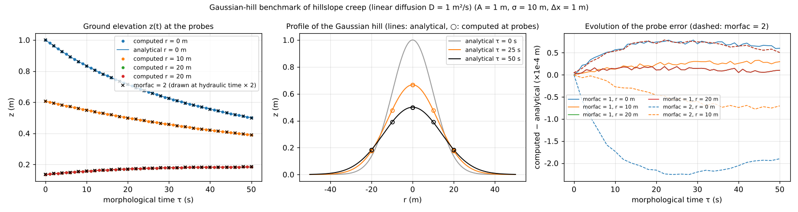

# test/creep — Gaussian-hill benchmark of hillslope creep (linear diffusion)

> English mirror of test/creep/README.md. The Japanese file is the master copy.

[日本語](../README.md)

Checks the hillslope creep of the landform evolution module (`f_creep = 1`
in `&list_geomorph`; [the landform evolution chapter of the users
guide](../../../docs/en/users_guide/geomorph.md)) against the analytical
solution of isotropic linear diffusion ∂z/∂t = D∇²z. No water is placed
(h₀ = 0, no rainfall); only the landform evolution acts. In addition, for
the coefficient **morfac** that accelerates only the terrain update, it
confirms that morfac = 2 × 25 s gives the same terrain as morfac = 1 × 50 s
(equivalence of the MORFAC method) (the implementation of the landform
evolution module in developer.md §19). It is an environment-independent
test whose pass/fail is judged by comparison with the analytical solution,
not with a reference. On the same Gaussian hill it also checks depth-dependent
creep, in which only the soil layer moves (`creep_hstar`, developer.md §89.8;
[section below](#depth-dependent-creep-creep_hstar)).

## Configuration

| Item | Value |
|---|---|
| Domain and grid | 101 m × 101 m, 101 × 101 cells (Δx = 1 m), walls on all four sides |
| Initial terrain | Gaussian hill z = A exp(−r²/2σ²), A = 1 m, σ = 10 m (user_geoinfo `gaussian_hill`; center cell (51, 51)) |
| Creep | Diffusion coefficient D = 1 m²/s, updated every step (dts = dt = 0.1 s). Explicit stability condition D dts (1/dx² + 1/dy²) ≤ 1/2 → dts ≤ 0.25 s |
| Time | dt = 0.1 s, 50 s (`param.txt`, morfac = 1) / 25 s (`param_morfac2.txt`, morfac = 2; the morphological time is the same 50 s) |
| Measurement | 4 probes: the hill center r = 0, r = 10, 20 m in the x direction, r = 20 m in the y direction. z recorded every 1 s |

Analytical solution (morphological time τ = hydraulic time × morfac):

  z(r, τ) = A σ² / (σ² + 2Dτ) · exp(−r² / (2(σ² + 2Dτ)))

At τ = 50 s, σ² + 2Dτ = 200 m², so the hill height goes from 1 m to 0.5 m
and the width spreads by a factor of √2.

| File | Contents |
|---|---|
| `param.txt` / `param_morfac2.txt` | morfac = 1 (50 s) / morfac = 2 (25 s). `param.txt` saves the final state in `save/` (for the comparison of depth-dependent creep) |
| `param_hstar_*.txt`, `sdzero.txt` | The 4 configurations of depth-dependent creep, and the zero soil-depth file of the bare-rock configuration |
| `Check_analytic.py` | Compares z(t) of the probe CSV with the analytical solution; PASS when the maximum absolute error < 5e-3 m |
| `Check_hstar.py <configuration>` | Checks of depth-dependent creep (reads z and sd of the save) |
| `Fig.py` | Draws the figure `en/figs/profile.png` below (`python3 Fig.py en`; `figs/profile.png` is the Japanese version) |

A, σ, D and the center cell are paired among `param*.txt`, `gaussian_hill`
in `src/user_geoinfo.f90`, `Check_analytic.py` and `Check_hstar.py`.
Change them together when changing them.

## Running

```bash
make
./Run.sh          # run the 6 configurations and check them by Check_analytic.py and Check_hstar.py (PASS when all PASS; a few seconds)
./Run_MPI.sh 4    # after Run.sh; depth-dependent creep is byte-compared with the serial saves (save_hstar_*_serial)
python3 Fig.py en # en/figs/profile.png
```

## Figures



Left: the ground elevation z(t) at the probes (points) and the analytical
solution (lines). All 4 points lie on the lines, and the morfac = 2 result
(×; drawn in morphological time by doubling the hydraulic time) also
coincides with the same curves. Center: the analytical profiles
(τ = 0, 25, 50 s) and the computed values at the probes (○). Right: the
evolution of computed − analytical. The maximum is 7.9e-5 m (0.008% of the
hill height) for morfac = 1 and 2.3e-4 m for morfac = 2, both within the
range of the O(dts) time discretization (morfac doubles the effective time
step, so the error is about 3 times larger).

## Findings

| Case | Maximum absolute error (4 probes) | Result (tolerance 5e-3 m) |
|---|---|---|
| morfac = 1, 50 s | 7.76e-5 m (r = 0), 3.3e-5 (r = 10), 1.9e-5 (r = 20) | PASS |
| morfac = 2, 25 s | 2.29e-4 m (r = 0), 7.6e-5 (r = 10), 7.9e-5 (r = 20) | PASS |

- Creep is a conservative 4-neighbor flux (5-point Laplacian) that is
  exactly consistent with isotropic linear diffusion, so it can be compared
  directly with the analytical solution. It can also be confirmed that the
  r = 20 m probes in the x and y directions give the same value (isotropy).
- The sediment volume is conserved to machine precision by the summation of
  antisymmetric fluxes.
- The equivalence of morfac is the basis of the interpretation "one
  computation = the landform change of morfac identical events". The only
  difference is the O(dts) time discretization.
- This case is also a detector for a future extension to 8 neighbors: if the
  normalization of the weights is wrong, the effective diffusion coefficient
  deviates from D, which shows up immediately in the comparison with the
  analytical solution (§19).
- The probe CSVs of MPI np = 1, 2, 4 are bit-identical to the serial run
  (verification record of §19).

## Depth-dependent creep (creep_hstar)

With `creep_hstar = H_c > 0`, only the soil layer moves with the flux
q = −D (1 − e^{−H/H_c}) ∇z (H is the soil depth sd of the supplying, i.e.
higher, cell; z and sd move by the same amount). Four configurations with a
uniform soil on the same Gaussian hill are checked by `Check_hstar.py` for the
common items (a) the bedrock surface z − sd stays at its initial value
(1e-12 m), (b) conservation of the total soil Σ sd A (relative 1e-12; walls on
all four sides), (c) sd ≥ 0, and for the items of each configuration.

| Configuration | File | Contents | Check of the configuration |
|---|---|---|---|
| Thick soil | `param_hstar_thick.txt` | sd0 = 10 m, H_c = 0.05 m (availability 1 − e^{−200} = 1) | z of every cell agrees with the conventional linear diffusion (the save of `param.txt`) within 1e-12 m. The analytical comparison at the probes (`Check_analytic.py`) is also made |
| Thin soil | `param_hstar_thin.txt` | sd0 = 2 cm, H_c = 0.1 m (availability starts at 0.18) | The soil at the hilltop is stripped (sd < 0.1 sd0) and accumulates at the foot (max sd > sd0) |
| Supply limiter | `param_hstar_lim.txt` | sd0 = H_c = 2 mm. On the flanks the outflow demanded in one update exceeds the soil depth, and the supply limiter shared with bedload acts | Same as the thin soil |
| Bare rock | `param_hstar_bare.txt` | Zero soil-depth file `sdzero.txt` | z stays at its initial value (1e-12 m), sd stays 0 |

Verification record (2026-10-27; gfortran 13.3 / Open MPI 4.1, default -Ofast
build):

- Thick soil: max|Δz| = 1.8e-15 m against the conventional linear diffusion
  (the rounding of converting the flux to solid volume and back); the error
  against the analytical solution at the probes is 7.76e-5 m, the same as
  before. Bedrock surface unchanged to 4.4e-14 m.
- Thin soil: sd at the hilltop 9.6e-7 m (the lowering of the hilltop stops at
  the initial soil depth of 2 cm), max sd = 3.66 cm.
- Supply limiter: fired in 226300 cell-updates (warning "fluvial supply
  limiter" at the end of the run), sd at the hilltop = 0, max sd = 4.3 mm.
  (a)–(c) hold while it fires.
- Bare rock: max|z − z0| = 2.2e-16 m (rounding of rebuilding the initial
  terrain in Python), sd = 0.
- The relative change of the total soil is 0 in every configuration (the
  double-precision sums agree).
- MPI: np = 2 with -fcheck=all was run first: no bounds violations, and the 4
  configurations are bit-identical to the debug serial run. np = 1, 2, 4 with
  -Ofast are also bit-identical to the serial run (the count of the supply
  limiter is printed per rank; 116228 + 110072 of np = 2 equals the serial
  226300).

## Related documents

- [docs/users_guide/geomorph.md](../../../docs/en/users_guide/geomorph.md) — `f_creep`, `creep_d`, `creep_hstar`, `morfac`, `dt_geomorph`
- developer.md §19 (implementation of the landform evolution module: morfac, creep, stability condition, verification record) and §89.8 (depth-dependent creep) (in Japanese)
