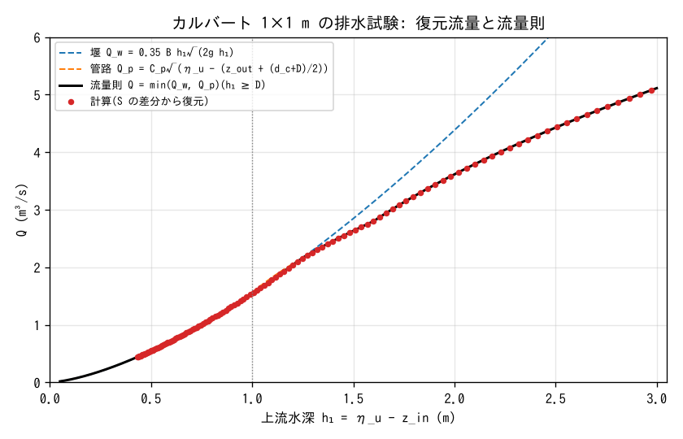

# test/culvert — passage through the three regimes of the culvert discharge law

> English mirror of test/culvert/README.md. The Japanese file is the master copy.

[日本語](../README.md)

This is the verification case for a box culvert crossing an embankment
(`&list_struct_culvert`; [the structures chapter of the user's guide](../../../docs/en/users_guide/structure.md);
the discharge law is in [the hydraulic laws supplement](../../../docs/en/users_guide/hydraulics.md) §2).
Water 3 m deep is placed in a flat upstream basin and drained through a single
1 m × 1 m culvert into a downstream column that is always dry. While the
upstream depth h₁ falls from 3D to 0.4D, the flow passes through the three
regimes: full pipe (inlet submerged) → transition (near the crown) → free
surface (weir). Because the downstream side is dry, Q is a function of h₁
alone, and Q(h₁) recovered from the storage S in the Log can be compared
directly with the discharge law (a check of the 2026-10-12 revision in
developer.md §22).

## Configuration

| Item | Value |
|---|---|
| Domain and grid | 120 m × 110 m, 12 × 11 cells (Δx = 10 m), walls on all four sides |
| Terrain | i = 1..10 upstream basin z = 0, i = 11 embankment z = 10 m, i = 12 downstream column z = 0 (`data_culvert/z.txt`) |
| Initial condition | Depth 3.0 m in the upstream basin (`hinit.txt`); dry elsewhere |
| Downstream column | Perfect outlet with prescribed stage η = −999 (`stage.txt`; always dry) |
| Culvert | (10, 6) → (12, 6), B = D = 1 m, inverts 0/0, L = 0 (no friction), c_e = 0.5 |
| Time | dt = 0.5 s, 14400 s. Log every 120 s |

With all 132 active cells × 100 m² = 13200 m² as A_total and the upstream
basin 11000 m² as A_up, Q = −A_total dS/dt and h₁ ≈ S A_total / A_up.

| File | Contents |
|---|---|
| `param.txt` | The case above (with a reference) |
| `make_init.py` | Regenerates the 3 files in `data_culvert/` |
| `Fig.py` | The figure `figs/law.png` below and the numbers in the findings |

## Running

```bash
make
./Run.sh          # compare Log.txt with the reference (ULP = 0, excluding the Runge column)
./Run_MPI.sh 4
python3 Fig.py    # figs/law.png
```

## Figures



The red dots are the computed discharge recovered from differences of S, and
the black line is the discharge law $`Q = \min(Q_w, Q_p)`$ (h₁ ≥ D). Because
the pipe formula takes the downstream head at the outlet invert +
(d_c + D)/2, it starts almost continuously from the weir discharge at
h₁ = D, where the inlet submerges, and acts as the upper bound from about
h₁ ≈ 1.3D upward.

## Findings

| h₁ (m) | Computed Q (m³/s) | Discharge-law Q (m³/s) | Difference |
|---|---|---|---|
| 2.505 | 4.435 | 4.435 | 0.0 % |
| 1.509 | 2.648 | 2.649 | 0.0 % |
| 1.006 | 1.563 | 1.565 | −0.1 % |
| 0.599 | 0.717 | 0.718 | −0.1 % |

- The recovered Q decreases monotonically over the whole range as h₁ falls,
  with no dip just above the crown (h₁ = 1.0–1.1 m). (Under the reference
  before the revision it dropped from 1.60 to 0.51 m³/s at h₁ = 1.02 m.)
- The difference of 0.1 % or less from the discharge law comes from the
  difference between the water level of the representative cell (10, 6) and
  the basin-mean water level (the local water-surface gradient caused by the
  drainage).
- np = 1, 2, 4 are bit-identical to the serial reference (ULP = 0).
