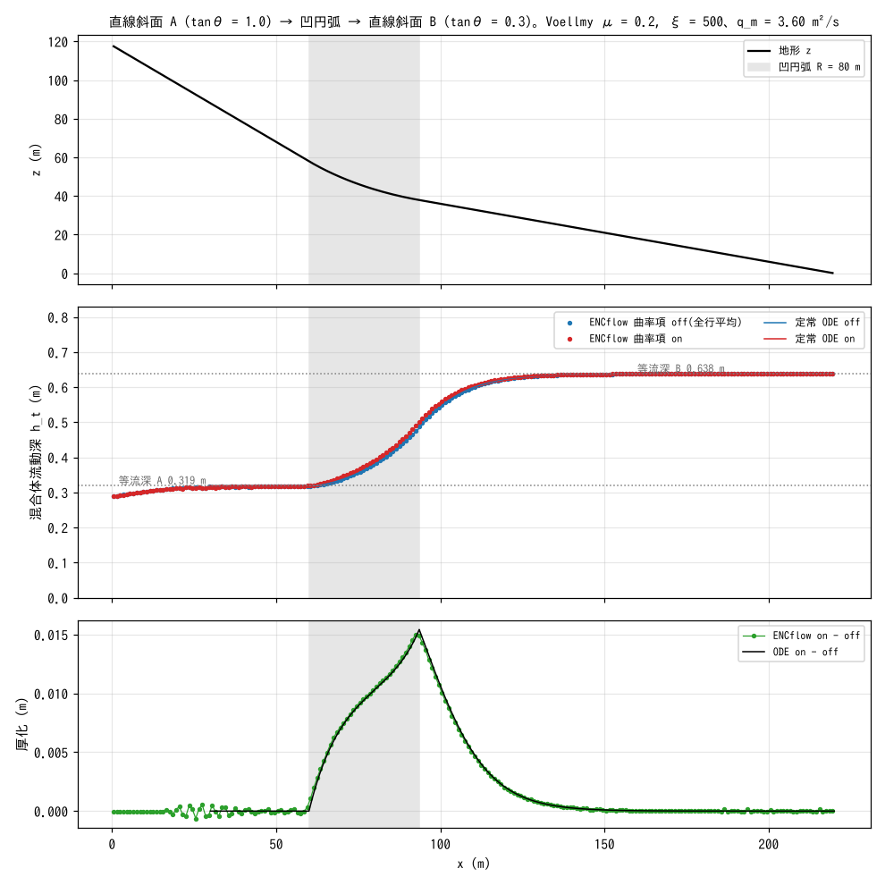

# test/curvature — steady one-dimensional check of the curvature term (f_dbcurv) for debris flows and avalanches

> English mirror of test/curvature/README.md. The Japanese file is the master copy.

[日本語](../README.md)

This is the verification case of the **curvature term**, in which the
centrifugal acceleration on a concave arc of a slope increases the yield
friction (`f_dbcurv = 1` of `&list_geomorph`; used with the mixture-flow
f_debris family for debris flows, avalanches, pyroclastic flows and the like)
(developer.md §28.10). A mixture is fed steadily onto a one-dimensional terrain
of straight slope A → concave arc → straight slope B, and the steady flow of
the Voellmy resistance law is compared with the curvature term off and on. The
benchmark is the **numerical integration of the steady one-dimensional
ordinary differential equation (ODE)** that includes the horizontal coordinate
system, the Ni correction, pressure, advection, Voellmy and the curvature term;
pass or fail is decided by the self-check of `Check_curvature.py`, not by a
reference comparison (the same type as test/volcano).

## Configuration

| Item | Value |
|---|---|
| Terrain | Straight slope A (tanθ = 1.0, x ≤ 60 m) → concave arc of radius 80 m (tangent to both slopes) → straight slope B (tanθ = 0.3). z = 0 at the east end x = 220 m (`make_init.py` generates `zinit.txt`) |
| Grid | 220 m × 8 m, 220 × 8 cells (Δx = 1 m). `p_diagratio = 0` (keeps the one-dimensionality) |
| Inflow | Constant inflow 16 m³/s from the 8 cells at the west end, sediment concentration 0.8 → mixture discharge per unit width q_m = 3.6 m²/s |
| Flow law | `f_debris = 1`, `f_dbed = 0` (no exchange with the bed = equivalent fluid), `f_dbres = 4` Voellmy (μ = 0.2, ξ = 500 m/s²), stopping velocity 0.05 m/s |
| Boundaries | The east side is free outflow (passes the supercritical flow of slope B as it is) |
| Time | dt = 0.02 s, 80 s (steady state reached). The final state is saved to `state.dat` in `save_off/` / `save_on/` |

Steady one-dimensional ODE (horizontal coordinate system; q_m = u h_t constant):

  (g_e − u²/h_t) dh_t/dx = g_e(−z′ − μF) − g_e u²/(ξ h_t),
  g_e = g/(1 + z′²), F = 1 + a_c/√(g g_e), a_c = u² z″/√(1 + z′²)

F is the curvature term; with it off, F = 1. On the straight parts z″ = 0, so
the curvature term vanishes and both configurations converge to the Voellmy
uniform-flow depth h_n = (q_m²/(ξ (tanθ − μ)))^{1/3} (A: 0.319 m, B: 0.638 m).

| File | Contents |
|---|---|
| `param_on.txt` / `param_off.txt` | With / without the curvature term (identical except for `f_dbcurv`) |
| `make_init.py` | Generates the terrain `zinit.txt` (the constants are paired with those of Check) |
| `Check_curvature.py` | Reads the flow depth h_t(x) averaged over all rows from `state.dat` and judges (1) uniform flow A, (2) uniform flow B and the on/off difference, (3) agreement with the ODE on the arc, (4) the ratio of the thickening on − off to the ODE |
| `Fig.py` | Draws the figure `figs/profile.png` below (it borrows the functions of Check, so the check output is also displayed) |

## Running

```bash
make
./Run.sh          # generate zinit.txt → run off → on → Check_curvature.py (PASS/FAIL)
./Run_MPI.sh 4    # MPI. The rule is that save_*/state.dat is byte-identical to the serial run
python3 Fig.py    # figs/profile.png
```

## Figures



Top: terrain. The grey band is the section of the concave arc (x = 60–94 m).
Middle: the steady mixture flow depth h_t (average over all rows). The dots are
ENCflow (blue off, red on), the lines the steady ODE. On the straight parts
both lie on the Voellmy uniform-flow depth, and on the arc they make the
transition from the uniform-flow depth of A to that of B. The ENC transition
rises slightly upstream of the ODE, but the average on the arc agrees with the
ODE within 1%. Bottom: the thickening on − off due to the curvature term. On
the arc the centrifugal acceleration increases the yield friction, and the flow
decelerates and thickens. The ENCflow difference (green) and the ODE difference
(black) overlap over the whole section of the arc, and the shape of the
downstream decay also agrees.

## Findings

| Check | Computed value | Criterion | Verdict |
|---|---|---|---|
| (1) <h_t> of uniform flow A (off / on) | 0.3165 m | Uniform-flow depth 0.3188 m (−0.7%, tolerance 5%) | PASS |
| (2) <h_t> of uniform flow B (off / on) | 0.6375 m | Uniform-flow depth 0.6376 m (−0.02%) | PASS |
| (2′) on/off difference on the straight parts | 0.00% | < 1% (the curvature term vanishes at z″ = 0) | PASS |
| (3) <h_t> on the arc (off / on) | 0.3881 / 0.3983 m | ODE 0.3844 / 0.3945 m (+0.9–1.0%, tolerance 10%) | PASS |
| (4) Thickening on − off on the arc | 0.0103 m | ODE 0.0100 m (ratio 1.02, tolerance 0.7–1.4) | PASS |

- Although the effect of the curvature term (thickening 1 cm, 3%) is small, it
  agrees with the ODE difference to 2%, showing that the implementation follows
  the formulation. The effect is small because the centrifugal acceleration
  u²/R ≈ 1.6 m/s² of this configuration is about 16% of gravity and the
  velocity-dependent term of Voellmy dominates.
- Row averages are compared because the Voellmy uniform flow does not always
  become transversely uniform, but after the fix of §28.11 (the yield-stop
  judgement is made with the edge speed) the scatter between rows on slope B is
  0.0%.
- Design history (§28.10): the original design, "release a soil mass onto the
  arc and compare with the stopping position of a Coulomb point mass", did not
  work because a deforming soil mass does not behave as a point mass (it
  dissipates through deceleration and piling-up at the front), so it was
  changed to a difference comparison with steady inflow.
- With MPI np = 2, 4, `state.dat` is byte-identical to the serial run (both
  configurations).

## Related documents

- [docs/users_guide/geomorph.md](../../../docs/en/users_guide/geomorph.md) — mixture flow (f_debris), resistance law `f_dbres`, curvature term `f_dbcurv`
- developer.md §28.10 (design, verification and history of the curvature term), §28.11 (fix of the yield-stop judgement)
- Self-check of the same type: [test/volcano](../../volcano/en/README.md) (one-dimensional benchmark of Voellmy uniform flow)
