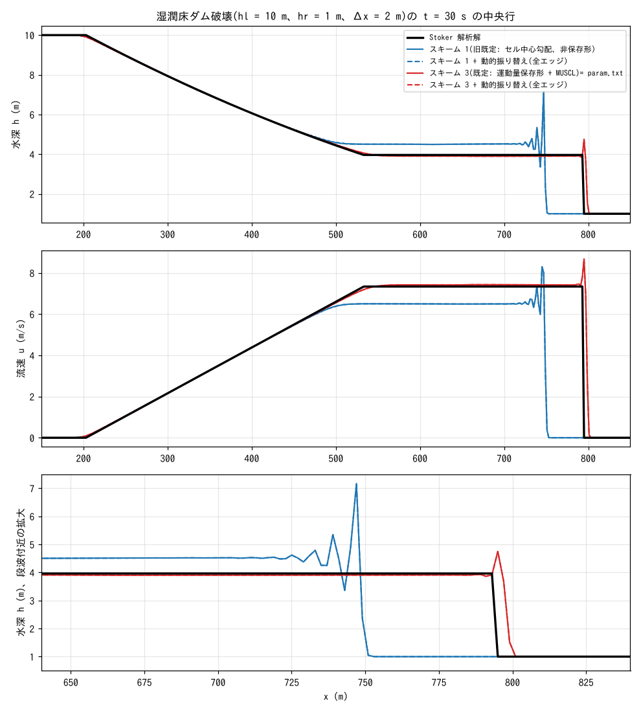
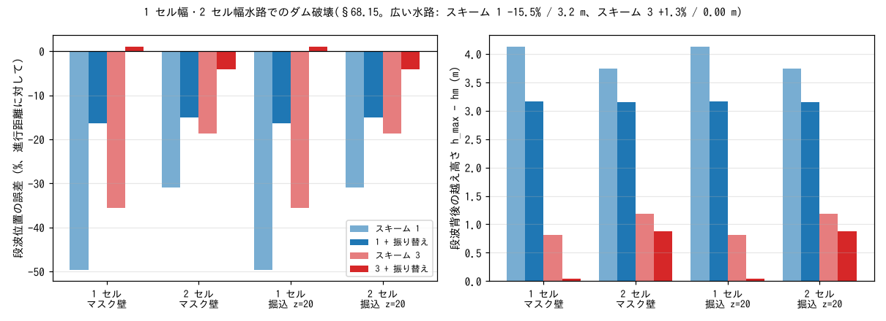

# test/dambreak — wet-bed dam break (verification of the advection schemes against the Stoker analytical solution)

> English mirror of test/dambreak/README.md. The Japanese file is the master copy.

[日本語](../README.md)

This is the wet-bed dam-break problem of Stoker (1957), for which the speed
of the bore (discontinuity) and the state behind it are known analytically.
Because the quality of the discretization of the advection term appears
directly in the position and shape of the bore, the case was designed as
the criterion for judging ENCflow's advection schemes
(`f_advection_scheme`) (developer.md §68.4). The introduction of the
momentum-conservative schemes 2 and 3 (§68.6), the conveyance problem of
one-cell-wide channels and the dynamic reassignment (§68.15), and
f_dry_head_cap, which stops leaks onto dry high ground (§68.16), were all
quantified and judged with this case.

## Configuration

| Item | Value |
|---|---|
| Domain and grid | 1000 m × 400 m, 500 × 200 cells (Δx = Δy = 2 m) |
| Terrain and roughness | Flat z = 0, frictionless, walls on all four sides |
| Initial condition | h = 10 m for x < 500 m, h = 1 m for x ≥ 500 m (user_initial `dambreak_step`), zero velocity |
| Time step | dt = 0.05 s, 30 s (Cn ≈ 0.35). h and u output every 10 s |
| Analytical solution (t = 30 s) | Intermediate state hm = 3.962 m, um = 7.337 m/s, bore speed s = 9.814 m/s, bore position x = 794.4 m, head of the rarefaction wave x ≈ 203 m (none of them reaches the walls) |

The width of 400 m is chosen so that the influence of the side walls (the
lag of the front along the walls) does not reach the central row within
30 s (with the original 40 m the bore speed on the central row was
evaluated 8% too slow; §68.4). ny = 200 satisfies the minimum of 2 rows per
band for MPI np = 4.

| File | Contents |
|---|---|
| `param.txt` | Baseline case (with reference). `&list_enc` states explicitly gravity correction, excess-outflow reduction and hcap = 1, upwind coefficient 0.5, adaptive RK threshold 1.5. The advection scheme is not written, so it is **the current default (3: momentum-conservative + MUSCL)** |
| `param_scheme1.txt` | `f_advection_scheme = 1` (the former default cell-centre gradient scheme; non-conservative). For comparison |
| `param_scheme3.txt` | `f_advection_scheme = 3` stated explicitly. Since the default became 3, the same result as `param.txt` |
| `param_dyn_s1.txt` / `param_dyn_s3.txt` | Scheme 1 / 3 with `f_opening_dynamic = 2` (dynamic reassignment of blocked openings on all edges) added. In a wide channel there is no effect except along the walls |
| `Check_stoker.py` | Compares the central row as a one-dimensional profile with the analytical solution and prints the errors of the bore position, hm and um, the overshoot behind the bore, the L1 errors and the deviation between rows. Writes `stoker.csv` (no pass/fail judgement; the regression is Log.txt) |
| `Make_incised.py` | Generates the terrain, mask and parameters of the dam break in one-cell-wide and two-cell-wide channels (§68.15) |
| `Plot_dambreak.plt` / `Plot_dambreak.py` | Interactive display and simple plotting (older scripts) |
| `Fig.py` | Draws the figures below, `figs/*.png` |

## Running

```bash
make
./Run.sh                   # serial; compares Log.txt with the reference, then runs Check_stoker.py
./Run_MPI.sh 4             # MPI with 4 ranks; the rule is that the Log matches the serial run

# comparison of the advection schemes and the dynamic reassignment (results in result_<name>/)
for p in param_scheme1 param_dyn_s1 param_dyn_s3; do
  ./encflow $p.txt
  RESDIR=$(grep dir_result $p.txt | sed "s/.*'\(.*\)'.*/\1/") PARAM=$p.txt python3 Check_stoker.py
done

# one-cell-wide and two-cell-wide channels (§68.15); generates and runs 24 cases
python3 Make_incised.py
for p in param_m[12]_*.txt param_ch[12]_*.txt; do
  ./encflow $p
  RESDIR=$(grep dir_result $p | sed "s/.*'\(.*\)'.*/\1/") PARAM=$p python3 Check_stoker.py
done

python3 Fig.py             # figs/profile.png, figs/incised.png
```

In Check_stoker.py the bore position is "the position where h crosses
(hm + hr)/2", hm and um are averages over the central 50% of the analytical
flat section, and the overshoot is the maximum h behind the bore − hm.
hl, hr and the step position are synchronized with `dambreak_step` in
`src/user_initial.f90`.

## Figures



Top and middle: depth h and velocity u on the central row at t = 30 s.
Black is the Stoker analytical solution. The default scheme 3 (red)
overlaps the analytical solution in the rarefaction wave, the intermediate
state and the bore, and the error of the bore position is +1.3% (relative
to the distance travelled; 1.8 cells). With the former default scheme 1
(blue) the bore is 15% late, the depth of the intermediate state is 14% too
high and the velocity 11% too low, because the non-conservative
discretization does not conserve the momentum flux across the bore and does
not satisfy the Rankine–Hugoniot jump condition.
Bottom: enlargement around the bore. Scheme 1 carries violent 2Δx
oscillations behind the bore (h 3.3 → 7.2 m), while scheme 3 only has a
0.8 m spike in the one cell at the front and is flat behind it (the spike
is caused by the edge depth (h_c + h_n)/2 of the continuity equation, a
property of the spatial discretization independent of the time step or the
protection mechanisms; §68.6). The dynamic reassignment (dashed) overlaps
the solid lines in a wide channel.



The same problem confined to a channel one cell wide (row 3 of ny = 5) or
two cells wide. The landside is either invalid cells (mask wall) or dry
cells above the water surface (incised terrain, z = 20 m). Left: the error
of the bore position; right: the overshoot behind the bore. In the
one-cell-wide channel all diagonal exchange partners are walls, so the
diagonal share of the passage widths of the 8-direction allocation of the
ENC cannot be used, and without reassignment the bore lags greatly: −50%
with scheme 1 and −36% with scheme 3. When the dynamic reassignment
(`f_opening_dynamic = 2`) moves the blocked passage widths to the axis
edges, the values of the one-cell channel return to those of the wide
channel (−16% / +1.1%). In the two-cell channel −6% remains even with
scheme 3 + reassignment (because each cell touches a wall on one side only,
so the transverse momentum exchange is asymmetric; not analysed, handoff).
The mask wall and the incised terrain give the same values to all digits in
every combination.

## Findings

Wide channel (the grid of `param.txt`), t = 30 s, central row:

| Setting | Bore position | hm | um | Overshoot behind the bore | L1(h) | L1(u) |
|---|---:|---:|---:|---:|---:|---:|
| Scheme 3 (default, `param.txt`) | +1.25% | −1.2% | +1.2% | 0.01 m | 0.006 | 0.021 |
| Scheme 3 + reassignment 2 | +1.25% | −1.5% | +1.2% | 0.00 m | 0.006 | 0.021 |
| Scheme 1 (former default) | −15.45% | +14.3% | −11.4% | 3.21 m | 0.051 | 0.171 |
| Scheme 1 + reassignment 2 | −15.45% | +13.8% | −11.5% | 3.21 m | 0.050 | 0.171 |

One-cell and two-cell channels (error of the bore position / overshoot;
the mask wall and the incised terrain give the same values):

| Channel | Scheme 1 | 1 + reassignment | Scheme 3 | 3 + reassignment |
|---|---|---|---|---|
| 1 cell | −49.7% / 4.12 m | −16.4% / 3.16 m | −35.6% / 0.81 m | **+1.1% / 0.05 m** |
| 2 cells | −30.9% / 3.74 m | −15.0% / 3.15 m | −24.2% / 1.38 m | −6.3% / 1.28 m |

- **That the bore speed comes out correctly** is the basis for making the
  momentum-conservative schemes (2 and 3) the default. With scheme 1 the
  lag of the bore and the oscillations behind it remain even after
  correcting the limiter (§68.5), and this case confirmed that they are a
  limitation of the structure of the discretization (non-conservative +
  smoothing by the two-sided average).
- That the one-cell channel + reassignment returns to the values of the
  wide channel supports the way the ENC is used to route one-cell-wide
  channels as a raster (tutorials/chichibu).
- With `f_dry_head_cap` (default 1), the dry high landside of the incised
  terrain is treated strictly equivalently to the mask wall. Before its
  introduction, scheme 1 on the incised terrain and scheme 3 in the
  two-cell channel diverged through the leak of "water climbing onto dry
  cells above the water surface" (§68.15–16). The cases with `_c1`
  (cap = 1 explicit) generated by Make_incised.py give the same results as
  the unmarked ones, since the default became 1.
- Regression discipline: the serial Log.txt must match the reference
  (ULP = 1, excluding the Runge column), and MPI np = 1, 2, 4 must be
  identical. Update the reference only after confirming the validity of the
  results (CLAUDE.md).
- Guide to the computing time (4 threads): baseline case 12 s.

## Related documents

- developer.md §68.4 (design and reference values), §68.5 (fix of the
  limiter), §68.6 (momentum-conservative advection), §68.15 (one-cell and
  two-cell channels), §68.16 (f_dry_head_cap) (in Japanese)
- [docs/users_guide/swflow.md](../../../docs/en/users_guide/swflow.md) —
  explanation of `f_advection_scheme`, `f_opening_dynamic` and
  `f_dry_head_cap` and when to use each
- References: Stoker, J. J. (1957) *Water Waves*; the momentum-conservative
  staggered-grid scheme of Stelling & Duinmeijer (2003) (the prototype of
  schemes 2 and 3)
