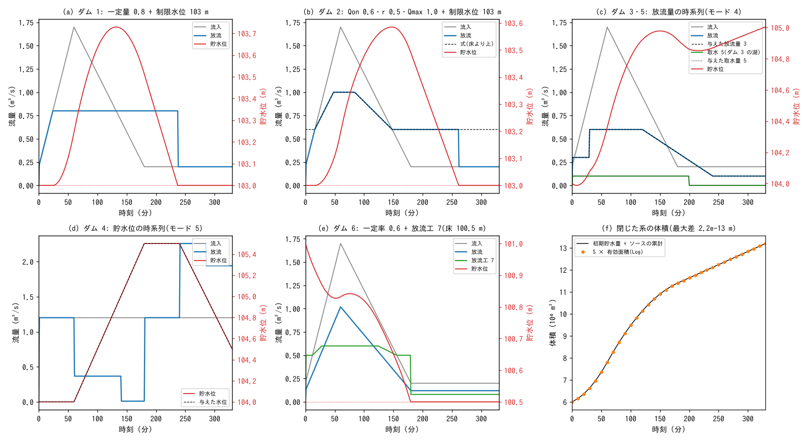

# test/damops — ダムの運転則: 制限水位・洪水調節開始流量・実績の時系列

[English](en/README.md)

構造物モジュールのダム(`&list_struct_dam`)の運転則を、記録行ごとの式との
一致と閉じた系の体積保存で検定するケースです(developer.md §131)。対象は

- 一定量放流方式(モード 1 + 制限水位 `dam_hlim`)
- 一定率一定量放流方式のピークまでの形(モード 2 + 洪水調節開始流量 `dam_qon`・
  放流量の上限 `dam_qmax`・制限水位)
- 放流量の時系列(モード 4。namelist の折れ線、同じ時刻の点を重ねた段を含む)
- 貯水位の時系列(モード 5。ファイル。初期水位は時系列の t0 の値)
- 追加の放流工(`dam_lake`)の放流量の時系列と、一定率一定量+自分の制限水位
- 従来の一定率カット(モード 2)

です。運転則の式は [構造物と境界の水理則の解説](../../docs/users_guide/hydraulics.md#4-ダム湖沼の運転) §4、
使い方は [内部水理構造物](../../docs/users_guide/structure.md#ダム湖沼list_struct_dam) にあります。

## 構成

| 項目 | 値 |
|---|---|
| 領域・格子 | 24 × 14 セル、dx = dy = 10 m(`make_data.py` が `data_damops/` を作る) |
| 捕捉帯 | i = 2 の列の孤立した 1 セル × 5(j = 2, 4, 6, 8, 10)。周りの 8 近傍は領域外で、流れのやり取りをしない |
| 流入 | 内部ソースで各捕捉帯に入れるハイドログラフ。基底 0.2 → 60 分に 1.7 → 180 分に 0.2 m³/s の三角形(ダム 4 だけ一定 1.2 m³/s)。捕捉帯は次の歩に全量を吸収する |
| 放流先 | i = 5〜24 の平坦な閉じた池(四周は壁)。水は系外へ出ない |
| HV | 全ダム共通: (100 m, 0) (105 m, 2.0×10⁴ m³) (112 m, 6.0×10⁴ m³)。但し書きの開始は既定の 110.8 m で、このケースの水位はそこまで上がらない |
| 時間 | dt = 1 s、19800 s(330 分)。ダム CSV は 60 s ごと |

| ダム | 設定 | 確かめること |
|---|---|---|
| 1 | モード 1、q0 = 0.8、制限水位 103 m | 流入 < 0.8 は水位 103 m を保って流入をそのまま流し、超えると 0.8 で貯め、洪水後は 0.8 で 103 m まで戻って再び流入を流す |
| 2 | モード 2、r = 0.5、Qon = 0.6、Qmax = 1.0、制限水位 103 m | 床での素通し・一定率・上限・床より上での Qon による戻しの 4 つの段階を通る |
| 3 | モード 4(namelist)。30 分に 0.3 → 0.6 の段 | 放流 = 与えた放流量 |
| 4 | モード 5(`level4.txt`)。初期水位は省略 | 水位 = 与えた水位(t = 0 を含む)、放流 = 流入 − 目標の貯水量の変化 |
| 5 | ダム 3 の湖から引く追加の放流工。モード 4(200 分に 0.1 → 0 の段) | 放流 = 与えた取水量、水位はダム 3 と同じ |
| 6 | モード 2、r = 0.6(従来の一定率カット) | 放流 = 0.6 × 流入 |
| 7 | ダム 6 の湖から引く追加の放流工。モード 2、r = 0.25、Qon = 0.5、Qmax = 0.6、自分の制限水位 100.5 m | 床より上で放流 = 式、床では主放流(ダム 6)の後に残った水まで |

| ファイル | 内容 |
|---|---|
| `Run.sh` | Log.txt と 7 基のダム CSV を reference と比較 → `Check_damops.py rules` → リスタート(165 分で保存して再開)が通し計算と一致 → 不正な設定 9 通りの停止 |
| `Run_MPI.sh` | MPI で同じ比較と `Check_damops.py rules` |
| `Check_damops.py rules\|restart` | 記録行ごとの検定と体積保存 / リスタートの継続の一致 |
| `make_data.py` | 入力(`mask.txt`・`z.txt`・`level4.txt`)の生成 |
| `Fig.py` | 下の図 `figs/damops.png`(引数 en で英語版を `en/figs/` に) |

## 検定の内容

- **流入 = 1 歩前のソースの流量**: 捕捉帯が孤立しているので、内部ソースが入れた水は次の歩に
  全量が吸収されます(セットアップの確認)。
- **運転則の式**: 床(制限水位)より上の行では放流 = 式、床にいる行では
  min(使える流入, 式) ≤ 放流 ≤ 式(使える流入は流入、追加の放流工では主放流の後の残り)。
  水位は床を下回りません。
- **時系列**: モード 4 の放流、モード 5 の水位が、与えた時系列の補間値(各ステップの終わりの時刻)と
  印字の桁(f13.4)の範囲で一致します。モード 5 の放流は 流入 − (V(H(t)) − V(H(t − dt))) / dt です。
- **体積保存**: Log.txt の S × 有効セル面積 = 初期貯水量 + ソースの累計体積(系は閉じていて、
  放流は捕捉帯の貯留から池へ移るだけ)。許容は 1×10⁻⁹ m。
- **リスタート**: 165 分で保存して再開した計算のダム CSV と S が、再開時刻より後で通し計算と
  一致します(再開の最初の行の Qin・Qout は保存しない診断量なので比べません)。
- **停止**: モードと合わないパラメータ(モード 1 の `dam_qon`、モード 3 の `dam_hlim`、
  モード 1 の `dam_qout_val`、モード 4 の `dam_tadashigaki`)、`dam_qmax` < `dam_qon`、
  減る時刻、但し書きの開始水位以上の制限水位、範囲外の水位の時系列、モード 5 の湖沼を
  参照する追加の放流工が、起動時にエラーで止まります。

## 結果



(a) ダム 1 は流入が 0.8 m³/s を超えるまで水位 103 m を保って流入を流し、超えると 0.8 で貯め、
洪水後は 0.8 で 103 m まで戻って(238 分)再び流入をそのまま流します。(b) ダム 2 は床での素通し →
一定率 → 上限 1.0 → 一定率 → Qon = 0.6 での戻し → 床での素通し、と段階を移ります(破線は式。床より上で
放流と重なる)。(c) ダム 3 の放流とダム 5 の取水は、与えた時系列(段を含む)に重なります。(d) ダム 4 の
水位は与えた水位に重なり、放流は目標の貯水量の変化に応じて変わります(105 m で HV の傾きが変わる)。
(e) ダム 7 は自分の床 100.5 m に達すると、主放流(ダム 6)の後に残った水(0.4 × 流入)だけを引きます。
(f) S × 有効面積は、初期貯水量 + ソースの累計体積に一致します。図は `python3 Fig.py`(英語版は
`python3 Fig.py en`)で描きます。

## 実行

```bash
make
./Run.sh
./Run_MPI.sh 4
```

reference との比較は ULP = 1(印字の最終桁 1 つ分まで)です。reference を作ったマシンと CPU の
違うマシンでは、`-march=native` の生成コードの差で Log.txt の S の最終桁が変わり得るためです
(test/damwq と同じ扱い)。同じマシンでは `ULP=0 ./Run.sh` でビット比較できます。

## このケースで確かめていないこと

- 但し書き(異常洪水時防災操作)のランプとサーチャージ超過のスピル(水位はそこまで上がらない)。
- 実ダムの記録との比較。運転則が規則どおりに働くことは確かめていますが、規則が実際の操作を
  どこまで再現するか(一定率一定量放流方式のピーク後の一定量を表さない近似の影響など)は、
  このケースの対象外です。
