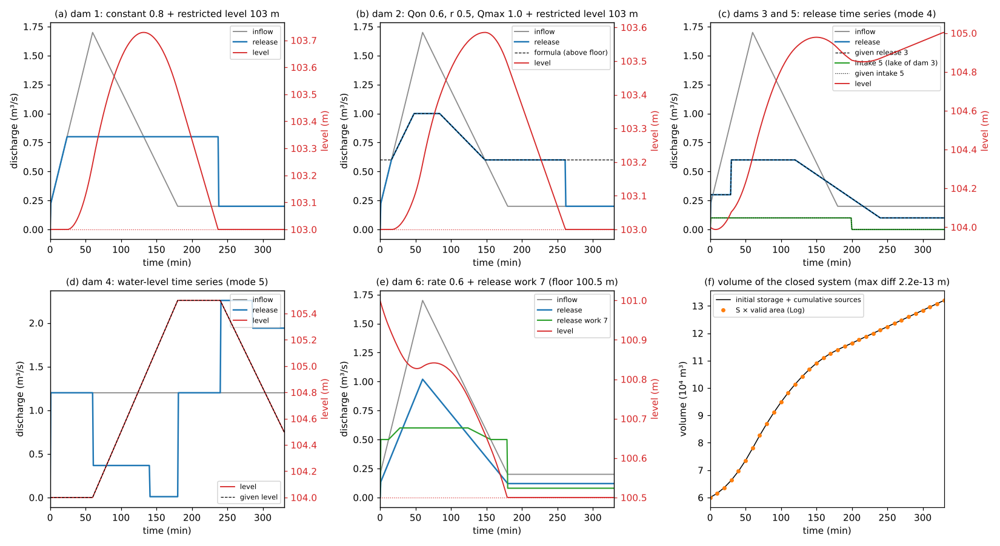

# test/damops — dam operation rules: restricted level, regulation start flow, record time series

> English mirror of test/damops/README.md. The Japanese file is the master copy.

[日本語](../README.md)

This case verifies the operation rules of the dams of the structure module
(`&list_struct_dam`) by agreement with the formulas at every recorded row and
by the volume conservation of a closed system (developer.md Sec. 132). It covers

- the constant-release method (mode 1 + the restricted level `dam_hlim`)
- the constant-rate constant-release method up to the peak (mode 2 + the
  regulation start flow `dam_qon`, the release cap `dam_qmax` and the
  restricted level)
- the release time series (mode 4; a polyline in the namelist, including a
  step made by a repeated time point)
- the water-level time series (mode 5; a file; the initial level is the value
  of the series at t0)
- additional release works (`dam_lake`) with a release time series, and with
  the constant-rate constant-release form + their own restricted level
- the existing constant-rate cut (mode 2)

The formulas of the operation rules are in §4 of
[Hydraulic laws of structures and boundaries](../../../docs/en/users_guide/hydraulics.md#4-operation-of-dams-and-lakes),
and how to use them in [Internal hydraulic structures](../../../docs/en/users_guide/structure.md#dams-and-lakes-list_struct_dam).

## Setup

| Item | Value |
|---|---|
| Domain and grid | 24 × 14 cells, dx = dy = 10 m (`make_data.py` creates `data_damops/`) |
| Capture zones | 5 isolated single cells in column i = 2 (j = 2, 4, 6, 8, 10). Their 8 neighbors are outside the domain, so no flow is exchanged |
| Inflow | A hydrograph put into each capture zone by an internal source: a triangle from a base of 0.2 to 1.7 m³/s at 60 min and back to 0.2 at 180 min (dam 4 only: a constant 1.2 m³/s). The capture zone absorbs all of it in the next step |
| Release destination | A flat closed pond at i = 5–24 (walls on all sides). No water leaves the system |
| HV | Common to all dams: (100 m, 0) (105 m, 2.0×10⁴ m³) (112 m, 6.0×10⁴ m³). The emergency release starts at the default 110.8 m, which the levels of this case do not reach |
| Time | dt = 1 s, 19800 s (330 min). The dam CSV every 60 s |

| Dam | Setting | What is checked |
|---|---|---|
| 1 | mode 1, q0 = 0.8, restricted level 103 m | An inflow below 0.8 passes through at the held level 103 m; above it, 0.8 is released and the rest stored; after the flood the reservoir returns to 103 m at 0.8 and passes the inflow again |
| 2 | mode 2, r = 0.5, Qon = 0.6, Qmax = 1.0, restricted level 103 m | Goes through the four phases: pass-through at the floor, constant rate, cap, and return at Qon above the floor |
| 3 | mode 4 (namelist), with a step 0.3 → 0.6 at 30 min | release = the given release |
| 4 | mode 5 (`level4.txt`), initial level omitted | level = the given level (including t = 0); release = inflow − change of the target storage |
| 5 | additional release work drawing from the lake of dam 3; mode 4 (a step 0.1 → 0 at 200 min) | release = the given intake; same level as dam 3 |
| 6 | mode 2, r = 0.6 (the existing constant-rate cut) | release = 0.6 × inflow |
| 7 | additional release work drawing from the lake of dam 6; mode 2, r = 0.25, Qon = 0.5, Qmax = 0.6, its own restricted level 100.5 m | Above the floor release = the formula; at the floor, at most what remains after the main release (dam 6) |

| File | Content |
|---|---|
| `Run.sh` | Compares Log.txt and the CSVs of the 7 dams with the reference → `Check_damops.py rules` → the restart (save at 165 min and resume) matches the straight run → 9 invalid settings stop |
| `Run_MPI.sh` | The same comparison and `Check_damops.py rules` with MPI |
| `Check_damops.py rules\|restart` | Per-row checks and volume conservation / agreement of the restart continuation |
| `make_data.py` | Generates the inputs (`mask.txt`, `z.txt`, `level4.txt`) |
| `Fig.py` | The figure below, `figs/damops.png` (with the argument en, the English version in `en/figs/`) |

## What is checked

- **Inflow = the source of the previous step**: since the capture zones are
  isolated, the water put in by an internal source is absorbed entirely in the
  next step (a check of the setup).
- **Formulas of the operation rules**: on rows above the floor (the restricted
  level) release = the formula; on rows at the floor
  min(available inflow, formula) ≤ release ≤ formula (the available inflow is
  the inflow; for an additional release work, what remains after the main
  release). The level never falls below the floor.
- **Time series**: the release of mode 4 and the level of mode 5 match the
  interpolated values of the given series (at the end time of each step)
  within the printed digits (f13.4). The release of mode 5 is
  inflow − (V(H(t)) − V(H(t − dt))) / dt.
- **Volume conservation**: S of Log.txt × the valid cell area = initial
  storage + cumulative source volume (the system is closed, and releases only
  move water from the capture-zone storage to the pond). Tolerance 1×10⁻⁹ m.
- **Restart**: the dam CSVs and S of the run saved at 165 min and resumed
  match the straight run after the restart time (Qin and Qout on the first row
  of the resumed run are diagnostics that are not saved, so they are not
  compared).
- **Stops**: parameters that do not fit the mode (`dam_qon` in mode 1,
  `dam_hlim` in mode 3, `dam_qout_val` in mode 1, `dam_tadashigaki` in mode 4),
  `dam_qmax` < `dam_qon`, decreasing times, a restricted level at or above the
  emergency-release start level, a water-level series out of range, and an
  additional release work referencing a lake in mode 5 stop with an error at
  start-up.

## Results



(a) Dam 1 holds the level of 103 m and passes the inflow until it exceeds 0.8 m³/s; above it, 0.8 is
released and the rest stored; after the flood it returns to 103 m at 0.8 (at 238 min) and passes the
inflow again. (b) Dam 2 moves through pass-through at the floor → constant rate → cap 1.0 → constant
rate → return at Qon = 0.6 → pass-through at the floor (the dashed line is the formula; it overlaps the
release above the floor). (c) The release of dam 3 and the intake of dam 5 overlap the given series
(including the steps). (d) The level of dam 4 overlaps the given level, and the release changes with the
change of the target storage (the slope of the HV changes at 105 m). (e) Once dam 7 reaches its own floor
of 100.5 m, it draws only what remains after the main release (dam 6), i.e. 0.4 × inflow. (f) S × the
valid area equals the initial storage + the cumulative source volume. The figure is drawn by
`python3 Fig.py` (the English version by `python3 Fig.py en`).

## Running

```bash
make
./Run.sh
./Run_MPI.sh 4
```

The comparison with the reference uses ULP = 1 (up to one unit of the last
printed digit), because on a machine with a different CPU from the one that
made the reference, differences in the code generated by `-march=native` can
change the last digit of S in Log.txt (handled as in test/damwq). On the same
machine, `ULP=0 ./Run.sh` compares bit for bit.

## Not checked by this case

- The ramp of the emergency release (abnormal-flood operation) and the spill
  above the surcharge (the levels do not reach them).
- Comparison with the records of a real dam. The case checks that the rules
  work as written, not how well the rules reproduce real operation (for
  example, the effect of the approximation without the post-peak constant
  release of the constant-rate constant-release method).
