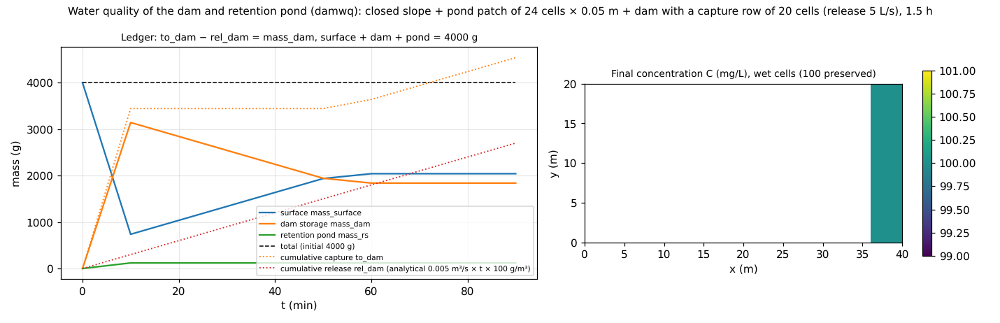

# test/damwq — water-quality ledger of a dam (completely mixed) and a retention pond: all-digit agreement with the analytical solution

> English mirror of test/damwq/README.md. The Japanese file is the master copy.

[日本語](../README.md)

A check of the pathway (developer.md §30.7) that couples the
**completely mixed pool** and the **retention-pond accompaniment** of water
quality to the dam of the structure module (intake from the capture row and
constant release) and the retention-pond patch (absorbs until its capacity is
reached). Water 0.05 m deep with initial concentration 100 mg/L (total mass
4000 g) is placed on a closed sloping domain, and over 1.5 hours

- closure of mass: mass_surface + mass_dam + mass_rs = 4000 g,
  to_dam − rel_dam = mass_dam
- analytical solution: released mass rel_dam = 0.005 m³/s × 5400 s ×
  100 g/m³ = 2700 g, retention pond to_rs = mass_rs = capacity 1.2 m³ ×
  100 g/m³ = 120 g
- uniformity of concentration: C = 100 mg/L along the whole pathway
  capture → complete mixing → release and absorption by the pond

are confirmed by comparison with the reference and by `Check_damwq.py`.

## Configuration

| Item | Value |
|---|---|
| Domain and grid | 40 × 20 cells (closed sloping domain in `z.txt`), initial h₀ = 0.05 m, walls on all four sides |
| Structures | Dam: intake from a capture row of 20 cells and a constant release of 5 L/s. Retention pond: a patch of 24 cells × 0.05 m (`rscap.txt`, i = 15–18, j = 8–13) |
| Water quality | Initial concentration `wq_c0 = 100` mg/L, no decay, no groundwater |
| Time | dt = 0.1 s, 5400 s |

| File | Contents |
|---|---|
| `Run.sh` | Compare Log.txt and wq.csv with the reference (ULP = 0) → `Check_damwq.py closure` → `uniform` |
| `Check_damwq.py closure\|uniform` | Closure of the ledger (relative 1e-6) and activity of each pathway / wet cells of the final C field at 100 ± 0.1 |
| `Fig.py` | The figure `en/figs/damwq.png` below (`python3 Fig.py en`; `figs/damwq.png` is the Japanese version) |

## Running

```bash
make
./Run.sh
./Run_MPI.sh 4
python3 Fig.py en # en/figs/damwq.png
```

## Figure



Left: time series of the ledger. In the first 10 minutes the water on the
slope collects in the capture row of the dam (to_dam rises sharply to
3450 g), and the retention pond absorbs the 120 g corresponding to its
capacity of 1.2 m³ and stays full. The stored mass of the dam decreases with
the constant release (rel_dam; dotted line = the straight line of the
analytical solution), and the released water returns to the surface,
increasing the surface mass. After 50 minutes the released water reaches
the capture row again, to_dam increases again, and the surface mass
equilibrates around 2000 g. The total remains 4000 g. Right: final
concentration distribution. Both the slope (the water released from the
dam) and the area downstream of the dam are at 100 mg/L; the concentration
is preserved along the whole pathway.

## Findings

| Check | Computed | Analytical | Result |
|---|---|---|---|
| Released mass rel_dam (5400 s) | 2700.0000 g | 2700 g | All digits agree |
| Retention pond to_rs = mass_rs | 120.00000 g | 120 g | All digits agree |
| to_dam − rel_dam = mass_dam | 4538.7285 − 2700.0000 = 1838.7285 g | mass_dam 1838.7285 | Agree |
| Total mass | 4000.0000 g | 4000 g | PASS |
| Final concentration (wet cells) | 100.0000 mg/L | 100 | PASS |

- The ledger agrees to all output digits with the exact solution of a system
  in which the release concentration of the completely mixed pool equals the
  inflow concentration.
- The stored mass M of the dam is saved / restored on restart, and mass_dam
  after restoration agrees to all digits with the continuous run (§30.7).
- The settings of the structures are in
  [docs/users_guide/structure.md](../../../docs/en/users_guide/structure.md)
  (dams, retention ponds, pumps, culverts).

## Related documents

- [docs/users_guide/wq.md](../../../docs/en/users_guide/wq.md), [docs/users_guide/structure.md](../../../docs/en/users_guide/structure.md)
- developer.md §30.7 (implementation and verification of the completely mixed dam and the retention-pond accompaniment)
