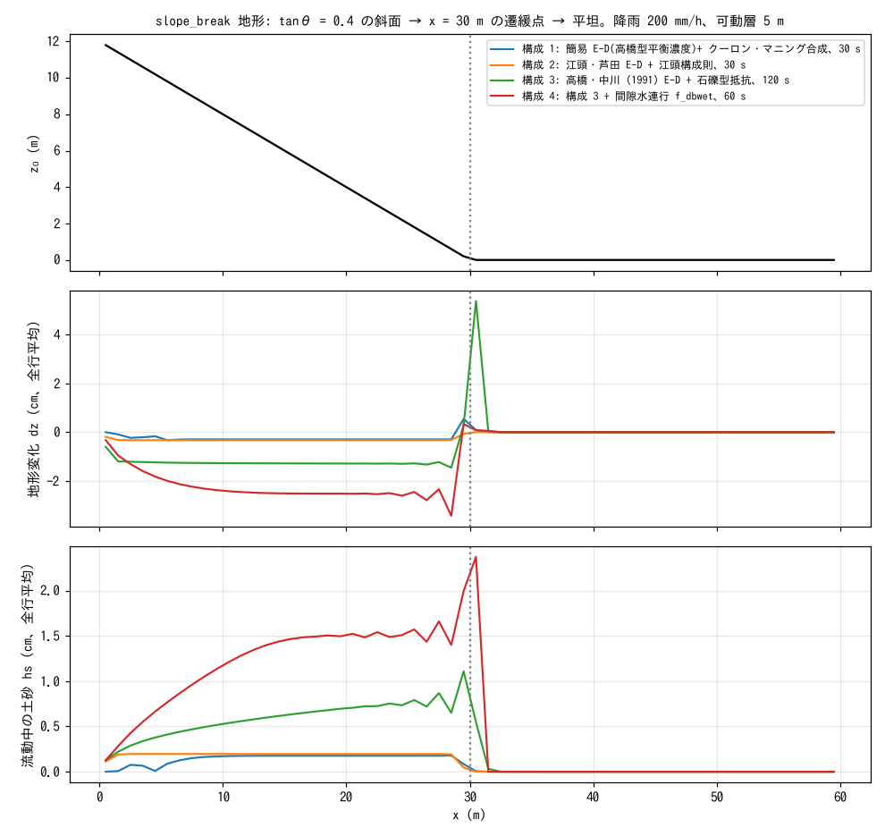
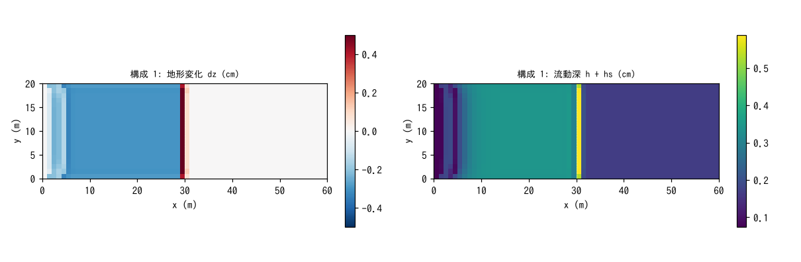

# test/debris — 土石流(侵食・堆積 E-D)の疎通と保存則、斜面等流の平衡濃度

[English](en/README.md)

単層混合体方式の土石流モデル(`f_debris = 1`。地表水 h と土砂柱状量 hs の
単層で表し、河床との侵食・堆積 E-D と抵抗則を切り替える。
docs/debris_plan.md、developer.md §28)の疎通・保存則の検定です。
slope_break 地形(tanθ = 0.4 の斜面 → x = 30 m の遷緩点 → 平坦)に
200 mm/h の降雨を与え、斜面で侵食した土砂が遷緩点下へ運ばれる過程を
4 つの構成則の組合せで走らせます(構成 5 は掃流砂、構成 6 は地下水計算との併用)。定量ベンチマークではなく、
**固体総量の保存・共動更新の恒等・活性(侵食が起き土砂が到達する)**を
`Check_debris.py` で検定します(§28.3、§28.5〜7)。

構成 7 は定量の検定です。勾配の違う 6 本の水路に水と土砂を流し、下流の混合体濃度が
高橋型の平衡濃度 C∞(θ) に一致することを `Check_debris_eq.py` で確かめます
(§28.15)。

## 構成

共通(構成 5 の地形と可動層は下記): 60 m × 20 m(Δx = 1 m)、可動層 sd₀ = 5 m、空隙率 λ = 0.4(C* = 0.6)、
降雨 200 mm/h、dt = 0.02 s、四周壁(閉領域 = 台帳が閉じる)。

| 構成 | ファイル | E-D 式 `f_dbed` | 抵抗則 `f_dbres` | 時間 | 検定モード |
|---|---|---|---|---|---|
| 1 | `param.txt` | 1: 高橋型平衡濃度 C∞(θ) への緩和(δe = 0.0007、δd = 0.05) | 1: クーロン + マニング合成(φ = 35°) | 30 s | 既定 |
| 2 | `param_eg.txt` | 2: 江頭・芦田 (1992) | 2: 江頭構成則(d50 = 0.05 m、反発係数 0.85) | 30 s | eg |
| 3 | `param_tk.txt` | 3: 高橋・中川 (1991) 式 (12)(27) | 3: 石礫型 式 (22)〜(25) | 120 s | eg |
| 4 | `param_tkwet.txt` | 3 + 間隙水連行 `f_dbwet = 1`(渓床飽和 s_b) | 3 | 60 s | wet |
| 5 | `param_fluv.txt` | 1 + 掃流砂 `f_fluvial = 1`(芦田・道上、d50 = 2 mm) | 1 | 30 s | fluv |
| 6 | `param_gw.txt` | 1 + 地下水計算と併用する間隙水 `f_dbwet = 2`(Green-Ampt の浸透能 ≈ 0。可動層は斜面 5 m・平坦部 0 = `sd_gw.txt`) | 1 | 30 s | gw |
| 7 | `param_eq.txt` | 1(δe = 0.02、δd = 0.05)。勾配の違う 6 本の水路(下記) | 0: マニングのみ | 120 s | `Check_debris_eq.py` |

構成 5 は、土石流 E-D と掃流砂の併用の検定です。地形は slope_break を転置した
20 × 60 セルの斜面(`z_fluv.txt`。`make_fluv.py` が生成。y < 40 m で tanθ = 0.4、
下流は平坦)で、流れが j 方向の帯の界面を横切ります。可動層は 2 mm と薄く、
掃流砂の供給量制限が帯の界面で効きます。土石流 E-D が帯内の z・sd を動かした後、
掃流砂の前にハロを交換すること(developer.md §28.13 の実バグの回帰検定)を、
`Run_MPI.sh` が np = N と np = 1 の state.dat のバイト一致で確かめます(合否。逐次
ビルドとの比較は他の構成と同じく警告)。

構成 6 は、地下水計算と併用する間隙水(`f_dbwet = 2`。堆積で増えた層の容量 sy0·Δz を
その場の地表水で満たし、侵食で削られた層の間隙水を地下貯留から戻す。developer.md §28.7)の
検定です。浸透能をほぼ 0 にして、地下貯留の増加を堆積の間隙水だけにします。平坦部の
可動層を 0 にしてあるので、平坦部の土層は堆積物だけになり、hg = sy0·sd が常に
成り立ちます(`f_dbwet = 0` では堆積物の間隙が空のまま残り、この関係が崩れる)。

構成 7 は、斜面等流の平衡濃度の検定です。南北に長い幅 1 セルの水路 6 本(長さ 300 m、
両側は 2 m 高い乾いた地盤。`make_eq.py` が書く)に tanθ = 0.60・0.25・0.15・0.10・0.05・
0.02 を与え、北端の区間流入から水と土砂を流します(南辺は自由流出)。流入の濃度は
平衡濃度 C∞(θ) の 0.95 倍(tanθ = 0.02 は C∞ = 0 なので `inflow_cs = 0.01`)で、流下に
つれて侵食・堆積で C∞ に近づきます。流入点と出口から離れた 100〜220 m の混合体濃度
C = hs/(h + hs) を、最終の河床から求めた最急降下勾配の C∞ と比べます。

- tanθ > 0.138: C∞ = tanθ / (s (tanφ − tanθ))(石礫型。0.25・0.15)
- 0.03 < tanθ ≤ 0.138: C∞ = 6.7 C∞d²(未成熟。0.10・0.05)
- tanθ ≤ 0.03: C∞ = 0(掃流域。0.02)
- 上限 C∞ ≤ 0.9 C* = 0.54(0.60)

抵抗はマニングのみ(`f_dbres = 0`)です。クーロン+マニング合成では C = C∞ で降伏が
重力と釣り合い、等流が続かないためです。侵食係数 δe は既定の約 30 倍(0.02)にして、
初期の水(土砂なし)が平衡へ近づく時間を数秒にしています。`inflow_cs` は水の体積
あたりの土砂の体積 hs/h なので、流入の混合体濃度は cs/(1 + cs) です。

検定項目(構成 1〜6): (1) 固体総量保存 |Σhs + (1 − λ)Σ(z − z₀)| < 1e-9(E-D の反対称
交換の帰結)、(2) 共動更新の恒等 max|(sd − sd₀) − (z − z₀)| < 1e-10(z と
土層厚 sd が同じ量だけ動く)、(3) 活性: 斜面侵食 min dz < −1e-3 m かつ
平坦部への土砂到達(構成 1・5 は遷緩点下の堆積 max dz、eg モードは max hs)、
(4) wet モードのみ水台帳 |Σh − 降雨総量 + λ s_b Σdz| < 1e-9(連行した
間隙水の分だけ地表水が増える)。gw モードは (4) 水台帳 |Σh + Σhg − 降雨総量| < 1e-9
(引き渡しは水を保存する)と (5) 平坦部の max|hg − sy0·sd| < 1e-10 かつ Σhg > 1e-4
(堆積物の間隙が地表水で満たされている)。

| ファイル | 内容 |
|---|---|
| `Check_debris.py <save> [eg\|wet\|fluv\|gw]` | 上記の検定(`save*/state.dat` を読む。fluv は構成 5 の地形と sd₀ = 2 mm で (1)〜(3)、gw は構成 6 の可動層で (1)〜(5)) |
| `Check_debris_eq.py [save_eq]` | 構成 7 の検定: 6 本の水路の 100〜220 m で \|C/C∞ − 1\| ≤ 1e-9(C∞ = 0 の水路は C ≤ 1e-12)、局所勾配が狙いの領域に入っていること。出口の行の河床変化を記録として表示 |
| `make_eq.py` | 構成 7 の地形 `z_eq.txt` と初期水深 `h_eq.txt` を書く(Run.sh・Run_MPI.sh が呼ぶ) |
| `sd_gw.txt` | 構成 6 の可動層(斜面 5 m、平坦部 0。定数は `Check_debris.py` の gw モードと対で保守) |
| `make_fluv.py` | 構成 5 の地形 `z_fluv.txt` の生成(同梱。定数は `Check_debris.py` の fluv モードと対で保守) |
| `Fig.py` | 下の図 `figs/*.png` |

## 実行

```bash
make
./Run.sh          # 7 構成を順に実行し、それぞれ Check。すべて PASS で PASS(十数秒)
./Run_MPI.sh 4    # MPI。state.dat が逐次とバイト一致(-O2 厳密数学ビルドで)。構成 5 は np = 1 とも比較
python3 Fig.py    # figs/profile.png, figs/map.png(引数 en で英語版を en/figs/ に)
```

## 図



上: 地形。中: 地形変化 dz(全行平均、cm)。どの構成でも斜面全体が
薄く侵食され(構成 1・2 で 0.3 cm、120 s の構成 3 で 1.3 cm、構成 4 で 2.5 cm)、
遷緩点の直前で侵食が強まり、構成 1 では遷緩点直下に堆積(+0.5 cm)、構成 3 では
遷緩点の下の平坦部の最初のセルに堆積(+5.4 cm)が現れます。
下: 流動中の土砂 hs(cm)。斜面上に一定の濃度で運ばれ、遷緩点を越えた
平坦部では急減します(希薄なシート流では θ_e ≈ 0 のため平坦部の堆積は
遅く、短時間の検定では hs の到達を活性の証拠とします)。構成 4 の
間隙水連行は、侵食した河床の間隙水を流れに加えるため地表水が増え
(同じ 60 s の構成 3 と比べて Σh 4.0 → 9.2 m·cell)、流速と侵食がさらに増す
正のフィードバックが見えます(侵食 −0.51 → −3.6 cm)。



構成 1 の地形変化(左)と流動深(右)。横断方向に一様な侵食と、遷緩点
直下 1〜2 セルの堆積帯、平坦部の薄い水膜が見えます。

## 所見

| 構成 | 固体総量 Σhs + (1 − λ)Σdz | 共動更新 | 活性(min dz / 到達) | 水台帳 |
|---|---|---|---|---|
| 1 | −4.3e-14 | 4e-14 | −0.33 cm / 遷緩点下堆積 +0.55 cm | — |
| 2 江頭 | −5.0e-13 | 3e-14 | −0.33 cm / max hs 0.05 cm | — |
| 3 高橋・中川(120 s) | −1.0e-13 | 1.2e-13 | −1.5 cm / max hs 1.1 cm | — |
| 4 + 間隙水連行 | 2.9e-13 | 7e-14 | −3.6 cm / max hs 2.6 cm | 1.8e-13 |
| 5 + 掃流砂 | −4.4e-13 | 4e-14 | −0.20 cm / 遷緩点下堆積 +0.15 cm | — |
| 6 + 地下水計算と併用する間隙水 | −2.4e-13 | 4e-14 | −0.30 cm / 遷緩点下堆積 +0.59 cm | 5.4e-14(Σh + Σhg) |

- 固体総量と共動更新は 6 構成とも機械精度で成り立ちます。E-D の
  交換量は時刻 n の場から 2 パスで求めて適用する構造(§28.2 の OpenMP
  競合の実バグの教訓)で、np = 1, 2, 4 の state.dat は逐次とバイト一致
  します(-O2 厳密数学ビルド。-Ofast ではビルド間に ULP 差。§28.5)。
- 構成 5 は 2026-10-27 に追加しました。修正前の実行ファイルでは、np = 2・3・4 の
  state.dat が np = 1 と食い違いました(developer.md §28.13)。修正後は、-O2 と既定の
  -Ofast のビルドで np = 1, 2, 4 が逐次とバイト一致し、-fcheck=all の np = 2 も PASS します。
- 構成 2 の値は、流向の河床勾配を下流側の片側差分にした後(2026-10-28。developer.md §89.24)の
  ものです(以前は固体総量 −4.6e-13、平坦部到達 max hs 0.09 cm)。
- 構成 3・4 の値は、流動面の勾配を下流側の片側差分にした後(2026-10-29。developer.md §89.28)の
  ものです。片側差分では、遷緩点の直前のセルが下流の平坦セルとの差で緩い勾配を見て低速凝集の
  停止条件が働き、30〜100 s の間は土砂がせき止められて 60 s では平坦部に届かないので、構成 3 の
  時間を 60 s から 120 s に延ばしました(以前は 60 s で −0.50 cm / max hs 0.15 cm。構成 4 は
  −3.0 cm / max hs 2.6 cm)。
- 構成 6 の平坦部の堆積物では max|hg − sy0·sd| = 2.7e-20 m(間隙が地表水で満たされて
  いる)。`f_dbwet = 0` に戻すと 2.4e-4 m になり (5) が FAIL します。
- 構成 1〜6 は**疎通と保存則**の検定です。構成則の定量的な妥当性は
  文献照合の残作業として debris_plan.md に記録されています(未成熟
  土石流域の係数、掃流状域の堆積式など)。

| 構成 7 の水路 | tanθ | 領域 | C∞ | 100〜220 m の \|C/C∞ − 1\| |
|---|---|---|---|---|
| 1 | 0.60 | 上限 | 0.540000 | 7e-16 |
| 2 | 0.25 | 石礫型 | 0.336545 | 7e-12 |
| 3 | 0.15 | 石礫型 | 0.165227 | 5e-13 |
| 4 | 0.10 | 未成熟 | 0.068313 | 6e-13 |
| 5 | 0.05 | 未成熟 | 0.014553 | 9e-13 |
| 6 | 0.02 | 掃流域 | 0 | C = 7e-166 |

- 構成 7 の濃度は、検定スクリプトが組んだ平衡濃度の式と 1e-11 以内で一致します
  (C∞ への緩和の不動点。侵食で下がった河床の局所勾配から求める)。
- 開いた境界(南辺)の行では、最急降下勾配が領域の外の近傍を見ないので下り勾配が
  0 になり、C∞ = 0 として流れの土砂を落とします。120 s で河床が水路 1〜5 で +3.58・
  +1.11・+0.39・+0.15・+0.03 m 上がり、その影響が上流へ伸びます(扱いは検討中。
  developer.md §28.15)。検定の区間は出口から 80 m 以上離しています。
- 瞬時流動化(f_release)と斜面安定判定(f_slide)は [test/slide](../slide/)、
  等価流体モード(交換なし)は [test/volcano](../volcano/) で検定します。

## 関連文書

- [docs/users_guide/geomorph.md](../../docs/users_guide/geomorph.md) — 土石流の設定(`f_dbed`、`f_dbres`、`f_dbwet`、停止 `f_dbstop`)
- [docs/debris_plan.md](../../docs/debris_plan.md) — 設計全文と文献照合の残作業
- developer.md §28.1〜28.7(構成、実バグ、検証記録、江頭・高橋中川則、間隙水連行)、
  §28.13(掃流砂との併用のハロの実バグ)、§28.15(斜面等流の平衡濃度と開いた境界の行)
