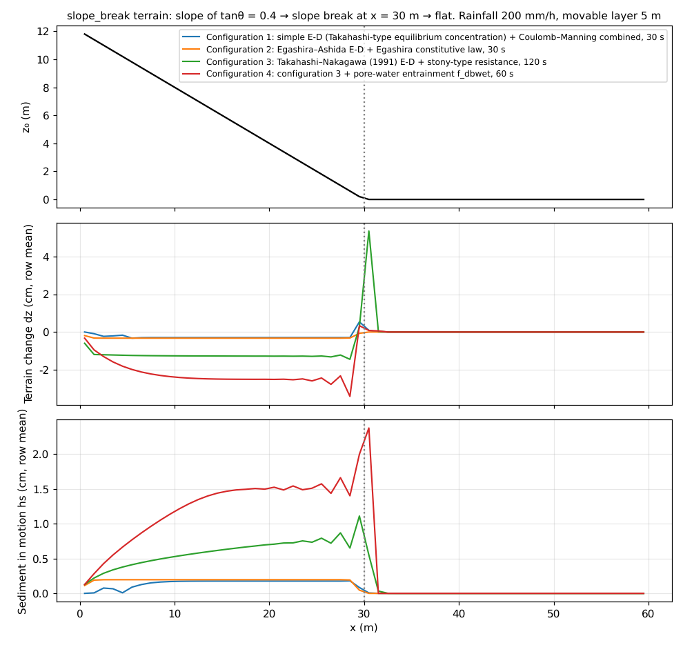
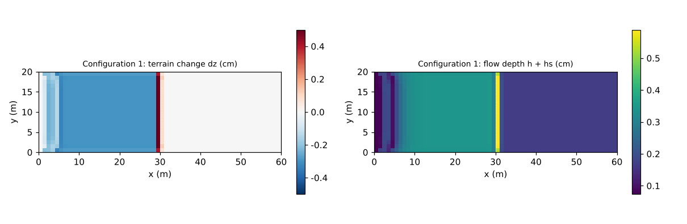

# test/debris — connectivity and conservation laws of debris flow (erosion-deposition E-D), and the equilibrium concentration of uniform flow on a slope

> English mirror of test/debris/README.md. The Japanese file is the master copy.

[日本語](../README.md)

This is a check of the connectivity and conservation laws of the single-layer
mixture debris-flow model (`f_debris = 1`: the surface water h and the sediment
column hs are represented as a single layer, and the erosion-deposition E-D
with the bed and the resistance law are switchable; docs/debris_plan.md,
developer.md §28). A rainfall of 200 mm/h is applied to the slope_break terrain
(a slope of tanθ = 0.4 → the slope break at x = 30 m → flat), and the process
in which sediment eroded on the slope is carried below the slope break is run
with four combinations of constitutive laws (configuration 5 adds bed load,
configuration 6 the groundwater computation).
It is not a quantitative
benchmark; **conservation of the total solids, the identity of the co-moving
update, and activity (erosion occurs and sediment arrives)** are checked by
`Check_debris.py` (§28.3, §28.5–7).

Configuration 7 is a quantitative check. Water and sediment flow down six
channels of different slopes, and `Check_debris_eq.py` confirms that the
mixture concentration downstream matches the Takahashi-type equilibrium
concentration C∞(θ) (§28.15).

## Configuration

Common (the terrain and movable layer of configuration 5: see below): 60 m × 20 m
(Δx = 1 m), movable layer sd₀ = 5 m, porosity λ = 0.4
(C* = 0.6), rainfall 200 mm/h, dt = 0.02 s, walls on all four sides (closed
domain = the ledger closes).

| Configuration | File | E-D formula `f_dbed` | Resistance law `f_dbres` | Time | Check mode |
|---|---|---|---|---|---|
| 1 | `param.txt` | 1: relaxation to the Takahashi-type equilibrium concentration C∞(θ) (δe = 0.0007, δd = 0.05) | 1: Coulomb + Manning combined (φ = 35°) | 30 s | default |
| 2 | `param_eg.txt` | 2: Egashira and Ashida (1992) | 2: Egashira constitutive law (d50 = 0.05 m, restitution coefficient 0.85) | 30 s | eg |
| 3 | `param_tk.txt` | 3: Takahashi and Nakagawa (1991) eqs. (12)(27) | 3: stony type, eqs. (22)–(25) | 120 s | eg |
| 4 | `param_tkwet.txt` | 3 + pore-water entrainment `f_dbwet = 1` (bed saturation s_b) | 3 | 60 s | wet |
| 5 | `param_fluv.txt` | 1 + bed load `f_fluvial = 1` (Ashida–Michiue, d50 = 2 mm) | 1 | 30 s | fluv |
| 6 | `param_gw.txt` | 1 + pore water with the groundwater computation `f_dbwet = 2` (Green-Ampt infiltration ≈ 0; movable layer 5 m on the slope and 0 on the flat = `sd_gw.txt`) | 1 | 30 s | gw |
| 7 | `param_eq.txt` | 1 (δe = 0.02, δd = 0.05); six channels of different slopes (below) | 0: Manning only | 120 s | `Check_debris_eq.py` |

Configuration 5 checks debris-flow E-D combined with bed load. The terrain is the
slope_break slope transposed to 20 × 60 cells (`z_fluv.txt`, generated by
`make_fluv.py`; tanθ = 0.4 for y < 40 m, flat downstream), so the flow crosses the
band interfaces in the j direction. The movable layer is a thin 2 mm, so the
supply limit of the bed load acts at the band interfaces. `Run_MPI.sh` checks
that the halos are exchanged after debris-flow E-D has moved z and sd within the
band and before bed load (the regression check of the real bug of developer.md
§28.13, in Japanese) by the byte identity of state.dat between np = N and np = 1
(pass/fail; the comparison with the serial build is a warning, as for the other
configurations).

Configuration 6 checks the pore water with the groundwater computation
(`f_dbwet = 2`: the capacity sy0·Δz added by deposition is filled from the local
surface water, and the pore water of the eroded layer returns from subsurface
storage; developer.md §28.7, in Japanese). The infiltration capacity is nearly
0, so the subsurface storage grows only by the pore water of deposits. The
movable layer on the flat is 0, so the soil layer there consists only of
deposits and hg = sy0·sd always holds (with `f_dbwet = 0` the pores of the
deposits stay empty and this relation breaks).

Configuration 7 checks the equilibrium concentration of uniform flow on a slope.
Six straight channels one cell wide run north-south (length 300 m, with dry
ground 2 m higher on both sides; written by `make_eq.py`). They have
tanθ = 0.60, 0.25, 0.15, 0.10, 0.05 and 0.02, and water and sediment enter
through section inflows at the north end (free outflow on the south edge).
The inflow concentration is 0.95 times the equilibrium concentration C∞(θ)
(`inflow_cs = 0.01` for tanθ = 0.02, where C∞ = 0), and erosion and
deposition bring it towards C∞ downstream. Over 100–220 m, away from the
inflow point and the outlet, the mixture concentration C = hs/(h + hs) is
compared with C∞ of the steepest-descent slope computed from the final bed.
Over 221–300 m on the outlet side (including the row on the open boundary)
the check also confirms that the concentration settles at C∞ and that no
artificial deposit forms in the outlet row (the steepest-descent slope
supplies the elevation of a neighbour outside an open edge by linear
extrapolation from the two inner cells along the normal of the edge;
§28.15):

- tanθ > 0.138: C∞ = tanθ / (s (tanφ − tanθ)) (stony type; 0.25, 0.15)
- 0.03 < tanθ ≤ 0.138: C∞ = 6.7 C∞d² (immature; 0.10, 0.05)
- tanθ ≤ 0.03: C∞ = 0 (bedload regime; 0.02)
- upper limit C∞ ≤ 0.9 C* = 0.54 (0.60)

The resistance is Manning only (`f_dbres = 0`): with Coulomb + Manning combined,
the yield balances gravity at C = C∞ and a uniform flow cannot continue. The
erosion coefficient δe is about 30 times the default (0.02), so the initial
water (no sediment) approaches equilibrium in a few seconds. `inflow_cs` is the
sediment volume per water volume hs/h, so the mixture concentration of the
inflow is cs/(1 + cs).

Checks (configurations 1–6): (1) conservation of the total solids |Σhs + (1 − λ)Σ(z − z₀)| < 1e-9
(a consequence of the antisymmetric exchange of E-D), (2) identity of the
co-moving update max|(sd − sd₀) − (z − z₀)| < 1e-10 (z and the soil depth sd
move by the same amount), (3) activity: slope erosion min dz < −1e-3 m and
arrival of sediment on the flat (configurations 1 and 5: deposition below the
slope break, max dz; eg mode: max hs), (4) wet mode only, the water ledger
|Σh − total rainfall + λ s_b Σdz| < 1e-9 (the surface water increases by the
entrained pore water). The gw mode checks (4) the water ledger
|Σh + Σhg − total rainfall| < 1e-9 (the hand-over conserves water) and (5)
max|hg − sy0·sd| < 1e-10 on the flat with Σhg > 1e-4 (the pores of the deposits
are filled with surface water).

| File | Contents |
|---|---|
| `Check_debris.py <save> [eg\|wet\|fluv\|gw]` | The checks above (reads `save*/state.dat`; fluv runs (1)–(3) with the terrain of configuration 5 and sd₀ = 2 mm, gw runs (1)–(5) with the movable layer of configuration 6) |
| `Check_debris_eq.py [save_eq]` | The check of configuration 7: \|C/C∞ − 1\| ≤ 1e-9 over 100–220 m in the six channels (C ≤ 1e-12 in the channel with C∞ = 0), and the local slopes lie in the intended regimes. \|C/C∞ − 1\| ≤ 1e-3 over 221–300 m on the outlet side, and the bed change in the outlet row agrees with the mean over 100–220 m within 1 mm |
| `make_eq.py` | Writes the terrain `z_eq.txt` and the initial depth `h_eq.txt` of configuration 7 (Run.sh and Run_MPI.sh call it) |
| `sd_gw.txt` | The movable layer of configuration 6 (5 m on the slope, 0 on the flat; kept in pairs with the gw mode of `Check_debris.py`) |
| `make_fluv.py` | Generates the terrain `z_fluv.txt` of configuration 5 (bundled; the constants are kept in pairs with the fluv mode of `Check_debris.py`) |
| `Fig.py` | The figures `en/figs/*.png` below (`python3 Fig.py en`; `figs/*.png` is the Japanese version) |

## Running

```bash
make
./Run.sh          # run the 7 configurations in turn, each followed by Check. PASS when all pass (a dozen seconds or so)
./Run_MPI.sh 4    # MPI. state.dat is byte-identical to the serial run (with the -O2 strict-math build); configuration 5 is also compared with np = 1
python3 Fig.py en # en/figs/profile.png, en/figs/map.png
```

## Figures



Top: terrain. Middle: terrain change dz (average over all rows, cm). In every
configuration the whole slope is thinly eroded (0.3 cm in configurations 1 and
2, 1.3 cm in configuration 3 over 120 s, 2.5 cm in configuration 4), erosion
intensifies just before the slope break, deposition (+0.5 cm) appears directly
below the slope break in configuration 1, and deposition (+5.4 cm) appears in
the first cell of the flat below the slope break in configuration 3. Bottom:
sediment in motion hs (cm). It is carried at a constant concentration on the
slope and drops sharply on the flat beyond the slope break
(in a dilute sheet flow θ_e ≈ 0, so deposition on the flat is slow, and in a
short check the arrival of hs is taken as the evidence of activity). The
pore-water entrainment of configuration 4 adds the pore water of the eroded bed
to the flow, so the surface water increases (Σh 4.0 → 9.2 m·cell compared with
configuration 3 at the same 60 s), and a positive feedback in which the velocity
and erosion increase further is seen (erosion −0.51 → −3.6 cm).



The terrain change (left) and the flow depth (right) of configuration 1.
Transversely uniform erosion, a deposition zone of 1–2 cells directly below the
slope break, and a thin water film on the flat are seen.

## Findings

| Configuration | Total solids Σhs + (1 − λ)Σdz | Co-moving update | Activity (min dz / arrival) | Water ledger |
|---|---|---|---|---|
| 1 | −4.3e-14 | 4e-14 | −0.33 cm / deposition below the slope break +0.55 cm | — |
| 2 Egashira | −5.0e-13 | 3e-14 | −0.33 cm / max hs 0.05 cm | — |
| 3 Takahashi–Nakagawa (120 s) | −1.0e-13 | 1.2e-13 | −1.5 cm / max hs 1.1 cm | — |
| 4 + pore-water entrainment | 2.9e-13 | 7e-14 | −3.6 cm / max hs 2.6 cm | 1.8e-13 |
| 5 + bed load | −4.4e-13 | 4e-14 | −0.20 cm / deposition below the slope break +0.15 cm | — |
| 6 + pore water with the groundwater computation | −2.4e-13 | 4e-14 | −0.30 cm / deposition below the slope break +0.59 cm | 5.4e-14 (Σh + Σhg) |

- The total solids and the co-moving update hold at machine precision in all
  6 configurations. The E-D exchange amounts are obtained from the field at
  time n in two passes and then applied (the lesson of the real OpenMP race
  bug of §28.2), and the state.dat of np = 1, 2, 4 is byte-identical to the
  serial run (with the -O2 strict-math build; with -Ofast there are ULP
  differences between builds; §28.5).
- Configuration 5 was added on 2026-10-27. With the executable before the fix,
  the state.dat of np = 2, 3 and 4 differed from np = 1 (developer.md §28.13).
  After the fix, np = 1, 2 and 4 are byte-identical to the serial run with the
  -O2 and the default -Ofast builds, and np = 2 with -fcheck=all also passes.
- The values of configuration 2 are those after the flow-direction bed slope
  became a one-sided difference to the downstream neighbour (2026-10-28;
  developer.md §89.24, in Japanese); before, the total solids were −4.6e-13 and
  the arrival on the flat max hs 0.09 cm.
- The values of configurations 3 and 4 are those after the slope of the flow
  surface became a one-sided difference to the downstream neighbour
  (2026-10-29; developer.md §89.28, in Japanese). With the one-sided difference
  the cell just before the slope break sees the gentle slope to the flat cell
  below it, the low-velocity stopping condition acts there, and the sediment
  is held back between 30 and 100 s, so it does not reach the flat by 60 s;
  the duration of configuration 3 was therefore extended from 60 s to 120 s
  (before: −0.50 cm / max hs 0.15 cm at 60 s; configuration 4 was −3.0 cm /
  max hs 2.6 cm).
- In the deposits on the flat of configuration 6, max|hg − sy0·sd| = 2.7e-20 m (the
  pores are filled with surface water). Back with `f_dbwet = 0` it becomes 2.4e-4 m
  and (5) fails.
- Configurations 1–6 are checks of **connectivity and conservation laws**. The
  quantitative validity of the constitutive laws is recorded in debris_plan.md
  as remaining work on literature comparison (coefficients for the immature
  debris-flow regime, the deposition formula for the bedload-like regime,
  etc.).

| Channel of configuration 7 | tanθ | Regime | C∞ | \|C/C∞ − 1\| over 100–220 m | \|C/C∞ − 1\| over 221–300 m | Bed change in the outlet row − mean over 100–220 m |
|---|---|---|---|---|---|---|
| 1 | 0.60 | upper limit | 0.540000 | 7e-16 | 1e-15 | −5e-5 m |
| 2 | 0.25 | stony | 0.336545 | 7e-12 | 2e-6 | +5e-5 m |
| 3 | 0.15 | stony | 0.165227 | 5e-13 | 1e-5 | −5e-5 m |
| 4 | 0.10 | immature | 0.068313 | 6e-13 | 6e-5 | −5e-5 m |
| 5 | 0.05 | immature | 0.014553 | 9e-13 | 2e-4 | −2e-5 m |
| 6 | 0.02 | bedload | 0 | C = 7e-166 | C = 8e-226 | 0 |

- The concentrations of configuration 7 match the equilibrium-concentration
  formulas assembled in the check script within 1e-11 (the fixed point of the
  relaxation to C∞, computed from the local slope of the bed lowered by
  erosion).
- The bed is lowered uniformly by the sediment the initial clear water picks
  up to reach C∞ (0.098 m in channel 1), and the outlet row agrees with that
  mean within 5e-5 m. The small departure of the concentration on the outlet
  side (at most 2e-4) arises because the local bed slope changes slightly
  near the outlet (0.050007 in the outlet row of channel 5) and the
  relaxation lags between its C∞ and the concentration carried from
  upstream.
- Before the fix of 2026-10-30 (developer.md §28.15), the steepest-descent
  slope left out neighbours outside the domain, so the downhill slope in the
  row on the open boundary (south edge) was 0 and the flow dropped its
  sediment as if C∞ = 0. In 120 s the bed in the outlet row rose by +3.58,
  +1.11, +0.39, +0.15 and +0.03 m in channels 1–5, and the effect extended
  upstream (with the output from before the fix, the outlet-side check fails
  in all five channels).
- Instantaneous mobilization (f_release) and the slope-stability judgement
  (f_slide) are checked in [test/slide](../../slide/en/README.md), and the
  equivalent-fluid mode (no exchange) in [test/volcano](../../volcano/en/README.md).

## Related documents

- [docs/users_guide/geomorph.md](../../../docs/en/users_guide/geomorph.md) — debris-flow settings (`f_dbed`, `f_dbres`, `f_dbwet`, stopping `f_dbstop`)
- [docs/debris_plan.md](../../../docs/debris_plan.md) (in Japanese) — the full design and the remaining literature comparison
- developer.md §28.1–28.7 (configuration, real bugs, verification records, the Egashira and Takahashi–Nakagawa laws, pore-water entrainment),
  §28.13 (the real halo bug of the combination with bed load) and §28.15 (the equilibrium concentration of uniform flow on a slope and the row on an open boundary)
